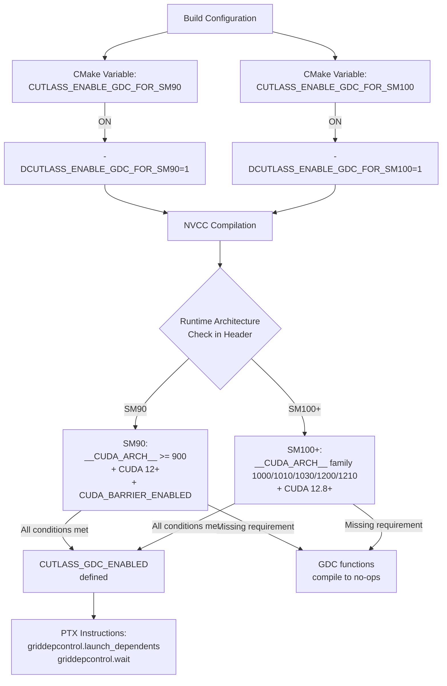
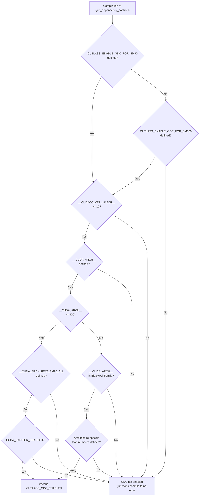
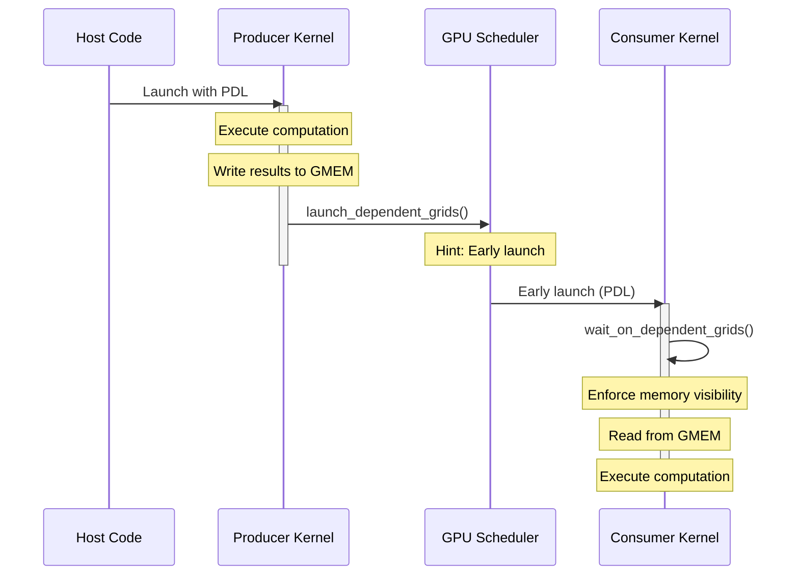

<!-- source: DeepWiki mcp.deepwiki.com · repo NVIDIA/cutlass · page 7.3 Grid Dependency Control (GDC) · fetched 2026-10-26 -->

# Grid Dependency Control (GDC)

<details>
<summary>Relevant source files</summary>

The following files were used as context for generating this wiki page:

- [CMakeLists.txt](CMakeLists.txt)
- [include/cute/atom/copy_traits_sm90_im2col.hpp](include/cute/atom/copy_traits_sm90_im2col.hpp)
- [include/cute/atom/copy_traits_sm90_tma.hpp](include/cute/atom/copy_traits_sm90_tma.hpp)
- [include/cutlass/arch/grid_dependency_control.h](include/cutlass/arch/grid_dependency_control.h)
- [include/cutlass/arch/memory.h](include/cutlass/arch/memory.h)
- [include/cutlass/cuda_host_adapter.hpp](include/cutlass/cuda_host_adapter.hpp)
- [include/cutlass/gemm/collective/sm100_mma_warpspecialized_blockwise_scaling.hpp](include/cutlass/gemm/collective/sm100_mma_warpspecialized_blockwise_scaling.hpp)
- [include/cutlass/numeric_types.h](include/cutlass/numeric_types.h)
- [include/cutlass/transform/kernel/sm90_sparse_gemm_compressor.hpp](include/cutlass/transform/kernel/sm90_sparse_gemm_compressor.hpp)
- [include/cutlass/transform/kernel/sparse_gemm_compressor.hpp](include/cutlass/transform/kernel/sparse_gemm_compressor.hpp)
- [test/unit/CMakeLists.txt](test/unit/CMakeLists.txt)
- [test/unit/conv/device/conv2d_problems.h](test/unit/conv/device/conv2d_problems.h)
- [test/unit/transform/CMakeLists.txt](test/unit/transform/CMakeLists.txt)
- [test/unit/transform/device/sm90_sparse_gemm_compressor_legacy.hpp](test/unit/transform/device/sm90_sparse_gemm_compressor_legacy.hpp)
- [tools/library/src/util.cu](tools/library/src/util.cu)

</details>


Grid Dependency Control (GDC) enables **Programmatic Dependent Launches (PDL)** in CUTLASS kernels, allowing fine-grained control over when dependent GPU kernels launch and how they synchronize memory accesses. GDC provides PTX-level instructions to hint launch timing and enforce memory ordering between dependent kernel grids.

For information about CUDA barriers and synchronization primitives used alongside GDC, see [Collective Mainloop and Pipeline Management](#5.1). For architecture-specific features, see [SM90 Hopper Architecture Features](#7.1) and [SM100 Blackwell Architecture](#7.2).

## Purpose and Scope

GDC addresses two performance concerns in multi-kernel GPU workloads:

1. **Launch Latency**: Dependent kernels may launch too late, leaving GPU resources idle.
2. **Memory Ordering**: Dependent kernels require guarantees that prior kernel writes are visible.

The GDC API consists of two device-side functions that emit specialized PTX instructions:
- `launch_dependent_grids()` - Hints the GPU to launch dependent kernels earlier.
- `wait_on_dependent_grids()` - Enforces memory visibility before proceeding.

**Sources:** [include/cutlass/arch/grid_dependency_control.h:32-34](), [include/cutlass/arch/grid_dependency_control.h:84-99]()

## Architecture Support

GDC is available on Hopper (SM90) and Blackwell (SM100+) architectures with CUDA 12.0 or later. Support is opt-in for SM90 and enabled by default for SM100.

### Architecture Support Matrix

| Architecture | Compute Capability | GDC Default | CUDA Version Required | CMake Flag |
|--------------|-------------------|-------------|----------------------|------------|
| Hopper | SM90 (9.0) | OFF | 12.0+ | `CUTLASS_ENABLE_GDC_FOR_SM90` |
| Blackwell Datacenter | SM100 (10.0), SM101 (10.1), SM103 (10.3) | ON | 12.8+ | `CUTLASS_ENABLE_GDC_FOR_SM100` |
| Blackwell GeForce | SM120 (12.0), SM121 (12.1) | ON | 12.8+ | `CUTLASS_ENABLE_GDC_FOR_SM100` |

**Sources:** [include/cutlass/arch/grid_dependency_control.h:43-74](), [CMakeLists.txt:453-470]()

## Build Configuration

### Enabling GDC via CMake

GDC is controlled by two CMake cache variables that add preprocessor definitions during compilation:

```cmake
# Enable for SM90 Hopper (disabled by default)
set(CUTLASS_ENABLE_GDC_FOR_SM90 OFF CACHE BOOL "Enable GDC for SM90")

# Enable for SM100+ Blackwell (enabled by default)
set(CUTLASS_ENABLE_GDC_FOR_SM100 ON CACHE BOOL "Enable GDC for SM100")
```

To enable GDC for SM90 Hopper:
```bash
cmake -DCUTLASS_ENABLE_GDC_FOR_SM90=ON ...
```

When enabled, the build system adds `-DCUTLASS_ENABLE_GDC_FOR_SM90=1` or `-DCUTLASS_ENABLE_GDC_FOR_SM100=1` to NVCC compiler flags.

**Sources:** [CMakeLists.txt:453-470]()

### GDC Enablement Flow



**Sources:** [include/cutlass/arch/grid_dependency_control.h:43-74](), [CMakeLists.txt:453-470]()

## API Reference

The GDC API is defined in the `cutlass::arch` namespace and consists of device-side functions that emit PTX instructions.

### Function: `launch_dependent_grids()`

```cpp
CUTLASS_DEVICE
void cutlass::arch::launch_dependent_grids()
```

Emits the `griddepcontrol.launch_dependents` PTX instruction, hinting the GPU scheduler to launch dependent kernels earlier than it otherwise would. This is a performance optimization hint and does not affect correctness.

**Use Case**: Call near the end of a kernel that produces data for subsequent dependent kernels. The hint allows overlapping computation from the current kernel with launch overhead of dependent kernels.

**Behavior**:
- With GDC enabled: Emits `griddepcontrol.launch_dependents;` PTX instruction via `asm volatile`.
- With GDC disabled: Compiles to no-op.

**Sources:** [include/cutlass/arch/grid_dependency_control.h:84-89]()

### Function: `wait_on_dependent_grids()`

```cpp
CUTLASS_DEVICE
void cutlass::arch::wait_on_dependent_grids()
```

Emits the `griddepcontrol.wait` PTX instruction, enforcing that no global memory accesses issued prior to this instruction are visible. This ensures correctness when a kernel was launched early via PDL.

**Use Case**: Call at the beginning of a dependent kernel before accessing global memory that was written by a prior kernel. This prevents reading stale data.

**Behavior**:
- With GDC enabled: Emits `griddepcontrol.wait;` PTX instruction via `asm volatile`.
- With GDC disabled: Compiles to no-op.

**Sources:** [include/cutlass/arch/grid_dependency_control.h:94-99]()

### Constant: `IsGdcGloballyEnabled`

```cpp
static constexpr bool cutlass::arch::IsGdcGloballyEnabled
```

Compile-time constant indicating whether GDC is enabled for the current compilation. Allows kernels to conditionally enable PDL-specific code paths.

**Value**:
- `true` when `CUTLASS_GDC_ENABLED` is defined.
- `false` otherwise.

**Sources:** [include/cutlass/arch/grid_dependency_control.h:102-106]()

## GDC Data Flow

The following diagram illustrates the relationship between producer and consumer kernels using GDC primitives to coordinate global memory visibility.

```mermaid
flowchart LR
    subgraph Producer_Kernel["Producer Kernel (e.g. GemmUniversal)"]
        COMPUTE_PROD["Compute<br/>Results"]
        WRITE_GMEM["Write to<br/>Global Memory"]
        LAUNCH_HINT["launch_dependent_grids()"]
    end
    
    subgraph GPU_Scheduler["GPU Scheduler"]
        EARLY_LAUNCH["Early Launch<br/>of Dependent Kernel"]
    end
    
    subgraph Consumer_Kernel["Consumer Kernel"]
        WAIT_INST["wait_on_dependent_grids()"]
        READ_GMEM["Read from<br/>Global Memory"]
        COMPUTE_CONS["Compute on<br/>Dependent Data"]
    end
    
    COMPUTE_PROD --> WRITE_GMEM
    WRITE_GMEM --> LAUNCH_HINT
    LAUNCH_HINT -.->|"Hint: Launch Early"| EARLY_LAUNCH
    EARLY_LAUNCH --> WAIT_INST
    WAIT_INST -->|"Enforce Memory<br/>Visibility"| READ_GMEM
    READ_GMEM --> COMPUTE_CONS
```



**Sources:** [include/cutlass/arch/grid_dependency_control.h:84-99]()

## Implementation Details

### Conditional Compilation Logic

The `CUTLASS_GDC_ENABLED` macro is defined through a multi-stage conditional compilation process in `include/cutlass/arch/grid_dependency_control.h`.

#### SM90 Hopper Detection

```cpp
#if (CUDA_BARRIER_ENABLED && \
    defined(CUTLASS_ENABLE_GDC_FOR_SM90) && \
    __CUDACC_VER_MAJOR__ >= 12 && \
    defined(__CUDA_ARCH__) && __CUDA_ARCH__ >= 900 && \
    defined(__CUDA_ARCH_FEAT_SM90_ALL))
  #define CUTLASS_GDC_ENABLED
#endif
```

**Requirements**:
- `CUDA_BARRIER_ENABLED`: CUDA barriers must be available.
- `CUTLASS_ENABLE_GDC_FOR_SM90`: CMake option set.
- `__CUDACC_VER_MAJOR__ >= 12`: CUDA 12 compiler.
- `__CUDA_ARCH__ >= 900`: SM90 architecture.
- `__CUDA_ARCH_FEAT_SM90_ALL`: Full SM90 feature set.

**Sources:** [include/cutlass/arch/grid_dependency_control.h:44-49]()

#### SM100+ Blackwell Detection

GDC is supported across the SM100, SM101, SM103, SM110, SM120, and SM121 architecture variants.

```cpp
#if (defined(CUTLASS_ENABLE_GDC_FOR_SM100) && \
    defined(__CUDA_ARCH__) && \
    ((__CUDA_ARCH__ == 1000 && (defined(__CUDA_ARCH_FEAT_SM100_ALL) || CUDA_ARCH_FAMILY(1000))) || \
     (__CUDA_ARCH__ == 1010 && (defined(__CUDA_ARCH_FEAT_SM101_ALL) || CUDA_ARCH_FAMILY(1010))) || \
     /* ... other Blackwell variants ... */
     (__CUDA_ARCH__ == 1210 && (defined(__CUDA_ARCH_FEAT_SM121_ALL) || CUDA_ARCH_CONDITIONAL_OR_FAMILY(1210)))))
  #define CUTLASS_GDC_ENABLED
#endif
```

**Sources:** [include/cutlass/arch/grid_dependency_control.h:57-75]()

### GDC Detection Decision Tree



**Sources:** [include/cutlass/arch/grid_dependency_control.h:43-75]()

## Usage Patterns in CUTLASS

GDC is critical for high-performance multi-kernel workflows, such as those involving the `CudaHostAdapter` and TMA-based collectives.

### Typical Sequence Diagram



### Integration with CUDA Host Adapter

GDC enables programmatic dependent launches, which require host-side setup through CUDA's extended launch API. The `CudaHostAdapter` and `CudaHostLaunchAttributes` structures manage these runtime attributes.

**Key Integration Points**:
- `CUTLASS_ENABLE_GDC_FOR_SM90` and `CUTLASS_ENABLE_GDC_FOR_SM100` control compile-time availability.
- `cutlass::arch::IsGdcGloballyEnabled` allows runtime conditional code paths.
- GDC works in conjunction with TMA (Tensor Memory Accelerator) and cluster launches.

**Sources:** [include/cutlass/cuda_host_adapter.hpp:75-78](), [include/cutlass/arch/grid_dependency_control.h:102-106](), [include/cutlass/cuda_host_adapter.hpp:168-174]()

## Performance Considerations

### When to Use GDC

**Use GDC when**:
- Launching chains of dependent kernels with data dependencies.
- The producer kernel has significant tail latency (e.g., epilogue computations).
- The consumer kernel has non-trivial launch overhead.
- Memory ordering requirements exist between kernels.

### Impact on Kernel Behavior

1. **`launch_dependent_grids()`**: Pure performance hint; does not affect correctness.
2. **`wait_on_dependent_grids()`**: Critical for correctness when using early launches.

The `wait` instruction must be called before any global memory accesses that depend on prior kernel writes to ensure data visibility.

**Sources:** [include/cutlass/arch/grid_dependency_control.h:84-99]()

## Code Entity Reference

### Header Files
- `include/cutlass/arch/grid_dependency_control.h` - Main GDC API definition.

### Functions
- `cutlass::arch::launch_dependent_grids()` [include/cutlass/arch/grid_dependency_control.h:85-89]()
- `cutlass::arch::wait_on_dependent_grids()` [include/cutlass/arch/grid_dependency_control.h:95-99]()

### Compile-Time Constants
- `cutlass::arch::IsGdcGloballyEnabled` [include/cutlass/arch/grid_dependency_control.h:102-106]()

### Preprocessor Macros
- `CUTLASS_GDC_ENABLED`: Defined when GDC is available [include/cutlass/arch/grid_dependency_control.h:43-75]().
- `CUTLASS_ENABLE_GDC_FOR_SM90`: CMake option for SM90.
- `CUTLASS_ENABLE_GDC_FOR_SM100`: CMake option for SM100+.

**Sources:** [include/cutlass/arch/grid_dependency_control.h:1-110](), [CMakeLists.txt:453-470]()

---

