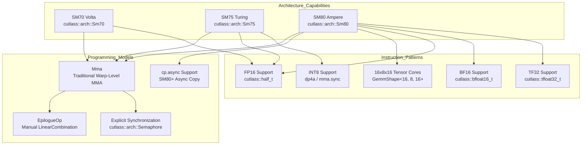
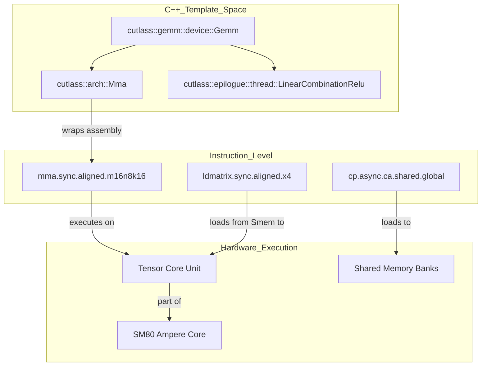

<!-- source: DeepWiki mcp.deepwiki.com · repo NVIDIA/cutlass · page 7.4 SM80 Ampere and Earlier Architectures · fetched 2026-10-26 -->

# SM80 Ampere and Earlier Architectures

<details>
<summary>Relevant source files</summary>

The following files were used as context for generating this wiki page:

- [examples/03_visualize_layout/CMakeLists.txt](examples/03_visualize_layout/CMakeLists.txt)
- [examples/06_splitK_gemm/splitk_gemm.cu](examples/06_splitK_gemm/splitk_gemm.cu)
- [examples/07_volta_tensorop_gemm/volta_tensorop_gemm.cu](examples/07_volta_tensorop_gemm/volta_tensorop_gemm.cu)
- [examples/08_turing_tensorop_gemm/turing_tensorop_gemm.cu](examples/08_turing_tensorop_gemm/turing_tensorop_gemm.cu)
- [examples/12_gemm_bias_relu/gemm_bias_relu.cu](examples/12_gemm_bias_relu/gemm_bias_relu.cu)
- [include/cute/arch/mma_sm80.hpp](include/cute/arch/mma_sm80.hpp)
- [include/cute/atom/mma_traits_sm80.hpp](include/cute/atom/mma_traits_sm80.hpp)
- [include/cute/container/array_subbyte.hpp](include/cute/container/array_subbyte.hpp)
- [include/cutlass/arch/mma.h](include/cutlass/arch/mma.h)
- [include/cutlass/arch/mma_sm50.h](include/cutlass/arch/mma_sm50.h)
- [include/cutlass/arch/mma_sm60.h](include/cutlass/arch/mma_sm60.h)
- [include/cutlass/arch/mma_sm61.h](include/cutlass/arch/mma_sm61.h)
- [include/cutlass/arch/mma_sm75.h](include/cutlass/arch/mma_sm75.h)
- [include/cutlass/arch/mma_sm80.h](include/cutlass/arch/mma_sm80.h)
- [tools/util/include/cutlass/util/host_tensor_planar_complex.h](tools/util/include/cutlass/util/host_tensor_planar_complex.h)

</details>


This document covers CUTLASS support for SM80 Ampere architecture and earlier GPU generations including SM75 Turing, SM70 Volta, and legacy SIMT architectures. These architectures use traditional tensor core programming patterns and manual optimization techniques that differ from the automated collective operations and TMA-based data movement in modern architectures. For SM90 Hopper features, see page 7.1. For SM100 Blackwell capabilities, see page 7.2.

CUTLASS supports Ampere and earlier architectures through CUTLASS 2.x and 3.x APIs, with compute capabilities ranging from SM50 (Maxwell) through SM86 (Ampere A10/RTX 30x0 series).

## Supported Architectures

CUTLASS provides extensive support for Ampere and earlier GPU architectures through traditional GEMM kernels and tensor core programming models. These architectures are accessed through CUTLASS 2.x and 3.x APIs, with CuTe providing a unified abstraction layer in 3.x.

| Architecture | Compute Capability | Example GPUs | Key Features | MMA Headers |
|--------------|-------------------|--------------|--------------|-------------|
| Maxwell | SM50 | GTX 980 | SIMT floating point, 1x1x1 GEMM shapes | `mma_sm50.h` |
| Pascal | SM60/61 | P100/P40 | FP16/INT8 vector instructions (dp4a/dp2a) | `mma_sm60.h`, `mma_sm61.h` |
| Volta | SM70 | V100, Titan V | First-generation tensor cores, FP16 mixed-precision, 8x8x4 shapes | `mma.h` |
| Turing | SM75 | T4, RTX 20x0 | Enhanced tensor cores, INT8/INT4 support, 16x8x8/16x8x16 shapes | `mma_sm75.h` |
| Ampere | SM80 | A100 | Async copy (cp.async), BF16, TF32, 16x8x16 tensor cores, FP64 support | `mma_sm80.h` |

Sources: [include/cutlass/arch/mma_sm50.h:61-62](), [include/cutlass/arch/mma_sm60.h:52-61](), [include/cutlass/arch/mma_sm61.h:48-57](), [include/cutlass/arch/mma_sm75.h:78-87](), [include/cutlass/arch/mma_sm80.h:58-60]()

**Ampere and Earlier Architecture Feature Hierarchy**



Sources: [examples/12_gemm_bias_relu/gemm_bias_relu.cu:73-121](), [examples/08_turing_tensorop_gemm/turing_tensorop_gemm.cu:58-76](), [include/cutlass/arch/mma.h:142-162]()

## MMA_Traits and Instruction Mapping

CUTLASS exposes tensor core capabilities through `MMA_Traits` specializations that map logical operations to hardware instructions. Each architecture has specific trait definitions that describe the thread layout, value layout, and register mapping for tensor core operations.

### SM80 Ampere MMA_Traits Specializations

Ampere (SM80/SM86) provides several MMA instruction shapes through specialized trait classes in the CuTe library:

**Key SM80 MMA Operations**

| MMA Operation Class | Shape (M×N×K) | ElementA | ElementB | ElementC | Threads |
|---------------------|---------------|----------|----------|----------|---------|
| `SM80_16x8x16_F16F16F16F16_TN` | 16×8×16 | `half_t` | `half_t` | `half_t` | 32 |
| `SM80_16x8x8_F32F16F16F32_TN` | 16×8×8 | `half_t` | `half_t` | `float` | 32 |
| `SM80_16x8x8_F32BF16BF16F32_TN` | 16×8×8 | `bfloat16_t` | `bfloat16_t` | `float` | 32 |
| `SM80_16x8x4_F32TF32TF32F32_TN` | 16×8×4 | `tfloat32_t` | `tfloat32_t` | `float` | 32 |
| `SM80_8x8x4_F64F64F64F64_TN` | 8×8×4 | `double` | `double` | `double` | 32 |

Each `MMA_Traits` specialization defines the `ValType` for all operands and the logical `ALayout`, `BLayout`, and `CLayout` representing how data is distributed across the 32 threads of a warp. For example, `SM80_16x8x8_F16F16F16F16_TN` uses `SM80_16x8_Row` for A and C layouts.

Sources: [include/cute/atom/mma_traits_sm80.hpp:63-75](), [include/cute/atom/mma_traits_sm80.hpp:99-106](), [include/cute/atom/mma_traits_sm80.hpp:123-130](), [include/cute/atom/mma_traits_sm80.hpp:147-160](), [include/cute/atom/mma_traits_sm80.hpp:184-196]()

## Traditional Tensor Core Programming

Legacy architectures use explicit tensor core programming with manual optimization patterns, such as the multi-stage pipeline where data moves from global memory to registers, then to shared memory, and finally back to registers for the MMA instruction.

### Instruction Level Abstractions (arch::Mma)

At the lowest level, CUTLASS provides the `arch::Mma` template specialized for specific hardware instructions. These wrap inline PTX assembly for operations like `mma.sync`.

**Example: SM75 (Turing) mma.sync.aligned.m16n8k8**
```cpp
// From include/cutlass/arch/mma_sm75.h:184-190
asm volatile("mma.sync.aligned.m16n8k8.row.col.f32.f16.f16.f32 {%0,%1,%2,%3}, {%4,%5}, {%6}, {%7,%8,%9,%10};\n"
    : "=f"(D[0]), "=f"(D[1]), "=f"(D[2]), "=f"(D[3])
    : "r"(A[0]), "r"(A[1]), "r"(B[0]), "f"(C[0]), "f"(C[1]), "f"(C[2]), "f"(C[3])
);
```

Sources: [include/cutlass/arch/mma_sm75.h:114-124](), [include/cutlass/arch/mma_sm75.h:184-190](), [include/cute/arch/mma_sm80.hpp:73-82]()

### Mapping Code Entities to Hardware Concepts

The following diagram bridges the high-level C++ templates used in examples to the underlying hardware execution units.



Sources: [examples/12_gemm_bias_relu/gemm_bias_relu.cu:107-121](), [include/cutlass/arch/mma_sm75.h:184-190](), [include/cute/arch/mma_sm80.hpp:106-116]()

## Data Flow and Memory Pipeline

In SM80 and earlier architectures, the data flow is managed explicitly by the threadblock. For SM80, the `cp.async` instruction allows for asynchronous data movement from global memory directly to shared memory, bypassing the register file.

### Multi-Stage Pipelining

Turing and Ampere kernels often use multiple "stages" to hide memory latency.
1.  **Stage 1**: Load data from Global Memory to Shared Memory (using `cp.async` on SM80).
2.  **Stage 2**: Load data from Shared Memory to Registers (using `ldmatrix` on SM75+).
3.  **Stage 3**: Execute `mma.sync` on registers.

The number of stages (e.g., `NumStages = 2`) defines how many buffers are allocated in shared memory to allow concurrent loading and computation.

Sources: [examples/12_gemm_bias_relu/gemm_bias_relu.cu:105-121](), [examples/08_turing_tensorop_gemm/turing_tensorop_gemm.cu:81-102]()

### Sub-byte Data Handling

For INT4, INT1, and other sub-byte types, CUTLASS uses specialized containers like `subbyte_reference` and `subbyte_storage_type_t` to manage packed data in memory. The storage type is selected based on bit width.

```cpp
// From include/cute/container/array_subbyte.hpp:49-54
template <class T>
using subbyte_storage_type_t = conditional_t<(cute::sizeof_bits_v<T> <=   8), uint8_t,
                               conditional_t<(cute::sizeof_bits_v<T> <=  16), uint16_t,
                               ...>>>>;
```

Sources: [include/cute/container/array_subbyte.hpp:48-54](), [include/cute/container/array_subbyte.hpp:64-97]()

## Implementation Differences from Modern Architectures

Unlike SM90 (Hopper) which introduces the **Tensor Memory Accelerator (TMA)** and **Warp-Group MMA (WGMMA)**, SM80 and earlier rely on:
-   **Warp-level Synchronization**: All threads in a warp must reach the `mma.sync` instruction together.
-   **Explicit Register Management**: The compiler and developer must manage fragment registers (e.g., `FragmentA`, `FragmentB`) for MMA operands.
-   **Manual Epilogues**: The epilogue (bias, activation) is typically performed by loading the accumulator fragments and applying a `LinearCombination` function before storing to global memory.

### Split-K Work Decomposition
For problems with a large K-dimension but small M/N dimensions (e.g., M=128, N=128, K=4096), SM80 and earlier often use **Split-K**. This partitions the K-dimension across multiple threadblocks (or SMs), each computing a partial sum to increase SM occupancy. A separate reduction kernel or atomic operations in the epilogue then combine these partial sums.

Sources: [examples/06_splitK_gemm/splitk_gemm.cu:36-45](), [examples/06_splitK_gemm/splitk_gemm.cu:95-96]()

## Planar Complex Support

For complex-valued GEMM, earlier architectures often used a "planar complex" representation where real and imaginary components are stored in separate memory buffers. CUTLASS provides `HostTensorPlanarComplex` to manage these allocations and provide `TensorRefPlanarComplex` views for kernels.

Sources: [tools/util/include/cutlass/util/host_tensor_planar_complex.h:59-65](), [tools/util/include/cutlass/util/host_tensor_planar_complex.h:90-96](), [tools/util/include/cutlass/util/host_tensor_planar_complex.h:113-123]()

---

