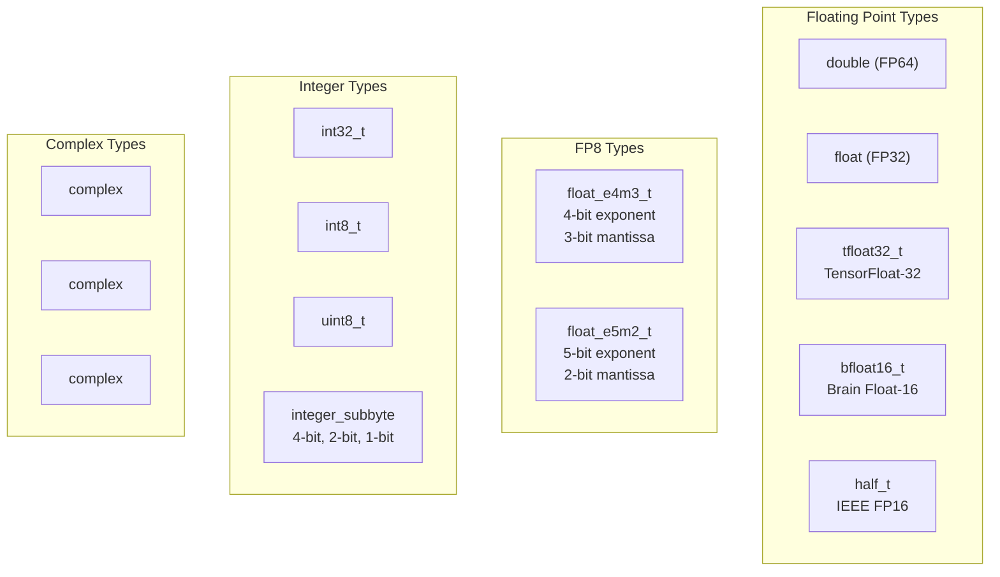
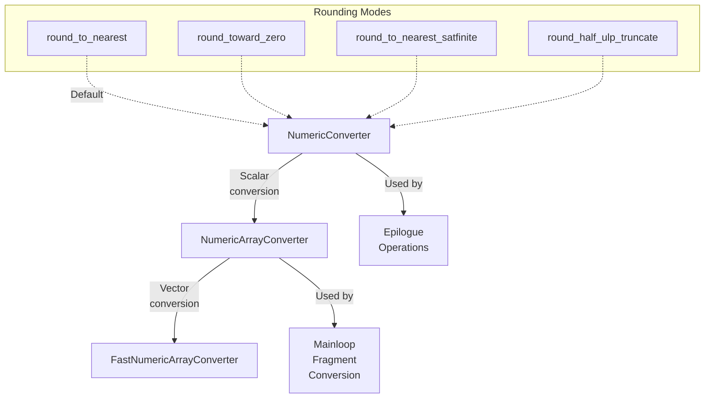
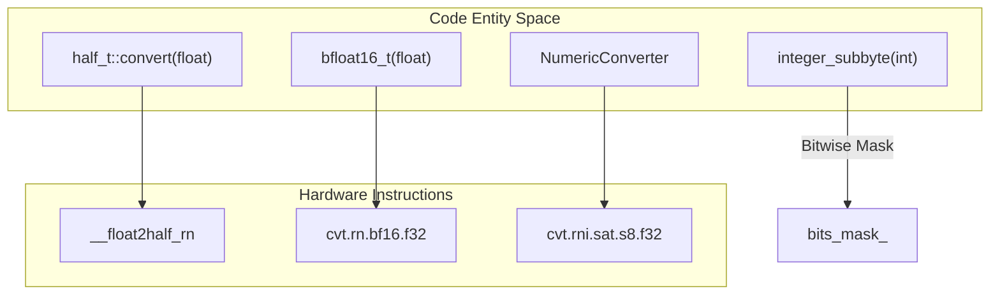

<!-- source: DeepWiki mcp.deepwiki.com · repo NVIDIA/cutlass · page 8 Data Types and Numeric Operations · fetched 2026-10-26 -->

# Data Types and Numeric Operations

Relevant source files

The following files were used as context for generating this wiki page:

- [examples/13_two_tensor_op_fusion/device/b2b_implicit_gemm_convolution.h](examples/13_two_tensor_op_fusion/device/b2b_implicit_gemm_convolution.h)
- [include/cute/container/tuple.hpp](include/cute/container/tuple.hpp)
- [include/cute/layout.hpp](include/cute/layout.hpp)
- [include/cute/numeric/arithmetic_tuple.hpp](include/cute/numeric/arithmetic_tuple.hpp)
- [include/cute/tensor_impl.hpp](include/cute/tensor_impl.hpp)
- [include/cutlass/conv/conv2d_problem_size.h](include/cutlass/conv/conv2d_problem_size.h)
- [include/cutlass/conv/conv3d_problem_size.h](include/cutlass/conv/conv3d_problem_size.h)
- [include/cutlass/detail/helper_macros.hpp](include/cutlass/detail/helper_macros.hpp)
- [include/cutlass/epilogue/collective/sm90_epilogue_tma_warpspecialized.hpp](include/cutlass/epilogue/collective/sm90_epilogue_tma_warpspecialized.hpp)
- [include/cutlass/functional.h](include/cutlass/functional.h)
- [include/cutlass/gemm/collective/sm120_blockscaled_sparse_mma_tma.hpp](include/cutlass/gemm/collective/sm120_blockscaled_sparse_mma_tma.hpp)
- [include/cutlass/half.h](include/cutlass/half.h)
- [include/cutlass/integer_subbyte.h](include/cutlass/integer_subbyte.h)
- [include/cutlass/numeric_conversion.h](include/cutlass/numeric_conversion.h)
- [include/cutlass/platform/platform.h](include/cutlass/platform/platform.h)
- [include/cutlass/wmma_array.h](include/cutlass/wmma_array.h)
- [test/unit/core/functional.cu](test/unit/core/functional.cu)
- [test/unit/core/numeric_conversion.cu](test/unit/core/numeric_conversion.cu)

## Purpose and Scope

This page provides a comprehensive overview of CUTLASS's data type system and numeric conversion infrastructure. It covers the supported numeric types (floating-point, integer, and complex), the conversion mechanisms between types, and the specialized support for mixed-precision operations. For detailed information about specific aspects, see:

- [Numeric Type System and Conversions](#8.1) for detailed conversion APIs and rounding modes.
- [FP8 Type System](#8.2) for FP8-specific accumulation and scaling strategies.
- [Mixed-Precision and Block-Scaled Types](#8.3) for quantization-aware operations and sub-byte integer handling.
- [Layout Types and Memory Formats](#8.4) for tensor layout specifications and memory organization.

Sources: [include/cutlass/numeric_conversion.h:31-50](), [include/cutlass/numeric_types.h:1-100](), [include/cutlass/half.h:31-36]()

## Supported Data Types

CUTLASS supports a comprehensive range of numeric types across multiple precision levels, optimized for different GPU architectures and computational requirements.

### Data Type Categories

Sources: [include/cutlass/numeric_types.h:1-100](), [include/cutlass/half.h:167-174](), [include/cutlass/bfloat16.h:56-64](), [include/cutlass/integer_subbyte.h:50-58]()

### Data Type Properties

| Type | Bits | Range | Primary Use Case | Tensor Core Support |
|------|------|-------|------------------|---------------------|
| `double` | 64 | Full IEEE-754 | High-precision compute | SM80+ (limited) |
| `float` | 32 | Full IEEE-754 | General compute | SM80+ (via TF32) |
| `tfloat32_t` | 19 | Reduced mantissa | TensorFloat-32 MMA | SM80+ |
| `bfloat16_t` | 16 | Wide dynamic range | Training, mixed precision | SM80+ |
| `half_t` | 16 | IEEE FP16 | Inference, training | SM70+ |
| `float_e4m3_t` | 8 | E4M3 format | FP8 training | SM89+, SM90+ |
| `float_e5m2_t` | 8 | E5M2 format | FP8 gradients | SM89+, SM90+ |
| `int8_t` | 8 | [-128, 127] | Quantized inference | SM75+ |
| `integer_subbyte<4>` | 4 | [-8, 7] | Ultra-low precision | SM75+ |

Sources: [include/cutlass/half.h:167-174](), [include/cutlass/bfloat16.h:56-64](), [include/cutlass/integer_subbyte.h:50-66](), [include/cutlass/platform/platform.h:103-116]()

## Numeric Conversion Infrastructure

CUTLASS provides a tiered conversion system optimized for different use cases: basic type conversion, vectorized array conversion, and hardware-accelerated rounding.

### Conversion Hierarchy

Sources: [include/cutlass/numeric_conversion.h:69-91](), [include/cutlass/numeric_conversion.h:56-65](), [test/unit/core/numeric_conversion.cu:51-59]()

### FloatRoundStyle Enumeration

The conversion infrastructure supports multiple rounding strategies defined in `FloatRoundStyle`:

| Mode | Description | Code Symbol |
|------|-------------|-------------|
| **Nearest** | Round to nearest even (IEEE 754) | `FloatRoundStyle::round_to_nearest` |
| **Zero** | Round toward zero (Truncate) | `FloatRoundStyle::round_toward_zero` |
| **SatFinite** | Round to nearest, capping to min/max of destination | `FloatRoundStyle::round_to_nearest_satfinite` |
| **Half ULP** | Add 0.5ulp then round toward zero | `FloatRoundStyle::round_half_ulp_truncate` |

Sources: [include/cutlass/numeric_conversion.h:56-72]()

### Conversion Specializations

CUTLASS provides optimized conversion paths for common type pairs using hardware intrinsics or efficient software fallbacks.

Sources: [include/cutlass/half.h:195-204](), [include/cutlass/bfloat16.h:116-147](), [include/cutlass/numeric_conversion.h:151-178](), [include/cutlass/integer_subbyte.h:102-116]()

## Mixed-Precision and Sub-byte Types

CUTLASS handles mixed-precision operations where operands A and B have different data types, and provides specialized containers for types smaller than one byte.

### Integer Sub-byte Handling
The `integer_subbyte<Bits, Signed>` template allows representing 4-bit, 2-bit, and 1-bit integers within an 8-bit storage container. It manages sign extension and truncation automatically during conversion via `bits_mask_` and `sign_mask_`.

Sources: [include/cutlass/integer_subbyte.h:50-66](), [include/cutlass/integer_subbyte.h:141-147]()

### Block-Scaled Operations
Modern architectures like SM120 support block-scaled types where elements are scaled by factors (SFA, SFB) to improve precision in low-bitwidth formats. The `CollectiveMma` specializations for `MainloopSm120TmaWarpSpecializedSparseBlockScaled` manage these factors alongside the main matrix data.

Sources: [include/cutlass/gemm/collective/sm120_blockscaled_sparse_mma_tma.hpp:79-108](), [include/cutlass/gemm/collective/sm120_blockscaled_sparse_mma_tma.hpp:125-133]()

## CuTe Numeric Abstractions

The CuTe library within CUTLASS introduces algebraic abstractions for numeric operations on coordinates and tensors.

### Arithmetic Tuple
The `ArithmeticTuple` extends standard tuples with element-wise arithmetic operators (`+`, `-`, `*`), enabling coordinate arithmetic in layout calculations.

Sources: [include/cute/numeric/arithmetic_tuple.hpp:44-54](), [include/cute/numeric/arithmetic_tuple.hpp:89-95]()

### Tensor and Engine
Tensors in CuTe are defined by an `Engine` (data storage) and a `Layout` (mapping). `ArrayEngine` provides owning storage, while `ViewEngine` provides a non-owning view over existing memory.

Sources: [include/cute/tensor_impl.hpp:70-84](), [include/cute/tensor_impl.hpp:106-117](), [include/cute/tensor_impl.hpp:135-152]()

## Platform and Standard Library Support

CUTLASS provides a `platform` namespace to offer C++ features and STL-like functionality that are compatible with both host and device code, especially for environments where the standard library might be restricted (e.g., NVRTC).

- **Type Traits**: Re-implementations of `is_same`, `enable_if`, `conditional`, etc.
- **Functional**: Device-annotated versions of `plus`, `minus`, `multiplies`, `abs`.
- **Keywords**: Macros for `noexcept`, `constexpr`, and `nullptr` to ensure compatibility across compiler versions.

Sources: [include/cutlass/platform/platform.h:38-98](), [include/cutlass/platform/platform.h:172-188](), [include/cutlass/functional.h:108-147]()

---

