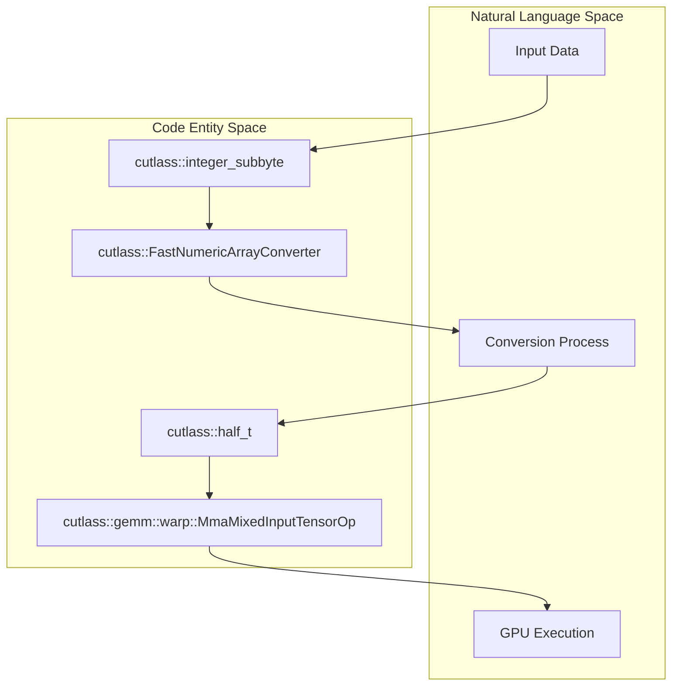
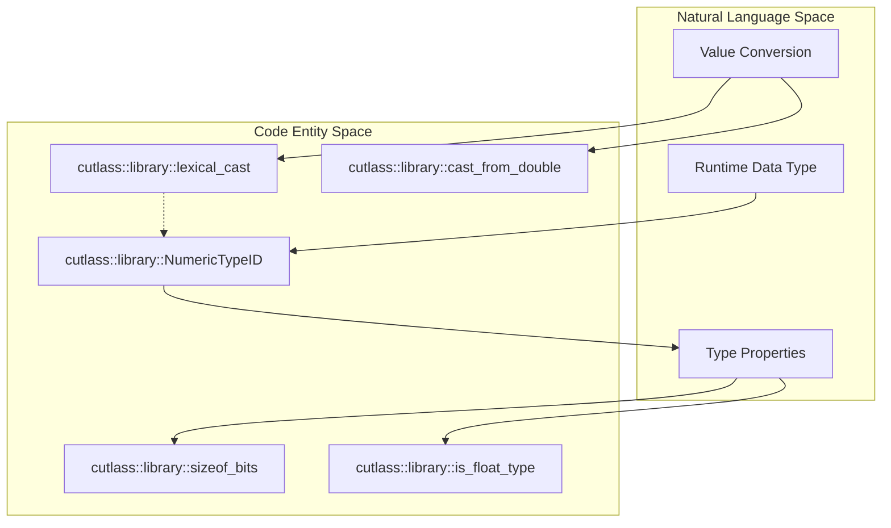

<!-- source: DeepWiki mcp.deepwiki.com · repo NVIDIA/cutlass · page 8.1 Numeric Type System and Conversions · fetched 2026-10-26 -->

# Numeric Type System and Conversions

<details>
<summary>Relevant source files</summary>

The following files were used as context for generating this wiki page:

- [examples/13_two_tensor_op_fusion/device/b2b_implicit_gemm_convolution.h](examples/13_two_tensor_op_fusion/device/b2b_implicit_gemm_convolution.h)
- [include/cutlass/arch/memory.h](include/cutlass/arch/memory.h)
- [include/cutlass/conv/conv2d_problem_size.h](include/cutlass/conv/conv2d_problem_size.h)
- [include/cutlass/conv/conv3d_problem_size.h](include/cutlass/conv/conv3d_problem_size.h)
- [include/cutlass/half.h](include/cutlass/half.h)
- [include/cutlass/integer_subbyte.h](include/cutlass/integer_subbyte.h)
- [include/cutlass/numeric_conversion.h](include/cutlass/numeric_conversion.h)
- [include/cutlass/numeric_types.h](include/cutlass/numeric_types.h)
- [include/cutlass/platform/platform.h](include/cutlass/platform/platform.h)
- [include/cutlass/transform/kernel/sm90_sparse_gemm_compressor.hpp](include/cutlass/transform/kernel/sm90_sparse_gemm_compressor.hpp)
- [include/cutlass/transform/kernel/sparse_gemm_compressor.hpp](include/cutlass/transform/kernel/sparse_gemm_compressor.hpp)
- [test/unit/core/numeric_conversion.cu](test/unit/core/numeric_conversion.cu)
- [test/unit/transform/CMakeLists.txt](test/unit/transform/CMakeLists.txt)
- [test/unit/transform/device/sm90_sparse_gemm_compressor_legacy.hpp](test/unit/transform/device/sm90_sparse_gemm_compressor_legacy.hpp)
- [tools/library/src/util.cu](tools/library/src/util.cu)

</details>


## Purpose and Scope

This document describes CUTLASS's numeric type conversion infrastructure, which provides comprehensive facilities for converting between numeric types with controlled rounding behavior. The system includes:

- **FloatRoundStyle enumeration**: Defines rounding modes for floating-point conversions.
- **NumericConverter template**: Core conversion facility for single value type conversions.
- **NumericArrayConverter template**: Vectorized conversions for arrays of values.
- **FastNumericArrayConverter template**: Optimized conversions for integer-range-limited values.
- **NumericTypeID enumeration**: Runtime type identification for library generation and profiling.

The conversion system supports all CUTLASS numeric types including FP8 variants, sub-byte integers (int4, int1), standard floating-point formats, and complex types. It provides both device and host implementations with architecture-specific optimizations.

**Sources:** [include/cutlass/numeric_conversion.h:31-97](), [tools/library/src/util.cu:476-562]()

---

## FloatRoundStyle Enumeration

The `FloatRoundStyle` enumeration defines rounding modes used during floating-point conversions. These modes control how values are rounded when converting from higher to lower precision types.

```cpp
enum class FloatRoundStyle {
  round_indeterminate,          ///< rounding mode unknown
  round_toward_zero,            ///< round toward zero
  round_to_nearest,             ///< round to nearest even
  round_to_nearest_satfinite,   ///< round to nearest even, capping value to min and max of destination type
  round_toward_infinity,        ///< round toward infinity
  round_toward_neg_infinity,    ///< round toward negative infinity
  round_half_ulp_truncate,      ///< add 0.5ulp to integer representation then round toward zero
  round_half_ulp_trunc_dntz     ///< like round_half_ulp_truncate, except denorms are rounded *toward* zero
};
```

### Rounding Mode Characteristics

| Mode | Behavior | Use Case |
|------|----------|----------|
| `round_to_nearest` | IEEE round-to-nearest-even | Default for most FP conversions [include/cutlass/numeric_conversion.h:66]() |
| `round_toward_zero` | Truncate fractional part | Fast conversion, deterministic [include/cutlass/numeric_conversion.h:65]() |
| `round_half_ulp_truncate` | Add 0.5 ULP before truncation | BF16 conversion optimization [include/cutlass/numeric_conversion.h:70]() |
| `round_half_ulp_trunc_dntz` | Special denorm handling | TF32 conversion without branches [include/cutlass/numeric_conversion.h:71]() |
| `round_to_nearest_satfinite` | Clamp overflow to finite bounds | Safe integer conversions [include/cutlass/numeric_conversion.h:67]() |

**Sources:** [include/cutlass/numeric_conversion.h:63-72]()

---

## NumericConverter Template

The `NumericConverter` template is the core conversion facility for single-value type conversions. It provides a uniform interface across all type pairs with specialized implementations for efficient conversions.

### Template Declaration

```cpp
template <
  typename T,                                           // Result type
  typename S,                                           // Source type
  FloatRoundStyle Round = FloatRoundStyle::round_to_nearest
>
struct NumericConverter {
  using result_type = T;
  using source_type = S;
  static FloatRoundStyle const round_style = Round;

  CUTLASS_HOST_DEVICE
  static result_type convert(source_type const & s);

  CUTLASS_HOST_DEVICE
  result_type operator()(source_type const &s) const;
};
```

### Generic Conversion
The default implementation performs a simple `static_cast` [include/cutlass/numeric_conversion.h:88-91]().

### Specializations for Float to Integer
Specialized converters for `float` to `int32_t` use hardware intrinsics like `__float2int_rn` on device [include/cutlass/numeric_conversion.h:115]() and `std::fesetround(FE_TONEAREST)` on host [include/cutlass/numeric_conversion.h:117]().

### Specializations for Float to int8_t/uint8_t
These conversions use PTX inline assembly for saturation and rounding on device [include/cutlass/numeric_conversion.h:168]().

```cpp
// int8_t, round to nearest
CUTLASS_HOST_DEVICE
static result_type convert(source_type const & s) {
  #if defined(__CUDA_ARCH__)
  int32_t intermediate;
  asm volatile("cvt.rni.sat.s8.f32 %0, %1;" : "=r"(intermediate) : "f"(s));
  return static_cast<result_type>(intermediate);
  #endif
}
```

**Sources:** [include/cutlass/numeric_conversion.h:76-268]()

---

## NumericArrayConverter Template

`NumericArrayConverter` applies element-wise conversions to `cutlass::Array` containers, with optional conjugation for complex types. It is heavily used in epilogue pipelines and mainloop transformations.

### Vectorized Half-Precision Conversions
Specialized for `Array<half_t, 2>` using packed intrinsics like `__float22half2_rn` to process multiple elements per instruction [include/cutlass/numeric_conversion.h:928]().

### Scaling Support
`NumericArrayConverter` also supports scaling factors, which is critical for FP8 and quantized integer workflows where values must be multiplied or divided by a scale during conversion [test/unit/core/numeric_conversion.cu:98-107]().

**Sources:** [include/cutlass/numeric_conversion.h:842-1186](), [test/unit/core/numeric_conversion.cu:51-59]()

---

## FastNumericArrayConverter Template

`FastNumericArrayConverter` provides optimized conversions for narrow integer types where the input range is limited. These trade generality for performance by making assumptions about input values, such as assuming values fit within a destination's mantissa [include/cutlass/numeric_conversion.h:2819-2830]().

### Mixed-Precision Dataflow



**Sources:** [include/cutlass/numeric_conversion.h:2819-3567](), [include/cutlass/integer_subbyte.h:50-100]()

---

## NumericTypeID Enumeration

The `NumericTypeID` enumeration provides runtime type identification for library generation, profiling, and the CUTLASS Python interface.

### Common Type IDs

| NumericTypeID | C++ Type | Text | Bit Width |
|---------------|----------|------|-----------|
| `kFE4M3` | `cutlass::float_e4m3_t` | `"fe4m3"` | 8 |
| `kF16` | `cutlass::half_t` | `"f16"` | 16 |
| `kBF16` | `cutlass::bfloat16_t` | `"bf16"` | 16 |
| `kF32` | `float` | `"f32"` | 32 |
| `kS8` | `int8_t` | `"s8"` | 8 |

### Runtime Type System Architecture



**Sources:** [tools/library/src/util.cu:476-721](), [tools/library/src/util.cu:1190-1981]()

---

## Sub-byte Integer Types

CUTLASS defines `integer_subbyte<Bits, Signed>` for handling types smaller than 8 bits (e.g., `int4_t`, `uint1_t`). These are used extensively in structured sparsity and low-precision inference.

- **Storage**: Always uses `uint8_t` as the underlying storage [include/cutlass/integer_subbyte.h:52]().
- **Sign Extension**: The conversion operator to `int` handles sign extension for signed sub-byte types [include/cutlass/integer_subbyte.h:141-147]().
- **Sparsity**: These types are critical for SM90 sparse GEMM compressors, where `ElementAUintCompressed` is defined as a `cute::sparse_elem` of sub-byte types [include/cutlass/transform/kernel/sm90_sparse_gemm_compressor.hpp:75]().

**Sources:** [include/cutlass/integer_subbyte.h:50-199](), [include/cutlass/transform/kernel/sm90_sparse_gemm_compressor.hpp:62-110]()

---

## Usage Examples

### Example: Vectorized Array Conversion
Using `NumericArrayConverter` in a kernel to convert multiple elements simultaneously.

```cpp
template <typename Destination, typename Source, int Count>
__global__ void convert_kernel(
  cutlass::Array<Destination, Count> *destination,
  cutlass::Array<Source, Count> const *source) {

  cutlass::NumericArrayConverter<Destination, Source, Count> convert;
  *destination = convert(*source);
}
```
**Sources:** [test/unit/core/numeric_conversion.cu:51-59]()

### Example: Lexical Cast
The `lexical_cast` utility converts string representations to CUTLASS numeric types, useful for command-line tools and profilers.

```cpp
// tools/library/src/util.cu
template <typename T>
T lexical_cast(std::string const &str);
```
**Sources:** [tools/library/src/util.cu:1190-1200]()

---

