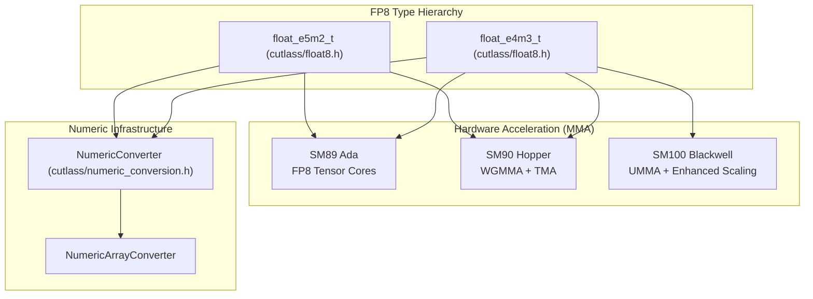
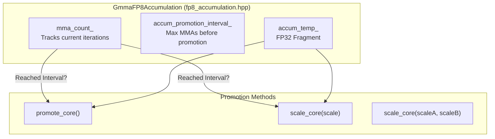
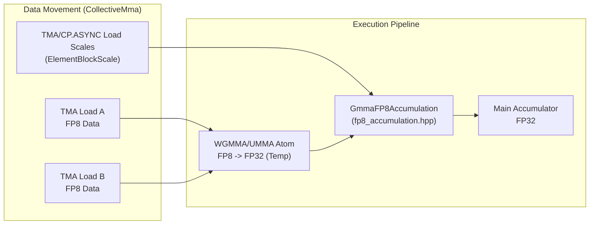

<!-- source: DeepWiki mcp.deepwiki.com · repo NVIDIA/cutlass · page 8.2 FP8 Type System · fetched 2026-10-26 -->

# FP8 Type System

<details>
<summary>Relevant source files</summary>

The following files were used as context for generating this wiki page:

- [examples/67_hopper_fp8_warp_specialized_gemm_with_blockwise_scaling/67_hopper_fp8_warp_specialized_gemm_with_blockwise_scaling.cu](examples/67_hopper_fp8_warp_specialized_gemm_with_blockwise_scaling/67_hopper_fp8_warp_specialized_gemm_with_blockwise_scaling.cu)
- [examples/67_hopper_fp8_warp_specialized_gemm_with_blockwise_scaling/67_hopper_fp8_warp_specialized_gemm_with_groupwise_scaling.cu](examples/67_hopper_fp8_warp_specialized_gemm_with_blockwise_scaling/67_hopper_fp8_warp_specialized_gemm_with_groupwise_scaling.cu)
- [examples/67_hopper_fp8_warp_specialized_gemm_with_blockwise_scaling/CMakeLists.txt](examples/67_hopper_fp8_warp_specialized_gemm_with_blockwise_scaling/CMakeLists.txt)
- [examples/python/CuTeDSL/cute_ext/blackwell/dense_gemm.py](examples/python/CuTeDSL/cute_ext/blackwell/dense_gemm.py)
- [include/cutlass/epilogue/collective/builders/sm100_builder.inl](include/cutlass/epilogue/collective/builders/sm100_builder.inl)
- [include/cutlass/epilogue/collective/builders/sm120_builder.inl](include/cutlass/epilogue/collective/builders/sm120_builder.inl)
- [include/cutlass/epilogue/collective/sm100_epilogue_array_nosmem.hpp](include/cutlass/epilogue/collective/sm100_epilogue_array_nosmem.hpp)
- [include/cutlass/epilogue/collective/sm100_epilogue_nosmem.hpp](include/cutlass/epilogue/collective/sm100_epilogue_nosmem.hpp)
- [include/cutlass/float8.h](include/cutlass/float8.h)
- [include/cutlass/gemm/collective/builders/sm120_blockscaled_mma_builder.inl](include/cutlass/gemm/collective/builders/sm120_blockscaled_mma_builder.inl)
- [include/cutlass/gemm/collective/builders/sm120_common.inl](include/cutlass/gemm/collective/builders/sm120_common.inl)
- [include/cutlass/gemm/collective/builders/sm90_gmma_builder.inl](include/cutlass/gemm/collective/builders/sm90_gmma_builder.inl)
- [include/cutlass/gemm/collective/fp8_accumulation.hpp](include/cutlass/gemm/collective/fp8_accumulation.hpp)
- [include/cutlass/gemm/collective/sm90_mma_tma_gmma_ss_warpspecialized_fp8_blockwise_scaling.hpp](include/cutlass/gemm/collective/sm90_mma_tma_gmma_ss_warpspecialized_fp8_blockwise_scaling.hpp)
- [include/cutlass/gemm/dispatch_policy.hpp](include/cutlass/gemm/dispatch_policy.hpp)
- [python/CuTeDSL/cutlass/cute/nvgpu/cpasync/copy.py](python/CuTeDSL/cutlass/cute/nvgpu/cpasync/copy.py)
- [python/cutlass_library/generator.py](python/cutlass_library/generator.py)

</details>


## Purpose and Scope

This page documents the FP8 (8-bit floating-point) type system in CUTLASS, including data type definitions, accumulation strategies, numeric conversion infrastructure, and integration with tensor core operations. FP8 types enable efficient AI workloads by reducing memory bandwidth and increasing compute throughput while maintaining numerical accuracy. 

The system specifically addresses the challenges of low-precision arithmetic on NVIDIA Hopper (SM90) and Blackwell (SM100/SM120) architectures, including specialized handling for **Blockwise Scaling** and **Periodic Promotion** to maintain numerical stability.

---

## FP8 Data Type Formats

CUTLASS defines multiple FP8 formats in `include/cutlass/float8.h`. These types provide 2x memory bandwidth improvement over FP16 and enable significantly higher throughput on modern tensor cores.

### Supported FP8 Formats

| Format | Exponent Bits | Mantissa Bits | Use Case | Type Name |
|--------|--------------|---------------|----------|-----------|
| E4M3 | 4 | 3 | Forward pass, activations | `float_e4m3_t` |
| E5M2 | 5 | 2 | Gradients, weight updates | `float_e5m2_t` |

The FP8 types are enabled for CUDA 11.8+ and SM89+ architectures [include/cutlass/float8.h:43-58](). CUTLASS implements these using the `float8_base` template which handles bit-level manipulation for exponent and mantissa fields [include/cutlass/float8.h:138-176](). Blackwell architecture (SM100/SM120) extends this system to support even lower precision formats like MXF4, MXF6, and NVF4 for block-scaled operations [include/cutlass/gemm/collective/builders/sm120_blockscaled_mma_builder.inl:107-113]().



**Sources:**
- [include/cutlass/float8.h:122-176]()
- [include/cutlass/float8.h:43-85]()
- [include/cutlass/gemm/collective/builders/sm120_blockscaled_mma_builder.inl:107-124]()

---

## FP8 Accumulation Strategy

FP8 accumulation in CUTLASS requires careful management to prevent overflow and precision loss. The `GmmaFP8Accumulation` class provides infrastructure for periodically promoting FP8 partial results to higher-precision accumulators (typically FP32).

### The GmmaFP8Accumulation Class

The `GmmaFP8Accumulation` template (defined in `include/cutlass/gemm/collective/fp8_accumulation.hpp`) manages a temporary accumulator and implements periodic promotion logic [include/cutlass/gemm/collective/fp8_accumulation.hpp:46-60]().



**Sources:**
- [include/cutlass/gemm/collective/fp8_accumulation.hpp:46-133]()

### Periodic Promotion Concept

To maximize performance, CUTLASS keeps partial results in registers using the fastest available accumulator type. However, to maintain accuracy, it periodically "promotes" these results:
1. **Accumulate in Temp**: MMA operations write to `accum_temp_` (FP32).
2. **Check Interval**: Every $N$ K-tiles (defined by `accum_promotion_interval_`), a promotion occurs [include/cutlass/gemm/collective/fp8_accumulation.hpp:166-180]().
3. **Apply Scales**: During promotion, scale factors can be applied to transition from the quantized FP8 space back to the compute space [include/cutlass/gemm/collective/fp8_accumulation.hpp:115-130]().

---

## Blockwise Scaling for FP8

Hopper (SM90) and Blackwell (SM100/SM120) architectures support **Blockwise Scaling** where scale factors are applied at a finer granularity than the entire tensor to improve dynamic range.

### Implementation in CollectiveMma

The `CollectiveMma` specialization for FP8 Blockwise scaling (e.g., `MainloopSm90TmaGmmaWarpSpecializedBlockwiseFP8`) defines how scales are loaded and applied [include/cutlass/gemm/collective/sm90_mma_tma_gmma_ss_warpspecialized_fp8_blockwise_scaling.hpp:78-92]().

Key parameters include:
- `ScaleGranularityM/N/K`: The size of the block over which a single scale factor applies [include/cutlass/gemm/collective/sm90_mma_tma_gmma_ss_warpspecialized_fp8_blockwise_scaling.hpp:123-125]().
- `ScalePromotionInterval`: How often scales are updated/applied relative to the MMA atom [include/cutlass/gemm/collective/sm90_mma_tma_gmma_ss_warpspecialized_fp8_blockwise_scaling.hpp:130-135]().

On Blackwell (SM120), block-scaled GEMM supports specialized instructions like `MXF4F6F8` and uses `OpClassBlockScaledTensorOp` to manage scale factors via `ElementSF` [include/cutlass/gemm/collective/builders/sm120_blockscaled_mma_builder.inl:54-92]().



**Sources:**
- [include/cutlass/gemm/collective/sm90_mma_tma_gmma_ss_warpspecialized_fp8_blockwise_scaling.hpp:123-145]()
- [include/cutlass/gemm/collective/builders/sm90_gmma_builder.inl:88-107]()
- [include/cutlass/gemm/collective/builders/sm120_blockscaled_mma_builder.inl:87-113]()

---

## Code Usage and Dispatch Policies

To use FP8 with blockwise scaling, specific kernel schedule policies are used in the collective builder:
- `KernelTmaWarpSpecializedCooperativeFP8Blockwise` [include/cutlass/gemm/dispatch_policy.hpp:130-135]()
- `MainloopSm90TmaGmmaWarpSpecializedBlockwiseFP8` [include/cutlass/gemm/collective/sm90_mma_tma_gmma_ss_warpspecialized_fp8_blockwise_scaling.hpp:96-100]()

These policies trigger the collective builders to select implementations that include scale factor loading and `GmmaFP8Accumulation` logic.

### Example: Collective Builder Configuration
The builder calculates the necessary shared memory stages considering the extra capacity needed for scale factors [include/cutlass/gemm/collective/builders/sm90_gmma_builder.inl:88-100](). For SM120, the builder also selects the appropriate `UMMA` major layout and permute selectors for scale factors [include/cutlass/gemm/collective/builders/sm120_common.inl:168-187]().

```cpp
// Logic for computing stage count with blockwise scale (SM90)
template<int capacity_bytes_, class ElementA, class ElementB, class ElementBlockScale, class TileShapeMNK, int ScaleMsPerTile, int ScaleNsPerTile>
constexpr int compute_stage_count_with_blockwise_scale(...) {
  // Includes A, B, and Scale factor memory requirements
}
```

**Sources:**
- [include/cutlass/gemm/collective/builders/sm90_gmma_builder.inl:88-107]()
- [include/cutlass/gemm/collective/sm90_mma_tma_gmma_ss_warpspecialized_fp8_blockwise_scaling.hpp:96-120]()
- [include/cutlass/gemm/dispatch_policy.hpp:130-143]()
- [include/cutlass/gemm/collective/builders/sm120_common.inl:168-187]()

---

