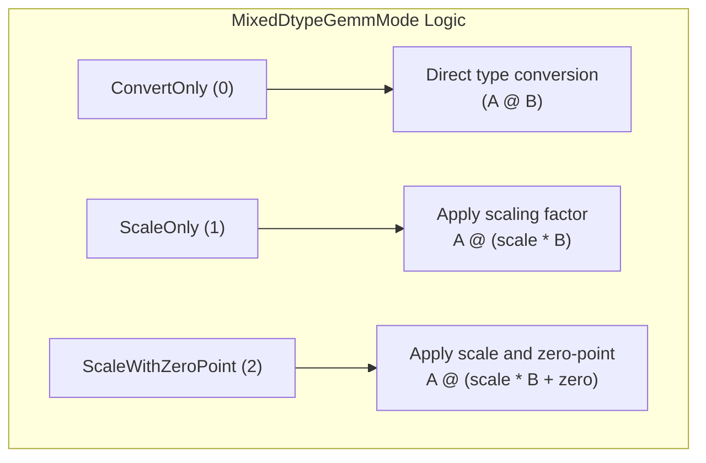
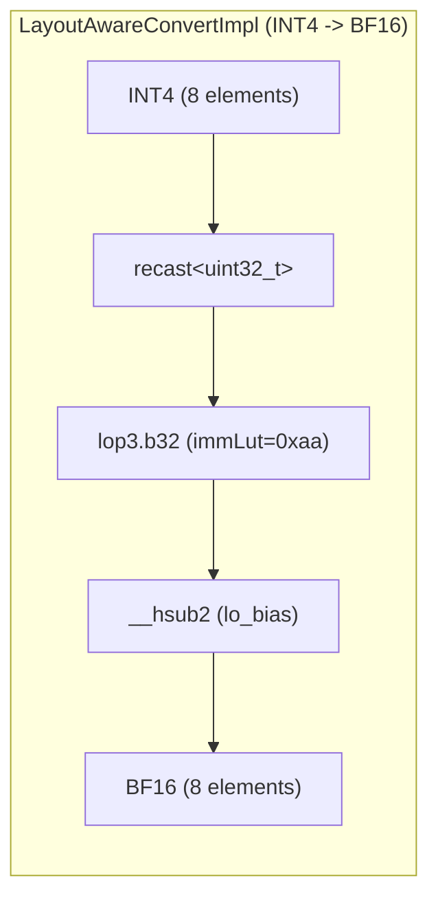
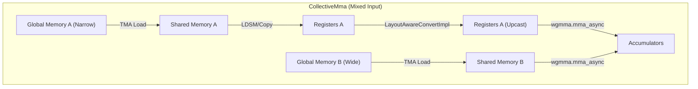

<!-- source: DeepWiki mcp.deepwiki.com · repo NVIDIA/cutlass · page 8.3 Mixed-Precision and Block-Scaled Types · fetched 2026-10-26 -->

# Mixed-Precision and Block-Scaled Types

Relevant source files

The following files were used as context for generating this wiki page:

- [examples/55_hopper_mixed_dtype_gemm/55_hopper_int4_bf16_gemm.cu](examples/55_hopper_mixed_dtype_gemm/55_hopper_int4_bf16_gemm.cu)
- [examples/55_hopper_mixed_dtype_gemm/55_hopper_int4_fp8_gemm.cu](examples/55_hopper_mixed_dtype_gemm/55_hopper_int4_fp8_gemm.cu)
- [examples/55_hopper_mixed_dtype_gemm/55_hopper_mixed_dtype_gemm.cu](examples/55_hopper_mixed_dtype_gemm/55_hopper_mixed_dtype_gemm.cu)
- [examples/55_hopper_mixed_dtype_gemm/README.md](examples/55_hopper_mixed_dtype_gemm/README.md)
- [examples/55_hopper_mixed_dtype_gemm/mixed_dtype_utils.hpp](examples/55_hopper_mixed_dtype_gemm/mixed_dtype_utils.hpp)
- [include/cutlass/detail/collective/mixed_input_utils.hpp](include/cutlass/detail/collective/mixed_input_utils.hpp)
- [include/cutlass/gemm/collective/sm120_blockscaled_mma_array_tma.hpp](include/cutlass/gemm/collective/sm120_blockscaled_mma_array_tma.hpp)
- [include/cutlass/gemm/collective/sm120_blockscaled_mma_tma.hpp](include/cutlass/gemm/collective/sm120_blockscaled_mma_tma.hpp)
- [include/cutlass/gemm/collective/sm120_mma_array_tma_blockwise_scaling.hpp](include/cutlass/gemm/collective/sm120_mma_array_tma_blockwise_scaling.hpp)
- [include/cutlass/gemm/collective/sm120_mma_tma.hpp](include/cutlass/gemm/collective/sm120_mma_tma.hpp)
- [include/cutlass/gemm/collective/sm120_mma_tma_blockwise_scaling.hpp](include/cutlass/gemm/collective/sm120_mma_tma_blockwise_scaling.hpp)
- [include/cutlass/gemm/collective/sm90_mma_tma_gmma_rs_warpspecialized_mixed_input.hpp](include/cutlass/gemm/collective/sm90_mma_tma_gmma_rs_warpspecialized_mixed_input.hpp)
- [include/cutlass/gemm/kernel/sm90_gemm_array_tma_warpspecialized_cooperative.hpp](include/cutlass/gemm/kernel/sm90_gemm_array_tma_warpspecialized_cooperative.hpp)
- [include/cutlass/gemm/kernel/sm90_gemm_array_tma_warpspecialized_pingpong.hpp](include/cutlass/gemm/kernel/sm90_gemm_array_tma_warpspecialized_pingpong.hpp)
- [include/cutlass/gemm/kernel/sm90_gemm_tma_warpspecialized_cooperative.hpp](include/cutlass/gemm/kernel/sm90_gemm_tma_warpspecialized_cooperative.hpp)
- [include/cutlass/gemm/kernel/sm90_gemm_tma_warpspecialized_pingpong.hpp](include/cutlass/gemm/kernel/sm90_gemm_tma_warpspecialized_pingpong.hpp)
- [include/cutlass/gemm/kernel/tile_scheduler_params.h](include/cutlass/gemm/kernel/tile_scheduler_params.h)
- [tools/util/include/cutlass/util/mixed_dtype_utils.hpp](tools/util/include/cutlass/util/mixed_dtype_utils.hpp)

CUTLASS supports mixed-precision operations where operands of different bit-widths are multiplied together, as well as block-scaled types that store quantized data with per-block scaling factors. These capabilities enable efficient inference by combining narrow-precision operands (4-bit, 8-bit) with higher-precision operands (16-bit) or by quantizing tensors to very low precision (4-bit) while preserving numerical accuracy through block scaling.

This page covers:
- **Mixed-Input GEMM**: Operations combining different operand precisions (e.g., INT8 × FP16, INT4 × BF16).
- **FragmentShuffler**: Register-level data reorganization for mixed-input operations.
- **Block-Scaled Types**: SM120 Blackwell features including blockwise and groupwise scaling.
- **MixedInputMode**: Enumeration controlling upcast and scaling behavior.
- **Numeric Conversion**: Type conversion infrastructure supporting mixed-precision and layout-aware conversions.

## Overview

**Mixed-Precision Operations:**
Mixed-precision GEMM allows multiplying operands of different precisions, typically upcasting the narrower operand to match the wider operand before computation. Common combinations include:

| Narrow Type | Wide Type | Primary Architecture | Use Case |
|-------------|-----------|---------------------|----------|
| INT4 | INT8 | SM80+ | Quantized inference |
| INT4 | BF16 | SM90+ | LLM weight-only quantization |
| INT8 | FP16 | SM80+ | Mixed quantization |
| FP8 | FP16 | SM89+ | AI training/inference |

**Block-Scaled Types:**
Block-scaled types divide tensors into blocks and store a scaling factor per block. This is particularly useful for quantized neural networks where different regions of tensors have different scaling requirements. SM120 (Blackwell) introduces native support for these via `UMMA` (Universal MMA) instructions.

| Format | Bits per Element | Scale Factor Type | Primary Architecture |
|--------|------------------|-------------------|---------------------|
| E4M3 (Scaled) | 8 | FP32 | SM100/SM120 |
| NVFP4 | 4 | FP16/BF16/FP32 | SM100/SM120 |
| MXFP4/6/8 | 4/6/8 | 8-bit exponent | SM100/SM120 |

Sources: [examples/55_hopper_mixed_dtype_gemm/55_hopper_mixed_dtype_gemm.cu:35-38](), [include/cutlass/gemm/collective/sm120_mma_tma_blockwise_scaling.hpp:140-150](), [include/cutlass/gemm/kernel/sm90_gemm_tma_warpspecialized_cooperative.hpp:138-143]()

## Mixed-Input GEMM Operations

Mixed-input GEMM operations multiply matrices with different element types. The narrower type always passes through the register file (Rmem), and the collective will implicitly swap operands A and B in the mainloop if the narrower type is operand B to ensure it can be processed via registers [examples/55_hopper_mixed_dtype_gemm/55_hopper_mixed_dtype_gemm.cu:40-42]().

### MixedInputMode and Conversion Mode

The `MixedInputMode` (often referred to as `MixedDtypeGemmMode` in examples) controls how narrow operands are transformed [examples/55_hopper_mixed_dtype_gemm/mixed_dtype_utils.hpp:50-54](). The `ConversionMode` enumeration in `cutlass::detail` defines the implementation strategy [include/cutlass/gemm/collective/sm90_mma_tma_gmma_rs_warpspecialized_mixed_input.hpp:103-104]().

Sources: [examples/55_hopper_mixed_dtype_gemm/mixed_dtype_utils.hpp:50-54](), [include/cutlass/gemm/collective/sm90_mma_tma_gmma_rs_warpspecialized_mixed_input.hpp:103-104]()

### Layout-Aware Conversion

For extremely narrow types like INT4, CUTLASS provides specialized layout-aware converters. These handle pre-shuffled data (e.g., `[0,2,4,6,1,3,5,7]` order) to allow multiple nibbles to be efficiently extracted and up-converted in parallel using `lop3` instructions [examples/55_hopper_mixed_dtype_gemm/55_hopper_int4_bf16_gemm.cu:50-52]().

**LayoutAwareConvertImpl Specialization:**
The class `LayoutAwareConvertImpl` in `cutlass/detail/collective/mixed_input_utils.hpp` provides optimized paths for `int4b_t` to `bfloat16_t` conversion [include/cutlass/detail/collective/mixed_input_utils.hpp:79-124]().

Sources: [include/cutlass/detail/collective/mixed_input_utils.hpp:46-124](), [examples/55_hopper_mixed_dtype_gemm/55_hopper_int4_bf16_gemm.cu:50-53]()

## FragmentShuffler and Data Reordering

In mixed-input operations, data must be reorganized in registers to align with the wide operand's layout for Tensor Core instructions.

### Operand Shuffle and Vectorization
Narrow data type tensors can be reordered such that elements read into the register file by the same thread are contiguous in global and shared memory. This promotes vectorization (e.g., a single 64-bit load instead of multiple 8-bit loads) [examples/55_hopper_mixed_dtype_gemm/55_hopper_int4_bf16_gemm.cu:43-48]().

Sources: [examples/55_hopper_mixed_dtype_gemm/55_hopper_int4_bf16_gemm.cu:43-49](), [include/cutlass/detail/collective/mixed_input_utils.hpp:100-115]()

## Block-Scaled GEMM (SM120 Blackwell)

Blackwell architecture (SM120) introduces native support for blockwise scaling via `UMMA`. For a GEMM $D = \alpha (SFA * A) (SFB * B) + \beta C$, scale factor tensors $SFA$ and $SFB$ are applied per-block.

### CollectiveMma for Blockwise Scaling
The `CollectiveMma` specialized for `MainloopSm120TmaWarpSpecializedBlockwiseScaling` manages the loading of operands and their corresponding scale factors [include/cutlass/gemm/collective/sm120_mma_tma_blockwise_scaling.hpp:75-90]().

**Key Implementation Details:**
- **Scale Granularity**: Defined by `ScaleGranularityM`, `ScaleGranularityN`, and `ScaleGranularityK`. These must evenly divide the `TileShape` [include/cutlass/gemm/collective/sm120_mma_tma_blockwise_scaling.hpp:129-142]().
- **ScaleConfig**: A `Sm120BlockwiseScaleConfig` struct maps these granularities to hardware `UMMA` majorness [include/cutlass/gemm/collective/sm120_mma_tma_blockwise_scaling.hpp:146-150]().
- **Shared Memory**: SM120 mainloops require specific `SmemCopyAtom` for A and B operand smem->rmem reads to handle the scale-integrated math [include/cutlass/gemm/collective/sm120_mma_tma_blockwise_scaling.hpp:157-160]().

Sources: [include/cutlass/gemm/collective/sm120_mma_tma_blockwise_scaling.hpp:75-160](), [include/cutlass/gemm/collective/sm120_mma_array_tma_blockwise_scaling.hpp:94-150]()

## Implementation Details

### CollectiveMma for Mixed Input
The SM90 mixed-input collective `CollectiveMma<MainloopSm90TmaGmmaRmemAWarpSpecializedMixedInput>` manages the loading of operands, scales, and zeros [include/cutlass/gemm/collective/sm90_mma_tma_gmma_rs_warpspecialized_mixed_input.hpp:81-125]().

**Key Constraints:**
1. **Layout**: The narrow type must be in K-major format [examples/55_hopper_mixed_dtype_gemm/55_hopper_mixed_dtype_gemm.cu:56]().
2. **Majorness**: Scales and zeros must be MN-major (Column-major if A is scaled, Row-major if B is scaled) [examples/55_hopper_mixed_dtype_gemm/55_hopper_mixed_dtype_gemm.cu:57]().
3. **Alignment**: The `NonVoidStrideScale` must be MN-major [include/cutlass/gemm/collective/sm90_mma_tma_gmma_rs_warpspecialized_mixed_input.hpp:157-158]().

### Mixed-Input Data Flow

Sources: [include/cutlass/gemm/collective/sm90_mma_tma_gmma_rs_warpspecialized_mixed_input.hpp:130-160](), [examples/55_hopper_mixed_dtype_gemm/55_hopper_mixed_dtype_gemm.cu:40-45]()

### Quantization-Aware Reference
For validation, CUTLASS provides `initialize_reference_operations.cu` which includes reference implementations for block-scaled GEMM on SM100, supporting various scale granularities and exponent-based scaling (MX formats) [tools/library/src/reference/initialize_reference_operations.cu:64-70]().

Sources: [tools/library/src/reference/initialize_reference_operations.cu:64-70](), [include/cutlass/detail/collective/mixed_input_utils.hpp:118-124]()

---

