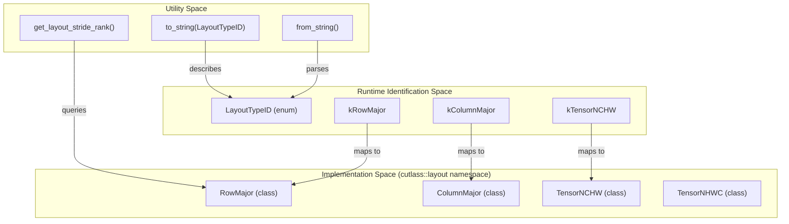
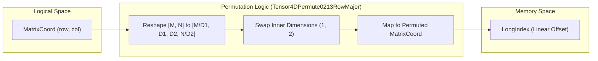

<!-- source: DeepWiki mcp.deepwiki.com · repo NVIDIA/cutlass · page 8.4 Layout Types and Memory Formats · fetched 2026-10-26 -->

# Layout Types and Memory Formats

Relevant source files

The following files were used as context for generating this wiki page:

- [examples/13_two_tensor_op_fusion/device/b2b_implicit_gemm_convolution.h](examples/13_two_tensor_op_fusion/device/b2b_implicit_gemm_convolution.h)
- [examples/39_gemm_permute/gemm_permute.cu](examples/39_gemm_permute/gemm_permute.cu)
- [include/cutlass/conv/conv2d_problem_size.h](include/cutlass/conv/conv2d_problem_size.h)
- [include/cutlass/conv/conv3d_problem_size.h](include/cutlass/conv/conv3d_problem_size.h)
- [include/cutlass/half.h](include/cutlass/half.h)
- [include/cutlass/integer_subbyte.h](include/cutlass/integer_subbyte.h)
- [include/cutlass/layout/matrix.h](include/cutlass/layout/matrix.h)
- [include/cutlass/layout/permute.h](include/cutlass/layout/permute.h)
- [include/cutlass/numeric_conversion.h](include/cutlass/numeric_conversion.h)
- [include/cutlass/platform/platform.h](include/cutlass/platform/platform.h)
- [test/unit/core/numeric_conversion.cu](test/unit/core/numeric_conversion.cu)

## Purpose and Scope

This page documents the memory layout types and tensor formats supported by CUTLASS for organizing matrix and tensor data in memory. It covers the `LayoutTypeID` enumeration system, standard matrix layouts (row-major, column-major), interleaved formats for optimized data access patterns, and multi-dimensional tensor formats used in convolution operations. For information about the CuTe layout algebra that operates on these formats, see [Layout Algebra](2.1). For numeric data types themselves, see [Numeric Type System and Conversions](8.1).

## Overview of Layout Type System

CUTLASS represents layout types through the `LayoutTypeID` enumeration, which provides runtime identification of memory layout patterns. Each layout type corresponds to a specific C++ template class in the `cutlass::layout` namespace and defines how multi-dimensional data is linearized in memory [include/cutlass/layout/matrix.h:48-55]().

### Code Entity Mapping: Layout System
The following diagram bridges the high-level layout concepts to the specific code entities that implement them.

**Sources:** [include/cutlass/layout/matrix.h:58-148](), [include/cutlass/layout/matrix.h:150-235]()

## LayoutTypeID Enumeration

The `LayoutTypeID` enumeration provides runtime type identification for layout formats. Each enumerant corresponds to a specific memory layout pattern and has associated string aliases for human-readable representation.

### Core Enumeration Values

| LayoutTypeID | String Aliases | Description |
|--------------|----------------|-------------|
| `kUnknown` | "unknown", "*" | Unspecified or enumerate-all wildcard |
| `kRowMajor` | "row", "t" | Row-major matrix layout (C-style) |
| `kColumnMajor` | "column", "col", "n" | Column-major matrix layout (Fortran-style) |
| `kInvalid` | "invalid" | Invalid layout identifier |

## Matrix Layouts

Matrix layouts define how 2D matrix data is stored linearly in memory. CUTLASS layouts implement a mapping from `MatrixCoord` (row, column) to a `LongIndex` offset [include/cutlass/layout/matrix.h:105-110]().

### Row-Major vs Column-Major

- **Row-Major (`RowMajor`)**: Elements in the same row are contiguous in memory. For a matrix with leading dimension `ldm`, element `(i,j)` is at offset `i * ldm + j` [include/cutlass/layout/matrix.h:58-110]().
- **Column-Major (`ColumnMajor`)**: Elements in the same column are contiguous in memory. For a matrix with leading dimension `ldm`, element `(i,j)` is at offset `j * ldm + i` [include/cutlass/layout/matrix.h:150-203]().

The `packed()` static method helper returns a layout instance where the stride is equal to the extent of the contiguous dimension [include/cutlass/layout/matrix.h:101-103]().

**Sources:** [include/cutlass/layout/matrix.h:58-148](), [include/cutlass/layout/matrix.h:150-235]()

## Interleaved Matrix Layouts

Interleaved layouts store matrix elements in blocks of $K$ consecutive elements along the inner dimension, improving memory access patterns for certain GPU operations, such as INT8 or mixed-precision tensor core instructions.

### Interleaving Factors

| Interleaving Factor | Column-Major Alias | Row-Major Alias | Typical Use Case |
|---------------------|--------------------|-----------------|------------------|
| K=2 | `nk2` | `tk2` | Small element sizes |
| K=4 | `nk4` | `tk4` | 4-bit and 8-bit data |
| K=16 | `nk16` | `tk16` | INT8 tensor core operations |
| K=32 | `nk32` | `tk32` | FP16/BF16 tensor core operations |
| K=64 | `nk64` | `tk64` | High-throughput operations |

## Tensor Layouts for Convolutions

CUTLASS supports multiple tensor layout formats optimized for convolution operations. These layouts are used by `Conv2dProblemSize` and `Conv3dProblemSize` to map spatial coordinates to memory [include/cutlass/conv/conv2d_problem_size.h:34-46]().

### Standard Tensor Layouts

| Layout | Dimensions | Stride Order | Typical Use |
|--------|------------|--------------|-------------|
| **NCHW** | N, C, H, W | (C×H×W, H×W, W, 1) | PyTorch default |
| **NHWC** | N, H, W, C | (H×W×C, W×C, C, 1) | TensorFlow default, Tensor Core optimized [include/cutlass/conv/conv2d_problem_size.h:35-37]() |
| **NCDHW** | N, C, D, H, W | (C×D×H×W, D×H×W, H×W, W, 1) | 3D convolution (PyTorch) |
| **NDHWC** | N, D, H, W, C | (D×H×W×C, H×W×C, W×C, C, 1) | 3D convolution (TensorFlow) [include/cutlass/conv/conv3d_problem_size.h:35-37]() |

**Sources:** [include/cutlass/conv/conv2d_problem_size.h:34-46](), [include/cutlass/conv/conv3d_problem_size.h:34-46]()

## Stride Rank and Layout Dimensions

The `kStrideRank` constant in a layout class indicates how many stride values are needed to fully specify the layout's memory access pattern [include/cutlass/layout/matrix.h:64]().

- **Rank 1**: Standard matrix layouts like `RowMajor` and `ColumnMajor` require only one stride value (the leading dimension) [include/cutlass/layout/matrix.h:64]().
- **Rank 3**: 4D tensor layouts like NCHW and NHWC typically require three stride values for the outer dimensions.
- **Rank 4**: 5D tensor layouts (NDHWC) require four stride values.

The `get_layout_stride_rank()` utility function provides a mapping from `LayoutTypeID` to these integer ranks.

**Sources:** [include/cutlass/layout/matrix.h:61-64](), [include/cutlass/layout/matrix.h:153-156]()

## Layout Permutations

CUTLASS provides utilities in `include/cutlass/layout/permute.h` for permuting tensor dimensions, often used in GEMM+Permute fusion paths [include/cutlass/layout/permute.h:32-39](). The `cutlass::layout::PermuteBase` provides the foundation for mapping logical coordinates to linear memory under permutation [include/cutlass/layout/permute.h:73-80]().

### Tensor4DPermute0213

The `Tensor4DPermute0213RowMajor` class reshapes a matrix `[M, N]` into `[M/D1, D1, D2, N/D2]` and then performs a `[0, 2, 1, 3]` permutation [include/cutlass/layout/permute.h:126-140](). This is used to implement customized global memory writeout address computation [examples/39_gemm_permute/gemm_permute.cu:37-39]().

**Sources:** [include/cutlass/layout/permute.h:126-179](), [examples/39_gemm_permute/gemm_permute.cu:37-47]()

## Layout Type to C++ Class Mapping

Each layout identifier maps to a specific template instantiation that defines the coordinate-to-offset transformation.

| LayoutTypeID | C++ Class Template | Header Location |
|--------------|-------------------|-----------------|
| `kRowMajor` | `cutlass::layout::RowMajor` | `cutlass/layout/matrix.h` |
| `kColumnMajor` | `cutlass::layout::ColumnMajor` | `cutlass/layout/matrix.h` |
| `kNoPermute` | `cutlass::layout::NoPermute` | `cutlass/layout/permute.h` |

**Sources:** [include/cutlass/layout/matrix.h:58](), [include/cutlass/layout/matrix.h:150](), [include/cutlass/layout/permute.h:82]()

---

