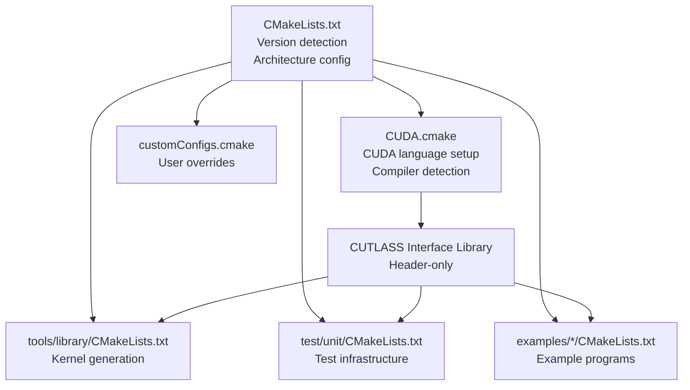
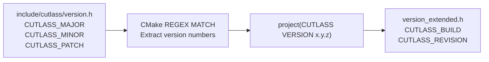
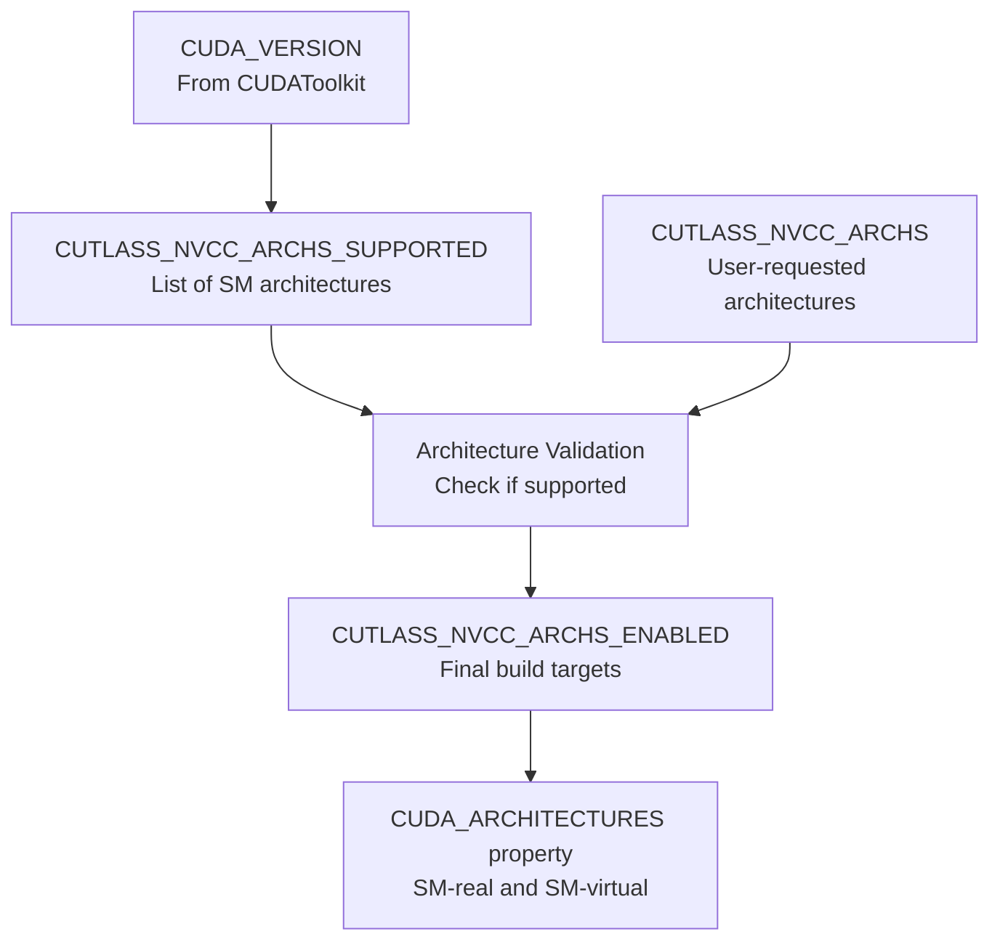
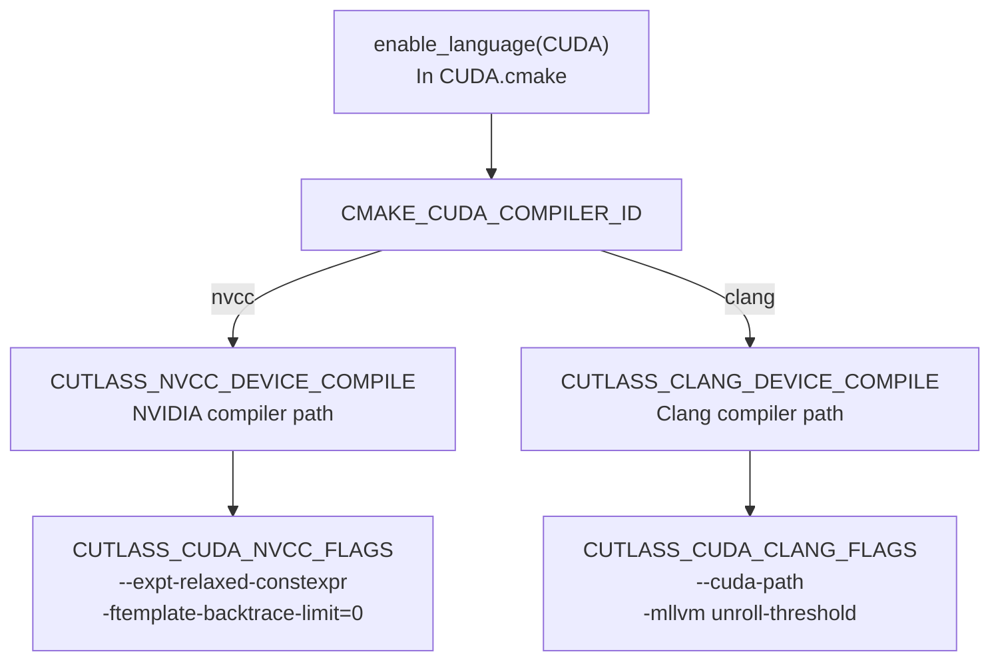
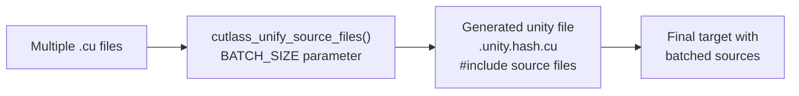
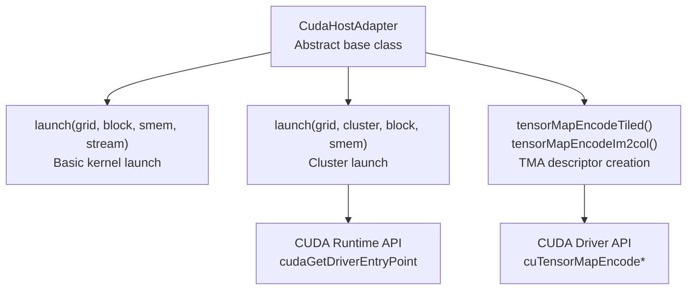
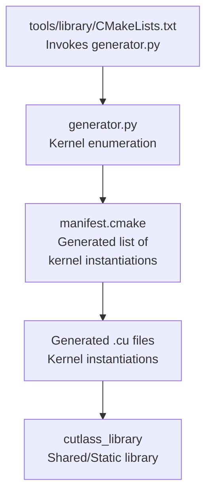

<!-- source: DeepWiki mcp.deepwiki.com · repo NVIDIA/cutlass · page 9 Build System and Compilation · fetched 2026-10-26 -->

# Build System and Compilation

Relevant source files

The following files were used as context for generating this wiki page:

- [CMakeLists.txt](CMakeLists.txt)
- [CUDA.cmake](CUDA.cmake)
- [Doxyfile](Doxyfile)
- [PUBLICATIONS.md](PUBLICATIONS.md)
- [cmake/version_extended.h.in](cmake/version_extended.h.in)
- [examples/02_dump_reg_shmem/CMakeLists.txt](examples/02_dump_reg_shmem/CMakeLists.txt)
- [examples/56_hopper_ptr_array_batched_gemm/CMakeLists.txt](examples/56_hopper_ptr_array_batched_gemm/CMakeLists.txt)
- [include/cute/atom/copy_traits_sm90_im2col.hpp](include/cute/atom/copy_traits_sm90_im2col.hpp)
- [include/cute/atom/copy_traits_sm90_tma.hpp](include/cute/atom/copy_traits_sm90_tma.hpp)
- [include/cutlass/arch/grid_dependency_control.h](include/cutlass/arch/grid_dependency_control.h)
- [include/cutlass/cuda_host_adapter.hpp](include/cutlass/cuda_host_adapter.hpp)
- [include/cutlass/gemm/collective/sm100_mma_warpspecialized_blockwise_scaling.hpp](include/cutlass/gemm/collective/sm100_mma_warpspecialized_blockwise_scaling.hpp)
- [test/unit/CMakeLists.txt](test/unit/CMakeLists.txt)
- [test/unit/conv/device/conv2d_problems.h](test/unit/conv/device/conv2d_problems.h)

## Purpose and Scope

This page documents the CUTLASS build system and compilation infrastructure. It covers CMake configuration, CUDA compilation (NVCC and Clang), architecture detection, compilation flags, host-side kernel setup, and the kernel generation pipeline. For information about testing infrastructure, see [Testing and Validation Infrastructure](#10). For Python JIT compilation in CuTe DSL, see [JIT Compilation and Caching](#3.3).

---

## CMake Build System Overview

The CUTLASS build system is centered around CMake 3.19+ [CMakeLists.txt:29]() with extensive CUDA-specific configuration. The root `CMakeLists.txt` detects CUDA capabilities, configures architecture flags, and provides helper functions for building libraries and executables.

### Root Build Structure

**Key Build Files Structure**

| File | Purpose |
|------|---------|
| `CMakeLists.txt` | Root build configuration, version parsing, architecture setup [CMakeLists.txt:1-170]() |
| `CUDA.cmake` | CUDA language enablement, compiler detection, library targets [CUDA.cmake:1-357]() |
| `customConfigs.cmake` | User-customizable build options [CMakeLists.txt:129]() |
| `test/unit/CMakeLists.txt` | GTest integration for unit tests [test/unit/CMakeLists.txt:1-210]() |

Sources: [CMakeLists.txt:1-170](), [CUDA.cmake:1-357](), [test/unit/CMakeLists.txt:1-210]()

---

## Version Detection and Configuration

CUTLASS parses its version from `include/cutlass/version.h` at CMake configuration time, avoiding duplicate version definitions.

The root `CMakeLists.txt` reads the version file and extracts version components using `string(REGEX MATCH)` to set the project version [CMakeLists.txt:46-58](). This metadata is also used to generate `version_extended.h` [cmake/version_extended.h.in:31-35]().

Sources: [CMakeLists.txt:44-58](), [cmake/version_extended.h.in:31-35]()

---

## CUDA Architecture Support and Gencode Flags

### Architecture Detection

CUTLASS maintains a list of supported SM architectures based on CUDA Toolkit version. The build system validates requested architectures and generates appropriate gencode flags.

**Supported Architectures by CUDA Version**
CUTLASS supports architectures from SM70 through SM100+ (Blackwell) [CMakeLists.txt:176-221](). Specific Blackwell features like `UMMA` and blockwise scaling are supported on SM100/SM103 [include/cutlass/gemm/collective/sm100_mma_warpspecialized_blockwise_scaling.hpp:82-101](). For details on architecture flags and variables like `CUTLASS_NVCC_ARCHS`, see [CMake Configuration and Architecture Flags](#9.1).

Sources: [CMakeLists.txt:176-221](), [CUDA.cmake:43-69](), [include/cutlass/gemm/collective/sm100_mma_warpspecialized_blockwise_scaling.hpp:82-101]()

---

## CUDA Compilation Paths

CUTLASS supports two device compilation paths: NVCC (default) and Clang [CUDA.cmake:55-61]().

### Compiler Detection

For detailed explanations of `CUDA.cmake`, `CudaHostAdapter` interface, and kernel launching with or without clusters, see [CUDA Compilation and Host Adapter](#9.2).

Sources: [CMakeLists.txt:111-114](), [CUDA.cmake:29-66]()

---

## Build Helper Functions

### Unity Build System

CUTLASS implements a unity build system to reduce compilation time by batching source files into unified compilation units [CUDA.cmake:211-217]().

**Unity Build Configuration:**
- `CUTLASS_UNITY_BUILD_ENABLED` - Enable unity build (default: ON for MSVC) [CUDA.cmake:211-217]().
- `CUTLASS_UNITY_BUILD_BATCH_SIZE` - Files per unity file [CUDA.cmake:221-227]().

Sources: [CUDA.cmake:211-287]()

---

## CUDA Host Adapter

The `CudaHostAdapter` class provides an abstraction layer between CUTLASS device kernels and CUDA Runtime/Driver APIs [include/cutlass/cuda_host_adapter.hpp:33]().

### Host Adapter Architecture

The adapter handles `CudaHostLaunchAttributes` [include/cutlass/cuda_host_adapter.hpp:168]() and uses `cudaGetDriverEntryPoint` to resolve driver functions like `cuTensorMapEncodeTiled` and `cuTensorMapEncodeIm2col` [include/cutlass/cuda_host_adapter.hpp:107-154](). This abstraction is critical for SM90/SM100 features such as TMA descriptors and Programmatic Dependent Launches (PDL) via `launch_dependent_grids()` [include/cutlass/arch/grid_dependency_control.h:85-89]().

Sources: [include/cutlass/cuda_host_adapter.hpp:49-427](), [include/cute/atom/copy_traits_sm90_tma.hpp:113-155](), [include/cute/atom/copy_traits_sm90_im2col.hpp:106-170](), [include/cutlass/arch/grid_dependency_control.h:77-109]()

---

## Python Package Structure

CUTLASS includes several Python packages for JIT kernel authoring and code generation. For details on `setup_cutlass.py`, dependencies, and package organization, see [Python Package Structure and Setup](#9.3).

---

## Kernel Library Generation Pipeline

CUTLASS can generate a library containing thousands of pre-instantiated kernel variants using a Python-based generator pipeline.

For details on `generator.py`, `CreateGemmOperator`, and `cutlass_library` compilation, see [Kernel Library Generation Pipeline](#9.4).

---

## Test Infrastructure Integration

The build system integrates with CTest via `test/unit/CMakeLists.txt` [test/unit/CMakeLists.txt:29](). It provides helper functions like `cutlass_test_unit_add_executable` to register unit tests with the `cutlass_test_unit_infra` [test/unit/CMakeLists.txt:64-126](). It also supports splitting unit tests into multiple files using `split_test_cmake.py` to reduce memory consumption during parallel builds [test/unit/CMakeLists.txt:129-170]().

Sources: [test/unit/CMakeLists.txt:1-210]()

---

