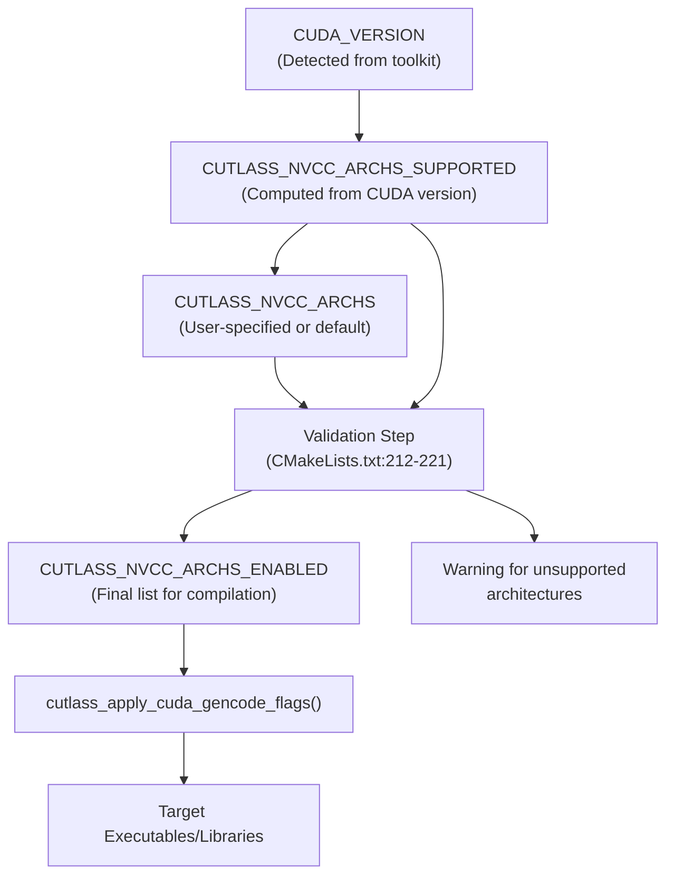
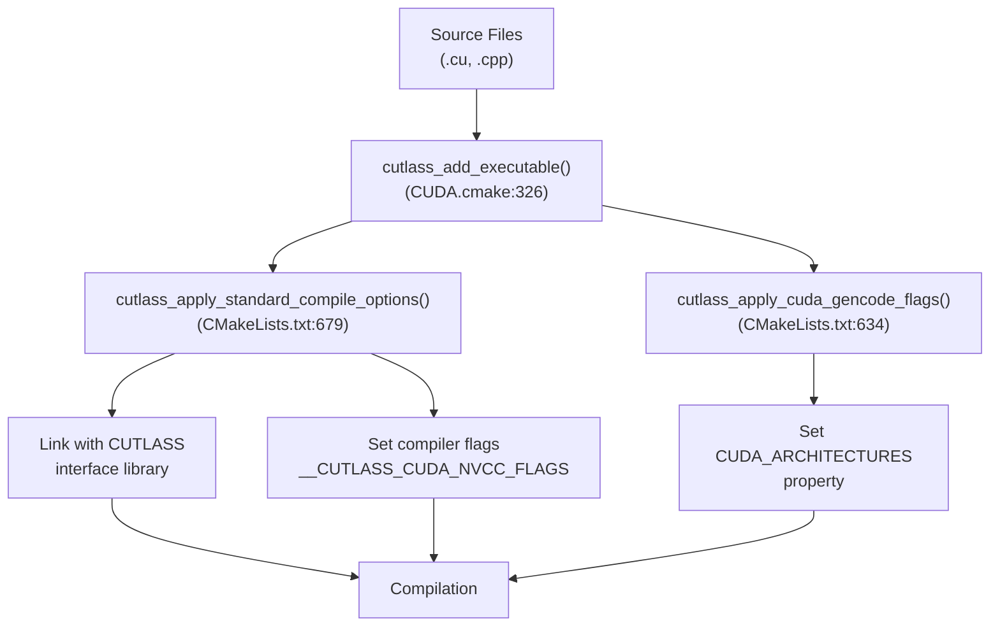
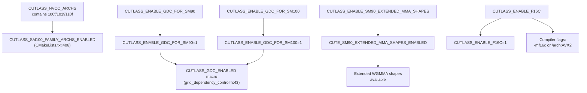

<!-- source: DeepWiki mcp.deepwiki.com · repo NVIDIA/cutlass · page 9.1 CMake Configuration and Architecture Flags · fetched 2026-10-26 -->

# CMake Configuration and Architecture Flags

<details>
<summary>Relevant source files</summary>

The following files were used as context for generating this wiki page:

- [CMakeLists.txt](CMakeLists.txt)
- [CUDA.cmake](CUDA.cmake)
- [Doxyfile](Doxyfile)
- [PUBLICATIONS.md](PUBLICATIONS.md)
- [cmake/version_extended.h.in](cmake/version_extended.h.in)
- [examples/02_dump_reg_shmem/CMakeLists.txt](examples/02_dump_reg_shmem/CMakeLists.txt)
- [examples/56_hopper_ptr_array_batched_gemm/CMakeLists.txt](examples/56_hopper_ptr_array_batched_gemm/CMakeLists.txt)
- [include/cute/atom/copy_traits_sm90_im2col.hpp](include/cute/atom/copy_traits_sm90_im2col.hpp)
- [include/cute/atom/copy_traits_sm90_tma.hpp](include/cute/atom/copy_traits_sm90_tma.hpp)
- [include/cutlass/arch/grid_dependency_control.h](include/cutlass/arch/grid_dependency_control.h)
- [include/cutlass/cuda_host_adapter.hpp](include/cutlass/cuda_host_adapter.hpp)
- [include/cutlass/gemm/collective/sm100_mma_warpspecialized_blockwise_scaling.hpp](include/cutlass/gemm/collective/sm100_mma_warpspecialized_blockwise_scaling.hpp)
- [test/unit/CMakeLists.txt](test/unit/CMakeLists.txt)
- [test/unit/conv/device/conv2d_problems.h](test/unit/conv/device/conv2d_problems.h)

</details>


## Purpose and Scope

This page documents the CMake configuration variables and functions that control GPU architecture targeting, compiler flags, and feature enablement in CUTLASS. This includes architecture selection (SM70-SM121+), gencode flag generation, and CMake functions for applying compilation settings to targets.

For information about CUDA host adapters and kernel launching, see [9.2](). For Python package build configuration, see [9.3](). For kernel library generation control, see [9.4]().

---

## Architecture Selection Variables

CUTLASS supports multiple NVIDIA GPU architectures through CMake configuration variables that determine which compute capabilities are compiled.

### CUTLASS_NVCC_ARCHS_SUPPORTED

This variable is automatically populated based on the detected CUDA version and contains the list of architectures that CUTLASS supports with the current CUDA toolkit.

[CMakeLists.txt:176-207]()

| CUDA Version | Supported Architectures |
|--------------|-------------------------|
| 11.4+ | 70, 72, 75, 80, 86, 87 |
| 11.8+ | +89, 90 |
| 12.0+ | +90a |
| 12.8+ | +100, 100a, 120, 120a, 121, 121a, 100f, 120f, 121f, 103a, 103f |
| 13.0+ | +110, 110a |

### CUTLASS_NVCC_ARCHS

User-configurable cache variable specifying which SM architectures to compile. Defaults to all supported architectures for the current CUDA version.

[CMakeLists.txt:209]()

**Example usage:**
```bash
cmake .. -DCUTLASS_NVCC_ARCHS="80;90;100"
```

### CUTLASS_NVCC_ARCHS_ENABLED

The actual list of architectures that will be compiled. This is used internally and defaults to `CUTLASS_NVCC_ARCHS`.

[CMakeLists.txt:210]()

### Architecture Validation

CUTLASS validates requested architectures against supported ones and issues warnings for unsupported compute capabilities.

[CMakeLists.txt:212-221]()

Sources: [CMakeLists.txt:176-221]()

---

## Architecture Configuration Flow

**Architecture Resolution Logic**


Sources: [CMakeLists.txt:176-221](), [CMakeLists.txt:634-662]()

---

## Architecture Flag Application Functions

CUTLASS provides CMake functions to apply architecture-specific compilation flags to targets.

### cutlass_apply_cuda_gencode_flags()

This function configures the `CUDA_ARCHITECTURES` target property based on the requested SM architectures. It translates architecture numbers into CMake's architecture specification format.

[CMakeLists.txt:634-662]()

**Function signature:**
```cmake
cutlass_apply_cuda_gencode_flags(TARGET [SM_ARCHS <arch_list>])
```

**Implementation details:**
- For each architecture, generates `-real` suffix for embedded CUBIN (if `CUTLASS_NVCC_EMBED_CUBIN` is ON) [CMakeLists.txt:648-650]()
- Generates `-virtual` suffix for embedded PTX (if `CUTLASS_NVCC_EMBED_PTX` is ON and not using Clang) [CMakeLists.txt:652-654]()
- Sets the `CUDA_ARCHITECTURES` property on the target [CMakeLists.txt:660]()

### cutlass_apply_standard_compile_options()

Applies standard CUTLASS compilation flags to a target, including architecture-specific flags, optimization flags, and debug settings.

[CMakeLists.txt:679-706]()

**What it does:**
1. Links the target with the `CUTLASS` interface library [CMakeLists.txt:683]()
2. Applies compiler-specific flags (`CUTLASS_CUDA_NVCC_FLAGS` or `CUTLASS_CUDA_CLANG_FLAGS`) [CMakeLists.txt:685-690]()
3. Applies build-type-specific flags (Release, RelWithDebInfo, Debug) [CMakeLists.txt:692-700]()
4. Uses generator expressions to apply flags only to CUDA compilation language [CMakeLists.txt:702-705]()

Sources: [CMakeLists.txt:634-706](), [CUDA.cmake:288-369]()

---

## Target Configuration Workflow

**Bridging Natural Language Requirements to Code Entities**


Sources: [CUDA.cmake:288-369](), [CMakeLists.txt:679-706]()

---

## Feature Control Flags

### Grid Dependency Control (GDC)

Enables programmatic dependent launches (PDL) for SM90 and SM100 architectures. This allows kernels to hint that a dependent kernel can be launched earlier, improving performance by overlapping communication or reducing latency.

| Variable | Default | Description |
|----------|---------|-------------|
| `CUTLASS_ENABLE_GDC_FOR_SM90` | OFF | Enable GDC for Hopper (SM90) kernels |
| `CUTLASS_ENABLE_GDC_FOR_SM100` | ON | Enable GDC for Blackwell (SM100) kernels |

[CMakeLists.txt:453-470]()

When enabled, defines preprocessor macros:
- `CUTLASS_ENABLE_GDC_FOR_SM90=1`
- `CUTLASS_ENABLE_GDC_FOR_SM100=1`

These are used in `include/cutlass/arch/grid_dependency_control.h` to conditionally compile `launch_dependent_grids()` and `wait_on_dependent_grids()` instructions using PTX `griddepcontrol`. [include/cutlass/arch/grid_dependency_control.h:43-99]()

### Tensor Core and MMA Configuration

| Variable | Default | Description |
|----------|---------|-------------|
| `CUTLASS_ENABLE_TENSOR_CORE_MMA` | ON (CUDA 10.1+) | Enable PTX `mma` instruction |
| `CUTLASS_ENABLE_SM90_EXTENDED_MMA_SHAPES` | OFF | Enable extended SM90 WGMMA shapes |

[CMakeLists.txt:383-401]()

### SM100 Family Architecture Flag

Special handling for SM100 family architectures (100f, 101f, 110f) enables family-specific optimizations for Blackwell variants. If any architecture in `CUTLASS_NVCC_ARCHS_ENABLED` belongs to the SM100 family, `CUTLASS_SM100_FAMILY_ARCHS_ENABLED` is set to ON. [CMakeLists.txt:403-409]()

### NVCC Output Control

| Variable | Default | Description |
|----------|---------|-------------|
| `CUTLASS_NVCC_EMBED_CUBIN` | ON | Embed compiled CUDA binaries |
| `CUTLASS_NVCC_EMBED_PTX` | ON | Embed compiled PTX |
| `CUTLASS_NVCC_KEEP` | OFF | Keep intermediate files generated by NVCC |

[CMakeLists.txt:283-286]()

### CPU Feature Flags

| Variable | Default | Description |
|----------|---------|-------------|
| `CUTLASS_ENABLE_F16C` | OFF | Enable F16C x86 extensions for host FP16 |

[CMakeLists.txt:286]()

When enabled, defines `CUTLASS_ENABLE_F16C=1` and adds `-mf16c` (GCC/Clang) or `/arch:AVX2` (MSVC) compiler flags to support hardware-accelerated half-precision conversions on the host. [CMakeLists.txt:516-523]()

Sources: [CMakeLists.txt:283-523](), [include/cutlass/arch/grid_dependency_control.h:43-107]()

---

## Feature Flag Dependencies

**Mapping Configuration Flags to Code Definitions**


Sources: [CMakeLists.txt:403-523](), [include/cutlass/arch/grid_dependency_control.h:43-74]()

---

## Compiler Flag Variables

CUTLASS maintains separate flag lists for different compilers and build configurations to ensure maximum performance and debugging capability.

### Flag Variable Structure

| Variable Base Name | Purpose |
|-------------------|---------|
| `CUTLASS_CUDA_FLAGS` | Common CUDA flags applied to all device targets |
| `CUTLASS_CUDA_NVCC_FLAGS` | NVCC-specific flags (e.g., `--expt-relaxed-constexpr`) |
| `CUTLASS_CUDA_CLANG_FLAGS` | Clang-specific flags for device compilation |

### Common CUDA Flags

Key flags added to `CUTLASS_CUDA_NVCC_FLAGS`:

- `--expt-relaxed-constexpr`: Allows `constexpr` functions to call non-`constexpr` functions in device code. [CMakeLists.txt:111]()
- `-ftemplate-backtrace-limit=0`: Disables the limit on template backtrace depth to aid in debugging complex CuTe templates. [CMakeLists.txt:113]()
- `-lineinfo`: Generates line number information for profiling tools, enabled for non-Release builds. [CMakeLists.txt:547-550]()

### Clang-Specific Flags

Clang is supported for device compilation (requires CMake 3.30+). [CUDA.cmake:75-83]()

Key Clang flags for device compilation [CMakeLists.txt:561-574]():
- `--cuda-path=${CUDA_TOOLKIT_ROOT_DIR}`
- `-D__NV_NO_HOST_COMPILER_CHECK=1`
- `-mllvm -pragma-unroll-threshold=100000`

Sources: [CMakeLists.txt:111-677](), [CUDA.cmake:75-83]()

---

## Kernel Generation Configuration

### CUTLASS_LIBRARY_KERNELS

Comma-delimited list of kernel name filters. Controls which kernel variants are instantiated by the `generator.py` script. [CMakeLists.txt:347]()

### CUTLASS_LIBRARY_OPERATIONS

Comma-delimited list of operation name filters (e.g., `"gemm"`, `"conv2d"`). This restricts the library generation to specific operation classes. [CMakeLists.txt:346]()

### KERNEL_FILTER_FILE

Path to a file containing specific kernel filters. If specified, the file path is made absolute and used by the generation pipeline to filter kernels. [CMakeLists.txt:295-311]()

Sources: [CMakeLists.txt:295-355]()

---

## Build Control Variables

### CUTLASS_UNITY_BUILD_ENABLED

Enables combined source compilation (unity builds) to reduce compilation memory usage and speed up build times. Defaults to ON for MSVC or when `CUTLASS_LIBRARY_KERNELS MATCHES "all"`. [CUDA.cmake:211-217]()

### CUTLASS_CUDA_USE_RESPONSE_FILE

Controls whether NVCC uses response files (`--options-file`) for includes, libraries, and objects to avoid command-line length limits on Windows. [CMakeLists.txt:78-84]()

Sources: [CMakeLists.txt:78-84](), [CUDA.cmake:211-287]()

---

## Summary Table of Key Variables

| Variable | Type | Default | Purpose |
|----------|------|---------|---------|
| `CUTLASS_NVCC_ARCHS_SUPPORTED` | Computed | Based on CUDA version | List of supported SM architectures |
| `CUTLASS_NVCC_ARCHS` | Cache (STRING) | All supported | SM architectures requested by user |
| `CUTLASS_NVCC_EMBED_PTX` | Cache (BOOL) | ON | Embed PTX in binaries |
| `CUTLASS_ENABLE_GDC_FOR_SM100` | Cache (BOOL) | ON | Enable GDC for Blackwell (SM100) |
| `CUTLASS_LIBRARY_KERNELS` | Cache (STRING) | "" | Kernel filter patterns for generation |
| `CUTLASS_UNITY_BUILD_ENABLED` | Cache (BOOL) | Platform-dependent | Enable unity builds to save memory |

Sources: [CMakeLists.txt:78-850](), [CUDA.cmake:211-226]()

---

