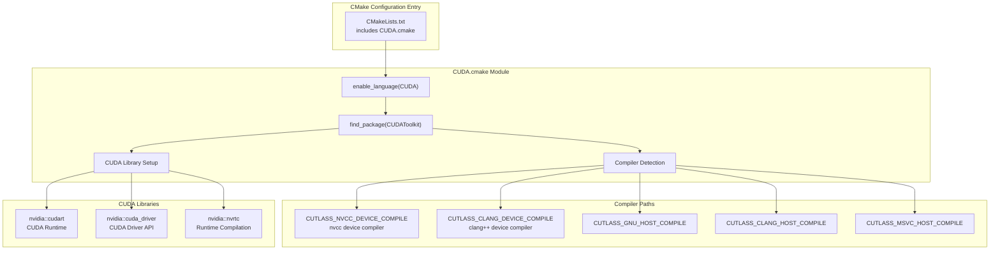
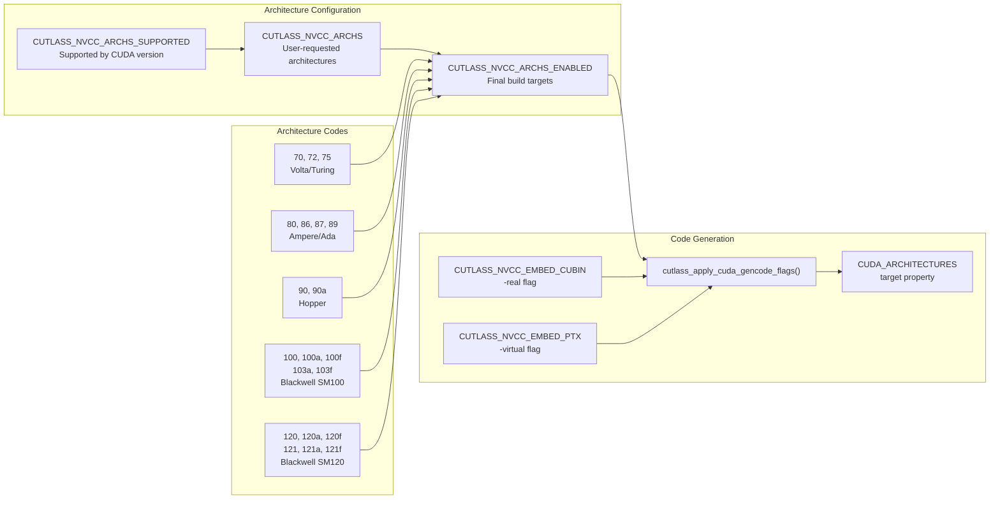
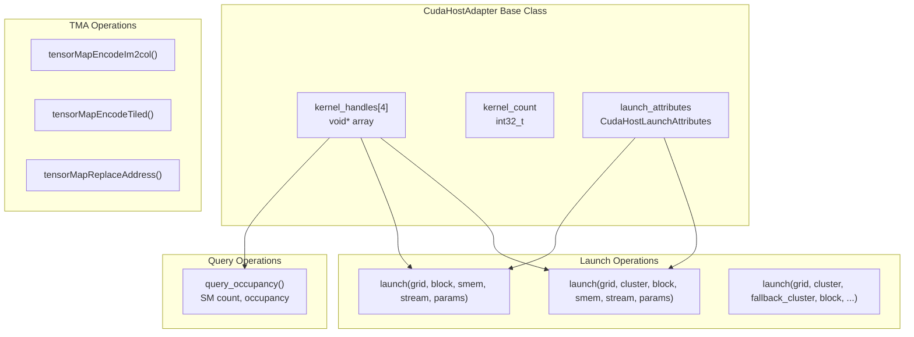
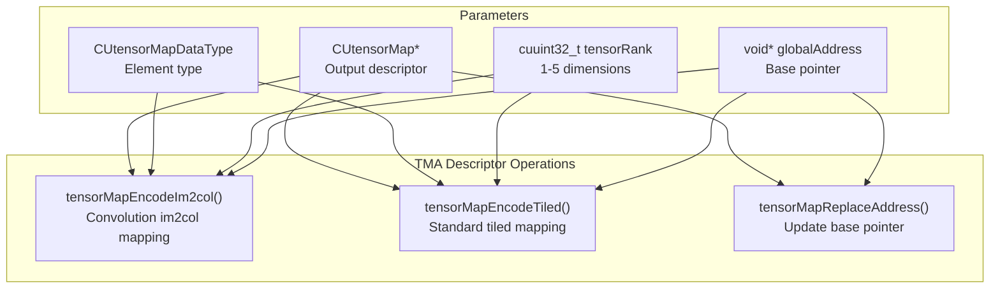

<!-- source: DeepWiki mcp.deepwiki.com · repo NVIDIA/cutlass · page 9.2 CUDA Compilation and Host Adapter · fetched 2026-10-26 -->

# CUDA Compilation and Host Adapter

<details>
<summary>Relevant source files</summary>

The following files were used as context for generating this wiki page:

- [CMakeLists.txt](CMakeLists.txt)
- [CUDA.cmake](CUDA.cmake)
- [Doxyfile](Doxyfile)
- [PUBLICATIONS.md](PUBLICATIONS.md)
- [cmake/version_extended.h.in](cmake/version_extended.h.in)
- [examples/02_dump_reg_shmem/CMakeLists.txt](examples/02_dump_reg_shmem/CMakeLists.txt)
- [examples/56_hopper_ptr_array_batched_gemm/CMakeLists.txt](examples/56_hopper_ptr_array_batched_gemm/CMakeLists.txt)
- [include/cute/atom/copy_traits_sm90_im2col.hpp](include/cute/atom/copy_traits_sm90_im2col.hpp)
- [include/cute/atom/copy_traits_sm90_tma.hpp](include/cute/atom/copy_traits_sm90_tma.hpp)
- [include/cutlass/arch/grid_dependency_control.h](include/cutlass/arch/grid_dependency_control.h)
- [include/cutlass/cuda_host_adapter.hpp](include/cutlass/cuda_host_adapter.hpp)
- [include/cutlass/gemm/collective/sm100_mma_warpspecialized_blockwise_scaling.hpp](include/cutlass/gemm/collective/sm100_mma_warpspecialized_blockwise_scaling.hpp)
- [test/unit/CMakeLists.txt](test/unit/CMakeLists.txt)
- [test/unit/conv/device/conv2d_problems.h](test/unit/conv/device/conv2d_problems.h)

</details>


This document describes CUTLASS's CUDA compilation infrastructure and the host-side adapter layer that abstracts interactions between device kernels and CUDA APIs. This includes CMake-based compilation configuration, architecture-specific flags, and the host adapter interface for kernel launches and TMA descriptor creation.

For information about device-side kernel execution and GPU architecture features, see [7. Hardware Architecture Implementations](). For details on the Python build system, see [9.3 Python Package Structure and Setup]().

## Overview

CUTLASS provides two primary compilation and runtime components:

1.  **CUDA Compilation System** (`CUDA.cmake`): CMake infrastructure for configuring NVCC/Clang compilation, architecture flags, and source file batching.
2.  **Host Adapter Layer** (`cuda_host_adapter.hpp`): Abstraction for launching kernels and creating TMA descriptors, supporting both CUDA Runtime API and CUDA Driver API.

These systems enable CUTLASS to compile for multiple GPU architectures while providing a uniform interface for host-side operations regardless of the underlying CUDA API.

## CUDA Compilation Configuration

### Compiler Detection and Setup

The compilation system detects and configures CUDA compilers through the `CUDA.cmake` module, which is included at the top level of the build system [CMakeLists.txt:74]().

Title: CUDA Build System Initialization


**Compiler Detection Logic**

The system detects the CUDA device compiler based on `CMAKE_CUDA_COMPILER_ID`:

[CUDA.cmake:73-79]()
```cmake
if (CMAKE_CUDA_COMPILER_ID MATCHES "(nvcc|[Nn][Vv][Ii][Dd][Ii][Aa])")
  set(CUTLASS_NVCC_DEVICE_COMPILE ON CACHE BOOL "Using nvcc tools for device compilation")
elseif (CMAKE_CUDA_COMPILER_ID MATCHES "[Cc]lang")
  set(CUTLASS_CLANG_DEVICE_COMPILE ON CACHE BOOL "Using Clang tools for device compilation")
else()
  message(FATAL_ERROR "Unknown device-side compiler ${CMAKE_CUDA_COMPILER_ID} found. Set CMAKE_CUDA_COMPILER to either nvcc or clang++.")
endif()
```

Host compilers are detected separately in the main project file: [CMakeLists.txt:62-70]().

Sources: [CUDA.cmake:29-79](), [CMakeLists.txt:62-70](), [CMakeLists.txt:74]()

### Architecture Flags and Code Generation

CUTLASS uses `CUTLASS_NVCC_ARCHS` to specify target GPU architectures. The system maps these to specific gencode flags based on the detected CUDA Toolkit version.

Title: Architecture Support Mapping


**Architecture Support Matrix by CUDA Version**

CUTLASS requires CUDA 9.2+ [CUDA.cmake:85-87]() but strongly recommends CUDA 11.8+ for modern architectures.

| CUDA Version | Supported Architectures |
| :--- | :--- |
| 11.4+ | 70, 72, 75, 80, 86, 87 [CMakeLists.txt:86-90]() |
| 11.8+ | + 89, 90 [include/cutlass/cuda_host_adapter.hpp:88-93]() |
| 12.0+ | + 90a (Hopper accelerated) [include/cutlass/cuda_host_adapter.hpp:57-59]() |
| 12.8+ | + 100, 101, 103, 110, 120, 121 [include/cutlass/arch/grid_dependency_control.h:57-75]() |

Sources: [CMakeLists.txt:86-90](), [CUDA.cmake:85-87](), [include/cutlass/arch/grid_dependency_control.h:57-75]()

### Compilation Functions

CUTLASS provides wrapper functions for adding CUDA-compiled targets with consistent configuration, including a "Unity Build" system to speed up compilation.

**Unity Build System**

When `CUTLASS_UNIT_TEST_SPLIT_FILES` is enabled, the build system can split or batch sources to manage memory during high-parallelism builds [test/unit/CMakeLists.txt:129-169](). This is particularly effective for large libraries like `cutlass_library`.

Sources: [test/unit/CMakeLists.txt:64-126](), [test/unit/CMakeLists.txt:129-169]()

## Host Adapter Architecture

The `CudaHostAdapter` class provides an abstraction layer between CUTLASS device kernels and CUDA host APIs, enabling support for both CUDA Runtime API and CUDA Driver API.

### CudaHostAdapter Class Structure

Title: Host Adapter Class Model


**CudaHostAdapter Declaration**

[include/cutlass/cuda_host_adapter.hpp:204-422]()

The base class defines pure virtual methods that concrete implementations must provide. It manages up to 4 kernel handles [include/cutlass/cuda_host_adapter.hpp:280]() and optional launch attributes.

**Launch Attributes**

The `CudaHostLaunchAttributes` structure wraps CUDA's `CUlaunchAttribute` array. It is enabled for CUDA 11.8+ [include/cutlass/cuda_host_adapter.hpp:51-55]().

```cpp
struct CudaHostLaunchAttributes {
#if defined(CUDA_HOST_ADAPTER_LAUNCH_ATTRIBUTES_ENABLED)
  static constexpr int32_t kMaximumAttributeCount = 5;
  CUlaunchAttribute launch_attributes[kMaximumAttributeCount];
  int32_t attribute_count = 0;
#endif
};
```

Sources: [include/cutlass/cuda_host_adapter.hpp:51-55](), [include/cutlass/cuda_host_adapter.hpp:168-199](), [include/cutlass/cuda_host_adapter.hpp:204-422]()

### Kernel Launch Methods

The adapter provides multiple launch signatures to accommodate different cluster configurations and hardware capabilities.

**Basic and Cluster Launches**

[include/cutlass/cuda_host_adapter.hpp:313-345]()

1.  **Basic Launch**: Standard grid/block launch.
2.  **Cluster Launch**: Includes `cluster_dims` for thread block clusters (SM90+).
3.  **Cluster Launch with Fallback**: Allows runtime selection between a preferred and a fallback cluster shape.

**Occupancy Query**

[include/cutlass/cuda_host_adapter.hpp:306-311]()

```cpp
virtual Status query_occupancy(
  int32_t *device_sms,
  int32_t *sm_occupancy,
  int32_t kernel_index,
  int32_t thread_count,
  int32_t smem_size) const = 0;
```

Sources: [include/cutlass/cuda_host_adapter.hpp:306-345]()

## TMA Descriptor Creation

For SM90+ architectures with Tensor Memory Accelerator (TMA) support, the host adapter provides methods to create and update `CUtensorMap` descriptors.

Title: TMA Descriptor Pipeline


**Descriptor Methods**

-   `tensorMapEncodeTiled`: Encodes a descriptor for standard tiled memory access patterns [include/cutlass/cuda_host_adapter.hpp:370-382]().
-   `tensorMapEncodeIm2col`: Encodes a descriptor for image-to-column convolution patterns [include/cutlass/cuda_host_adapter.hpp:352-367]().
-   `tensorMapReplaceAddress`: Updates the global memory base address in an existing descriptor [include/cutlass/cuda_host_adapter.hpp:385-387]().

Sources: [include/cutlass/cuda_host_adapter.hpp:352-387]()

## CUDA Driver API Wrappers

CUTLASS provides a wrapper system to invoke CUDA Driver API functions. This system supports both direct linking and runtime symbol lookup via `cudaGetDriverEntryPoint`.

**Wrapper Macro System**

[include/cutlass/cuda_host_adapter.hpp:97-147]()

The `CUTLASS_CUDA_DRIVER_WRAPPER_DECL` macro generates `call_##func` templates. Depending on `CUTLASS_ENABLE_DIRECT_CUDA_DRIVER_CALL`, these either call the function directly or resolve it at runtime using `cudaGetDriverEntryPoint` [include/cutlass/cuda_host_adapter.hpp:116-121]().

**Wrapped TMA Functions**

[include/cutlass/cuda_host_adapter.hpp:151-154]()

```cpp
#if (__CUDACC_VER_MAJOR__ >= 12)
CUTLASS_CUDA_DRIVER_WRAPPER_DECL(cuTensorMapEncodeTiled, 12000);
CUTLASS_CUDA_DRIVER_WRAPPER_DECL(cuTensorMapEncodeIm2col, 12000);
#endif
```

These are invoked using the `CUTLASS_CUDA_DRIVER_WRAPPER_CALL(func)` macro [include/cutlass/cuda_host_adapter.hpp:158]().

Sources: [include/cutlass/cuda_host_adapter.hpp:97-158]()

## Integration with Copy Traits

TMA descriptor management is integrated with CuTe's `Copy_Traits` for SM90 and SM100.

**SM90 TMA Load Traits**

[include/cute/atom/copy_traits_sm90_tma.hpp:103-124]()

The `Copy_Traits<SM90_TMA_LOAD, NumBitsPerTMA, AuxParams_>` holds a `TmaDescriptor`. It provides a `get_tma_descriptor()` method to access the underlying hardware descriptor [include/cute/atom/copy_traits_sm90_tma.hpp:121-123]().

**SM90 Im2col Load Traits**

[include/cute/atom/copy_traits_sm90_im2col.hpp:113-140]()

Similarly, `Copy_Traits<SM90_TMA_LOAD_IM2COL, NumBitsPerTMA, TMATensor>` manages an `Im2ColTmaDescriptor`. These traits are "non-executable" until a memory barrier is attached via the `.with(tma_mbar)` method [include/cute/atom/copy_traits_sm90_im2col.hpp:155-159]().

Sources: [include/cute/atom/copy_traits_sm90_tma.hpp:103-124](), [include/cute/atom/copy_traits_sm90_im2col.hpp:113-159]()

## Grid Dependency Control (GDC)

CUTLASS supports Programmatic Dependent Launches (PDL) via GDC helpers. This allows kernels to hint at or wait for dependent grid launches.

- `launch_dependent_grids()`: Issues the `griddepcontrol.launch_dependents` instruction [include/cutlass/arch/grid_dependency_control.h:85-89]().
- `wait_on_dependent_grids()`: Issues the `griddepcontrol.wait` instruction to enforce memory ordering [include/cutlass/arch/grid_dependency_control.h:95-99]().
- `IsGdcGloballyEnabled`: A static flag indicating if GDC is supported by the current architecture and compiler [include/cutlass/arch/grid_dependency_control.h:102-106]().

Sources: [include/cutlass/arch/grid_dependency_control.h:43-106]()

---

