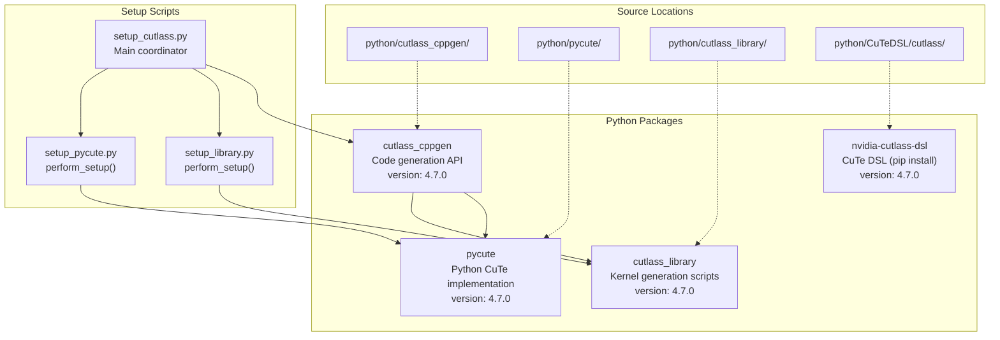
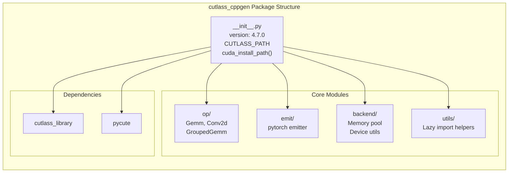
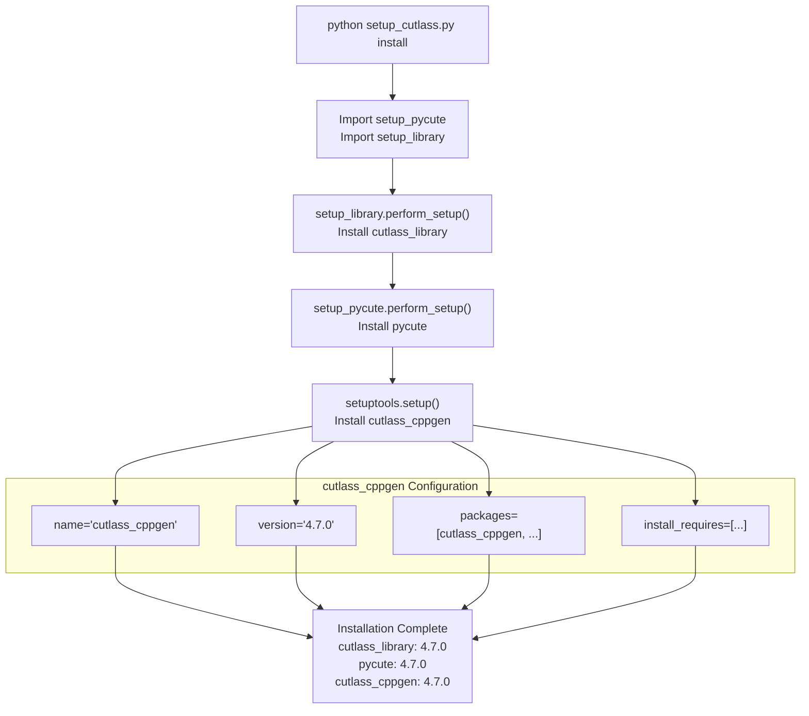
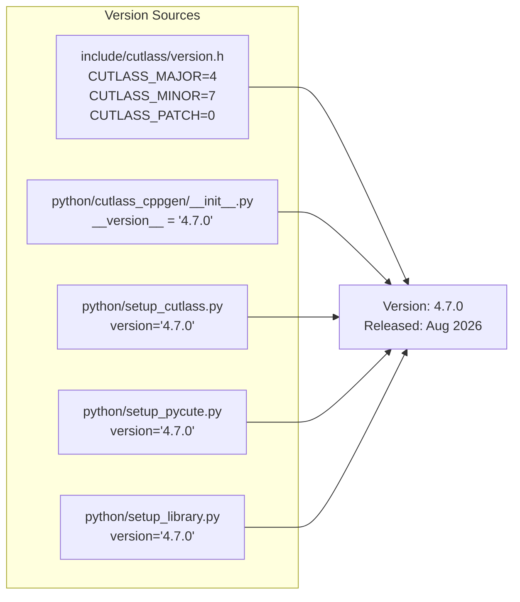

<!-- source: DeepWiki mcp.deepwiki.com · repo NVIDIA/cutlass · page 9.3 Python Package Structure and Setup · fetched 2026-10-26 -->

# Python Package Structure and Setup

<details>
<summary>Relevant source files</summary>

The following files were used as context for generating this wiki page:

- [CHANGELOG.md](CHANGELOG.md)
- [README.md](README.md)
- [include/cutlass/version.h](include/cutlass/version.h)
- [pyproject.toml](pyproject.toml)
- [python/CuTeDSL/cutlass/base_dsl/env_manager.py](python/CuTeDSL/cutlass/base_dsl/env_manager.py)
- [python/CuTeDSL/cutlass/base_dsl/runtime/cuda.py](python/CuTeDSL/cutlass/base_dsl/runtime/cuda.py)
- [python/CuTeDSL/cutlass/cute/__init__.py](python/CuTeDSL/cutlass/cute/__init__.py)
- [python/CuTeDSL/cutlass/cute/arch/nvvm_wrappers.py](python/CuTeDSL/cutlass/cute/arch/nvvm_wrappers.py)
- [python/CuTeDSL/cutlass/cute/core.py](python/CuTeDSL/cutlass/cute/core.py)
- [python/CuTeDSL/cutlass/jax/primitive.py](python/CuTeDSL/cutlass/jax/primitive.py)
- [python/CuTeDSL/requirements-cu13.txt](python/CuTeDSL/requirements-cu13.txt)
- [python/CuTeDSL/requirements.txt](python/CuTeDSL/requirements.txt)
- [python/README.md](python/README.md)
- [python/cutlass_cppgen/__init__.py](python/cutlass_cppgen/__init__.py)
- [python/docs_src/source/install.md](python/docs_src/source/install.md)
- [python/setup_cutlass.py](python/setup_cutlass.py)
- [python/setup_library.py](python/setup_library.py)
- [python/setup_pycute.py](python/setup_pycute.py)
- [setup.cfg](setup.cfg)

</details>


## Purpose and Scope

This page documents the Python package structure, setup scripts, and installation procedures for CUTLASS. It covers the organization of Python packages (`cutlass_cppgen`, `pycute`, `cutlass_library`, and the CuTe DSL package), their setup mechanisms, dependency management, and configuration via environment variables.

For information about building the C++ CUTLASS library and CMake configuration, see [CMake Configuration and Architecture Flags](#9.1). For information about the kernel library generation pipeline, see [Kernel Library Generation Pipeline](#9.4). For details on CuTe DSL Python interface specifics, see [CuTe DSL Kernel Authoring](#3.1) and [TVM FFI Integration](#3.2).

## Package Organization

CUTLASS provides four distinct Python packages that serve different purposes in the ecosystem. With the release of CUTLASS 4.7.0, these packages form a cohesive suite for both C++ kernel generation and Python-native JIT authoring.



**Package Hierarchy and Dependencies**

Sources: [python/setup_cutlass.py:1-75](), [python/setup_pycute.py:1-47](), [python/setup_library.py:1-47]()

## Package Details

### cutlass_cppgen Package

The `cutlass_cppgen` package provides a Pythonic interface for generating C++ CUTLASS kernel code programmatically. It serves as the primary entry point for the offline code generation pipeline.



**Key Components:**

| Component | Description | Source |
|-----------|-------------|--------|
| `__version__` | Package version string `'4.7.0'` | [python/cutlass_cppgen/__init__.py:136]() |
| `CUTLASS_PATH` | Environment variable or library source path | [python/cutlass_cppgen/__init__.py:54]() |
| `cuda_install_path()` | Lazy CUDA toolkit path discovery | [python/cutlass_cppgen/__init__.py:73-82]() |
| `nvcc_version()` | NVCC version detection | [python/cutlass_cppgen/__init__.py:60-70]() |
| `device_cc()` | Device compute capability detection | [python/cutlass_cppgen/__init__.py:123]() |

**Package Installation:**

The package is configured with specific dependencies in [python/setup_cutlass.py:52-74]():

```python
# Package structure
packages=[
    'cutlass_cppgen',
    'cutlass_cppgen.emit',
    'cutlass_cppgen.op',
    'cutlass_cppgen.utils',
    'cutlass_cppgen.backend',
    'cutlass_cppgen.backend.utils'
]

# Dependencies
install_requires=[
    'bfloat16',
    'cuda-python>=11.8.0',
    'pybind11',
    'scikit-build',
    'treelib',
    'pydot'
]
```

Sources: [python/cutlass_cppgen/__init__.py:1-214](), [python/setup_cutlass.py:52-74]()

### pycute Package

The `pycute` package provides a pure Python implementation of CuTe concepts (layouts, shapes, strides) for use in code generation and offline layout computation.

**Configuration:**

The setup is minimal with no external dependencies:

```python
# From setup_pycute.py
setup(
    name='pycute',
    version='4.7.0',
    description='Python implementation of CuTe',
    packages=['pycute'],
)
```

Sources: [python/setup_pycute.py:36-43]()

### cutlass_library Package

The `cutlass_library` package contains Python scripts and data structures for kernel generation, enumeration, and the CUTLASS profiler backend. It defines core enumerations such as `DataType`, `LayoutType`, and `MathOperation` [python/cutlass_cppgen/__init__.py:86-95]().

**Configuration:**

```python
# From setup_library.py
setup(
    name='cutlass_library',
    version='4.7.0',
    description='CUTLASS library generation scripts',
    packages=['cutlass_library']
)
```

Sources: [python/setup_library.py:36-43](), [python/cutlass_cppgen/__init__.py:86-95]()

### CuTe DSL Package (nvidia-cutlass-dsl)

The CuTe DSL is distributed as a separate pip-installable package (`nvidia-cutlass-dsl`) for JIT kernel authoring. It supports multiple CUDA versions, including specific requirements for CUDA 13.3+ via `nvidia-cutlass-dsl[cu13]` [python/CuTeDSL/requirements-cu13.txt:3]().

**Key Features (v4.7.0):**
*   **Primitives API:** Experimental thin wrapper over NVVM operations for SIMT-based Tensor Core programming [README.md:50-52]().
*   **Task Scheduling Framework:** Static analysis of execution schedules for warp-specialized kernels to detect concurrency issues [README.md:53]().
*   **Improved Compiler Diagnostics:** Reporting of register spills and local memory usage with source line numbers [README.md:54]().
*   **Fine-grained Compilation:** `cute.compile_to` API for controlling output stages (MLIR, PTX, CUBIN) [CHANGELOG.md:60]().
*   **IKET Profiler:** Instrumentation-based In-Kernel-Event-Tracing for warp-specialized kernel performance analysis [CHANGELOG.md:61]().

Sources: [python/CuTeDSL/requirements.txt:1-4](), [python/CuTeDSL/requirements-cu13.txt:1-4](), [README.md:48-55]()

## Setup Script Execution Flow

The main setup coordinator is `setup_cutlass.py`, which orchestrates the installation of the core code generation packages.



**Execution Sequence:**

1.  **Import dependent setup modules** [python/setup_cutlass.py:40-41]()
2.  **Install cutlass_library** via `setup_library.perform_setup()` [python/setup_cutlass.py:45]()
3.  **Install pycute** via `setup_pycute.perform_setup()` [python/setup_cutlass.py:49]()
4.  **Install cutlass_cppgen** via main `setup()` call [python/setup_cutlass.py:52-74]()

Sources: [python/setup_cutlass.py:34-74]()

## Environment Variables and Configuration

CUTLASS Python packages use environment variables for configuration, particularly for locating the CUDA toolkit and managing JIT artifacts.

### Key Environment Variables

**CUDA Configuration:**

| Variable | Purpose | Discovery Method |
|----------|---------|------------------|
| `CUDA_INSTALL_PATH` | CUDA toolkit location | `_cuda_install_path_from_nvcc()` [python/cutlass_cppgen/__init__.py:81]() |
| `CUTLASS_PATH` | CUTLASS source root | Defaults to `cutlass_library.source_path` [python/cutlass_cppgen/__init__.py:54]() |

**DSL Runtime Configuration:**

The CuTe DSL supports advanced caching and FFI features:

| Variable | Description | Source |
|----------|-------------|--------|
| `__cache_key__` | Stable, hashable representation for compiled function caching | [CHANGELOG.md:106]() |
| `ENABLE_TVM_FFI` | Enable TVM FFI for reduced host overhead | [python/CuTeDSL/cutlass/cute/__init__.py:245]() |

Sources: [python/cutlass_cppgen/__init__.py:39-82](), [CHANGELOG.md:103-111]()

## Version Management

All CUTLASS components share a synchronized versioning scheme. The version is centrally defined in the C++ headers and mirrored in Python setup scripts.



**Version Calculation:**

The C++ library defines version components:
```cpp
// From include/cutlass/version.h
#define CUTLASS_MAJOR 4
#define CUTLASS_MINOR 7
#define CUTLASS_PATCH 0
#define CUTLASS_VERSION ((CUTLASS_MAJOR)*100 + (CUTLASS_MINOR)*10 + CUTLASS_PATCH)
// = 470
```

Sources: [include/cutlass/version.h:41-52](), [python/cutlass_cppgen/__init__.py:136](), [python/setup_cutlass.py:54](), [python/setup_pycute.py:39](), [python/setup_library.py:39]()

---

