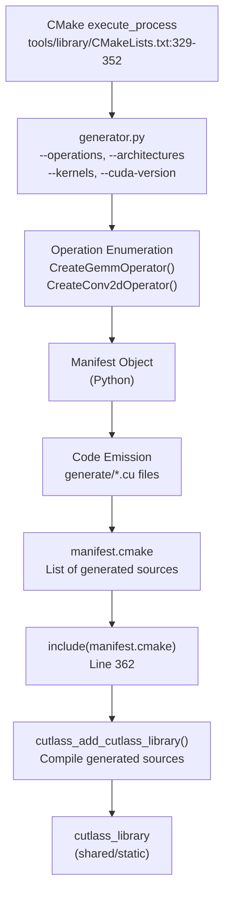
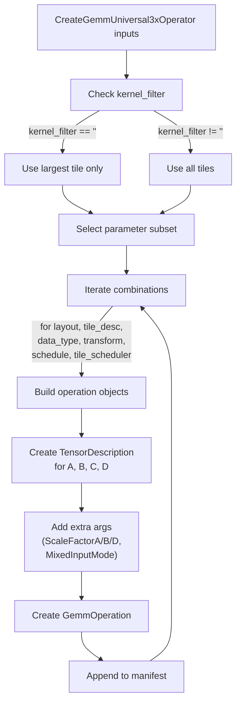
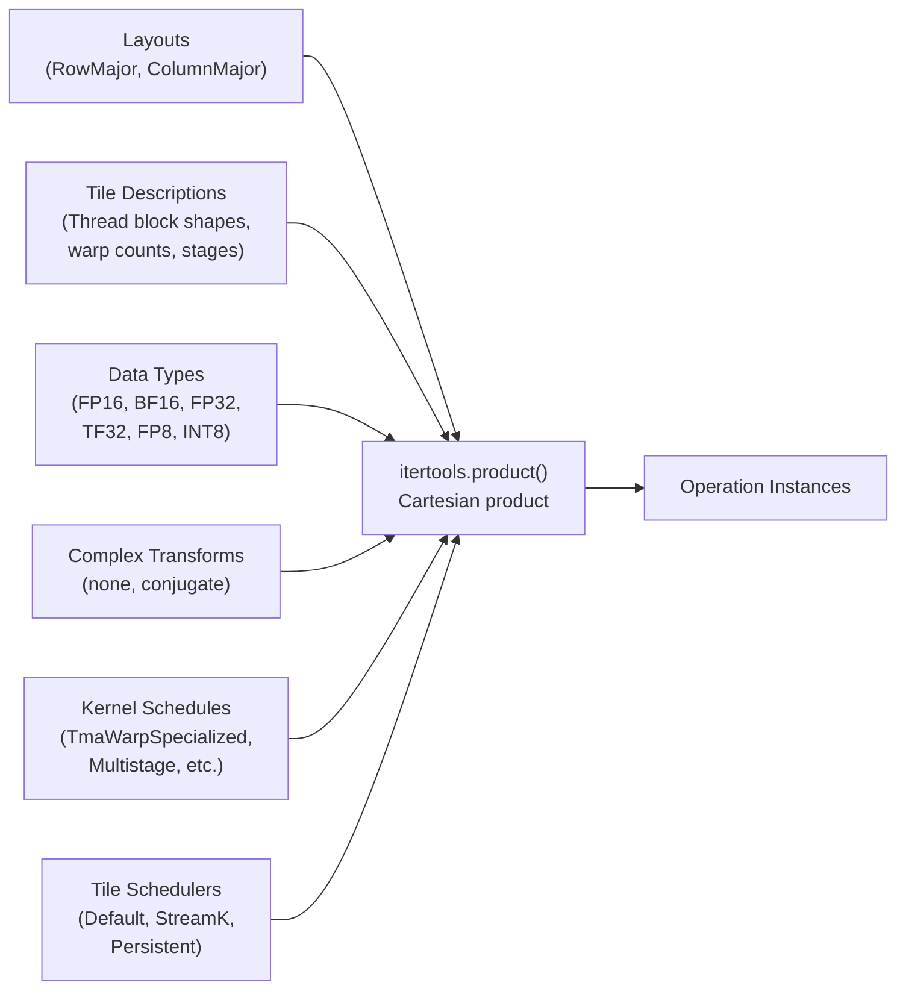
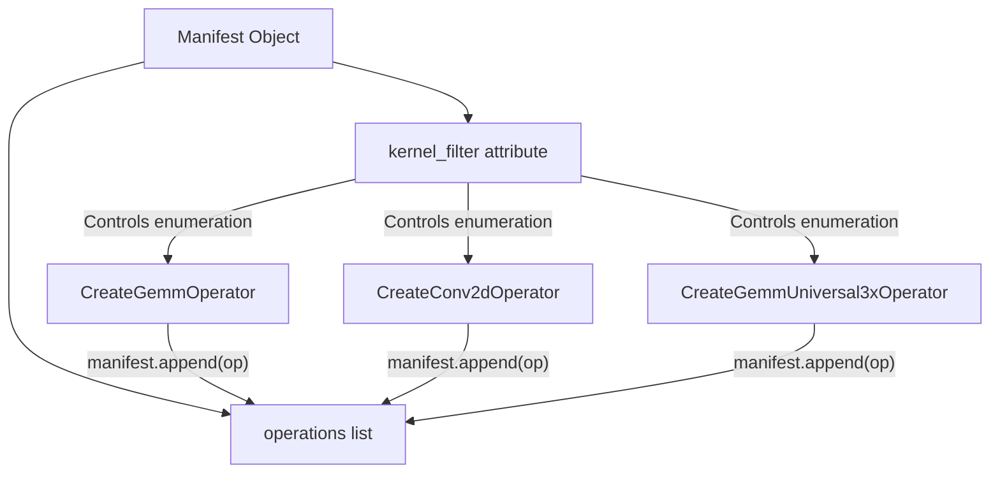
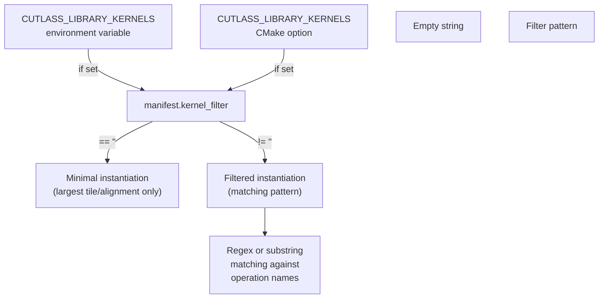
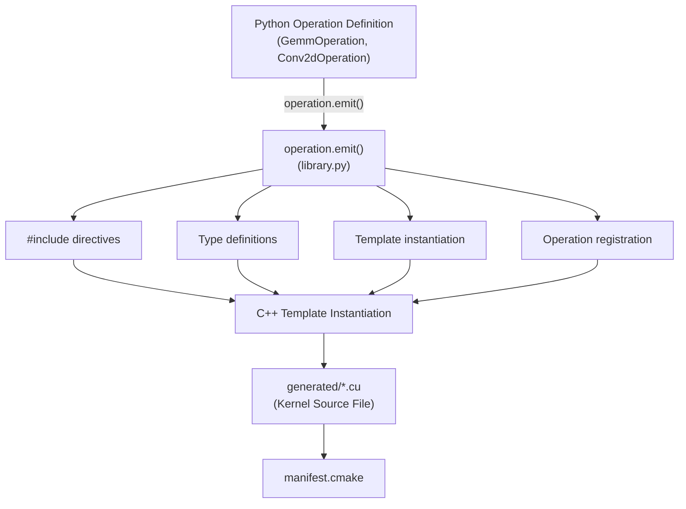
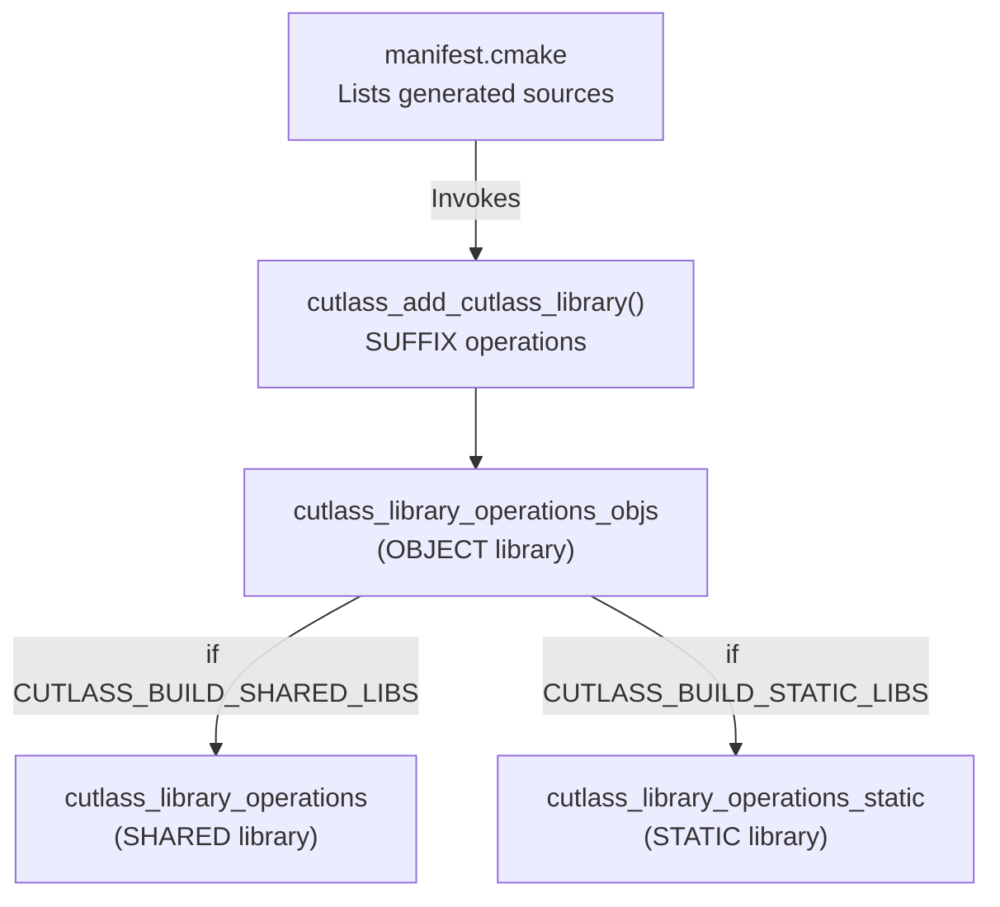
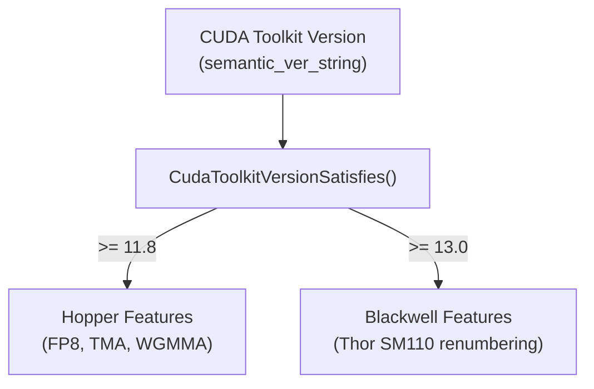

<!-- source: DeepWiki mcp.deepwiki.com · repo NVIDIA/cutlass · page 9.4 Kernel Library Generation Pipeline · fetched 2026-10-26 -->

# Kernel Library Generation Pipeline

<details>
<summary>Relevant source files</summary>

The following files were used as context for generating this wiki page:

- [examples/python/CuTeDSL/cute_ext/blackwell/dense_gemm.py](examples/python/CuTeDSL/cute_ext/blackwell/dense_gemm.py)
- [include/cutlass/epilogue/collective/builders/sm100_builder.inl](include/cutlass/epilogue/collective/builders/sm100_builder.inl)
- [include/cutlass/epilogue/collective/builders/sm120_builder.inl](include/cutlass/epilogue/collective/builders/sm120_builder.inl)
- [include/cutlass/epilogue/collective/sm100_epilogue_array_nosmem.hpp](include/cutlass/epilogue/collective/sm100_epilogue_array_nosmem.hpp)
- [include/cutlass/epilogue/collective/sm100_epilogue_nosmem.hpp](include/cutlass/epilogue/collective/sm100_epilogue_nosmem.hpp)
- [include/cutlass/float8.h](include/cutlass/float8.h)
- [include/cutlass/gemm/collective/builders/sm120_blockscaled_mma_builder.inl](include/cutlass/gemm/collective/builders/sm120_blockscaled_mma_builder.inl)
- [include/cutlass/gemm/collective/builders/sm120_common.inl](include/cutlass/gemm/collective/builders/sm120_common.inl)
- [include/cutlass/gemm/device/default_gemm_configuration.h](include/cutlass/gemm/device/default_gemm_configuration.h)
- [include/cutlass/gemm/warp/default_mma_tensor_op_sm80.h](include/cutlass/gemm/warp/default_mma_tensor_op_sm80.h)
- [include/cutlass/gemm/warp/mma_mixed_input_tensor_op.h](include/cutlass/gemm/warp/mma_mixed_input_tensor_op.h)
- [python/CuTeDSL/cutlass/cute/nvgpu/cpasync/copy.py](python/CuTeDSL/cutlass/cute/nvgpu/cpasync/copy.py)
- [python/cutlass_library/generator.py](python/cutlass_library/generator.py)
- [test/unit/core/fast_numeric_conversion.cu](test/unit/core/fast_numeric_conversion.cu)
- [test/unit/gemm/device/gemm_universal_s4t_s8n_s32t_mixed_input_tensor_op_s32_sm80.cu](test/unit/gemm/device/gemm_universal_s4t_s8n_s32t_mixed_input_tensor_op_s32_sm80.cu)
- [test/unit/gemm/device/gemm_universal_s4t_s8n_s8t_mixed_input_tensor_op_s32_sm80.cu](test/unit/gemm/device/gemm_universal_s4t_s8n_s8t_mixed_input_tensor_op_s32_sm80.cu)
- [test/unit/gemm/device/gemm_universal_s8t_s4n_s32t_mixed_input_tensor_op_s32_sm80.cu](test/unit/gemm/device/gemm_universal_s8t_s4n_s32t_mixed_input_tensor_op_s32_sm80.cu)
- [test/unit/gemm/device/gemm_universal_s8t_s4n_s8t_mixed_input_tensor_op_s32_sm80.cu](test/unit/gemm/device/gemm_universal_s8t_s4n_s8t_mixed_input_tensor_op_s32_sm80.cu)
- [test/unit/gemm/warp/gemm_mixed_input_sm80.cu](test/unit/gemm/warp/gemm_mixed_input_sm80.cu)
- [tools/library/CMakeLists.txt](tools/library/CMakeLists.txt)
- [tools/library/include/cutlass/library/handle.h](tools/library/include/cutlass/library/handle.h)
- [tools/library/include/cutlass/library/library.h](tools/library/include/cutlass/library/library.h)
- [tools/library/src/conv2d_operation.h](tools/library/src/conv2d_operation.h)
- [tools/library/src/conv3d_operation.h](tools/library/src/conv3d_operation.h)
- [tools/library/src/gemm_operation.h](tools/library/src/gemm_operation.h)
- [tools/library/src/handle.cu](tools/library/src/handle.cu)
- [tools/library/src/reduction/reduction_operation.h](tools/library/src/reduction/reduction_operation.h)
- [tools/library/src/reference/conv_reference_operation.h](tools/library/src/reference/conv_reference_operation.h)
- [tools/library/src/reference/gemm_reference_operation.h](tools/library/src/reference/gemm_reference_operation.h)
- [tools/library/src/reference/initialize_reference_operations.cu](tools/library/src/reference/initialize_reference_operations.cu)

</details>


## Purpose and Scope

This document describes the kernel library generation pipeline, which transforms high-level operation specifications written in Python into optimized GPU kernel implementations compiled into static libraries and profiler tools. The pipeline handles parameter space enumeration, manifest creation, selective kernel instantiation, and C++ code emission.

For CMake build system configuration and architecture flags, see [CMake Configuration and Architecture Flags](#9.1). For CUDA compilation details, see [CUDA Compilation and Host Adapter](#9.2). For Python package structure, see [Python Package Structure and Setup](#9.3).

## Pipeline Overview

The kernel library generation pipeline transforms operation specifications into compiled GPU binaries through CMake-driven Python code generation:

Title: Library Generation Data Flow


**Pipeline Stages:**

1. **CMake Invocation** ([tools/library/CMakeLists.txt:329-352]()): CMake invokes `generator.py` with architecture, kernel filter, and CUDA version parameters.
2. **Operation Enumeration**: Generator functions create operation instances by enumerating parameter combinations.
3. **Manifest Creation**: Operations are collected into a Python `Manifest` object.
4. **Code Emission**: C++ source files (`.cu`) are written to `${CMAKE_CURRENT_BINARY_DIR}/generated/`.
5. **Manifest CMake File**: A `manifest.cmake` file lists all generated source files and their compiler flags.
6. **CMake Integration**: The manifest is included and used to configure library compilation targets.
7. **Compilation**: NVCC compiles generated sources into `cutlass_library` (shared and/or static).

**Sources**: [tools/library/CMakeLists.txt:329-366](), [python/cutlass_library/generator.py:1-100]()

## Operation Definition Functions

The generator provides specialized functions for creating different operation types. Each function accepts parameter specifications and generates operation instances.

### Core Generator Functions

| Function | Purpose | Key Parameters |
|----------|---------|----------------|
| `CreateGemmOperator` | Universal GEMM kernels (2.x API) | layouts, tile_descriptions, data_type, alignment_constraints [python/cutlass_library/generator.py:142-178]() |
| `CreateGemmUniversal3xOperator` | GEMM kernels with 3.x API | layouts, tile_descriptions, data_types, schedules, tile_schedulers [python/cutlass_library/generator.py:181-269]() |
| `CreateSparseGemmOperator` | Sparse GEMM (2.x API) | layouts, tile_descriptions, data_type, alignment_constraints [python/cutlass_library/generator.py:272-317]() |
| `CreateSparseGemmUniversal3xOperator` | Sparse GEMM (3.x API) | layouts, tile_descriptions, data_types, schedules [python/cutlass_library/generator.py:320-355]() |
| `CreateGemmGroupedOperator` | Grouped GEMM operations | layouts, tile_descriptions, data_type, alignment_constraints [python/cutlass_library/generator.py:391-424]() |
| `CreateConv2dOperator` | 2D convolution kernels | layout, tile_descriptions, data_type, conv_kinds [python/cutlass_library/generator.py:573-679]() |
| `CreateConv3dOperator` | 3D convolution kernels | layout, tile_descriptions, data_type, conv_kinds [python/cutlass_library/generator.py:774-846]() |

**Sources**: [python/cutlass_library/generator.py:142-846]()

### GEMM Universal 3.x Operation Creation

Title: CreateGemmUniversal3xOperator Logic


**Sources**: [python/cutlass_library/generator.py:181-269]()

## Parameter Space Enumeration

Operation generators enumerate combinations of parameters to create a comprehensive library of kernel variants. The enumeration strategy depends on the `kernel_filter` setting.

### Default Filtering Behavior

```python
# From generator.py lines 154-156
if manifest.kernel_filter == '':
    tile_descriptions = [tile_descriptions[0],]
    alignment_constraints = [alignment_constraints[0],]
```

When `kernel_filter` is empty (default), only the largest tile size and largest alignment are instantiated to minimize build times. This produces a baseline library suitable for most use cases.

**Sources**: [python/cutlass_library/generator.py:154-156](), [python/cutlass_library/generator.py:202-206]()

### Full Parameter Space

When `kernel_filter` is non-empty, the generator enumerates all combinations using `itertools.product` and `chain` [python/cutlass_library/generator.py:39]().

Title: Cartesian Product of Parameters


**Sources**: [python/cutlass_library/generator.py:39](), [python/cutlass_library/generator.py:207-268]()

### Mixed-Input and Block-Scaled Variants

For kernels with mixed-precision inputs or block-scaled formats (like SM100/SM120), the generator creates additional variants:

| Mode | Purpose | Generated Variants |
|------|---------|-------------------|
| `ConvertOnly` | Upcasts narrow type to match wide type | 1 variant |
| `ScaleOnly` | Applies per-element scale factor | 1 variant |
| `ScaleWithZeroPoint` | Applies scale and zero-point | 1 variant |
| `BlockScaled` | SM120 blockwise scaling [include/cutlass/gemm/collective/builders/sm120_blockscaled_mma_builder.inl:53-85]() | Architecture-specific variants |

**Sources**: [python/cutlass_library/generator.py:237-268](), [include/cutlass/gemm/collective/builders/sm120_blockscaled_mma_builder.inl:53-85]()

## Manifest System

The manifest collects operation definitions during generation and provides filtering capabilities.

### Manifest Structure

Title: Manifest Component Interaction


**Sources**: [python/cutlass_library/generator.py:175-176](), [python/cutlass_library/generator.py:266-267]()

## Kernel Filtering with CUTLASS_LIBRARY_KERNELS

The `CUTLASS_LIBRARY_KERNELS` environment variable or CMake option controls which kernel variants are instantiated.

### Filter Specification

Title: Kernel Filtering Workflow


**Sources**: [python/cutlass_library/generator.py:202-206]()

## C++ Code Emission

Python operation definitions are emitted as C++ template instantiations.

### Code Generation Flow

Title: Emission to Source Code


**Sources**: [python/cutlass_library/generator.py:172-176]()

## CMake Invocation of Generator

The generator is invoked during CMake configuration via `execute_process`:

```cmake
# From tools/library/CMakeLists.txt:329-352
execute_process(
  WORKING_DIRECTORY ${CMAKE_CURRENT_SOURCE_DIR}/../../python/cutlass_library
  COMMAND ${CMAKE_COMMAND} -E env PYTHONPATH=${CUTLASS_LIBRARY_PACKAGE_DIR}
    ${Python3_EXECUTABLE} ${CUTLASS_SOURCE_DIR}/python/cutlass_library/generator.py
    --operations "${CUTLASS_LIBRARY_OPERATIONS}"
    --build-dir ${PROJECT_BINARY_DIR}
    --curr-build-dir ${CMAKE_CURRENT_BINARY_DIR}
    --generator-target library
    --architectures "${CUTLASS_NVCC_ARCHS_ENABLED}"
    --kernels "${CUTLASS_LIBRARY_KERNELS}"
    --instantiation-level "${CUTLASS_LIBRARY_INSTANTIATION_LEVEL}"
    --ignore-kernels "${CUTLASS_LIBRARY_IGNORE_KERNELS}"
    --exclude-kernels "${CUTLASS_LIBRARY_EXCLUDE_KERNELS}"
    --kernel-filter-file "${KERNEL_FILTER_FILE}"
    --selected-kernel-list "${CUTLASS_LIBRARY_GENERATED_KERNEL_LIST_FILE}"
    --cuda-version "${CUTLASS_GENERATOR_CUDA_COMPILER_VERSION}"
  OUTPUT_FILE ${CMAKE_CURRENT_BINARY_DIR}/library_instance_generation.log
)
```

**Sources**: [tools/library/CMakeLists.txt:329-352]()

## Library Compilation from Generated Sources

The `cutlass_add_cutlass_library()` function defined in [tools/library/CMakeLists.txt:89-223]() creates library targets:

Title: CMake Target Generation


**Large Library Support:** On Linux x86_64, the build system applies `-mcmodel=medium` to handle libraries exceeding 2GB [tools/library/CMakeLists.txt:129-137]().

**Sources**: [tools/library/CMakeLists.txt:89-223](), [tools/library/CMakeLists.txt:129-137]()

## Epilogue and Schedule Configuration

The 3.x API supports configurable kernel schedules and epilogue schedules:

### Blackwell (SM120) Builder Policies

The `CollectiveBuilder` for SM120 selects shared memory atoms and schedules based on input data types and tile shapes.

| Component | Selector Logic |
|-----------|---------------|
| **Mainloop MMA** | `detail::blockscaled::select_instr` for BlockScaled operations [include/cutlass/gemm/collective/builders/sm120_blockscaled_mma_builder.inl:107-112]() |
| **SMEM Copy A** | `sm120_rr_smem_copy_selector_A` handles SU6/SU4 LDSM for FP8/FP6/FP4 [include/cutlass/gemm/collective/builders/sm120_common.inl:55-70]() |
| **Epilogue Policy** | `sm120_get_tma_dispatch_policy` determines TMA stages and reuse strategies [include/cutlass/epilogue/collective/builders/sm120_builder.inl:78-114]() |

**Sources**: [include/cutlass/gemm/collective/builders/sm120_blockscaled_mma_builder.inl:107-112](), [include/cutlass/gemm/collective/builders/sm120_common.inl:55-70](), [include/cutlass/epilogue/collective/builders/sm120_builder.inl:78-114]()

## Architecture-Specific Generation

The generator adapts operation creation based on target GPU architecture and CUDA version.

### CUDA Toolkit Version Checks

Title: Version-Gated Generation


**Architecture Renumbering:** CUDA 13.0 renumbered Thor architecture from SM101 to SM110 [python/cutlass_library/generator.py:118-119]().

**Sources**: [python/cutlass_library/generator.py:103-119]()

---

