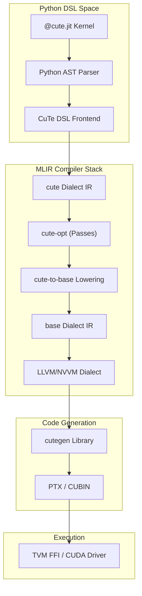
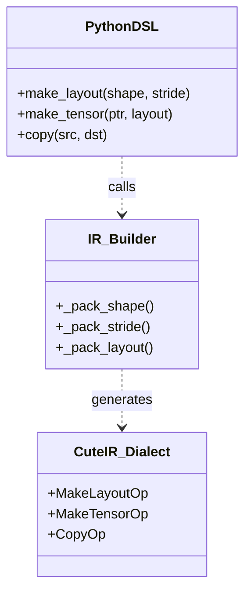

<!-- source: DeepWiki mcp.deepwiki.com · repo NVIDIA/cutlass · page 9.5 CuTe IR Compiler Stack · fetched 2026-10-26 -->

# CuTe IR Compiler Stack

Relevant source files

The following files were used as context for generating this wiki page:

- [CHANGELOG.md](CHANGELOG.md)
- [README.md](README.md)
- [include/cutlass/version.h](include/cutlass/version.h)
- [python/CuTeDSL/cutlass/base_dsl/env_manager.py](python/CuTeDSL/cutlass/base_dsl/env_manager.py)
- [python/CuTeDSL/cutlass/base_dsl/runtime/cuda.py](python/CuTeDSL/cutlass/base_dsl/runtime/cuda.py)
- [python/CuTeDSL/cutlass/base_dsl/tvm_ffi_builder/mlir_builder.py](python/CuTeDSL/cutlass/base_dsl/tvm_ffi_builder/mlir_builder.py)
- [python/CuTeDSL/cutlass/cute/__init__.py](python/CuTeDSL/cutlass/cute/__init__.py)
- [python/CuTeDSL/cutlass/cute/arch/nvvm_wrappers.py](python/CuTeDSL/cutlass/cute/arch/nvvm_wrappers.py)
- [python/CuTeDSL/cutlass/cute/core.py](python/CuTeDSL/cutlass/cute/core.py)
- [python/CuTeDSL/cutlass/cutlass_dsl/tvm_ffi_provider.py](python/CuTeDSL/cutlass/cutlass_dsl/tvm_ffi_provider.py)
- [python/CuTeDSL/cutlass/jax/primitive.py](python/CuTeDSL/cutlass/jax/primitive.py)
- [python/CuTeDSL/requirements-cu13.txt](python/CuTeDSL/requirements-cu13.txt)
- [python/CuTeDSL/requirements.txt](python/CuTeDSL/requirements.txt)
- [python/cutlass_cppgen/__init__.py](python/cutlass_cppgen/__init__.py)
- [python/setup_cutlass.py](python/setup_cutlass.py)
- [python/setup_library.py](python/setup_library.py)
- [python/setup_pycute.py](python/setup_pycute.py)

The **CuTe IR Compiler Stack** is an MLIR-based infrastructure within the `cutlass_compiler/` directory that bridges the gap between the high-level Python CuTe DSL and the low-level CUDA/PTX execution. It provides a structured Intermediate Representation (IR) to represent CuTe's algebraic abstractions—such as Shapes, Strides, and Layouts—enabling static analysis, optimization, and code generation for complex GPU kernels.

## 1. Dialect Stack Architecture

The stack consists of two primary MLIR dialects that work in tandem to lower high-level tensor operations into executable code.

*   **CuTe Dialect (`cute`):** Captures high-level CuTe abstractions including `Layout`, `Shape`, `Stride`, and `Tensor` [python/CuTeDSL/cutlass/cute/core.py:33-43](). It defines operations for layout algebra (composition, complement, product) and tensor manipulation.
*   **Base Dialect (`base`):** Provides a lower-level abstraction for hardware-specific primitives, memory management, and SIMT execution patterns [python/CuTeDSL/cutlass/cute/core.py:57-59]().

### Compiler Pipeline Data Flow

The following diagram illustrates how a kernel defined in the Python DSL flows through the CuTe IR stack:

**CuTe IR Compilation Workflow**

Sources: [python/CuTeDSL/cutlass/cute/core.py:33-56](), [python/CuTeDSL/cutlass/cutlass_dsl/__init__.py:229-234]().

## 2. Core Dialect Types and Ops

The `cute` dialect mirrors the C++ CuTe library's algebraic types to maintain performance parity and mathematical correctness.

### 2.1 CuTe Types
The IR supports the following core types, which are packed into MLIR values:
*   **Shape & Stride:** Represented as nested `IntTuple` structures [python/CuTeDSL/cutlass/cute/core.py:210-225]().
*   **Layout:** A composition of Shape and Stride [python/CuTeDSL/cutlass/cute/core.py:72-77]().
*   **Tensor:** Represents a pointer associated with a Layout and an `AddressSpace` (Global, Shared, or Register) [python/CuTeDSL/cutlass/cute/core.py:78-88]().

### 2.2 Key Operations
The compiler stack implements several critical passes and operations:
*   **fold-static:** A pass that evaluates layout arithmetic at compile-time when shapes and strides are static constants [python/CuTeDSL/cutlass/cute/core.py:97-100]().
*   **expand-ops:** Expands high-level CuTe operations (like `logical_divide` or `composition`) into fundamental coordinate arithmetic [python/CuTeDSL/cutlass/cute/core.py:151-164]().
*   **make-ops:** Specialized builders like `MakeShapeOp`, `MakeStrideOp`, and `MakeLayoutOp` are used to construct these types within the IR [python/CuTeDSL/cutlass/cute/core.py:195-208]().

Sources: [python/CuTeDSL/cutlass/cute/core.py:185-260](), [python/CuTeDSL/cutlass/cute/typing.py:61-88]().

## 3. Tooling and Infrastructure

The compiler stack includes command-line tools for debugging and manual IR manipulation, following the standard MLIR design pattern.

| Tool | Purpose |
| :--- | :--- |
| `cute-opt` | A tool for applying transformations and optimizations to `.mlir` files containing the `cute` dialect. |
| `base-opt` | Applies optimizations to the lower-level `base` dialect. |
| `cutlass-compiler` | The end-to-end driver that consumes CuTe IR and produces PTX or C++ source code. |
| `cutegen` | The core code generation library that implements the backend for the MLIR stack. |

### Integration with Python DSL
The Python DSL uses `cutlass._mlir` to build the IR graph. The `jit` decorator triggers the conversion of Python calls into `cute` dialect operations [python/CuTeDSL/cutlass/cute/core.py:33-35]().

**Code Entity Association: DSL to IR**

Sources: [python/CuTeDSL/cutlass/cute/core.py:210-248](), [python/CuTeDSL/cutlass/cute/tensor.py:160-165]().

## 4. Lowering Pipeline

The lowering process transforms algebraic layouts into concrete memory addresses.

1.  **Layout Resolution:** High-level layout compositions are simplified using `coalesce` and `complement` logic [python/CuTeDSL/cutlass/cute/core.py:142-152]().
2.  **Coordinate Mapping:** `crd2idx` and `idx2crd` operations map logical multidimensional coordinates to linear memory offsets [python/CuTeDSL/cutlass/cute/core.py:143-145]().
3.  **Address Generation:** The `base` dialect converts these indices into `llvm.ptr` arithmetic or `nvvm` specific instructions for TMA (Tensor Memory Accelerator) or WGMMA (Warp Group MMA) [python/CuTeDSL/cutlass/cute/arch/nvvm_wrappers.py:74-85]().

### LIT Test Infrastructure
The compiler stack is validated using the **LLVM Integrated Tester (LIT)**. Tests are located in the `test/` subdirectory and verify:
*   Correctness of layout arithmetic.
*   Successful lowering from `cute` to `base` dialects.
*   Static optimization of constant shapes.

Sources: [python/CuTeDSL/cutlass/cute/core.py:142-176](), [python/CuTeDSL/cutlass/cute/arch/nvvm_wrappers.py:66-86]().

---

