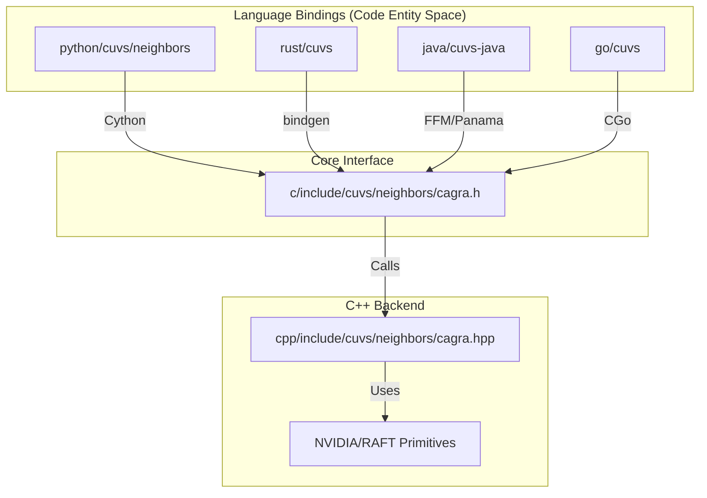
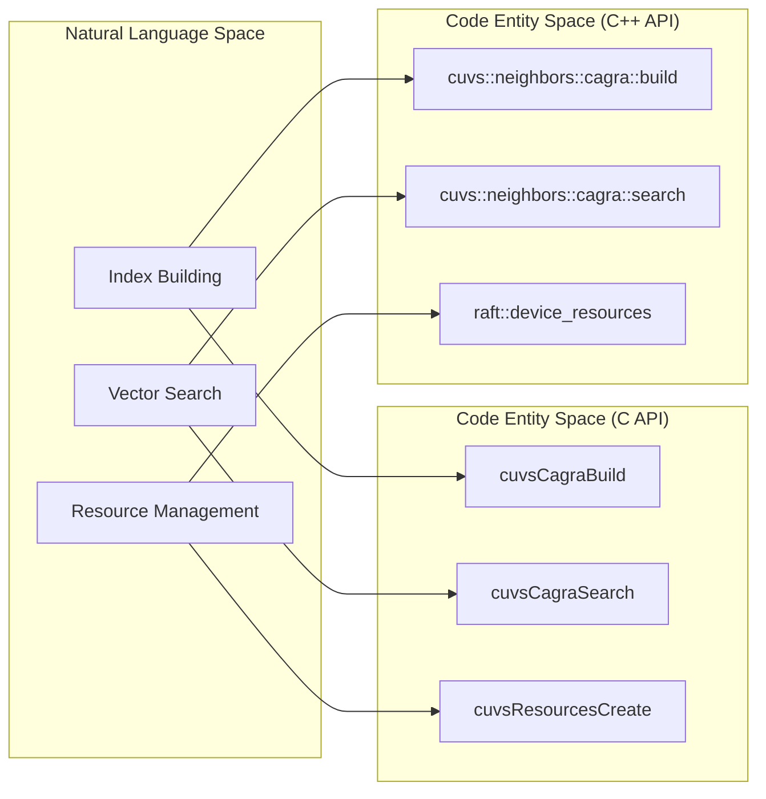

<!-- source: DeepWiki mcp.deepwiki.com · repo NVIDIA/cuvs · page 1 cuVS Overview · fetched 2026-10-26 -->

# cuVS Overview

Relevant source files

The following files were used as context for generating this wiki page:

- [.github/workflows/build.yaml](.github/workflows/build.yaml)
- [.github/workflows/pr.yaml](.github/workflows/pr.yaml)
- [.github/workflows/test.yaml](.github/workflows/test.yaml)
- [.github/workflows/trigger-breaking-change-alert.yaml](.github/workflows/trigger-breaking-change-alert.yaml)
- [CHANGELOG.md](CHANGELOG.md)
- [RAPIDS_BRANCH](RAPIDS_BRANCH)
- [README.md](README.md)
- [examples/go/README.md](examples/go/README.md)
- [fern/assets/images/cuvs-overview.png](fern/assets/images/cuvs-overview.png)
- [fern/pages/index.md](fern/pages/index.md)
- [python/cuvs_bench/cuvs_bench/plot/__main__.py](python/cuvs_bench/cuvs_bench/plot/__main__.py)

cuVS is a high-performance, GPU-accelerated library dedicated to vector similarity search and clustering. It provides state-of-the-art implementations of Approximate Nearest Neighbor (ANN) algorithms, enabling efficient retrieval and data mining tasks on NVIDIA GPUs [README.md:24-26](). 

The library is designed to serve as a foundational building block for vector databases, recommendation systems, and Retrieval Augmented Generation (RAG) pipelines [README.md:37-45](). It leverages the RAPIDS RAFT library for low-level machine learning primitives and high-performance CUDA kernels [README.md:70-74]().

### Purpose and Scope
cuVS aims to simplify GPU acceleration for vector search by providing:
*   **Fast Index Building:** Significant speedups in creating searchable indices compared to CPU-only implementations [README.md:60]().
*   **High Throughput & Low Latency:** Optimized for both batch processing and real-time query serving [README.md:61]().
*   **Interoperability:** Support for building indices on GPUs and deploying them on CPUs where necessary [README.md:64]().
*   **Multi-language Support:** Native-feeling APIs for Python, C++, C, Rust, Go, and Java [README.md:65]().

Sources: [README.md:24-74]()

---

### Core Algorithms
cuVS implements a variety of ANN and clustering algorithms, each optimized for different hardware constraints and recall requirements.

| Algorithm Category | Key Implementations | Primary Use Case |
| :--- | :--- | :--- |
| **Graph-Based** | `CAGRA`, `HNSW`, `Vamana` | High-recall, low-latency search [README.md:89-115]() |
| **Inverted File** | `IVF-PQ`, `IVF-Flat`, `IVF-SQ` | Memory-efficient search for large-scale datasets [CHANGELOG.md:54]() |
| **Clustering** | `K-Means`, `Spectral Clustering` | Data mining and unsupervised learning [README.md:48-50]() |
| **Primitives** | `Brute Force`, `NN-Descent` | Exact search and graph construction seeds [CHANGELOG.md:48-52]() |

Sources: [README.md:48-115](), [CHANGELOG.md:48-54]()

---

### System Integration & Code Architecture
The following diagrams illustrate how high-level search concepts map to specific code entities within the cuVS repository, bridging natural language space to code entity space.

#### Diagram 1: API Layering and Language Bindings
This diagram shows how the different language-specific libraries interface with the core C++ engine through the stable C ABI.

Sources: [README.md:91-170](), [.github/CODEOWNERS:1-20](), [rust/Cargo.toml:4-8]()

#### Diagram 2: Algorithm Execution Flow (CAGRA Example)
This diagram bridges the conceptual "Index Build" and "Search" steps to the actual function names used in the C and C++ APIs.

Sources: [README.md:102-140](), [CHANGELOG.md:29-37]()

---

### Repository Organization
The repository is structured to separate the core C++ implementation from its various language wrappers and benchmarking tools.

*   `cpp/`: Core C++ template library and ANN implementations [.github/CODEOWNERS:5-7]().
*   `c/`: Stable C ABI headers and implementation for cross-language support [.github/CODEOWNERS:1-3]().
*   `python/`: Cython-based Python bindings and the `cuvs_bench` tool [.github/CODEOWNERS:14-15]().
*   `rust/`, `java/`, `go/`: Native bindings for respective languages [.github/CODEOWNERS:10-20]().
*   `ci/`: Build scripts and CI/CD configuration [.github/CODEOWNERS:32-33]().
*   `examples/`: Standalone usage examples for all supported languages [.github/CODEOWNERS:3-19]().

Sources: [.github/CODEOWNERS:1-49]()

---

### Further Reading & Child Pages
For detailed information on specific topics, refer to the following sections:

*   **[Getting Started & Installation](#1.1):** How to install cuVS via Conda, pip wheels, or from source. Covers devcontainer setup, supported CUDA versions, architectures, and the `build.sh` entrypoint.
*   **[Integrations & Use Cases](#1.2):** How cuVS integrates with external databases (OpenSearch, Elasticsearch, Lucene, CyborgDB), ML frameworks, and vector database stacks; role in RAG, semantic search, and clustering.

Sources: [README.md:1-140](), [CHANGELOG.md:1-55]()

---

