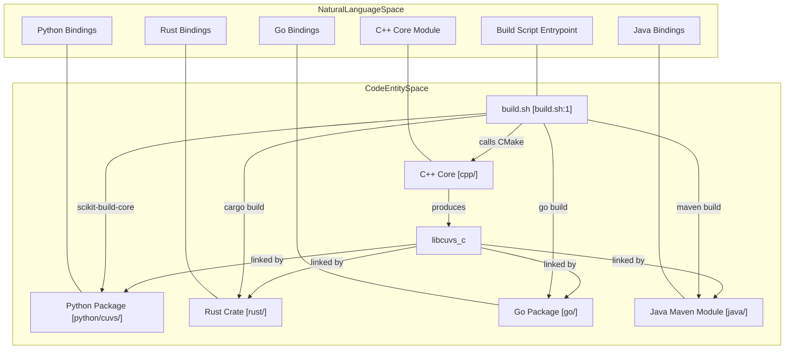
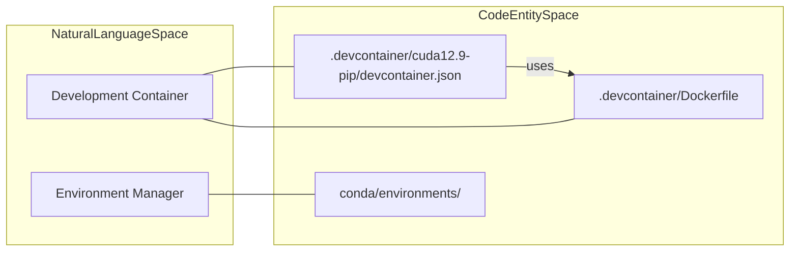

<!-- source: DeepWiki mcp.deepwiki.com · repo NVIDIA/cuvs · page 1.1 Getting Started & Installation · fetched 2026-10-26 -->

# Getting Started & Installation

<details>
<summary>Relevant source files</summary>

The following files were used as context for generating this wiki page:

- [.devcontainer/Dockerfile](.devcontainer/Dockerfile)
- [.devcontainer/cuda12.9-conda/devcontainer.json](.devcontainer/cuda12.9-conda/devcontainer.json)
- [.devcontainer/cuda12.9-pip/devcontainer.json](.devcontainer/cuda12.9-pip/devcontainer.json)
- [.devcontainer/cuda13.3-conda/devcontainer.json](.devcontainer/cuda13.3-conda/devcontainer.json)
- [.devcontainer/cuda13.3-pip/devcontainer.json](.devcontainer/cuda13.3-pip/devcontainer.json)
- [build.sh](build.sh)
- [c/include/cuvs/core/c_api.h](c/include/cuvs/core/c_api.h)
- [c/src/core/c_api.cpp](c/src/core/c_api.cpp)
- [ci/release/update-version.sh](ci/release/update-version.sh)
- [conda/environments/all_cuda-133_arch-aarch64.yaml](conda/environments/all_cuda-133_arch-aarch64.yaml)
- [conda/environments/all_cuda-133_arch-x86_64.yaml](conda/environments/all_cuda-133_arch-x86_64.yaml)
- [conda/environments/bench_ann_cuda-133_arch-aarch64.yaml](conda/environments/bench_ann_cuda-133_arch-aarch64.yaml)
- [conda/environments/bench_ann_cuda-133_arch-x86_64.yaml](conda/environments/bench_ann_cuda-133_arch-x86_64.yaml)
- [conda/environments/go_cuda-133_arch-aarch64.yaml](conda/environments/go_cuda-133_arch-aarch64.yaml)
- [conda/environments/go_cuda-133_arch-x86_64.yaml](conda/environments/go_cuda-133_arch-x86_64.yaml)
- [cpp/include/cuvs/neighbors/dynamic_batching.hpp](cpp/include/cuvs/neighbors/dynamic_batching.hpp)
- [cpp/src/neighbors/detail/dynamic_batching.cuh](cpp/src/neighbors/detail/dynamic_batching.cuh)
- [examples/c/src/bruteforce_c_example.c](examples/c/src/bruteforce_c_example.c)
- [java/benchmarks/pom.xml](java/benchmarks/pom.xml)
- [java/build.sh](java/build.sh)
- [java/cuvs-java/pom.xml](java/cuvs-java/pom.xml)
- [java/panama-bindings/generate-bindings.sh](java/panama-bindings/generate-bindings.sh)
- [java/panama-bindings/headers.h](java/panama-bindings/headers.h)

</details>


This page provides technical details for installing and building cuVS, a high-performance GPU-accelerated vector search library. cuVS supports multiple installation paths including Conda packages, Pip wheels, and building from source for various language bindings (C++, Python, Rust, Go, and Java).

## Supported Environments & Architectures

cuVS is optimized for NVIDIA GPUs and supports the following configurations:

*   **Architectures:** `x86_64` and `aarch64` (ARM64) [conda/environments/all_cuda-133_arch-x86_64.yaml:51](), [conda/environments/all_cuda-133_arch-aarch64.yaml:52]().
*   **CUDA Versions:** Support for CUDA 12.x and 13.x [conda/environments/all_cuda-133_arch-x86_64.yaml:19]().
*   **Operating Systems:** Linux (primarily tested on Ubuntu 22.04+ and RHEL-compatible distributions).
*   **Compilers:** GCC 14.x and Clang 20.1.8 are used in standard build environments [conda/environments/all_cuda-133_arch-x86_64.yaml:10-11,25]().

Sources: [conda/environments/all_cuda-133_arch-x86_64.yaml:1-51](), [conda/environments/all_cuda-133_arch-aarch64.yaml:1-52]()

## Installation via Conda

Conda is the recommended method for installing cuVS as it manages complex CUDA dependencies and system libraries like `libblas` and `liblapack`.

### Package Structure
cuVS is split into several packages to allow for minimal installations:
*   `libcuvs`: The core C++ and C shared libraries [conda/environments/bench_ann_cuda-133_arch-x86_64.yaml:35]().
*   `cuvs`: The Python bindings (requires `libcuvs` and `pylibraft`) [conda/environments/bench_ann_cuda-133_arch-x86_64.yaml:22,35,46]().
*   `cuvs-bench`: Tools for benchmarking ANN algorithms [conda/environments/bench_ann_cuda-133_arch-x86_64.yaml:54]().

### Environment Setup
You can create a development environment using the generated environment files:
```bash
# Example for CUDA 13.3 on x86_64
conda env create -f conda/environments/all_cuda-133_arch-x86_64.yaml
```
Sources: [conda/environments/all_cuda-133_arch-x86_64.yaml:1-51](), [conda/environments/bench_ann_cuda-133_arch-x86_64.yaml:1-54]()

## Installation via Pip Wheels

cuVS provides PEP 440 compliant wheels. The build process uses `scikit-build-core` and `rapids-build-backend` to handle the CMake-based C++ build during the pip installation process [conda/environments/all_cuda-133_arch-x86_64.yaml:46,48]().

### Dependencies
The Python package and build setup require several core packages managed via `dependencies.yaml` and generated conda environments:
*   `cuda-bindings >= 13.0.1` [conda/environments/all_cuda-133_arch-x86_64.yaml:13]().
*   `libcuvs` (C++ backend) [conda/environments/bench_ann_cuda-133_arch-x86_64.yaml:35]().
*   `pylibraft` (RAFT library primitives) [conda/environments/all_cuda-133_arch-x86_64.yaml:43]().
*   `numpy >= 2.0` [conda/environments/all_cuda-133_arch-x86_64.yaml:39]().

Sources: [conda/environments/all_cuda-133_arch-x86_64.yaml:13-49](), [conda/environments/bench_ann_cuda-133_arch-x86_64.yaml:22-48]()

## Building from Source

The repository provides a unified entrypoint script, `build.sh`, which orchestrates the build process for all components.

### The `build.sh` Entrypoint
The `build.sh` script manages CMake configurations, installation prefixes, and parallel build levels. It defaults to using the `Ninja` generator [build.sh:126]().

| Target | Description | Source Reference |
| :--- | :--- | :--- |
| `clean` | Removes all build artifacts | [build.sh:25]() |
| `libcuvs` | Builds the C++ core and C-API wrapper | [build.sh:26-27]() |
| `python` | Builds the cuvs Python package | [build.sh:28]() |
| `rust` | Builds the cuvs Rust bindings | [build.sh:29]() |
| `go` | Builds the cuvs Go bindings | [build.sh:30]() |
| `java` | Builds the cuvs Java bindings | [build.sh:31]() |
| `lucene` | Builds the cuvs-lucene Apache Lucene codecs | [build.sh:32]() |
| `docs` | Builds the documentation | [build.sh:33]() |
| `tests` | Builds the tests | [build.sh:34]() |
| `bench-ann`| Builds end-to-end ANN benchmarks | [build.sh:35]() |
| `examples` | Builds the examples | [build.sh:36]() |

### Local Development Workflow
For C++ development, the script sets up a local build directory (defaulting to `cpp/build`) and can install to a specific prefix [build.sh:75,119]().

```bash
# Build C++ library and tests with verbose output
./build.sh libcuvs tests -v

# Build for specific GPU architectures (e.g., H100 and A100)
./build.sh libcuvs --gpu-arch="80-real;90-real"
```

### Build Process Data Flow
The following diagram illustrates how `build.sh` interacts with the various build systems across the repository, bridging natural language concepts to code entities.

**Diagram: Build Orchestration Flow**

Sources: [build.sh:22-37](), [java/build.sh:43-52](), [java/panama-bindings/generate-bindings.sh:45-52]()

## Devcontainer Setup

For a consistent development environment, cuVS provides VS Code Devcontainer configurations pre-configured with necessary CUDA toolkits and dependencies.

*   **Base Image:** `rapidsai/devcontainers` [.devcontainer/cuda12.9-pip/devcontainer.json:8]().
*   **Features:** Includes `cuda` (with cuBLAS, cuSOLVER, cuRAND, cuSPARSE) and `rapids-build-utils` [.devcontainer/cuda12.9-pip/devcontainer.json:23-30]().

**Diagram: Devcontainer Entity Mapping**

Sources: [.devcontainer/cuda12.9-pip/devcontainer.json:1-55](), [conda/environments/all_cuda-133_arch-x86_64.yaml:1-51]()

## Versioning and Release

cuVS follows the RAPIDS versioning scheme (`YY.MM.PP`). Versioning is centrally managed via a `VERSION` file at the repository root [ci/release/update-version.sh:104]().

The `update-version.sh` script automates updating version strings across:
1.  `dependencies.yaml` and Conda environments [ci/release/update-version.sh:119-124]().
2.  `pyproject.toml` files for Python packages [ci/release/update-version.sh:125-129]().
3.  `Cargo.toml` for Rust (stripping leading zeros as required by SemVer) [ci/release/update-version.sh:157-159]().
4.  `pom.xml` and version markers for Java [ci/release/update-version.sh:104](), [java/cuvs-java/pom.xml:12]().

Sources: [ci/release/update-version.sh:71-166](), [java/cuvs-java/pom.xml:1-13]()

---

