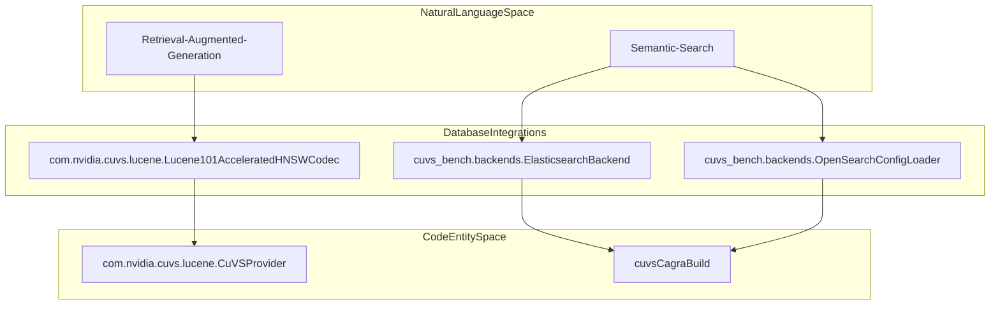
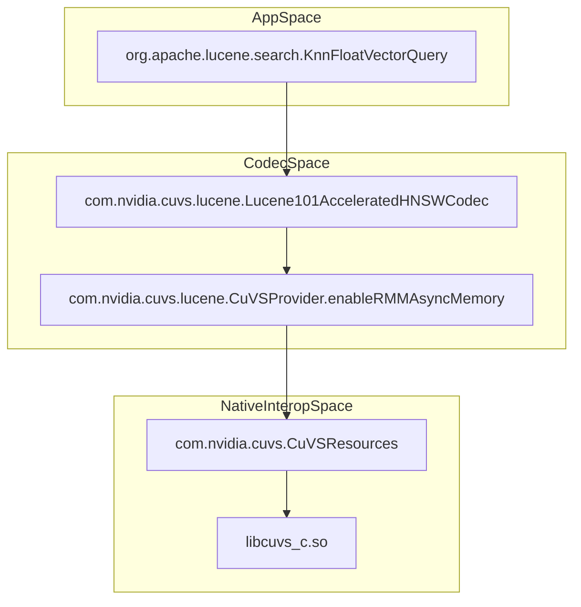

<!-- source: DeepWiki mcp.deepwiki.com · repo NVIDIA/cuvs · page 1.2 Integrations & Use Cases · fetched 2026-10-26 -->

# Integrations & Use Cases

Relevant source files

The following files were used as context for generating this wiki page:

- [fern/assets/images/cuvs-overview.png](fern/assets/images/cuvs-overview.png)
- [fern/pages/index.md](fern/pages/index.md)
- [java/cuvs-lucene/README.md](java/cuvs-lucene/README.md)
- [java/cuvs-lucene/build.sh](java/cuvs-lucene/build.sh)
- [java/cuvs-lucene/pom.xml](java/cuvs-lucene/pom.xml)
- [python/cuvs_bench/cuvs_bench/backends/base.py](python/cuvs_bench/cuvs_bench/backends/base.py)
- [python/cuvs_bench/cuvs_bench/backends/cpp_gbench.py](python/cuvs_bench/cuvs_bench/backends/cpp_gbench.py)
- [python/cuvs_bench/cuvs_bench/backends/elasticsearch.py](python/cuvs_bench/cuvs_bench/backends/elasticsearch.py)
- [python/cuvs_bench/cuvs_bench/backends/opensearch.py](python/cuvs_bench/cuvs_bench/backends/opensearch.py)
- [python/cuvs_bench/cuvs_bench/orchestrator/orchestrator.py](python/cuvs_bench/cuvs_bench/orchestrator/orchestrator.py)
- [python/cuvs_bench/cuvs_bench/run/__main__.py](python/cuvs_bench/cuvs_bench/run/__main__.py)
- [python/cuvs_bench/cuvs_bench/run/data_export.py](python/cuvs_bench/cuvs_bench/run/data_export.py)
- [python/cuvs_bench/cuvs_bench/tests/test_cpp_gbench.py](python/cuvs_bench/cuvs_bench/tests/test_cpp_gbench.py)
- [python/cuvs_bench/cuvs_bench/tests/test_data_export.py](python/cuvs_bench/cuvs_bench/tests/test_data_export.py)
- [python/cuvs_bench/cuvs_bench/tests/test_modularization.py](python/cuvs_bench/cuvs_bench/tests/test_modularization.py)
- [python/cuvs_bench/cuvs_bench/tests/test_opensearch.py](python/cuvs_bench/cuvs_bench/tests/test_opensearch.py)
- [python/cuvs_bench/cuvs_bench/tests/test_registry.py](python/cuvs_bench/cuvs_bench/tests/test_registry.py)

cuVS is designed to be a high-performance acceleration layer for vector similarity search and clustering. It provides a stable C ABI and multiple language bindings that allow it to be integrated into external databases, search engines, machine learning frameworks, and large-scale Retrieval-Augmented Generation (RAG) pipelines `[README.md:26-32]()`.

---

## Ecosystem Integration Architecture

The following diagram illustrates how high-level vector workloads map to specific integration modules, codecs, and core cuVS code entities.

### Natural Language to Code Entity Mapping (Database & Search Focus)

**Sources:** `[java/cuvs-lucene/README.md:15-23]()`, `[python/cuvs_bench/cuvs_bench/backends/elasticsearch.py:117-129]()`, `[python/cuvs_bench/cuvs_bench/backends/opensearch.py:31-42]()`

---

## Vector Database & Framework Integrations

cuVS plugs directly into major database and search infrastructure stacks to offload intensive index construction and vector search workloads to NVIDIA GPUs.

### 1. Apache Lucene (`cuvs-lucene`)
The `cuvs-lucene` module provides pluggable `KnnVectorsFormat` implementations that allow Apache Lucene to delegate index building and search execution to cuVS `[java/cuvs-lucene/README.md:13-16]()`. 
- **Codecs Provided**:
  - `Lucene101AcceleratedHNSWCodec`: GPU-accelerated HNSW index construction with standard Lucene-compatible on-disk formatting `[java/cuvs-lucene/README.md:19-20]()`.
  - Quantized Variants (`LuceneAcceleratedHNSWScalarQuantizedCodec`, `LuceneAcceleratedHNSWBinaryQuantizedCodec`): Scalar and binary quantized vector layouts for minimized index footprints `[java/cuvs-lucene/README.md:20-21]`.
  - `CuVS2510GPUSearchCodec`: End-to-end GPU-accelerated HNSW building and GPU-resident search `[java/cuvs-lucene/README.md:22]()`.
- **RMM Async Memory**: Applications can opt into RAPIDS Memory Manager (RMM) stream-ordered asynchronous allocation using `CuVSProvider.provider().enableRMMAsyncMemory()` to optimize high-throughput concurrent GPU searches `[java/cuvs-lucene/README.md:67-80]()`.

### 2. OpenSearch & Elasticsearch (`cuvs-bench` Backends)
Through the `cuvs-bench` orchestrator framework, cuVS connects natively with Elasticsearch and OpenSearch instances to benchmark and drive vector search capabilities:
- **OpenSearch Backend (`OpenSearchConfigLoader`)**: Supports Faiss and Lucene ANN engines, including integration with OpenSearch 3.0+ Remote Index Build services which offload HNSW graph construction to external GPU accelerators `[python/cuvs_bench/cuvs_bench/backends/opensearch.py:7-13]()`.
- **Elasticsearch Backend (`ElasticsearchBackend`)**: Interacts with Elasticsearch GPU APIs to configure node-level GPU indexing (`vectors.indexing.use_gpu`) and supports specialized index types such as `hnsw`, `int8_hnsw`, `int4_hnsw`, and `bbq_hnsw` `[python/cuvs_bench/cuvs_bench/backends/elasticsearch.py:6-16]()`.

**Sources:** `[java/cuvs-lucene/README.md:1-80]()`, `[python/cuvs_bench/cuvs_bench/backends/elasticsearch.py:1-129]()`, `[python/cuvs_bench/cuvs_bench/backends/opensearch.py:31-62]()`

---

## Integration Execution Flow

The flow below illustrates how a query originating from an integrated search framework (such as Apache Lucene) traverses the Java layer to invoke native GPU execution paths.

### Pluggable Codec Execution Flow

**Sources:** `[java/cuvs-lucene/README.md:63-80]`, `[java/cuvs-lucene/build.sh:30-36]()`

---

## Key Use Cases

### 1. Retrieval-Augmented Generation (RAG) & Semantic Search
cuVS acts as the low-latency vector retrieval backbone for generative AI applications. By leveraging accelerated graph indices (`CAGRA`) and inverted file structures (`IVF-PQ`), RAG pipelines retrieve context documents within sub-millisecond latencies across various distance metrics (Euclidean, Inner Product, Cosine) `[fern/pages/index.md:29-37]()`.

### 2. KNN Graph Construction & Data Mining
For manifold learning algorithms like UMAP and t-SNE, cuVS converts unstructured dense vector sets into nearest-neighbor graphs via `NN-Descent` and `CAGRA` graph builders, unlocking downstream graph analytics in libraries like cuGraph `[fern/pages/index.md:21-24]()`.

### 3. High-Throughput Clustering
Using accelerated implementations of `K-Means`, Agglomerative Clustering, and Gaussian Mixture Models (GMM), cuVS supports large-scale data mining workflows, vector quantization, and dataset partitioning `[fern/pages/index.md:19-21]()`.

**Sources:** `[fern/pages/index.md:1-46]()`, `[python/cuvs_bench/cuvs_bench/backends/base.py:21-60]()`

---

