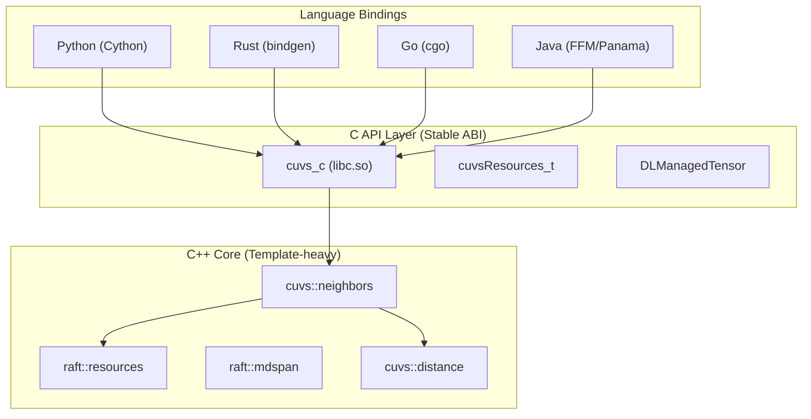
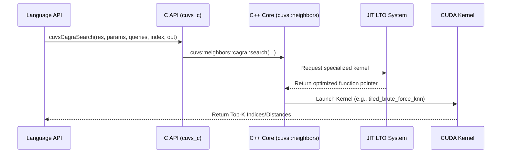

<!-- source: DeepWiki mcp.deepwiki.com · repo NVIDIA/cuvs · page 2 Core Architecture · fetched 2026-10-26 -->

# Core Architecture

Relevant source files

The following files were used as context for generating this wiki page:

- [build.sh](build.sh)
- [c/include/cuvs/core/c_api.h](c/include/cuvs/core/c_api.h)
- [c/src/core/c_api.cpp](c/src/core/c_api.cpp)
- [ci/release/update-version.sh](ci/release/update-version.sh)
- [cpp/cmake/thirdparty/get_cuvs.cmake](cpp/cmake/thirdparty/get_cuvs.cmake)
- [cpp/cmake/thirdparty/get_raft.cmake](cpp/cmake/thirdparty/get_raft.cmake)
- [cpp/include/cuvs/neighbors/brute_force.hpp](cpp/include/cuvs/neighbors/brute_force.hpp)
- [cpp/include/cuvs/neighbors/common.hpp](cpp/include/cuvs/neighbors/common.hpp)
- [cpp/include/cuvs/neighbors/dynamic_batching.hpp](cpp/include/cuvs/neighbors/dynamic_batching.hpp)
- [cpp/src/neighbors/brute_force.cu](cpp/src/neighbors/brute_force.cu)
- [cpp/src/neighbors/detail/dynamic_batching.cuh](cpp/src/neighbors/detail/dynamic_batching.cuh)
- [cpp/src/neighbors/detail/faiss_distance_utils.h](cpp/src/neighbors/detail/faiss_distance_utils.h)
- [cpp/src/neighbors/detail/knn_brute_force.cuh](cpp/src/neighbors/detail/knn_brute_force.cuh)
- [examples/c/src/bruteforce_c_example.c](examples/c/src/bruteforce_c_example.c)
- [examples/cmake/thirdparty/get_cuvs.cmake](examples/cmake/thirdparty/get_cuvs.cmake)
- [java/benchmarks/pom.xml](java/benchmarks/pom.xml)
- [java/build.sh](java/build.sh)
- [java/cuvs-java/pom.xml](java/cuvs-java/pom.xml)
- [java/panama-bindings/generate-bindings.sh](java/panama-bindings/generate-bindings.sh)
- [java/panama-bindings/headers.h](java/panama-bindings/headers.h)

cuVS is built on a layered architecture designed to provide high-performance GPU-accelerated vector search while maintaining a stable, interoperable interface for multiple programming languages. The system leverages the NVIDIA RAPIDS ecosystem, specifically [RAFT](https://github.com/rapidsai/raft), to handle low-level CUDA resource management and linear algebra primitives.

## Layered System Overview

The architecture is divided into three primary tiers: the C++ Core, the C API Layer, and the Language Bindings. 

System Layers and Code Entities:

Sources: [c/src/core/c_api.cpp:30-113](), [java/panama-bindings/generate-bindings.sh:37-44](), [cpp/include/cuvs/neighbors/common.hpp:11-16]()

---

## Core Components

### RAFT Dependency and Resources
cuVS relies heavily on the RAFT library for its core infrastructure [cpp/cmake/thirdparty/get_raft.cmake:40-55](). The `raft::resources` object is the central handle used to manage CUDA streams, device properties, and memory resources (RMM). In the C API, this is encapsulated as the opaque `cuvsResources_t` handle [c/src/core/c_api.cpp:36-42]().

* **Resources Management**: Handles stream synchronization, device ID mapping, and multi-GPU contexts [c/src/core/c_api.cpp:135-165]().
* **Memory Management**: Integrates with RMM (RAPIDS Memory Manager) for pooled workspace allocations [c/src/core/c_api.cpp:44-55]().

Sources: [cpp/cmake/thirdparty/get_raft.cmake:40-55](), [c/src/core/c_api.cpp:36-55]()

### Common Data Structures
cuVS utilizes modern C++ standards and the DLPack protocol to ensure efficient data movement without unnecessary copies.
* **mdspan**: The C++ core uses `raft::mdspan` and specialized views like `raft::device_matrix_view` to represent multi-dimensional arrays, supporting layouts such as `row_major` and `col_major` [cpp/include/cuvs/neighbors/brute_force.hpp:67-115]().
* **DLPack**: The C API and language bindings use `DLManagedTensor` as the standard exchange format for tensors between external frameworks and cuVS [c/src/core/c_api.cpp:90-107]().
* **Dataset Abstraction**: The `cuvs::neighbors::dataset` structure provides a unified interface for owning, non-owning, and strided data representations [cpp/include/cuvs/neighbors/common.hpp:159-164]().

Sources: [cpp/include/cuvs/neighbors/brute_force.hpp:67-115](), [c/src/core/c_api.cpp:90-107](), [cpp/include/cuvs/neighbors/common.hpp:159-164]()

### Distance Metrics
The `cuvs::distance` namespace provides a comprehensive suite of metrics (such as L2, Inner Product, and Cosine) that are utilized across all approximate nearest neighbor algorithms [cpp/src/neighbors/detail/knn_brute_force.cuh:112-150](). These metrics are often fused into distance kernels to minimize memory bandwidth usage [cpp/src/neighbors/detail/knn_brute_force.cuh:64-87]().
For details, see [Distance Metrics & Primitives](#2.1).

Sources: [cpp/src/neighbors/detail/knn_brute_force.cuh:64-150](), [cpp/include/cuvs/neighbors/common.hpp:126-130]()

---

## Subsystem Interaction

The following diagram illustrates how a search request flows from a language binding down to the CUDA execution layer.

Search Execution Flow:

Sources: [c/src/core/c_api.cpp:30-36](), [cpp/src/neighbors/detail/knn_brute_force.cuh:64-95](), [cpp/include/cuvs/neighbors/brute_force.hpp:67-70]()

---

## Child Pages

### [Distance Metrics & Primitives](#2.1)
Covers the distance computation layer, supported metrics, and fused distance primitives used by search algorithms.

### [C API Layer](#2.2)
Documents the stable C ABI that serves as the foundation for all language bindings (Python, Rust, Go, Java), detailing opaque handles and `DLManagedTensor` integration.

### [JIT LTO Kernel System](#2.3)
Explains the Just-In-Time Link-Time Optimization system used to generate specialized CUDA kernels at runtime, balancing binary size and execution performance.

---

