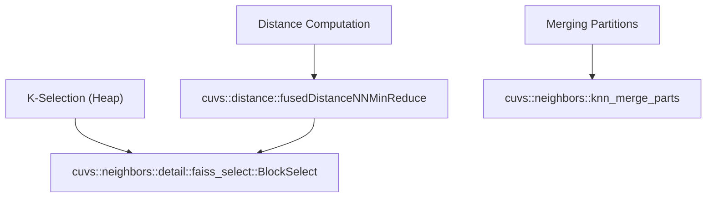
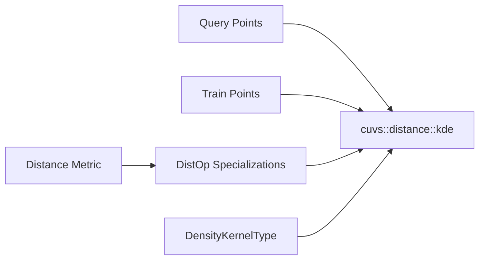

<!-- source: DeepWiki mcp.deepwiki.com · repo NVIDIA/cuvs · page 2.1 Distance Metrics & Primitives · fetched 2026-10-26 -->

# Distance Metrics & Primitives

Relevant source files

The following files were used as context for generating this wiki page:

- [cpp/cmake/modules/FindSVE.cmake](cpp/cmake/modules/FindSVE.cmake)
- [cpp/cmake/modules/generate_cuvs_export.cmake](cpp/cmake/modules/generate_cuvs_export.cmake)
- [cpp/cmake/patches/cutlass/Support-both-CUDA-12-and-13-cccl-header-locations.patch](cpp/cmake/patches/cutlass/Support-both-CUDA-12-and-13-cccl-header-locations.patch)
- [cpp/cmake/patches/cutlass_override.json](cpp/cmake/patches/cutlass_override.json)
- [cpp/cmake/patches/ggnn_override.json](cpp/cmake/patches/ggnn_override.json)
- [cpp/cmake/patches/hnswlib_override.json](cpp/cmake/patches/hnswlib_override.json)
- [cpp/cmake/thirdparty/get_cutlass.cmake](cpp/cmake/thirdparty/get_cutlass.cmake)
- [cpp/cmake/thirdparty/get_diskann.cmake](cpp/cmake/thirdparty/get_diskann.cmake)
- [cpp/cmake/thirdparty/get_faiss.cmake](cpp/cmake/thirdparty/get_faiss.cmake)
- [cpp/cmake/thirdparty/get_ggnn.cmake](cpp/cmake/thirdparty/get_ggnn.cmake)
- [cpp/cmake/thirdparty/get_hnswlib.cmake](cpp/cmake/thirdparty/get_hnswlib.cmake)
- [cpp/include/cuvs/util/cutlass_utils.hpp](cpp/include/cuvs/util/cutlass_utils.hpp)
- [cpp/src/cluster/detail/minClusterDistanceCompute.cu](cpp/src/cluster/detail/minClusterDistanceCompute.cu)
- [cpp/src/core/omp_wrapper.cpp](cpp/src/core/omp_wrapper.cpp)
- [cpp/src/core/omp_wrapper.hpp](cpp/src/core/omp_wrapper.hpp)
- [cpp/src/distance/detail/fused_distance_nn/cutlass_base.cuh](cpp/src/distance/detail/fused_distance_nn/cutlass_base.cuh)
- [cpp/src/distance/detail/pairwise_distance_cutlass_base.cuh](cpp/src/distance/detail/pairwise_distance_cutlass_base.cuh)
- [cpp/src/distance/detail/sparse/coo_spmv.cuh](cpp/src/distance/detail/sparse/coo_spmv.cuh)
- [cpp/src/distance/detail/sparse/coo_spmv_kernel.cuh](cpp/src/distance/detail/sparse/coo_spmv_kernel.cuh)
- [cpp/src/distance/detail/sparse/coo_spmv_strategies/dense_smem_strategy.cuh](cpp/src/distance/detail/sparse/coo_spmv_strategies/dense_smem_strategy.cuh)
- [cpp/src/distance/detail/sparse/coo_spmv_strategies/hash_strategy.cuh](cpp/src/distance/detail/sparse/coo_spmv_strategies/hash_strategy.cuh)
- [cpp/src/distance/detail/sparse/l2_distance.cuh](cpp/src/distance/detail/sparse/l2_distance.cuh)
- [cpp/src/distance/detail/sparse/lp_distance.cuh](cpp/src/distance/detail/sparse/lp_distance.cuh)
- [cpp/src/distance/detail/sparse/utils.cuh](cpp/src/distance/detail/sparse/utils.cuh)
- [cpp/src/distance/fused_distance_nn-inl.cuh](cpp/src/distance/fused_distance_nn-inl.cuh)
- [cpp/src/distance/unfused_distance_nn.cuh](cpp/src/distance/unfused_distance_nn.cuh)
- [cpp/src/neighbors/mg/snmg.cuh](cpp/src/neighbors/mg/snmg.cuh)
- [cpp/src/preprocessing/quantize/detail/scalar.cuh](cpp/src/preprocessing/quantize/detail/scalar.cuh)
- [cpp/src/preprocessing/quantize/scalar.cu](cpp/src/preprocessing/quantize/scalar.cu)
- [cpp/tests/CMakeLists.txt](cpp/tests/CMakeLists.txt)
- [cpp/tests/cluster/kmeans_predict_batching.cu](cpp/tests/cluster/kmeans_predict_batching.cu)
- [cpp/tests/neighbors/distance_nn.cu](cpp/tests/neighbors/distance_nn.cu)
- [cpp/tests/neighbors/distance_nn_helper.cuh](cpp/tests/neighbors/distance_nn_helper.cuh)
- [cpp/tests/neighbors/knn_merge_parts.cu](cpp/tests/neighbors/knn_merge_parts.cu)
- [cpp/tests/preprocessing/scalar_quantization.cu](cpp/tests/preprocessing/scalar_quantization.cu)
- [cpp/tests/test_utils.cuh](cpp/tests/test_utils.cuh)
- [python/cuvs/cuvs/distance/__init__.py](python/cuvs/cuvs/distance/__init__.py)
- [python/cuvs/cuvs/distance/distance.pyx](python/cuvs/cuvs/distance/distance.pyx)
- [python/cuvs/cuvs/distance_type.pxd](python/cuvs/cuvs/distance_type.pxd)
- [python/cuvs/cuvs/neighbors/nn_descent/CMakeLists.txt](python/cuvs/cuvs/neighbors/nn_descent/CMakeLists.txt)
- [python/cuvs/cuvs/neighbors/nn_descent/__init__.pxd](python/cuvs/cuvs/neighbors/nn_descent/__init__.pxd)
- [python/cuvs/cuvs/neighbors/nn_descent/__init__.py](python/cuvs/cuvs/neighbors/nn_descent/__init__.py)

The distance computation layer in cuVS provides highly optimized CUDA kernels for calculating similarities and distances between vectors. This layer serves as the foundation for all Approximate Nearest Neighbor (ANN) algorithms, clustering techniques, and manifold learning methods within the library. It supports a wide array of metrics, ranging from standard Euclidean distance to specialized sparse and bitwise metrics.

## Supported Metrics

Metrics are defined via the `cuvs::distance::DistanceType` enum `[cpp/include/cuvs/distance/distance.hpp:19-67]()`. The system distinguishes between "expanded" and "unexpanded" versions of certain metrics. Expanded versions utilize mathematical identities (e.g., $|x-y|^2 = |x|^2 + |y|^2 - 2xy$) to leverage high-performance GEMM (General Matrix Multiplication) operations, whereas unexpanded versions use direct element-wise accumulation `[cpp/include/cuvs/distance/distance.hpp:21-32]()`. Python bindings expose these via `DISTANCE_TYPES` and `SUPPORTED_DISTANCES` `[python/cuvs/cuvs/distance/distance.pyx:17-46]()`.

### Dense Distance Metrics
| Metric Type | Enum Value | Implementation Note |
| :--- | :--- | :--- |
| **L2 (Euclidean)** | `L2Expanded`, `L2Unexpanded` | Standard $L_2$ norm `[cpp/include/cuvs/distance/distance.hpp:22-30]()`. |
| **L2 Sqrt** | `L2SqrtExpanded`, `L2SqrtUnexpanded` | Euclidean distance with square root `[cpp/include/cuvs/distance/distance.hpp:24-32]()`. |
| **Inner Product** | `InnerProduct` | Basic dot product similarity `[cpp/include/cuvs/distance/distance.hpp:34-34]()`. |
| **Cosine** | `CosineExpanded` | Normalized dot product `[cpp/include/cuvs/distance/distance.hpp:26-26]()`. |
| **Manhattan** | `L1` | $L_1$ norm `[cpp/include/cuvs/distance/distance.hpp:28-28]()`. |
| **Chebyshev** | `Linf` | $L_{\infty}$ norm `[cpp/include/cuvs/distance/distance.hpp:36-36]()`. |
| **Minkowski** | `LpUnexpanded` | Generalized $L_p$ distance `[cpp/include/cuvs/distance/distance.hpp:40-40]()`. |
| **Geographic** | `Haversine` | Great-circle distance for lat/lon `[cpp/include/cuvs/distance/distance.hpp:48-48]()`. |

### Sparse & Bitwise Metrics
*   **Hamming**: Supported for both standard vectors (`HammingUnexpanded`) and bit-packed strings (`BitwiseHamming`) `[cpp/include/cuvs/distance/distance.hpp:54-62]()`.
*   **Jaccard/Dice**: Specialized for set similarity `[cpp/include/cuvs/distance/distance.hpp:44-60]()`.
*   **Sparse Optimized**: Kernels for CSR/COO formats, including `KLDivergence`, `JensenShannon`, and `RusselRao` `[cpp/include/cuvs/distance/distance.hpp:52-58]()`.

Sources: `[cpp/include/cuvs/distance/distance.hpp:19-67]`, `[python/cuvs/cuvs/distance/distance.pyx:17-46]`

## Pairwise Distance API

The primary entry point for distance computation is the `pairwise_distance` function in both C++ and Python (`cuvsPairwiseDistance`) `[python/cuvs/cuvs/distance/distance.pyx:51-135]()`. It computes an $N \times M$ distance matrix given two input matrices $X$ ($N \times K$) and $Y$ ($M \times K$).

### Data Flow & Dispatch
The API uses a tag-dispatching mechanism to select the optimal kernel at compile-time based on the `DistanceType`.

1.  **Public API**: `pairwise_distance` accepts `raft::device_matrix_view` `[cpp/include/cuvs/distance/distance.hpp:163-170]()` or DLPack-backed tensors in Python `[python/cuvs/cuvs/distance/distance.pyx:122-134]`.
2.  **Internal Dispatch**: Calls `distance_impl` with a `distance_tag<Metric>` `[cpp/src/distance/detail/distance.cuh:78-81]()`.
3.  **Operation Selection**: Matches the tag to a specific operator (e.g., `canberra_distance_op`) `[cpp/src/distance/detail/distance.cuh:93-93]()`.
4.  **Matrix Execution**: Executes via `pairwise_matrix_dispatch`, which handles tiling and layout (Row vs. Column Major) `[cpp/src/distance/detail/distance.cuh:99-100]()`.

Sources: `[cpp/include/cuvs/distance/distance.hpp:163-213]`, `[cpp/src/distance/detail/distance.cuh:23-101]`, `[python/cuvs/cuvs/distance/distance.pyx:51-135]`

## Fused Distance NN

For K-Nearest Neighbor (KNN) search and clustering reductions where the full $N \times M$ distance matrix is too large to store, cuVS provides **Fused Kernels** (e.g., `fusedDistanceNNMinReduce`) alongside fallback unfused routines (`unfusedDistanceNNMinReduce`) `[cpp/src/cluster/detail/minClusterDistanceCompute.cu:60-117]()`. These compute distances and perform K-selection or min-reductions in a single pass, significantly reducing global memory traffic.

### Implementation Details
*   **Registers & Shmem**: The `fusedL2kNN` kernel tiles the query and index matrices, accumulating distances in registers and using shared memory for top-K candidates `[cpp/src/neighbors/detail/fused_l2_knn.cuh:186-193]()`.
*   **Warp Select**: Uses `faiss_select::BlockSelect` and `warp_reduce` to efficiently find the smallest values across thread blocks `[cpp/src/neighbors/detail/fused_l2_knn.cuh:108-133]()`.
*   **Multi-Part Merging**: When datasets are partitioned across GPUs or memory segments, `knn_merge_parts` combines local top-K results into a global top-K `[cpp/src/neighbors/detail/knn_merge_parts.cuh:75-80]()`.

### Natural Language to Code Entity Mapping (KNN)
Title: KNN Fused Execution Mapping

Sources: `[cpp/src/cluster/detail/minClusterDistanceCompute.cu:34-118]`, `[cpp/src/neighbors/detail/fused_l2_knn.cuh:108-193]`, `[cpp/tests/neighbors/knn_merge_parts.cu:75-80]`

## Sparse Distance Primitives

Sparse distance computations in cuVS are optimized for high-dimensional data where most features are zero, utilizing specialized SPMV (Sparse-Matrix-Vector) strategies.

### SPMV Strategies
Sparse computations are dispatched through a strategy pattern defined in `coo_spmv_strategy` `[cpp/src/distance/detail/sparse/coo_spmv_strategies/base_strategy.cuh]()`.
*   **Dense Shared Memory**: `dense_smem_strategy` loads a row of the sparse matrix into a dense shared memory buffer for fast lookups `[cpp/src/distance/detail/sparse/coo_spmv_strategies/dense_smem_strategy.cuh:18-21]()`.
*   **Hash-Based**: `hash_strategy` uses `cuco::static_map` to handle rows that are too large for shared memory but still sparse `[cpp/src/distance/detail/sparse/coo_spmv_strategies/hash_strategy.cuh:37-51]()`.

### Sparse Kernel Architecture
The `balanced_coo_generalized_spmv_kernel` provides load-balanced execution by chunking the non-zero elements (NNZ) of the matrix across thread blocks `[cpp/src/distance/detail/sparse/coo_spmv_kernel.cuh:85-103]()`.

Sources: `[cpp/src/distance/detail/sparse/coo_spmv_kernel.cuh:26-103]`, `[cpp/src/distance/detail/sparse/coo_spmv_strategies/hash_strategy.cuh:37-51]`, `[cpp/src/distance/detail/sparse/coo_spmv_strategies/dense_smem_strategy.cuh:18-91]`

## Kernel Density Estimation (KDE)

KDE is a non-parametric method to estimate probability density functions. cuVS provides a fused `kde` function that computes log-density estimates `[cpp/include/cuvs/distance/kde.hpp:48-57]()`.

### KDE Implementation Flow
1.  **Tiling**: The kernel tiles over query points and training points.
2.  **Distance Accumulation**: Uses `DistOp` structures to accumulate distances per-feature in registers `[cpp/src/distance/kde.cu:42-113]()`.
3.  **Kernel Evaluation**: Applies a smoothing kernel defined by `DensityKernelType` `[cpp/include/cuvs/distance/distance.hpp:93-100]()`.
4.  **LogSumExp**: Performs a Log-Sum-Exp reduction to normalize density without numerical overflow `[cpp/include/cuvs/distance/kde.hpp:19-23]()`.

### Natural Language to Code Entity Mapping (KDE)
Title: KDE System Architecture

Sources: `[cpp/include/cuvs/distance/kde.hpp:19-57]`, `[cpp/src/distance/kde.cu:37-113]`, `[cpp/include/cuvs/distance/distance.hpp:93-100]`

---

