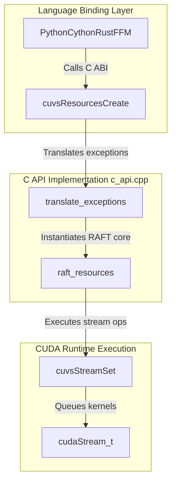
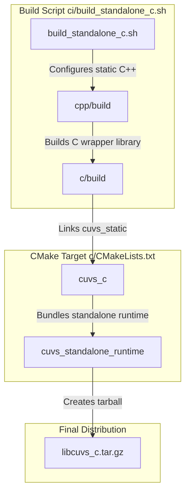

<!-- source: DeepWiki mcp.deepwiki.com · repo NVIDIA/cuvs · page 2.2 C API Layer · fetched 2026-10-26 -->

# C API Layer

Relevant source files

The following files were used as context for generating this wiki page:

- [build.sh](build.sh)
- [c/CMakeLists.txt](c/CMakeLists.txt)
- [c/include/cuvs/core/all.h](c/include/cuvs/core/all.h)
- [c/include/cuvs/core/c_api.h](c/include/cuvs/core/c_api.h)
- [c/include/cuvs/neighbors/common.h](c/include/cuvs/neighbors/common.h)
- [c/include/cuvs/neighbors/mg_common.h](c/include/cuvs/neighbors/mg_common.h)
- [c/include/cuvs/preprocessing/quantize/binary.h](c/include/cuvs/preprocessing/quantize/binary.h)
- [c/src/core/c_api.cpp](c/src/core/c_api.cpp)
- [c/src/neighbors/brute_force.cpp](c/src/neighbors/brute_force.cpp)
- [c/src/neighbors/ivf_flat.cpp](c/src/neighbors/ivf_flat.cpp)
- [c/src/neighbors/mg_cagra.cpp](c/src/neighbors/mg_cagra.cpp)
- [c/src/neighbors/mg_ivf_flat.cpp](c/src/neighbors/mg_ivf_flat.cpp)
- [c/src/neighbors/mg_ivf_pq.cpp](c/src/neighbors/mg_ivf_pq.cpp)
- [c/src/preprocessing/quantize/binary.cpp](c/src/preprocessing/quantize/binary.cpp)
- [c/tests/CMakeLists.txt](c/tests/CMakeLists.txt)
- [c/tests/cmake/header_check.cmake](c/tests/cmake/header_check.cmake)
- [c/tests/core/headers.c](c/tests/core/headers.c)
- [ci/build_standalone_c.sh](ci/build_standalone_c.sh)
- [ci/check_c_abi/LICENSE](ci/check_c_abi/LICENSE)
- [ci/check_c_abi/VERSION](ci/check_c_abi/VERSION)
- [ci/check_c_abi/check_c_abi/__init__.py](ci/check_c_abi/check_c_abi/__init__.py)
- [ci/check_c_abi/check_c_abi/abi.py](ci/check_c_abi/check_c_abi/abi.py)
- [ci/check_c_abi/check_c_abi/main.py](ci/check_c_abi/check_c_abi/main.py)
- [ci/check_c_abi/check_c_abi/tests/test_abi.py](ci/check_c_abi/check_c_abi/tests/test_abi.py)
- [ci/check_c_abi/pyproject.toml](ci/check_c_abi/pyproject.toml)
- [ci/release/update-version.sh](ci/release/update-version.sh)
- [cpp/cmake/modules/determine_cuvs_abi_version.cmake](cpp/cmake/modules/determine_cuvs_abi_version.cmake)
- [cpp/include/cuvs/neighbors/dynamic_batching.hpp](cpp/include/cuvs/neighbors/dynamic_batching.hpp)
- [cpp/src/neighbors/detail/dynamic_batching.cuh](cpp/src/neighbors/detail/dynamic_batching.cuh)
- [examples/c/src/bruteforce_c_example.c](examples/c/src/bruteforce_c_example.c)
- [fern/pages/c_api/index.md](fern/pages/c_api/index.md)
- [java/benchmarks/pom.xml](java/benchmarks/pom.xml)
- [java/build.sh](java/build.sh)
- [java/cuvs-java/pom.xml](java/cuvs-java/pom.xml)
- [java/panama-bindings/generate-bindings.sh](java/panama-bindings/generate-bindings.sh)
- [java/panama-bindings/headers.h](java/panama-bindings/headers.h)

The cuVS C API provides a stable ABI (Application Binary Interface) that serves as the foundation for multi-language interoperability. By exposing a pure C interface, cuVS enables seamless integration with languages such as Python, Rust, Go, and Java without the complexities of C++ name mangling or standard library version mismatches.

## Overview and Purpose

The C API layer wraps the high-performance C++ template-based core into a set of opaque handles and flat functions. This architecture ensures that the underlying C++ implementation can evolve while maintaining a consistent binary interface for external consumers.

Key features include:
* **Multi-language Support:** Acts as the target for `bindgen` (Rust), `cgo` (Go), `Cython` (Python), and `FFM/Panama` (Java) [java/panama-bindings/generate-bindings.sh:37-53]().
* **Resource Management:** Centralized handling of CUDA streams, device IDs, and RMM (RAPIDS Memory Manager) contexts via `cuvsResources_t` [c/include/cuvs/core/c_api.h:76-80]().
* **Data Exchange:** Standardized tensor passing using the **DLPack** protocol [c/include/cuvs/core/c_api.h:9-9]().
* **ABI Stability:** Explicit versioning of the shared library to prevent breaking downstream applications [c/CMakeLists.txt:125-134]().

### C API Resource Creation and Execution Data Flow

Sources: [c/src/core/c_api.cpp:36-42](), [c/include/cuvs/core/c_api.h:76-133]()

---

## Core Entities & Resource Management

### cuvsResources_t
The `cuvsResources_t` is an opaque `uintptr_t` handle that encapsulates a `raft::resources` object [c/include/cuvs/core/c_api.h:76-80](). It is mandatory for almost all cuVS operations as it manages the CUDA stream, device context, and memory resources.

* **Creation:** `cuvsResourcesCreate` allocates a new `raft::resources` object on the heap [c/src/core/c_api.cpp:36-42]().
* **Workspace Pools:** `cuvsResourcesSetWorkspacePool` configures an uncapped pool backed by the current device memory resource to minimize allocation overhead [c/src/core/c_api.cpp:44-55](), [c/include/cuvs/core/c_api.h:175-177]().
* **Memory Tracking:** `cuvsResourcesCreateWithMemoryTracking` wraps memory resources with allocation-tracking adaptors that output CSV logs [c/src/core/c_api.cpp:57-72](), [c/include/cuvs/core/c_api.h:113-116]().
* **Multi-GPU:** For SNMG (Single Node Multi-GPU) operations, `cuvsMultiGpuResourcesCreate` and `cuvsMultiGpuResourcesCreateWithDeviceIds` instantiate `raft::device_resources_snmg` [c/src/core/c_api.cpp:82-116](), [c/include/cuvs/core/c_api.h:179-196]().
* **Stream Management:** Streams can be configured via `cuvsStreamSet`, retrieved via `cuvsStreamGet`, and synchronized via `cuvsStreamSync` [c/src/core/c_api.cpp:135-157](), [c/include/cuvs/core/c_api.h:133-151]().

### Opaque Index Handles
To avoid exposing C++ template types, the C API uses index-specific structs containing a `uintptr_t` address and type metadata.

| C Type | Wrapped C++ Type |
| :--- | :--- |
| `cuvsResources_t` | `raft::resources` [c/include/cuvs/core/c_api.h:76-80]() |
| `cuvsIvfSqIndex_t` | `cuvs::neighbors::ivf_sq::index` [c/src/core/c_api.cpp:30-41]() |
| `cuvsCagraIndex_t` | `cuvs::neighbors::cagra::index` [c/src/core/c_api.cpp:30-41]() |
| `cuvsBruteForceIndex_t` | `cuvs::neighbors::brute_force::index` [c/src/core/c_api.cpp:30-41]() |

Sources: [c/include/cuvs/core/c_api.h:76-80](), [c/src/core/c_api.cpp:36-124]()

---

## Error Handling and Logging

Since C does not support exceptions, the C API layer wraps all internal operations using `cuvs::core::translate_exceptions` to catch C++ exceptions and convert them into `cuvsError_t` return codes [c/src/core/c_api.cpp:36-41]().

* **Error Retrieval:** Detailed error strings are retrieved per thread via `cuvsGetLastErrorText()` and updated with `cuvsSetLastErrorText()` [c/include/cuvs/core/c_api.h:29-38]().
* **Logging:** Global log levels (`cuvsLogLevel_t`) are managed through `cuvsGetLogLevel()` and `cuvsSetLogLevel()` [c/include/cuvs/core/c_api.h:51-68]().

Sources: [c/include/cuvs/core/c_api.h:27-68](), [c/src/core/c_api.cpp:36-42]()

---

## Data Exchange via DLPack

The C API layer relies on the standard `DLManagedTensor` protocol defined in DLPack for zero-copy data exchange between host/device memory and various language bindings [c/include/cuvs/core/c_api.h:9-9](). Functions such as `cuvsMultiGpuResourcesCreateWithDeviceIds` validate tensor metadata (such as `dtype.code == kDLInt`, `dtype.bits == 32`, and `device_type == kDLCPU`) before consuming device identifier arrays [c/src/core/c_api.cpp:90-116]().

Sources: [c/include/cuvs/core/c_api.h:9-9](), [c/src/core/c_api.cpp:90-116]()

---

## C-ABI Stability Workflow

cuVS enforces ABI stability through automated CI workflows and strict target properties:

1. **Header Validation:** Dedicated tests like `cuvs_c_headers` ensure that `cuvs/core/all.h` correctly aggregates all exported headers [c/tests/CMakeLists.txt:106-118]().
2. **Versioning:** The target `cuvs_c` defines explicit `VERSION` and `SOVERSION` properties derived via `determine_cuvs_abi_version.cmake` to guarantee safe dynamic linking [c/CMakeLists.txt:85-134]().
3. **Export Controls:** C++ symbols are hidden by default (`CXX_VISIBILITY_PRESET hidden`), exposing only explicit C functions [c/CMakeLists.txt:121-122]().

Sources: [c/CMakeLists.txt:85-134](), [c/tests/CMakeLists.txt:106-118]()

---

## Standalone C Library Build (`ci/build_standalone_c.sh`)

To support environments with strict `glibc` requirements or embedders requiring zero Python/Conda dependencies, cuVS provides a standalone C build workflow (`ci/build_standalone_c.sh`).

### Standalone C Library Build & Packaging Pipeline

Sources: [ci/build_standalone_c.sh:65-117](), [c/CMakeLists.txt:34-43]()

* **Static Linking:** The C++ core is compiled statically (`-DCUVSC_STATIC_CUVS_LIBRARY=ON`), encapsulating internal RAFT and RMM dependencies inside the shared `libcuvs_c.so` library [ci/build_standalone_c.sh:80-87](), [c/CMakeLists.txt:34-43]().
* **Toolchain Isolation:** Uses `gcc-toolset-14` to compile modern C++20 constructs on older enterprise Linux systems [ci/build_standalone_c.sh:7-7](), [ci/build_standalone_c.sh:65-68]().
* **Runtime Bundling:** Installs required standalone runtime components such as KvikIO libraries via CMake component targets (`cuvs_standalone_runtime`) [ci/build_standalone_c.sh:95-103]().
* **Distribution Tarball:** Packages headers, shared objects, licenses, and auxiliary symbols into `libcuvs_c.tar.gz` [ci/build_standalone_c.sh:111-117]().

Sources: [ci/build_standalone_c.sh:1-117](), [c/CMakeLists.txt:34-44]()

---

