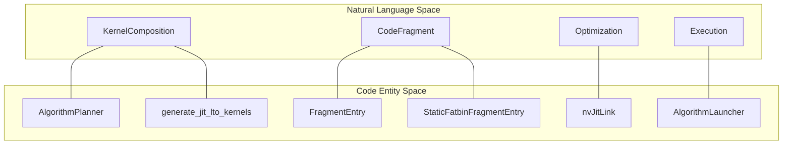
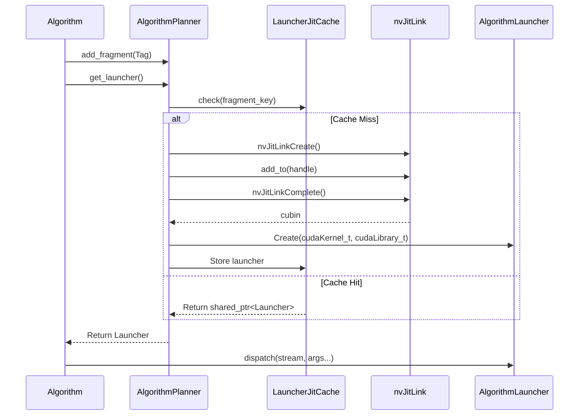

<!-- source: DeepWiki mcp.deepwiki.com · repo NVIDIA/cuvs · page 2.3 JIT LTO Kernel System · fetched 2026-10-26 -->

# JIT LTO Kernel System

Relevant source files

The following files were used as context for generating this wiki page:

- [c/include/cuvs/neighbors/cagra.h](c/include/cuvs/neighbors/cagra.h)
- [c/src/neighbors/cagra.cpp](c/src/neighbors/cagra.cpp)
- [c/tests/neighbors/ann_cagra_c.cu](c/tests/neighbors/ann_cagra_c.cu)
- [cpp/.clang-format](cpp/.clang-format)
- [cpp/CMakeLists.txt](cpp/CMakeLists.txt)
- [cpp/bench/ann/src/cuvs/cuvs_ann_bench_param_parser.h](cpp/bench/ann/src/cuvs/cuvs_ann_bench_param_parser.h)
- [cpp/bench/ann/src/cuvs/cuvs_cagra_wrapper.h](cpp/bench/ann/src/cuvs/cuvs_cagra_wrapper.h)
- [cpp/cmake/modules/ConfigureCUDA.cmake](cpp/cmake/modules/ConfigureCUDA.cmake)
- [cpp/include/cuvs/detail/jit_lto/common_fragments.hpp](cpp/include/cuvs/detail/jit_lto/common_fragments.hpp)
- [cpp/include/cuvs/neighbors/cagra.hpp](cpp/include/cuvs/neighbors/cagra.hpp)
- [cpp/src/neighbors/cagra.cuh](cpp/src/neighbors/cagra.cuh)
- [cpp/src/neighbors/detail/cagra/cagra_filter_payload.hpp](cpp/src/neighbors/detail/cagra/cagra_filter_payload.hpp)
- [cpp/src/neighbors/detail/cagra/cagra_merge.cuh](cpp/src/neighbors/detail/cagra/cagra_merge.cuh)
- [cpp/src/neighbors/detail/cagra/jit_lto_kernels/cagra_filter_payload.cuh](cpp/src/neighbors/detail/cagra/jit_lto_kernels/cagra_filter_payload.cuh)
- [cpp/src/neighbors/detail/cagra/search_multi_cta_inst.cu.in](cpp/src/neighbors/detail/cagra/search_multi_cta_inst.cu.in)
- [cpp/src/neighbors/detail/cagra/search_single_cta_inst.cu.in](cpp/src/neighbors/detail/cagra/search_single_cta_inst.cu.in)
- [cpp/src/neighbors/detail/cagra/search_single_cta_kernel_launcher_jit.cuh](cpp/src/neighbors/detail/cagra/search_single_cta_kernel_launcher_jit.cuh)
- [cpp/src/neighbors/detail/cagra/shared_launcher_jit.hpp](cpp/src/neighbors/detail/cagra/shared_launcher_jit.hpp)
- [cpp/src/neighbors/ivf_pq/ivf_pq_compute_similarity.cuh](cpp/src/neighbors/ivf_pq/ivf_pq_compute_similarity.cuh)
- [cpp/src/neighbors/ivf_pq/ivf_pq_compute_similarity.hpp](cpp/src/neighbors/ivf_pq/ivf_pq_compute_similarity.hpp)
- [cpp/src/neighbors/ivf_pq/ivf_pq_compute_similarity_impl.cuh](cpp/src/neighbors/ivf_pq/ivf_pq_compute_similarity_impl.cuh)
- [cpp/src/neighbors/refine/refine_host.hpp](cpp/src/neighbors/refine/refine_host.hpp)
- [cpp/tests/neighbors/ann_cagra.cuh](cpp/tests/neighbors/ann_cagra.cuh)
- [cpp/tests/neighbors/ann_cagra/test_merge_fastener.cu](cpp/tests/neighbors/ann_cagra/test_merge_fastener.cu)
- [python/cuvs_bench/cuvs_bench/config/algos/constraints/__init__.py](python/cuvs_bench/cuvs_bench/config/algos/constraints/__init__.py)
- [python/cuvs_bench/cuvs_bench/config/algos/cuvs_cagra.yaml](python/cuvs_bench/cuvs_bench/config/algos/cuvs_cagra.yaml)

The Just-In-Time Link-Time Optimization (JIT LTO) system in cuVS composes and optimizes specialized CUDA kernels at runtime. By leveraging the `nvJitLink` library, cuVS combines modular device code "fragments"—such as specific distance metrics, data types, or filtering logic—into a single optimized executable kernel. This approach avoids the binary size explosion that would occur from statically pre-compiling every combination of template parameters.

Sources: [cpp/include/cuvs/detail/jit_lto/AlgorithmPlanner.hpp:24-60](), [cpp/cmake/modules/generate_jit_lto_kernels.cmake:86-136]()

---

## System Architecture

The JIT LTO subsystem relies on three primary abstractions:
1.  **Fragments**: Pre-compiled LTO intermediate representation (IR) encapsulated in fatbins.
2.  **Planner**: Coordination logic that selects and aggregates required fragments for a target algorithm configuration (`AlgorithmPlanner`).
3.  **Launcher**: Manages the loaded CUDA library lifecycle and handles execution dispatch (`AlgorithmLauncher`).

### Natural Language to Code Entity Mapping

The following diagram bridges high-level architectural concepts to their corresponding C++ classes and CMake modules.

**Concept to Entity Mapping**

Sources: [cpp/include/cuvs/detail/jit_lto/AlgorithmPlanner.hpp:24-60](), [cpp/include/cuvs/detail/jit_lto/FragmentEntry.hpp:18-47](), [cpp/cmake/modules/generate_jit_lto_kernels.cmake:86-136]()

---

## Build-Time: Kernel Generation

During the CMake configuration and build phase, the `generate_jit_lto_kernels` module processes template parameter matrices (supplied via JSON) to generate specialized fatbins containing LTO IR.

### Workflow
1.  **Matrix Expansion**: `compute_matrix_product` expands JSON configurations into valid combinations [cpp/cmake/modules/generate_jit_lto_kernels.cmake:102-114]().
2.  **Kernel Compilation**: `add_jit_lto_kernel` creates object libraries with `CUDA_FATBIN_COMPILATION` and `INTERPROCEDURAL_OPTIMIZATION` enabled [cpp/cmake/modules/generate_jit_lto_kernels.cmake:19-34]().
3.  **Embedding**: The `bin2c` tool converts fatbins into C++ header byte arrays [cpp/cmake/modules/generate_jit_lto_kernels.cmake:36-41]().

**Build-Time Data Flow**

Sources: [cpp/cmake/modules/generate_jit_lto_kernels.cmake:12-42](), [cpp/cmake/modules/generate_jit_lto_kernels.cmake:86-136]()

---

## Runtime: Composition and Linking

At runtime, algorithms instantiate an `AlgorithmPlanner` to collect necessary code fragments and link them into an executable kernel.

### Fragment Management
Fragments implement the `FragmentEntry` interface [cpp/include/cuvs/detail/jit_lto/FragmentEntry.hpp:18-24]().
*   **`StaticFatbinFragmentEntry<Tag>`**: Wraps build-time pre-compiled fatbins [cpp/include/cuvs/detail/jit_lto/FragmentEntry.hpp:35-47]().
*   **`UDFFatbinFragment`**: Compiles runtime user-defined CUDA code via NVRTC into LTO IR [cpp/include/cuvs/detail/jit_lto/FragmentEntry.hpp:49-64]().

### AlgorithmPlanner and AlgorithmLauncher
The `AlgorithmPlanner` manages the `nvJitLink` lifecycle:
1.  **Cache Lookup**: Generates a unique key and queries `LauncherJitCache` [cpp/src/detail/jit_lto/AlgorithmPlanner.cpp:24-46]().
2.  **Linking**: On a cache miss, initializes an `nvJitLinkHandle`, registers fragments, and invokes `nvJitLinkComplete` for cross-module optimization into a `cubin` [cpp/src/detail/jit_lto/AlgorithmPlanner.cpp:75-93]().
3.  **Loading**: Loads the `cubin` into a `cudaLibrary_t` and extracts the `cudaKernel_t` entrypoint [cpp/src/detail/jit_lto/AlgorithmPlanner.cpp:108-115]().

The `AlgorithmLauncher` wraps these handles, offering type-safe invocation via its `dispatch` method [cpp/include/cuvs/detail/jit_lto/AlgorithmLauncher.hpp:31-38]().

**Runtime Execution Flow**

Sources: [cpp/src/detail/jit_lto/AlgorithmPlanner.cpp:41-116](), [cpp/include/cuvs/detail/jit_lto/AlgorithmLauncher.hpp:31-38]()

---

## Implementation Example: IVF-Flat Interleaved Scan

The IVF-Flat algorithm uses this framework to specialize its scan kernels. In `ivf_flat_interleaved_scan_jit.cuh`, the launch workflow proceeds as follows:

1.  **Tag Mapping**: Maps types like `float` or `int8_t` to JIT tags [cpp/src/neighbors/ivf_flat/ivf_flat_interleaved_scan_jit.cuh:36-43]().
2.  **Planner Setup**: Instantiates an `InterleavedScanPlanner` extending `AlgorithmPlanner` [cpp/src/neighbors/ivf_flat/ivf_flat_interleaved_scan_jit.cuh:164-165]().
3.  **Fragment Registration**: Appends entrypoint, distance metric, loading logic, and filter fragments [cpp/src/neighbors/ivf_flat/ivf_flat_interleaved_scan_jit.cuh:166-180]().
4.  **UDF Integration**: Compiles and injects custom metrics at runtime if specified [cpp/src/neighbors/ivf_flat/ivf_flat_interleaved_scan_jit.cuh:168-173]().

Sources: [cpp/src/neighbors/ivf_flat/ivf_flat_interleaved_scan_jit.cuh:36-43](), [cpp/src/neighbors/ivf_flat/ivf_flat_interleaved_scan_jit.cuh:164-181]()

---

