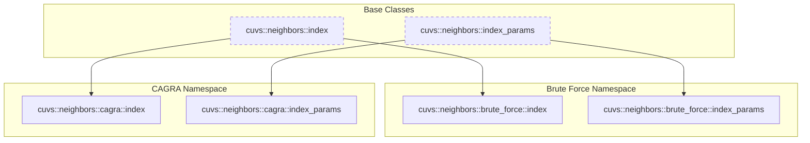
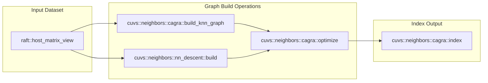

<!-- source: DeepWiki mcp.deepwiki.com · repo NVIDIA/cuvs · page 3 ANN Algorithms · fetched 2026-10-26 -->

# ANN Algorithms

Relevant source files

The following files were used as context for generating this wiki page:

- [c/include/cuvs/neighbors/cagra.h](c/include/cuvs/neighbors/cagra.h)
- [c/src/neighbors/cagra.cpp](c/src/neighbors/cagra.cpp)
- [c/tests/neighbors/ann_cagra_c.cu](c/tests/neighbors/ann_cagra_c.cu)
- [cpp/CMakeLists.txt](cpp/CMakeLists.txt)
- [cpp/bench/ann/src/cuvs/cuvs_ann_bench_param_parser.h](cpp/bench/ann/src/cuvs/cuvs_ann_bench_param_parser.h)
- [cpp/bench/ann/src/cuvs/cuvs_cagra_wrapper.h](cpp/bench/ann/src/cuvs/cuvs_cagra_wrapper.h)
- [cpp/include/cuvs/neighbors/brute_force.hpp](cpp/include/cuvs/neighbors/brute_force.hpp)
- [cpp/include/cuvs/neighbors/cagra.hpp](cpp/include/cuvs/neighbors/cagra.hpp)
- [cpp/include/cuvs/neighbors/common.hpp](cpp/include/cuvs/neighbors/common.hpp)
- [cpp/src/neighbors/brute_force.cu](cpp/src/neighbors/brute_force.cu)
- [cpp/src/neighbors/cagra.cuh](cpp/src/neighbors/cagra.cuh)
- [cpp/src/neighbors/detail/cagra/cagra_merge.cuh](cpp/src/neighbors/detail/cagra/cagra_merge.cuh)
- [cpp/src/neighbors/detail/faiss_distance_utils.h](cpp/src/neighbors/detail/faiss_distance_utils.h)
- [cpp/src/neighbors/detail/knn_brute_force.cuh](cpp/src/neighbors/detail/knn_brute_force.cuh)
- [cpp/tests/neighbors/ann_cagra.cuh](cpp/tests/neighbors/ann_cagra.cuh)
- [cpp/tests/neighbors/ann_cagra/test_merge_fastener.cu](cpp/tests/neighbors/ann_cagra/test_merge_fastener.cu)
- [python/cuvs_bench/cuvs_bench/config/algos/constraints/__init__.py](python/cuvs_bench/cuvs_bench/config/algos/constraints/__init__.py)
- [python/cuvs_bench/cuvs_bench/config/algos/cuvs_cagra.yaml](python/cuvs_bench/cuvs_bench/config/algos/cuvs_cagra.yaml)

Approximate Nearest Neighbor (ANN) algorithms are the core of cuVS, providing high-performance vector search capabilities on GPUs. cuVS implements several families of ANN algorithms, each optimized for different trade-offs between search latency, index build time, memory footprint, and recall accuracy. As a parent overview page, this section introduces the available algorithm families and routes to detailed child pages.

## Algorithm Selection Guide

The following table provides a high-level comparison to help select the appropriate algorithm for a given use case.

| Algorithm | Type | Strengths | Best For |
| :--- | :--- | :--- | :--- |
| **CAGRA** [cpp/include/cuvs/neighbors/cagra.hpp:106-109]() | Graph-Based | State-of-the-art search throughput; hardware-optimized for GPUs. | Low-latency serving; high-throughput requirements. |
| **IVF-PQ** [cpp/include/cuvs/neighbors/common.hpp:54-54]() | Quantized | Very low memory footprint; fast build times. | Billion-scale datasets; memory-constrained environments. |
| **IVF-Flat & IVF-SQ** [cpp/include/cuvs/neighbors/common.hpp:54-54]() | Inverted File | High recall; supports dynamic updates and scalar quantization. | Medium-scale datasets where accuracy or quantization trade-offs are critical. |
| **HNSW** [cpp/include/cuvs/neighbors/cagra.hpp:132-132]() | Graph-Based | CPU/GPU interoperability; established industry standard. | Hybrid cloud deployments; interoperability with `hnswlib`. |
| **Brute Force** [cpp/include/cuvs/neighbors/brute_force.hpp:31-38]() | Exact | 100% recall; no index build required. | Small datasets; ground-truth generation; exact distance refinement. |

Sources: [cpp/include/cuvs/neighbors/common.hpp:43-55](), [cpp/include/cuvs/neighbors/brute_force.hpp:31-38]()

## Graph-Based ANN

Graph-based methods represent the dataset as a navigable graph where nodes are vectors and edges connect neighbors.

### CAGRA: Graph-Based ANN
CAGRA (`cuvs::neighbors::cagra`) is cuVS's flagship graph-based algorithm. It is designed specifically for GPU architectures, utilizing specialized search kernels to maximize throughput. It can be seeded using other algorithms like IVF-PQ or NN-Descent, or constructed via Augmented Core Extraction (ACE) partitioning.
For details, see [CAGRA: Graph-Based ANN](#3.1).

### HNSW: Hierarchical Navigable Small Worlds
cuVS provides HNSW support primarily through integration with `hnswlib`. It supports building HNSW indices on the GPU (via CAGRA graph conversion heuristics) and provides CPU-friendly search capabilities.
For details, see [HNSW: Hierarchical Navigable Small Worlds](#3.4).

### NN-Descent: KNN Graph Construction
NN-Descent (`cuvs::neighbors::nn_descent`) is an iterative algorithm used to construct high-quality K-Nearest Neighbor (KNN) graphs via local joins and Bloom filter sampling. In cuVS, it serves as a fast graph seed builder for CAGRA.
For details, see [NN-Descent: KNN Graph Construction](#3.5).

Sources: [cpp/include/cuvs/neighbors/common.hpp:43-55](), [cpp/include/cuvs/neighbors/cagra.hpp:132-157]()

## Quantization & Inverted File (IVF)

IVF methods partition the vector space into Voronoi cells to narrow the search space at query time.

### IVF-PQ: Inverted File with Product Quantization
IVF-PQ (`cuvs::neighbors::ivf_pq`) combines inverted files with Product Quantization to compress vectors into compact codes using trained codebooks. This significantly reduces memory usage, allowing billion-scale indices to fit on a single GPU or multi-GPU setup.
For details, see [IVF-PQ: Inverted File with Product Quantization](#3.2).

### IVF-Flat & IVF-SQ: Inverted File Variants
IVF-Flat stores interleaved exact vectors in inverted lists, while IVF-SQ (Scalar Quantization) quantizes vector components to lower bit-widths (e.g., `int8` or `fp16`) to balance memory consumption and search accuracy.
For details, see [IVF-Flat & IVF-SQ: Inverted File Variants](#3.3).

Sources: [cpp/include/cuvs/neighbors/common.hpp:56-112](), [cpp/include/cuvs/neighbors/cagra.hpp:10-15]()

## Specialized & Exact Search

### Brute Force, ScaNN, Vamana & Other Algorithms
The exact `brute_force::index` provides exact nearest neighbor search using tiled matrix multiplication (`tiled_brute_force_knn`). Other specialized algorithms include ScaNN (SOAR/AVQ), Vamana/DiskANN graph indices, and batch all-neighbors construction.
For details, see [Brute Force, ScaNN, Vamana & Other Algorithms](#3.6).

Sources: [cpp/include/cuvs/neighbors/brute_force.hpp:31-78](), [cpp/src/neighbors/detail/knn_brute_force.cuh:60-87]()

## Mapping Algorithms to Code Entities

The following diagrams bridge natural language concepts to concrete code entities within the cuVS codebase.

### Algorithm Hierarchy and Parameter Mapping
Title: "ANN Index and Parameter Structure"

Sources: [cpp/include/cuvs/neighbors/common.hpp:121-131](), [cpp/include/cuvs/neighbors/brute_force.hpp:22-42](), [cpp/include/cuvs/neighbors/cagra.hpp:159-165]()

### CAGRA Graph Construction Pipeline
Title: "CAGRA Graph Build and Optimization"

Sources: [cpp/src/neighbors/cagra.cuh:119-137](), [cpp/src/neighbors/cagra.cuh:150-167]()

## Advanced Index Features

cuVS algorithms support several cross-cutting features to improve production performance:
- **Pre-filtering**: Using bitsets or bitmaps to filter candidate results during search.
- **Refinement**: Applying post-search or combined ratio refinement over quantized distances.
- **Multi-GPU (SNMG)**: Scaling search and index building across multiple GPUs.

For details, see [Advanced Index Features](#3.7).

Sources: [cpp/src/neighbors/detail/knn_brute_force.cuh:79-86](), [cpp/bench/ann/src/cuvs/cuvs_cagra_wrapper.h:147-152]()

---

