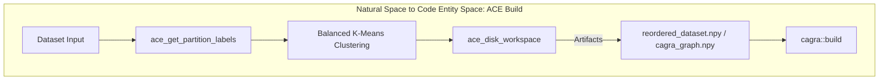
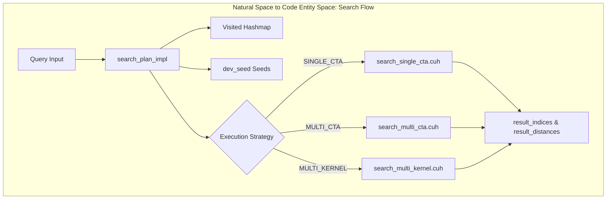
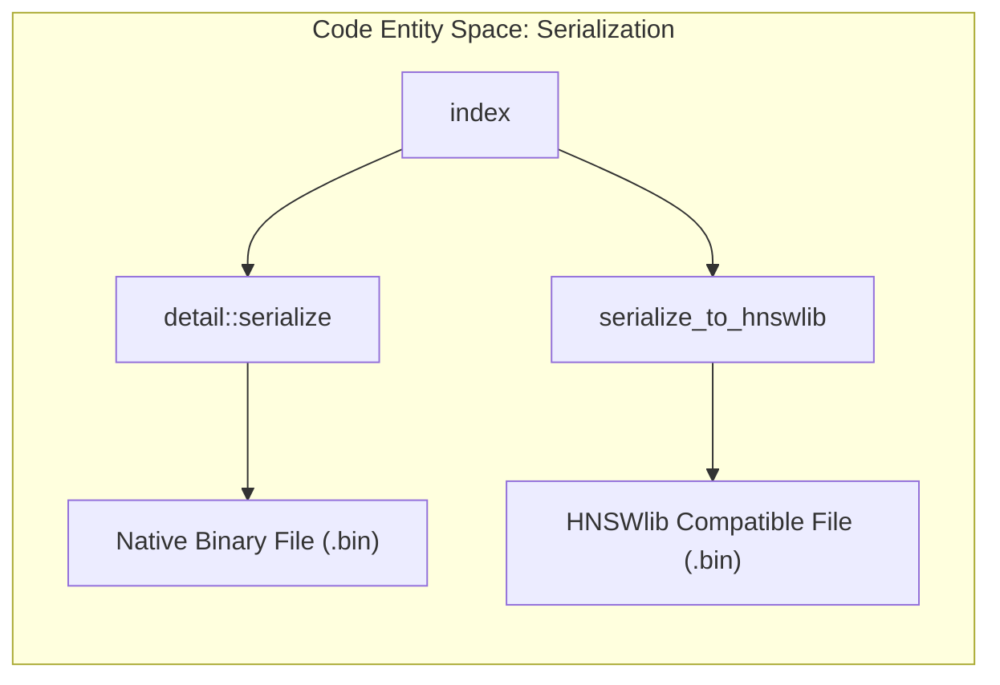

<!-- source: DeepWiki mcp.deepwiki.com · repo NVIDIA/cuvs · page 3.1 CAGRA: Graph-Based ANN · fetched 2026-10-26 -->

# CAGRA: Graph-Based ANN

Relevant source files

The following files were used as context for generating this wiki page:

- [c/include/cuvs/neighbors/cagra.h](c/include/cuvs/neighbors/cagra.h)
- [c/src/neighbors/cagra.cpp](c/src/neighbors/cagra.cpp)
- [c/tests/neighbors/ann_cagra_c.cu](c/tests/neighbors/ann_cagra_c.cu)
- [cpp/CMakeLists.txt](cpp/CMakeLists.txt)
- [cpp/bench/ann/src/cuvs/cuvs_ann_bench_param_parser.h](cpp/bench/ann/src/cuvs/cuvs_ann_bench_param_parser.h)
- [cpp/bench/ann/src/cuvs/cuvs_cagra_wrapper.h](cpp/bench/ann/src/cuvs/cuvs_cagra_wrapper.h)
- [cpp/include/cuvs/neighbors/cagra.hpp](cpp/include/cuvs/neighbors/cagra.hpp)
- [cpp/include/cuvs/neighbors/hnsw.hpp](cpp/include/cuvs/neighbors/hnsw.hpp)
- [cpp/include/cuvs/neighbors/ivf_flat.hpp](cpp/include/cuvs/neighbors/ivf_flat.hpp)
- [cpp/include/cuvs/neighbors/ivf_pq.hpp](cpp/include/cuvs/neighbors/ivf_pq.hpp)
- [cpp/include/cuvs/neighbors/ivf_sq.hpp](cpp/include/cuvs/neighbors/ivf_sq.hpp)
- [cpp/include/cuvs/util/file_io.hpp](cpp/include/cuvs/util/file_io.hpp)
- [cpp/src/neighbors/brute_force_serialize.cu](cpp/src/neighbors/brute_force_serialize.cu)
- [cpp/src/neighbors/cagra.cuh](cpp/src/neighbors/cagra.cuh)
- [cpp/src/neighbors/detail/ann_utils.cuh](cpp/src/neighbors/detail/ann_utils.cuh)
- [cpp/src/neighbors/detail/cagra/add_nodes.cuh](cpp/src/neighbors/detail/cagra/add_nodes.cuh)
- [cpp/src/neighbors/detail/cagra/cagra_build.cuh](cpp/src/neighbors/detail/cagra/cagra_build.cuh)
- [cpp/src/neighbors/detail/cagra/cagra_merge.cuh](cpp/src/neighbors/detail/cagra/cagra_merge.cuh)
- [cpp/src/neighbors/detail/cagra/cagra_search.cuh](cpp/src/neighbors/detail/cagra/cagra_search.cuh)
- [cpp/src/neighbors/detail/cagra/cagra_serialize.cuh](cpp/src/neighbors/detail/cagra/cagra_serialize.cuh)
- [cpp/src/neighbors/detail/cagra/factory.cuh](cpp/src/neighbors/detail/cagra/factory.cuh)
- [cpp/src/neighbors/detail/cagra/graph_core.cuh](cpp/src/neighbors/detail/cagra/graph_core.cuh)
- [cpp/src/neighbors/detail/cagra/graph_shared.cu](cpp/src/neighbors/detail/cagra/graph_shared.cu)
- [cpp/src/neighbors/detail/cagra/graph_shared.cuh](cpp/src/neighbors/detail/cagra/graph_shared.cuh)
- [cpp/src/neighbors/detail/cagra/search_multi_cta.cuh](cpp/src/neighbors/detail/cagra/search_multi_cta.cuh)
- [cpp/src/neighbors/detail/cagra/search_multi_cta_inst.cuh](cpp/src/neighbors/detail/cagra/search_multi_cta_inst.cuh)
- [cpp/src/neighbors/detail/cagra/search_multi_cta_kernel.cuh](cpp/src/neighbors/detail/cagra/search_multi_cta_kernel.cuh)
- [cpp/src/neighbors/detail/cagra/search_multi_kernel.cuh](cpp/src/neighbors/detail/cagra/search_multi_kernel.cuh)
- [cpp/src/neighbors/detail/cagra/search_plan.cuh](cpp/src/neighbors/detail/cagra/search_plan.cuh)
- [cpp/src/neighbors/detail/cagra/search_single_cta.cuh](cpp/src/neighbors/detail/cagra/search_single_cta.cuh)
- [cpp/src/neighbors/detail/cagra/search_single_cta_inst.cuh](cpp/src/neighbors/detail/cagra/search_single_cta_inst.cuh)
- [cpp/src/neighbors/detail/cagra/search_single_cta_kernel.cuh](cpp/src/neighbors/detail/cagra/search_single_cta_kernel.cuh)
- [cpp/src/neighbors/detail/cagra/utils.hpp](cpp/src/neighbors/detail/cagra/utils.hpp)
- [cpp/src/neighbors/detail/dataset_serialize.hpp](cpp/src/neighbors/detail/dataset_serialize.hpp)
- [cpp/src/neighbors/detail/hnsw.hpp](cpp/src/neighbors/detail/hnsw.hpp)
- [cpp/src/neighbors/detail/vamana/vamana_serialize.cuh](cpp/src/neighbors/detail/vamana/vamana_serialize.cuh)
- [cpp/src/neighbors/ivf_flat/ivf_flat_build.cuh](cpp/src/neighbors/ivf_flat/ivf_flat_build.cuh)
- [cpp/src/neighbors/ivf_flat/ivf_flat_search.cuh](cpp/src/neighbors/ivf_flat/ivf_flat_search.cuh)
- [cpp/src/neighbors/ivf_flat/ivf_flat_serialize.cuh](cpp/src/neighbors/ivf_flat/ivf_flat_serialize.cuh)
- [cpp/src/neighbors/ivf_list.cuh](cpp/src/neighbors/ivf_list.cuh)
- [cpp/src/neighbors/ivf_pq/ivf_pq_build.cuh](cpp/src/neighbors/ivf_pq/ivf_pq_build.cuh)
- [cpp/src/neighbors/ivf_pq/ivf_pq_build_common.cu](cpp/src/neighbors/ivf_pq/ivf_pq_build_common.cu)
- [cpp/src/neighbors/ivf_pq/ivf_pq_codepacking.cuh](cpp/src/neighbors/ivf_pq/ivf_pq_codepacking.cuh)
- [cpp/src/neighbors/ivf_pq/ivf_pq_search.cuh](cpp/src/neighbors/ivf_pq/ivf_pq_search.cuh)
- [cpp/src/neighbors/ivf_pq/ivf_pq_serialize.cuh](cpp/src/neighbors/ivf_pq/ivf_pq_serialize.cuh)
- [cpp/src/neighbors/ivf_sq/ivf_sq_build.cuh](cpp/src/neighbors/ivf_sq/ivf_sq_build.cuh)
- [cpp/src/neighbors/ivf_sq/ivf_sq_serialize.cuh](cpp/src/neighbors/ivf_sq/ivf_sq_serialize.cuh)
- [cpp/tests/neighbors/ann_cagra.cuh](cpp/tests/neighbors/ann_cagra.cuh)
- [cpp/tests/neighbors/ann_cagra/test_float_uint32_t.cu](cpp/tests/neighbors/ann_cagra/test_float_uint32_t.cu)
- [cpp/tests/neighbors/ann_cagra/test_half_uint32_t.cu](cpp/tests/neighbors/ann_cagra/test_half_uint32_t.cu)
- [cpp/tests/neighbors/ann_cagra/test_int8_t_uint32_t.cu](cpp/tests/neighbors/ann_cagra/test_int8_t_uint32_t.cu)
- [cpp/tests/neighbors/ann_cagra/test_merge_fastener.cu](cpp/tests/neighbors/ann_cagra/test_merge_fastener.cu)
- [cpp/tests/neighbors/ann_cagra/test_uint8_t_uint32_t.cu](cpp/tests/neighbors/ann_cagra/test_uint8_t_uint32_t.cu)
- [cpp/tests/neighbors/ann_hnsw_ace.cuh](cpp/tests/neighbors/ann_hnsw_ace.cuh)
- [cpp/tests/neighbors/ann_hnsw_ace/test_float_uint32_t.cu](cpp/tests/neighbors/ann_hnsw_ace/test_float_uint32_t.cu)
- [cpp/tests/neighbors/ann_hnsw_ace/test_half_uint32_t.cu](cpp/tests/neighbors/ann_hnsw_ace/test_half_uint32_t.cu)
- [cpp/tests/neighbors/ann_hnsw_ace/test_int8_t_uint32_t.cu](cpp/tests/neighbors/ann_hnsw_ace/test_int8_t_uint32_t.cu)
- [cpp/tests/neighbors/ann_hnsw_ace/test_uint8_t_uint32_t.cu](cpp/tests/neighbors/ann_hnsw_ace/test_uint8_t_uint32_t.cu)
- [cpp/tests/neighbors/ann_ivf_flat/test_float_int64_t.cu](cpp/tests/neighbors/ann_ivf_flat/test_float_int64_t.cu)
- [cpp/tests/neighbors/ann_ivf_sq/test_float_int64_t.cu](cpp/tests/neighbors/ann_ivf_sq/test_float_int64_t.cu)
- [python/cuvs/cuvs/tests/test_cagra_ace.py](python/cuvs/cuvs/tests/test_cagra_ace.py)
- [python/cuvs_bench/cuvs_bench/config/algos/constraints/__init__.py](python/cuvs_bench/cuvs_bench/config/algos/constraints/__init__.py)
- [python/cuvs_bench/cuvs_bench/config/algos/cuvs_cagra.yaml](python/cuvs_bench/cuvs_bench/config/algos/cuvs_cagra.yaml)

CAGRA (CUDA Accelerated Graph-based RetrievAl) is a GPU-native approximate nearest neighbor (ANN) search algorithm designed to maximize hardware throughput via fixed-degree graphs and customized CUDA traversal kernels. 

This page provides a technical deep dive into CAGRA index construction, seeding strategies (IVF-PQ and NN-Descent), pruning, Minimum Spanning Tree (MST) connectivity, ACE (Augmented Core Extraction) partitioning for large datasets, search execution plans, dynamic extension, merging, and serialization.

---

## 1. Index Construction Pipeline

CAGRA construction converts a raw vector dataset into an optimized, fixed-degree K-Nearest Neighbor (KNN) graph. The build process begins by generating an initial coarse KNN graph using configurable seeding strategies, refines it via distance-based pruning, and optionally enforces graph connectivity.

### Construction Workflow & Seeding Strategies
The initial seeding graph is defined by `graph_build_params_t` in `cuvs/neighbors/cagra.hpp`, supporting multiple backend heuristics [cpp/include/cuvs/neighbors/cagra.hpp:119-123]():
1. **IVF-PQ Seeding**: Uses Inverted File Product Quantization (`cuvs::neighbors::ivf_pq`) to quickly cluster vectors and construct an initial candidate graph [cpp/include/cuvs/neighbors/cagra.hpp:120]().
2. **NN-Descent Seeding**: Uses Neighborhood Descent (`cuvs::neighbors::nn_descent`) to iteratively discover local neighbors [cpp/include/cuvs/neighbors/cagra.hpp:121]().
3. **Iterative Search / Monostate**: Automatically selects heuristics based on dataset dimensions and shape [cpp/include/cuvs/neighbors/cagra.hpp:167-168]().

### Pruning and Optimization
Once the intermediate graph of degree `intermediate_graph_degree` is built, CAGRA applies a fused pruning kernel (`kern_fused_prune`) to compress the neighbor list down to the target `graph_degree` [cpp/src/neighbors/detail/cagra/graph_core.cuh:86-92](). The pruning algorithm evaluates edge quality by counting multi-hop detours ($A \to D \to B$), eliminating redundant edges that can be reached efficiently through alternative paths [cpp/src/neighbors/detail/cagra/graph_core.cuh:139-157]().

Sources: [cpp/include/cuvs/neighbors/cagra.hpp:119-168](), [cpp/src/neighbors/detail/cagra/graph_core.cuh:86-169]()

---

## 2. ACE: Augmented Core Extraction

For massive datasets exceeding available GPU memory, CAGRA implements **ACE (Augmented Core Extraction)**, enabling partitioned index construction with optional disk-backed storage [cpp/include/cuvs/neighbors/cagra.hpp:38-81]().

### ACE Partitioning Architecture
ACE divides the dataset into balanced partitions, builds local graphs independently, and merges them into a global structure:
* **Partition Assignment**: `ace_get_partition_labels` computes partition histograms and labels using balanced K-Means [cpp/src/neighbors/detail/cagra/cagra_build.cuh:177-184]().
* **Disk Workspace (`ace_disk_workspace`)**: Manages intermediate build files such as `reordered_dataset.npy`, `augmented_dataset.npy`, `dataset_mapping.npy`, and `cagra_graph.npy` inside a configured `build_dir` [cpp/src/neighbors/detail/cagra/cagra_build.cuh:67-83]().
* **Resource Controls**: `max_host_memory_gb` and `max_gpu_memory_gb` govern peak resource consumption, triggering automatic partition adjustments if limits are exceeded [cpp/include/cuvs/neighbors/cagra.hpp:52-55]().

Sources: [cpp/include/cuvs/neighbors/cagra.hpp:38-81](), [cpp/src/neighbors/detail/cagra/cagra_build.cuh:67-184]()

---

## 3. Search Algorithms & Execution Plans

CAGRA search execution is managed by specialized search plans and kernel variants selected via `search_params` [cpp/src/neighbors/detail/cagra/search_plan.cuh:113-131]().

### Search Strategies
1. **`SINGLE_CTA`**: Each Cooperative Thread Array (CTA/block) handles a single query. Highly optimized for low `itopk_size` ($\le 512$) and high-concurrency throughput [cpp/src/neighbors/detail/cagra/search_plan.cuh:124-127](). Supports persistent kernel modes [cpp/src/neighbors/detail/cagra/search_plan.cuh:112-116]().
2. **`MULTI_CTA`**: Multiple CTAs cooperate to traverse the graph for a single query. Preferred for large top-$k$ sizes where latency is prioritized over raw throughput [cpp/src/neighbors/detail/cagra/search_plan.cuh:128-130]().
3. **`MULTI_KERNEL`**: Decomposes graph expansion and distance calculations across separate kernel invocations.

Sources: [cpp/src/neighbors/detail/cagra/search_plan.cuh:112-132](), [cpp/src/neighbors/detail/cagra/search_single_cta.cuh:1-50](), [cpp/src/neighbors/detail/cagra/search_multi_cta.cuh:1-50]()

---

## 4. Index Extension and Merging

CAGRA supports incremental updates and multi-GPU collection consolidation without requiring full index reconstruction.

### Index Extension (`add_node_core`)
New vectors are appended to an existing index using `add_node_core`:
1. **Neighborhood Search**: Finds nearest neighbors for incoming nodes using the existing graph [cpp/src/neighbors/detail/cagra/add_nodes.cuh:114-116]().
2. **Rank-Based Reordering**: Re-ranks incoming edges to maintain structural graph quality [cpp/src/neighbors/detail/cagra/add_nodes.cuh:148-155]().
3. **Incoming Edge Tracking**: Uses `dev_num_incoming_edges` to monitor connection densities across nodes [cpp/src/neighbors/detail/cagra/add_nodes.cuh:41-50]().

### Multi-GPU Merging
Distributed indexes built across multiple GPUs can be merged using shard combination functions [cpp/src/neighbors/mg/snmg.cuh:92-166](), supporting both **SHARDED** (partitioned dataset chunks) and **REPLICATED** (full copies per GPU) topologies [cpp/src/neighbors/mg/snmg.cuh:97-131]().

Sources: [cpp/src/neighbors/detail/cagra/add_nodes.cuh:24-155](), [cpp/src/neighbors/mg/snmg.cuh:92-166]()

---

## 5. Serialization and Interoperability

CAGRA provides binary serialization for persistence and export mechanisms to bridge GPU-built indexes with CPU runtimes like `hnswlib`.

### Native Serialization
The `serialize` function writes index metadata (version, dimensions, graph degree, metric type), adjacency lists, and optional base datasets to an `std::ostream` [cpp/src/neighbors/detail/cagra/cagra_serialize.cuh:31-84]().

### HNSW Interoperability (`serialize_to_hnswlib`)
GPU-constructed CAGRA graphs can be exported into CPU-compatible `hnswlib` binary formats [cpp/src/neighbors/detail/cagra/cagra_serialize.cuh:106-162]().
* **Heuristics**: `hnsw_heuristic_type` allows choosing between `SIMILAR_SEARCH_PERFORMANCE` and `SAME_GRAPH_FOOTPRINT` when mapping CAGRA's fixed-degree graph to HNSW layer structures [cpp/include/cuvs/neighbors/cagra.hpp:145-156]().

Sources: [cpp/src/neighbors/detail/cagra/cagra_serialize.cuh:31-162](), [cpp/include/cuvs/neighbors/cagra.hpp:145-156]()

---

