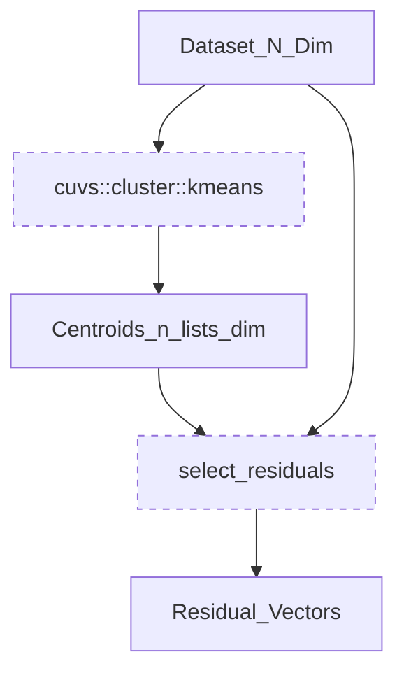
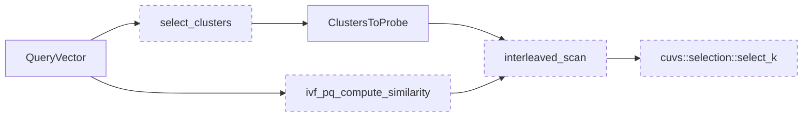

<!-- source: DeepWiki mcp.deepwiki.com · repo NVIDIA/cuvs · page 3.2 IVF-PQ: Inverted File with Product Quantization · fetched 2026-10-26 -->

# IVF-PQ: Inverted File with Product Quantization

Relevant source files

The following files were used as context for generating this wiki page:

- [cpp/bench/ann/src/common/cuda_huge_page_resource.hpp](cpp/bench/ann/src/common/cuda_huge_page_resource.hpp)
- [cpp/cmake/modules/ConfigureCUDA.cmake](cpp/cmake/modules/ConfigureCUDA.cmake)
- [cpp/include/cuvs/neighbors/ivf_flat.hpp](cpp/include/cuvs/neighbors/ivf_flat.hpp)
- [cpp/include/cuvs/neighbors/ivf_pq.hpp](cpp/include/cuvs/neighbors/ivf_pq.hpp)
- [cpp/src/core/nvtx.hpp](cpp/src/core/nvtx.hpp)
- [cpp/src/neighbors/detail/ann_utils.cuh](cpp/src/neighbors/detail/ann_utils.cuh)
- [cpp/src/neighbors/detail/cagra/add_nodes.cuh](cpp/src/neighbors/detail/cagra/add_nodes.cuh)
- [cpp/src/neighbors/detail/cagra/graph_core.cuh](cpp/src/neighbors/detail/cagra/graph_core.cuh)
- [cpp/src/neighbors/detail/cagra/graph_shared.cu](cpp/src/neighbors/detail/cagra/graph_shared.cu)
- [cpp/src/neighbors/detail/cagra/graph_shared.cuh](cpp/src/neighbors/detail/cagra/graph_shared.cuh)
- [cpp/src/neighbors/detail/cagra/utils.hpp](cpp/src/neighbors/detail/cagra/utils.hpp)
- [cpp/src/neighbors/ivf_common.cu](cpp/src/neighbors/ivf_common.cu)
- [cpp/src/neighbors/ivf_common.cuh](cpp/src/neighbors/ivf_common.cuh)
- [cpp/src/neighbors/ivf_flat/ivf_flat_build.cuh](cpp/src/neighbors/ivf_flat/ivf_flat_build.cuh)
- [cpp/src/neighbors/ivf_flat/ivf_flat_search.cuh](cpp/src/neighbors/ivf_flat/ivf_flat_search.cuh)
- [cpp/src/neighbors/ivf_pq/ivf_pq_build.cuh](cpp/src/neighbors/ivf_pq/ivf_pq_build.cuh)
- [cpp/src/neighbors/ivf_pq/ivf_pq_build_common.cu](cpp/src/neighbors/ivf_pq/ivf_pq_build_common.cu)
- [cpp/src/neighbors/ivf_pq/ivf_pq_codepacking.cuh](cpp/src/neighbors/ivf_pq/ivf_pq_codepacking.cuh)
- [cpp/src/neighbors/ivf_pq/ivf_pq_compute_similarity.cuh](cpp/src/neighbors/ivf_pq/ivf_pq_compute_similarity.cuh)
- [cpp/src/neighbors/ivf_pq/ivf_pq_compute_similarity.hpp](cpp/src/neighbors/ivf_pq/ivf_pq_compute_similarity.hpp)
- [cpp/src/neighbors/ivf_pq/ivf_pq_compute_similarity_impl.cuh](cpp/src/neighbors/ivf_pq/ivf_pq_compute_similarity_impl.cuh)
- [cpp/src/neighbors/ivf_pq/ivf_pq_fp_8bit.cuh](cpp/src/neighbors/ivf_pq/ivf_pq_fp_8bit.cuh)
- [cpp/src/neighbors/ivf_pq/ivf_pq_search.cuh](cpp/src/neighbors/ivf_pq/ivf_pq_search.cuh)
- [cpp/src/neighbors/ivf_pq_impl.hpp](cpp/src/neighbors/ivf_pq_impl.hpp)
- [cpp/src/neighbors/ivf_pq_index.cu](cpp/src/neighbors/ivf_pq_index.cu)
- [cpp/src/neighbors/refine/refine_host.hpp](cpp/src/neighbors/refine/refine_host.hpp)
- [cpp/tests/distance/distance_base.cuh](cpp/tests/distance/distance_base.cuh)
- [cpp/tests/neighbors/ann_ivf_pq.cuh](cpp/tests/neighbors/ann_ivf_pq.cuh)
- [cpp/tests/neighbors/ann_ivf_pq/test_float_int64_t.cu](cpp/tests/neighbors/ann_ivf_pq/test_float_int64_t.cu)
- [cpp/tests/neighbors/ann_utils.cuh](cpp/tests/neighbors/ann_utils.cuh)
- [cpp/tests/sparse/neighbors/cross_component_nn.cu](cpp/tests/sparse/neighbors/cross_component_nn.cu)

Inverted File with Product Quantization (IVF-PQ) is a lossy compression-based approximate nearest neighbor (ANN) algorithm. It accelerates searches by partitioning the dataset into Voronoi cells (Inverted Lists) and compressing the residual vectors within each cell using Product Quantization (PQ). This approach significantly reduces the memory footprint and enables fast distance computations using lookup tables (LUTs).

## Coarse IVF Clustering

The first stage of IVF-PQ is coarse quantization, where the vector space is divided into $N$ inverted lists.

*   **Clustering Implementation**: cuVS uses a balanced K-Means implementation to ensure that inverted lists are relatively uniform in size, which prevents GPU thread divergence during search [cpp/src/neighbors/ivf_pq/ivf_pq_build.cuh:23-24]().
*   **Metric Selection**: For `InnerProduct` metrics, the system automatically maps to `L2Expanded` for coarse clustering to maintain spatial consistency [cpp/src/neighbors/ivf_pq/ivf_pq_build.cuh:70-76]().
*   **Residual Computation**: After identifying the nearest cluster center (centroid) for a vector, the algorithm computes the residual (the difference between the vector and its centroid). PQ is then applied to these residuals rather than the raw vectors [cpp/src/neighbors/ivf_pq/ivf_pq_build.cuh:79-83]().

### Data Flow: Coarse Clustering to Residuals
The following diagram describes the transition from raw input data to the residual space handled by the PQ encoder, bridging natural language concepts to specific code entities.

Title: Coarse Clustering and Residual Flow

Sources: [cpp/src/neighbors/ivf_pq/ivf_pq_build.cuh:79-130](), [cpp/src/cluster/kmeans_balanced.cuh:1-20]()

## Product Quantization (PQ)

PQ decomposes the high-dimensional residual vector into $M$ sub-vectors (subspaces). Each sub-vector is quantized using a separate codebook.

*   **Subspaces (`pq_dim`)**: The residual vector is split into `pq_dim` sub-vectors. If `pq_dim` is not a divisor of the original dimension, a random rotation matrix is applied to align the dimensions [cpp/include/cuvs/neighbors/ivf_pq.hpp:92-103]().
*   **Codebook Generation**: cuVS supports two kinds of codebooks configured via `codebook_gen` [cpp/include/cuvs/neighbors/ivf_pq.hpp:34-37]():
    *   `PER_SUBSPACE`: One codebook per subspace across all clusters [cpp/include/cuvs/neighbors/ivf_pq.hpp:35]().
    *   `PER_CLUSTER`: Specialized codebooks for each inverted list [cpp/include/cuvs/neighbors/ivf_pq.hpp:36]().
*   **Bit Length (`pq_bits`)**: Specifies the number of bits per subspace index, taking values in `[4, 5, 6, 7, 8]` [cpp/include/cuvs/neighbors/ivf_pq.hpp:67]().

Sources: [cpp/include/cuvs/neighbors/ivf_pq.hpp:33-104](), [cpp/src/neighbors/ivf_pq/ivf_pq_build.cuh:15-18]()

## Index Layout and Memory Management

cuVS provides two layouts for storing the quantized codes within the inverted lists via `list_layout` [cpp/include/cuvs/neighbors/ivf_pq.hpp:39-45]().

| Layout | Description | Use Case |
| :--- | :--- | :--- |
| `FLAT` | Codes for each vector are stored contiguously: `[v1_c1, v1_c2, ..., vN_cM]` [cpp/include/cuvs/neighbors/ivf_pq.hpp:42]() | Simpler data management, sequential access. |
| `INTERLEAVED` | Codes from multiple vectors are interleaved for coalesced memory access: `[v1_c1, v2_c1, ..., v32_c1]` [cpp/include/cuvs/neighbors/ivf_pq.hpp:44]() | Optimized for GPU search performance (default). |

*   **Interleaving**: Specifically groups vectors into blocks to allow threads within a warp to read codes for the same subspace simultaneously [cpp/src/neighbors/ivf_flat/ivf_flat_build.cuh:138-142]().
*   **Conservative Allocation**: Users can toggle `conservative_memory_allocation`. If false, the system over-allocates list buffers to amortize the cost of `extend` operations [cpp/include/cuvs/neighbors/ivf_pq.hpp:114-115]().

Sources: [cpp/include/cuvs/neighbors/ivf_pq.hpp:40-45](), [cpp/src/neighbors/ivf_flat/ivf_flat_build.cuh:138-158]()

## Search Implementation and LUT-Based Search

The search process involves identifying candidate inverted lists and then scanning the compressed codes within those lists using precomputed lookup tables.

1.  **Select Clusters**: The query is compared against all coarse centroids using a GEMM-based search (`select_clusters`) to find the `n_probes` nearest lists [cpp/src/neighbors/ivf_pq/ivf_pq_search.cuh:60-72]().
2.  **LUT Construction**: A Look-Up Table (LUT) is built dynamically for the query to store distances from query sub-vectors to codebook entries [cpp/include/cuvs/neighbors/ivf_pq.hpp:160-175]().
3.  **Distance Computation**: For each vector in the probed lists, the distance is approximated by summing the pre-computed values from the LUT corresponding to the vector's PQ codes [cpp/src/neighbors/ivf_pq/ivf_pq_search.cuh:12-14]().

Title: IVF-PQ Search Pipeline and Code Mapping

Sources: [cpp/src/neighbors/ivf_pq/ivf_pq_search.cuh:60-168](), [cpp/include/cuvs/neighbors/ivf_pq.hpp:160-175]()

## Serialization and Codepacker Helpers

### Serialization
The index is serialized into a binary format that includes global metadata, coarse centroids, rotation matrices, PQ codebooks, and inverted list data [cpp/src/neighbors/ivf_pq_index.cu:1-50]().

### Codepacker Helpers
Because of the `INTERLEAVED` layout, adding or extracting data from the index requires specialized packing logic. The `ivf_pq_codepacking.cuh` utility handles the conversion between raw PQ codes and the optimized GPU memory layout [cpp/src/neighbors/ivf_pq/ivf_pq_codepacking.cuh:1-30]().

Sources: [cpp/src/neighbors/ivf_pq_index.cu:1-50](), [cpp/src/neighbors/ivf_pq/ivf_pq_codepacking.cuh:1-30]()

## API Reference

### Key C++ Structures
*   `cuvs::neighbors::ivf_pq::index_params`: Configuration structure for building the index [cpp/include/cuvs/neighbors/ivf_pq.hpp:47-151]().
*   `cuvs::neighbors::ivf_pq::search_params`: Runtime parameters structure for search operations [cpp/include/cuvs/neighbors/ivf_pq.hpp:160-175]().

### Key Functions
*   `ivf_pq::build`: Constructs the index from a dataset [cpp/include/cuvs/neighbors/ivf_pq.hpp:123]().
*   `ivf_pq::extend`: Adds new vectors to an existing index [cpp/include/cuvs/neighbors/ivf_pq.hpp:114]().
*   `ivf_pq::search`: Performs approximate nearest neighbor search [cpp/src/neighbors/ivf_pq/ivf_pq_search.cuh:60-168]().

Sources: [cpp/include/cuvs/neighbors/ivf_pq.hpp:47-175](), [cpp/src/neighbors/ivf_pq/ivf_pq_search.cuh:60-168]()

---

