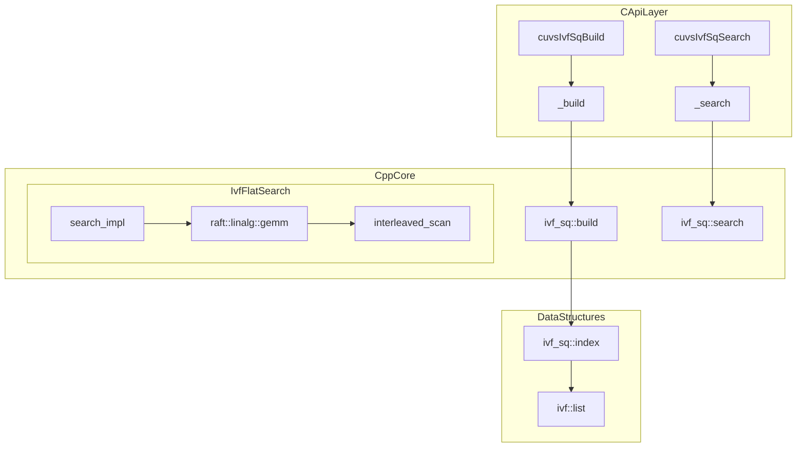
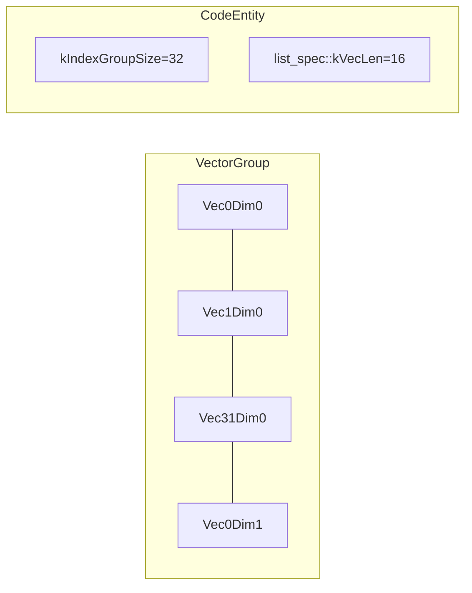

<!-- source: DeepWiki mcp.deepwiki.com · repo NVIDIA/cuvs · page 3.3 IVF-Flat & IVF-SQ: Inverted File Variants · fetched 2026-10-26 -->

# IVF-Flat & IVF-SQ: Inverted File Variants

Relevant source files

The following files were used as context for generating this wiki page:

- [c/include/cuvs/neighbors/ivf_sq.h](c/include/cuvs/neighbors/ivf_sq.h)
- [c/src/neighbors/ivf_sq.hpp](c/src/neighbors/ivf_sq.hpp)
- [c/tests/neighbors/ann_ivf_sq_c.cu](c/tests/neighbors/ann_ivf_sq_c.cu)
- [c/tests/neighbors/c_api.c](c/tests/neighbors/c_api.c)
- [c/tests/neighbors/run_ivf_sq_c.c](c/tests/neighbors/run_ivf_sq_c.c)
- [cpp/include/cuvs/neighbors/ivf_sq.hpp](cpp/include/cuvs/neighbors/ivf_sq.hpp)
- [cpp/include/cuvs/neighbors/refine.hpp](cpp/include/cuvs/neighbors/refine.hpp)
- [cpp/src/neighbors/brute_force_serialize.cu](cpp/src/neighbors/brute_force_serialize.cu)
- [cpp/src/neighbors/detail/cagra/cagra_serialize.cuh](cpp/src/neighbors/detail/cagra/cagra_serialize.cuh)
- [cpp/src/neighbors/detail/dataset_serialize.hpp](cpp/src/neighbors/detail/dataset_serialize.hpp)
- [cpp/src/neighbors/detail/vamana/vamana_serialize.cuh](cpp/src/neighbors/detail/vamana/vamana_serialize.cuh)
- [cpp/src/neighbors/ivf_flat/ivf_flat_interleaved_scan_ext.cuh](cpp/src/neighbors/ivf_flat/ivf_flat_interleaved_scan_ext.cuh)
- [cpp/src/neighbors/ivf_flat/ivf_flat_serialize.cuh](cpp/src/neighbors/ivf_flat/ivf_flat_serialize.cuh)
- [cpp/src/neighbors/ivf_flat_index.cpp](cpp/src/neighbors/ivf_flat_index.cpp)
- [cpp/src/neighbors/ivf_list.cuh](cpp/src/neighbors/ivf_list.cuh)
- [cpp/src/neighbors/ivf_pq/ivf_pq_serialize.cuh](cpp/src/neighbors/ivf_pq/ivf_pq_serialize.cuh)
- [cpp/src/neighbors/ivf_sq/ivf_sq_build.cuh](cpp/src/neighbors/ivf_sq/ivf_sq_build.cuh)
- [cpp/src/neighbors/ivf_sq/ivf_sq_serialize.cuh](cpp/src/neighbors/ivf_sq/ivf_sq_serialize.cuh)
- [cpp/src/neighbors/refine/refine_device.cuh](cpp/src/neighbors/refine/refine_device.cuh)
- [cpp/tests/cluster/kmeans_balanced.cu](cpp/tests/cluster/kmeans_balanced.cu)
- [cpp/tests/neighbors/ann_brute_force.cuh](cpp/tests/neighbors/ann_brute_force.cuh)
- [cpp/tests/neighbors/ann_ivf_flat.cuh](cpp/tests/neighbors/ann_ivf_flat.cuh)
- [cpp/tests/neighbors/ann_ivf_flat/test_float_int64_t.cu](cpp/tests/neighbors/ann_ivf_flat/test_float_int64_t.cu)
- [cpp/tests/neighbors/ann_ivf_sq.cuh](cpp/tests/neighbors/ann_ivf_sq.cuh)
- [cpp/tests/neighbors/ann_ivf_sq/test_float_int64_t.cu](cpp/tests/neighbors/ann_ivf_sq/test_float_int64_t.cu)
- [cpp/tests/neighbors/dynamic_batching.cuh](cpp/tests/neighbors/dynamic_batching.cuh)
- [cpp/tests/neighbors/hnsw.cu](cpp/tests/neighbors/hnsw.cu)
- [cpp/tests/neighbors/tiered_index.cu](cpp/tests/neighbors/tiered_index.cu)
- [fern/pages/c_api/c-api-neighbors-ivf-sq.md](fern/pages/c_api/c-api-neighbors-ivf-sq.md)
- [fern/pages/cpp_api/cpp-api-neighbors-ivf-sq.md](fern/pages/cpp_api/cpp-api-neighbors-ivf-sq.md)

Inverted File (IVF) indices partition the vector space into Voronoi cells based on cluster centers. At search time, only the most promising cells (inverted lists) are scanned. cuVS provides two high-performance variants that differ in how they store the residual data within these lists: **IVF-Flat** (storing exact vectors) and **IVF-SQ** (storing scalar-quantized residuals).

Sources: `[cpp/include/cuvs/neighbors/ivf_flat.hpp:1-30](), [cpp/include/cuvs/neighbors/ivf_sq.hpp:138-170]()`

---

## IVF-Flat: Exact Inverted File

IVF-Flat stores the original vector data within the inverted lists. To maximize GPU memory throughput during search, vectors are stored in an **interleaved layout** within each list.

### Data Layout and Build
The build process uses K-Means to find cluster centers. Vectors are then assigned to these centers and copied into the index. The internal storage uses `kIndexGroupSize` (32) to interleave dimensions, allowing for coalesced memory access during the scan.

| Parameter | Role |
| :--- | :--- |
| `n_lists` | Number of Voronoi cells (inverted lists). `[cpp/src/neighbors/ivf_flat/ivf_flat_build.cuh:173]()` |
| `adaptive_centers` | If true, cluster centers are updated as data is added. `[cpp/src/neighbors/ivf_flat/ivf_flat_build.cuh:56]()` |
| `conservative_memory_allocation` | If true, minimizes GPU memory by avoiding over-provisioning list capacity. `[cpp/src/neighbors/ivf_flat/ivf_flat_build.cuh:57]()` |

### Search Pipeline
The search process follows a two-stage approach:
1.  **Coarse Quantization**: A GEMM operation computes distances between queries and all cluster centers to select the top `n_probes` lists. `[cpp/src/neighbors/ivf_flat/ivf_flat_search.cuh:148-162]()`
2.  **Fine Scan**: The selected lists are scanned using an interleaved kernel that computes exact distances (L2, Inner Product, or Cosine). `[cpp/src/neighbors/ivf_flat/ivf_flat_search.cuh:11-13]()`

Sources: `[cpp/src/neighbors/ivf_flat/ivf_flat_build.cuh:47-120](), [cpp/src/neighbors/ivf_flat/ivf_flat_search.cuh:41-162](), [cpp/include/cuvs/neighbors/ivf_flat.hpp:28-60]()`

---

## IVF-SQ: Scalar Quantized Inverted File

IVF-SQ provides a middle ground between the exactness of IVF-Flat and the high compression of IVF-PQ. It stores 8-bit scalar quantized residuals.

### Quantization Mechanism
For each dimension $i$, the residual $r_i$ (vector component minus centroid component) is mapped to a `uint8_t` code using learned per-dimension minimums ($vmin_i$) and step-sizes ($delta_i$):
$$code_i = clamp(round((x_i - centroid_i - vmin_i) / delta_i), 0, 255)$$
`[cpp/include/cuvs/neighbors/ivf_sq.hpp:148-155]()`

### Key Classes and Structures
-   `cuvs::neighbors::ivf_sq::index<CodeT>`: The main index structure. Currently, `CodeT` must be `uint8_t`. `[cpp/include/cuvs/neighbors/ivf_sq.hpp:171-180]()`
-   `list_spec`: Defines the storage alignment and padding (vectors are padded to multiples of 16 for performance). `[cpp/include/cuvs/neighbors/ivf_sq.hpp:92-123]()`

Sources: `[cpp/include/cuvs/neighbors/ivf_sq.hpp:36-62](), [cpp/include/cuvs/neighbors/ivf_sq.hpp:138-180]()`

---

## System Architecture & Data Flow

The following diagrams bridge natural language concepts to concrete code entities within the cuVS codebase.

### IVF Variant Logic to Code Mapping
Diagram: IVF Data Flow

Sources: `[c/src/neighbors/ivf_sq.cpp:53-72](), [c/src/neighbors/ivf_sq.cpp:74-116](), [cpp/src/neighbors/ivf_flat/ivf_flat_search.cuh:41-56]()`

---

## Implementation Details

### Interleaved Memory Layout
Both variants use a specialized layout to ensure that when a warp (32 threads) processes a list, each thread reads a dimension from a different vector in a single transaction.

Diagram: Memory Layout of Inverted Lists

Sources: `[cpp/src/neighbors/ivf_flat/ivf_flat_build.cuh:138-144](), [cpp/include/cuvs/neighbors/ivf_sq.hpp:28-116]()`

### Pre-filtering
Both IVF-Flat and IVF-SQ support bitset-based pre-filtering. This allows excluding specific IDs from the search results before distance computation.
-   In the C API, this is handled via `cuvsFilter`. `[c/src/neighbors/ivf_sq.cpp:96-112]()`
-   In the C++ detail layer, it uses `IvfSampleFilterT`. `[cpp/src/neighbors/ivf_flat/ivf_flat_search.cuh:40-55]()`

Sources: `[c/src/neighbors/ivf_sq.cpp:96-112](), [cpp/src/neighbors/ivf_flat/ivf_flat_search.cuh:40-55]()`

### Serialization
Serialization is implemented for both variants to allow saving/loading indices to/from disk.
-   **IVF-Flat**: Uses `cuvs::neighbors::ivf_flat::serialize`. `[cpp/src/neighbors/ivf_flat/ivf_flat_serialize.cuh:43-78]()`
-   **IVF-SQ**: Uses `cuvs::neighbors::ivf_sq::serialize`. `[cpp/src/neighbors/ivf_sq/ivf_sq_serialize.cuh:20-50]()`

Sources: `[cpp/src/neighbors/ivf_flat/ivf_flat_serialize.cuh:43-78](), [cpp/src/neighbors/ivf_sq/ivf_sq_serialize.cuh:20-50]()`

---

## Summary Table

| Feature | IVF-Flat | IVF-SQ |
| :--- | :--- | :--- |
| **Data Storage** | Full `float`/`half` vectors `[cpp/src/neighbors/ivf_flat/ivf_flat_build.cuh:88]()` | 8-bit Scalar Quantized residuals `[cpp/include/cuvs/neighbors/ivf_sq.hpp:179]()` |
| **Distance Computation** | Exact (L2, IP, Cosine) `[cpp/src/neighbors/ivf_flat/ivf_flat_search.cuh:109-146]()` | Dequantized + Centroid distance `[cpp/include/cuvs/neighbors/ivf_sq.hpp:153-155]()` |
| **Memory Efficiency** | Low (Full vector size) | Medium (1 byte per dimension) |
| **Performance** | High (Coalesced IO) | Very High (Reduced bandwidth) |

Sources: `[cpp/include/cuvs/neighbors/ivf_sq.hpp:138-160](), [cpp/src/neighbors/ivf_flat/ivf_flat_search.cuh:109-162](), [c/src/neighbors/ivf_sq.cpp:21-38]()`

---

