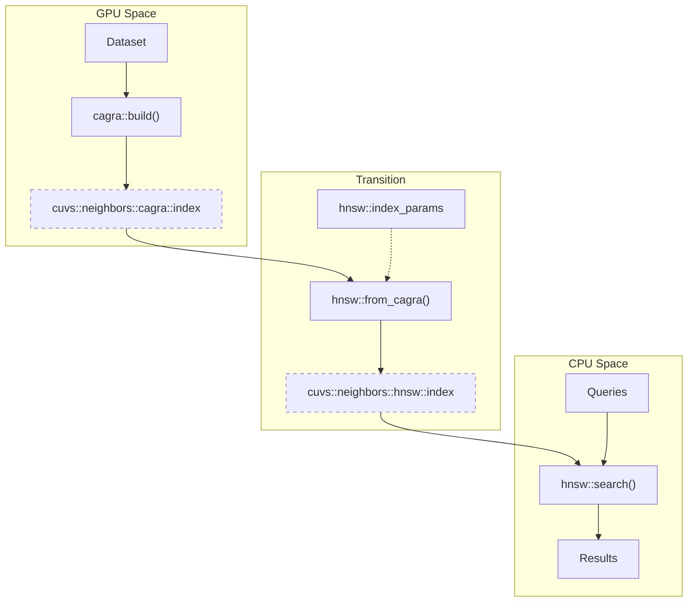
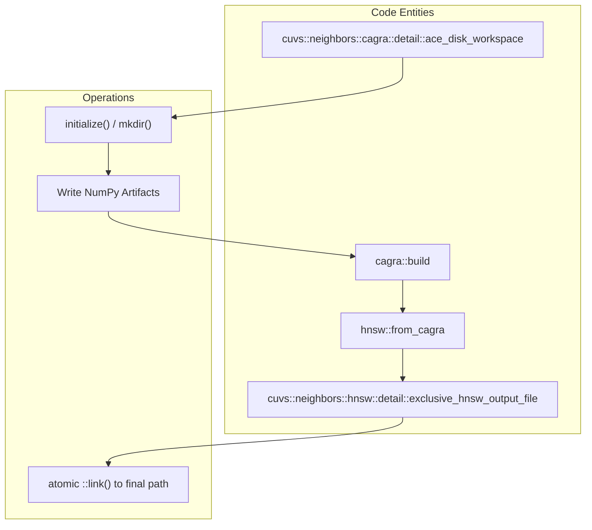

<!-- source: DeepWiki mcp.deepwiki.com · repo NVIDIA/cuvs · page 3.4 HNSW: Hierarchical Navigable Small Worlds · fetched 2026-10-26 -->

# HNSW: Hierarchical Navigable Small Worlds

Relevant source files

The following files were used as context for generating this wiki page:

- [c/include/cuvs/neighbors/hnsw.h](c/include/cuvs/neighbors/hnsw.h)
- [c/src/neighbors/hnsw.cpp](c/src/neighbors/hnsw.cpp)
- [c/tests/neighbors/ann_hnsw_c.cu](c/tests/neighbors/ann_hnsw_c.cu)
- [cpp/bench/ann/src/cuvs/cuvs_cagra_hnswlib.cu](cpp/bench/ann/src/cuvs/cuvs_cagra_hnswlib.cu)
- [cpp/bench/ann/src/cuvs/cuvs_cagra_hnswlib_wrapper.h](cpp/bench/ann/src/cuvs/cuvs_cagra_hnswlib_wrapper.h)
- [cpp/include/cuvs/neighbors/hnsw.hpp](cpp/include/cuvs/neighbors/hnsw.hpp)
- [cpp/include/cuvs/util/file_io.hpp](cpp/include/cuvs/util/file_io.hpp)
- [cpp/src/neighbors/detail/cagra/cagra_build.cuh](cpp/src/neighbors/detail/cagra/cagra_build.cuh)
- [cpp/src/neighbors/detail/hnsw.hpp](cpp/src/neighbors/detail/hnsw.hpp)
- [cpp/src/neighbors/hnsw.cpp](cpp/src/neighbors/hnsw.cpp)
- [cpp/tests/neighbors/ann_hnsw_ace.cuh](cpp/tests/neighbors/ann_hnsw_ace.cuh)
- [cpp/tests/neighbors/ann_hnsw_ace/test_float_uint32_t.cu](cpp/tests/neighbors/ann_hnsw_ace/test_float_uint32_t.cu)
- [cpp/tests/neighbors/ann_hnsw_ace/test_half_uint32_t.cu](cpp/tests/neighbors/ann_hnsw_ace/test_half_uint32_t.cu)
- [cpp/tests/neighbors/ann_hnsw_ace/test_int8_t_uint32_t.cu](cpp/tests/neighbors/ann_hnsw_ace/test_int8_t_uint32_t.cu)
- [cpp/tests/neighbors/ann_hnsw_ace/test_uint8_t_uint32_t.cu](cpp/tests/neighbors/ann_hnsw_ace/test_uint8_t_uint32_t.cu)
- [java/cuvs-java/src/main/java/com/nvidia/cuvs/HnswIndex.java](java/cuvs-java/src/main/java/com/nvidia/cuvs/HnswIndex.java)
- [java/cuvs-java/src/main/java/com/nvidia/cuvs/HnswIndexParams.java](java/cuvs-java/src/main/java/com/nvidia/cuvs/HnswIndexParams.java)
- [java/cuvs-java/src/main/java22/com/nvidia/cuvs/internal/HnswIndexImpl.java](java/cuvs-java/src/main/java22/com/nvidia/cuvs/internal/HnswIndexImpl.java)
- [java/cuvs-java/src/test/java/com/nvidia/cuvs/HnswBuildAndSearchIT.java](java/cuvs-java/src/test/java/com/nvidia/cuvs/HnswBuildAndSearchIT.java)
- [python/cuvs/cuvs/neighbors/hnsw/hnsw.pxd](python/cuvs/cuvs/neighbors/hnsw/hnsw.pxd)
- [python/cuvs/cuvs/neighbors/hnsw/hnsw.pyx](python/cuvs/cuvs/neighbors/hnsw/hnsw.pyx)
- [python/cuvs/cuvs/tests/test_cagra_ace.py](python/cuvs/cuvs/tests/test_cagra_ace.py)
- [python/cuvs/cuvs/tests/test_hnsw.py](python/cuvs/cuvs/tests/test_hnsw.py)

The HNSW implementation in cuVS provides a high-performance CPU search interface integrated with GPU-accelerated construction. By leveraging the `hnswlib` library and cuVS's own CAGRA algorithm, it enables a workflow where complex graph construction is offloaded to the GPU while search can be performed on CPU-only nodes. This page covers the core HNSW integration, the conversion path from CAGRA, the ACE (Augmented Core Extraction) system for large-scale builds, serialization, and language bindings.

## Overview and Integration

cuVS integrates HNSW by wrapping the `hnswlib` library via headers like `[cpp/include/cuvs/neighbors/hnsw.hpp]()` and implementation files like `[cpp/src/neighbors/detail/hnsw.hpp]().` The primary value proposition is building a high-quality graph on the GPU (via CAGRA) and converting it into a standard HNSW structure for low-latency CPU serving.

### System Architecture and Data Flow

The following diagram bridges natural language concepts to concrete code entities in the cuVS codebase for the HNSW pipeline.

**HNSW Construction and Search Pipeline**

Sources: `[cpp/include/cuvs/neighbors/hnsw.hpp:101-115](), [cpp/src/neighbors/detail/hnsw.hpp:190-218]()`

## HNSW Index and Parameters

The HNSW implementation supports various data types including `float`, `half`, `uint8_t`, and `int8_t` `[cpp/src/neighbors/detail/hnsw.hpp:139-162]()`.

### Hierarchy Types
The `HnswHierarchy` enum defines how the hierarchical layers of the HNSW index are constructed during conversion from a CAGRA graph:
*   `NONE`: Creates a base-layer-only index (flat graph).
*   `CPU`: Build the hierarchy using CPU threads.
*   `GPU`: Offload hierarchy construction to the GPU for faster processing.

Sources: `[cpp/include/cuvs/neighbors/hnsw.hpp:39-43]()`

### Configuration Classes
*   `hnsw::index_params`: Configuration struct containing `hierarchy`, `ef_construction`, `num_threads`, `M`, and `graph_build_params` `[cpp/include/cuvs/neighbors/hnsw.hpp:45-91]()`.
*   `hnsw::extend_params`: Configuration struct containing `num_threads` for appending vectors `[cpp/include/cuvs/neighbors/hnsw.hpp:192-196]()`.

Sources: `[cpp/include/cuvs/neighbors/hnsw.hpp:45-91](), [cpp/include/cuvs/neighbors/hnsw.hpp:192-196]()`

## CAGRA-to-HNSW Conversion

A unique feature of cuVS is generating an HNSW index from a CAGRA graph. CAGRA produces a high-quality K-NN graph on the GPU, which can be hierarchized into an HNSW index.

*   **Function**: `hnsw::from_cagra` `[cpp/include/cuvs/neighbors/hnsw.hpp:217-221]()`
*   **Workflow**:
    1. Build a CAGRA index using `cagra::build`.
    2. Invoke `hnsw::from_cagra` with `hnsw::index_params` to produce a `hnsw::index` handle `[cpp/include/cuvs/neighbors/hnsw.hpp:101-118]()`.

Sources: `[cpp/include/cuvs/neighbors/hnsw.hpp:91-118](), [cpp/src/neighbors/detail/hnsw.hpp:190-215]()`

## ACE-based HNSW Build & Out-of-Core Workspaces

For datasets exceeding GPU memory, cuVS uses **ACE (Augmented Core Extraction)** implemented via `cagra::detail::ace_disk_workspace` `[cpp/src/neighbors/detail/cagra/cagra_build.cuh:67-153]()`. ACE partitions the dataset, builds sub-indices, and merges them into a single coherent graph.

### ACE Implementation Details
The `ace_params` structure allows fine-tuning the partitioned build:
*   `npartitions`: Number of dataset chunks (`0` derives it automatically) `[python/cuvs/cuvs/neighbors/hnsw/hnsw.pyx:41-46]()`.
*   `build_dir`: Directory for temporary artifacts (`reordered_dataset.npy`, `augmented_dataset.npy`, `dataset_mapping.npy`, `cagra_graph.npy`) `[cpp/src/neighbors/detail/cagra/cagra_build.cuh:69-74]()`.
*   `use_disk`: Enables disk-backed storage for memory-efficient construction `[python/cuvs/cuvs/neighbors/hnsw/hnsw.pyx:108-110]()`.

**ACE Disk Workspace and HNSW Output Pipeline**

Sources: `[cpp/src/neighbors/detail/cagra/cagra_build.cuh:67-153](), [cpp/src/neighbors/detail/hnsw.hpp:49-115]()`

## Serialization and Search API

HNSW indices can be serialized to disk and deserialized for later use via transactional patterns.

*   **Serialization**: `hnsw::serialize(res, filename, index)` uses `exclusive_hnsw_output_file` to write to a temporary file via `mkstemp` and publish via `::link` `[cpp/src/neighbors/detail/hnsw.hpp:49-105]()`.
*   **Search**: Performed on the CPU using `hnsw::search` [cpp/src/neighbors/hnsw.cpp:79-87](), accepting host matrix views for queries, neighbors, and distances.

Sources: `[cpp/src/neighbors/detail/hnsw.hpp:49-115](), [cpp/src/neighbors/hnsw.cpp:79-109]()`

## Language Bindings

### Python (Cython)
The Python API wraps the C++ structures via `AceParams` and `IndexParams` in `[python/cuvs/cuvs/neighbors/hnsw/hnsw.pyx:31-151]()`, supporting both in-memory and disk-spill ACE builds.

### Java (FFM)
The Java implementation uses the Foreign Function & Memory API in `[java/cuvs-java/src/main/java22/com/nvidia/cuvs/internal/HnswIndexImpl.java:47-155]()`, exposing `HnswIndex`, `HnswIndexParams`, and native calls like `cuvsHnswSearch`.

### C API Layer
Exposes stable ABI functions in `[c/include/cuvs/neighbors/hnsw.h:48-137]()` for creating parameters (`cuvsHnswIndexParamsCreate`), managing indices (`cuvsHnswIndexCreate`, `cuvsHnswIndexDestroy`), and searching.

Sources: `[python/cuvs/cuvs/neighbors/hnsw/hnsw.pyx:31-151](), [java/cuvs-java/src/main/java22/com/nvidia/cuvs/internal/HnswIndexImpl.java:47-155](), [c/include/cuvs/neighbors/hnsw.h:48-137]()`

---

