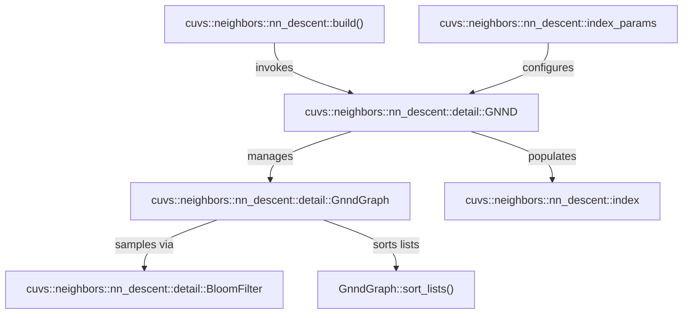
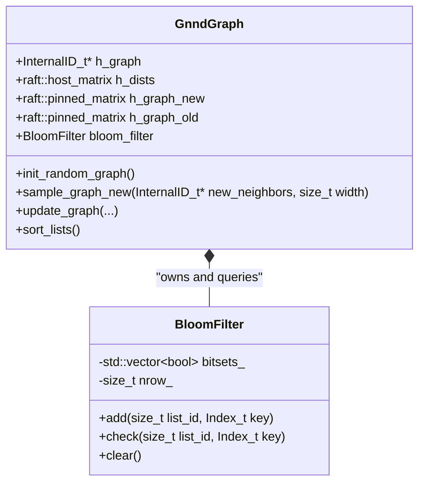

<!-- source: DeepWiki mcp.deepwiki.com · repo NVIDIA/cuvs · page 3.5 NN-Descent: KNN Graph Construction · fetched 2026-10-26 -->

# NN-Descent: KNN Graph Construction

Relevant source files

The following files were used as context for generating this wiki page:

- [c/include/cuvs/neighbors/all_neighbors.h](c/include/cuvs/neighbors/all_neighbors.h)
- [c/include/cuvs/neighbors/nn_descent.h](c/include/cuvs/neighbors/nn_descent.h)
- [c/src/neighbors/all_neighbors.cpp](c/src/neighbors/all_neighbors.cpp)
- [c/src/neighbors/nn_descent.cpp](c/src/neighbors/nn_descent.cpp)
- [cpp/include/cuvs/neighbors/all_neighbors.hpp](cpp/include/cuvs/neighbors/all_neighbors.hpp)
- [cpp/include/cuvs/neighbors/nn_descent.hpp](cpp/include/cuvs/neighbors/nn_descent.hpp)
- [cpp/src/neighbors/all_neighbors/all_neighbors.cu](cpp/src/neighbors/all_neighbors/all_neighbors.cu)
- [cpp/src/neighbors/all_neighbors/all_neighbors.cuh](cpp/src/neighbors/all_neighbors/all_neighbors.cuh)
- [cpp/src/neighbors/all_neighbors/all_neighbors_batched.cuh](cpp/src/neighbors/all_neighbors/all_neighbors_batched.cuh)
- [cpp/src/neighbors/all_neighbors/all_neighbors_builder.cuh](cpp/src/neighbors/all_neighbors/all_neighbors_builder.cuh)
- [cpp/src/neighbors/all_neighbors/all_neighbors_merge.cuh](cpp/src/neighbors/all_neighbors/all_neighbors_merge.cuh)
- [cpp/src/neighbors/detail/nn_descent.cuh](cpp/src/neighbors/detail/nn_descent.cuh)
- [cpp/src/neighbors/detail/nn_descent_gnnd.hpp](cpp/src/neighbors/detail/nn_descent_gnnd.hpp)
- [cpp/src/neighbors/nn_descent.cuh](cpp/src/neighbors/nn_descent.cuh)
- [cpp/tests/neighbors/all_neighbors.cuh](cpp/tests/neighbors/all_neighbors.cuh)
- [cpp/tests/neighbors/all_neighbors/test_float.cu](cpp/tests/neighbors/all_neighbors/test_float.cu)
- [cpp/tests/neighbors/ann_nn_descent.cuh](cpp/tests/neighbors/ann_nn_descent.cuh)
- [cpp/tests/neighbors/ann_nn_descent/test_float_uint32_t.cu](cpp/tests/neighbors/ann_nn_descent/test_float_uint32_t.cu)
- [cpp/tests/neighbors/ann_nn_descent/test_uint8_t_uint32_t.cu](cpp/tests/neighbors/ann_nn_descent/test_uint8_t_uint32_t.cu)
- [cpp/tests/neighbors/naive_knn.cuh](cpp/tests/neighbors/naive_knn.cuh)
- [python/cuvs/cuvs/neighbors/all_neighbors/all_neighbors.pyx](python/cuvs/cuvs/neighbors/all_neighbors/all_neighbors.pyx)
- [python/cuvs/cuvs/neighbors/nn_descent/nn_descent.pxd](python/cuvs/cuvs/neighbors/nn_descent/nn_descent.pxd)
- [python/cuvs/cuvs/neighbors/nn_descent/nn_descent.pyx](python/cuvs/cuvs/neighbors/nn_descent/nn_descent.pyx)
- [python/cuvs/cuvs/tests/test_all_neighbors.py](python/cuvs/cuvs/tests/test_all_neighbors.py)
- [python/cuvs/cuvs/tests/test_nn_descent.py](python/cuvs/cuvs/tests/test_nn_descent.py)

## Purpose and Scope
This page details the implementation of **NN-Descent** (specifically the GNND GPU-accelerated solver) within cuVS [cpp/src/neighbors/detail/nn_descent_gnnd.hpp:1-15](). NN-Descent is an efficient algorithm for constructing Approximate K-Nearest Neighbor (KNN) graphs [cpp/include/cuvs/neighbors/nn_descent.hpp:87-95](). In cuVS, NN-Descent serves a dual role: it provides high-quality graph seeds for graph-based indices like **CAGRA** [cpp/include/cuvs/neighbors/nn_descent.hpp:91-95](), and it acts as an underlying graph build engine for **all-neighbors** batch construction pipelines [cpp/include/cuvs/neighbors/all_neighbors.hpp:25-27]().

Sources: `[cpp/include/cuvs/neighbors/nn_descent.hpp:87-95]`, `[cpp/src/neighbors/detail/nn_descent_gnnd.hpp:1-15]`, `[cpp/include/cuvs/neighbors/all_neighbors.hpp:25-27]()`.

---

## Algorithm Overview

The NN-Descent algorithm starts with a random graph and iteratively improves it by exploring the neighbors of neighbors based on the heuristic that "a neighbor of my neighbor is likely to be my neighbor."

### Key Phases
1. **Initialization**: A random neighbor graph is initialized where each node connects to random peers via `GnndGraph::init_random_graph()` [cpp/src/neighbors/detail/nn_descent_gnnd.hpp:180-180]().
2. **Sampling**: In each iteration, "new" and "old" neighbor candidates are sampled for local joins. A probabilistic Bloom filter tracks explored paths to avoid redundancy [cpp/src/neighbors/detail/nn_descent_gnnd.hpp:182-184]().
3. **Local Join**: Pairwise distances are computed among sampled neighborhood candidates. If closer peers are discovered, the adjacency list is updated via `GnndGraph::update_graph()` [cpp/src/neighbors/detail/nn_descent_gnnd.hpp:185-188]().
4. **Refinement Iterations**: Refinement repeats up to `max_iterations` or until updates drop below the `termination_threshold` [cpp/include/cuvs/neighbors/nn_descent.hpp:64-65]().

### Data Flow and Code Entity Mapping

The following diagram bridges the natural language concepts of NN-Descent to the concrete classes and functions in the codebase.

Title: "NN-Descent Component Mapping"

Sources: `[cpp/include/cuvs/neighbors/nn_descent.hpp:61-131]`, `[cpp/src/neighbors/detail/nn_descent_gnnd.hpp:154-192]`, `[cpp/src/neighbors/nn_descent.cuh:54-60]()`.

---

## Implementation Details

### WMMA vs. SIMT Kernels and Precision
The local join phase evaluates large batches of pairwise distances on the GPU:
* **Kernel Dispatch**: Depending on hardware capabilities and data layout, kernels utilize either Tensor Core acceleration via Warp Matrix Multiply-Accumulate (`WMMA`) or standard Warp-level `SIMT` execution paths [cpp/src/neighbors/detail/nn_descent.cuh:207-209]().
* **Precision Control (`DIST_COMP_DTYPE`)**: Controlled via `index_params::dist_comp_dtype`, users can select `AUTO`, `FP32`, or `FP16` [cpp/include/cuvs/neighbors/nn_descent.hpp:40-67](). `AUTO` selects the optimal precision based on dataset dimensions.
* **Bank Conflict Avoidance**: Shared memory layouts apply `skew_dim<T>()` to pad dimensions and eliminate shared memory bank conflicts during parallel matrix updates [cpp/src/neighbors/detail/nn_descent.cuh:116-124]().

### Bloom Filter Sampling
To prevent redundant distance calculations across iterations, `BloomFilter<Index_t>` maintains compact bitsets [cpp/src/neighbors/detail/nn_descent_gnnd.hpp:72-151]().
* **Hash Functions**: Employs two fast integer hash routines (`hash_0` and `hash_1`) to map neighbor IDs into bitset indices [cpp/src/neighbors/detail/nn_descent_gnnd.hpp:125-143]().
* **Efficiency**: `GnndGraph::sample_graph_new()` uses the Bloom filter to quickly identify unvisited candidates for local joining without maintaining dense transition matrices [cpp/src/neighbors/detail/nn_descent_gnnd.hpp:182-184]().

### Memory Management & Host/Device Split
* **Graph Storage**: The resulting KNN graph is stored as a host matrix (`raft::host_matrix`) of indices inside `cuvs::neighbors::nn_descent::index` [cpp/include/cuvs/neighbors/nn_descent.hpp:123-125]().
* **Distances**: If requested, computed distances reside in a device matrix (`raft::device_matrix`) [cpp/include/cuvs/neighbors/nn_descent.hpp:127-130]().
* **Pinned Buffers**: Internal iteration state vectors (`h_graph_new`, `h_graph_old`, `h_list_sizes_new`) allocate pinned host memory (`raft::pinned_matrix`) to maximize PCIe transfer throughput between CPU and GPU [cpp/src/neighbors/detail/nn_descent_gnnd.hpp:166-170]().

Sources: `[cpp/include/cuvs/neighbors/nn_descent.hpp:40-130]`, `[cpp/src/neighbors/detail/nn_descent.cuh:116-209]`, `[cpp/src/neighbors/detail/nn_descent_gnnd.hpp:72-170]()`.

---

## Configuration Parameters

The `index_params` struct exposes the primary tuning knobs for the NN-Descent algorithm:

| Parameter | Type | Default | Description |
| :--- | :--- | :--- | :--- |
| `graph_degree` | `size_t` | 64 | Final output degree of the KNN graph per node [cpp/include/cuvs/neighbors/nn_descent.hpp:62-62](). |
| `intermediate_graph_degree` | `size_t` | 128 | Internal working degree during graph refinement (recommended $\ge 1.5 \times \text{graph\_degree}$) [cpp/include/cuvs/neighbors/nn_descent.hpp:63-63](). |
| `max_iterations` | `size_t` | 20 | Maximum refinement iterations [cpp/include/cuvs/neighbors/nn_descent.hpp:64-64](). |
| `termination_threshold` | `float` | 0.0001 | Convergence threshold based on graph update deltas [cpp/include/cuvs/neighbors/nn_descent.hpp:65-65](). |
| `dist_comp_dtype` | `enum` | `AUTO` | Distance computation precision (`AUTO`, `FP32`, or `FP16`) [cpp/include/cuvs/neighbors/nn_descent.hpp:67-67](). |

Sources: `[cpp/include/cuvs/neighbors/nn_descent.hpp:61-76]()`.

---

## Data Structures and Core Classes

### ResultItem and InternalID_t
* `ResultItem<Index_t>`: Tracks candidate neighbor IDs and distances inside CUDA kernels, utilizing sign-bit manipulation to distinguish between newly discovered (`is_new() == true`) and established graph edges [cpp/src/neighbors/detail/nn_descent.cuh:53-77]().
* `InternalID_t<Index_t>`: Internal representation used by `GnndGraph` to pack flags and node identifiers into single integers [cpp/src/neighbors/detail/nn_descent_gnnd.hpp:33-55]().

### GnndGraph and BloomFilter Class Hierarchy

Title: "NN-Descent Internal Data Structures"

Sources: `[cpp/src/neighbors/detail/nn_descent_gnnd.hpp:72-192]`, `[cpp/src/neighbors/detail/nn_descent.cuh:53-104]()`.

---

## Role as CAGRA and All-Neighbors Graph Seed

NN-Descent is critical across multiple cuVS subsystems:
1. **CAGRA Seed**: While CAGRA provides ultra-fast GPU graph-based search, its index quality relies heavily on initial graph connectivity. NN-Descent yields superior recall-latency curves compared to random or IVF seeding [cpp/include/cuvs/neighbors/nn_descent.hpp:91-95]().
2. **All-Neighbors Graph Builder**: Integrated via `graph_build_params::nn_descent_params`, NN-Descent powers batched global graph construction workflows in `all_neighbors::build()` [cpp/include/cuvs/neighbors/all_neighbors.hpp:25-27]().

Sources: `[cpp/include/cuvs/neighbors/nn_descent.hpp:91-95]`, `[cpp/include/cuvs/neighbors/all_neighbors.hpp:25-27]()`.

---

