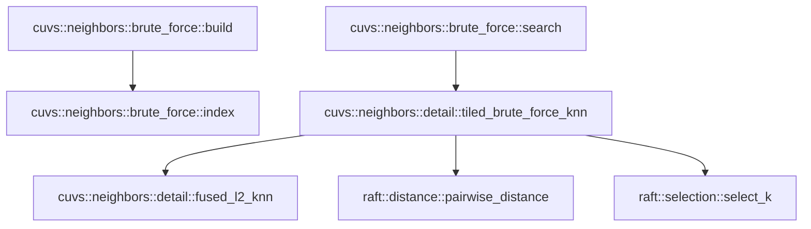
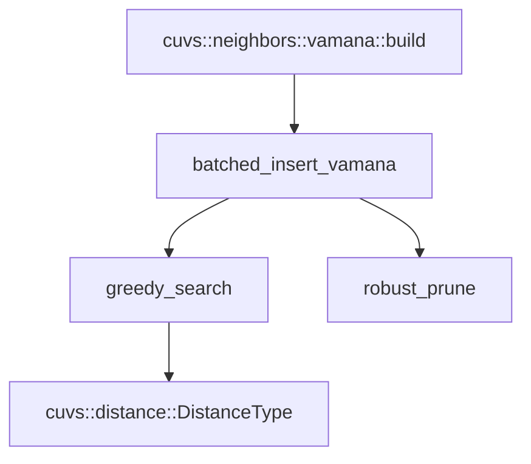

<!-- source: DeepWiki mcp.deepwiki.com · repo NVIDIA/cuvs · page 3.6 Brute Force, ScaNN, Vamana & Other Algorithms · fetched 2026-10-26 -->

# Brute Force, ScaNN, Vamana & Other Algorithms

Relevant source files

The following files were used as context for generating this wiki page:

- [c/include/cuvs/neighbors/all_neighbors.h](c/include/cuvs/neighbors/all_neighbors.h)
- [c/src/neighbors/all_neighbors.cpp](c/src/neighbors/all_neighbors.cpp)
- [cpp/include/cuvs/neighbors/all_neighbors.hpp](cpp/include/cuvs/neighbors/all_neighbors.hpp)
- [cpp/include/cuvs/neighbors/brute_force.hpp](cpp/include/cuvs/neighbors/brute_force.hpp)
- [cpp/include/cuvs/neighbors/common.hpp](cpp/include/cuvs/neighbors/common.hpp)
- [cpp/include/cuvs/neighbors/scann.hpp](cpp/include/cuvs/neighbors/scann.hpp)
- [cpp/include/cuvs/neighbors/vamana.hpp](cpp/include/cuvs/neighbors/vamana.hpp)
- [cpp/src/cluster/detail/agglomerative.cuh](cpp/src/cluster/detail/agglomerative.cuh)
- [cpp/src/cluster/detail/connectivities.cuh](cpp/src/cluster/detail/connectivities.cuh)
- [cpp/src/cluster/detail/mst.cuh](cpp/src/cluster/detail/mst.cuh)
- [cpp/src/cluster/single_linkage.cuh](cpp/src/cluster/single_linkage.cuh)
- [cpp/src/neighbors/all_neighbors/all_neighbors.cu](cpp/src/neighbors/all_neighbors/all_neighbors.cu)
- [cpp/src/neighbors/all_neighbors/all_neighbors.cuh](cpp/src/neighbors/all_neighbors/all_neighbors.cuh)
- [cpp/src/neighbors/all_neighbors/all_neighbors_batched.cuh](cpp/src/neighbors/all_neighbors/all_neighbors_batched.cuh)
- [cpp/src/neighbors/all_neighbors/all_neighbors_builder.cuh](cpp/src/neighbors/all_neighbors/all_neighbors_builder.cuh)
- [cpp/src/neighbors/all_neighbors/all_neighbors_merge.cuh](cpp/src/neighbors/all_neighbors/all_neighbors_merge.cuh)
- [cpp/src/neighbors/ball_cover/ball_cover.cuh](cpp/src/neighbors/ball_cover/ball_cover.cuh)
- [cpp/src/neighbors/ball_cover/common.cuh](cpp/src/neighbors/ball_cover/common.cuh)
- [cpp/src/neighbors/ball_cover/registers.cuh](cpp/src/neighbors/ball_cover/registers.cuh)
- [cpp/src/neighbors/brute_force.cu](cpp/src/neighbors/brute_force.cu)
- [cpp/src/neighbors/detail/faiss_distance_utils.h](cpp/src/neighbors/detail/faiss_distance_utils.h)
- [cpp/src/neighbors/detail/knn_brute_force.cuh](cpp/src/neighbors/detail/knn_brute_force.cuh)
- [cpp/src/neighbors/detail/knn_graph.cuh](cpp/src/neighbors/detail/knn_graph.cuh)
- [cpp/src/neighbors/detail/reachability.cuh](cpp/src/neighbors/detail/reachability.cuh)
- [cpp/src/neighbors/detail/vamana/greedy_search.cuh](cpp/src/neighbors/detail/vamana/greedy_search.cuh)
- [cpp/src/neighbors/detail/vamana/macros.cuh](cpp/src/neighbors/detail/vamana/macros.cuh)
- [cpp/src/neighbors/detail/vamana/priority_queue.cuh](cpp/src/neighbors/detail/vamana/priority_queue.cuh)
- [cpp/src/neighbors/detail/vamana/robust_prune.cuh](cpp/src/neighbors/detail/vamana/robust_prune.cuh)
- [cpp/src/neighbors/detail/vamana/vamana_build.cuh](cpp/src/neighbors/detail/vamana/vamana_build.cuh)
- [cpp/src/neighbors/detail/vamana/vamana_structs.cuh](cpp/src/neighbors/detail/vamana/vamana_structs.cuh)
- [cpp/src/neighbors/scann/detail/scann_avq.cuh](cpp/src/neighbors/scann/detail/scann_avq.cuh)
- [cpp/src/neighbors/scann/detail/scann_build.cuh](cpp/src/neighbors/scann/detail/scann_build.cuh)
- [cpp/src/neighbors/scann/detail/scann_common.cuh](cpp/src/neighbors/scann/detail/scann_common.cuh)
- [cpp/src/neighbors/scann/detail/scann_quantize.cuh](cpp/src/neighbors/scann/detail/scann_quantize.cuh)
- [cpp/src/neighbors/scann/detail/scann_serialize.cuh](cpp/src/neighbors/scann/detail/scann_serialize.cuh)
- [cpp/src/neighbors/scann/detail/scann_soar.cuh](cpp/src/neighbors/scann/detail/scann_soar.cuh)
- [cpp/src/neighbors/scann/scann.cuh](cpp/src/neighbors/scann/scann.cuh)
- [cpp/src/neighbors/scann/scann_build_float.cu](cpp/src/neighbors/scann/scann_build_float.cu)
- [cpp/src/neighbors/scann/scann_serialize_float.cu](cpp/src/neighbors/scann/scann_serialize_float.cu)
- [cpp/src/neighbors/vamana.cuh](cpp/src/neighbors/vamana.cuh)
- [cpp/tests/cluster/connect_knn.cu](cpp/tests/cluster/connect_knn.cu)
- [cpp/tests/neighbors/all_neighbors.cuh](cpp/tests/neighbors/all_neighbors.cuh)
- [cpp/tests/neighbors/all_neighbors/test_float.cu](cpp/tests/neighbors/all_neighbors/test_float.cu)
- [cpp/tests/neighbors/ann_scann.cuh](cpp/tests/neighbors/ann_scann.cuh)
- [cpp/tests/neighbors/ann_scann/test_float_int64_t.cu](cpp/tests/neighbors/ann_scann/test_float_int64_t.cu)
- [cpp/tests/neighbors/ann_vamana.cuh](cpp/tests/neighbors/ann_vamana.cuh)
- [cpp/tests/neighbors/ball_cover.cu](cpp/tests/neighbors/ball_cover.cu)
- [examples/cpp/src/scann_example.cu](examples/cpp/src/scann_example.cu)
- [examples/cpp/src/vamana_example.cu](examples/cpp/src/vamana_example.cu)
- [python/cuvs/cuvs/neighbors/all_neighbors/all_neighbors.pyx](python/cuvs/cuvs/neighbors/all_neighbors/all_neighbors.pyx)
- [python/cuvs/cuvs/tests/test_all_neighbors.py](python/cuvs/cuvs/tests/test_all_neighbors.py)

This section covers a diverse set of nearest neighbor search algorithms and utilities in cuVS, ranging from exact brute-force search to advanced graph-based (Vamana/DiskANN), quantization-based approximate search (ScaNN with SOAR/AVQ), all-neighbors batch construction, and range-based query primitives (epsilon neighborhood and ball cover).

---

## 1. Brute Force KNN Search

The Brute Force implementation provides exact K-Nearest Neighbor search by computing distances between all pairs of query and index vectors. It is highly optimized for GPUs using a tiled memory-budget approach to maximize throughput under constrained hardware limits.

### Implementation Details

The core search routine is implemented in `tiled_brute_force_knn` [cpp/src/neighbors/detail/knn_brute_force.cuh:62-81](), which divides the search and index matrices into smaller row and column tiles [cpp/src/neighbors/detail/knn_brute_force.cuh:62-63]().

*   **Tiling Selection:** The system leverages `faiss_select::chooseTileSize` to compute optimal tile dimensions based on available memory and element sizes [cpp/src/neighbors/detail/knn_brute_force.cuh:93-94]().
*   **Norm Precomputation:** For metrics requiring expanded norms (such as `L2Expanded`, `L2SqrtExpanded`, or `CosineExpanded`), norms are computed once across rows to prevent redundant per-tile evaluations [cpp/src/neighbors/detail/knn_brute_force.cuh:110-150]().
*   **Index Structure:** Managed via `cuvs::neighbors::brute_force::index` [cpp/include/cuvs/neighbors/brute_force.hpp:38-38](), which stores the dataset and optional precomputed norms on device memory [cpp/include/cuvs/neighbors/brute_force.hpp:35-37]().

### Brute Force Code Architecture

**Sources:** [cpp/include/cuvs/neighbors/brute_force.hpp:38-168](), [cpp/src/neighbors/detail/knn_brute_force.cuh:58-81](), [cpp/src/neighbors/brute_force.cu:156-163]()

---

## 2. ScaNN (SOAR/AVQ)

cuVS includes an experimental implementation of Google's ScaNN algorithm, combining Anisotropic Vector Quantization (AVQ) and Spatially Optimized Admission Record (SOAR) mechanisms to accelerate high-recall approximate nearest neighbor search.

### Key Components

*   **AVQ (Anisotropic Vector Quantization):** Adjusts coarse k-means cluster centroids to minimize quantization error specifically along the direction of the underlying vector distribution [cpp/src/neighbors/scann/detail/scann_avq.cuh:136-141]().
*   **SOAR:** Facilitates multi-partition assignment and robust candidate routing during index build [cpp/src/neighbors/scann/detail/scann_build.cuh:191-193]().
*   **Build Pipeline:** Executed via `cuvs::neighbors::experimental::scann::detail::build` [cpp/src/neighbors/scann/detail/scann_build.cuh:43-47](), which performs balanced k-means fitting, AVQ centroid adjustment [cpp/src/neighbors/scann/detail/scann_avq.cuh:136-141](), residual computation, and Product Quantization (PQ) codebook training [cpp/src/neighbors/scann/detail/scann_build.cuh:165-177]().

**Sources:** [cpp/src/neighbors/scann/detail/scann_build.cuh:43-177](), [cpp/src/neighbors/scann/detail/scann_avq.cuh:136-141]()

---

## 3. Vamana (DiskANN Graph Index)

Vamana is a graph-based approximate nearest neighbor algorithm optimized for high-degree connectivity and efficient greedy traversal, serving as the core index structure in DiskANN.

### Build Process & Batched Insertion

The Vamana builder constructs the graph iteratively using batched inserts and robust graph pruning:
*   **Greedy Search:** Traverses the graph to find routing paths and candidate neighbors for incoming insertion batches [cpp/src/neighbors/detail/vamana/vamana_build.cuh:10-11]().
*   **Robust Prune:** Filters neighbor lists to remove redundant edges while preserving long-range links necessary for fast graph traversal [cpp/src/neighbors/detail/vamana/robust_prune.cuh:11-12]().
*   **GPU Batched Insertion:** Implemented in `batched_insert_vamana` [cpp/src/neighbors/detail/vamana/vamana_build.cuh:112-124]() to parallelize insertions across GPU blocks.

### Vamana Implementation Flow

**Sources:** [cpp/src/neighbors/detail/vamana/vamana_build.cuh:97-124](), [cpp/include/cuvs/neighbors/vamana.hpp:31-50](), [examples/cpp/src/vamana_example.cu:31-44]()

---

## 4. All-Neighbors Batch Construction

The `all_neighbors` utility constructs an approximate or exact k-NN graph for an entire dataset, finding the top-$K$ nearest neighbors for every vector in the training set.

### Scalability Strategy

To handle datasets that exceed GPU memory capacity, the all-neighbors build pipeline partitions the training vectors into overlapping clusters:
1.  **Subsample Clustering:** Fits balanced k-means on a data subsample to generate coarse centroids (`get_centroids_on_data_subsample`) [cpp/src/neighbors/all_neighbors/all_neighbors_batched.cuh:79-103]().
2.  **Cluster Assignment:** Assigns dataset rows to their `overlap_factor` nearest clusters (`single_gpu_assign_clusters`) [cpp/src/neighbors/all_neighbors/all_neighbors_batched.cuh:105-116]().
3.  **Local Graph Build:** Computes local k-NN graphs using configurable backends (Brute Force, NN-Descent, or IVF-PQ) via `check_params_validity` [cpp/src/neighbors/all_neighbors/all_neighbors.cuh:25-30]().
4.  **Global Merge:** Merges local components into a unified global k-NN graph [cpp/include/cuvs/neighbors/all_neighbors.hpp:32-34]().

**Sources:** [cpp/include/cuvs/neighbors/all_neighbors.hpp:40-94](), [cpp/src/neighbors/all_neighbors/all_neighbors_batched.cuh:67-116](), [cpp/src/neighbors/all_neighbors/all_neighbors.cuh:25-30]()

---

## 5. Epsilon Neighborhood & Ball Cover

These algorithms address range-restricted spatial queries rather than fixed-$K$ nearest neighbor searches:

*   **Epsilon Neighborhood:** Identifies all neighbors within a specified distance threshold $\epsilon$ from query vectors [cpp/include/cuvs/neighbors/epsilon_neighborhood.hpp:34-45](), returning results structured as a Compressed Sparse Row (CSR) matrix [cpp/src/neighbors/detail/epsilon_neighborhood.cuh:44-55]().
*   **Ball Cover:** Organizes data points into hierarchical hyperspherical boundaries to accelerate exact range queries and spatial indexing.

**Sources:** [cpp/include/cuvs/neighbors/epsilon_neighborhood.hpp:34-45](), [cpp/src/neighbors/detail/epsilon_neighborhood.cuh:44-55]()

---

## 6. Summary of Algorithm Parameters

| Algorithm | Key Parameters | File Reference |
| :--- | :--- | :--- |
| **Brute Force** | `metric`, `metric_arg` | [cpp/include/cuvs/neighbors/brute_force.hpp:22-24]() |
| **ScaNN** | `pq_bits`, `pq_dim`, `partitioning_eta` | [cpp/include/cuvs/neighbors/scann.hpp:30-60]() |
| **Vamana** | `graph_degree`, `visited_size`, `alpha` | [cpp/include/cuvs/neighbors/vamana.hpp:31-50]() |
| **All-Neighbors** | `overlap_factor`, `n_clusters`, `graph_build_params` | [cpp/include/cuvs/neighbors/all_neighbors.hpp:40-94]() |

**Sources:** [cpp/include/cuvs/neighbors/common.hpp:46-101](), [cpp/include/cuvs/neighbors/brute_force.hpp:22-24]()

---

