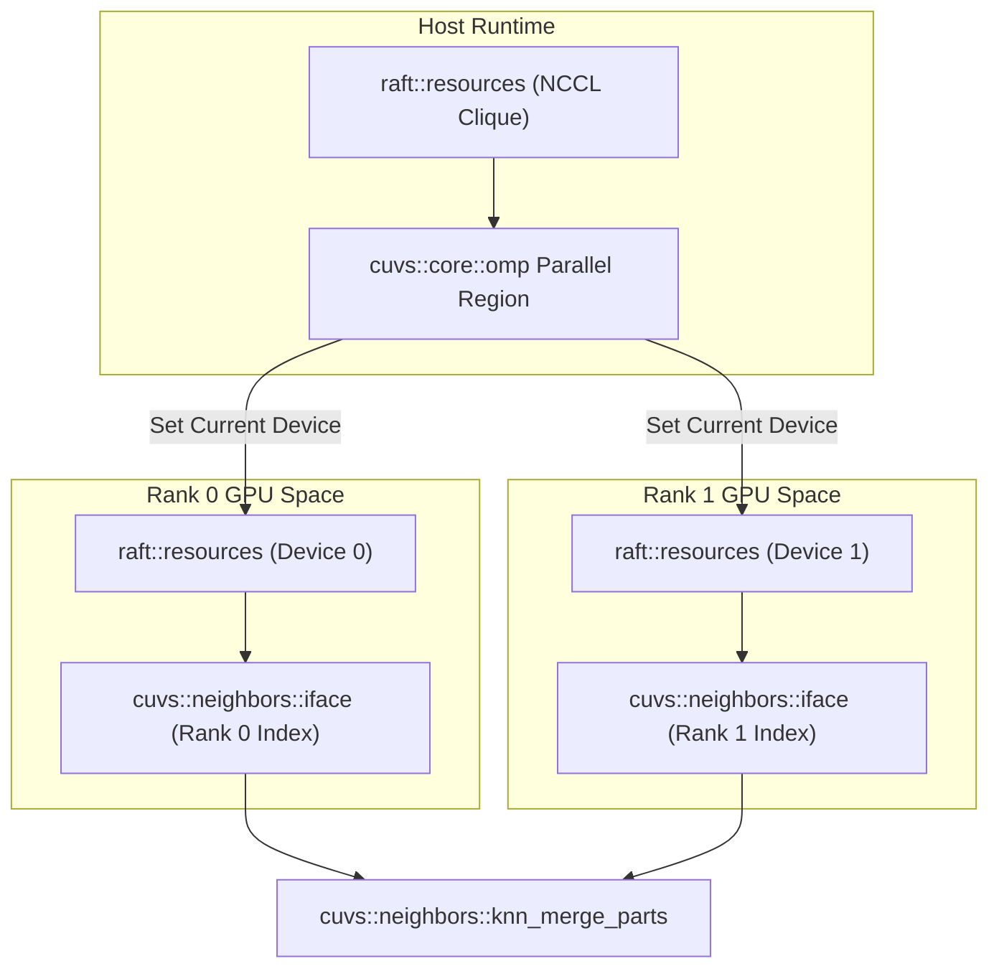
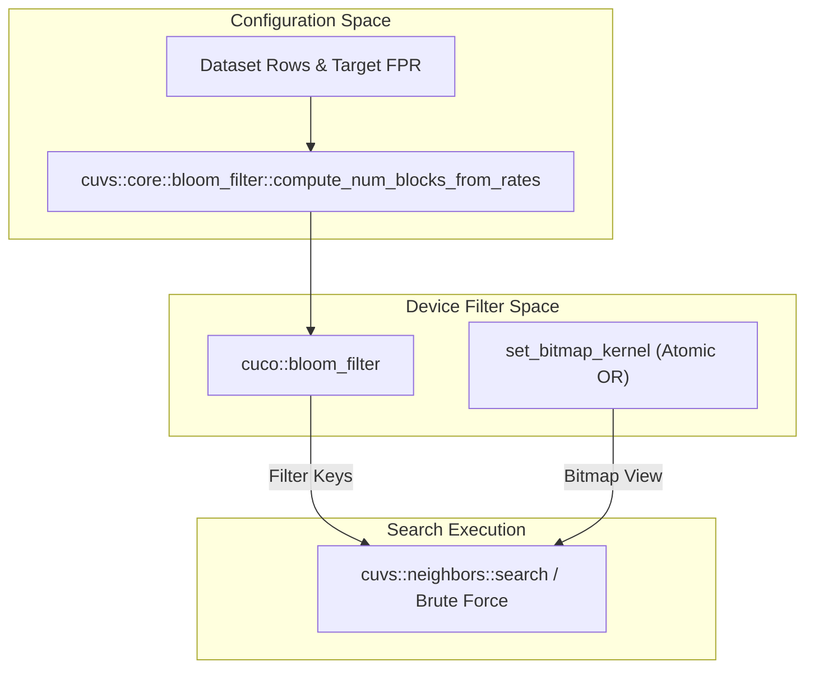

<!-- source: DeepWiki mcp.deepwiki.com · repo NVIDIA/cuvs · page 3.7 Advanced Index Features · fetched 2026-10-26 -->

# Advanced Index Features

Relevant source files

The following files were used as context for generating this wiki page:

- [cpp/bench/ann/src/common/thread_pool.hpp](cpp/bench/ann/src/common/thread_pool.hpp)
- [cpp/bench/ann/src/cuvs/cuvs_mg_ivf_flat_wrapper.h](cpp/bench/ann/src/cuvs/cuvs_mg_ivf_flat_wrapper.h)
- [cpp/bench/ann/src/cuvs/cuvs_mg_ivf_pq_wrapper.h](cpp/bench/ann/src/cuvs/cuvs_mg_ivf_pq_wrapper.h)
- [cpp/src/cluster/detail/kmeans_balanced.cuh](cpp/src/cluster/detail/kmeans_balanced.cuh)
- [cpp/src/cluster/detail/minClusterDistanceCompute.cu](cpp/src/cluster/detail/minClusterDistanceCompute.cu)
- [cpp/src/core/bloom_filter.cu](cpp/src/core/bloom_filter.cu)
- [cpp/src/core/omp_wrapper.cpp](cpp/src/core/omp_wrapper.cpp)
- [cpp/src/core/omp_wrapper.hpp](cpp/src/core/omp_wrapper.hpp)
- [cpp/src/distance/detail/sparse/bin_distance.cuh](cpp/src/distance/detail/sparse/bin_distance.cuh)
- [cpp/src/distance/detail/sparse/common.hpp](cpp/src/distance/detail/sparse/common.hpp)
- [cpp/src/distance/detail/sparse/coo_spmv_strategies/base_strategy.cuh](cpp/src/distance/detail/sparse/coo_spmv_strategies/base_strategy.cuh)
- [cpp/src/distance/detail/sparse/coo_spmv_strategies/coo_mask_row_iterators.cuh](cpp/src/distance/detail/sparse/coo_spmv_strategies/coo_mask_row_iterators.cuh)
- [cpp/src/distance/unfused_distance_nn.cuh](cpp/src/distance/unfused_distance_nn.cuh)
- [cpp/src/neighbors/detail/smem_utils.cuh](cpp/src/neighbors/detail/smem_utils.cuh)
- [cpp/src/neighbors/iface/iface.hpp](cpp/src/neighbors/iface/iface.hpp)
- [cpp/src/neighbors/mg/snmg.cuh](cpp/src/neighbors/mg/snmg.cuh)
- [cpp/tests/CMakeLists.txt](cpp/tests/CMakeLists.txt)
- [cpp/tests/cluster/kmeans_predict_batching.cu](cpp/tests/cluster/kmeans_predict_batching.cu)
- [cpp/tests/neighbors/ann_cagra/bug_issue_93_reproducer.cu](cpp/tests/neighbors/ann_cagra/bug_issue_93_reproducer.cu)
- [cpp/tests/neighbors/ann_cagra/bug_iterative_cagra_build.cu](cpp/tests/neighbors/ann_cagra/bug_iterative_cagra_build.cu)
- [cpp/tests/neighbors/brute_force_prefiltered.cu](cpp/tests/neighbors/brute_force_prefiltered.cu)
- [cpp/tests/neighbors/distance_nn.cu](cpp/tests/neighbors/distance_nn.cu)
- [cpp/tests/neighbors/distance_nn_helper.cuh](cpp/tests/neighbors/distance_nn_helper.cuh)
- [cpp/tests/neighbors/knn_merge_parts.cu](cpp/tests/neighbors/knn_merge_parts.cu)
- [cpp/tests/neighbors/mg.cuh](cpp/tests/neighbors/mg.cuh)
- [python/cuvs/cuvs/tests/test_mg_cagra.py](python/cuvs/cuvs/tests/test_mg_cagra.py)
- [python/cuvs/cuvs/tests/test_mg_ivf_flat.py](python/cuvs/cuvs/tests/test_mg_ivf_flat.py)
- [python/cuvs/cuvs/tests/test_mg_ivf_pq.py](python/cuvs/cuvs/tests/test_mg_ivf_pq.py)

This page covers cross-cutting features in cuVS that extend beyond individual Approximate Nearest Neighbor (ANN) algorithms. These features enable low-latency serving, hybrid indexing strategies, multi-GPU scaling, fine-grained control over search results, and custom distance or filtering user-defined functions (UDFs).

## Multi-GPU Search (SNMG)

cuVS supports Single-Node Multi-GPU (SNMG) search using sharded or replicated index distributions. The SNMG layer utilizes NCCL for inter-GPU communication and OpenMP for managing host-side CPU threads that orchestrate multiple CUDA streams.

### Distribution Modes and Implementation
The system defines distribution strategies within `cuvs::neighbors::distribution_mode`:
1. **SHARDED**: The dataset rows are partitioned across available devices. Each rank builds a local index on its assigned shard (`n_rows_per_shard`). Search results are merged across ranks using `knn_merge_parts` [cpp/src/neighbors/mg/snmg.cuh:130-165]().
2. **REPLICATED**: The entire dataset is copied to every device, enabling high-throughput query load-balancing across all ranks [cpp/src/neighbors/mg/snmg.cuh:100-129]().

The `cuvs::neighbors::snmg::detail::build` function and `cuvs::neighbors::snmg::detail::deserialize` coordinate these multi-rank operations [cpp/src/neighbors/mg/snmg.cuh:63-99]().

**SNMG Code-Space Architecture**

**Sources:** [cpp/src/neighbors/mg/snmg.cuh:31-99](), [cpp/src/neighbors/mg/snmg.cuh:100-165]()

## Tiered Index (CAGRA + HNSW)

Tiered indexing implements hybrid architectures where GPU-constructed graph indices (such as CAGRA) or high-performance memory structures are exposed via CPU-compatible fallback layers or serialized into CPU-native search formats like `hnswlib`.

### Implementation and Verification
Tiered indexes are validated via dedicated test suites such as `NEIGHBORS_TIERED_INDEX_TEST` [cpp/tests/CMakeLists.txt:119-123](). They allow systems to ingest data and construct graphs using high-throughput GPU primitives before transferring or wrapping them for execution paths optimized for host CPU memory constraints.

**Sources:** [cpp/tests/CMakeLists.txt:119-123]()

## Result Refinement

Refinement re-calculates exact or unquantized distances for a candidate neighbor set returned by a lossy compressed index (e.g., IVF-PQ or IVF-SQ). 

### Mechanism
Refinement constructs a transient exact-distance evaluation over the candidate indices, ensuring high recall without paying the full memory bandwidth cost of uncompressed scans across the entire dataset.

**Sources:** [cpp/tests/CMakeLists.txt:110-116]()

## Pre-Filtering with Bitsets, Bitmaps, and Bloom Filters

cuVS supports pre-filtering mechanisms to prune invalid vector IDs before or during distance evaluation.

### Bloom Filter Integration
The `cuvs::core::bloom_filter` class implements GPU-accelerated Bloom filters using underlying `cuco::bloom_filter` policies [cpp/src/core/bloom_filter.cu:9-12](). 

- `compute_num_blocks_from_rates`: Derives optimal block allocations given dataset row counts, filtering rates, and target false-positive rates [cpp/src/core/bloom_filter.cu:67-103]().
- `expected_false_positive_rate`: Calculates inclusion-exclusion probabilities over binomial block occupancy [cpp/src/core/bloom_filter.cu:41-65]().

### Bitmaps and Bitsets
For structured exclusion, custom bitset/bitmap kernels populate bit arrays via atomic operations [cpp/tests/neighbors/brute_force_prefiltered.cu:106-134](). These are integrated directly into brute-force and ANN search passes as sample filters.

**Pre-Filtering & Bloom Filter Code-Space Architecture**

**Sources:** [cpp/src/core/bloom_filter.cu:67-150](), [cpp/tests/neighbors/brute_force_prefiltered.cu:106-134]()

## UDF Custom Distance and Filters

cuVS permits user-defined functions (UDFs) to inject custom distance metrics or inspection routines into index searching and clustering loops.

### IVF-Flat UDF Testing
Custom distance and filtering logic is verified through dedicated integration tests such as `NEIGHBORS_ANN_IVF_FLAT_UDF_TEST` [cpp/tests/CMakeLists.txt:157-161](). These tests validate that custom metric kernels and predicate functors integrate correctly with inverted file partition scanning without violating memory safety or stream synchronization boundaries.

**Sources:** [cpp/tests/CMakeLists.txt:157-161]()

## Dynamic Batching

Dynamic batching breaks down large query workloads into smaller chunks to manage device memory limits and optimize tensor core utilization.

### Batching Heuristics
Batching parameters such as `batch_samples` and `batch_centroids` control allocation sizes during fused and unfused nearest-neighbor reductions (e.g., within `minClusterAndDistanceCompute` and K-Means prediction loops) [cpp/src/cluster/detail/minClusterDistanceCompute.cu:31-75](). Tests verify that these parameters preserve convergence accuracy while reducing peak memory allocation [cpp/tests/cluster/kmeans_predict_batching.cu:123-153]().

**Sources:** [cpp/src/cluster/detail/minClusterDistanceCompute.cu:31-137](), [cpp/tests/cluster/kmeans_predict_batching.cu:123-153]()

---

