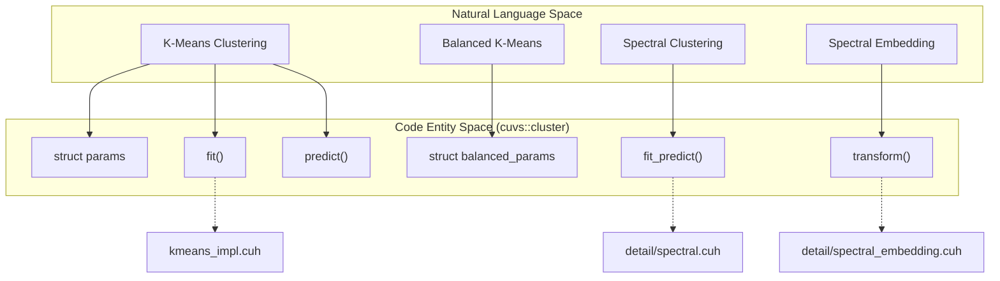
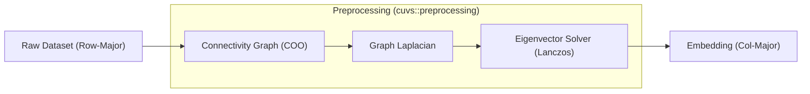

<!-- source: DeepWiki mcp.deepwiki.com · repo NVIDIA/cuvs · page 4 Clustering & Preprocessing · fetched 2026-10-26 -->

# Clustering & Preprocessing

Relevant source files

The following files were used as context for generating this wiki page:

- [cpp/include/cuvs/cluster/kmeans.hpp](cpp/include/cuvs/cluster/kmeans.hpp)
- [cpp/src/cluster/detail/kmeans.cuh](cpp/src/cluster/detail/kmeans.cuh)
- [cpp/src/cluster/detail/kmeans_auto_find_k.cuh](cpp/src/cluster/detail/kmeans_auto_find_k.cuh)
- [cpp/src/cluster/detail/kmeans_common.cuh](cpp/src/cluster/detail/kmeans_common.cuh)
- [cpp/src/cluster/detail/kmeans_mg.cuh](cpp/src/cluster/detail/kmeans_mg.cuh)
- [cpp/src/cluster/detail/kmeans_mg_batched_init.cuh](cpp/src/cluster/detail/kmeans_mg_batched_init.cuh)
- [cpp/src/cluster/kmeans.cuh](cpp/src/cluster/kmeans.cuh)
- [cpp/src/cluster/kmeans_fit_double.cu](cpp/src/cluster/kmeans_fit_double.cu)
- [cpp/src/cluster/kmeans_fit_float.cu](cpp/src/cluster/kmeans_fit_float.cu)
- [cpp/src/cluster/kmeans_impl.cuh](cpp/src/cluster/kmeans_impl.cuh)
- [cpp/src/cluster/kmeans_impl_fit_predict.cuh](cpp/src/cluster/kmeans_impl_fit_predict.cuh)
- [cpp/src/cluster/kmeans_predict_double.cu](cpp/src/cluster/kmeans_predict_double.cu)
- [cpp/src/cluster/kmeans_predict_float.cu](cpp/src/cluster/kmeans_predict_float.cu)
- [cpp/tests/cluster/kmeans.cu](cpp/tests/cluster/kmeans.cu)
- [fern/pages/c_api/c-api-core-c-api.md](fern/pages/c_api/c-api-core-c-api.md)
- [fern/pages/c_api/c-api-neighbors-all-neighbors.md](fern/pages/c_api/c-api-neighbors-all-neighbors.md)
- [fern/pages/c_api/c-api-neighbors-cagra.md](fern/pages/c_api/c-api-neighbors-cagra.md)
- [fern/pages/c_api/c-api-neighbors-mg-cagra.md](fern/pages/c_api/c-api-neighbors-mg-cagra.md)
- [fern/pages/c_api/c-api-preprocessing-pca.md](fern/pages/c_api/c-api-preprocessing-pca.md)
- [fern/pages/cpp_api/cpp-api-cluster-kmeans.md](fern/pages/cpp_api/cpp-api-cluster-kmeans.md)
- [fern/pages/cpp_api/cpp-api-neighbors-all-neighbors.md](fern/pages/cpp_api/cpp-api-neighbors-all-neighbors.md)
- [fern/pages/cpp_api/cpp-api-neighbors-brute-force.md](fern/pages/cpp_api/cpp-api-neighbors-brute-force.md)
- [fern/pages/cpp_api/cpp-api-neighbors-common.md](fern/pages/cpp_api/cpp-api-neighbors-common.md)

cuVS provides a suite of GPU-accelerated algorithms for data grouping, dimensionality reduction, and vector quantization. These tools serve both as standalone clustering solutions and as critical preprocessing steps for Approximate Nearest Neighbor (ANN) index construction (such as building coarse quantizers for IVF-PQ).

### Overview of Capabilities

The clustering and preprocessing subsystem is built on top of RAFT primitives and is designed to handle massive datasets through memory-efficient batching and multi-GPU distribution.

*   **Centroid-based Clustering**: High-performance K-Means with support for standard, balanced, and multi-GPU execution [cpp/include/cuvs/cluster/kmeans.hpp:22-108]().
*   **Graph-based & Hierarchical Clustering**: Agglomerative methods, MST connectivity, and spectral techniques for discovering complex manifold structures.
*   **Dimensionality Reduction & Quantization**: Tools like Spectral Embedding, PCA, and scalar/binary/product quantization (VPQ) to project and compress high-dimensional vectors [fern/pages/cpp_api/cpp-api-cluster-kmeans.md:1-1296]().
*   **Statistical Evaluation & GMMs**: Gaussian Mixture Models alongside cluster quality metrics such as silhouette and trustworthiness scores.

### System Architecture: Clustering Components

The following diagram illustrates how high-level clustering concepts map to the internal C++ implementation entities within cuVS.

**Clustering Entity Map**

Sources: [cpp/include/cuvs/cluster/kmeans.hpp:37-148](), [cpp/src/cluster/kmeans_impl.cuh:14-39]()

---

## [K-Means Clustering](#4.1)

cuVS implements a highly optimized K-Means algorithm capable of processing data that exceeds single-GPU memory. It supports multiple initialization methods, including **K-Means++** and **Random** [cpp/include/cuvs/cluster/kmeans.hpp:38-54]().

*   **Standard K-Means**: Uses Lloyd's algorithm with specialized kernels for distance computation and centroid updates. It supports various metrics like L2 and Cosine [cpp/include/cuvs/cluster/kmeans.hpp:22-27]().
*   **Balanced K-Means**: A variation that enforces roughly equal cluster sizes, primarily used internally for balancing Inverted File (IVF) lists in ANN indices [cpp/include/cuvs/cluster/kmeans.hpp:169-197]().
*   **Multi-GPU & Out-of-Core**: Supports streaming host data to GPU in batches (`device_buffer_samples`) and synchronizing centroids across multiple GPUs using NCCL via RAFT communicators [cpp/include/cuvs/cluster/kmeans.hpp:150-156](), [cpp/src/cluster/detail/kmeans_mg.cuh:106-118]().

For details, see [K-Means Clustering](#4.1).

Sources: [cpp/include/cuvs/cluster/kmeans.hpp:37-157](), [cpp/src/cluster/detail/kmeans_mg.cuh:106-118](), [cpp/src/cluster/kmeans_fit_float.cu:37-59]()

---

## [Agglomerative Clustering & Graph Connectivity](#4.2)

This section covers algorithms that leverage graph structures to identify manifold clusters and hierarchy.

*   **Single-Linkage & MST**: Computes minimum spanning trees (MST) over k-NN graphs to extract single-linkage hierarchies and connected components.
*   **Spectral Clustering Pipeline**: Combines graph construction, normalized Laplacian calculation, and eigenvector embedding followed by K-Means clustering to discover non-convex clusters.

For details, see [Agglomerative Clustering & Graph Connectivity](#4.2).

Sources: [cpp/include/cuvs/cluster/kmeans.hpp:22-28](), [cpp/src/cluster/detail/kmeans.cuh:63-74]()

---

## [Vector Preprocessing & Quantization](#4.3)

Preprocessing involves transforming raw vectors into forms more suitable for downstream tasks or more efficient storage.

*   **Dimensionality Reduction**: Includes PCA and Spectral Embedding using Lanczos solvers to project high-dimensional representations into compact coordinate spaces.
*   **Quantization (VPQ)**: Primitives for Scalar, Binary, and Product Quantization (VPQ) to compress vectors, significantly reducing memory footprint while enabling accelerated distance lookups during ANN search.

**Preprocessing Pipeline Flow**

Sources: [cpp/src/cluster/detail/kmeans.cuh:91-144](), [cpp/src/cluster/detail/kmeans_common.cuh:67-83]()

For details, see [Vector Preprocessing & Quantization](#4.3).

Sources: [cpp/src/cluster/detail/kmeans.cuh:138-144](), [cpp/src/cluster/detail/kmeans_common.cuh:67-83]()

---

## [Gaussian Mixture Models & Cluster Statistics](#4.4)

cuVS implements probability-based clustering and diagnostic evaluation metrics for cluster validation.

*   **Gaussian Mixture Models (GMM)**: Expectation-Maximization (EM) fitting and prediction kernels supporting both single-precision (`float`) and double-precision (`double`) instantiations.
*   **Cluster Quality Statistics**: Evaluation metrics including silhouette scores and trustworthiness scores to quantify cluster separation and neighborhood preservation after dimensionality reduction or clustering.

For details, see [Gaussian Mixture Models & Cluster Statistics](#4.4).

Sources: [cpp/include/cuvs/cluster/kmeans.hpp:80-96](), [cpp/src/cluster/kmeans_fit_float.cu:22-30]()

---

