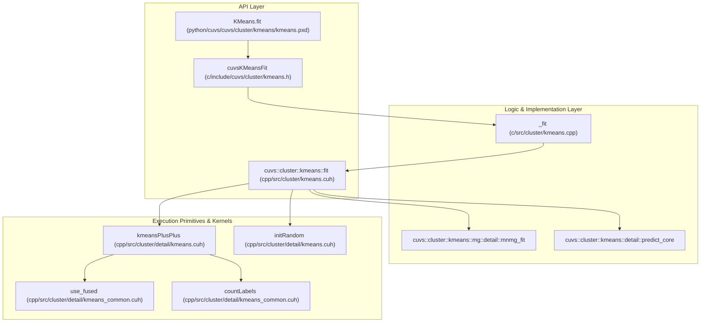
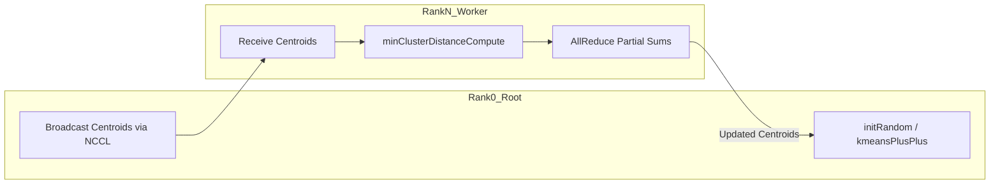

<!-- source: DeepWiki mcp.deepwiki.com · repo NVIDIA/cuvs · page 4.1 K-Means Clustering · fetched 2026-10-26 -->

# K-Means Clustering

Relevant source files

The following files were used as context for generating this wiki page:

- [c/include/cuvs/cluster/kmeans.h](c/include/cuvs/cluster/kmeans.h)
- [c/include/cuvs/cluster/mg_kmeans.h](c/include/cuvs/cluster/mg_kmeans.h)
- [c/src/cluster/kmeans.cpp](c/src/cluster/kmeans.cpp)
- [c/src/cluster/mg_kmeans.cpp](c/src/cluster/mg_kmeans.cpp)
- [c/tests/cluster/kmeans_c.cu](c/tests/cluster/kmeans_c.cu)
- [c/tests/cluster/kmeans_mg_c.cu](c/tests/cluster/kmeans_mg_c.cu)
- [cpp/include/cuvs/cluster/kmeans.hpp](cpp/include/cuvs/cluster/kmeans.hpp)
- [cpp/src/cluster/detail/kmeans.cuh](cpp/src/cluster/detail/kmeans.cuh)
- [cpp/src/cluster/detail/kmeans_auto_find_k.cuh](cpp/src/cluster/detail/kmeans_auto_find_k.cuh)
- [cpp/src/cluster/detail/kmeans_balanced.cuh](cpp/src/cluster/detail/kmeans_balanced.cuh)
- [cpp/src/cluster/detail/kmeans_common.cuh](cpp/src/cluster/detail/kmeans_common.cuh)
- [cpp/src/cluster/detail/kmeans_mg.cuh](cpp/src/cluster/detail/kmeans_mg.cuh)
- [cpp/src/cluster/detail/kmeans_mg_batched_init.cuh](cpp/src/cluster/detail/kmeans_mg_batched_init.cuh)
- [cpp/src/cluster/kmeans.cuh](cpp/src/cluster/kmeans.cuh)
- [cpp/src/cluster/kmeans_balanced.cuh](cpp/src/cluster/kmeans_balanced.cuh)
- [cpp/src/cluster/kmeans_fit_double.cu](cpp/src/cluster/kmeans_fit_double.cu)
- [cpp/src/cluster/kmeans_fit_float.cu](cpp/src/cluster/kmeans_fit_float.cu)
- [cpp/src/cluster/kmeans_impl.cuh](cpp/src/cluster/kmeans_impl.cuh)
- [cpp/src/cluster/kmeans_impl_fit_predict.cuh](cpp/src/cluster/kmeans_impl_fit_predict.cuh)
- [cpp/src/cluster/kmeans_predict_double.cu](cpp/src/cluster/kmeans_predict_double.cu)
- [cpp/src/cluster/kmeans_predict_float.cu](cpp/src/cluster/kmeans_predict_float.cu)
- [cpp/src/core/bloom_filter.cu](cpp/src/core/bloom_filter.cu)
- [cpp/src/distance/detail/sparse/bin_distance.cuh](cpp/src/distance/detail/sparse/bin_distance.cuh)
- [cpp/src/distance/detail/sparse/common.hpp](cpp/src/distance/detail/sparse/common.hpp)
- [cpp/src/distance/detail/sparse/coo_spmv_strategies/base_strategy.cuh](cpp/src/distance/detail/sparse/coo_spmv_strategies/base_strategy.cuh)
- [cpp/src/distance/detail/sparse/coo_spmv_strategies/coo_mask_row_iterators.cuh](cpp/src/distance/detail/sparse/coo_spmv_strategies/coo_mask_row_iterators.cuh)
- [cpp/tests/cluster/kmeans.cu](cpp/tests/cluster/kmeans.cu)
- [cpp/tests/neighbors/brute_force_prefiltered.cu](cpp/tests/neighbors/brute_force_prefiltered.cu)
- [examples/README.md](examples/README.md)
- [examples/cpp/src/balanced_kmeans_example.cu](examples/cpp/src/balanced_kmeans_example.cu)
- [fern/pages/c_api/c-api-cluster-kmeans.md](fern/pages/c_api/c-api-cluster-kmeans.md)
- [fern/pages/c_api/c-api-cluster-mg-kmeans.md](fern/pages/c_api/c-api-cluster-mg-kmeans.md)
- [fern/pages/cluster/kmeans.md](fern/pages/cluster/kmeans.md)
- [fern/pages/python_api/python-api-cluster-kmeans.md](fern/pages/python_api/python-api-cluster-kmeans.md)
- [python/cuvs/cuvs/cluster/kmeans/kmeans.pxd](python/cuvs/cuvs/cluster/kmeans/kmeans.pxd)
- [python/cuvs/cuvs/cluster/kmeans/kmeans.pyx](python/cuvs/cuvs/cluster/kmeans/kmeans.pyx)
- [python/cuvs/cuvs/cluster/mg/kmeans/kmeans.pxd](python/cuvs/cuvs/cluster/mg/kmeans/kmeans.pxd)
- [python/cuvs/cuvs/cluster/mg/kmeans/kmeans.pyx](python/cuvs/cuvs/cluster/mg/kmeans/kmeans.pyx)
- [rust/cuvs-sys/src/bindings.rs](rust/cuvs-sys/src/bindings.rs)

## Purpose and Scope
K-Means is a fundamental clustering algorithm used throughout cuVS for data partitioning, vector quantization, and as a core building block for inverted file (IVF) index structures. cuVS provides multiple GPU-accelerated implementations tailored to diverse hardware constraints and workflow requirements: standard Lloyd's algorithm, balanced K-Means (used internally by IVF for load balancing), multi-GPU clustering, and auto-find-k, exposed via C++ templates, a stable C ABI, and Python bindings.

Sources: [cpp/include/cuvs/cluster/kmeans.hpp:1-21](), [c/include/cuvs/cluster/kmeans.h:1-20]()

---

## Architecture Overview

The cuVS K-Means subsystem builds upon RAFT linear algebra and distance primitives. It accepts GPU-resident or host-resident datasets (`raft::device_matrix_view` and `raft::host_matrix_view`), managing temporary memory using `rmm::device_uvector` and RMM asynchronous memory resources.

### System Components & Code Mapping
The following diagram maps the high-level clustering interfaces to their internal C++ and execution-level code entities.

Sources: [cpp/include/cuvs/cluster/kmeans.hpp:81-88](), [cpp/src/cluster/detail/kmeans.cuh:63-112](), [c/src/cluster/kmeans.cpp:45-141](), [python/cuvs/cuvs/cluster/kmeans/kmeans.pxd:46-52]()

---

## Implementation Details

### Standard K-Means
Standard K-Means executes Lloyd's iterative refinement loop, supporting `InitMethod::KMeansPlusPlus`, `InitMethod::Random`, and user-supplied initial centers via `InitMethod::Array` [cpp/include/cuvs/cluster/kmeans.hpp:38-54](). 

*   **Fused Distance Kernels**: To optimize memory bandwidth, `use_fused` dynamically selects between fused distance-reduction kernels (preferred on Ampere SM 8.x and Hopper SM 9.x for large matrices) and unfused kernels (preferred on Blackwell SM 10.x+) [cpp/src/cluster/detail/kmeans_common.cuh:61-83]().
*   **Tiled Computation**: `batch_samples` and `batch_centroids` parameterize 1-Nearest-Neighbor distance matrix tiling to cap temporary memory consumption [cpp/include/cuvs/cluster/kmeans.hpp:119-124]().

### Balanced K-Means
Balanced K-Means enforces uniform cluster sizes, which prevents search bottlenecks in IVF-based indices [cpp/include/cuvs/cluster/kmeans.hpp:160-207](). It relies on hierarchical rebalancing parameters (`balance_lower_tolerance`, `balance_upper_tolerance`, `centroid_offset`, and `balanced_donor_selection`) to detect underfull and overfull clusters and reinitialize centers accordingly [cpp/include/cuvs/cluster/kmeans.hpp:173-207](). Prediction and assignment for balanced clustering are implemented via `predict_core` [cpp/src/cluster/detail/kmeans_balanced.cuh:75-87]().

### Multi-GPU Clustering (MNMG / SNMG)
Multi-GPU clustering (`mnmg_fit`) coordinates execution across multiple ranks using NCCL or RAFT communication primitives [cpp/src/cluster/detail/kmeans_mg.cuh:106-141](). Each rank processes local data partitions (`X_parts`) and sample weights (`sample_weight_parts`), performing local reductions followed by collective `AllReduce` operations for centroid updates, convergence checks, and inertia computation [cpp/src/cluster/detail/kmeans_mg.cuh:106-118]().

### Multi-GPU Initialization Data Flow

Sources: [cpp/src/cluster/detail/kmeans.cuh:63-112](), [cpp/src/cluster/detail/kmeans_mg.cuh:106-141]()

---

## API Reference

### C++ API
Configured via `cuvs::cluster::kmeans::params` and executed via `cuvs::cluster::kmeans::fit` / `cuvs::cluster::kmeans::predict` [cpp/include/cuvs/cluster/kmeans.hpp:38-157](), [cpp/src/cluster/kmeans.cuh:81-88]().

| Parameter | Type | Description |
| :--- | :--- | :--- |
| `n_clusters` | `int` | Number of clusters to form (default: `8`) [cpp/include/cuvs/cluster/kmeans.hpp:60]() |
| `init` | `InitMethod` | Initialization strategy: `KMeansPlusPlus`, `Random`, or `Array` [cpp/include/cuvs/cluster/kmeans.hpp:70]() |
| `max_iter` | `int` | Maximum Lloyd iterations per run (default: `300`) [cpp/include/cuvs/cluster/kmeans.hpp:75]() |
| `tol` | `double` | Relative tolerance for inertia convergence (default: `1e-4`) [cpp/include/cuvs/cluster/kmeans.hpp:80]() |
| `metric` | `DistanceType` | Distance metric (e.g., `L2Expanded`, `InnerProduct`) [cpp/include/cuvs/cluster/kmeans.hpp:27]() |

Sources: [cpp/include/cuvs/cluster/kmeans.hpp:22-157]()

### C API
The C API exposes a stable ABI using `cuvsResources_t`, `cuvsKMeansParams_t`, and DLPack `DLManagedTensor` structures [c/include/cuvs/cluster/kmeans.h:45-118]().

*   `cuvsKMeansParamsCreate` / `cuvsKMeansParamsDestroy`: Parameter lifecycle management [c/include/cuvs/cluster/kmeans.h:128-136]().
*   `cuvsKMeansFit`: Computes cluster centroids from training data `X` [c/include/cuvs/cluster/kmeans.h:182-188]().
*   `cuvsKMeansPredict`: Assigns new samples to nearest centroids [c/include/cuvs/cluster/kmeans.h:209-217]().

Sources: [c/include/cuvs/cluster/kmeans.h:45-217]()

### Python API
Wrapped via Cython in `cuvs.cluster.kmeans`, accepting any array container supporting `__cuda_array_interface__` or NumPy [python/cuvs/cuvs/cluster/kmeans/kmeans.pxd:15-67]().

Sources: [python/cuvs/cuvs/cluster/kmeans/kmeans.pxd:15-67]()

---

## Internal Functions and Utilities

| Function / Class | File Path | Role |
| :--- | :--- | :--- |
| `kmeansPlusPlus` | `cpp/src/cluster/detail/kmeans.cuh:91` | Scalable K-Means++ seeding algorithm |
| `initRandom` | `cpp/src/cluster/detail/kmeans.cuh:63` | Uniform random centroid sampling |
| `use_fused` | `cpp/src/cluster/detail/kmeans_common.cuh:67` | Architecture-based kernel selection heuristic |
| `countLabels` | `cpp/src/cluster/detail/kmeans_common.cuh:121` | Histogram computation using `cub::DeviceHistogram` |
| `mnmg_fit` | `cpp/src/cluster/detail/kmeans_mg.cuh:106` | Multi-GPU distributed K-Means fit coordination |
| `predict_core` | `cpp/src/cluster/detail/kmeans_balanced.cuh:75` | Balanced K-Means cluster label prediction |

Sources: [cpp/src/cluster/detail/kmeans.cuh:63-112](), [cpp/src/cluster/detail/kmeans_common.cuh:67-121](), [cpp/src/cluster/detail/kmeans_balanced.cuh:75-87](), [cpp/src/cluster/detail/kmeans_mg.cuh:106-118]()

---

