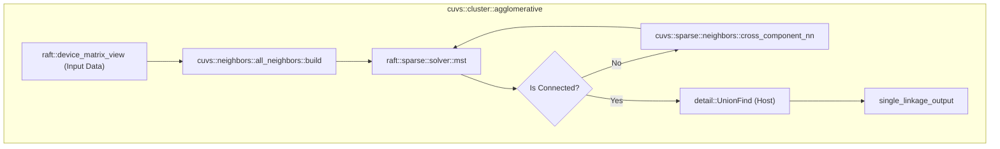
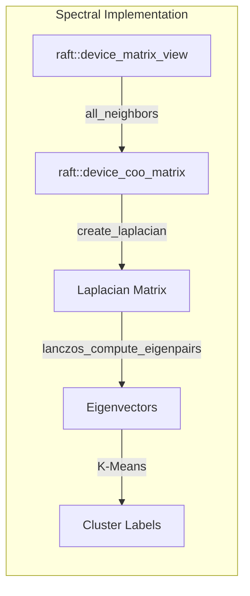

<!-- source: DeepWiki mcp.deepwiki.com · repo NVIDIA/cuvs · page 4.2 Agglomerative Clustering & Graph Connectivity · fetched 2026-10-26 -->

# Agglomerative Clustering & Graph Connectivity

Relevant source files

The following files were used as context for generating this wiki page:

- [cpp/include/cuvs/cluster/agglomerative.hpp](cpp/include/cuvs/cluster/agglomerative.hpp)
- [cpp/include/cuvs/cluster/spectral.hpp](cpp/include/cuvs/cluster/spectral.hpp)
- [cpp/include/cuvs/preprocessing/spectral_embedding.hpp](cpp/include/cuvs/preprocessing/spectral_embedding.hpp)
- [cpp/src/cluster/detail/agglomerative.cuh](cpp/src/cluster/detail/agglomerative.cuh)
- [cpp/src/cluster/detail/connectivities.cuh](cpp/src/cluster/detail/connectivities.cuh)
- [cpp/src/cluster/detail/mst.cuh](cpp/src/cluster/detail/mst.cuh)
- [cpp/src/cluster/detail/single_linkage.cuh](cpp/src/cluster/detail/single_linkage.cuh)
- [cpp/src/cluster/detail/spectral.cuh](cpp/src/cluster/detail/spectral.cuh)
- [cpp/src/cluster/single_linkage.cuh](cpp/src/cluster/single_linkage.cuh)
- [cpp/src/cluster/single_linkage_float.cu](cpp/src/cluster/single_linkage_float.cu)
- [cpp/src/cluster/spectral.cu](cpp/src/cluster/spectral.cu)
- [cpp/src/neighbors/ball_cover/ball_cover.cuh](cpp/src/neighbors/ball_cover/ball_cover.cuh)
- [cpp/src/neighbors/ball_cover/common.cuh](cpp/src/neighbors/ball_cover/common.cuh)
- [cpp/src/neighbors/ball_cover/registers.cuh](cpp/src/neighbors/ball_cover/registers.cuh)
- [cpp/src/neighbors/detail/knn_graph.cuh](cpp/src/neighbors/detail/knn_graph.cuh)
- [cpp/src/neighbors/detail/reachability.cuh](cpp/src/neighbors/detail/reachability.cuh)
- [cpp/src/preprocessing/spectral/detail/spectral_embedding.cuh](cpp/src/preprocessing/spectral/detail/spectral_embedding.cuh)
- [cpp/src/preprocessing/spectral/spectral_embedding.cu](cpp/src/preprocessing/spectral/spectral_embedding.cu)
- [cpp/src/sparse/neighbors/cross_component_nn.cuh](cpp/src/sparse/neighbors/cross_component_nn.cuh)
- [cpp/src/sparse/neighbors/detail/cross_component_nn.cuh](cpp/src/sparse/neighbors/detail/cross_component_nn.cuh)
- [cpp/tests/cluster/connect_knn.cu](cpp/tests/cluster/connect_knn.cu)
- [cpp/tests/cluster/spectral.cu](cpp/tests/cluster/spectral.cu)
- [cpp/tests/neighbors/ball_cover.cu](cpp/tests/neighbors/ball_cover.cu)

The `cuvs` library provides GPU-accelerated implementations for hierarchical clustering and graph-based connectivity analysis. This includes single-linkage agglomerative clustering, spectral clustering, and specialized primitives for connecting disjoint components in K-Nearest Neighbor (KNN) graphs. These algorithms are essential for density-based clustering (like HDBSCAN) and non-linear dimensionality reduction.

## Single-Linkage Agglomerative Clustering

Agglomerative clustering in cuVS focuses on the single-linkage criterion, where the distance between two clusters is defined as the minimum distance between any member of one cluster and any member of the other. The implementation is designed to scale beyond the $O(n^2)$ memory requirements of traditional dense distance matrices by utilizing sparse KNN graphs.

### Linkage Construction Strategies
The library supports two primary strategies for building the hierarchy, defined by the `cuvs::cluster::agglomerative::Linkage` enum:
1.  **PAIRWISE**: Uses a full pairwise distance matrix. This is optimal for smaller datasets (e.g., < 50,000 points) where memory is not the bottleneck [cpp/include/cuvs/cluster/agglomerative.hpp:33-39]().
2.  **KNN_GRAPH**: Constructs a sparse KNN graph. If the resulting Minimum Spanning Tree (MST) is not fully connected (forming a Minimum Spanning Forest), the library iteratively adds cross-component edges until a single tree is formed [cpp/include/cuvs/cluster/agglomerative.hpp:41-47]().

### Data Flow: From Vectors to Dendrogram
The `single_linkage` API [cpp/include/cuvs/cluster/agglomerative.hpp:107-115]() orchestrates the transformation of raw device vectors into a dendrogram and cluster labels.

| Component | Role | Source |
| :--- | :--- | :--- |
| `all_neighbors` | Constructs the initial KNN graph to seed the MST. | [cpp/src/cluster/detail/single_linkage.cuh:75-76]() |
| `raft::sparse::solver::mst` | Computes the Minimum Spanning Tree from the sparse graph. | [cpp/src/cluster/detail/mst.cuh:102-112]() |
| `connect_knn_graph` | Finds nearest neighbors between disjoint components to ensure connectivity. | [cpp/src/cluster/detail/mst.cuh:67-75]() |
| `build_dendrogram_host` | Constructs the final hierarchy (children, distances, sizes) on the host using Union-Find. | [cpp/src/cluster/detail/agglomerative.cuh:97-106]() |

**Agglomerative Clustering Logic Flow**

Sources: [cpp/include/cuvs/cluster/agglomerative.hpp:60-81](), [cpp/src/cluster/detail/single_linkage.cuh:47-59](), [cpp/src/cluster/detail/mst.cuh:67-94]()

## Graph Connectivity & Cross-Component NN

A critical challenge in graph-based clustering is ensuring the graph is fully connected. When a KNN graph is built, it often contains multiple disjoint components. cuVS provides `cross_component_nn` to efficiently bridge these gaps.

### Cross-Component Nearest Neighbors
The function `cuvs::sparse::neighbors::cross_component_nn` identifies the closest points between different "colors" (component IDs) in a graph [cpp/src/cluster/detail/mst.cuh:86-94]().
*   **Masked NN**: It uses a masked nearest neighbor search where points in the same component are ignored.
*   **Reduction Operators**: It supports custom reduction logic via `FixConnectivitiesRedOp` and `MutualReachabilityFixConnectivitiesRedOp` [cpp/src/sparse/neighbors/detail/cross_component_nn.cuh:53-186]().
*   **Mutual Reachability**: For algorithms like HDBSCAN, the distance metric is transformed into "mutual reachability distance," which accounts for local point density (core distances) [cpp/src/sparse/neighbors/detail/cross_component_nn.cuh:102-148]().

### Mutual Reachability Linkage
The `build_mr_linkage` function specifically implements the Mutual Reachability space linkage [cpp/src/cluster/detail/single_linkage.cuh:47-58](). It:
1.  Computes core distances for every point using KNN [cpp/src/cluster/detail/single_linkage.cuh:75-76]().
2.  Symmetrizes the resulting graph [cpp/src/cluster/detail/single_linkage.cuh:84-91]().
3.  Computes the MST in the reachability space, where edge weight $d_{mr}(a, b) = \max(core\_dist(a), core\_dist(b), dist(a, b))$ [cpp/src/sparse/neighbors/detail/cross_component_nn.cuh:114-128]().

Sources: [cpp/src/cluster/detail/mst.cuh:86-94](), [cpp/src/sparse/neighbors/detail/cross_component_nn.cuh:53-186](), [cpp/src/cluster/detail/single_linkage.cuh:47-150]()

## Spectral Clustering & Embedding

Spectral clustering uses the eigenvalues and eigenvectors of the graph Laplacian to perform dimensionality reduction before clustering in the embedding space.

### Spectral Embedding Pipeline
The `cuvs::preprocessing::spectral_embedding::transform` function implements the following pipeline:
1.  **Graph Construction**: If not provided, it builds a KNN graph using `all_neighbors` [cpp/src/preprocessing/spectral/detail/spectral_embedding.cuh:150-153]().
2.  **Laplacian Computation**: Creates either a normalized ($D^{-1/2} L D^{-1/2}$) or unnormalized ($L = D - W$) Laplacian matrix [cpp/src/preprocessing/spectral/detail/spectral_embedding.cuh:32-41]().
3.  **Eigen-decomposition**: Uses a GPU-accelerated Lanczos solver (`raft::sparse::solver::lanczos_compute_eigenpairs`) to find the eigenvectors corresponding to the smallest eigenvalues [cpp/src/preprocessing/spectral/detail/spectral_embedding.cuh:77-79]().
4.  **Embedding**: The eigenvectors (optionally dropping the first uninformative one) form the new coordinates [cpp/src/preprocessing/spectral/detail/spectral_embedding.cuh:90-115]().

### Spectral Clustering API
The high-level `fit_predict` API [cpp/include/cuvs/cluster/spectral.hpp:87-90]() wraps the embedding and follows it with a K-Means clustering step on the embedded coordinates to produce final labels.

**Spectral Pipeline Mapping**
| Code Entity | Purpose | File Reference |
| :--- | :--- | :--- |
| `cuvs::preprocessing::spectral_embedding::params` | Configures components, neighbors, and normalization. | [cpp/include/cuvs/preprocessing/spectral_embedding.hpp:28-69]() |
| `detail::create_laplacian` | Computes the sparse Laplacian matrix. | [cpp/src/preprocessing/spectral/detail/spectral_embedding.cuh:32-52]() |
| `detail::compute_eigenpairs` | Invokes the Lanczos solver. | [cpp/src/preprocessing/spectral/detail/spectral_embedding.cuh:54-116]() |
| `cuvs::cluster::spectral::fit_predict` | End-to-end clustering (Embedding + K-Means). | [cpp/include/cuvs/cluster/spectral.hpp:87-161]() |

**Spectral Clustering Data Flow**

Sources: [cpp/include/cuvs/preprocessing/spectral_embedding.hpp:28-69](), [cpp/src/preprocessing/spectral/detail/spectral_embedding.cuh:32-131](), [cpp/include/cuvs/cluster/spectral.hpp:25-43]()

## Ball Cover for Exact Neighborhoods

The `ball_cover` implementation provides an alternative way to handle graph connectivity and neighborhood searches by partitioning space into "balls" around landmarks.

*   **Landmark Sampling**: Uniformly samples $\sqrt{n}$ points to act as ball centers [cpp/src/neighbors/ball_cover/ball_cover.cuh:46-86]().
*   **Radius Computation**: For each landmark, determines the radius required to cover its assigned points [cpp/src/neighbors/ball_cover/ball_cover.cuh:186-190]().
*   **Post-Filtering**: A specialized CUDA kernel `perform_post_filter_registers` uses the triangle inequality to prune landmarks that cannot possibly contain a neighbor for a given query, significantly speeding up exact search [cpp/src/neighbors/ball_cover/registers.cuh:54-114]().

Sources: [cpp/src/neighbors/ball_cover/ball_cover.cuh:46-190](), [cpp/src/neighbors/ball_cover/registers.cuh:54-114]()

---

