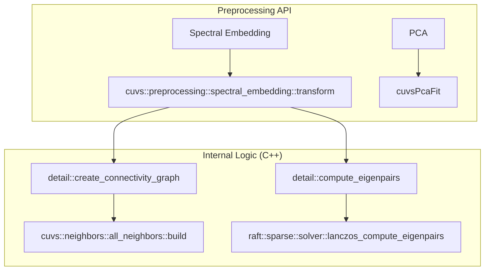
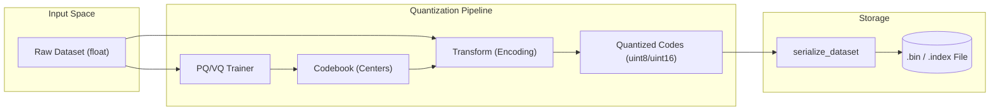

<!-- source: DeepWiki mcp.deepwiki.com · repo NVIDIA/cuvs · page 4.3 Vector Preprocessing & Quantization · fetched 2026-10-26 -->

# Vector Preprocessing & Quantization

Relevant source files

The following files were used as context for generating this wiki page:

- [c/include/cuvs/preprocessing/pca.h](c/include/cuvs/preprocessing/pca.h)
- [c/src/preprocessing/pca.cpp](c/src/preprocessing/pca.cpp)
- [c/src/preprocessing/quantize/pq.cpp](c/src/preprocessing/quantize/pq.cpp)
- [c/tests/preprocessing/pca_c.cu](c/tests/preprocessing/pca_c.cu)
- [cpp/bench/ann/src/cuvs/cuvs_cagra_diskann_wrapper.h](cpp/bench/ann/src/cuvs/cuvs_cagra_diskann_wrapper.h)
- [cpp/bench/ann/src/cuvs/cuvs_mg_cagra_wrapper.h](cpp/bench/ann/src/cuvs/cuvs_mg_cagra_wrapper.h)
- [cpp/include/cuvs/preprocessing/pca.hpp](cpp/include/cuvs/preprocessing/pca.hpp)
- [cpp/include/cuvs/preprocessing/quantize/binary.hpp](cpp/include/cuvs/preprocessing/quantize/binary.hpp)
- [cpp/include/cuvs/preprocessing/quantize/pq.hpp](cpp/include/cuvs/preprocessing/quantize/pq.hpp)
- [cpp/include/cuvs/preprocessing/quantize/scalar.hpp](cpp/include/cuvs/preprocessing/quantize/scalar.hpp)
- [cpp/src/distance/detail/sparse/coo_spmv.cuh](cpp/src/distance/detail/sparse/coo_spmv.cuh)
- [cpp/src/distance/detail/sparse/coo_spmv_kernel.cuh](cpp/src/distance/detail/sparse/coo_spmv_kernel.cuh)
- [cpp/src/distance/detail/sparse/coo_spmv_strategies/dense_smem_strategy.cuh](cpp/src/distance/detail/sparse/coo_spmv_strategies/dense_smem_strategy.cuh)
- [cpp/src/distance/detail/sparse/coo_spmv_strategies/hash_strategy.cuh](cpp/src/distance/detail/sparse/coo_spmv_strategies/hash_strategy.cuh)
- [cpp/src/distance/detail/sparse/l2_distance.cuh](cpp/src/distance/detail/sparse/l2_distance.cuh)
- [cpp/src/distance/detail/sparse/lp_distance.cuh](cpp/src/distance/detail/sparse/lp_distance.cuh)
- [cpp/src/distance/detail/sparse/utils.cuh](cpp/src/distance/detail/sparse/utils.cuh)
- [cpp/src/distance/fused_distance_nn-inl.cuh](cpp/src/distance/fused_distance_nn-inl.cuh)
- [cpp/src/neighbors/detail/vpq_dataset.cuh](cpp/src/neighbors/detail/vpq_dataset.cuh)
- [cpp/src/preprocessing/pca/detail/pca.cuh](cpp/src/preprocessing/pca/detail/pca.cuh)
- [cpp/src/preprocessing/pca/pca.cu](cpp/src/preprocessing/pca/pca.cu)
- [cpp/src/preprocessing/quantize/binary.cu](cpp/src/preprocessing/quantize/binary.cu)
- [cpp/src/preprocessing/quantize/detail/binary.cuh](cpp/src/preprocessing/quantize/detail/binary.cuh)
- [cpp/src/preprocessing/quantize/detail/pq.cuh](cpp/src/preprocessing/quantize/detail/pq.cuh)
- [cpp/src/preprocessing/quantize/detail/scalar.cuh](cpp/src/preprocessing/quantize/detail/scalar.cuh)
- [cpp/src/preprocessing/quantize/pq.cu](cpp/src/preprocessing/quantize/pq.cu)
- [cpp/src/preprocessing/quantize/scalar.cu](cpp/src/preprocessing/quantize/scalar.cu)
- [cpp/tests/preprocessing/binary_quantization.cu](cpp/tests/preprocessing/binary_quantization.cu)
- [cpp/tests/preprocessing/pca.cu](cpp/tests/preprocessing/pca.cu)
- [cpp/tests/preprocessing/product_quantization.cu](cpp/tests/preprocessing/product_quantization.cu)
- [cpp/tests/preprocessing/scalar_quantization.cu](cpp/tests/preprocessing/scalar_quantization.cu)
- [cpp/tests/test_utils.cuh](cpp/tests/test_utils.cuh)
- [python/cuvs/cuvs/preprocessing/CMakeLists.txt](python/cuvs/cuvs/preprocessing/CMakeLists.txt)
- [python/cuvs/cuvs/preprocessing/__init__.py](python/cuvs/cuvs/preprocessing/__init__.py)
- [python/cuvs/cuvs/preprocessing/pca/CMakeLists.txt](python/cuvs/cuvs/preprocessing/pca/CMakeLists.txt)
- [python/cuvs/cuvs/preprocessing/pca/pca.pyx](python/cuvs/cuvs/preprocessing/pca/pca.pyx)
- [python/cuvs/cuvs/preprocessing/quantize/__init__.py](python/cuvs/cuvs/preprocessing/quantize/__init__.py)
- [python/cuvs/cuvs/preprocessing/quantize/binary/CMakeLists.txt](python/cuvs/cuvs/preprocessing/quantize/binary/CMakeLists.txt)
- [python/cuvs/cuvs/preprocessing/quantize/binary/__init__.py](python/cuvs/cuvs/preprocessing/quantize/binary/__init__.py)
- [python/cuvs/cuvs/preprocessing/quantize/scalar/__init__.py](python/cuvs/cuvs/preprocessing/quantize/scalar/__init__.py)
- [python/cuvs/cuvs/tests/test_pca.py](python/cuvs/cuvs/tests/test_pca.py)

Vector preprocessing and quantization are critical stages in the vector search pipeline, enabling dimensionality reduction for efficiency and quantization for reduced memory footprint and accelerated distance computations. cuVS provides high-performance GPU implementations for standard techniques like PCA, Spectral Embedding, and various quantization schemes including Scalar (SQ), Binary (BQ), and Product Quantization (PQ).

Sources: [cpp/include/cuvs/preprocessing/quantize/pq.hpp:20-65](), [cpp/src/preprocessing/quantize/detail/binary.cuh:24-46]()

---

## Dimensionality Reduction

### Principal Component Analysis (PCA)
PCA is used to reduce the dimensionality of datasets while preserving as much variance as possible. In cuVS, PCA is accessible through both C++ and C APIs.
*   **C API**: Defined in `c/include/cuvs/preprocessing/pca.h:1-35` (see additional file).
*   **Implementation**: The C implementation wraps the underlying RAFT/cuVS logic in `c/src/preprocessing/pca.cpp:1-50` (see additional file).

Sources: [c/include/cuvs/preprocessing/pca.h:1-35](), [c/src/preprocessing/pca.cpp:1-50]()

### Spectral Embedding
Spectral embedding uses the eigenvectors of the graph Laplacian to embed data into a lower-dimensional space, often used for non-linear dimensionality reduction.

**Implementation Flow:**
1.  **Graph Construction**: A k-nearest neighbors graph is built from the input data [cpp/include/cuvs/preprocessing/spectral_embedding.hpp:79-80]().
2.  **Laplacian Computation**: The graph is converted into a Laplacian matrix (normalized or unnormalized) [cpp/src/preprocessing/spectral/detail/spectral_embedding.cuh:32-52]().
3.  **Eigen-decomposition**: The Lanczos solver is used to find eigenvectors corresponding to the smallest eigenvalues [cpp/src/preprocessing/spectral/detail/spectral_embedding.cuh:54-78]().
4.  **Embedding Generation**: These eigenvectors serve as the new coordinates [cpp/include/cuvs/preprocessing/spectral_embedding.hpp:82-83]().

**Key Structures:**
*   `cuvs::preprocessing::spectral_embedding::params`: Configures `n_components`, `n_neighbors`, and Laplacian normalization [cpp/include/cuvs/preprocessing/spectral_embedding.hpp:28-69]().

Diagram: Spectral Embedding to Code Entity Mapping

Sources: [cpp/include/cuvs/preprocessing/spectral_embedding.hpp:16-121](), [cpp/src/preprocessing/spectral/detail/spectral_embedding.cuh:29-116](), [c/include/cuvs/preprocessing/pca.h:20-30]()

---

## Vector Quantization

Quantization reduces the precision of vectors to save memory and speed up search via specialized hardware instructions (e.g., `POPC` for binary).

### Binary Quantization (BQ)
BQ converts floating-point vectors into bit-vectors based on a threshold (usually zero or the mean).
*   **Kernel**: `binary_quantization_kernel` performs bit-packing using warps to coalesce memory access [cpp/src/preprocessing/quantize/detail/binary.cuh:38-105]().
*   **Thresholding**: Supports zero-thresholding or calculated mean values via `mean_f16_in_f32` [cpp/src/preprocessing/quantize/detail/binary.cuh:141-162]().

Sources: [cpp/src/preprocessing/quantize/detail/binary.cuh:38-105](), [cpp/src/preprocessing/quantize/detail/binary.cuh:141-162]()

### Scalar Quantization (SQ)
SQ maps floating-point values to a smaller set of discrete values (e.g., 8-bit integers) using linear scaling based on min/max quantiles.
*   **Quantization Operator**: `quantize_op` computes scaling and offsets for mapping floating points to integer ranges [cpp/src/preprocessing/quantize/detail/scalar.cuh:41-72]().
*   **Quantile Bounds**: `quantile_min_max` subsamples the dataset and uses CUB merge sort to determine bounding quantiles [cpp/src/preprocessing/quantize/detail/scalar.cuh:74-129]().

Sources: [cpp/src/preprocessing/quantize/detail/scalar.cuh:41-72](), [cpp/src/preprocessing/quantize/detail/scalar.cuh:74-129]()

### Product Quantization (PQ)
PQ divides a vector into sub-vectors and quantizes each sub-vector independently using a codebook. cuVS supports a sophisticated variant often referred to as Vector-Product Quantization (VPQ) when combined with an initial Vector Quantization (VQ) step to subtract cluster centers.

**Data Flow for PQ Training:**
1.  **VQ Training (Optional)**: If `n_vq_centers > 0`, K-Means is run to find coarse centroids [cpp/src/neighbors/detail/vpq_dataset.cuh:111-118]().
2.  **Subspace Decomposition**: The dataset (or residuals after VQ) is split into `pq_dim` subspaces [cpp/src/preprocessing/quantize/detail/pq.cuh:84-90]().
3.  **PQ Codebook Training**: K-Means is run on each subspace to generate local codebooks [cpp/src/preprocessing/quantize/detail/pq.cuh:130-147]().

**Code Entity Space Mapping:**
| Concept | Code Entity | File |
| :--- | :--- | :--- |
| **PQ Parameters** | `cuvs::preprocessing::quantize::pq::params` | [cpp/include/cuvs/preprocessing/quantize/pq.hpp:37-140]() |
| **Training Entry** | `cuvs::preprocessing::quantize::pq::detail::build` | [cpp/src/preprocessing/quantize/detail/pq.cuh:152-156]() |
| **K-Means Helper** | `cuvs::neighbors::detail::train_pq_centers` | [cpp/src/neighbors/detail/vpq_dataset.cuh:76-83]() |
| **Bit Packing** | `pq_bits-bitfield` logic | [cpp/src/preprocessing/quantize/detail/pq_codepacking.cuh:1-11]() |

Sources: [cpp/include/cuvs/preprocessing/quantize/pq.hpp:37-140](), [cpp/src/preprocessing/quantize/detail/pq.cuh:75-149](), [cpp/src/neighbors/detail/vpq_dataset.cuh:76-121]()

---

## Technical Implementation Details

### K-Means in Quantization
Quantization training heavily relies on K-Means. cuVS provides a choice between:
*   **Classic K-Means**: Standard Lloyd's algorithm via `cuvs::cluster::kmeans::fit` [cpp/src/neighbors/detail/vpq_dataset.cuh:111-118]().
*   **Balanced K-Means**: Ensures clusters are of roughly equal size, which is often preferred for PQ codebooks to maximize entropy via `cuvs::cluster::kmeans_balanced::helpers::build_clusters` [cpp/src/neighbors/detail/vpq_dataset.cuh:90-104]().

Sources: [cpp/src/neighbors/detail/vpq_dataset.cuh:76-121]()

Diagram: Quantization Data Flow Pipeline

Sources: [cpp/src/neighbors/detail/vpq_dataset.cuh:76-121](), [cpp/src/preprocessing/quantize/detail/pq.cuh:152-175]()

---

