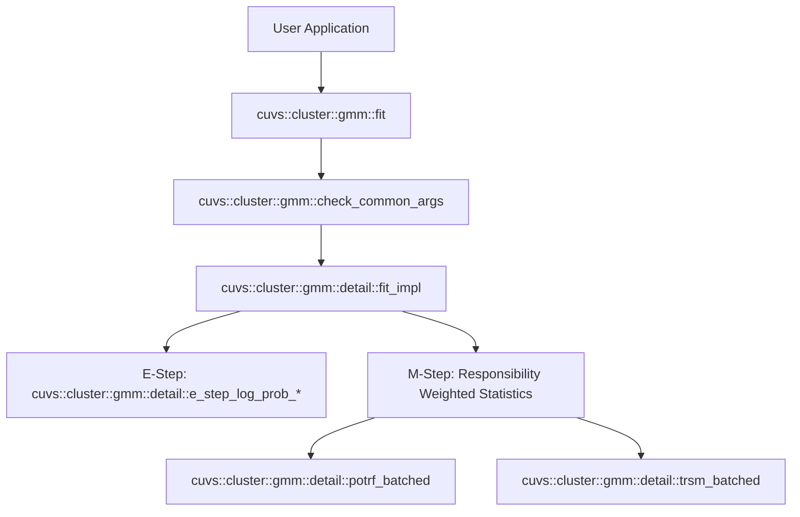
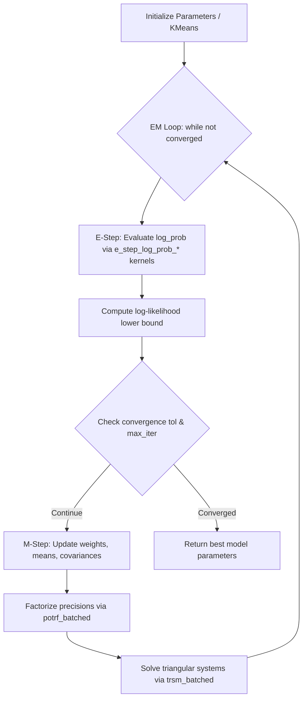
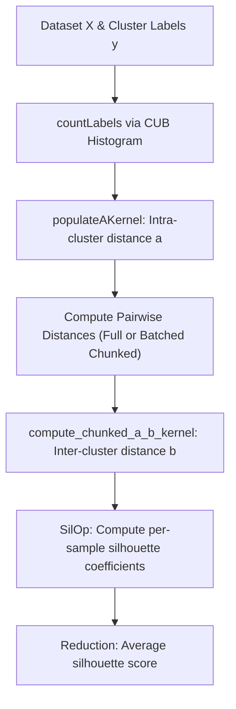

<!-- source: DeepWiki mcp.deepwiki.com · repo NVIDIA/cuvs · page 4.4 Gaussian Mixture Models & Cluster Statistics · fetched 2026-10-26 -->

# Gaussian Mixture Models & Cluster Statistics

<details>
<summary>Relevant source files</summary>

The following files were used as context for generating this wiki page:

- [cpp/include/cuvs/cluster/gmm.hpp](cpp/include/cuvs/cluster/gmm.hpp)
- [cpp/include/cuvs/stats/silhouette_score.hpp](cpp/include/cuvs/stats/silhouette_score.hpp)
- [cpp/include/cuvs/stats/trustworthiness_score.hpp](cpp/include/cuvs/stats/trustworthiness_score.hpp)
- [cpp/src/cluster/gmm.cuh](cpp/src/cluster/gmm.cuh)
- [cpp/src/cluster/gmm_double.cu](cpp/src/cluster/gmm_double.cu)
- [cpp/src/cluster/gmm_float.cu](cpp/src/cluster/gmm_float.cu)
- [cpp/src/cluster/gmm_impl.cuh](cpp/src/cluster/gmm_impl.cuh)
- [cpp/src/cluster/gmm_kernels.cuh](cpp/src/cluster/gmm_kernels.cuh)
- [cpp/src/stats/detail/batched/silhouette_score.cuh](cpp/src/stats/detail/batched/silhouette_score.cuh)
- [cpp/src/stats/detail/silhouette_score.cuh](cpp/src/stats/detail/silhouette_score.cuh)
- [cpp/src/stats/detail/trustworthiness_score.cuh](cpp/src/stats/detail/trustworthiness_score.cuh)
- [cpp/src/stats/silhouette_score.cu](cpp/src/stats/silhouette_score.cu)
- [cpp/src/stats/trustworthiness_score.cu](cpp/src/stats/trustworthiness_score.cu)
- [cpp/tests/cluster/gmm.cu](cpp/tests/cluster/gmm.cu)
- [cpp/tests/stats/silhouette_score.cu](cpp/tests/stats/silhouette_score.cu)
- [fern/pages/cluster/gmm.md](fern/pages/cluster/gmm.md)

</details>


This technical documentation page covers the Gaussian Mixture Model (GMM) clustering and density estimation subsystem in cuVS, alongside cluster quality statistics such as the silhouette score and trustworthiness score. It details the Expectation-Maximization (EM) solver architecture, GPU kernel implementations for E- and M-steps, precision-typed instantiations (`float` and `double`), covariance parameterizations, and batching strategies for large-scale distance and score computations.

---

## 1. Gaussian Mixture Model (GMM) Architecture & APIs

The GMM implementation models a dataset as a weighted sum of $K$ Gaussian components (`n_components`), learning component weights, means, and covariance structures via the Expectation-Maximization (EM) algorithm [fern/pages/cluster/gmm.md:1-3](). 

The core configuration and API structures reside in `cuvs::cluster::gmm` [cpp/include/cuvs/cluster/gmm.hpp:15-17](). The hyper-parameter struct `params` exposes configuration options mirroring scikit-learn's `GaussianMixture`:

```cpp
struct params {
  int n_components = 1;
  covariance_type cov_type = covariance_type::FULL;
  double tol = 1e-3;
  double reg_covar = 1e-6;
  int max_iter = 100;
  int n_init = 1;
  init_method init = init_method::KMeans;
  uint64_t seed = 0;
};
``` [cpp/include/cuvs/cluster/gmm.hpp:49-75]()

### Covariance Types and Parameterization

The `covariance_type` enum defines four parameterization strategies controlling component shape flexibility [cpp/include/cuvs/cluster/gmm.hpp:25-34]():
- `FULL`: Each component maintains its own general covariance matrix of shape $(K, d, d)$.
- `TIED`: All components share a single general covariance matrix of shape $(d, d)$.
- `DIAG`: Each component maintains an axis-aligned diagonal covariance matrix of shape $(K, d)$.
- `SPHERICAL`: Each component maintains a single scalar variance (isotropic) of shape $(K,)$.

### Primary Functions

The C++ API provides four primary entrypoints for fitting, predicting, and scoring [cpp/include/cuvs/cluster/gmm.hpp:102-164]():
- `cuvs::cluster::gmm::fit`: Runs EM estimation across `n_init` random restarts (or a single run if `warm_start` is enabled) to output component weights, means, covariances, Cholesky factors of precision matrices (`precisions_chol`), precisions, hard cluster `labels`, and convergence diagnostics [cpp/include/cuvs/cluster/gmm.hpp:102-164]().
- `cuvs::cluster::gmm::predict`: Assigns hard cluster labels to input samples via argument-maximum of component responsibilities [cpp/include/cuvs/cluster/gmm.hpp:166-180]().
- `cuvs::cluster::gmm::predict_proba`: Computes the soft responsibility matrix of shape $(n\_samples, n\_components)$ [cpp/include/cuvs/cluster/gmm.hpp:182-198]().
- `cuvs::cluster::gmm::score_samples`: Computes the per-sample log-likelihood under the fitted mixture model [cpp/include/cuvs/cluster/gmm.hpp:200-215]().


*Figure 1: Natural Language Space to Code Entity Space mapping for GMM fitting and linear algebra routines.*

Sources: `cpp/include/cuvs/cluster/gmm.hpp`, `fern/pages/cluster/gmm.md`, `cpp/src/cluster/gmm.cuh`, `cpp/src/cluster/gmm_impl.cuh`

---

## 2. GMM Implementation Details & EM Loop

The GMM solver internal logic is implemented in `cpp/src/cluster/gmm_impl.cuh` and instantiated for single-precision (`float`) and double-precision (`double`) types in `cpp/src/cluster/gmm_float.cu` and `cpp/src/cluster/gmm_double.cu`.

### Argument Validation and Tensor Layout

Before launching EM iterations, `check_common_args` validates matrix extents, component bounds ($\le 65535$), and buffer sizing requirements [cpp/src/cluster/gmm.cuh:23-51](). Covariance-shaped buffers (`covariances`, `precisions_chol`, `precisions`) are flattened into 1D device vectors whose expected lengths depend on `covariance_type` [cpp/include/cuvs/cluster/gmm.hpp:81-98]():
- `FULL`: $K \cdot d^2$
- `TIED`: $d^2$
- `DIAG`: $K \cdot d$
- `SPHERICAL`: $K$

### E-Step Kernels

The Expectation step evaluates the log-probability density of each sample under each Gaussian component. Depending on dimensionality $d$, cuVS dispatches specialized CUDA kernels:
- `e_step_log_prob_small_kernel`: Optimized for dimensions $d \le 64$, leveraging shared memory to cache component means and Cholesky factors [cpp/src/cluster/gmm_kernels.cuh:44-120]().
- `e_step_log_prob_large_d_thread64_kernel`: Utilizes 64-column tiled block processing for high-dimensional feature spaces ($d > 64$) [cpp/src/cluster/gmm_kernels.cuh:124-182]().

### M-Step Linear Algebra Wrappers

The Maximization step updates component weights, means, and covariance matrices based on responsibility-weighted data statistics. Matrix inversions and Cholesky decompositions rely on batched cuSOLVER and cuBLAS routines [cpp/src/cluster/gmm_impl.cuh:71-158]():
- `cuvs::cluster::gmm::detail::potrf_batched`: Wraps `cusolverDnSpotrfBatched` and `cusolverDnDpotrfBatched` for batched Cholesky factorization [cpp/src/cluster/gmm_impl.cuh:71-105]().
- `cuvs::cluster::gmm::detail::trsm_batched`: Wraps `cublasStrsmBatched` and `cublasDtrsmBatched` for batched triangular system solves [cpp/src/cluster/gmm_impl.cuh:110-158]().


*Figure 2: Data flow and execution loop of the GPU-accelerated GMM Expectation-Maximization solver.*

Sources: `cpp/src/cluster/gmm.cuh`, `cpp/src/cluster/gmm_impl.cuh`, `cpp/src/cluster/gmm_kernels.cuh`, `cpp/src/cluster/gmm_float.cu`, `cpp/src/cluster/gmm_double.cu`

---

## 3. Cluster Quality Statistics: Silhouette Score

The silhouette score measures how similar an object is to its own cluster compared to other clusters, producing values between -1 and +1. cuVS provides both standard and batched GPU implementations in `cuvs::stats::silhouette_score` and `cuvs::stats::silhouette_score_batched`.

### Core Algorithms and Kernels

1. **Histogram Binning**: `cuvs::stats::detail::countLabels` computes per-cluster sample counts (`binCountArray`) using CUB's `DeviceHistogram::HistogramEven` [cpp/src/stats/detail/silhouette_score.cuh:99-135]().
2. **Intra-Cluster Distance (`a`)**: `populateAKernel` calculates the mean intra-cluster distance for each sample point and flags singleton clusters [cpp/src/stats/detail/silhouette_score.cuh:50-85]().
3. **Inter-Cluster Distance (`b`)**: 
   - Standard implementation computes pairwise distance matrices directly.
   - Batched implementation (`cuvs::stats::batched::detail::compute_chunked_a_b_kernel`) processes pairwise distance chunks asynchronously across streams to bound memory consumption [cpp/src/stats/detail/batched/silhouette_score.cuh:71-105]().
4. **Reduction**: `SilOp` and `DivOp` functors combine $a$ and $b$ to derive per-sample silhouette coefficients [cpp/src/stats/detail/silhouette_score.cuh:138-168]().


*Figure 3: Computational pipeline for GPU-accelerated Silhouette Score calculation.*

Sources: `cpp/include/cuvs/stats/silhouette_score.hpp`, `cpp/src/stats/detail/silhouette_score.cuh`, `cpp/src/stats/detail/batched/silhouette_score.cuh`

---

## 4. Cluster Quality Statistics: Trustworthiness Score

The trustworthiness score evaluates how faithfully a local neighborhood structure in a high-dimensional space is preserved in a lower-dimensional embedding (or clustering space). It is implemented in `cuvs::stats::detail::trustworthiness_score` [cpp/src/stats/detail/trustworthiness_score.cuh:116-126]().

### Key Functions and Kernels

- `cuvs::stats::detail::run_knn`: Builds a brute-force k-NN index using `cuvs::neighbors::brute_force::build` and queries nearest neighbors via `cuvs::neighbors::brute_force::search` [cpp/src/stats/detail/trustworthiness_score.cuh:82-102]().
- `cuvs::stats::detail::build_lookup_table`: Constructs a lookup table mapping high-dimensional pairwise distance ranks to sample indices [cpp/src/stats/detail/trustworthiness_score.cuh:30-41]().
- `cuvs::stats::detail::compute_rank`: Evaluates embedding neighbor ranks against original space ranks and accumulates penalties via atomic additions (`raft::myAtomicAdd`) [cpp/src/stats/detail/trustworthiness_score.cuh:52-70]().

Sources: `cpp/include/cuvs/stats/trustworthiness_score.hpp`, `cpp/src/stats/detail/trustworthiness_score.cuh`, `cpp/src/stats/trustworthiness_score.cu`

---

