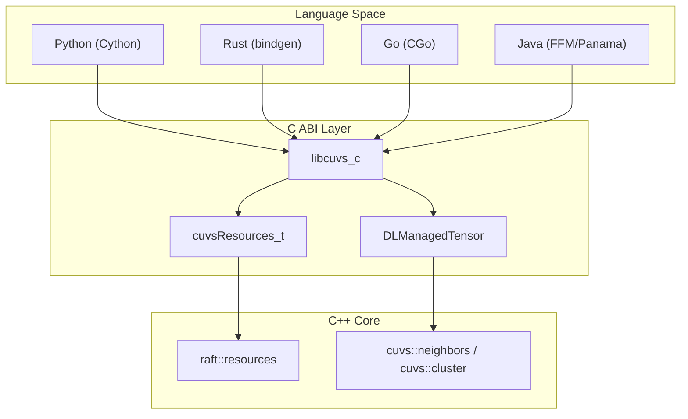

<!-- source: DeepWiki mcp.deepwiki.com · repo NVIDIA/cuvs · page 5 Language Bindings · fetched 2026-10-26 -->

# Language Bindings

Relevant source files

The following files were used as context for generating this wiki page:

- [build.sh](build.sh)
- [c/include/cuvs/core/c_api.h](c/include/cuvs/core/c_api.h)
- [c/src/core/c_api.cpp](c/src/core/c_api.cpp)
- [ci/release/update-version.sh](ci/release/update-version.sh)
- [cpp/include/cuvs/neighbors/dynamic_batching.hpp](cpp/include/cuvs/neighbors/dynamic_batching.hpp)
- [cpp/src/neighbors/detail/dynamic_batching.cuh](cpp/src/neighbors/detail/dynamic_batching.cuh)
- [examples/c/src/bruteforce_c_example.c](examples/c/src/bruteforce_c_example.c)
- [fern/pages/c_api/c-api-neighbors-hnsw.md](fern/pages/c_api/c-api-neighbors-hnsw.md)
- [fern/pages/c_api/c-api-neighbors-vamana.md](fern/pages/c_api/c-api-neighbors-vamana.md)
- [fern/pages/cuvs_bench/param_tuning.md](fern/pages/cuvs_bench/param_tuning.md)
- [fern/pages/java_api/java-api-com-nvidia-cuvs-cagraindex.md](fern/pages/java_api/java-api-com-nvidia-cuvs-cagraindex.md)
- [fern/pages/java_api/java-api-com-nvidia-cuvs-hnswindex.md](fern/pages/java_api/java-api-com-nvidia-cuvs-hnswindex.md)
- [fern/pages/java_api/java-api-com-nvidia-cuvs-hnswindexparams.md](fern/pages/java_api/java-api-com-nvidia-cuvs-hnswindexparams.md)
- [fern/pages/java_api/java-api-com-nvidia-cuvs-spi-cuvsprovider.md](fern/pages/java_api/java-api-com-nvidia-cuvs-spi-cuvsprovider.md)
- [fern/pages/python_api/python-api-neighbors-hnsw.md](fern/pages/python_api/python-api-neighbors-hnsw.md)
- [fern/pages/python_api/python-api-neighbors-vamana.md](fern/pages/python_api/python-api-neighbors-vamana.md)
- [java/benchmarks/pom.xml](java/benchmarks/pom.xml)
- [java/build.sh](java/build.sh)
- [java/cuvs-java/pom.xml](java/cuvs-java/pom.xml)
- [java/panama-bindings/generate-bindings.sh](java/panama-bindings/generate-bindings.sh)
- [java/panama-bindings/headers.h](java/panama-bindings/headers.h)

The cuVS library provides a multi-layered interface designed to enable high-performance vector search across various programming environments. While the core algorithms are implemented in C++ and CUDA, cuVS exposes a stable C ABI that serves as the foundation for all high-level language bindings, leveraging the **DLPack** protocol for zero-copy tensor exchange.

---

## Architecture Overview

All language bindings in cuVS (Python, Rust, Go, and Java) follow a consistent architectural pattern. They wrap the stable C API layer and use the `DLManagedTensor` structure to pass multidimensional arrays across language boundaries without host-device memory duplication [c/include/cuvs/core/c_api.h:9-11]().

### The C API Foundation
The C API provides opaque handles for complex C++ objects, such as `cuvsResources_t` which wraps the underlying `raft::resources` [c/include/cuvs/core/c_api.h:76-80](), [c/src/core/c_api.cpp:36-42](). This allows foreign function interfaces (FFI) to manage GPU execution streams and workspace memory without linking directly against C++ mangled symbols.

### Language Interop Diagram

Diagram: cuVS Language Interop Architecture

Sources: [c/include/cuvs/core/c_api.h:76-88](), [c/src/core/c_api.cpp:36-42]()

---

## Python Bindings (Cython)

The Python bindings provide a Pythonic interface to cuVS, supporting seamless integration with the RAPIDS ecosystem (CuPy, PyTorch, NumPy). They are implemented using Cython `.pyx` and `.pxd` modules.

*   **Key Modules:** `cuvs.neighbors` (CAGRA, IVF-PQ, IVF-Flat, IVF-SQ, HNSW, NN-Descent, Brute Force), `cuvs.cluster`, `cuvs.distance`, and `cuvs.preprocessing`.
*   **Resource Management:** The `Resources` class wraps `cuvsResources_t` and provides an `auto_sync_resources` decorator to manage CUDA stream synchronization.
*   **Data Handling:** Uses the DLPack protocol via `cydlpack` to interface with any array supporting `__cuda_array_interface__`.

For details, see [Python Bindings (Cython)](#5.1).

Sources: [build.sh:28]()

---

## Java Bindings (FFM/Panama) & Lucene Integration

The Java bindings utilize the Foreign Function & Memory (FFM) API (Project Panama) to call native cuVS code with minimal overhead, replacing traditional JNI.

*   **Native Interop:** Bindings are generated using `jextract` against the cuVS C headers [java/panama-bindings/generate-bindings.sh:45-53]().
*   **Core APIs:** Provides high-level classes such as `CagraIndex`, `BruteForceIndex`, `HnswIndex`, and `TieredIndex`, managed via `CuVSResources` and `CuVSMatrix` host/device tensors.
*   **Lucene Codecs:** The `cuvs-lucene` module integrates GPU-accelerated HNSW and vector search codecs directly into Apache Lucene.

For details, see [Java Bindings (FFM/Panama)](#5.2) and [cuvs-lucene: GPU-Accelerated Lucene Codecs](#5.2.1).

Sources: [java/build.sh:28-32](), [java/cuvs-java/pom.xml:10-18]()

---

## Rust Bindings

Rust support is structured around a dual-crate workspace separating low-level FFI bindings from safe, idiomatic abstractions.

*   **Crate Structure:** `cuvs-sys` (bindgen-generated raw FFI bindings to `libcuvs_c`) and `cuvs` (high-level safe wrappers).
*   **Index APIs:** Idiomatic wrappers for CAGRA, IVF-PQ, IVF-Flat, Brute Force, Vamana, and K-Means.
*   **Memory Safety:** Leverages Rust's ownership model to manage `ManagedTensor` and DLPack lifetimes, automatically releasing native handles.

For details, see [Rust Bindings](#5.3).

Sources: [build.sh:29]()

---

## Go Bindings

The Go bindings provide integration through CGo, allowing Go-based applications and vector database microservices to invoke GPU-accelerated search algorithms.

*   **Package Structure:** Organized into subpackages matching the C API (`cagra`, `ivf_flat`, `ivf_pq`, `brute_force`).
*   **Types:** Exposes `Resource` and `Tensor` types mapping directly to `cuvsResources_t` and `DLManagedTensor`.

For details, see [Go Bindings](#5.4).

Sources: [build.sh:30]()

---

## Common Patterns Across Bindings

All language bindings implement a consistent lifecycle pattern when interacting with the cuVS C backend:

| Feature | Implementation Pattern | C API Reference |
| :--- | :--- | :--- |
| **Initialization** | Allocate a Resources handle to manage CUDA context and streams. | `cuvsResourcesCreate` [c/include/cuvs/core/c_api.h:88]() |
| **Data Input** | Wrap host or device memory pointers into a DLPack tensor descriptor. | `DLManagedTensor` [c/include/cuvs/core/c_api.h:9]() |
| **Error Handling** | Inspect return codes and retrieve descriptive error strings. | `cuvsGetLastErrorText` [c/include/cuvs/core/c_api.h:32]() |
| **Execution** | Pass resource handles and tensors to build or search functions. | e.g., `cuvsVamanaBuild` |
| **Cleanup** | Explicitly release index structures and destroy resource handles. | `cuvsResourcesDestroy` [c/include/cuvs/core/c_api.h:123]() |

Sources: [c/include/cuvs/core/c_api.h:27-123](), [c/src/core/c_api.cpp:36-80]()

---

