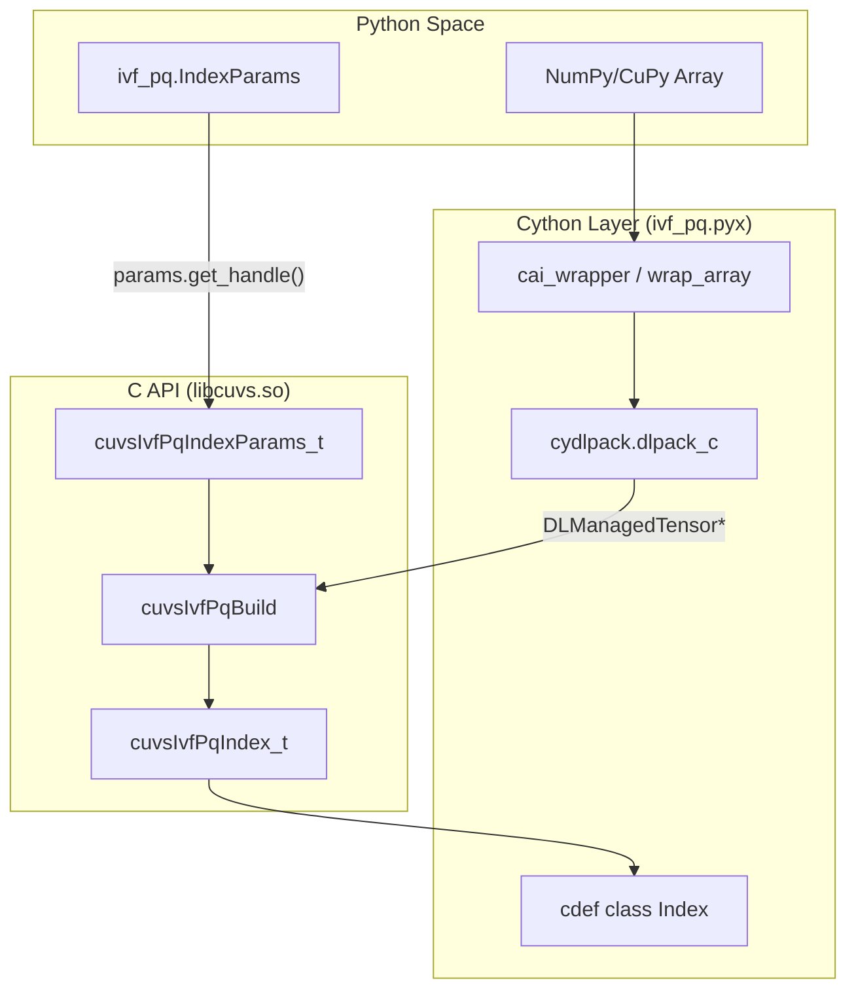
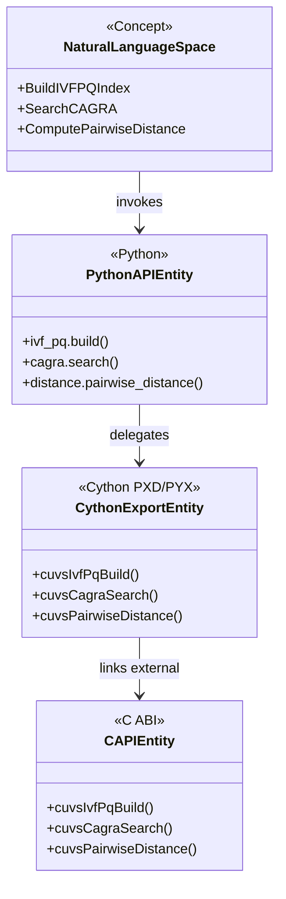

<!-- source: DeepWiki mcp.deepwiki.com · repo NVIDIA/cuvs · page 5.1 Python Bindings (Cython) · fetched 2026-10-26 -->

# Python Bindings (Cython)

Relevant source files

The following files were used as context for generating this wiki page:

- [c/include/cuvs/neighbors/ivf_pq.h](c/include/cuvs/neighbors/ivf_pq.h)
- [c/src/neighbors/ivf_pq.cpp](c/src/neighbors/ivf_pq.cpp)
- [cpp/cmake/thirdparty/get_kvikio.cmake](cpp/cmake/thirdparty/get_kvikio.cmake)
- [python/cuvs/CMakeLists.txt](python/cuvs/CMakeLists.txt)
- [python/cuvs/cuvs/common/CMakeLists.txt](python/cuvs/cuvs/common/CMakeLists.txt)
- [python/cuvs/cuvs/common/c_api.pxd](python/cuvs/cuvs/common/c_api.pxd)
- [python/cuvs/cuvs/common/resources.pyx](python/cuvs/cuvs/common/resources.pyx)
- [python/cuvs/cuvs/distance/CMakeLists.txt](python/cuvs/cuvs/distance/CMakeLists.txt)
- [python/cuvs/cuvs/distance/__init__.py](python/cuvs/cuvs/distance/__init__.py)
- [python/cuvs/cuvs/distance/distance.pyx](python/cuvs/cuvs/distance/distance.pyx)
- [python/cuvs/cuvs/distance_type.pxd](python/cuvs/cuvs/distance_type.pxd)
- [python/cuvs/cuvs/neighbors/CMakeLists.txt](python/cuvs/cuvs/neighbors/CMakeLists.txt)
- [python/cuvs/cuvs/neighbors/__init__.py](python/cuvs/cuvs/neighbors/__init__.py)
- [python/cuvs/cuvs/neighbors/brute_force/CMakeLists.txt](python/cuvs/cuvs/neighbors/brute_force/CMakeLists.txt)
- [python/cuvs/cuvs/neighbors/brute_force/brute_force.pyx](python/cuvs/cuvs/neighbors/brute_force/brute_force.pyx)
- [python/cuvs/cuvs/neighbors/cagra/CMakeLists.txt](python/cuvs/cuvs/neighbors/cagra/CMakeLists.txt)
- [python/cuvs/cuvs/neighbors/cagra/__init__.py](python/cuvs/cuvs/neighbors/cagra/__init__.py)
- [python/cuvs/cuvs/neighbors/cagra/cagra.pxd](python/cuvs/cuvs/neighbors/cagra/cagra.pxd)
- [python/cuvs/cuvs/neighbors/cagra/cagra.pyx](python/cuvs/cuvs/neighbors/cagra/cagra.pyx)
- [python/cuvs/cuvs/neighbors/common.py](python/cuvs/cuvs/neighbors/common.py)
- [python/cuvs/cuvs/neighbors/filters/CMakeLists.txt](python/cuvs/cuvs/neighbors/filters/CMakeLists.txt)
- [python/cuvs/cuvs/neighbors/hnsw/CMakeLists.txt](python/cuvs/cuvs/neighbors/hnsw/CMakeLists.txt)
- [python/cuvs/cuvs/neighbors/ivf_flat/CMakeLists.txt](python/cuvs/cuvs/neighbors/ivf_flat/CMakeLists.txt)
- [python/cuvs/cuvs/neighbors/ivf_flat/__init__.py](python/cuvs/cuvs/neighbors/ivf_flat/__init__.py)
- [python/cuvs/cuvs/neighbors/ivf_flat/ivf_flat.pxd](python/cuvs/cuvs/neighbors/ivf_flat/ivf_flat.pxd)
- [python/cuvs/cuvs/neighbors/ivf_flat/ivf_flat.pyx](python/cuvs/cuvs/neighbors/ivf_flat/ivf_flat.pyx)
- [python/cuvs/cuvs/neighbors/ivf_pq/CMakeLists.txt](python/cuvs/cuvs/neighbors/ivf_pq/CMakeLists.txt)
- [python/cuvs/cuvs/neighbors/ivf_pq/__init__.py](python/cuvs/cuvs/neighbors/ivf_pq/__init__.py)
- [python/cuvs/cuvs/neighbors/ivf_pq/ivf_pq.pxd](python/cuvs/cuvs/neighbors/ivf_pq/ivf_pq.pxd)
- [python/cuvs/cuvs/neighbors/ivf_pq/ivf_pq.pyx](python/cuvs/cuvs/neighbors/ivf_pq/ivf_pq.pyx)
- [python/cuvs/cuvs/neighbors/nn_descent/CMakeLists.txt](python/cuvs/cuvs/neighbors/nn_descent/CMakeLists.txt)
- [python/cuvs/cuvs/neighbors/nn_descent/__init__.pxd](python/cuvs/cuvs/neighbors/nn_descent/__init__.pxd)
- [python/cuvs/cuvs/neighbors/nn_descent/__init__.py](python/cuvs/cuvs/neighbors/nn_descent/__init__.py)
- [python/cuvs/cuvs/neighbors/refine.pyx](python/cuvs/cuvs/neighbors/refine.pyx)
- [python/cuvs/cuvs/tests/test_brute_force.py](python/cuvs/cuvs/tests/test_brute_force.py)
- [python/cuvs/cuvs/tests/test_cagra.py](python/cuvs/cuvs/tests/test_cagra.py)
- [python/cuvs/cuvs/tests/test_ivf_flat.py](python/cuvs/cuvs/tests/test_ivf_flat.py)
- [python/cuvs/cuvs/tests/test_ivf_pq.py](python/cuvs/cuvs/tests/test_ivf_pq.py)
- [python/cuvs/cuvs/tests/test_mg_cagra.py](python/cuvs/cuvs/tests/test_mg_cagra.py)
- [python/cuvs/cuvs/tests/test_mg_ivf_flat.py](python/cuvs/cuvs/tests/test_mg_ivf_flat.py)
- [python/cuvs/cuvs/tests/test_mg_ivf_pq.py](python/cuvs/cuvs/tests/test_mg_ivf_pq.py)
- [python/libcuvs/CMakeLists.txt](python/libcuvs/CMakeLists.txt)

The cuVS Python package provides high-performance GPU-accelerated vector search, clustering, and preprocessing capabilities by wrapping the cuVS C API using Cython. It leverages the DLPack protocol for zero-copy data exchange with popular Python tensor libraries like NumPy, CuPy, and PyTorch via the CUDA Array Interface (CAI).

Sources: `[python/cuvs/CMakeLists.txt:48-59]()`, `[python/cuvs/cuvs/neighbors/CMakeLists.txt:1-29]()`

---

## Package Structure

The Python bindings are organized into submodules mirroring the core C++ functional areas. The build system relies on `scikit-build-core` and `rapids-cython` to compile `.pyx` and `.pxd` Cython files into optimized shared extension modules.

### `cuvs.neighbors`
Contains Approximate Nearest Neighbor (ANN) and exact search algorithms:
*   **CAGRA**: Graph-based ANN index construction and search [python/cuvs/cuvs/neighbors/cagra/cagra.pyx:1-50]()
*   **IVF-PQ**: Inverted File with Product Quantization [python/cuvs/cuvs/neighbors/ivf_pq/ivf_pq.pyx:40-125]()
*   **IVF-Flat / IVF-SQ**: Inverted File with exact vectors or Scalar Quantization [python/cuvs/cuvs/neighbors/ivf_flat/ivf_flat.pyx:41-116]()
*   **Brute Force**: Exact k-nearest neighbor search
*   **HNSW**: Hierarchical Navigable Small Worlds (via HNSWlib integration)
*   **NN-Descent**: Fast KNN graph construction for CAGRA seeding

### `cuvs.common`
Provides foundational utilities for device resource management and tensor interop:
*   **Resources**: Manages the `cuvsResources_t` opaque handle, wrapping CUDA streams and execution contexts `[python/cuvs/cuvs/common/c_api.pxd:14-28]()`
*   **DLPack / cydlpack**: Implements zero-copy array exchange between Python CAI arrays and `DLManagedTensor` `[python/cuvs/cuvs/common/cydlpack.pyx:1-15]()`

### `cuvs.distance`, `cuvs.cluster`, and `cuvs.preprocessing`
*   **Distance**: Provides `pairwise_distance` supporting diverse metric types [python/cuvs/cuvs/distance/distance.pyx:17-52]()
*   **Cluster**: Contains GPU-accelerated K-Means and clustering algorithms
*   **Preprocessing**: Vector transformations, quantization utilities, and dimensionality reduction

Sources: `[python/cuvs/CMakeLists.txt:48-59]()`, `[python/cuvs/cuvs/neighbors/CMakeLists.txt:1-29]()`

---

## Data Flow and Interop Layer

cuVS Python integrates Python arrays with underlying C APIs using the **DLPack** protocol. Any library implementing the CUDA Array Interface (CAI) can pass device memory pointers directly into Cython bindings without host roundtrips.

### Implementation Pattern: Python to C API
The following diagram details the execution flow from a high-level Python invocation down to the underlying C library function.

**Diagram: Python to C API Data Flow**

Sources: `[python/cuvs/cuvs/neighbors/ivf_pq/ivf_pq.pyx:58-61]`, `[python/cuvs/cuvs/neighbors/ivf_pq/ivf_pq.pxd:125-128]`, `[python/cuvs/cuvs/common/cydlpack.pyx:1-15]()`

---

## Key Components

### Resources and Memory Management
The `cuvs.common.resources.Resources` class wraps the C-level `cuvsResources_t` handle. Functions apply the `@auto_sync_resources` decorator to synchronize CUDA streams automatically upon completion `[python/cuvs/cuvs/common/resources.pyx:1-15]()`.

### CAGRA (Graph-based ANN)
CAGRA bindings expose comprehensive parameter classes and search options:
*   **IndexParams**: Configures `intermediate_graph_degree`, `graph_degree`, and `build_algo` (`ivf_pq` or `nn_descent`) [python/cuvs/cuvs/neighbors/cagra/cagra.pyx:47-53]()
*   **AceParams**: Configures Augmented Core Extraction (ACE) for constructing indexes larger than GPU memory via balanced k-means partitioning [python/cuvs/cuvs/neighbors/cagra/cagra.pyx:59-110]()
*   **SearchParams**: Exposes search strategies such as `SINGLE_CTA`, `MULTI_CTA`, and `MULTI_KERNEL` via `cuvsCagraSearchAlgo` [python/cuvs/cuvs/neighbors/cagra/cagra.pxd:71-76]()

### IVF-PQ & IVF-Flat
The `ivf_pq` and `ivf_flat` submodules manage inverted file lists combined with product quantization or exact vector storage:
*   **IndexParams**: Defines coarse clusters (`n_lists`), PQ codebook size (`pq_bits`), and memory layouts (`codes_layout`) [python/cuvs/cuvs/neighbors/ivf_pq/ivf_pq.pyx:40-125]()
*   **SearchParams**: Controls `n_probes`, lookup table (`lut_dtype`), and internal distance precision [python/cuvs/cuvs/neighbors/ivf_pq/ivf_pq.pxd:52-59]()

Sources: `[python/cuvs/cuvs/neighbors/cagra/cagra.pyx:59-174]`, `[python/cuvs/cuvs/neighbors/ivf_pq/ivf_pq.pyx:40-125]`, `[python/cuvs/cuvs/neighbors/ivf_flat/ivf_flat.pyx:41-116]()`

---

## Code Entity Mapping

This diagram bridges natural language functional requirements to exact code symbols across the Python, Cython, and C API layers.

**Diagram: Natural Language to Code Entity Mapping**

Sources: `[python/cuvs/cuvs/neighbors/ivf_pq/ivf_pq.pxd:125-128]`, `[python/cuvs/cuvs/neighbors/cagra/cagra.pxd:133-144]`, `[python/cuvs/cuvs/distance/distance.pyx:129-134]()`

---

## Test Patterns

Python test suites use `pytest` to validate correctness by comparing GPU outputs against CPU baselines (such as `scikit-learn`).

| Test File | Algorithm Tested | Key Validation Focus |
| :--- | :--- | :--- |
| `test_ivf_pq.py` | IVF-PQ | Recall > 0.7 against brute-force, serialization `[python/cuvs/cuvs/tests/test_ivf_pq.py:142-143]()` |
| `test_cagra.py` | CAGRA | Graph degree verification, dataset roundtrip `[python/cuvs/cuvs/tests/test_cagra.py:139-152]()` |
| `test_ivf_flat.py`| IVF-Flat | Adaptive center drift and indexing |

### Standard Test Execution Flow
1.  **Data Generation**: Construct test matrices using `generate_data` [python/cuvs/cuvs/tests/test_ivf_pq.py:40-43]()
2.  **Index Creation**: Instantiate `IndexParams` and build index via `ivf_pq.build` or `cagra.build` [python/cuvs/cuvs/tests/test_ivf_pq.py:45-60]()
3.  **Search Execution**: Invoke `search` with `SearchParams` and query arrays [python/cuvs/cuvs/tests/test_ivf_pq.py:93-106]()
4.  **Recall Metric Check**: Compute recall score against `sklearn.neighbors.NearestNeighbors` [python/cuvs/cuvs/tests/test_ivf_pq.py:130-143]()

Sources: `[python/cuvs/cuvs/tests/test_ivf_pq.py:17-43]`, `[python/cuvs/cuvs/tests/test_cagra.py:23-45]()`

---

