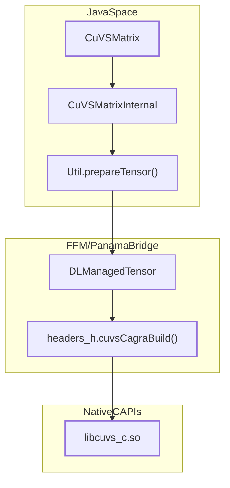
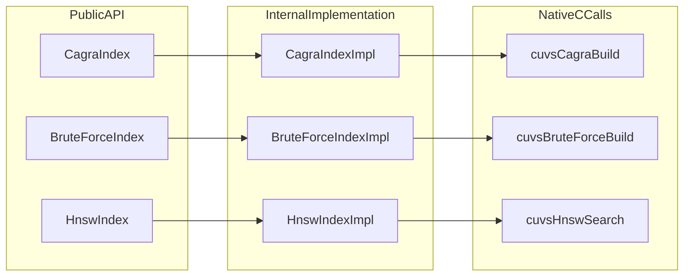

<!-- source: DeepWiki mcp.deepwiki.com · repo NVIDIA/cuvs · page 5.2 Java Bindings (FFM/Panama) · fetched 2026-10-26 -->

# Java Bindings (FFM/Panama)

Relevant source files

The following files were used as context for generating this wiki page:

- [cpp/src/neighbors/cagra.cpp](cpp/src/neighbors/cagra.cpp)
- [java/.gitignore](java/.gitignore)
- [java/README.md](java/README.md)
- [java/benchmarks/README.md](java/benchmarks/README.md)
- [java/benchmarks/src/main/java/com/nvidia/cuvs/CagraIndexBenchmarks.java](java/benchmarks/src/main/java/com/nvidia/cuvs/CagraIndexBenchmarks.java)
- [java/benchmarks/src/main/java/com/nvidia/cuvs/CuVSDeviceMatrixBenchmarks.java](java/benchmarks/src/main/java/com/nvidia/cuvs/CuVSDeviceMatrixBenchmarks.java)
- [java/benchmarks/src/main/java/com/nvidia/cuvs/Utils.java](java/benchmarks/src/main/java/com/nvidia/cuvs/Utils.java)
- [java/cuvs-java/.mvn/maven.config](java/cuvs-java/.mvn/maven.config)
- [java/cuvs-java/src/main/java/com/nvidia/cuvs/BruteForceQuery.java](java/cuvs-java/src/main/java/com/nvidia/cuvs/BruteForceQuery.java)
- [java/cuvs-java/src/main/java/com/nvidia/cuvs/CagraIndex.java](java/cuvs-java/src/main/java/com/nvidia/cuvs/CagraIndex.java)
- [java/cuvs-java/src/main/java/com/nvidia/cuvs/CagraIndexParams.java](java/cuvs-java/src/main/java/com/nvidia/cuvs/CagraIndexParams.java)
- [java/cuvs-java/src/main/java/com/nvidia/cuvs/CagraQuery.java](java/cuvs-java/src/main/java/com/nvidia/cuvs/CagraQuery.java)
- [java/cuvs-java/src/main/java/com/nvidia/cuvs/CuVSDeviceMatrix.java](java/cuvs-java/src/main/java/com/nvidia/cuvs/CuVSDeviceMatrix.java)
- [java/cuvs-java/src/main/java/com/nvidia/cuvs/CuVSHostMatrix.java](java/cuvs-java/src/main/java/com/nvidia/cuvs/CuVSHostMatrix.java)
- [java/cuvs-java/src/main/java/com/nvidia/cuvs/CuVSMatrix.java](java/cuvs-java/src/main/java/com/nvidia/cuvs/CuVSMatrix.java)
- [java/cuvs-java/src/main/java/com/nvidia/cuvs/CuVSResources.java](java/cuvs-java/src/main/java/com/nvidia/cuvs/CuVSResources.java)
- [java/cuvs-java/src/main/java/com/nvidia/cuvs/DelegatingScopedAccess.java](java/cuvs-java/src/main/java/com/nvidia/cuvs/DelegatingScopedAccess.java)
- [java/cuvs-java/src/main/java/com/nvidia/cuvs/HnswQuery.java](java/cuvs-java/src/main/java/com/nvidia/cuvs/HnswQuery.java)
- [java/cuvs-java/src/main/java/com/nvidia/cuvs/SearchResults.java](java/cuvs-java/src/main/java/com/nvidia/cuvs/SearchResults.java)
- [java/cuvs-java/src/main/java/com/nvidia/cuvs/SynchronizedCuVSResources.java](java/cuvs-java/src/main/java/com/nvidia/cuvs/SynchronizedCuVSResources.java)
- [java/cuvs-java/src/main/java/com/nvidia/cuvs/TieredIndex.java](java/cuvs-java/src/main/java/com/nvidia/cuvs/TieredIndex.java)
- [java/cuvs-java/src/main/java/com/nvidia/cuvs/TieredIndexQuery.java](java/cuvs-java/src/main/java/com/nvidia/cuvs/TieredIndexQuery.java)
- [java/cuvs-java/src/main/java/com/nvidia/cuvs/spi/CuVSProvider.java](java/cuvs-java/src/main/java/com/nvidia/cuvs/spi/CuVSProvider.java)
- [java/cuvs-java/src/main/java/com/nvidia/cuvs/spi/CuVSServiceProvider.java](java/cuvs-java/src/main/java/com/nvidia/cuvs/spi/CuVSServiceProvider.java)
- [java/cuvs-java/src/main/java/com/nvidia/cuvs/spi/ProviderInitializationException.java](java/cuvs-java/src/main/java/com/nvidia/cuvs/spi/ProviderInitializationException.java)
- [java/cuvs-java/src/main/java/com/nvidia/cuvs/spi/UnsupportedProvider.java](java/cuvs-java/src/main/java/com/nvidia/cuvs/spi/UnsupportedProvider.java)
- [java/cuvs-java/src/main/java22/com/nvidia/cuvs/internal/BruteForceIndexImpl.java](java/cuvs-java/src/main/java22/com/nvidia/cuvs/internal/BruteForceIndexImpl.java)
- [java/cuvs-java/src/main/java22/com/nvidia/cuvs/internal/BruteForceSearchResults.java](java/cuvs-java/src/main/java22/com/nvidia/cuvs/internal/BruteForceSearchResults.java)
- [java/cuvs-java/src/main/java22/com/nvidia/cuvs/internal/CagraIndexImpl.java](java/cuvs-java/src/main/java22/com/nvidia/cuvs/internal/CagraIndexImpl.java)
- [java/cuvs-java/src/main/java22/com/nvidia/cuvs/internal/CagraSearchResults.java](java/cuvs-java/src/main/java22/com/nvidia/cuvs/internal/CagraSearchResults.java)
- [java/cuvs-java/src/main/java22/com/nvidia/cuvs/internal/CuVSDeviceMatrixImpl.java](java/cuvs-java/src/main/java22/com/nvidia/cuvs/internal/CuVSDeviceMatrixImpl.java)
- [java/cuvs-java/src/main/java22/com/nvidia/cuvs/internal/CuVSHostMatrixImpl.java](java/cuvs-java/src/main/java22/com/nvidia/cuvs/internal/CuVSHostMatrixImpl.java)
- [java/cuvs-java/src/main/java22/com/nvidia/cuvs/internal/CuVSMatrixBaseImpl.java](java/cuvs-java/src/main/java22/com/nvidia/cuvs/internal/CuVSMatrixBaseImpl.java)
- [java/cuvs-java/src/main/java22/com/nvidia/cuvs/internal/CuVSMatrixInternal.java](java/cuvs-java/src/main/java22/com/nvidia/cuvs/internal/CuVSMatrixInternal.java)
- [java/cuvs-java/src/main/java22/com/nvidia/cuvs/internal/CuVSParamsHelper.java](java/cuvs-java/src/main/java22/com/nvidia/cuvs/internal/CuVSParamsHelper.java)
- [java/cuvs-java/src/main/java22/com/nvidia/cuvs/internal/CuVSResourcesImpl.java](java/cuvs-java/src/main/java22/com/nvidia/cuvs/internal/CuVSResourcesImpl.java)
- [java/cuvs-java/src/main/java22/com/nvidia/cuvs/internal/GPUInfoProviderImpl.java](java/cuvs-java/src/main/java22/com/nvidia/cuvs/internal/GPUInfoProviderImpl.java)
- [java/cuvs-java/src/main/java22/com/nvidia/cuvs/internal/HnswSearchResults.java](java/cuvs-java/src/main/java22/com/nvidia/cuvs/internal/HnswSearchResults.java)
- [java/cuvs-java/src/main/java22/com/nvidia/cuvs/internal/ScopedAccessWithHostBuffer.java](java/cuvs-java/src/main/java22/com/nvidia/cuvs/internal/ScopedAccessWithHostBuffer.java)
- [java/cuvs-java/src/main/java22/com/nvidia/cuvs/internal/TieredIndexImpl.java](java/cuvs-java/src/main/java22/com/nvidia/cuvs/internal/TieredIndexImpl.java)
- [java/cuvs-java/src/main/java22/com/nvidia/cuvs/internal/common/CloseableHandle.java](java/cuvs-java/src/main/java22/com/nvidia/cuvs/internal/common/CloseableHandle.java)
- [java/cuvs-java/src/main/java22/com/nvidia/cuvs/internal/common/CompositeCloseableHandle.java](java/cuvs-java/src/main/java22/com/nvidia/cuvs/internal/common/CompositeCloseableHandle.java)
- [java/cuvs-java/src/main/java22/com/nvidia/cuvs/internal/common/NativeLibraryUtils.java](java/cuvs-java/src/main/java22/com/nvidia/cuvs/internal/common/NativeLibraryUtils.java)
- [java/cuvs-java/src/main/java22/com/nvidia/cuvs/internal/common/PinnedMemoryBuffer.java](java/cuvs-java/src/main/java22/com/nvidia/cuvs/internal/common/PinnedMemoryBuffer.java)
- [java/cuvs-java/src/main/java22/com/nvidia/cuvs/internal/common/Util.java](java/cuvs-java/src/main/java22/com/nvidia/cuvs/internal/common/Util.java)
- [java/cuvs-java/src/main/java22/com/nvidia/cuvs/spi/JDKProvider.java](java/cuvs-java/src/main/java22/com/nvidia/cuvs/spi/JDKProvider.java)
- [java/cuvs-java/src/main/java22/com/nvidia/cuvs/spi/NativeDependencyLoader.java](java/cuvs-java/src/main/java22/com/nvidia/cuvs/spi/NativeDependencyLoader.java)
- [java/cuvs-java/src/test/java/com/nvidia/cuvs/BruteForceAndSearchIT.java](java/cuvs-java/src/test/java/com/nvidia/cuvs/BruteForceAndSearchIT.java)
- [java/cuvs-java/src/test/java/com/nvidia/cuvs/BruteForceRandomizedIT.java](java/cuvs-java/src/test/java/com/nvidia/cuvs/BruteForceRandomizedIT.java)
- [java/cuvs-java/src/test/java/com/nvidia/cuvs/CagraBuildAndSearchIT.java](java/cuvs-java/src/test/java/com/nvidia/cuvs/CagraBuildAndSearchIT.java)
- [java/cuvs-java/src/test/java/com/nvidia/cuvs/CagraMultiThreadStabilityIT.java](java/cuvs-java/src/test/java/com/nvidia/cuvs/CagraMultiThreadStabilityIT.java)
- [java/cuvs-java/src/test/java/com/nvidia/cuvs/CagraRandomizedIT.java](java/cuvs-java/src/test/java/com/nvidia/cuvs/CagraRandomizedIT.java)
- [java/cuvs-java/src/test/java/com/nvidia/cuvs/CheckedCuVSResources.java](java/cuvs-java/src/test/java/com/nvidia/cuvs/CheckedCuVSResources.java)
- [java/cuvs-java/src/test/java/com/nvidia/cuvs/CuVSMatrixIT.java](java/cuvs-java/src/test/java/com/nvidia/cuvs/CuVSMatrixIT.java)
- [java/cuvs-java/src/test/java/com/nvidia/cuvs/CuVSResourcesIT.java](java/cuvs-java/src/test/java/com/nvidia/cuvs/CuVSResourcesIT.java)
- [java/cuvs-java/src/test/java/com/nvidia/cuvs/CuVSTestCase.java](java/cuvs-java/src/test/java/com/nvidia/cuvs/CuVSTestCase.java)
- [java/cuvs-java/src/test/java/com/nvidia/cuvs/FilterBitsetHandleIT.java](java/cuvs-java/src/test/java/com/nvidia/cuvs/FilterBitsetHandleIT.java)
- [java/cuvs-java/src/test/java/com/nvidia/cuvs/HnswRandomizedIT.java](java/cuvs-java/src/test/java/com/nvidia/cuvs/HnswRandomizedIT.java)
- [java/cuvs-java/src/test/java/com/nvidia/cuvs/MultiPartitionCagraSearchIT.java](java/cuvs-java/src/test/java/com/nvidia/cuvs/MultiPartitionCagraSearchIT.java)
- [java/cuvs-java/src/test/java/com/nvidia/cuvs/TieredIndexIT.java](java/cuvs-java/src/test/java/com/nvidia/cuvs/TieredIndexIT.java)
- [java/cuvs-lucene/src/main/java/com/nvidia/cuvs/lucene/FilterCuVSProvider.java](java/cuvs-lucene/src/main/java/com/nvidia/cuvs/lucene/FilterCuVSProvider.java)

The cuVS Java library provides a high-performance interface for GPU-accelerated vector search and clustering. It leverages the Java **Foreign Function & Memory (FFM) API** (Project Panama) to provide low-overhead native interop with the cuVS C API, replacing the traditional JNI approach [java/cuvs-java/pom.xml:48-49]().

## Architecture and Native Interop

The Java bindings are built on the FFM API introduced in JDK 22 [java/cuvs-java/pom.xml:48-49](). The library uses `jextract` to generate low-level Panama bindings from cuVS C headers [java/README.md:12-13]().

### Data Flow and Memory Management
The system uses `java.lang.foreign.MemorySegment` to manage memory across the JVM-Native boundary. 
*   **DLPack Protocol**: cuVS communicates with the native layer using the DLPack protocol. Java matrices are prepared as `DLManagedTensor` structures before being passed to native functions [java/cuvs-java/src/main/java22/com/nvidia/cuvs/internal/common/Util.java:15-18]().
*   **Memory Tiers**: The library supports three memory locations for datasets: `HEAP` (standard Java arrays), `NATIVE` (off-heap memory via `MemorySegment`), and `DEVICE` (GPU memory via RMM) [java/cuvs-java/src/test/java/com/nvidia/cuvs/CagraRandomizedIT.java:32-36]().

### Natural Language to Code Entity Space: Native Interop
This diagram maps the high-level concept of "Native Interop" to the specific classes and functions in the Java codebase.

Title: "Java Native Interop Data Flow"

Sources: [java/cuvs-java/src/main/java22/com/nvidia/cuvs/internal/common/Util.java:15-18](), [java/cuvs-java/src/main/java22/com/nvidia/cuvs/internal/CagraIndexImpl.java:180-181](), [java/cuvs-java/src/main/java/com/nvidia/cuvs/CuVSMatrix.java:15-20]()

## Core Components

### CuVSResources Lifecycle
`CuVSResources` manages the GPU state, including the CUDA stream and RMM (RAPIDS Memory Manager) memory resources. It must be created before any index operations and closed to prevent memory leaks [java/cuvs-java/src/main/java22/com/nvidia/cuvs/internal/CuVSResourcesImpl.java:25-30]().

*   **Pooled Memory**: Users can enable RMM pooled memory to improve performance in multi-threaded environments by calling `enableRMMPooledMemory` on the provider [java/cuvs-java/src/main/java/com/nvidia/cuvs/spi/CuVSProvider.java:110-111]().
*   **Thread Safety**: While resources can be shared, `SynchronizedCuVSResources` provides a wrapper for thread-safe access [java/cuvs-java/src/main/java/com/nvidia/cuvs/SynchronizedCuVSResources.java:10-15]().

### Matrix Implementations
| Class | Role | Storage |
| :--- | :--- | :--- |
| `CuVSHostMatrixImpl` | Host-side data | Off-heap `MemorySegment` |
| `CuVSDeviceMatrixImpl` | GPU-side data | RMM-allocated Device Memory |
| `CuVSMatrix.ofArray()` | Utility | Wraps Java `float[][]` or `byte[][]` |

Sources: [java/cuvs-java/src/main/java22/com/nvidia/cuvs/internal/CuVSHostMatrixImpl.java:10-15](), [java/cuvs-java/src/main/java22/com/nvidia/cuvs/internal/CuVSDeviceMatrixImpl.java:10-15](), [java/cuvs-java/src/main/java/com/nvidia/cuvs/CuVSMatrix.java:95-102]()

## Supported Algorithms

### CAGRA (Graph-Based)
`CagraIndexImpl` implements the CAGRA algorithm. It supports building from a dataset or loading from a pre-computed graph [java/cuvs-java/src/main/java22/com/nvidia/cuvs/internal/CagraIndexImpl.java:63-118]().
*   **Multi-threading**: Index building can be parallelized using OpenMP via `omp_set_num_threads` [java/cuvs-java/src/main/java22/com/nvidia/cuvs/internal/CagraIndexImpl.java:157-158]().
*   **Merge Strategy**: Multiple CAGRA indices can be merged into a single index using `mergeCagraIndexes` [java/cuvs-java/src/main/java/com/nvidia/cuvs/spi/CuVSProvider.java:143-149]().

### Brute Force
`BruteForceIndexImpl` provides exact KNN search. It copies the dataset to the GPU and uses the `cuvsBruteForceBuild` and `cuvsBruteForceSearch` C functions [java/cuvs-java/src/main/java22/com/nvidia/cuvs/internal/BruteForceIndexImpl.java:143-170]().

### HNSW and Tiered Index
*   **HNSW**: Implemented via `HnswIndexImpl`. Supports building via the ACE (Augmented Core Extraction) algorithm or converting an existing CAGRA index to HNSW for CPU-friendly searching [java/cuvs-java/src/main/java/com/nvidia/cuvs/spi/CuVSProvider.java:124-136]().
*   **Tiered Index**: A hybrid index managed by `TieredIndexImpl` [java/cuvs-java/src/main/java22/com/nvidia/cuvs/internal/TieredIndexImpl.java:10-20]().

### Natural Language to Code Entity Space: Index Implementation
This diagram bridges algorithm names to their internal Java implementation classes and native C API calls.

Title: "Algorithm Implementation Mapping"

Sources: [java/cuvs-java/src/main/java22/com/nvidia/cuvs/internal/CagraIndexImpl.java:180-181](), [java/cuvs-java/src/main/java22/com/nvidia/cuvs/internal/BruteForceIndexImpl.java:143-144](), [java/cuvs-java/src/main/java22/com/nvidia/cuvs/internal/HnswIndexImpl.java:132-139]()

## Serialization and I/O
The Java bindings implement index serialization by streaming bytes between the JVM and native memory.
*   **Temporary Files**: Because native cuVS serialization often expects file paths or file descriptors, the Java layer uses temporary files as buffers when deserializing from an `InputStream` [java/cuvs-java/src/main/java22/com/nvidia/cuvs/internal/CagraIndexImpl.java:235-245]().
*   **Process**:
    1.  Java `InputStream` writes to a `Files.createTempFile`.
    2.  Native `cuvsCagraDeserialize` is called with the temp file path.
    3.  Temporary file is deleted after the index is loaded into GPU memory [java/cuvs-java/src/test/java/com/nvidia/cuvs/CagraBuildAndSearchIT.java:141-150]().

## Build and Maven System

The project uses a standard Maven build system with specific configurations for the Panama API:
*   **Multi-Release JAR**: The `maven-compiler-plugin` is configured to handle Java 22 specific code (Panama) in `src/main/java22` while keeping base compatibility [java/cuvs-java/pom.xml:161-176]().
*   **Native Dependencies**: The build requires `libcuvs_c.so`. The `NativeDependencyLoader` handles finding and loading the shared library and its dependencies like `cudart` [java/cuvs-java/src/main/java/com/nvidia/cuvs/spi/NativeDependencyLoader.java:10-20]().
*   **Testing**: Tests use the `RandomizedRunner` and include integration tests (`IT`) that verify the full flow from indexing to search [java/cuvs-java/src/test/java/com/nvidia/cuvs/CagraBuildAndSearchIT.java:43-44]().

Sources: [java/cuvs-java/pom.xml:1-50](), [java/README.md:15-30](), [java/cuvs-java/src/main/java/com/nvidia/cuvs/spi/JDKProvider.java:146-150]()

---

## Child Pages & Integrations

For details on GPU-accelerated vector search integrations with Apache Lucene, see [cuvs-lucene: GPU-Accelerated Lucene Codecs](#5.2.1).

---

