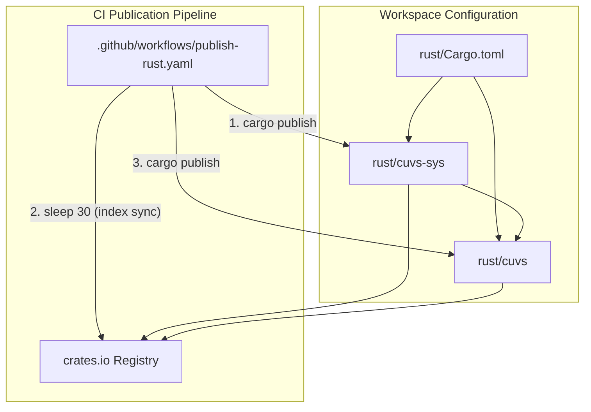
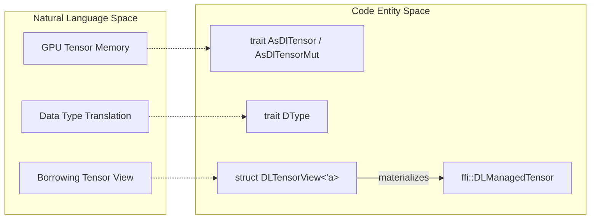

<!-- source: DeepWiki mcp.deepwiki.com · repo NVIDIA/cuvs · page 5.3 Rust Bindings · fetched 2026-10-26 -->

# Rust Bindings

Relevant source files

The following files were used as context for generating this wiki page:

- [.github/workflows/check-c-abi.yaml](.github/workflows/check-c-abi.yaml)
- [.github/workflows/publish-rust.yaml](.github/workflows/publish-rust.yaml)
- [.github/workflows/store-c-abi-baseline.yaml](.github/workflows/store-c-abi-baseline.yaml)
- [.github/workflows/update-c-abi-baseline.yaml](.github/workflows/update-c-abi-baseline.yaml)
- [.github/zizmor.yml](.github/zizmor.yml)
- [VERSION](VERSION)
- [c/include/cuvs/cluster/kmeans.h](c/include/cuvs/cluster/kmeans.h)
- [c/include/cuvs/cluster/mg_kmeans.h](c/include/cuvs/cluster/mg_kmeans.h)
- [c/src/cluster/kmeans.cpp](c/src/cluster/kmeans.cpp)
- [c/src/cluster/mg_kmeans.cpp](c/src/cluster/mg_kmeans.cpp)
- [c/tests/cluster/kmeans_c.cu](c/tests/cluster/kmeans_c.cu)
- [c/tests/cluster/kmeans_mg_c.cu](c/tests/cluster/kmeans_mg_c.cu)
- [fern/pages/c_api/c-api-cluster-kmeans.md](fern/pages/c_api/c-api-cluster-kmeans.md)
- [fern/pages/c_api/c-api-cluster-mg-kmeans.md](fern/pages/c_api/c-api-cluster-mg-kmeans.md)
- [fern/pages/python_api/python-api-cluster-kmeans.md](fern/pages/python_api/python-api-cluster-kmeans.md)
- [python/cuvs/cuvs/cluster/kmeans/kmeans.pxd](python/cuvs/cuvs/cluster/kmeans/kmeans.pxd)
- [python/cuvs/cuvs/cluster/kmeans/kmeans.pyx](python/cuvs/cuvs/cluster/kmeans/kmeans.pyx)
- [python/cuvs/cuvs/cluster/mg/kmeans/kmeans.pxd](python/cuvs/cuvs/cluster/mg/kmeans/kmeans.pxd)
- [python/cuvs/cuvs/cluster/mg/kmeans/kmeans.pyx](python/cuvs/cuvs/cluster/mg/kmeans/kmeans.pyx)
- [rust/Cargo.toml](rust/Cargo.toml)
- [rust/cuvs-sys/build.rs](rust/cuvs-sys/build.rs)
- [rust/cuvs-sys/cuvs_c_wrapper.h](rust/cuvs-sys/cuvs_c_wrapper.h)
- [rust/cuvs-sys/src/bindings.rs](rust/cuvs-sys/src/bindings.rs)
- [rust/cuvs/Cargo.toml](rust/cuvs/Cargo.toml)
- [rust/cuvs/examples/cagra.rs](rust/cuvs/examples/cagra.rs)
- [rust/cuvs/src/cluster/kmeans/mod.rs](rust/cuvs/src/cluster/kmeans/mod.rs)
- [rust/cuvs/src/cluster/kmeans/params.rs](rust/cuvs/src/cluster/kmeans/params.rs)
- [rust/cuvs/src/cluster/mod.rs](rust/cuvs/src/cluster/mod.rs)
- [rust/cuvs/src/distance/mod.rs](rust/cuvs/src/distance/mod.rs)
- [rust/cuvs/src/dlpack.rs](rust/cuvs/src/dlpack.rs)
- [rust/cuvs/src/error.rs](rust/cuvs/src/error.rs)
- [rust/cuvs/src/lib.rs](rust/cuvs/src/lib.rs)
- [rust/cuvs/src/resources.rs](rust/cuvs/src/resources.rs)
- [rust/cuvs/src/version.rs](rust/cuvs/src/version.rs)
- [rust/cuvs/tests/version.rs](rust/cuvs/tests/version.rs)

## Purpose and Scope
The cuVS Rust bindings provide a safe, idiomatic, and high-performance Rust interface to NVIDIA cuVS, enabling GPU-accelerated vector search and clustering directly from Rust applications [rust/cuvs/src/lib.rs:6-9](). The codebase is structured as a Cargo workspace housing two primary crates: `cuvs-sys` for low-level FFI bindings and `cuvs` for high-level safety-wrapped APIs [rust/Cargo.toml:4-9](), [rust/cuvs/src/lib.rs:6-27]().

---

## Crate Structure and Cargo Workspace

The workspace manages dependencies and package configuration centrally. The `rust/Cargo.toml` file defines the workspace members (`cuvs` and `cuvs-sys`) and shared workspace settings such as the library version (`26.12.0`), edition (`2024`), repository URLs, and licenses [rust/Cargo.toml:4-18]().

1.  **`cuvs-sys`**: A low-level binding crate containing raw FFI declarations and type definitions generated via `bindgen` [rust/cuvs-sys/src/bindings.rs:1-111]().
2.  **`cuvs`**: The high-level user crate depending on `cuvs-sys`, `bon`, `thiserror`, and `tinyvec`, which exposes structured builders, RAII resource wrappers, and DLPack protocol integrations [rust/cuvs/Cargo.toml:15-20]().

**Cargo Workspace and Publishing Data Flow**

**Sources:** [rust/Cargo.toml:4-9](), [rust/cuvs/Cargo.toml:15-20](), [.github/workflows/publish-rust.yaml:35-63]()

---

## Bindgen-Based Sys Crate Build

The `cuvs-sys` crate uses a custom build script (`build.rs`) to discover native C libraries and automatically generate Rust foreign function interfaces [rust/cuvs-sys/build.rs:6-67]().

### Build Process Workflow
1.  **Library Locating**: `cmake::locate_cuvs()` scans environment variables like `CMAKE_PREFIX_PATH`, `CONDA_PREFIX`, or default paths to locate the compiled native `libcuvs` and `libcuvs_c` libraries [rust/cuvs-sys/build.rs:41-59]().
2.  **Cargo Metadata Output**: The script exposes build locations to downstream crates by printing `cargo::metadata=include=...` and `cargo::metadata=lib=...` [rust/cuvs-sys/build.rs:61-64]().
3.  **Bindings Generation**: When the `generate-bindings` feature is active, `bindgen::Builder` parses `cuvs_c_wrapper.h` using clang arguments pointing to the located include directories and stub headers [rust/cuvs-sys/build.rs:12-33](). It applies allowlists for functions matching `cuvs.*` and types matching `(cuvs|DL).*`, producing `cuvs_bindings.rs` in `OUT_DIR` [rust/cuvs-sys/build.rs:16-38]().

Sources: [rust/cuvs-sys/build.rs:11-68]()

---

## Managed Tensors and DLPack Interop

To avoid unnecessary data copying between host and device memory, cuVS implements the **DLPack** tensor specification. The `cuvs::dlpack` module bridges Rust structures with the C-ABI `DLManagedTensor` type [rust/cuvs/src/lib.rs:15]().

### Natural Language to Code Entity Space: DLPack Interop

**Sources:** [rust/cuvs/src/lib.rs:25](), [rust/cuvs-sys/src/bindings.rs:87-104]()

---

## High-Level Index APIs

The `cuvs::neighbors` module exposes robust, high-level abstractions for Approximate Nearest Neighbor (ANN) search algorithms [rust/cuvs/src/lib.rs:18]().

| Algorithm Family | Module Path | Core Structs | Description |
| :--- | :--- | :--- | :--- |
| **CAGRA** | `cuvs::neighbors::cagra` | `Index`, `IndexParams`, `SearchParams` | High-throughput GPU graph-based indexing [rust/cuvs/src/lib.rs:18]() |
| **IVF-PQ** | `cuvs::neighbors::ivf_pq` | `Index`, `IndexParams`, `SearchParams` | Inverted File with Product Quantization compression [rust/cuvs/src/lib.rs:18]() |
| **IVF-Flat** | `cuvs::neighbors::ivf_flat` | `Index`, `IndexParams`, `SearchParams` | Inverted File storing exact unquantized vectors [rust/cuvs/src/lib.rs:18]() |
| **Brute Force** | `cuvs::neighbors::brute_force` | `Index`, `SearchParams` | Exact pairwise distance matrix calculation [rust/cuvs/src/lib.rs:18]() |
| **Vamana** | `cuvs::neighbors::vamana` | `Index`, `IndexParams`, `SearchParams` | DiskANN-compatible graph index structure [rust/cuvs/src/lib.rs:18]() |

Sources: [rust/cuvs/src/lib.rs:18]()

---

## K-Means Clustering and Distance APIs

The Rust bindings expose clustering algorithms and distance metric primitives through dedicated submodules [rust/cuvs/src/lib.rs:12-14]().

### K-Means Clustering
The `cuvs::cluster::kmeans` module wraps the C-API k-means implementation defined in `cuvs/cluster/kmeans.h` [c/include/cuvs/cluster/kmeans.h:8-12](). It configures hyperparameters via `cuvsKMeansParams` [c/include/cuvs/cluster/kmeans.h:45-118]() and executes training over DLPack tensors via `cuvsKMeansFit` [c/include/cuvs/cluster/kmeans.h:182-188]() and `cuvsKMeansPredict` [c/include/cuvs/cluster/kmeans.h:209-216]().

### Distance Metrics
The `cuvs::distance` module provides functions to calculate pairwise metrics (such as L2, Inner Product, Cosine) across host or device tensors [rust/cuvs/src/lib.rs:14]().

Sources: [rust/cuvs/src/lib.rs:12-14](), [c/include/cuvs/cluster/kmeans.h:45-216]()

---

## Resources, Error Handling, and Publishing

### Resources and Error Handling
*   **`Resources`**: Manages the CUDA stream, handle lifecycle, and internal workspace allocations, wrapping `cuvsResources_t` [rust/cuvs/src/lib.rs:19](), [rust/cuvs-sys/src/bindings.rs:135]().
*   **`LibraryError`**: Translates native `cuvsError_t` return codes into standard Rust `Result` enums via `error::check_cuvs`, querying `cuvsGetLastErrorText()` upon failures [rust/cuvs/src/lib.rs:16](), [rust/cuvs-sys/src/bindings.rs:108-114]().

### Publishing Workflow
During release pipelines defined in `.github/workflows/publish-rust.yaml`, the `cuvs-sys` crate is published to crates.io first, followed by a 30-second sleep interval to allow index propagation, after which the main `cuvs` crate is published [.github/workflows/publish-rust.yaml:52-63]().

Sources: [rust/cuvs/src/lib.rs:16-19](), [rust/cuvs-sys/src/bindings.rs:108-135](), [.github/workflows/publish-rust.yaml:52-63]()

---

