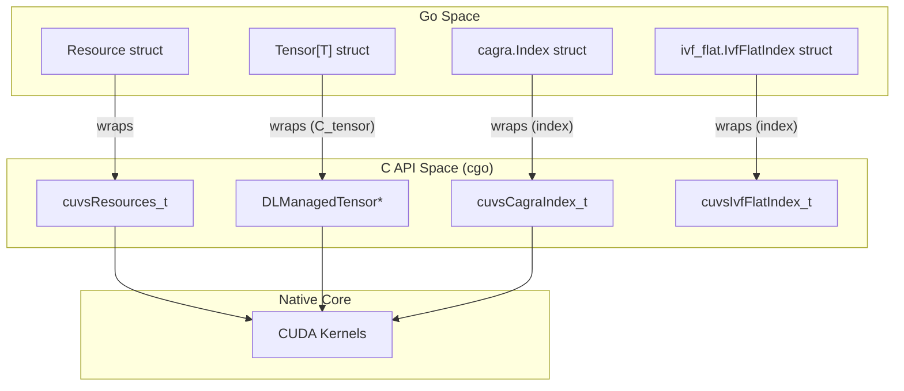
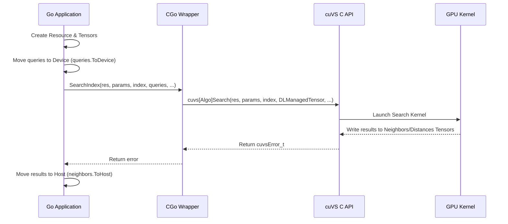

<!-- source: DeepWiki mcp.deepwiki.com · repo NVIDIA/cuvs · page 5.4 Go Bindings · fetched 2026-10-26 -->

# Go Bindings

<details>
<summary>Relevant source files</summary>

The following files were used as context for generating this wiki page:

- [.github/workflows/build.yaml](.github/workflows/build.yaml)
- [.github/workflows/pr.yaml](.github/workflows/pr.yaml)
- [.github/workflows/test.yaml](.github/workflows/test.yaml)
- [.github/workflows/trigger-breaking-change-alert.yaml](.github/workflows/trigger-breaking-change-alert.yaml)
- [RAPIDS_BRANCH](RAPIDS_BRANCH)
- [README.md](README.md)
- [examples/go/README.md](examples/go/README.md)
- [go/brute_force/brute_force.go](go/brute_force/brute_force.go)
- [go/brute_force/brute_force_test.go](go/brute_force/brute_force_test.go)
- [go/cagra/cagra.go](go/cagra/cagra.go)
- [go/cagra/cagra_test.go](go/cagra/cagra_test.go)
- [go/cagra/extend_params.go](go/cagra/extend_params.go)
- [go/cagra/extend_params_test.go](go/cagra/extend_params_test.go)
- [go/cagra/index_params.go](go/cagra/index_params.go)
- [go/cagra/index_params_test.go](go/cagra/index_params_test.go)
- [go/cagra/search_params.go](go/cagra/search_params.go)
- [go/distance_test.go](go/distance_test.go)
- [go/dlpack_test.go](go/dlpack_test.go)
- [go/go.mod](go/go.mod)
- [go/ivf_flat/index_params.go](go/ivf_flat/index_params.go)
- [go/ivf_flat/ivf_flat.go](go/ivf_flat/ivf_flat.go)
- [go/ivf_flat/ivf_flat_test.go](go/ivf_flat/ivf_flat_test.go)
- [python/cuvs/cuvs/tests/ann_utils.py](python/cuvs/cuvs/tests/ann_utils.py)
- [python/cuvs_bench/cuvs_bench/plot/__main__.py](python/cuvs_bench/cuvs_bench/plot/__main__.py)

</details>


The cuVS Go bindings provide a high-performance interface for GPU-accelerated vector search within the Go ecosystem. These bindings wrap the cuVS C API using CGo, allowing Go applications to leverage optimized CUDA kernels for Approximate Nearest Neighbor (ANN) search and brute-force KNN.

## Package Structure

The Go bindings are organized into several sub-packages, each corresponding to a specific algorithm or core utility. This modular structure allows users to import only the necessary components.

| Package | Description |
| :--- | :--- |
| `github.com/nvidia/cuvs/go` | Core package containing `Resource`, `Tensor`, and `Distance` types. |
| `github.com/nvidia/cuvs/go/cagra` | Graph-based ANN search (CUDA Accelerated Graph-based RetrievAl). |
| `github.com/nvidia/cuvs/go/ivf_flat` | Inverted File (IVF) with flat vector storage. |
| `github.com/nvidia/cuvs/go/ivf_pq` | Inverted File with Product Quantization. |
| `github.com/nvidia/cuvs/go/brute_force` | Exact nearest neighbor search using brute force. |

**Sources:** [examples/go/README.md:35-41](), [go/cagra/cagra.go:1-10](), [go/ivf_flat/ivf_flat.go:1-11](), [go/brute_force/brute_force.go:1-11]()

## Core Types and Data Flow

The integration relies on two primary abstractions to manage GPU state and data movement: `Resource` and `Tensor`.

### Resource Management
The `Resource` type wraps `cuvsResources_t`. It manages the CUDA stream, handle, and temporary workspace required for GPU operations. It must be initialized before any cuVS operation and closed to release native resources.

### Tensor and DLPack
Data exchange between Go and the CUDA kernels is handled via the `Tensor` type. This type encapsulates a `DLManagedTensor` (from the DLPack protocol), enabling zero-copy data sharing between the host and device where possible.

### Go to C API Mapping
The following diagram illustrates how Go entities interact with the underlying C API and CUDA hardware.

**Entity Mapping: Go Bindings to C API**

**Sources:** [go/ivf_flat/ivf_flat.go:14-17](), [go/brute_force/brute_force.go:14-17](), [go/cagra/cagra.go:13-16](), [go/ivf_flat/ivf_flat.go:39-39]()

## Implementation Details

### Index Lifecycle
Every index implementation (CAGRA, IVF, Brute Force) follows a consistent lifecycle:
1.  **Creation**: `CreateIndex` initializes the opaque C handle.
2.  **Configuration**: Parameter structs (e.g., `IndexParams`) are used to set algorithm-specific hyperparameters.
3.  **Building**: `BuildIndex` processes a dataset `Tensor` and populates the index on the GPU.
4.  **Searching**: `SearchIndex` performs queries against the built index.
5.  **Destruction**: `Close()` must be called to free GPU memory allocated for the index.

### IVF-Flat Example
In `ivf_flat.go`, the `BuildIndex` function demonstrates the transition from Go types to CGo calls:
[go/ivf_flat/ivf_flat.go:38-45]()
```go
func BuildIndex[T any](Resources cuvs.Resource, params *IndexParams, dataset *cuvs.Tensor[T], index *IvfFlatIndex) error {
	err := cuvs.CheckCuvs(cuvs.CuvsError(C.cuvsIvfFlatBuild(C.ulong(Resources.Resource), params.params, (*C.DLManagedTensor)(unsafe.Pointer(dataset.C_tensor)), index.index)))
    // ...
}
```

### Brute Force Example
The `brute_force` package provides exact search and supports various distance metrics via the `cuvs.Distance` enum.
[go/brute_force/brute_force.go:48-62]()
```go
func BuildIndex[T any](Resources cuvs.Resource, Dataset *cuvs.Tensor[T], metric cuvs.Distance, metric_arg float32, index *BruteForceIndex) error {
	CMetric, exists := cuvs.CDistances[metric]
    // ...
	err := cuvs.CheckCuvs(cuvs.CuvsError(C.cuvsBruteForceBuild(C.cuvsResources_t(Resources.Resource), (*C.DLManagedTensor)(unsafe.Pointer(Dataset.C_tensor)), C.cuvsDistanceType(CMetric), C.float(metric_arg), index.index)))
    // ...
}
```

**Sources:** [go/ivf_flat/ivf_flat.go:20-76](), [go/brute_force/brute_force.go:20-85](), [go/cagra/cagra.go:18-35]()

## Search and Filtering

cuVS Go bindings support filtered search, allowing users to restrict results based on a bitset. The `SearchIndex` functions accept a `cuvsFilter` object. By default, `NO_FILTER` is used if no filter is provided.

**Data Flow: Search Execution**

**Sources:** [go/ivf_flat/ivf_flat.go:66-76](), [go/ivf_flat/ivf_flat_test.go:131-142](), [go/cagra/cagra_test.go:115-125]()

## Usage Example: CAGRA Search

The following logic summarizes the typical workflow for performing a graph-based search using the CAGRA package.

1.  **Initialize Resources**: Create a `cuvs.Resource` to handle the CUDA context.
2.  **Prepare Data**: Create a `cuvs.Tensor` from a Go slice and move it to the GPU using `ToDevice`.
3.  **Build Index**: Initialize `IndexParams`, create an index, and call `BuildIndex`.
4.  **Execute Search**: Allocate tensors for neighbors (indices) and distances, then call `SearchIndex`.
5.  **Retrieve Results**: Use `ToHost` and `Slice()` to access the results in Go.

**Sources:** [go/cagra/cagra_test.go:36-158](), [examples/go/README.md:17-31]()

## CGo Integration and Environment

To compile Go applications using these bindings, the `CGO_CFLAGS` and `CGO_LDFLAGS` must be configured to point to the cuVS C headers and libraries (`libcuvs` and `libcuvs_c`).

**Required Environment Variables:**
```bash
export CGO_CFLAGS="-I${CONDA_PREFIX}/include"
export CGO_LDFLAGS="-L${CONDA_PREFIX}/lib -lcudart_static -ldl -lrt -lcuvs -lcuvs_c"
export LD_LIBRARY_PATH="$CONDA_PREFIX/lib:$LD_LIBRARY_PATH"
```
**Sources:** [examples/go/README.md:17-23]()

---

