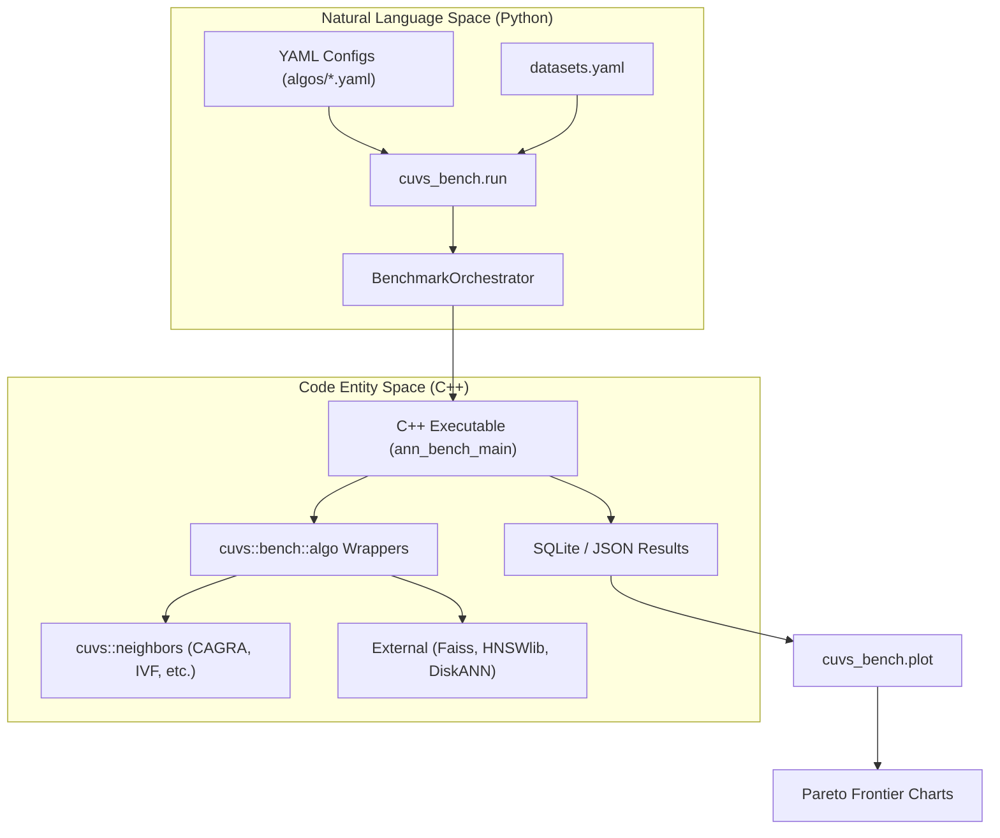

<!-- source: DeepWiki mcp.deepwiki.com · repo NVIDIA/cuvs · page 6 Benchmarking · fetched 2026-10-26 -->

# Benchmarking

Relevant source files

The following files were used as context for generating this wiki page:

- [c/tests/neighbors/ann_mg_c.cu](c/tests/neighbors/ann_mg_c.cu)
- [cpp/bench/ann/CMakeLists.txt](cpp/bench/ann/CMakeLists.txt)
- [cpp/bench/ann/src/cuvs/cuvs_cagra_diskann.cu](cpp/bench/ann/src/cuvs/cuvs_cagra_diskann.cu)
- [cpp/bench/ann/src/cuvs/cuvs_vamana.cu](cpp/bench/ann/src/cuvs/cuvs_vamana.cu)
- [cpp/bench/ann/src/cuvs/cuvs_vamana_wrapper.h](cpp/bench/ann/src/cuvs/cuvs_vamana_wrapper.h)
- [cpp/bench/ann/src/diskann/diskann_benchmark.cpp](cpp/bench/ann/src/diskann/diskann_benchmark.cpp)
- [cpp/bench/ann/src/diskann/diskann_wrapper.h](cpp/bench/ann/src/diskann/diskann_wrapper.h)
- [cpp/bench/ann/src/faiss/faiss_cpu_benchmark.cpp](cpp/bench/ann/src/faiss/faiss_cpu_benchmark.cpp)
- [cpp/bench/ann/src/faiss/faiss_cpu_wrapper.h](cpp/bench/ann/src/faiss/faiss_cpu_wrapper.h)
- [cpp/bench/ann/src/faiss/faiss_gpu_benchmark.cu](cpp/bench/ann/src/faiss/faiss_gpu_benchmark.cu)
- [cpp/bench/ann/src/faiss/faiss_gpu_wrapper.h](cpp/bench/ann/src/faiss/faiss_gpu_wrapper.h)
- [python/cuvs_bench/cuvs_bench/backends/base.py](python/cuvs_bench/cuvs_bench/backends/base.py)
- [python/cuvs_bench/cuvs_bench/backends/cpp_gbench.py](python/cuvs_bench/cuvs_bench/backends/cpp_gbench.py)
- [python/cuvs_bench/cuvs_bench/backends/elasticsearch.py](python/cuvs_bench/cuvs_bench/backends/elasticsearch.py)
- [python/cuvs_bench/cuvs_bench/backends/opensearch.py](python/cuvs_bench/cuvs_bench/backends/opensearch.py)
- [python/cuvs_bench/cuvs_bench/config/algorithms.yaml](python/cuvs_bench/cuvs_bench/config/algorithms.yaml)
- [python/cuvs_bench/cuvs_bench/config/algos/cuvs_cagra_diskann.yaml](python/cuvs_bench/cuvs_bench/config/algos/cuvs_cagra_diskann.yaml)
- [python/cuvs_bench/cuvs_bench/config/algos/cuvs_vamana.yaml](python/cuvs_bench/cuvs_bench/config/algos/cuvs_vamana.yaml)
- [python/cuvs_bench/cuvs_bench/config/algos/diskann_memory.yaml](python/cuvs_bench/cuvs_bench/config/algos/diskann_memory.yaml)
- [python/cuvs_bench/cuvs_bench/config/algos/diskann_ssd.yaml](python/cuvs_bench/cuvs_bench/config/algos/diskann_ssd.yaml)
- [python/cuvs_bench/cuvs_bench/orchestrator/orchestrator.py](python/cuvs_bench/cuvs_bench/orchestrator/orchestrator.py)
- [python/cuvs_bench/cuvs_bench/run/__main__.py](python/cuvs_bench/cuvs_bench/run/__main__.py)
- [python/cuvs_bench/cuvs_bench/run/data_export.py](python/cuvs_bench/cuvs_bench/run/data_export.py)
- [python/cuvs_bench/cuvs_bench/tests/test_cpp_gbench.py](python/cuvs_bench/cuvs_bench/tests/test_cpp_gbench.py)
- [python/cuvs_bench/cuvs_bench/tests/test_data_export.py](python/cuvs_bench/cuvs_bench/tests/test_data_export.py)
- [python/cuvs_bench/cuvs_bench/tests/test_modularization.py](python/cuvs_bench/cuvs_bench/tests/test_modularization.py)
- [python/cuvs_bench/cuvs_bench/tests/test_opensearch.py](python/cuvs_bench/cuvs_bench/tests/test_opensearch.py)
- [python/cuvs_bench/cuvs_bench/tests/test_registry.py](python/cuvs_bench/cuvs_bench/tests/test_registry.py)

The cuVS benchmarking infrastructure provides a comprehensive suite for evaluating Approximate Nearest Neighbor (ANN) algorithms. It consists of a high-level Python orchestration tool, `cuvs_bench`, and a high-performance C++ benchmark harness. This infrastructure supports end-to-end workflows including dataset acquisition, index building, search performance measurement (latency and throughput), and result visualization [python/cuvs_bench/cuvs_bench/run/__main__.py:184-207](), [python/cuvs_bench/cuvs_bench/orchestrator/orchestrator.py:90-160]().

Sources: [python/cuvs_bench/cuvs_bench/run/__main__.py:184-207](), [python/cuvs_bench/cuvs_bench/orchestrator/orchestrator.py:90-160]()

---

### Benchmarking Architecture

The system is designed to bridge high-level user configuration (YAML) with low-level execution. The Python layer manages the "Natural Language Space" of experiments, while the C++ layer handles the "Code Entity Space" for maximum performance.

Diagram: Orchestration Flow

Sources: [python/cuvs_bench/cuvs_bench/run/__main__.py:184-207](), [python/cuvs_bench/cuvs_bench/orchestrator/orchestrator.py:90-160]()

---

### [cuvs_bench Python Tool](#6.1)

The `cuvs_bench` package is the primary entry point for users. It automates the complex task of sweeping across parameter grids for multiple algorithms and datasets. The orchestrator coordinates execution across local C++ backends as well as external database backends like OpenSearch and Elasticsearch [python/cuvs_bench/cuvs_bench/orchestrator/orchestrator.py:71-104](), [python/cuvs_bench/cuvs_bench/backends/opensearch.py:31-62](), [python/cuvs_bench/cuvs_bench/backends/elasticsearch.py:117-129]().

For details, see [cuvs_bench Python Tool](#6.1).

Sources: [python/cuvs_bench/cuvs_bench/orchestrator/orchestrator.py:71-104](), [python/cuvs_bench/cuvs_bench/backends/opensearch.py:31-62](), [python/cuvs_bench/cuvs_bench/backends/elasticsearch.py:117-129]()

---

### [C++ ANN Benchmark Harness](#6.2)

The C++ harness is a specialized framework for low-overhead measurement of ANN algorithms. It wraps both cuVS-native algorithms and third-party libraries (Faiss GPU/CPU, HNSWlib, DiskANN) to provide a unified benchmarking interface compiled via CMake [cpp/bench/ann/CMakeLists.txt:13-55](), [cpp/bench/ann/src/diskann/diskann_benchmark.cpp:76-106](), [cpp/bench/ann/src/faiss/faiss_gpu_wrapper.h:75-102]().

For details, see [C++ ANN Benchmark Harness](#6.2).

Sources: [cpp/bench/ann/CMakeLists.txt:13-55](), [cpp/bench/ann/src/diskann/diskann_benchmark.cpp:76-106](), [cpp/bench/ann/src/faiss/faiss_gpu_wrapper.h:75-102]()

---

### Supported Algorithms & Dataset Management

The benchmarking suite supports a wide array of configurations, spanning cuVS native algorithms, external vector engines, and different memory layouts:

| Category | Supported Algorithms | Key Benchmark Parameters |
| :--- | :--- | :--- |
| **cuVS Native** | CAGRA, IVF-PQ, IVF-Flat, IVF-SQ, Brute Force, Vamana | `graph_degree`, `n_probes`, `itopk`, `refine_ratio` |
| **External** | Faiss (GPU/CPU), HNSWlib, DiskANN (Memory/SSD), OpenSearch, Elasticsearch | `M`, `ef_construction`, `ef_search`, `L_build`, `L_search` |

Sources: [cpp/bench/ann/CMakeLists.txt:13-55](), [cpp/bench/ann/src/diskann/diskann_benchmark.cpp:22-56](), [cpp/bench/ann/src/faiss/faiss_cpu_benchmark.cpp:19-78]()

---

