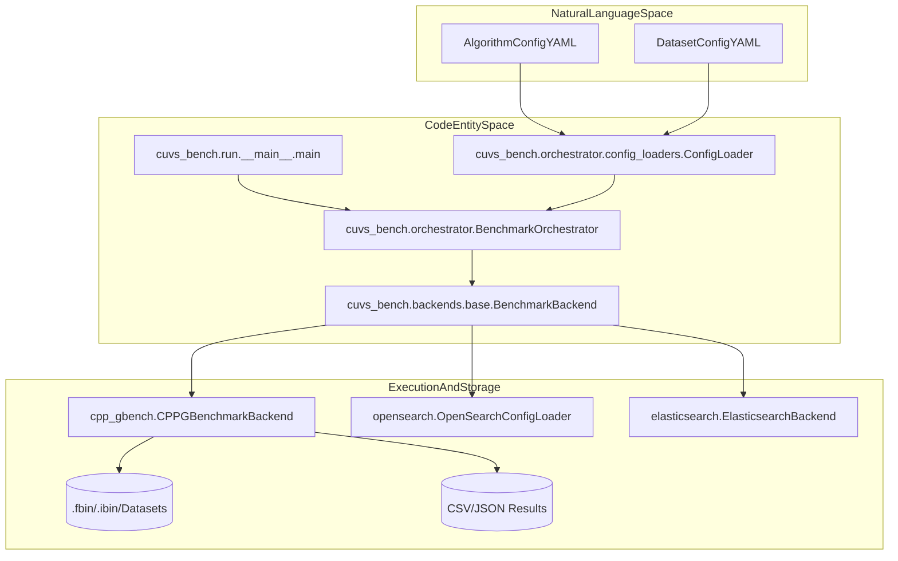
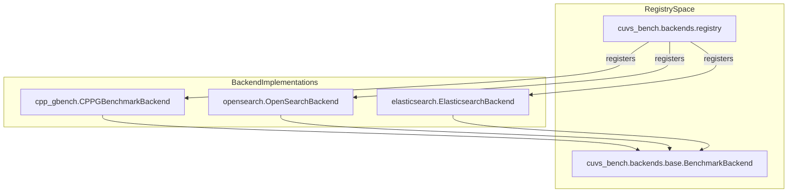
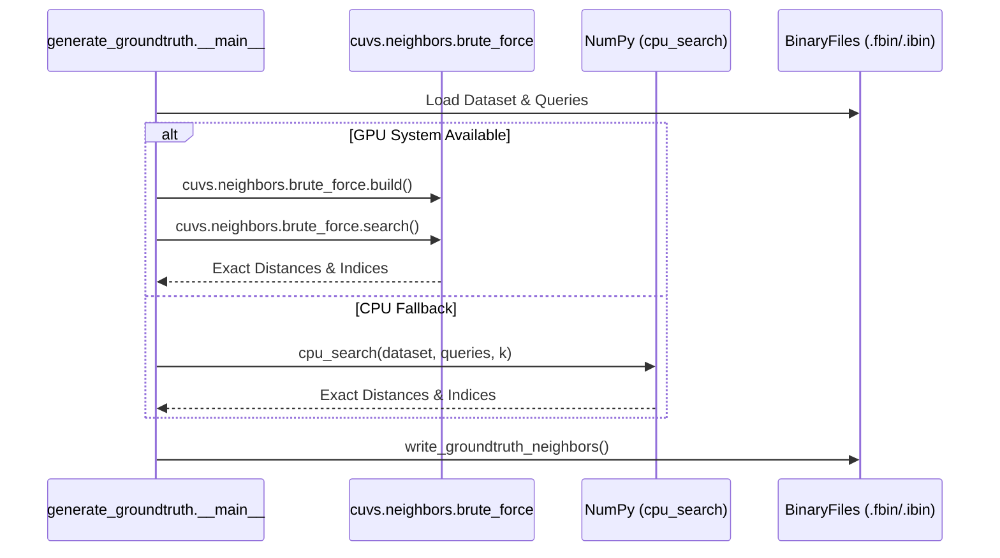

<!-- source: DeepWiki mcp.deepwiki.com · repo NVIDIA/cuvs · page 6.1 cuvs_bench Python Tool · fetched 2026-10-26 -->

# cuvs_bench Python Tool

Relevant source files

The following files were used as context for generating this wiki page:

- [cpp/bench/ann/src/common/util.hpp](cpp/bench/ann/src/common/util.hpp)
- [fern/pages/cuvs_bench/figures/diskann_bigann.png](fern/pages/cuvs_bench/figures/diskann_bigann.png)
- [fern/pages/cuvs_bench/figures/diskann_falcon.png](fern/pages/cuvs_bench/figures/diskann_falcon.png)
- [fern/pages/cuvs_bench/figures/diskann_wiki.png](fern/pages/cuvs_bench/figures/diskann_wiki.png)
- [fern/pages/cuvs_bench/figures/pipeline.png](fern/pages/cuvs_bench/figures/pipeline.png)
- [fern/pages/cuvs_bench/synthesize_dataset.md](fern/pages/cuvs_bench/synthesize_dataset.md)
- [python/cuvs_bench/cuvs_bench/_bin_format.py](python/cuvs_bench/cuvs_bench/_bin_format.py)
- [python/cuvs_bench/cuvs_bench/backends/__init__.py](python/cuvs_bench/cuvs_bench/backends/__init__.py)
- [python/cuvs_bench/cuvs_bench/backends/_utils.py](python/cuvs_bench/cuvs_bench/backends/_utils.py)
- [python/cuvs_bench/cuvs_bench/backends/base.py](python/cuvs_bench/cuvs_bench/backends/base.py)
- [python/cuvs_bench/cuvs_bench/backends/cpp_gbench.py](python/cuvs_bench/cuvs_bench/backends/cpp_gbench.py)
- [python/cuvs_bench/cuvs_bench/backends/elasticsearch.py](python/cuvs_bench/cuvs_bench/backends/elasticsearch.py)
- [python/cuvs_bench/cuvs_bench/backends/opensearch.py](python/cuvs_bench/cuvs_bench/backends/opensearch.py)
- [python/cuvs_bench/cuvs_bench/backends/registry.py](python/cuvs_bench/cuvs_bench/backends/registry.py)
- [python/cuvs_bench/cuvs_bench/backends/search_spaces.py](python/cuvs_bench/cuvs_bench/backends/search_spaces.py)
- [python/cuvs_bench/cuvs_bench/config/algos/cuvs_cagra_hnswlib.yaml](python/cuvs_bench/cuvs_bench/config/algos/cuvs_cagra_hnswlib.yaml)
- [python/cuvs_bench/cuvs_bench/config/algos/cuvs_ivf_pq.yaml](python/cuvs_bench/cuvs_bench/config/algos/cuvs_ivf_pq.yaml)
- [python/cuvs_bench/cuvs_bench/config/algos/elasticsearch.yml](python/cuvs_bench/cuvs_bench/config/algos/elasticsearch.yml)
- [python/cuvs_bench/cuvs_bench/config/algos/faiss_cpu_hnsw_flat.yaml](python/cuvs_bench/cuvs_bench/config/algos/faiss_cpu_hnsw_flat.yaml)
- [python/cuvs_bench/cuvs_bench/config/algos/faiss_cpu_ivf_flat.yaml](python/cuvs_bench/cuvs_bench/config/algos/faiss_cpu_ivf_flat.yaml)
- [python/cuvs_bench/cuvs_bench/config/algos/faiss_gpu_cagra.yaml](python/cuvs_bench/cuvs_bench/config/algos/faiss_gpu_cagra.yaml)
- [python/cuvs_bench/cuvs_bench/config/algos/faiss_gpu_cagra_hnsw.yaml](python/cuvs_bench/cuvs_bench/config/algos/faiss_gpu_cagra_hnsw.yaml)
- [python/cuvs_bench/cuvs_bench/config/algos/faiss_gpu_ivf_flat.yaml](python/cuvs_bench/cuvs_bench/config/algos/faiss_gpu_ivf_flat.yaml)
- [python/cuvs_bench/cuvs_bench/config/algos/faiss_gpu_ivf_pq.yaml](python/cuvs_bench/cuvs_bench/config/algos/faiss_gpu_ivf_pq.yaml)
- [python/cuvs_bench/cuvs_bench/config/algos/hnswlib.yaml](python/cuvs_bench/cuvs_bench/config/algos/hnswlib.yaml)
- [python/cuvs_bench/cuvs_bench/config/datasets/datasets.yaml](python/cuvs_bench/cuvs_bench/config/datasets/datasets.yaml)
- [python/cuvs_bench/cuvs_bench/generate_groundtruth/__main__.py](python/cuvs_bench/cuvs_bench/generate_groundtruth/__main__.py)
- [python/cuvs_bench/cuvs_bench/generate_groundtruth/utils.py](python/cuvs_bench/cuvs_bench/generate_groundtruth/utils.py)
- [python/cuvs_bench/cuvs_bench/get_dataset/fbin_to_f16bin.py](python/cuvs_bench/cuvs_bench/get_dataset/fbin_to_f16bin.py)
- [python/cuvs_bench/cuvs_bench/get_dataset/hdf5_to_fbin.py](python/cuvs_bench/cuvs_bench/get_dataset/hdf5_to_fbin.py)
- [python/cuvs_bench/cuvs_bench/orchestrator/__init__.py](python/cuvs_bench/cuvs_bench/orchestrator/__init__.py)
- [python/cuvs_bench/cuvs_bench/orchestrator/config_loaders.py](python/cuvs_bench/cuvs_bench/orchestrator/config_loaders.py)
- [python/cuvs_bench/cuvs_bench/orchestrator/orchestrator.py](python/cuvs_bench/cuvs_bench/orchestrator/orchestrator.py)
- [python/cuvs_bench/cuvs_bench/run/__main__.py](python/cuvs_bench/cuvs_bench/run/__main__.py)
- [python/cuvs_bench/cuvs_bench/run/data_export.py](python/cuvs_bench/cuvs_bench/run/data_export.py)
- [python/cuvs_bench/cuvs_bench/run/run.py](python/cuvs_bench/cuvs_bench/run/run.py)
- [python/cuvs_bench/cuvs_bench/run/runners.py](python/cuvs_bench/cuvs_bench/run/runners.py)
- [python/cuvs_bench/cuvs_bench/synthesize_dataset/__init__.py](python/cuvs_bench/cuvs_bench/synthesize_dataset/__init__.py)
- [python/cuvs_bench/cuvs_bench/synthesize_dataset/__main__.py](python/cuvs_bench/cuvs_bench/synthesize_dataset/__main__.py)
- [python/cuvs_bench/cuvs_bench/tests/conftest.py](python/cuvs_bench/cuvs_bench/tests/conftest.py)
- [python/cuvs_bench/cuvs_bench/tests/test_cli.py](python/cuvs_bench/cuvs_bench/tests/test_cli.py)
- [python/cuvs_bench/cuvs_bench/tests/test_cpp_gbench.py](python/cuvs_bench/cuvs_bench/tests/test_cpp_gbench.py)
- [python/cuvs_bench/cuvs_bench/tests/test_data_export.py](python/cuvs_bench/cuvs_bench/tests/test_data_export.py)
- [python/cuvs_bench/cuvs_bench/tests/test_modularization.py](python/cuvs_bench/cuvs_bench/tests/test_modularization.py)
- [python/cuvs_bench/cuvs_bench/tests/test_opensearch.py](python/cuvs_bench/cuvs_bench/tests/test_opensearch.py)
- [python/cuvs_bench/cuvs_bench/tests/test_registry.py](python/cuvs_bench/cuvs_bench/tests/test_registry.py)
- [python/cuvs_bench/cuvs_bench/tests/test_run.py](python/cuvs_bench/cuvs_bench/tests/test_run.py)
- [python/cuvs_bench/cuvs_bench/tests/test_utils.py](python/cuvs_bench/cuvs_bench/tests/test_utils.py)

The `cuvs_bench` package is a Python-based benchmarking infrastructure designed to evaluate Approximate Nearest Neighbor (ANN) search algorithms across diverse backends. It provides a unified interface for orchestrating benchmark runs, managing datasets in various formats (HDF5, fbin/ibin), generating exact ground truth data via GPU/CPU acceleration, configuring algorithm search spaces through YAML files, exporting structured CSV/JSON metrics, and interfacing with C++ benchmarks as well as external database engines like OpenSearch and Elasticsearch.

Sources: [python/cuvs_bench/cuvs_bench/run/__main__.py:1-20](), [python/cuvs_bench/cuvs_bench/orchestrator/orchestrator.py:1-25]()

---

## System Architecture & Benchmarking Pipeline

The cuvs_bench tool acts as an orchestrator that bridges high-level YAML configurations with low-level execution backends. It manages the full benchmark lifecycle from dataset download and synthesis to index building, searching, and result exporting.

Sources: [python/cuvs_bench/cuvs_bench/run/__main__.py:22-184](), [python/cuvs_bench/cuvs_bench/orchestrator/orchestrator.py:32-104](), [python/cuvs_bench/cuvs_bench/backends/opensearch.py:31-63]()

---

## Core Components

### 1. Orchestrator and CLI Runner (`cuvs_bench.run`)
The entry point `cuvs_bench.run.__main__` uses `click` to expose command-line options for running benchmark sweeps or hyperparameter tuning [python/cuvs_bench/cuvs_bench/run/__main__.py:22-184]().

*   **`main`**: Parses arguments such as `--subset-size`, `-k` (count), `-bs` (batch size), `--dataset`, `--algorithms`, `--groups`, `--mode`, and `--backend-config` [python/cuvs_bench/cuvs_bench/run/__main__.py:184-207]().
*   **`BenchmarkOrchestrator`**: Coordinates backend instantiation via a registry pattern, loading parameter spaces and executing build and search phases [python/cuvs_bench/cuvs_bench/orchestrator/orchestrator.py:32-104]().

Sources: [python/cuvs_bench/cuvs_bench/run/__main__.py:22-207](), [python/cuvs_bench/cuvs_bench/orchestrator/orchestrator.py:32-104]()

### 2. Pluggable Backends System
The benchmarking framework supports multiple backends registered through Python entry points and internal registry modules:
*   **`cpp_gbench`**: The default C++ harness (`libcuvs-bench-ann`) executing high-performance GPU and CPU algorithms [python/cuvs_bench/cuvs_bench/tests/test_modularization.py:38-51]().
*   **`opensearch`**: Integrates OpenSearch vector search engines, supporting Lucene and Faiss engines as well as OpenSearch 3.0+ remote GPU index build services [python/cuvs_bench/cuvs_bench/backends/opensearch.py:7-13]().
*   **`elasticsearch`**: Interfaces with Elasticsearch GPU HTTP endpoints for `hnsw`, `int8_hnsw`, `int4_hnsw`, and `bbq_hnsw` indexing types [python/cuvs_bench/cuvs_bench/backends/elasticsearch.py:6-16]().

Sources: [python/cuvs_bench/cuvs_bench/backends/opensearch.py:7-40](), [python/cuvs_bench/cuvs_bench/backends/elasticsearch.py:6-36](), [python/cuvs_bench/cuvs_bench/tests/test_modularization.py:38-51]()

Sources: [python/cuvs_bench/cuvs_bench/backends/registry.py:1-50](), [python/cuvs_bench/cuvs_bench/backends/base.py:1-40]()

---

## Algorithm YAML Configurations & Search Spaces

Algorithm hyperparameters are defined in YAML configuration files (e.g., under `cuvs_bench/config/algos/`). Each file specifies algorithm constraints, group definitions, and hyperparameter grids for both building and searching.

*   **Groups**: Named parameter sets (e.g., `base`, `test`, `large`, `100M`) allowing selective sweeps [python/cuvs_bench/cuvs_bench/config/algos/faiss_gpu_ivf_pq.yaml:5-88]().
*   **Build Parameters**: Configure index structures such as `nlist`, `M`, `graph_degree`, and quantization bits [python/cuvs_bench/cuvs_bench/config/algos/faiss_gpu_ivf_pq.yaml:7-14]().
*   **Search Parameters**: Configure query-time parameters such as `nprobe`, `refine_ratio`, `itopk`, and `search_width` [python/cuvs_bench/cuvs_bench/config/algos/faiss_gpu_ivf_pq.yaml:15-18]().

Sources: [python/cuvs_bench/cuvs_bench/config/algos/faiss_gpu_ivf_pq.yaml:1-88](), [python/cuvs_bench/cuvs_bench/config/algos/faiss_gpu_cagra.yaml:1-22]()

---

## Dataset Management and Ground Truth Generation

`cuvs_bench` provides dataset acquisition, conversion utilities, and ground truth generation tools located in `cuvs_bench.generate_groundtruth` [python/cuvs_bench/cuvs_bench/generate_groundtruth/__main__.py:1-20]().

*   **Formats**: Supports HDF5 (`.hdf5`) and flat binary files (`.fbin` for vectors, `.ibin` for neighbor indices) [python/cuvs_bench/cuvs_bench/tests/test_cli.py:32-38]().
*   **Ground Truth Calculation**: `calc_truth` uses batched exact k-NN queries via `cuvs.neighbors.brute_force` on GPU (accelerated via RMM and CuPy) with automatic fallback to NumPy (`cpu_search`) [python/cuvs_bench/cuvs_bench/generate_groundtruth/__main__.py:66-94](), [python/cuvs_bench/cuvs_bench/generate_groundtruth/__main__.py:131-192]().

Sources: [python/cuvs_bench/cuvs_bench/generate_groundtruth/__main__.py:66-94](), [python/cuvs_bench/cuvs_bench/generate_groundtruth/__main__.py:131-209]()

---

## Data Export and Visualization

The data export module (`cuvs_bench.run.data_export`) processes raw benchmark outputs, standardizes metrics, and saves structured CSV and JSON frontier files [python/cuvs_bench/cuvs_bench/run/data_export.py:56-84]().

*   **Result Export**: Converts build and search results into tabular DataFrames, automatically calculating throughput (queries per second), latency, and recall [python/cuvs_bench/cuvs_bench/run/data_export.py:86-204]().
*   **Metrics Tracked**:
    *   `k-nn`: Recall accuracy against ground truth [python/cuvs_bench/cuvs_bench/run/data_export.py:39-44]().
    *   `throughput`: Queries processed per second [python/cuvs_bench/cuvs_bench/run/data_export.py:45-48]().
    *   `latency`: Search response time in seconds [python/cuvs_bench/cuvs_bench/run/data_export.py:49-53]().

Sources: [python/cuvs_bench/cuvs_bench/run/data_export.py:1-84](), [python/cuvs_bench/cuvs_bench/run/data_export.py:133-204]()

---

