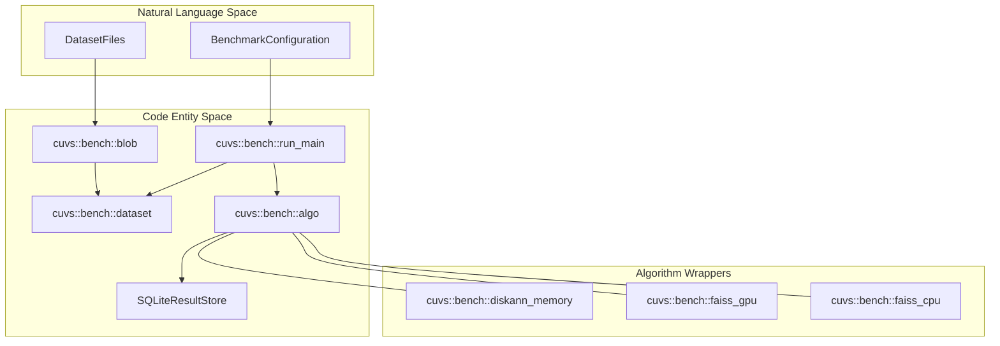
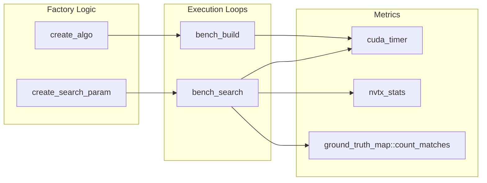

<!-- source: DeepWiki mcp.deepwiki.com · repo NVIDIA/cuvs · page 6.2 C++ ANN Benchmark Harness · fetched 2026-10-26 -->

# C++ ANN Benchmark Harness

Relevant source files

The following files were used as context for generating this wiki page:

- [c/tests/neighbors/ann_mg_c.cu](c/tests/neighbors/ann_mg_c.cu)
- [cpp/bench/ann/CMakeLists.txt](cpp/bench/ann/CMakeLists.txt)
- [cpp/bench/ann/src/common/ann_types.hpp](cpp/bench/ann/src/common/ann_types.hpp)
- [cpp/bench/ann/src/common/benchmark.hpp](cpp/bench/ann/src/common/benchmark.hpp)
- [cpp/bench/ann/src/common/blob.hpp](cpp/bench/ann/src/common/blob.hpp)
- [cpp/bench/ann/src/common/conf.hpp](cpp/bench/ann/src/common/conf.hpp)
- [cpp/bench/ann/src/common/cuda_huge_page_resource.hpp](cpp/bench/ann/src/common/cuda_huge_page_resource.hpp)
- [cpp/bench/ann/src/common/dataset.hpp](cpp/bench/ann/src/common/dataset.hpp)
- [cpp/bench/ann/src/common/nvtx_stats.hpp](cpp/bench/ann/src/common/nvtx_stats.hpp)
- [cpp/bench/ann/src/common/thread_pool.hpp](cpp/bench/ann/src/common/thread_pool.hpp)
- [cpp/bench/ann/src/cuvs/cuvs_ann_bench_utils.h](cpp/bench/ann/src/cuvs/cuvs_ann_bench_utils.h)
- [cpp/bench/ann/src/cuvs/cuvs_cagra_diskann.cu](cpp/bench/ann/src/cuvs/cuvs_cagra_diskann.cu)
- [cpp/bench/ann/src/cuvs/cuvs_ivf_flat_wrapper.h](cpp/bench/ann/src/cuvs/cuvs_ivf_flat_wrapper.h)
- [cpp/bench/ann/src/cuvs/cuvs_ivf_pq_wrapper.h](cpp/bench/ann/src/cuvs/cuvs_ivf_pq_wrapper.h)
- [cpp/bench/ann/src/cuvs/cuvs_mg_ivf_flat_wrapper.h](cpp/bench/ann/src/cuvs/cuvs_mg_ivf_flat_wrapper.h)
- [cpp/bench/ann/src/cuvs/cuvs_mg_ivf_pq_wrapper.h](cpp/bench/ann/src/cuvs/cuvs_mg_ivf_pq_wrapper.h)
- [cpp/bench/ann/src/cuvs/cuvs_vamana.cu](cpp/bench/ann/src/cuvs/cuvs_vamana.cu)
- [cpp/bench/ann/src/cuvs/cuvs_vamana_wrapper.h](cpp/bench/ann/src/cuvs/cuvs_vamana_wrapper.h)
- [cpp/bench/ann/src/cuvs/cuvs_wrapper.h](cpp/bench/ann/src/cuvs/cuvs_wrapper.h)
- [cpp/bench/ann/src/diskann/diskann_benchmark.cpp](cpp/bench/ann/src/diskann/diskann_benchmark.cpp)
- [cpp/bench/ann/src/diskann/diskann_wrapper.h](cpp/bench/ann/src/diskann/diskann_wrapper.h)
- [cpp/bench/ann/src/faiss/faiss_cpu_benchmark.cpp](cpp/bench/ann/src/faiss/faiss_cpu_benchmark.cpp)
- [cpp/bench/ann/src/faiss/faiss_cpu_wrapper.h](cpp/bench/ann/src/faiss/faiss_cpu_wrapper.h)
- [cpp/bench/ann/src/faiss/faiss_gpu_benchmark.cu](cpp/bench/ann/src/faiss/faiss_gpu_benchmark.cu)
- [cpp/bench/ann/src/faiss/faiss_gpu_wrapper.h](cpp/bench/ann/src/faiss/faiss_gpu_wrapper.h)
- [cpp/cmake/patches/faiss_override.json](cpp/cmake/patches/faiss_override.json)
- [cpp/cmake/thirdparty/get_sqlite.cmake](cpp/cmake/thirdparty/get_sqlite.cmake)
- [cpp/src/neighbors/iface/iface.hpp](cpp/src/neighbors/iface/iface.hpp)
- [cpp/src/neighbors/ivf_pq_impl.hpp](cpp/src/neighbors/ivf_pq_impl.hpp)
- [cpp/src/neighbors/ivf_pq_index.cu](cpp/src/neighbors/ivf_pq_index.cu)
- [cpp/tests/neighbors/ann_ivf_pq.cuh](cpp/tests/neighbors/ann_ivf_pq.cuh)
- [cpp/tests/neighbors/ann_ivf_pq/test_float_int64_t.cu](cpp/tests/neighbors/ann_ivf_pq/test_float_int64_t.cu)
- [cpp/tests/neighbors/ann_utils.cuh](cpp/tests/neighbors/ann_utils.cuh)
- [cpp/tests/neighbors/mg.cuh](cpp/tests/neighbors/mg.cuh)
- [examples/cpp/src/cagra_hnsw_ace_example.cu](examples/cpp/src/cagra_hnsw_ace_example.cu)
- [python/cuvs_bench/cuvs_bench/config/algorithms.yaml](python/cuvs_bench/cuvs_bench/config/algorithms.yaml)
- [python/cuvs_bench/cuvs_bench/config/algos/cuvs_cagra_diskann.yaml](python/cuvs_bench/cuvs_bench/config/algos/cuvs_cagra_diskann.yaml)
- [python/cuvs_bench/cuvs_bench/config/algos/cuvs_vamana.yaml](python/cuvs_bench/cuvs_bench/config/algos/cuvs_vamana.yaml)
- [python/cuvs_bench/cuvs_bench/config/algos/diskann_memory.yaml](python/cuvs_bench/cuvs_bench/config/algos/diskann_memory.yaml)
- [python/cuvs_bench/cuvs_bench/config/algos/diskann_ssd.yaml](python/cuvs_bench/cuvs_bench/config/algos/diskann_ssd.yaml)

The C++ ANN Benchmark Harness is a high-performance framework designed to evaluate and compare Approximate Nearest Neighbor (ANN) algorithms. It provides a standardized environment for benchmarking cuVS algorithms alongside industry-standard libraries like Faiss, HNSWlib, and DiskANN. The harness handles data loading, index building, search execution, result validation (recall), and performance instrumentation.

Sources: `[cpp/bench/ann/src/common/benchmark.hpp:30-35]`, `[cpp/bench/ann/src/common/dataset.hpp:146-160]()`.

## Core Architecture and Data Flow

The harness is built around a centralized runner that orchestrates the lifecycle of a benchmark run, from configuration parsing to result persistence in SQLite.

### System Components Diagram

The following diagram illustrates the relationship between the benchmark runner, algorithm wrappers, and the data management layer.

**ANN Benchmark Data Flow**

Sources: `[cpp/bench/ann/src/common/benchmark.hpp:30-33]()`, `[cpp/bench/ann/src/common/dataset.hpp:147-158]()`, `[cpp/bench/ann/src/common/blob.hpp:29-30]()`.

### Key Classes and Roles

| Class | Role |
| :--- | :--- |
| `cuvs::bench::algo<T>` | Abstract base class defining the interface for all benchmarked algorithms (build, search, save, load). `[cpp/bench/ann/src/common/ann_types.hpp:120-125]()` |
| `cuvs::bench::dataset<T>` | Manages the base set, query set, and ground truth data. `[cpp/bench/ann/src/common/dataset.hpp:147-161]()` |
| `cuvs::bench::blob<T>` | RAII wrapper for memory-mapped files and device/managed memory allocations. `[cpp/bench/ann/src/common/blob.hpp:210-212]()` |
| `cuvs::bench::ground_truth_map<T>` | Handles recall calculation by building O(1) lookup maps for ground truth neighbors. `[cpp/bench/ann/src/common/dataset.hpp:38-45]()` |

Sources: `[cpp/bench/ann/src/common/ann_types.hpp:120-125]()`, `[cpp/bench/ann/src/common/dataset.hpp:38-161]`, `[cpp/bench/ann/src/common/blob.hpp:210-212]()`.

## Data Loading and Memory Management

The harness uses a sophisticated memory management system to handle datasets that may exceed available GPU or System RAM.

### Blob and Memory Mapping
The `blob<T>` class provides a unified interface for data access across different memory types:
*   **HostMmap**: Uses `mmap` to map large files from disk without loading them entirely into RAM. `[cpp/bench/ann/src/common/blob.hpp:95-105]()`
*   **Device/Managed**: Allocates memory via `cudaMalloc` or `cudaMallocManaged`. `[cpp/bench/ann/src/common/blob.hpp:161-165]()`, `[cpp/bench/ann/src/common/blob.hpp:211-215]()`

### Dataset Management
The `dataset<T>` class encapsulates the base vectors, query vectors, and ground truth. It supports filtering via bitsets and manages the `ground_truth_map` for recall validation. `[cpp/bench/ann/src/common/dataset.hpp:153-158]()`.

Sources: `[cpp/bench/ann/src/common/blob.hpp:95-215]()`, `[cpp/bench/ann/src/common/dataset.hpp:147-175]()`.

## Algorithm Wrappers

Each external library or internal cuVS algorithm is integrated via a specialized wrapper that inherits from `cuvs::bench::algo<T>`.

### cuVS Wrappers
Wrappers for CAGRA, IVF-PQ, IVF-Flat, and IVF-SQ utilize configured resources to manage GPU streams and memory pools.
*   **CAGRA**: Supports multiple search modes and refinement.
*   **IVF Variants**: Implement coarse clustering and quantization logic via cuVS core APIs.

### Third-Party Wrappers
*   **Faiss (GPU/CPU)**: Wraps Faiss indices, handling the translation between cuVS metrics and `faiss::MetricType`. `[cpp/bench/ann/src/faiss/faiss_gpu_wrapper.h:41-50]()`. It manages `faiss::gpu::StandardGpuResources` and memory resource pools. `[cpp/bench/ann/src/faiss/faiss_gpu_wrapper.h:92-101]()`.
*   **DiskANN/Vamana**: Supports `diskann_memory` and `diskann_ssd` for graph-based search on host or SSD. `[cpp/bench/ann/src/diskann/diskann_wrapper.h:40-42]()`, `[cpp/bench/ann/src/diskann/diskann_wrapper.h:172-175]()`.
*   **HNSWlib**: Integrates the standard CPU HNSW implementation.

Sources: `[cpp/bench/ann/src/faiss/faiss_gpu_wrapper.h:41-101]()`, `[cpp/bench/ann/src/diskann/diskann_wrapper.h:40-175]()`.

## Execution and Benchmarking

The `benchmark.hpp` runner provides the core loops for `bench_build` and `bench_search`.

### Build and Search Lifecycle
1.  **Build**: Measures index construction time. It supports forcing overwrites and uses timers for precise duration tracking. `[cpp/bench/ann/src/common/benchmark.hpp:109-175]()`.
2.  **Search**: Executes queries in batches. It calculates latency and throughput while recording NVTX ranges for profiling. `[cpp/bench/ann/src/common/benchmark.hpp:178-208]()`.

### NVTX and Performance Stats
The harness uses `nvtx_stats` to push/pop NVTX ranges, allowing developers to correlate benchmark iterations with specific kernel executions in profiling tools. `[cpp/bench/ann/src/common/benchmark.hpp:142-143]()`.

### Result Storage
Benchmark results, including latency percentiles, throughput (QPS), and recall, are stored in an SQLite database for post-processing and Pareto frontier visualization.

**Algorithm Factory and Execution Flow**

Sources: `[cpp/bench/ann/src/common/benchmark.hpp:128-166]()`, `[cpp/bench/ann/src/common/dataset.hpp:121-136]()`.

## Build Configuration

The harness is configured via CMake, allowing users to toggle specific algorithm support to reduce build times or dependency requirements.

| Option | Description | Default |
| :--- | :--- | :--- |
| `CUVS_ANN_BENCH_USE_FAISS_GPU_CAGRA` | Include Faiss CAGRA in benchmark | ON |
| `CUVS_ANN_BENCH_USE_CUVS_CAGRA` | Include cuVS CAGRA in benchmark | ON |
| `CUVS_ANN_BENCH_USE_DISKANN` | Include DiskANN search in benchmark | ON |
| `CUVS_ANN_BENCH_USE_HNSWLIB` | Include HNSWlib in benchmark | ON |

Sources: `[cpp/bench/ann/CMakeLists.txt:13-43]()`, `[cpp/bench/ann/CMakeLists.txt:149-171]()`.

---

