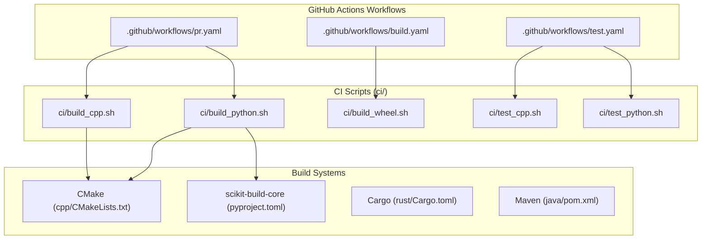
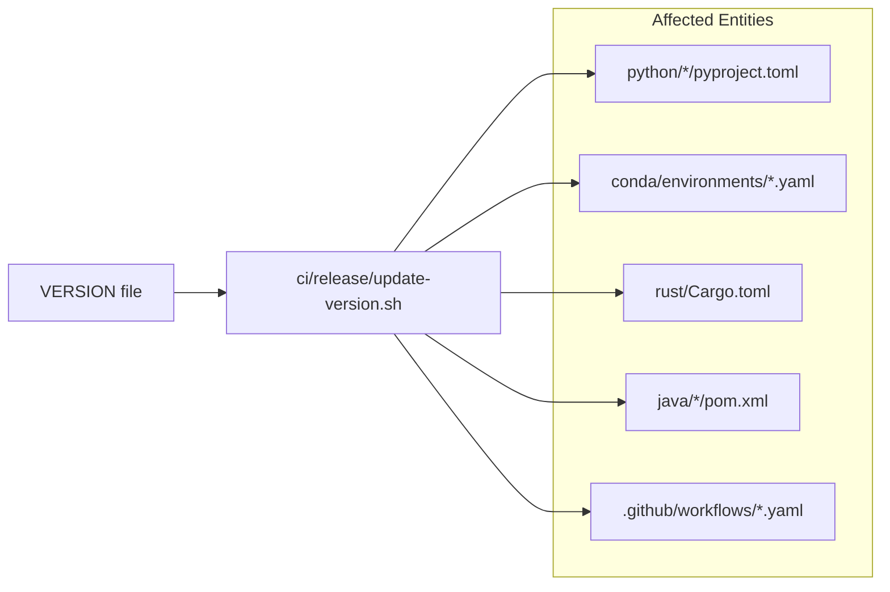

<!-- source: DeepWiki mcp.deepwiki.com · repo NVIDIA/cuvs · page 7 Build System & CI/CD · fetched 2026-10-26 -->

# Build System & CI/CD

Relevant source files

The following files were used as context for generating this wiki page:

- [.github/workflows/build.yaml](.github/workflows/build.yaml)
- [.github/workflows/pr.yaml](.github/workflows/pr.yaml)
- [.github/workflows/test.yaml](.github/workflows/test.yaml)
- [.github/workflows/trigger-breaking-change-alert.yaml](.github/workflows/trigger-breaking-change-alert.yaml)
- [RAPIDS_BRANCH](RAPIDS_BRANCH)
- [README.md](README.md)
- [build.sh](build.sh)
- [c/include/cuvs/core/c_api.h](c/include/cuvs/core/c_api.h)
- [c/src/core/c_api.cpp](c/src/core/c_api.cpp)
- [ci/release/update-version.sh](ci/release/update-version.sh)
- [cmake/RAPIDS.cmake](cmake/RAPIDS.cmake)
- [cmake/rapids_config.cmake](cmake/rapids_config.cmake)
- [cpp/include/cuvs/neighbors/dynamic_batching.hpp](cpp/include/cuvs/neighbors/dynamic_batching.hpp)
- [cpp/src/neighbors/detail/dynamic_batching.cuh](cpp/src/neighbors/detail/dynamic_batching.cuh)
- [examples/c/src/bruteforce_c_example.c](examples/c/src/bruteforce_c_example.c)
- [examples/go/README.md](examples/go/README.md)
- [java/benchmarks/pom.xml](java/benchmarks/pom.xml)
- [java/build.sh](java/build.sh)
- [java/cuvs-java/pom.xml](java/cuvs-java/pom.xml)
- [java/internal/CMakeLists.txt](java/internal/CMakeLists.txt)
- [java/panama-bindings/generate-bindings.sh](java/panama-bindings/generate-bindings.sh)
- [java/panama-bindings/headers.h](java/panama-bindings/headers.h)
- [python/cuvs_bench/cuvs_bench/plot/__main__.py](python/cuvs_bench/cuvs_bench/plot/__main__.py)

This page provides a high-level overview of the cuVS build infrastructure, including the multi-language build systems, release versioning automation, CI/CD pipelines, and the documentation site. cuVS employs a unified build strategy that coordinates C++ (`CMake`), Python (`scikit-build-core`), Rust (`Cargo`), Java (`Maven`), and Go (`CGo`) components.

For deep technical details, refer to the child pages linked at the bottom of this overview.

---

## Unified Build Entrypoint: `build.sh`

The primary interface for local development and CI is the root-level `build.sh` script [build.sh:1-22](). This script wraps the underlying build systems for all supported languages and provides a consistent CLI for building specific components, running tests, or generating benchmarks.

| Target | Description | Underlying Tool |
| :--- | :--- | :--- |
| `libcuvs` | C++ Core and C-API Library | CMake / Ninja [build.sh:26-27]() |
| `python` | Python Bindings and `cuvs_bench` | scikit-build-core / pip [build.sh:28]() |
| `rust` | Rust Crates (`cuvs` & `cuvs-sys`) | Cargo [build.sh:29]() |
| `go` | Go Packages | Go Build / CGo [build.sh:30]() |
| `java` | Java Bindings | Maven [build.sh:31]() |
| `lucene` | Apache Lucene GPU Codecs | Maven [build.sh:32]() |
| `docs` | Documentation site generation | Sphinx / Doxygen / Fern [build.sh:33]() |
| `tests` | Compiled test suites | CMake [build.sh:34]() |
| `bench-ann` | C++ ANN Benchmark Harness | CMake [build.sh:35]() |

Sources: [build.sh:1-37]()

---

## Build System Architecture

The cuVS build system handles complex CUDA dependencies, cross-language interop, and modular compilation.

### C++ & CUDA (CMake)
The core library (`libcuvs`) is built using CMake and manages third-party dependencies such as RAFT, Faiss, CUTLASS, HNSWlib, DiskANN, KvikIO, and SQLite. It handles CUDA architecture configuration and JIT LTO kernel generation. 
For details, see [C++ CMake Build System](#7.1).

### Python & Conda Packaging
Python packages (`cuvs`, `libcuvs`, `cuvs_bench`) use `scikit-build-core` and `rapids-build-backend` to bridge CMake and Python setup. Conda packages are built using `rattler-build` recipes.
For details, see [Python & Conda Packaging](#7.2).

### Multi-Language Bindings
- **Rust:** Managed by Cargo, using `bindgen` in `cuvs-sys` to interface with the C API [rust/Cargo.toml:21]().
- **Java:** Managed by Maven, utilizing Panama Foreign Function & Memory (FFM) API bindings [java/build.sh:31-32](), [java/cuvs-java/pom.xml:9-13]().
- **Go:** Managed via standard Go toolchain with CGo pointers to the stable C ABI [examples/go/README.md:19-23]().

Sources: [rust/Cargo.toml:21](), [java/build.sh:31-32](), [java/cuvs-java/pom.xml:9-13](), [examples/go/README.md:19-23]()

---

## CI/CD Workflows & Testing

cuVS uses GitHub Actions workflows for continuous integration, validating PRs across multiple CUDA versions and architectures using shared RAPIDS workflows [.github/workflows/pr.yaml:10-42]().

**CI Workflow & Script Association**

Sources: [.github/workflows/pr.yaml:10-36](), [.github/workflows/build.yaml:38-58](), [.github/workflows/test.yaml:28-60]()

Key pipeline stages include change-detection optimization, C-ABI stability validation, multi-language test suites, and nightly artifact publishing.
For details, see [CI/CD Workflows & Testing](#7.3).

Sources: [.github/workflows/pr.yaml:10-42](), [.github/workflows/build.yaml:38-58](), [.github/workflows/test.yaml:28-60]()

---

## Documentation Site (Fern & Doxygen)

The `fern/` directory powers the cuVS documentation site (`docs.nvidia.com/cuvs`), driven by Fern navigation configuration (`docs.yml`), Doxygen-generated C/C++ API references, and custom NVIDIA themes. Pre-commit hooks (`fern-api-reference`) validate API specs.
For details, see [Documentation Site (Fern & Doxygen)](#7.4).

Sources: [ci/release/update-version.sh:143-143]()

---

## Release & Versioning

Versioning is centralized in the root `VERSION` file [ci/release/update-version.sh:104]() and managed via `ci/release/update-version.sh` [ci/release/update-version.sh:1-32](). The release script automates updates across dependencies, pyproject files, package manifests, and CI pipelines [ci/release/update-version.sh:103-172]().

**Version Flow Diagram**

Sources: [ci/release/update-version.sh:103-172]()

---

## Child Pages

- [C++ CMake Build System](#7.1) — C++ CMake configuration, dependency acquisition, CUDA architecture config, and JIT LTO kernel generation.
- [Python & Conda Packaging](#7.2) — Packaging pipeline via `scikit-build-core`, conda `rattler-build` recipes, and wheel generation.
- [CI/CD Workflows & Testing](#7.3) — GitHub Actions workflows, PR/build/test pipelines, and C-ABI stability checking.
- [Documentation Site (Fern & Doxygen)](#7.4) — The `fern/` documentation site, Doxygen API integration, and navigation configuration.

---

