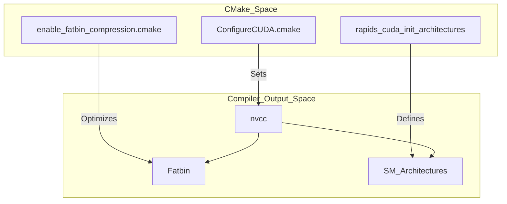
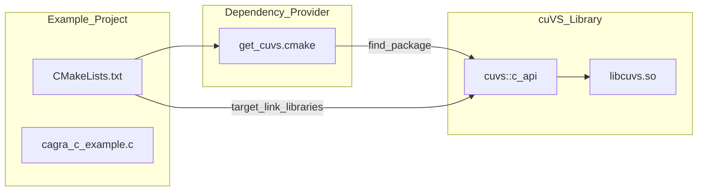

<!-- source: DeepWiki mcp.deepwiki.com · repo NVIDIA/cuvs · page 7.1 C++ CMake Build System · fetched 2026-10-26 -->

# C++ CMake Build System

Relevant source files

The following files were used as context for generating this wiki page:

- [c/include/cuvs/neighbors/cagra.h](c/include/cuvs/neighbors/cagra.h)
- [c/src/neighbors/cagra.cpp](c/src/neighbors/cagra.cpp)
- [c/tests/neighbors/ann_cagra_c.cu](c/tests/neighbors/ann_cagra_c.cu)
- [cmake/RAPIDS.cmake](cmake/RAPIDS.cmake)
- [cmake/rapids_config.cmake](cmake/rapids_config.cmake)
- [cpp/CMakeLists.txt](cpp/CMakeLists.txt)
- [cpp/bench/ann/src/cuvs/cuvs_ann_bench_param_parser.h](cpp/bench/ann/src/cuvs/cuvs_ann_bench_param_parser.h)
- [cpp/bench/ann/src/cuvs/cuvs_cagra_wrapper.h](cpp/bench/ann/src/cuvs/cuvs_cagra_wrapper.h)
- [cpp/cmake/modules/ConfigureCUDA.cmake](cpp/cmake/modules/ConfigureCUDA.cmake)
- [cpp/cmake/modules/FindSVE.cmake](cpp/cmake/modules/FindSVE.cmake)
- [cpp/cmake/modules/generate_cuvs_export.cmake](cpp/cmake/modules/generate_cuvs_export.cmake)
- [cpp/cmake/patches/cutlass/Support-both-CUDA-12-and-13-cccl-header-locations.patch](cpp/cmake/patches/cutlass/Support-both-CUDA-12-and-13-cccl-header-locations.patch)
- [cpp/cmake/patches/cutlass_override.json](cpp/cmake/patches/cutlass_override.json)
- [cpp/cmake/patches/ggnn_override.json](cpp/cmake/patches/ggnn_override.json)
- [cpp/cmake/patches/hnswlib_override.json](cpp/cmake/patches/hnswlib_override.json)
- [cpp/cmake/thirdparty/get_cutlass.cmake](cpp/cmake/thirdparty/get_cutlass.cmake)
- [cpp/cmake/thirdparty/get_cuvs.cmake](cpp/cmake/thirdparty/get_cuvs.cmake)
- [cpp/cmake/thirdparty/get_diskann.cmake](cpp/cmake/thirdparty/get_diskann.cmake)
- [cpp/cmake/thirdparty/get_faiss.cmake](cpp/cmake/thirdparty/get_faiss.cmake)
- [cpp/cmake/thirdparty/get_ggnn.cmake](cpp/cmake/thirdparty/get_ggnn.cmake)
- [cpp/cmake/thirdparty/get_hnswlib.cmake](cpp/cmake/thirdparty/get_hnswlib.cmake)
- [cpp/cmake/thirdparty/get_raft.cmake](cpp/cmake/thirdparty/get_raft.cmake)
- [cpp/include/cuvs/neighbors/cagra.hpp](cpp/include/cuvs/neighbors/cagra.hpp)
- [cpp/include/cuvs/util/cutlass_utils.hpp](cpp/include/cuvs/util/cutlass_utils.hpp)
- [cpp/src/distance/detail/fused_distance_nn/cutlass_base.cuh](cpp/src/distance/detail/fused_distance_nn/cutlass_base.cuh)
- [cpp/src/distance/detail/pairwise_distance_cutlass_base.cuh](cpp/src/distance/detail/pairwise_distance_cutlass_base.cuh)
- [cpp/src/neighbors/cagra.cuh](cpp/src/neighbors/cagra.cuh)
- [cpp/src/neighbors/detail/cagra/cagra_merge.cuh](cpp/src/neighbors/detail/cagra/cagra_merge.cuh)
- [cpp/src/neighbors/ivf_pq/ivf_pq_compute_similarity.cuh](cpp/src/neighbors/ivf_pq/ivf_pq_compute_similarity.cuh)
- [cpp/src/neighbors/ivf_pq/ivf_pq_compute_similarity.hpp](cpp/src/neighbors/ivf_pq/ivf_pq_compute_similarity.hpp)
- [cpp/src/neighbors/ivf_pq/ivf_pq_compute_similarity_impl.cuh](cpp/src/neighbors/ivf_pq/ivf_pq_compute_similarity_impl.cuh)
- [cpp/src/neighbors/refine/refine_host.hpp](cpp/src/neighbors/refine/refine_host.hpp)
- [cpp/tests/neighbors/ann_cagra.cuh](cpp/tests/neighbors/ann_cagra.cuh)
- [cpp/tests/neighbors/ann_cagra/test_merge_fastener.cu](cpp/tests/neighbors/ann_cagra/test_merge_fastener.cu)
- [examples/cmake/thirdparty/get_cuvs.cmake](examples/cmake/thirdparty/get_cuvs.cmake)
- [java/internal/CMakeLists.txt](java/internal/CMakeLists.txt)
- [python/cuvs_bench/cuvs_bench/config/algos/constraints/__init__.py](python/cuvs_bench/cuvs_bench/config/algos/constraints/__init__.py)
- [python/cuvs_bench/cuvs_bench/config/algos/cuvs_cagra.yaml](python/cuvs_bench/cuvs_bench/config/algos/cuvs_cagra.yaml)

The purpose and scope of this page is to detail the C++ CMake configuration of cuVS, covering third-party dependency acquisition (RAFT, Faiss, CUTLASS, HNSWlib, DiskANN, KvikIO, SQLite), CUDA architecture configuration, JIT LTO kernel generation, `ConfigureCUDA`, and module exports.

## Build System Architecture

The cuVS build system is based on Modern CMake (version 4.0+) and leverages the `rapids-cmake` ecosystem to manage dependencies, CUDA configurations, and multi-architecture builds. It is designed to support high-performance vector search by orchestrating complex CUDA compilation workflows. The build system is centralized in `cpp/CMakeLists.txt`, which handles project initialization, user-configurable options, and dependency resolution via `rapids-cpm` and `rapids-cuda` [cpp/CMakeLists.txt:7-29]().

### Key Build Options
The following options in `cpp/CMakeLists.txt` control the build behavior:

| Option | Default | Description |
| :--- | :--- | :--- |
| `BUILD_SHARED_LIBS` | `ON` | Build cuVS shared libraries (`libcuvs.so`) [cpp/CMakeLists.txt:60](). |
| `BUILD_C_LIBRARY` | `ON` | Build the stable C ABI library [cpp/CMakeLists.txt:62](). |
| `BUILD_TESTS` | `ON` | Build GoogleTest-based unit tests [cpp/CMakeLists.txt:61](). |
| `BUILD_CPU_ONLY` | `OFF` | Build only CPU components (primarily for benchmarks) [cpp/CMakeLists.txt:13](). |
| `CUDA_STATIC_MATH_LIBRARIES` | `OFF` | Statically link math libraries like cuBLAS/cuSolver [cpp/CMakeLists.txt:78](). |
| `CUVS_STATIC_RAPIDS_LIBRARIES` | `OFF` | Statically link internal RAPIDS dependencies like RAFT [cpp/CMakeLists.txt:79](). |

**Sources:**
- [cpp/CMakeLists.txt:13-68]()
- [cpp/CMakeLists.txt:70-97]()

## Dependency Acquisition

cuVS relies on several core and third-party libraries managed via `rapids-cpm` to ensure version consistency across environments.

### Core Dependencies
*   **RAFT:** The foundational library for cuVS, providing CUDA primitives and infrastructure. Configured via `cpp/cmake/thirdparty/get_raft.cmake`, version is pinned to `RAPIDS_VERSION_MAJOR_MINOR` [cpp/cmake/thirdparty/get_raft.cmake:8-10]().
*   **CUTLASS:** Used for high-performance matrix multiplications, configured as a header-only dependency with a custom namespace.

### Third-Party ANN Libraries
cuVS integrates several external ANN libraries to provide a unified benchmarking and algorithm suite:
*   **Faiss:** Integrated via `cpp/cmake/thirdparty/get_faiss.cmake`. Detects CPU features like AVX2 or SVE to select optimal optimization levels.
*   **HNSWlib:** Provides CPU-based HNSW implementations via `cpp/cmake/thirdparty/get_hnswlib.cmake`.
*   **DiskANN / Vamana:** Integrated for disk-optimized vector search via `cpp/cmake/thirdparty/get_diskann.cmake`.

**Sources:**
- [cpp/cmake/thirdparty/get_raft.cmake:12-59]()
- [cpp/cmake/thirdparty/get_cutlass.cmake:8-51]()
- [cpp/cmake/thirdparty/get_faiss.cmake:8-121]()

## CUDA Configuration and Architecture

The `cpp/cmake/modules/ConfigureCUDA.cmake` module standardizes compilation flags across the project, handling strictness (warnings as errors), performance optimizations, and debug information [cpp/cmake/modules/ConfigureCUDA.cmake:8-59]().

### Compilation Flags
*   **Standard Flags:** Includes `--expt-extended-lambda` and `--expt-relaxed-constexpr` for modern C++ features in CUDA [cpp/cmake/modules/ConfigureCUDA.cmake:40]().
*   **Fatbin Compression:** Uses `rapids_cuda_enable_fatbin_compression` to reduce the binary size of generated GPU code [cpp/cmake/modules/ConfigureCUDA.cmake:44-45]().
*   **Debug Info:** Appends `-G` and `-rdynamic`, and caps register counts to 64 when building in Debug mode [cpp/cmake/modules/ConfigureCUDA.cmake:58]().

### Build-to-Code Association: CUDA Setup
The following diagram illustrates how CMake modules map to CUDA compilation entities:

**[CUDAEntityMapping]**

**Sources:**
- [cpp/cmake/modules/ConfigureCUDA.cmake:8-59]()
- [cpp/CMakeLists.txt:20-23]()

## JIT LTO Kernel Generation

cuVS employs a Just-In-Time (JIT) Link-Time Optimization (LTO) system to generate specialized CUDA kernels, managed by the JIT CMake integration modules.

### Implementation Details
1.  **Matrix Product Configuration:** Reads a JSON file defining combinations of types and parameters.
2.  **Kernel Specialization:** For each entry in the matrix, a `.cu` kernel file is generated from a template using `configure_file`.
3.  **Object Compilation:** Kernels are compiled as OBJECT libraries with `CUDA_SEPARABLE_COMPILATION` and `INTERPROCEDURAL_OPTIMIZATION` enabled.
4.  **Fatbin Embedding:** Resulting object files are converted into C headers using `bin2c`, allowing them to be embedded directly into the cuVS library and loaded at runtime.

**Sources:**
- [cpp/CMakeLists.txt:1-100]()

## Testing and Examples

### Unit Tests
The build system uses custom functions to standardize GoogleTest executable creation, handling linking against `cuvs`, `raft`, and `GTest`, while configuring C++20 and CUDA standards [cpp/tests/CMakeLists.txt:1-62]().

### Standalone Examples
Examples demonstrate how to use cuVS as an external dependency via `get_cuvs.cmake` to either find a system-installed cuVS or download it via CPM [examples/cmake/thirdparty/get_cuvs.cmake]()].

**[DependencyFlow]**

**Sources:**
- [cpp/CMakeLists.txt:1-1799]()
- [cpp/cmake/thirdparty/get_raft.cmake:1-59]()

---

