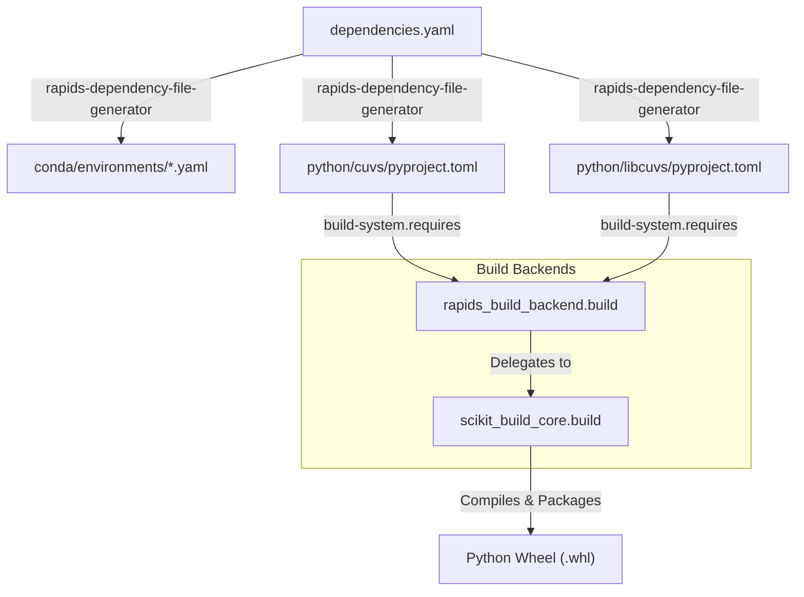
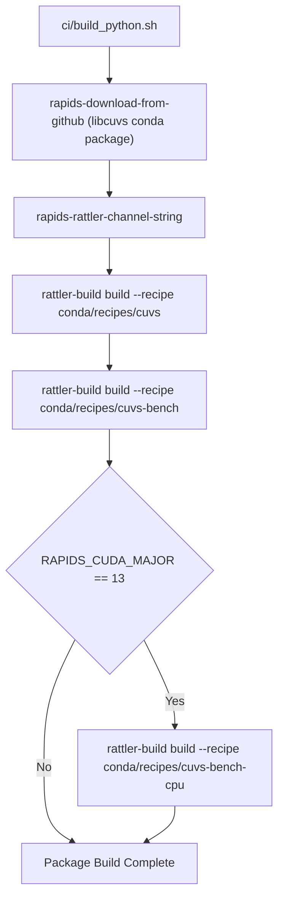
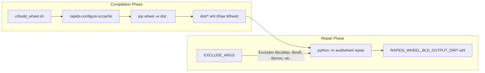

<!-- source: DeepWiki mcp.deepwiki.com · repo NVIDIA/cuvs · page 7.2 Python & Conda Packaging · fetched 2026-10-26 -->

# Python & Conda Packaging

Relevant source files

The following files were used as context for generating this wiki page:

- [ci/build_cpp.sh](ci/build_cpp.sh)
- [ci/build_python.sh](ci/build_python.sh)
- [ci/build_wheel.sh](ci/build_wheel.sh)
- [ci/build_wheel_cuvs.sh](ci/build_wheel_cuvs.sh)
- [ci/build_wheel_libcuvs.sh](ci/build_wheel_libcuvs.sh)
- [ci/test_wheel_cuvs.sh](ci/test_wheel_cuvs.sh)
- [ci/validate_wheel.sh](ci/validate_wheel.sh)
- [conda/environments/all_cuda-129_arch-aarch64.yaml](conda/environments/all_cuda-129_arch-aarch64.yaml)
- [conda/environments/all_cuda-129_arch-x86_64.yaml](conda/environments/all_cuda-129_arch-x86_64.yaml)
- [conda/environments/all_cuda-133_arch-aarch64.yaml](conda/environments/all_cuda-133_arch-aarch64.yaml)
- [conda/environments/all_cuda-133_arch-x86_64.yaml](conda/environments/all_cuda-133_arch-x86_64.yaml)
- [conda/environments/bench_ann_cuda-129_arch-aarch64.yaml](conda/environments/bench_ann_cuda-129_arch-aarch64.yaml)
- [conda/environments/bench_ann_cuda-129_arch-x86_64.yaml](conda/environments/bench_ann_cuda-129_arch-x86_64.yaml)
- [conda/environments/bench_ann_cuda-133_arch-aarch64.yaml](conda/environments/bench_ann_cuda-133_arch-aarch64.yaml)
- [conda/environments/bench_ann_cuda-133_arch-x86_64.yaml](conda/environments/bench_ann_cuda-133_arch-x86_64.yaml)
- [conda/environments/go_cuda-129_arch-aarch64.yaml](conda/environments/go_cuda-129_arch-aarch64.yaml)
- [conda/environments/go_cuda-129_arch-x86_64.yaml](conda/environments/go_cuda-129_arch-x86_64.yaml)
- [conda/environments/go_cuda-133_arch-aarch64.yaml](conda/environments/go_cuda-133_arch-aarch64.yaml)
- [conda/environments/go_cuda-133_arch-x86_64.yaml](conda/environments/go_cuda-133_arch-x86_64.yaml)
- [conda/environments/rust_cuda-129_arch-aarch64.yaml](conda/environments/rust_cuda-129_arch-aarch64.yaml)
- [conda/environments/rust_cuda-129_arch-x86_64.yaml](conda/environments/rust_cuda-129_arch-x86_64.yaml)
- [conda/recipes/cuvs-bench-cpu/conda_build_config.yaml](conda/recipes/cuvs-bench-cpu/conda_build_config.yaml)
- [conda/recipes/cuvs-bench-cpu/recipe.yaml](conda/recipes/cuvs-bench-cpu/recipe.yaml)
- [conda/recipes/cuvs-bench/conda_build_config.yaml](conda/recipes/cuvs-bench/conda_build_config.yaml)
- [conda/recipes/cuvs-bench/recipe.yaml](conda/recipes/cuvs-bench/recipe.yaml)
- [conda/recipes/cuvs/conda_build_config.yaml](conda/recipes/cuvs/conda_build_config.yaml)
- [conda/recipes/cuvs/recipe.yaml](conda/recipes/cuvs/recipe.yaml)
- [conda/recipes/libcuvs/conda_build_config.yaml](conda/recipes/libcuvs/conda_build_config.yaml)
- [conda/recipes/libcuvs/recipe.yaml](conda/recipes/libcuvs/recipe.yaml)
- [cpp/cmake/thirdparty/get_kvikio.cmake](cpp/cmake/thirdparty/get_kvikio.cmake)
- [dependencies.yaml](dependencies.yaml)
- [python/cuvs/CMakeLists.txt](python/cuvs/CMakeLists.txt)
- [python/cuvs/cuvs/common/CMakeLists.txt](python/cuvs/cuvs/common/CMakeLists.txt)
- [python/cuvs/cuvs/common/c_api.pxd](python/cuvs/cuvs/common/c_api.pxd)
- [python/cuvs/cuvs/common/resources.pyx](python/cuvs/cuvs/common/resources.pyx)
- [python/cuvs/cuvs/distance/CMakeLists.txt](python/cuvs/cuvs/distance/CMakeLists.txt)
- [python/cuvs/cuvs/neighbors/CMakeLists.txt](python/cuvs/cuvs/neighbors/CMakeLists.txt)
- [python/cuvs/cuvs/neighbors/__init__.py](python/cuvs/cuvs/neighbors/__init__.py)
- [python/cuvs/cuvs/neighbors/brute_force/CMakeLists.txt](python/cuvs/cuvs/neighbors/brute_force/CMakeLists.txt)
- [python/cuvs/cuvs/neighbors/cagra/CMakeLists.txt](python/cuvs/cuvs/neighbors/cagra/CMakeLists.txt)
- [python/cuvs/cuvs/neighbors/filters/CMakeLists.txt](python/cuvs/cuvs/neighbors/filters/CMakeLists.txt)
- [python/cuvs/cuvs/neighbors/hnsw/CMakeLists.txt](python/cuvs/cuvs/neighbors/hnsw/CMakeLists.txt)
- [python/cuvs/cuvs/neighbors/ivf_flat/CMakeLists.txt](python/cuvs/cuvs/neighbors/ivf_flat/CMakeLists.txt)
- [python/cuvs/cuvs/neighbors/ivf_pq/CMakeLists.txt](python/cuvs/cuvs/neighbors/ivf_pq/CMakeLists.txt)
- [python/cuvs/pyproject.toml](python/cuvs/pyproject.toml)
- [python/cuvs_bench/pyproject.toml](python/cuvs_bench/pyproject.toml)
- [python/libcuvs/CMakeLists.txt](python/libcuvs/CMakeLists.txt)
- [python/libcuvs/pyproject.toml](python/libcuvs/pyproject.toml)

The cuVS Python packaging pipeline provides high-performance GPU-accelerated vector search through multiple distribution channels, including Conda packages and PyPI wheels. The system integrates modern packaging tools such as `scikit-build-core`, `rapids-build-backend`, and `rattler-build` to manage complex CUDA dependencies, C++ shared libraries, and Cython extensions [dependencies.yaml:1-30](), [python/cuvs/pyproject.toml:4-10](), [ci/build_python.sh:36-38]().

## Dependency Management System

cuVS uses a centralized dependency management system governed by `dependencies.yaml` [dependencies.yaml:1-2](). This file acts as the single source of truth for build-time, run-time, and test-time requirements across Conda, `requirements.txt`, and `pyproject.toml` configurations [dependencies.yaml:3-272]().

### The Dependency Generator
The `rapids-dependency-file-generator` utility parses `dependencies.yaml` to dynamically synchronize configuration files across the repository:
*   **Conda Environment Files**: Generates isolated architecture- and CUDA-specific environment YAML files under `conda/environments/` [dependencies.yaml:3-7](), [conda/environments/all_cuda-129_arch-x86_64.yaml:1-2]().
*   **pyproject.toml Metadata**: Automatically populates `build-system.requires`, `project.dependencies`, and `tool.rapids-build-backend` configurations for `libcuvs`, `cuvs`, and `cuvs_bench` [python/cuvs/pyproject.toml:4-27](), [python/libcuvs/pyproject.toml:4-28]().

### Data Flow: Dependency Resolution
The following diagram illustrates how dependency specifications flow from `dependencies.yaml` through the generator tool to the build backends and package outputs.

**Title: Dependency Resolution and Generation Pipeline**

Sources: [dependencies.yaml:1-126](), [python/cuvs/pyproject.toml:4-118](), [python/libcuvs/pyproject.toml:4-89]()

## Python Packaging Stack

cuVS employs a layered Python build stack to compile C++ shared libraries, wrap interfaces via Cython, and package artifacts using standard PEP 517 build backends [python/cuvs/pyproject.toml:4-10](), [python/libcuvs/pyproject.toml:4-9]().

### Key Build Backends and Tools
*   **`rapids-build-backend`**: A RAPIDS-specific wrapper around `scikit-build-core` that handles automated versioning, dependency tracking, and CUDA suffixing [python/cuvs/pyproject.toml:107-120]().
*   **`scikit-build-core`**: The underlying PEP 517 build backend that bridges Python packaging with CMake configurations (`CMakeLists.txt`) [python/cuvs/pyproject.toml:92-96](), [python/libcuvs/pyproject.toml:65-70]().
*   **`cython`**: Used in the main `cuvs` package to compile low-overhead bindings (`.pyx`, `.pxd`) against the C API [dependencies.yaml:266-270](), [conda/recipes/cuvs/recipe.yaml:73]().

### Package Distribution Structure
The Python project is divided into three distinct packages:
1.  **`libcuvs`**: A library wheel containing C++ headers, shared libraries (`libcuvs.so`, `libcuvs_c.so`), and CMake configuration entry points [python/libcuvs/pyproject.toml:12-38](), [tool.scikit-build install.components python/libcuvs/pyproject.toml:75]().
2.  **`cuvs`**: The primary Python package containing Cython modules for neighboring algorithms, clustering, distance metrics, and preprocessing [python/cuvs/pyproject.toml:12-27]().
3.  **`cuvs-bench`**: A standalone benchmarking utility package integrating with OpenSearch, Elasticsearch, and internal test runners [python/cuvs_bench/pyproject.toml:12-54]().

Sources: [python/cuvs/pyproject.toml:4-118](), [python/libcuvs/pyproject.toml:4-89](), [python/cuvs_bench/pyproject.toml:1-54]()

## Conda Distribution (`rattler-build`)

cuVS uses `rattler-build` for creating optimized Conda packages across multiple CUDA versions and hardware architectures [ci/build_python.sh:36-38]().

### Recipe Implementations
The recipes leverage Jinja2 templating to determine dynamic package versions, build strings, and runtime constraints [conda/recipes/cuvs/recipe.yaml:5-14]().

| Recipe Path | Output Package Name | Key Dependencies |
| :--- | :--- | :--- |
| `conda/recipes/libcuvs` | `libcuvs` | `libraft`, `librmm`, `cuda-version`, `libkvikio` |
| `conda/recipes/cuvs` | `cuvs` | `libcuvs`, `pylibraft`, `cuda-python`, `numpy` |
| `conda/recipes/cuvs-bench` | `cuvs-bench` | `cuvs`, `cupy`, `pandas`, `click` |

### Build Orchestration Workflow
The build script `ci/build_python.sh` manages local channel integration and executes `rattler-build` sequentially for each package [ci/build_python.sh:16-59](). C++ packages are built first and published to a local channel so that subsequent Python binding packages can resolve them at build time [ci/build_python.sh:16-28]().

**Title: Conda Package Build Pipeline (`ci/build_python.sh`)**

Sources: [conda/recipes/cuvs/recipe.yaml:1-110](), [ci/build_python.sh:1-63]()

## Wheel Distribution & Repair

Python wheels are compiled using `pip wheel` and subsequently processed with `auditwheel` to ensure all necessary shared objects are correctly bundled or excluded [ci/build_wheel.sh:69-101]().

### Build and Repair Pipeline
The script `ci/build_wheel.sh` handles environment initialization, compiler caching via `sccache`, wheel compilation, and `auditwheel repair` [ci/build_wheel.sh:26-101]().

**Title: Wheel Build and Audit Repair Workflow (`ci/build_wheel.sh`)**

### Exclusion Management (`EXCLUDE_ARGS`)
To prevent package bloat and avoid symbol conflicts with host CUDA drivers or sibling RAPIDS libraries, `ci/build_wheel.sh` explicitly excludes standard system and runtime libraries from wheel bundling [ci/build_wheel.sh:38-58](). Exclusions include:
*   CUDA runtime and math libraries (`libcublas.so.*`, `libcusolver.so.*`, `libnvrtc.so.*`) [ci/build_wheel.sh:39-47]().
*   RAPIDS core dependencies (`libraft.so`, `librmm.so`, `libkvikio.so*`) [ci/build_wheel.sh:44-50]().
*   Internal C++ binaries (`libcuvs.so`, `libcuvs_c.so`) when building top-level Python wheels [ci/build_wheel.sh:53-58]().

### Wheel Validation
Post-build validation is handled by `ci/test_wheel_cuvs.sh`, which performs a clean virtual environment installation, verifies library loading (`libcuvs.load_library()`), and executes the pytest suite [ci/test_wheel_cuvs.sh:18-41]().

Sources: [ci/build_wheel.sh:1-101](), [ci/test_wheel_cuvs.sh:1-41]()

## CUDA Suffixing and Matrix Builds

To support concurrent installations of multiple CUDA toolkit versions on PyPI (e.g., `cuvs-cu12`), the packaging system utilizes CUDA suffixing [python/cuvs/pyproject.toml:107-120]().

*   **Matrix Configuration**: Configured in `pyproject.toml` under `[tool.rapids-build-backend]` using parameters like `matrix-entry = "cuda_suffixed=true;use_cuda_wheels=true"` [python/cuvs/pyproject.toml:107-120](), [python/libcuvs/pyproject.toml:82-94]().
*   **Version Independence**: Conda recipes specify `version_independent: true` for the Python layer, decoupling the Python package version from specific Python interpreter minor versions [conda/recipes/cuvs/recipe.yaml:23-26]().
*   **Stable ABI**: Build scripts support a `--stable` flag configuring `skbuild.wheel.py-api` (such as `cp311` or `abi3`) to generate ABI-3 compliant wheels that work across multiple Python minor versions without recompilation [ci/build_wheel.sh:12-18](), [ci/build_wheel.sh:76-79]().

Sources: [python/cuvs/pyproject.toml:107-120](), [python/libcuvs/pyproject.toml:82-94](), [conda/recipes/cuvs/recipe.yaml:23-26](), [ci/build_wheel.sh:12-79]()

---

