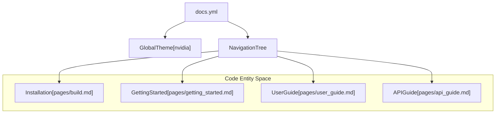
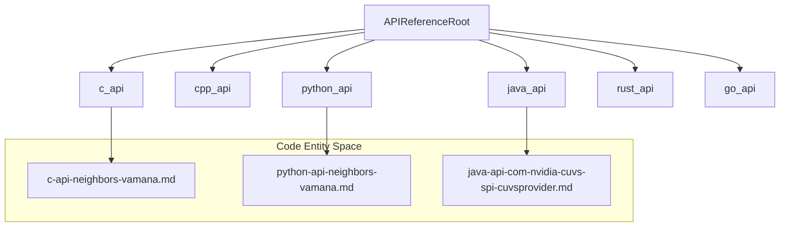
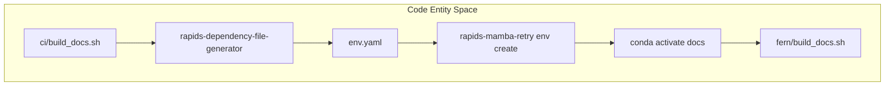

<!-- source: DeepWiki mcp.deepwiki.com · repo NVIDIA/cuvs · page 7.4 Documentation Site (Fern & Doxygen) · fetched 2026-10-26 -->

# Documentation Site (Fern & Doxygen)

<details>
<summary>Relevant source files</summary>

The following files were used as context for generating this wiki page:

- [ci/build_docs.sh](ci/build_docs.sh)
- [ci/build_go.sh](ci/build_go.sh)
- [ci/build_java.sh](ci/build_java.sh)
- [ci/build_rust.sh](ci/build_rust.sh)
- [ci/check_style.sh](ci/check_style.sh)
- [ci/test_cpp.sh](ci/test_cpp.sh)
- [ci/test_python.sh](ci/test_python.sh)
- [cpp/doxygen/header.html](cpp/doxygen/header.html)
- [cpp/tests/python/test_compute_matrix_product.py](cpp/tests/python/test_compute_matrix_product.py)
- [fern/assets/images/cuvs-overview.png](fern/assets/images/cuvs-overview.png)
- [fern/docs.yml](fern/docs.yml)
- [fern/pages/c_api/c-api-core-c-api.md](fern/pages/c_api/c-api-core-c-api.md)
- [fern/pages/c_api/c-api-neighbors-all-neighbors.md](fern/pages/c_api/c-api-neighbors-all-neighbors.md)
- [fern/pages/c_api/c-api-neighbors-cagra.md](fern/pages/c_api/c-api-neighbors-cagra.md)
- [fern/pages/c_api/c-api-neighbors-hnsw.md](fern/pages/c_api/c-api-neighbors-hnsw.md)
- [fern/pages/c_api/c-api-neighbors-mg-cagra.md](fern/pages/c_api/c-api-neighbors-mg-cagra.md)
- [fern/pages/c_api/c-api-neighbors-vamana.md](fern/pages/c_api/c-api-neighbors-vamana.md)
- [fern/pages/c_api/c-api-preprocessing-pca.md](fern/pages/c_api/c-api-preprocessing-pca.md)
- [fern/pages/cpp_api/cpp-api-cluster-gmm.md](fern/pages/cpp_api/cpp-api-cluster-gmm.md)
- [fern/pages/cpp_api/cpp-api-cluster-kmeans.md](fern/pages/cpp_api/cpp-api-cluster-kmeans.md)
- [fern/pages/cpp_api/cpp-api-neighbors-all-neighbors.md](fern/pages/cpp_api/cpp-api-neighbors-all-neighbors.md)
- [fern/pages/cpp_api/cpp-api-neighbors-brute-force.md](fern/pages/cpp_api/cpp-api-neighbors-brute-force.md)
- [fern/pages/cpp_api/cpp-api-neighbors-common.md](fern/pages/cpp_api/cpp-api-neighbors-common.md)
- [fern/pages/cpp_api/index.md](fern/pages/cpp_api/index.md)
- [fern/pages/cuvs_bench/param_tuning.md](fern/pages/cuvs_bench/param_tuning.md)
- [fern/pages/index.md](fern/pages/index.md)
- [fern/pages/java_api/java-api-com-nvidia-cuvs-cagraindex.md](fern/pages/java_api/java-api-com-nvidia-cuvs-cagraindex.md)
- [fern/pages/java_api/java-api-com-nvidia-cuvs-hnswindex.md](fern/pages/java_api/java-api-com-nvidia-cuvs-hnswindex.md)
- [fern/pages/java_api/java-api-com-nvidia-cuvs-hnswindexparams.md](fern/pages/java_api/java-api-com-nvidia-cuvs-hnswindexparams.md)
- [fern/pages/java_api/java-api-com-nvidia-cuvs-spi-cuvsprovider.md](fern/pages/java_api/java-api-com-nvidia-cuvs-spi-cuvsprovider.md)
- [fern/pages/python_api/python-api-neighbors-hnsw.md](fern/pages/python_api/python-api-neighbors-hnsw.md)
- [fern/pages/python_api/python-api-neighbors-vamana.md](fern/pages/python_api/python-api-neighbors-vamana.md)
- [fern/theme/nvidia/components/CustomFooter.tsx](fern/theme/nvidia/components/CustomFooter.tsx)

</details>


## Purpose and Scope
This page details the technical architecture and build pipeline of the NVIDIA cuVS documentation site, which is built using Fern (`fern/docs.yml`) and integrated with Doxygen for C and C++ API extraction. It covers the documentation navigation structure, multi-language API reference generation (`c_api`, `cpp_api`, `python_api`, `java_api`, `rust_api`, `go_api`), user guide pages, the custom NVIDIA theme, and the CI/CD documentation build process.

---

## 1. Documentation Site Configuration & Navigation (`docs.yml`)
The documentation portal is driven by Fern configuration (`fern/docs.yml`). It establishes global branding, multi-instance publishing URLs, color themes, and hierarchical documentation navigation.

```yaml
global-theme: nvidia
title: "NVIDIA cuVS"
instances:
  - url: "nvidia-cuvs.docs.buildwithfern.com/cuvs"
    custom-domain: docs.nvidia.com/cuvs
    multi-source: true
```
*(Reference: `fern/docs.yml:1-8`)*

The navigation structure groups content into sections including Installation, Getting Started, User Guide, and language-specific API references. Redirection rules ensure legacy paths map correctly to restructured guides.


**Sources:** `fern/docs.yml:1-185`

---

## 2. Per-Language API Reference Architecture
cuVS provides client APIs across multiple languages. The documentation site aggregates pre-generated or structured Markdown pages corresponding to each language binding layer:

*   **C API (`c_api`):** Exposes the stable C ABI (`cuvsResources_t`, opaque index handles, error types). Example: [`fern/pages/c_api/c-api-neighbors-vamana.md`]().
*   **C++ API (`cpp_api`):** Documents the header-only and compiled C++ core implementations.
*   **Python API (`python_api`):** Covers Cython modules (`cuvs.neighbors`, `cuvs.cluster`, `cuvs.preprocessing`). Example: [`fern/pages/python_api/python-api-neighbors-vamana.md`]().
*   **Java API (`java_api`):** Documents Panama FFM-based bindings (`com.nvidia.cuvs`, `com.nvidia.cuvs.spi`). Example: [`fern/pages/java_api/java-api-com-nvidia-cuvs-spi-cuvsprovider.md`]().
*   **Rust & Go APIs (`rust_api`, `go_api`):** Outlines cargo crates (`cuvs`, `cuvs-sys`) and go packages.


**Sources:** `fern/pages/java_api/java-api-com-nvidia-cuvs-spi-cuvsprovider.md:1-203`, `fern/pages/c_api/c-api-neighbors-vamana.md:1-219`, `fern/pages/python_api/python-api-neighbors-vamana.md:1-213`

---

## 3. Doxygen Integration & C/C++ Documentation
C and C++ codebases utilize Doxygen for parsing source headers and generating standardized reference structures. Custom headers like `cpp/doxygen/header.html` inject NVIDIA branding and stylesheet assets into the generated HTML output before integration into the Fern site layout.

**Sources:** `cpp/doxygen/header.html:1-50`

---

## 4. Custom NVIDIA Theme & Styling
The site employs a custom NVIDIA theme defined in `fern/docs.yml` and styled via CSS files and React components:
*   **Primary Color Palette:** Configured with NVIDIA green (`#76B900`) accents on light and dark backgrounds (`fern/docs.yml:17-26`).
*   **Custom Footer:** Located at `fern/theme/nvidia/components/CustomFooter.tsx` (`fern/docs.yml:9`).
*   **Custom Stylesheets:** Includes `fern/theme/nvidia/main.css`, `fern/styles/authors.css`, `fern/styles/expandable-code.css`, `fern/styles/metrics-table.css`, and `fern/styles/notebook-viewer.css` (`fern/docs.yml:61-67`).

**Sources:** `fern/docs.yml:3-26`, `fern/docs.yml:61-70`

---

## 5. CI/CD Build Pipeline (`ci/build_docs.sh`)
Documentation validation and builds are automated via `ci/build_docs.sh`. The script creates a dedicated conda environment using `rapids-dependency-file-generator` and executes Fern validation or preview deployments.

```bash
rapids-dependency-file-generator \
  --output conda \
  --file-key docs \
  --matrix "cuda=${RAPIDS_CUDA_VERSION%.*};arch=$(arch);py=${RAPIDS_PY_VERSION}" \
  | tee env.yaml

rapids-mamba-retry env create --yes -f env.yaml -n docs
```
*(Reference: `ci/build_docs.sh:13-19`)*


**Sources:** `ci/build_docs.sh:1-66`

---

