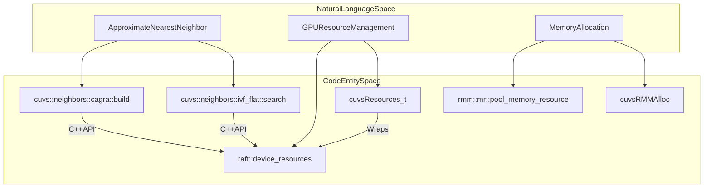
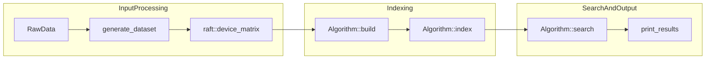

<!-- source: DeepWiki mcp.deepwiki.com · repo NVIDIA/cuvs · page 8 Code Examples & Notebooks · fetched 2026-10-26 -->

# Code Examples & Notebooks

Relevant source files

The following files were used as context for generating this wiki page:

- [cpp/scripts/run-cmake-format.sh](cpp/scripts/run-cmake-format.sh)
- [cpp/tests/distance/masked_nn.cu](cpp/tests/distance/masked_nn.cu)
- [examples/.clang-format](examples/.clang-format)
- [examples/.clang-tidy](examples/.clang-tidy)
- [examples/.clangd](examples/.clangd)
- [examples/build.sh](examples/build.sh)
- [examples/c/CMakeLists.txt](examples/c/CMakeLists.txt)
- [examples/c/src/L2_c_example.c](examples/c/src/L2_c_example.c)
- [examples/c/src/cagra_c_example.c](examples/c/src/cagra_c_example.c)
- [examples/c/src/common.h](examples/c/src/common.h)
- [examples/c/src/ivf_flat_c_example.c](examples/c/src/ivf_flat_c_example.c)
- [examples/c/src/ivf_pq_c_example.c](examples/c/src/ivf_pq_c_example.c)
- [examples/cpp/CMakeLists.txt](examples/cpp/CMakeLists.txt)
- [examples/cpp/src/brute_force_bitmap.cu](examples/cpp/src/brute_force_bitmap.cu)
- [examples/cpp/src/cagra_persistent_example.cu](examples/cpp/src/cagra_persistent_example.cu)
- [examples/cpp/src/common.cuh](examples/cpp/src/common.cuh)
- [examples/cpp/src/dynamic_batching_example.cu](examples/cpp/src/dynamic_batching_example.cu)
- [examples/cpp/src/ivf_flat_example.cu](examples/cpp/src/ivf_flat_example.cu)
- [examples/cpp/src/ivf_pq_example.cu](examples/cpp/src/ivf_pq_example.cu)

The cuVS repository provides a comprehensive suite of self-contained examples and Jupyter notebooks to demonstrate the library's capabilities across different programming languages and use cases. These resources serve as both functional tests and templates for integrating cuVS into production systems.

For deep technical details, build instructions, and complete code walkthroughs, refer to the child pages:
- **[C & C++ Examples](#8.1)** — Covers CAGRA, IVF-PQ, IVF-Flat, brute force, ScaNN, Vamana, balanced k-means, dynamic batching, persistent index, and the CPM-based standalone build.
- **[Rust, Go, Java & Notebook Examples](#8.2)** — Covers Rust, Go, and Java example programs and Jupyter notebooks.

---

## Overview of Examples

cuVS supports multiple language ecosystems by providing examples that utilize the core C++ headers (`[examples/cpp/CMakeLists.txt:39-53]()`), the stable C API (`[examples/c/CMakeLists.txt:34-62]()`), or high-level bindings.

### Language-Specific Examples

| Language | Primary Focus | Build System |
| :--- | :--- | :--- |
| **C++** | Performance-critical applications, low-level RAFT integration, and advanced features like persistent kernels. | CMake (CPM) `[examples/cpp/CMakeLists.txt:12-36]()` |
| **C** | Demonstrating the stable ABI for interoperability and standard C integration. | CMake `[examples/c/CMakeLists.txt:12-30]()` |
| **Rust** | Safety-focused systems programming using the `cuvs` crate. | Cargo |
| **Go** | Integration into Go-based microservices using CGo. | Go Modules |
| **Java** | Panama/FFM native interop and the cuvs-lucene integration. | Maven |

### Jupyter Notebooks
The notebooks focus on Python-based data science workflows, demonstrating integration with the broader RAPIDS ecosystem (e.g., RMM, CuPy) and practical applications like semantic search and parameter tuning.

Sources:
- `[examples/cpp/CMakeLists.txt:1-53]()`
- `[examples/c/CMakeLists.txt:1-62]()`

---

## C & C++ Examples

The C and C++ examples are located in the `examples/c/` and `examples/cpp/` directories. These examples demonstrate the full lifecycle of vector search: index construction, data extension, searching, and result refinement.

Key demonstrations include:
- **Algorithm Basics**: Simple build and search routines for `CAGRA`, `IVF-Flat`, `IVF-PQ`, and `Brute Force` (`[examples/c/CMakeLists.txt:34-62]()`, `[examples/cpp/CMakeLists.txt:39-53]()`).
- **Persistent Kernels**: Using `search_params.persistent = true` to maintain a search kernel on the GPU for low-latency, small-batch asynchronous requests (`[examples/cpp/src/cagra_persistent_example.cu:83-95]()`).
- **Index Extension**: Building an index on a training subset and using `ivf_flat::extend` to add the full dataset (`[examples/cpp/src/ivf_flat_example.cu:70-86]()`).
- **Refinement**: Re-ranking ANN results using exact distance calculations via `cuvs::neighbors::refine` (`[examples/cpp/src/ivf_pq_example.cu:60-67]()`).

For detailed implementation and build guides, see **[C & C++ Examples](#8.1)**.

Sources:
- `[examples/c/CMakeLists.txt:34-62]()`
- `[examples/cpp/CMakeLists.txt:39-53]()`
- `[examples/cpp/src/cagra_persistent_example.cu:83-95]()`
- `[examples/cpp/src/ivf_flat_example.cu:70-86]()`
- `[examples/cpp/src/ivf_pq_example.cu:60-67]()`

---

## Rust, Go, Java & Notebook Examples

These examples target developers building applications in higher-level languages or conducting interactive research.

- **Rust & Go**: Utilize bindings via the `cuvs` crate and CGo respectively, offering templates for managing GPU resources and tensors (`[examples/rust/README.md:1-8]()`, `[examples/go/README.md:18-23]()`).
- **Java**: Demonstrates Panama/FFM integration and Lucene codec acceleration.
- **Notebooks**: Practical tutorials such as `VectorSearch_QuestionRetrieval.ipynb` for asymmetric semantic search and `ivf_flat_example.ipynb` for performance tuning (`[notebooks/VectorSearch_QuestionRetrieval.ipynb:9-15]()`, `[notebooks/ivf_flat_example.ipynb:221-230]()`).

For details on running these examples, see **[Rust, Go, Java & Notebook Examples](#8.2)**.

Sources:
- `[examples/rust/README.md:1-8]()`
- `[examples/go/README.md:18-23]()`
- `[notebooks/VectorSearch_QuestionRetrieval.ipynb:9-15]()`
- `[notebooks/ivf_flat_example.ipynb:221-230]()`

---

## Mapping Concepts to Code

The following diagrams illustrate how high-level example concepts map to specific code entities in the cuVS codebase.

### Example System Architecture

Sources:
- `[examples/cpp/src/ivf_flat_example.cu:112-117]()`
- `[examples/c/src/ivf_flat_c_example.c:37-40]()`
- `[examples/cpp/src/ivf_flat_example.cu:31]()`

### Data Flow in Examples

Sources:
- `[examples/cpp/src/common.cuh:24-36]()`
- `[examples/cpp/src/ivf_flat_example.cu:123-130]()`
- `[examples/cpp/src/common.cuh:40-63]()`

---

