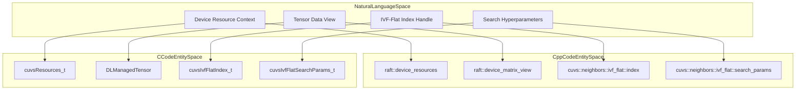
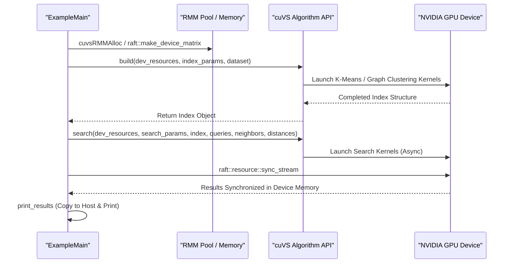

<!-- source: DeepWiki mcp.deepwiki.com · repo NVIDIA/cuvs · page 8.1 C & C++ Examples · fetched 2026-10-26 -->

# C & C++ Examples

Relevant source files

The following files were used as context for generating this wiki page:

- [cpp/scripts/run-cmake-format.sh](cpp/scripts/run-cmake-format.sh)
- [cpp/src/cluster/kmeans_balanced.cuh](cpp/src/cluster/kmeans_balanced.cuh)
- [cpp/tests/distance/masked_nn.cu](cpp/tests/distance/masked_nn.cu)
- [examples/.clang-format](examples/.clang-format)
- [examples/.clang-tidy](examples/.clang-tidy)
- [examples/.clangd](examples/.clangd)
- [examples/README.md](examples/README.md)
- [examples/build.sh](examples/build.sh)
- [examples/c/CMakeLists.txt](examples/c/CMakeLists.txt)
- [examples/c/src/L2_c_example.c](examples/c/src/L2_c_example.c)
- [examples/c/src/cagra_c_example.c](examples/c/src/cagra_c_example.c)
- [examples/c/src/common.h](examples/c/src/common.h)
- [examples/c/src/ivf_flat_c_example.c](examples/c/src/ivf_flat_c_example.c)
- [examples/c/src/ivf_pq_c_example.c](examples/c/src/ivf_pq_c_example.c)
- [examples/cpp/CMakeLists.txt](examples/cpp/CMakeLists.txt)
- [examples/cpp/src/balanced_kmeans_example.cu](examples/cpp/src/balanced_kmeans_example.cu)
- [examples/cpp/src/brute_force_bitmap.cu](examples/cpp/src/brute_force_bitmap.cu)
- [examples/cpp/src/cagra_persistent_example.cu](examples/cpp/src/cagra_persistent_example.cu)
- [examples/cpp/src/common.cuh](examples/cpp/src/common.cuh)
- [examples/cpp/src/dynamic_batching_example.cu](examples/cpp/src/dynamic_batching_example.cu)
- [examples/cpp/src/ivf_flat_example.cu](examples/cpp/src/ivf_flat_example.cu)
- [examples/cpp/src/ivf_pq_example.cu](examples/cpp/src/ivf_pq_example.cu)
- [fern/pages/cluster/kmeans.md](fern/pages/cluster/kmeans.md)

The cuVS repository provides a comprehensive collection of self-contained C and C++ example programs illustrating how to configure, build, extend, and query GPU-accelerated vector search indices [examples/README.md:1-10](). These examples span core Approximate Nearest Neighbor (ANN) algorithms, clustering routines, distance metrics, and advanced serving patterns such as dynamic batching and persistent indexing [examples/cpp/CMakeLists.txt:39-53]().

---

## CPM-Based Standalone Build Infrastructure

The cuVS examples are structured to be compiled as standalone projects using **CPM (CMake Package Manager)** [examples/cpp/CMakeLists.txt:32](). This configuration allows developers to build cuVS applications by automatically fetching required dependencies (such as RAFT, cuVS, and cuco) from remote repositories or locating existing installations via `cuvs_ROOT` [examples/cpp/CMakeLists.txt:31-36](), [examples/build.sh:81-82]().

### Build Script and CMake Targets
The top-level `examples/build.sh` script automates configuration and parallel compilation for both C and C++ example directories [examples/build.sh:88-105](). 
*   **C++ Executables**: Defined in `examples/cpp/CMakeLists.txt`, including `CAGRA_EXAMPLE`, `CAGRA_PERSISTENT_EXAMPLE`, `DYNAMIC_BATCHING_EXAMPLE`, `IVF_FLAT_EXAMPLE`, `IVF_PQ_EXAMPLE`, `BALANCED_KMEANS_EXAMPLE`, `BRUTE_FORCE_EXAMPLE`, `VAMANA_EXAMPLE`, and `SCANN_EXAMPLE` [examples/cpp/CMakeLists.txt:39-53]().
*   **C Executables**: Defined in `examples/c/CMakeLists.txt`, linking against the stable C ABI library (`cuvs::c_api`) and utilizing `DLManagedTensor` for memory interoperability [examples/c/CMakeLists.txt:34-62]().

**Sources:** [examples/cpp/CMakeLists.txt:1-82](), [examples/c/CMakeLists.txt:1-62](), [examples/build.sh:1-105]()

---

## Core Algorithm & Advanced Serving Examples

### CAGRA and Advanced Graph Variants
CAGRA examples illustrate graph-based indexing, searching, and filtering workflows:
*   **Basic & Persistent Search**: `cagra_example.cu` and `cagra_persistent_example.cu` show how to construct a CAGRA graph index and employ persistent search parameters (`search_params.persistent = true`) to keep search kernels resident on the GPU, minimizing latency for high-throughput queries [examples/cpp/src/cagra_persistent_example.cu:70-95]().
*   **Filtering and UDFs**: `CAGRA_FILTER_UDF_EXAMPLE` and `CAGRA_BLOOM_FILTER_EXAMPLE` demonstrate integrating user-defined filters and Bloom filters [examples/cpp/CMakeLists.txt:42-43]() using `cuco::cuco` hash tables [examples/cpp/CMakeLists.txt:64]().
*   **CAGRA-HNSW-ACE**: `CAGRA_HNSW_ACE_BUILD_EXAMPLE` and `CAGRA_HNSW_ACE_EXAMPLE` demonstrate advanced graph conversion and ACE partitioning pipelines [examples/cpp/CMakeLists.txt:44-45]().

### Inverted File Variants (IVF-Flat & IVF-PQ)
*   **IVF-Flat**: `ivf_flat_example.cu` demonstrates both simple build-and-search patterns (`ivf_flat::build`, `ivf_flat::search`) and advanced "build-extend-search" workflows where an index is trained on a subset (`subsample`) and populated incrementally using `ivf_flat::extend` [examples/cpp/src/ivf_flat_example.cu:19-108]().
*   **IVF-PQ**: `ivf_pq_example.cu` and `ivf_pq_c_example.c` showcase Product Quantization for memory-compressed storage, lookup-table (LUT) configuration (`search_params.internal_distance_dtype`), and post-search exact distance re-ranking via `cuvs::neighbors::refine` [examples/cpp/src/ivf_pq_example.cu:17-74](), [examples/c/src/ivf_pq_c_example.c:13-137]().

### Brute Force & Balanced K-Means
*   **Brute Force Bitmap**: `BRUTE_FORCE_EXAMPLE` (`brute_force_bitmap.cu`) covers exact KNN search combined with bitmap masking to exclude specific entries [examples/cpp/CMakeLists.txt:39]().
*   **Balanced K-Means**: `BALANCED_KMEANS_EXAMPLE` demonstrates hierarchical balanced k-means clustering (`cuvs::cluster::kmeans_balanced::fit`) to partition datasets into uniform cluster sizes, serving as a foundational primitive for inverted file algorithms [examples/cpp/CMakeLists.txt:40](), [cpp/src/cluster/kmeans_balanced.cuh:16-96]().

### Dynamic Batching
*   **Dynamic Batching**: `DYNAMIC_BATCHING_EXAMPLE` (`dynamic_batching_example.cu`) groups multiple asynchronous independent query streams into unified GPU kernel dispatches, balancing throughput and tail latency [examples/cpp/CMakeLists.txt:47]().

**Sources:** [examples/cpp/CMakeLists.txt:39-82](), [examples/cpp/src/ivf_flat_example.cu:1-136](), [examples/cpp/src/ivf_pq_example.cu:1-97](), [examples/cpp/src/cagra_persistent_example.cu:1-150](), [cpp/src/cluster/kmeans_balanced.cuh:16-96]()

---

## Data Flow and Implementation Patterns

### Resource and Memory Management
C++ examples use RAFT's `raft::device_resources` handle alongside device mdarrays (`raft::make_device_matrix`), while C examples utilize `cuvsResources_t` and `DLManagedTensor` structures wrapping RMM memory allocations (`cuvsRMMAlloc`) [examples/cpp/src/ivf_flat_example.cu:39-40](), [examples/c/src/ivf_flat_c_example.c:12-40]().

### Code Entity Association

The diagram below associates natural language functional concepts with their concrete C++ and C API code symbols across the example codebases.

**Entity Mapping: C++ vs C API Examples**

**Sources:** [examples/cpp/src/ivf_flat_example.cu:19-48](), [examples/c/src/ivf_flat_c_example.c:12-61]()

### Execution Pipeline Data Flow

The following sequence illustrates the lifecycle of dataset ingestion, index construction, asynchronous query submission, and host synchronization in the example programs.

**Data Flow: Build, Search, and Refinement Pipeline**

**Sources:** [examples/cpp/src/common.cuh:40-63](), [examples/cpp/src/ivf_flat_example.cu:31-51](), [examples/c/src/ivf_flat_c_example.c:30-73]()

---

## Example Program Summary

| Algorithm / Feature | Target Executable Name | Primary API Functions / Classes |
| :--- | :--- | :--- |
| **CAGRA Persistent** | `CAGRA_PERSISTENT_EXAMPLE` | `cagra::build`, `cagra::search` [examples/cpp/src/cagra_persistent_example.cu:74-108]() |
| **IVF-Flat** | `IVF_FLAT_EXAMPLE`, `IVF_FLAT_C_EXAMPLE` | `ivf_flat::build`, `ivf_flat::extend`, `ivf_flat::search` [examples/cpp/src/ivf_flat_example.cu:31-48](), [examples/c/src/ivf_flat_c_example.c:30-61]() |
| **IVF-PQ** | `IVF_PQ_EXAMPLE`, `IVF_PQ_C_EXAMPLE` | `ivf_pq::build`, `ivf_pq::search`, `cuvs::neighbors::refine` [examples/cpp/src/ivf_pq_example.cu:31-61](), [examples/c/src/ivf_pq_c_example.c:33-97]() |
| **Balanced K-Means** | `BALANCED_KMEANS_EXAMPLE` | `cuvs::cluster::kmeans_balanced::fit` [cpp/src/cluster/kmeans_balanced.cuh:69-74]() |
| **Brute Force Filter** | `BRUTE_FORCE_EXAMPLE` | `brute_force::search` with `cuvsFilter` [examples/cpp/CMakeLists.txt:39]() |
| **Vamana Index** | `VAMANA_EXAMPLE` | `vamana::build`, `vamana::search` [examples/cpp/CMakeLists.txt:52]() |

**Sources:** [examples/cpp/CMakeLists.txt:39-53](), [examples/c/CMakeLists.txt:34-62](), [examples/cpp/src/ivf_flat_example.cu:31-51](), [cpp/src/cluster/kmeans_balanced.cuh:69-96]()

---

