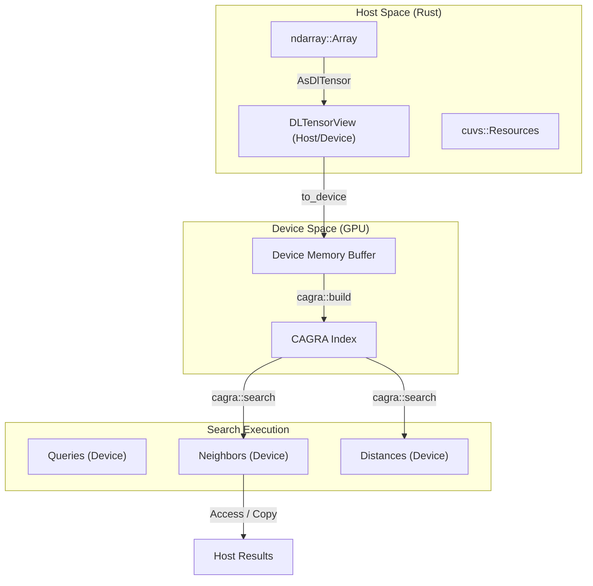
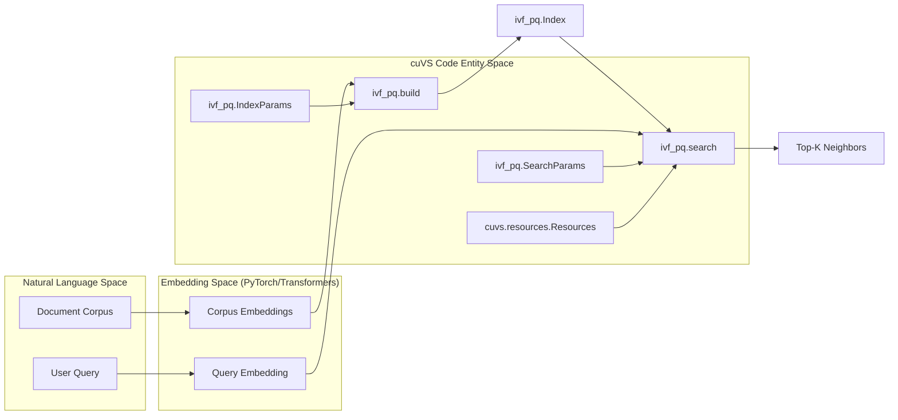

<!-- source: DeepWiki mcp.deepwiki.com · repo NVIDIA/cuvs · page 8.2 Rust, Go, Java & Notebook Examples · fetched 2026-10-26 -->

# Rust, Go, Java & Notebook Examples

<details>
<summary>Relevant source files</summary>

The following files were used as context for generating this wiki page:

- [.github/CODEOWNERS](.github/CODEOWNERS)
- [.github/workflows/labeler.yml](.github/workflows/labeler.yml)
- [.github/workflows/security-suite.yml](.github/workflows/security-suite.yml)
- [.gitignore](.gitignore)
- [.pre-commit-config.yaml](.pre-commit-config.yaml)
- [.yamllint.yaml](.yamllint.yaml)
- [ci/build_lucene.sh](ci/build_lucene.sh)
- [ci/checks/run_spotless.sh](ci/checks/run_spotless.sh)
- [cpp/src/neighbors/cagra_optimize.cu](cpp/src/neighbors/cagra_optimize.cu)
- [cpp/tests/neighbors/ann_cagra/test_optimize_uint32_t.cu](cpp/tests/neighbors/ann_cagra/test_optimize_uint32_t.cu)
- [examples/java/.gitignore](examples/java/.gitignore)
- [examples/java/cuvs-java/README.md](examples/java/cuvs-java/README.md)
- [examples/java/cuvs-java/pom.xml](examples/java/cuvs-java/pom.xml)
- [examples/java/cuvs-java/src/main/java/com/nvidia/cuvs/examples/BruteForceExample.java](examples/java/cuvs-java/src/main/java/com/nvidia/cuvs/examples/BruteForceExample.java)
- [go/brute_force/brute_force.go](go/brute_force/brute_force.go)
- [go/brute_force/brute_force_test.go](go/brute_force/brute_force_test.go)
- [go/cagra/cagra.go](go/cagra/cagra.go)
- [go/cagra/cagra_test.go](go/cagra/cagra_test.go)
- [go/cagra/extend_params.go](go/cagra/extend_params.go)
- [go/cagra/extend_params_test.go](go/cagra/extend_params_test.go)
- [go/cagra/index_params.go](go/cagra/index_params.go)
- [go/cagra/index_params_test.go](go/cagra/index_params_test.go)
- [go/cagra/search_params.go](go/cagra/search_params.go)
- [go/distance_test.go](go/distance_test.go)
- [go/dlpack_test.go](go/dlpack_test.go)
- [go/go.mod](go/go.mod)
- [go/ivf_flat/index_params.go](go/ivf_flat/index_params.go)
- [go/ivf_flat/ivf_flat.go](go/ivf_flat/ivf_flat.go)
- [go/ivf_flat/ivf_flat_test.go](go/ivf_flat/ivf_flat_test.go)
- [notebooks/VectorSearch_QuestionRetrieval.ipynb](notebooks/VectorSearch_QuestionRetrieval.ipynb)
- [notebooks/ivf_flat_example.ipynb](notebooks/ivf_flat_example.ipynb)
- [notebooks/tutorial_ivf_pq.ipynb](notebooks/tutorial_ivf_pq.ipynb)
- [python/cuvs/cuvs/tests/ann_utils.py](python/cuvs/cuvs/tests/ann_utils.py)
- [python/cuvs_bench/cuvs_bench/plot/__init__.py](python/cuvs_bench/cuvs_bench/plot/__init__.py)
- [rust/cuvs-sys/build.rs](rust/cuvs-sys/build.rs)
- [rust/cuvs-sys/cuvs_c_wrapper.h](rust/cuvs-sys/cuvs_c_wrapper.h)
- [rust/cuvs/Cargo.toml](rust/cuvs/Cargo.toml)
- [rust/cuvs/examples/cagra.rs](rust/cuvs/examples/cagra.rs)
- [rust/cuvs/src/cluster/kmeans/mod.rs](rust/cuvs/src/cluster/kmeans/mod.rs)
- [rust/cuvs/src/cluster/kmeans/params.rs](rust/cuvs/src/cluster/kmeans/params.rs)
- [rust/cuvs/src/cluster/mod.rs](rust/cuvs/src/cluster/mod.rs)
- [rust/cuvs/src/distance/mod.rs](rust/cuvs/src/distance/mod.rs)
- [rust/cuvs/src/dlpack.rs](rust/cuvs/src/dlpack.rs)
- [rust/cuvs/src/error.rs](rust/cuvs/src/error.rs)
- [rust/cuvs/src/lib.rs](rust/cuvs/src/lib.rs)
- [rust/cuvs/src/resources.rs](rust/cuvs/src/resources.rs)
- [rust/cuvs/src/version.rs](rust/cuvs/src/version.rs)
- [rust/cuvs/tests/version.rs](rust/cuvs/tests/version.rs)

</details>


This page provides a technical overview of the cuVS example implementations in Rust, Go, and Java, as well as the educational Jupyter notebooks. These examples demonstrate how to integrate cuVS into diverse software stacks and how to leverage its algorithms for real-world vector search tasks.

## Rust Example

The Rust example provides a template for using the `cuvs` crate to perform high-performance graph-based ANN search using CAGRA. It demonstrates the lifecycle of managing device memory through DLPack/managed tensors and executing searches via the high-level Rust API (`rust/cuvs/src/lib.rs`).

### Implementation Details
The example follows a standard pattern of initializing a GPU resource handle, generating synthetic data, and moving that data to the GPU device for processing.

*   **Resource Management**: The `cuvs::Resources` object is initialized to manage the CUDA stream and internal state [rust/cuvs/src/resources.rs:38-42]().
*   **Index Building**: The `cuvs::neighbors::cagra::build` function consumes tensor views and produces a GPU-resident CAGRA index.
*   **Memory Flow**: Data is moved using DLPack tensor views (`AsDlTensor` / `AsDlTensorMut`) [rust/cuvs/src/dlpack.rs:89-100](). Search results (neighbors and distances) are allocated on the device and subsequently accessed or copied.

### Running the Rust Example
Users must have `libcuvs.so` and `libcuvs_c.so` installed in their environment.

1.  **Environment Setup**:
    ```bash
    conda env create --name rust -f conda/environments/rust_cuda-133_arch-$(uname -m).yaml
    conda activate rust
    export LIBCLANG_PATH=$(dirname "$(find "$CONDA_PREFIX" -name libclang.so | head -n 1)")
    ```
2.  **Build and Run**:
    ```bash
    cargo run --example cagra
    ```

### Data Flow: Rust to GPU
The following diagram illustrates how the Rust entities interact with the underlying C-API and GPU memory.

**Rust-to-GPU Memory Mapping**

Sources: [rust/cuvs/src/lib.rs:1-33](), [rust/cuvs/src/resources.rs:32-71](), [rust/cuvs/src/dlpack.rs:89-100]()

## Go Example

The Go bindings allow developers to call cuVS algorithms through CGO. The examples demonstrate the package structure where each algorithm (CAGRA, IVF-Flat, IVF-PQ, Brute Force) resides in its own sub-package under `github.com/rapidsai/cuvs/go` (or local module configuration).

### Configuration and Build
The Go bindings require explicit configuration of `CGO_CFLAGS` and `CGO_LDFLAGS` to locate the cuVS headers and libraries installed via Conda.

*   **CGO Integration**: The project links against `libcuvs` and `libcuvs_c` via package configuration.
*   **Package Structure**: Algorithms are imported modularly, e.g., `github.com/rapidsai/cuvs/go/cagra` and `github.com/rapidsai/cuvs/go/ivf_flat` [go/cagra/cagra.go:1-25](), [go/ivf_flat/ivf_flat.go:1-25]().

### Running the Go Example
1.  **Environment Setup**:
    ```bash
    conda activate go
    export CGO_CFLAGS="-I${CONDA_PREFIX}/include"
    export CGO_LDFLAGS="-L${CONDA_PREFIX}/lib -lcudart_static -ldl -lrt -lcuvs -lcuvs_c"
    export CC=clang
    ```
2.  **Execution**:
    ```bash
    go test ./...
    ```

Sources: [go/cagra/cagra_test.go:1-40](), [go/ivf_flat/ivf_flat_test.go:1-40](), [go/brute_force/brute_force_test.go:1-40]()

## Java Example

The Java bindings provide Panama/FFM-based access to cuVS via `cuvs-java` and `cuvs-lucene` [ci/build_lucene.sh:1-30]().

### Implementation Details
*   **Resource Lifecycle**: Managed via `CuVSResources` matching the C handle lifecycle.
*   **Indices**: `CagraIndex`, `BruteForceIndex`, and `HnswIndex` offer high-level abstractions over native memory tensors (`CuVSMatrix`) [examples/java/cuvs-java/src/main/java/com/nvidia/cuvs/examples/BruteForceExample.java:1-50]().
*   **Lucene Codecs**: The `cuvs-lucene` module implements GPU-accelerated HNSW codecs (`CuVS2510GPUVectors`) for integration into Apache Lucene search pipelines.

### Running the Java Examples
1.  **Build with Maven**:
    ```bash
    mvn clean package -f java/cuvs-java/pom.xml
    ```
2.  **Run BruteForceExample**:
    ```bash
    mvn exec:java -f examples/java/cuvs-java/pom.xml -Dexec.mainClass="com.nvidia.cuvs.examples.BruteForceExample"
    ```

Sources: [ci/build_lucene.sh:1-45](), [examples/java/cuvs-java/pom.xml:1-60](), [examples/java/cuvs-java/src/main/java/com/nvidia/cuvs/examples/BruteForceExample.java:1-80]()

## Jupyter Notebook Tutorials

The repository includes several notebooks that demonstrate cuVS in Python, focusing on integration with the broader ML ecosystem (PyTorch, Sentence-Transformers) and fine-tuning algorithm parameters.

### Vector Search: Question Retrieval
This notebook demonstrates an asymmetric search task: retrieving Wikipedia passages that answer Google search queries [notebooks/VectorSearch_QuestionRetrieval.ipynb:1-20]().

*   **Model**: Uses `nq-distilbert-base-v1` via `SentenceTransformer` to generate 768-dimensional embeddings [notebooks/VectorSearch_QuestionRetrieval.ipynb:50-90]().
*   **cuVS Integration**: Demonstrates using `ivf_pq` to reduce memory footprint, configuring indices with parameters like `n_lists` and `pq_dim` [notebooks/VectorSearch_QuestionRetrieval.ipynb:100-160]().

### IVF-Flat Tutorial
This notebook covers the standard Inverted File (IVF) algorithm without quantization, focusing on accuracy and parameter tuning [notebooks/ivf_flat_example.ipynb:1-30]().

*   **Key APIs**: Uses `cuvs.neighbors.ivf_flat` for building and searching [notebooks/ivf_flat_example.ipynb:20-50]().
*   **Parameters**: Explores `n_lists` (coarse clusters) during build and `n_probes` (clusters searched) during query time [notebooks/ivf_flat_example.ipynb:100-200]().

### IVF-PQ Tutorial
A deep dive into the Product Quantization variant, explaining the trade-offs between compression and recall [notebooks/tutorial_ivf_pq.ipynb:1-30]().

*   **Phases**: Explains the two-phase process of `ivf_pq.build` (training clusters) and `ivf_pq.extend` (adding data) [notebooks/tutorial_ivf_pq.ipynb:100-180]().
*   **Refinement**: Demonstrates the `cuvs.neighbors.refine` API to improve search accuracy by re-ranking candidates using exact distances [notebooks/tutorial_ivf_pq.ipynb:30-60]().

### System-to-Code Mapping: Python Notebooks
The following diagram maps the conceptual steps of a vector search pipeline to the specific cuVS Python API entities used in the notebooks.

**Python API Pipeline Mapping**

Sources: [notebooks/VectorSearch_QuestionRetrieval.ipynb:1-161](), [notebooks/ivf_flat_example.ipynb:1-234](), [notebooks/tutorial_ivf_pq.ipynb:1-216]()

## Summary of Example Files

| Algorithm | Language | File Path | Key Feature |
| :--- | :--- | :--- | :--- |
| **CAGRA** | Rust | `rust/cuvs/examples/cagra.rs` | DLPack tensor interop and device memory management. |
| **CAGRA** | Go | `go/cagra/cagra.go` | CGO integration and package separation. |
| **Brute Force** | Java | `examples/java/cuvs-java/.../BruteForceExample.java` | Panama FFM API usage for exact nearest neighbors. |
| **IVF-PQ** | Python | `notebooks/VectorSearch_QuestionRetrieval.ipynb` | Integration with Sentence-Transformers for RAG. |
| **IVF-Flat** | Python | `notebooks/ivf_flat_example.ipynb` | HDF5 dataset loading and recall benchmarking. |
| **IVF-PQ** | Python | `notebooks/tutorial_ivf_pq.ipynb` | Deep dive into PQ dimensions and refinement. |

Sources: [rust/cuvs/examples/cagra.rs:1-100](), [go/cagra/cagra.go:1-50](), [examples/java/cuvs-java/src/main/java/com/nvidia/cuvs/examples/BruteForceExample.java:1-80](), [notebooks/VectorSearch_QuestionRetrieval.ipynb:1-161](), [notebooks/ivf_flat_example.ipynb:1-234](), [notebooks/tutorial_ivf_pq.ipynb:1-216]()

---

