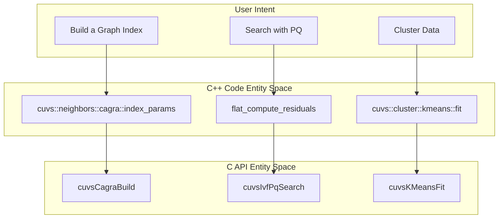
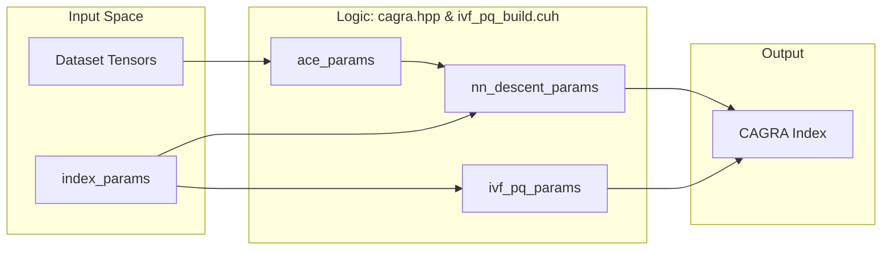

<!-- source: DeepWiki mcp.deepwiki.com · repo NVIDIA/cuvs · page 9 Glossary · fetched 2026-10-26 -->

# Glossary

Relevant source files

The following files were used as context for generating this wiki page:

- [build.sh](build.sh)
- [c/include/cuvs/core/c_api.h](c/include/cuvs/core/c_api.h)
- [c/include/cuvs/neighbors/cagra.h](c/include/cuvs/neighbors/cagra.h)
- [c/src/core/c_api.cpp](c/src/core/c_api.cpp)
- [c/src/neighbors/cagra.cpp](c/src/neighbors/cagra.cpp)
- [c/tests/neighbors/ann_cagra_c.cu](c/tests/neighbors/ann_cagra_c.cu)
- [ci/release/update-version.sh](ci/release/update-version.sh)
- [conda/environments/all_cuda-129_arch-aarch64.yaml](conda/environments/all_cuda-129_arch-aarch64.yaml)
- [conda/environments/all_cuda-129_arch-x86_64.yaml](conda/environments/all_cuda-129_arch-x86_64.yaml)
- [conda/environments/bench_ann_cuda-129_arch-aarch64.yaml](conda/environments/bench_ann_cuda-129_arch-aarch64.yaml)
- [conda/environments/bench_ann_cuda-129_arch-x86_64.yaml](conda/environments/bench_ann_cuda-129_arch-x86_64.yaml)
- [conda/environments/go_cuda-129_arch-aarch64.yaml](conda/environments/go_cuda-129_arch-aarch64.yaml)
- [conda/environments/go_cuda-129_arch-x86_64.yaml](conda/environments/go_cuda-129_arch-x86_64.yaml)
- [conda/environments/rust_cuda-129_arch-aarch64.yaml](conda/environments/rust_cuda-129_arch-aarch64.yaml)
- [conda/environments/rust_cuda-129_arch-x86_64.yaml](conda/environments/rust_cuda-129_arch-x86_64.yaml)
- [cpp/CMakeLists.txt](cpp/CMakeLists.txt)
- [cpp/bench/ann/src/cuvs/cuvs_ann_bench_param_parser.h](cpp/bench/ann/src/cuvs/cuvs_ann_bench_param_parser.h)
- [cpp/bench/ann/src/cuvs/cuvs_cagra_wrapper.h](cpp/bench/ann/src/cuvs/cuvs_cagra_wrapper.h)
- [cpp/include/cuvs/neighbors/cagra.hpp](cpp/include/cuvs/neighbors/cagra.hpp)
- [cpp/include/cuvs/neighbors/dynamic_batching.hpp](cpp/include/cuvs/neighbors/dynamic_batching.hpp)
- [cpp/include/cuvs/neighbors/ivf_flat.hpp](cpp/include/cuvs/neighbors/ivf_flat.hpp)
- [cpp/include/cuvs/neighbors/ivf_pq.hpp](cpp/include/cuvs/neighbors/ivf_pq.hpp)
- [cpp/src/neighbors/cagra.cuh](cpp/src/neighbors/cagra.cuh)
- [cpp/src/neighbors/detail/ann_utils.cuh](cpp/src/neighbors/detail/ann_utils.cuh)
- [cpp/src/neighbors/detail/cagra/add_nodes.cuh](cpp/src/neighbors/detail/cagra/add_nodes.cuh)
- [cpp/src/neighbors/detail/cagra/cagra_merge.cuh](cpp/src/neighbors/detail/cagra/cagra_merge.cuh)
- [cpp/src/neighbors/detail/cagra/graph_core.cuh](cpp/src/neighbors/detail/cagra/graph_core.cuh)
- [cpp/src/neighbors/detail/cagra/graph_shared.cu](cpp/src/neighbors/detail/cagra/graph_shared.cu)
- [cpp/src/neighbors/detail/cagra/graph_shared.cuh](cpp/src/neighbors/detail/cagra/graph_shared.cuh)
- [cpp/src/neighbors/detail/cagra/utils.hpp](cpp/src/neighbors/detail/cagra/utils.hpp)
- [cpp/src/neighbors/detail/dynamic_batching.cuh](cpp/src/neighbors/detail/dynamic_batching.cuh)
- [cpp/src/neighbors/ivf_flat/ivf_flat_build.cuh](cpp/src/neighbors/ivf_flat/ivf_flat_build.cuh)
- [cpp/src/neighbors/ivf_flat/ivf_flat_search.cuh](cpp/src/neighbors/ivf_flat/ivf_flat_search.cuh)
- [cpp/src/neighbors/ivf_pq/ivf_pq_build.cuh](cpp/src/neighbors/ivf_pq/ivf_pq_build.cuh)
- [cpp/src/neighbors/ivf_pq/ivf_pq_build_common.cu](cpp/src/neighbors/ivf_pq/ivf_pq_build_common.cu)
- [cpp/src/neighbors/ivf_pq/ivf_pq_codepacking.cuh](cpp/src/neighbors/ivf_pq/ivf_pq_codepacking.cuh)
- [cpp/src/neighbors/ivf_pq/ivf_pq_search.cuh](cpp/src/neighbors/ivf_pq/ivf_pq_search.cuh)
- [cpp/tests/neighbors/ann_cagra.cuh](cpp/tests/neighbors/ann_cagra.cuh)
- [cpp/tests/neighbors/ann_cagra/test_merge_fastener.cu](cpp/tests/neighbors/ann_cagra/test_merge_fastener.cu)
- [dependencies.yaml](dependencies.yaml)
- [examples/c/src/bruteforce_c_example.c](examples/c/src/bruteforce_c_example.c)
- [java/benchmarks/pom.xml](java/benchmarks/pom.xml)
- [java/build.sh](java/build.sh)
- [java/cuvs-java/pom.xml](java/cuvs-java/pom.xml)
- [java/panama-bindings/generate-bindings.sh](java/panama-bindings/generate-bindings.sh)
- [java/panama-bindings/headers.h](java/panama-bindings/headers.h)
- [python/cuvs/pyproject.toml](python/cuvs/pyproject.toml)
- [python/cuvs_bench/cuvs_bench/config/algos/constraints/__init__.py](python/cuvs_bench/cuvs_bench/config/algos/constraints/__init__.py)
- [python/cuvs_bench/cuvs_bench/config/algos/cuvs_cagra.yaml](python/cuvs_bench/cuvs_bench/config/algos/cuvs_cagra.yaml)
- [python/cuvs_bench/pyproject.toml](python/cuvs_bench/pyproject.toml)
- [python/libcuvs/pyproject.toml](python/libcuvs/pyproject.toml)

This page provides definitions for cuVS-specific terminology, algorithm names, and domain concepts. It serves as a technical reference for engineers to map high-level concepts to their specific implementations and code entities within the repository.

Sources: [cpp/include/cuvs/neighbors/cagra.hpp:1-105]()

---

## Core Concepts

### Resources (`cuvsResources_t`)
The central object managing the lifecycle of CUDA resources, including the `cudaStream_t`, device memory allocators (RMM), and internal workspace handles. Most cuVS functions require a resource handle as their first argument.
*   **C++ Class:** `raft::device_resources` [cpp/include/cuvs/neighbors/cagra.hpp:110]()
*   **C Type:** `cuvsResources_t` [c/include/cuvs/core/c_api.h:1-50]()
*   **Java Class:** `CuVSResources` [java/cuvs-java/pom.xml:1-30]()
*   **Rust Class:** `Resources` [rust/cuvs/src/lib.rs:1-33]()

Sources: [cpp/include/cuvs/neighbors/cagra.hpp:110-125](), [c/include/cuvs/core/c_api.h:1-50]()

### DLPack & Tensors
cuVS uses the **DLPack** protocol for zero-copy data exchange between different languages and frameworks. Tensors are typically represented as `DLManagedTensor` in the C API or `device_matrix_view` in C++.
*   **C API usage:** `DLManagedTensor` [c/include/cuvs/core/c_api.h:1-50]()
*   **Rust Wrapper:** `ManagedTensor` [rust/cuvs/src/lib.rs:1-33]()
*   **C++ View:** `raft::device_matrix_view` [cpp/src/neighbors/detail/cagra/graph_core.cuh:57-62]()

Sources: [cpp/src/neighbors/detail/cagra/graph_core.cuh:57-62](), [c/include/cuvs/core/c_api.h:1-50]()

---

## Algorithm Glossary

### CAGRA (CUDA Accelerated Graph-based RetrievAl)
A high-performance graph-based ANN algorithm designed specifically for GPUs. It supports fixed-degree graphs and high-concurrency search.
*   **Index Params:** `cuvs::neighbors::cagra::index_params` [cpp/include/cuvs/neighbors/cagra.hpp:159-170]()
*   **Search Implementation:** `cuvs::neighbors::cagra::search` [cpp/include/cuvs/neighbors/cagra.hpp:159-170]()

Sources: [cpp/include/cuvs/neighbors/cagra.hpp:159-170]()

### ACE (Augmented Core Extraction)
A specialized partitioned graph construction technique for CAGRA. It enables building graphs for datasets that exceed GPU memory by partitioning the data and augmenting cores.
*   **Parameters:** `cuvs::neighbors::graph_build_params::ace_params` [cpp/include/cuvs/neighbors/cagra.hpp:38-101]()

Sources: [cpp/include/cuvs/neighbors/cagra.hpp:38-101]()

### IVF-PQ (Inverted File with Product Quantization)
An algorithm that clusters the vector space into "lists" (Inverted File) and compresses the vectors using Product Quantization (PQ).
*   **C++ Header:** `cpp/include/cuvs/neighbors/ivf_pq.hpp` [cpp/include/cuvs/neighbors/ivf_pq.hpp:1-25]()
*   **Residual Computation:** `flat_compute_residuals` [cpp/src/neighbors/ivf_pq/ivf_pq_build.cuh:141-152]()

Sources: [cpp/include/cuvs/neighbors/ivf_pq.hpp:1-25](), [cpp/src/neighbors/ivf_pq/ivf_pq_build.cuh:141-152]()

### NN-Descent
An algorithm for constructing K-Nearest Neighbor (kNN) graphs by iteratively refining a random graph through local joins. In cuVS, it is often used as a fast "seeding" step for CAGRA.
*   **Index Params Variant:** `graph_build_params::nn_descent_params` [cpp/include/cuvs/neighbors/cagra.hpp:119-124]()

Sources: [cpp/include/cuvs/neighbors/cagra.hpp:119-124]()

### K-Means
A clustering algorithm used internally by IVF-style indices for coarse quantization and independently for data analysis.
*   **Balanced K-Means Header:** `kmeans_balanced.cuh` [cpp/src/neighbors/ivf_pq/ivf_pq_build.cuh:23-25]()
*   **Fit Function:** `cuvs::cluster::kmeans::fit` [cpp/src/neighbors/ivf_pq/ivf_pq_build.cuh:23-25]()

Sources: [cpp/src/neighbors/ivf_pq/ivf_pq_build.cuh:23-25]()

---

## Implementation Concepts

### System Mapping: Natural Language to Code
The following diagram maps high-level user intents to the specific C++ and C code entities responsible for them.

Title: "Intent-to-Entity Mapping"

Sources: [cpp/include/cuvs/neighbors/cagra.hpp:119-170](), [cpp/src/neighbors/ivf_pq/ivf_pq_build.cuh:141-152]()

### Data Flow: Index Construction
This diagram illustrates the flow of data through the system during a CAGRA index build, highlighting the internal use of NN-Descent or IVF-PQ for seeding.

Title: "CAGRA Build Data Flow"

Sources: [cpp/include/cuvs/neighbors/cagra.hpp:38-124](), [cpp/src/neighbors/ivf_pq/ivf_pq_build.cuh:141-152]()

---

## Abbreviations & Terms

| Term | Definition | Code Pointer |
| :--- | :--- | :--- |
| **ANN** | Approximate Nearest Neighbors. | [cpp/include/cuvs/neighbors/cagra.hpp:132-157]() |
| **PQ** | Product Quantization; a lossy compression technique for vectors. | [cpp/include/cuvs/neighbors/ivf_pq.hpp:1-20]() |
| **IVF** | Inverted File; a data structure for narrowing search space. | [cpp/src/neighbors/ivf_pq/ivf_pq_build.cuh:1-20]() |
| **RMM** | RAPIDS Memory Manager; provides pooled and asynchronous allocators. | [cpp/CMakeLists.txt:1-120]() |
| **RAFT** | A library of reusable CUDA primitives that cuVS is built upon. | [cpp/include/cuvs/neighbors/cagra.hpp:16-24]() |
| **VPQ** | Vector Product Quantization. | [cpp/src/neighbors/ivf_pq/ivf_pq_build.cuh:1-20]() |
| **QPS** | Queries Per Second; a common throughput metric. | [cpp/include/cuvs/neighbors/cagra.hpp:132-157]() |
| **Recall** | The fraction of true nearest neighbors found by an ANN algorithm. | [cpp/include/cuvs/neighbors/cagra.hpp:132-157]() |

Sources: [cpp/include/cuvs/neighbors/cagra.hpp:132-157](), [cpp/include/cuvs/neighbors/ivf_pq.hpp:1-20](), [cpp/CMakeLists.txt:1-120]()