# Page: cuVS Overview

# cuVS Overview

<details>
<summary>Relevant source files</summary>

The following files were used as context for generating this wiki page:

- [.github/workflows/build.yaml](.github/workflows/build.yaml)
- [.github/workflows/pr.yaml](.github/workflows/pr.yaml)
- [.github/workflows/test.yaml](.github/workflows/test.yaml)
- [.github/workflows/trigger-breaking-change-alert.yaml](.github/workflows/trigger-breaking-change-alert.yaml)
- [CHANGELOG.md](CHANGELOG.md)
- [RAPIDS_BRANCH](RAPIDS_BRANCH)
- [README.md](README.md)
- [examples/go/README.md](examples/go/README.md)
- [fern/assets/images/cuvs-overview.png](fern/assets/images/cuvs-overview.png)
- [fern/pages/index.md](fern/pages/index.md)
- [python/cuvs_bench/cuvs_bench/plot/__main__.py](python/cuvs_bench/cuvs_bench/plot/__main__.py)

</details>


cuVS is a high-performance, GPU-accelerated library dedicated to vector similarity search and clustering. It provides state-of-the-art implementations of Approximate Nearest Neighbor (ANN) algorithms, enabling efficient retrieval and data mining tasks on NVIDIA GPUs [README.md:24-26](). 

The library is designed to serve as a foundational building block for vector databases, recommendation systems, and Retrieval Augmented Generation (RAG) pipelines [README.md:37-45](). It leverages the RAPIDS RAFT library for low-level machine learning primitives and high-performance CUDA kernels [README.md:70-74]().

### Purpose and Scope
cuVS aims to simplify GPU acceleration for vector search by providing:
*   **Fast Index Building:** Significant speedups in creating searchable indices compared to CPU-only implementations [README.md:60]().
*   **High Throughput & Low Latency:** Optimized for both batch processing and real-time query serving [README.md:61]().
*   **Interoperability:** Support for building indices on GPUs and deploying them on CPUs where necessary [README.md:64]().
*   **Multi-language Support:** Native-feeling APIs for Python, C++, C, Rust, Go, and Java [README.md:65]().

Sources: [README.md:24-74]()

---

### Core Algorithms
cuVS implements a variety of ANN and clustering algorithms, each optimized for different hardware constraints and recall requirements.

| Algorithm Category | Key Implementations | Primary Use Case |
| :--- | :--- | :--- |
| **Graph-Based** | `CAGRA`, `HNSW`, `Vamana` | High-recall, low-latency search [README.md:89-115]() |
| **Inverted File** | `IVF-PQ`, `IVF-Flat`, `IVF-SQ` | Memory-efficient search for large-scale datasets [CHANGELOG.md:54]() |
| **Clustering** | `K-Means`, `Spectral Clustering` | Data mining and unsupervised learning [README.md:48-50]() |
| **Primitives** | `Brute Force`, `NN-Descent` | Exact search and graph construction seeds [CHANGELOG.md:48-52]() |

Sources: [README.md:48-115](), [CHANGELOG.md:48-54]()

---

### System Integration & Code Architecture
The following diagrams illustrate how high-level search concepts map to specific code entities within the cuVS repository, bridging natural language space to code entity space.

#### Diagram 1: API Layering and Language Bindings
This diagram shows how the different language-specific libraries interface with the core C++ engine through the stable C ABI.

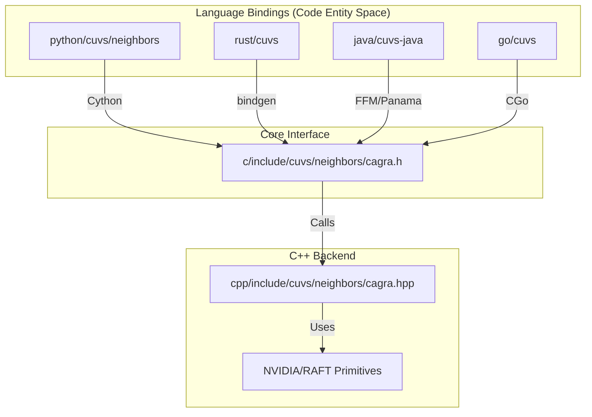
Sources: [README.md:91-170](), [.github/CODEOWNERS:1-20](), [rust/Cargo.toml:4-8]()

#### Diagram 2: Algorithm Execution Flow (CAGRA Example)
This diagram bridges the conceptual "Index Build" and "Search" steps to the actual function names used in the C and C++ APIs.

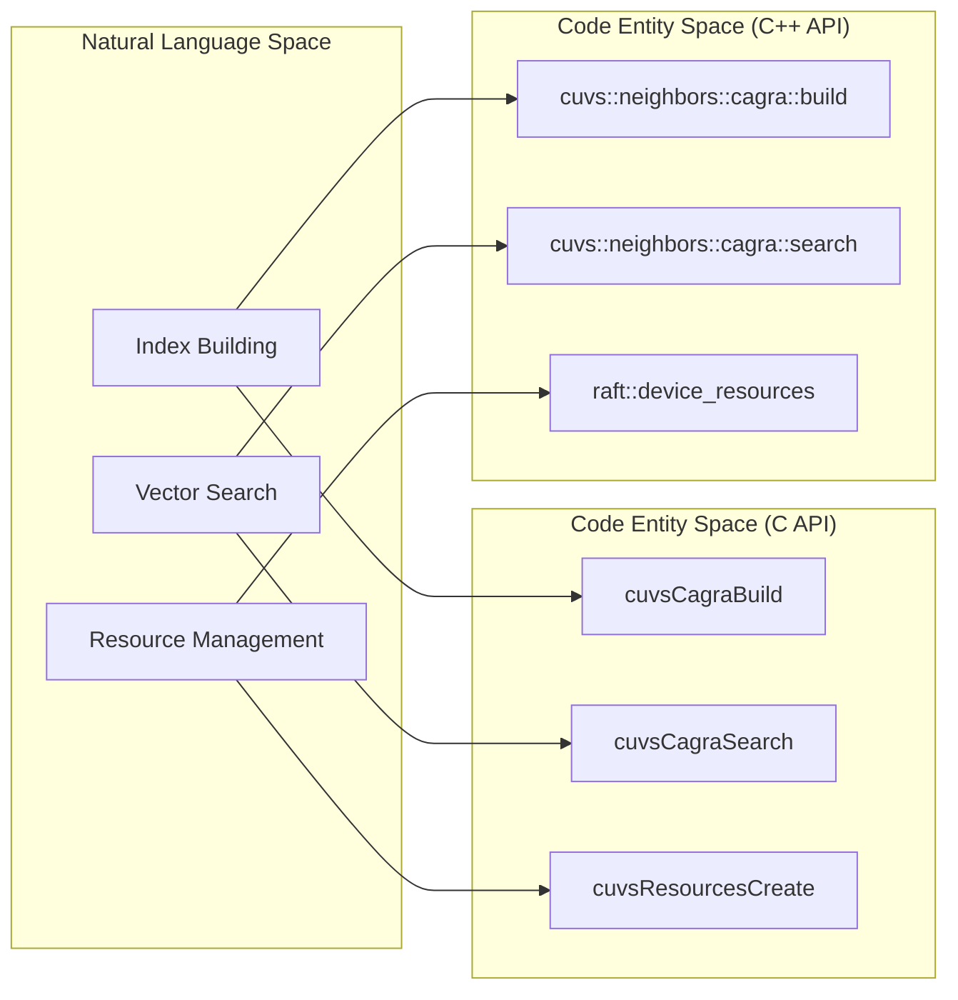
Sources: [README.md:102-140](), [CHANGELOG.md:29-37]()

---

### Repository Organization
The repository is structured to separate the core C++ implementation from its various language wrappers and benchmarking tools.

*   `cpp/`: Core C++ template library and ANN implementations [.github/CODEOWNERS:5-7]().
*   `c/`: Stable C ABI headers and implementation for cross-language support [.github/CODEOWNERS:1-3]().
*   `python/`: Cython-based Python bindings and the `cuvs_bench` tool [.github/CODEOWNERS:14-15]().
*   `rust/`, `java/`, `go/`: Native bindings for respective languages [.github/CODEOWNERS:10-20]().
*   `ci/`: Build scripts and CI/CD configuration [.github/CODEOWNERS:32-33]().
*   `examples/`: Standalone usage examples for all supported languages [.github/CODEOWNERS:3-19]().

Sources: [.github/CODEOWNERS:1-49]()

---

### Further Reading & Child Pages
For detailed information on specific topics, refer to the following sections:

*   **[Getting Started & Installation](#1.1):** How to install cuVS via Conda, pip wheels, or from source. Covers devcontainer setup, supported CUDA versions, architectures, and the `build.sh` entrypoint.
*   **[Integrations & Use Cases](#1.2):** How cuVS integrates with external databases (OpenSearch, Elasticsearch, Lucene, CyborgDB), ML frameworks, and vector database stacks; role in RAG, semantic search, and clustering.

Sources: [README.md:1-140](), [CHANGELOG.md:1-55]()

---

# Page: Getting Started & Installation

# Getting Started & Installation

<details>
<summary>Relevant source files</summary>

The following files were used as context for generating this wiki page:

- [.devcontainer/Dockerfile](.devcontainer/Dockerfile)
- [.devcontainer/cuda12.9-conda/devcontainer.json](.devcontainer/cuda12.9-conda/devcontainer.json)
- [.devcontainer/cuda12.9-pip/devcontainer.json](.devcontainer/cuda12.9-pip/devcontainer.json)
- [.devcontainer/cuda13.3-conda/devcontainer.json](.devcontainer/cuda13.3-conda/devcontainer.json)
- [.devcontainer/cuda13.3-pip/devcontainer.json](.devcontainer/cuda13.3-pip/devcontainer.json)
- [build.sh](build.sh)
- [c/include/cuvs/core/c_api.h](c/include/cuvs/core/c_api.h)
- [c/src/core/c_api.cpp](c/src/core/c_api.cpp)
- [ci/release/update-version.sh](ci/release/update-version.sh)
- [conda/environments/all_cuda-133_arch-aarch64.yaml](conda/environments/all_cuda-133_arch-aarch64.yaml)
- [conda/environments/all_cuda-133_arch-x86_64.yaml](conda/environments/all_cuda-133_arch-x86_64.yaml)
- [conda/environments/bench_ann_cuda-133_arch-aarch64.yaml](conda/environments/bench_ann_cuda-133_arch-aarch64.yaml)
- [conda/environments/bench_ann_cuda-133_arch-x86_64.yaml](conda/environments/bench_ann_cuda-133_arch-x86_64.yaml)
- [conda/environments/go_cuda-133_arch-aarch64.yaml](conda/environments/go_cuda-133_arch-aarch64.yaml)
- [conda/environments/go_cuda-133_arch-x86_64.yaml](conda/environments/go_cuda-133_arch-x86_64.yaml)
- [cpp/include/cuvs/neighbors/dynamic_batching.hpp](cpp/include/cuvs/neighbors/dynamic_batching.hpp)
- [cpp/src/neighbors/detail/dynamic_batching.cuh](cpp/src/neighbors/detail/dynamic_batching.cuh)
- [examples/c/src/bruteforce_c_example.c](examples/c/src/bruteforce_c_example.c)
- [java/benchmarks/pom.xml](java/benchmarks/pom.xml)
- [java/build.sh](java/build.sh)
- [java/cuvs-java/pom.xml](java/cuvs-java/pom.xml)
- [java/panama-bindings/generate-bindings.sh](java/panama-bindings/generate-bindings.sh)
- [java/panama-bindings/headers.h](java/panama-bindings/headers.h)

</details>


This page provides technical details for installing and building cuVS, a high-performance GPU-accelerated vector search library. cuVS supports multiple installation paths including Conda packages, Pip wheels, and building from source for various language bindings (C++, Python, Rust, Go, and Java).

## Supported Environments & Architectures

cuVS is optimized for NVIDIA GPUs and supports the following configurations:

*   **Architectures:** `x86_64` and `aarch64` (ARM64) [conda/environments/all_cuda-133_arch-x86_64.yaml:51](), [conda/environments/all_cuda-133_arch-aarch64.yaml:52]().
*   **CUDA Versions:** Support for CUDA 12.x and 13.x [conda/environments/all_cuda-133_arch-x86_64.yaml:19]().
*   **Operating Systems:** Linux (primarily tested on Ubuntu 22.04+ and RHEL-compatible distributions).
*   **Compilers:** GCC 14.x and Clang 20.1.8 are used in standard build environments [conda/environments/all_cuda-133_arch-x86_64.yaml:10-11,25]().

Sources: [conda/environments/all_cuda-133_arch-x86_64.yaml:1-51](), [conda/environments/all_cuda-133_arch-aarch64.yaml:1-52]()

## Installation via Conda

Conda is the recommended method for installing cuVS as it manages complex CUDA dependencies and system libraries like `libblas` and `liblapack`.

### Package Structure
cuVS is split into several packages to allow for minimal installations:
*   `libcuvs`: The core C++ and C shared libraries [conda/environments/bench_ann_cuda-133_arch-x86_64.yaml:35]().
*   `cuvs`: The Python bindings (requires `libcuvs` and `pylibraft`) [conda/environments/bench_ann_cuda-133_arch-x86_64.yaml:22,35,46]().
*   `cuvs-bench`: Tools for benchmarking ANN algorithms [conda/environments/bench_ann_cuda-133_arch-x86_64.yaml:54]().

### Environment Setup
You can create a development environment using the generated environment files:
```bash
# Example for CUDA 13.3 on x86_64
conda env create -f conda/environments/all_cuda-133_arch-x86_64.yaml
```
Sources: [conda/environments/all_cuda-133_arch-x86_64.yaml:1-51](), [conda/environments/bench_ann_cuda-133_arch-x86_64.yaml:1-54]()

## Installation via Pip Wheels

cuVS provides PEP 440 compliant wheels. The build process uses `scikit-build-core` and `rapids-build-backend` to handle the CMake-based C++ build during the pip installation process [conda/environments/all_cuda-133_arch-x86_64.yaml:46,48]().

### Dependencies
The Python package and build setup require several core packages managed via `dependencies.yaml` and generated conda environments:
*   `cuda-bindings >= 13.0.1` [conda/environments/all_cuda-133_arch-x86_64.yaml:13]().
*   `libcuvs` (C++ backend) [conda/environments/bench_ann_cuda-133_arch-x86_64.yaml:35]().
*   `pylibraft` (RAFT library primitives) [conda/environments/all_cuda-133_arch-x86_64.yaml:43]().
*   `numpy >= 2.0` [conda/environments/all_cuda-133_arch-x86_64.yaml:39]().

Sources: [conda/environments/all_cuda-133_arch-x86_64.yaml:13-49](), [conda/environments/bench_ann_cuda-133_arch-x86_64.yaml:22-48]()

## Building from Source

The repository provides a unified entrypoint script, `build.sh`, which orchestrates the build process for all components.

### The `build.sh` Entrypoint
The `build.sh` script manages CMake configurations, installation prefixes, and parallel build levels. It defaults to using the `Ninja` generator [build.sh:126]().

| Target | Description | Source Reference |
| :--- | :--- | :--- |
| `clean` | Removes all build artifacts | [build.sh:25]() |
| `libcuvs` | Builds the C++ core and C-API wrapper | [build.sh:26-27]() |
| `python` | Builds the cuvs Python package | [build.sh:28]() |
| `rust` | Builds the cuvs Rust bindings | [build.sh:29]() |
| `go` | Builds the cuvs Go bindings | [build.sh:30]() |
| `java` | Builds the cuvs Java bindings | [build.sh:31]() |
| `lucene` | Builds the cuvs-lucene Apache Lucene codecs | [build.sh:32]() |
| `docs` | Builds the documentation | [build.sh:33]() |
| `tests` | Builds the tests | [build.sh:34]() |
| `bench-ann`| Builds end-to-end ANN benchmarks | [build.sh:35]() |
| `examples` | Builds the examples | [build.sh:36]() |

### Local Development Workflow
For C++ development, the script sets up a local build directory (defaulting to `cpp/build`) and can install to a specific prefix [build.sh:75,119]().

```bash
# Build C++ library and tests with verbose output
./build.sh libcuvs tests -v

# Build for specific GPU architectures (e.g., H100 and A100)
./build.sh libcuvs --gpu-arch="80-real;90-real"
```

### Build Process Data Flow
The following diagram illustrates how `build.sh` interacts with the various build systems across the repository, bridging natural language concepts to code entities.

**Diagram: Build Orchestration Flow**
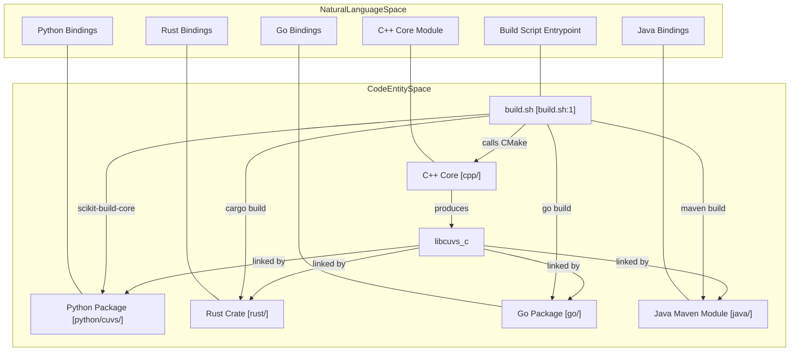
Sources: [build.sh:22-37](), [java/build.sh:43-52](), [java/panama-bindings/generate-bindings.sh:45-52]()

## Devcontainer Setup

For a consistent development environment, cuVS provides VS Code Devcontainer configurations pre-configured with necessary CUDA toolkits and dependencies.

*   **Base Image:** `rapidsai/devcontainers` [.devcontainer/cuda12.9-pip/devcontainer.json:8]().
*   **Features:** Includes `cuda` (with cuBLAS, cuSOLVER, cuRAND, cuSPARSE) and `rapids-build-utils` [.devcontainer/cuda12.9-pip/devcontainer.json:23-30]().

**Diagram: Devcontainer Entity Mapping**
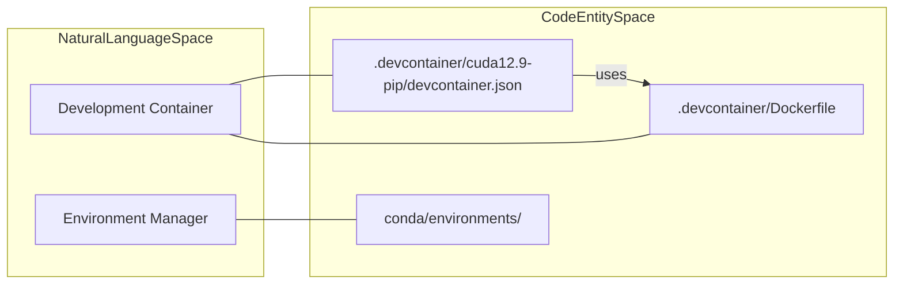
Sources: [.devcontainer/cuda12.9-pip/devcontainer.json:1-55](), [conda/environments/all_cuda-133_arch-x86_64.yaml:1-51]()

## Versioning and Release

cuVS follows the RAPIDS versioning scheme (`YY.MM.PP`). Versioning is centrally managed via a `VERSION` file at the repository root [ci/release/update-version.sh:104]().

The `update-version.sh` script automates updating version strings across:
1.  `dependencies.yaml` and Conda environments [ci/release/update-version.sh:119-124]().
2.  `pyproject.toml` files for Python packages [ci/release/update-version.sh:125-129]().
3.  `Cargo.toml` for Rust (stripping leading zeros as required by SemVer) [ci/release/update-version.sh:157-159]().
4.  `pom.xml` and version markers for Java [ci/release/update-version.sh:104](), [java/cuvs-java/pom.xml:12]().

Sources: [ci/release/update-version.sh:71-166](), [java/cuvs-java/pom.xml:1-13]()

---

# Page: Integrations & Use Cases

# Integrations & Use Cases

<details>
<summary>Relevant source files</summary>

The following files were used as context for generating this wiki page:

- [fern/assets/images/cuvs-overview.png](fern/assets/images/cuvs-overview.png)
- [fern/pages/index.md](fern/pages/index.md)
- [java/cuvs-lucene/README.md](java/cuvs-lucene/README.md)
- [java/cuvs-lucene/build.sh](java/cuvs-lucene/build.sh)
- [java/cuvs-lucene/pom.xml](java/cuvs-lucene/pom.xml)
- [python/cuvs_bench/cuvs_bench/backends/base.py](python/cuvs_bench/cuvs_bench/backends/base.py)
- [python/cuvs_bench/cuvs_bench/backends/cpp_gbench.py](python/cuvs_bench/cuvs_bench/backends/cpp_gbench.py)
- [python/cuvs_bench/cuvs_bench/backends/elasticsearch.py](python/cuvs_bench/cuvs_bench/backends/elasticsearch.py)
- [python/cuvs_bench/cuvs_bench/backends/opensearch.py](python/cuvs_bench/cuvs_bench/backends/opensearch.py)
- [python/cuvs_bench/cuvs_bench/orchestrator/orchestrator.py](python/cuvs_bench/cuvs_bench/orchestrator/orchestrator.py)
- [python/cuvs_bench/cuvs_bench/run/__main__.py](python/cuvs_bench/cuvs_bench/run/__main__.py)
- [python/cuvs_bench/cuvs_bench/run/data_export.py](python/cuvs_bench/cuvs_bench/run/data_export.py)
- [python/cuvs_bench/cuvs_bench/tests/test_cpp_gbench.py](python/cuvs_bench/cuvs_bench/tests/test_cpp_gbench.py)
- [python/cuvs_bench/cuvs_bench/tests/test_data_export.py](python/cuvs_bench/cuvs_bench/tests/test_data_export.py)
- [python/cuvs_bench/cuvs_bench/tests/test_modularization.py](python/cuvs_bench/cuvs_bench/tests/test_modularization.py)
- [python/cuvs_bench/cuvs_bench/tests/test_opensearch.py](python/cuvs_bench/cuvs_bench/tests/test_opensearch.py)
- [python/cuvs_bench/cuvs_bench/tests/test_registry.py](python/cuvs_bench/cuvs_bench/tests/test_registry.py)

</details>


cuVS is designed to be a high-performance acceleration layer for vector similarity search and clustering. It provides a stable C ABI and multiple language bindings that allow it to be integrated into external databases, search engines, machine learning frameworks, and large-scale Retrieval-Augmented Generation (RAG) pipelines `[README.md:26-32]()`.

---

## Ecosystem Integration Architecture

The following diagram illustrates how high-level vector workloads map to specific integration modules, codecs, and core cuVS code entities.

### Natural Language to Code Entity Mapping (Database & Search Focus)
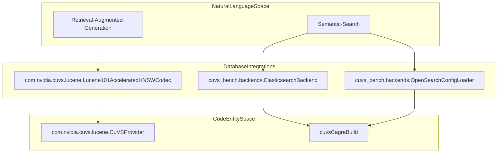
**Sources:** `[java/cuvs-lucene/README.md:15-23]()`, `[python/cuvs_bench/cuvs_bench/backends/elasticsearch.py:117-129]()`, `[python/cuvs_bench/cuvs_bench/backends/opensearch.py:31-42]()`

---

## Vector Database & Framework Integrations

cuVS plugs directly into major database and search infrastructure stacks to offload intensive index construction and vector search workloads to NVIDIA GPUs.

### 1. Apache Lucene (`cuvs-lucene`)
The `cuvs-lucene` module provides pluggable `KnnVectorsFormat` implementations that allow Apache Lucene to delegate index building and search execution to cuVS `[java/cuvs-lucene/README.md:13-16]()`. 
- **Codecs Provided**:
  - `Lucene101AcceleratedHNSWCodec`: GPU-accelerated HNSW index construction with standard Lucene-compatible on-disk formatting `[java/cuvs-lucene/README.md:19-20]()`.
  - Quantized Variants (`LuceneAcceleratedHNSWScalarQuantizedCodec`, `LuceneAcceleratedHNSWBinaryQuantizedCodec`): Scalar and binary quantized vector layouts for minimized index footprints `[java/cuvs-lucene/README.md:20-21]`.
  - `CuVS2510GPUSearchCodec`: End-to-end GPU-accelerated HNSW building and GPU-resident search `[java/cuvs-lucene/README.md:22]()`.
- **RMM Async Memory**: Applications can opt into RAPIDS Memory Manager (RMM) stream-ordered asynchronous allocation using `CuVSProvider.provider().enableRMMAsyncMemory()` to optimize high-throughput concurrent GPU searches `[java/cuvs-lucene/README.md:67-80]()`.

### 2. OpenSearch & Elasticsearch (`cuvs-bench` Backends)
Through the `cuvs-bench` orchestrator framework, cuVS connects natively with Elasticsearch and OpenSearch instances to benchmark and drive vector search capabilities:
- **OpenSearch Backend (`OpenSearchConfigLoader`)**: Supports Faiss and Lucene ANN engines, including integration with OpenSearch 3.0+ Remote Index Build services which offload HNSW graph construction to external GPU accelerators `[python/cuvs_bench/cuvs_bench/backends/opensearch.py:7-13]()`.
- **Elasticsearch Backend (`ElasticsearchBackend`)**: Interacts with Elasticsearch GPU APIs to configure node-level GPU indexing (`vectors.indexing.use_gpu`) and supports specialized index types such as `hnsw`, `int8_hnsw`, `int4_hnsw`, and `bbq_hnsw` `[python/cuvs_bench/cuvs_bench/backends/elasticsearch.py:6-16]()`.

**Sources:** `[java/cuvs-lucene/README.md:1-80]()`, `[python/cuvs_bench/cuvs_bench/backends/elasticsearch.py:1-129]()`, `[python/cuvs_bench/cuvs_bench/backends/opensearch.py:31-62]()`

---

## Integration Execution Flow

The flow below illustrates how a query originating from an integrated search framework (such as Apache Lucene) traverses the Java layer to invoke native GPU execution paths.

### Pluggable Codec Execution Flow
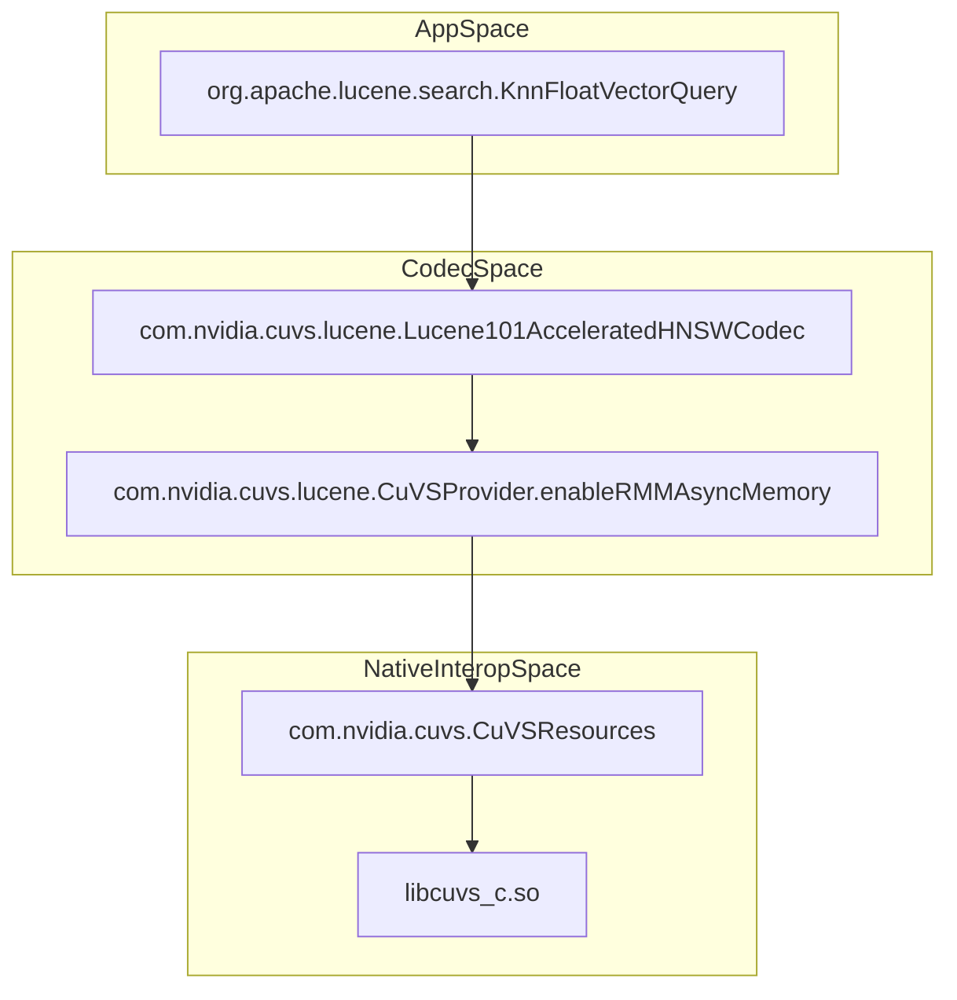
**Sources:** `[java/cuvs-lucene/README.md:63-80]`, `[java/cuvs-lucene/build.sh:30-36]()`

---

## Key Use Cases

### 1. Retrieval-Augmented Generation (RAG) & Semantic Search
cuVS acts as the low-latency vector retrieval backbone for generative AI applications. By leveraging accelerated graph indices (`CAGRA`) and inverted file structures (`IVF-PQ`), RAG pipelines retrieve context documents within sub-millisecond latencies across various distance metrics (Euclidean, Inner Product, Cosine) `[fern/pages/index.md:29-37]()`.

### 2. KNN Graph Construction & Data Mining
For manifold learning algorithms like UMAP and t-SNE, cuVS converts unstructured dense vector sets into nearest-neighbor graphs via `NN-Descent` and `CAGRA` graph builders, unlocking downstream graph analytics in libraries like cuGraph `[fern/pages/index.md:21-24]()`.

### 3. High-Throughput Clustering
Using accelerated implementations of `K-Means`, Agglomerative Clustering, and Gaussian Mixture Models (GMM), cuVS supports large-scale data mining workflows, vector quantization, and dataset partitioning `[fern/pages/index.md:19-21]()`.

**Sources:** `[fern/pages/index.md:1-46]()`, `[python/cuvs_bench/cuvs_bench/backends/base.py:21-60]()`

---

# Page: Core Architecture

# Core Architecture

<details>
<summary>Relevant source files</summary>

The following files were used as context for generating this wiki page:

- [build.sh](build.sh)
- [c/include/cuvs/core/c_api.h](c/include/cuvs/core/c_api.h)
- [c/src/core/c_api.cpp](c/src/core/c_api.cpp)
- [ci/release/update-version.sh](ci/release/update-version.sh)
- [cpp/cmake/thirdparty/get_cuvs.cmake](cpp/cmake/thirdparty/get_cuvs.cmake)
- [cpp/cmake/thirdparty/get_raft.cmake](cpp/cmake/thirdparty/get_raft.cmake)
- [cpp/include/cuvs/neighbors/brute_force.hpp](cpp/include/cuvs/neighbors/brute_force.hpp)
- [cpp/include/cuvs/neighbors/common.hpp](cpp/include/cuvs/neighbors/common.hpp)
- [cpp/include/cuvs/neighbors/dynamic_batching.hpp](cpp/include/cuvs/neighbors/dynamic_batching.hpp)
- [cpp/src/neighbors/brute_force.cu](cpp/src/neighbors/brute_force.cu)
- [cpp/src/neighbors/detail/dynamic_batching.cuh](cpp/src/neighbors/detail/dynamic_batching.cuh)
- [cpp/src/neighbors/detail/faiss_distance_utils.h](cpp/src/neighbors/detail/faiss_distance_utils.h)
- [cpp/src/neighbors/detail/knn_brute_force.cuh](cpp/src/neighbors/detail/knn_brute_force.cuh)
- [examples/c/src/bruteforce_c_example.c](examples/c/src/bruteforce_c_example.c)
- [examples/cmake/thirdparty/get_cuvs.cmake](examples/cmake/thirdparty/get_cuvs.cmake)
- [java/benchmarks/pom.xml](java/benchmarks/pom.xml)
- [java/build.sh](java/build.sh)
- [java/cuvs-java/pom.xml](java/cuvs-java/pom.xml)
- [java/panama-bindings/generate-bindings.sh](java/panama-bindings/generate-bindings.sh)
- [java/panama-bindings/headers.h](java/panama-bindings/headers.h)

</details>


cuVS is built on a layered architecture designed to provide high-performance GPU-accelerated vector search while maintaining a stable, interoperable interface for multiple programming languages. The system leverages the NVIDIA RAPIDS ecosystem, specifically [RAFT](https://github.com/rapidsai/raft), to handle low-level CUDA resource management and linear algebra primitives.

## Layered System Overview

The architecture is divided into three primary tiers: the C++ Core, the C API Layer, and the Language Bindings. 

System Layers and Code Entities:
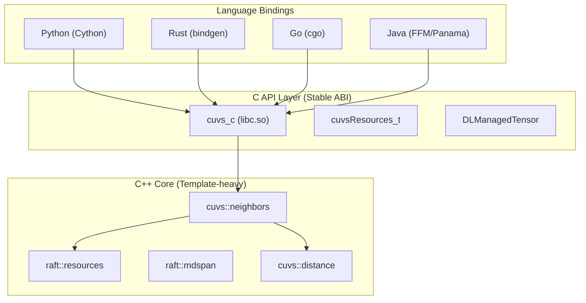
Sources: [c/src/core/c_api.cpp:30-113](), [java/panama-bindings/generate-bindings.sh:37-44](), [cpp/include/cuvs/neighbors/common.hpp:11-16]()

---

## Core Components

### RAFT Dependency and Resources
cuVS relies heavily on the RAFT library for its core infrastructure [cpp/cmake/thirdparty/get_raft.cmake:40-55](). The `raft::resources` object is the central handle used to manage CUDA streams, device properties, and memory resources (RMM). In the C API, this is encapsulated as the opaque `cuvsResources_t` handle [c/src/core/c_api.cpp:36-42]().

* **Resources Management**: Handles stream synchronization, device ID mapping, and multi-GPU contexts [c/src/core/c_api.cpp:135-165]().
* **Memory Management**: Integrates with RMM (RAPIDS Memory Manager) for pooled workspace allocations [c/src/core/c_api.cpp:44-55]().

Sources: [cpp/cmake/thirdparty/get_raft.cmake:40-55](), [c/src/core/c_api.cpp:36-55]()

### Common Data Structures
cuVS utilizes modern C++ standards and the DLPack protocol to ensure efficient data movement without unnecessary copies.
* **mdspan**: The C++ core uses `raft::mdspan` and specialized views like `raft::device_matrix_view` to represent multi-dimensional arrays, supporting layouts such as `row_major` and `col_major` [cpp/include/cuvs/neighbors/brute_force.hpp:67-115]().
* **DLPack**: The C API and language bindings use `DLManagedTensor` as the standard exchange format for tensors between external frameworks and cuVS [c/src/core/c_api.cpp:90-107]().
* **Dataset Abstraction**: The `cuvs::neighbors::dataset` structure provides a unified interface for owning, non-owning, and strided data representations [cpp/include/cuvs/neighbors/common.hpp:159-164]().

Sources: [cpp/include/cuvs/neighbors/brute_force.hpp:67-115](), [c/src/core/c_api.cpp:90-107](), [cpp/include/cuvs/neighbors/common.hpp:159-164]()

### Distance Metrics
The `cuvs::distance` namespace provides a comprehensive suite of metrics (such as L2, Inner Product, and Cosine) that are utilized across all approximate nearest neighbor algorithms [cpp/src/neighbors/detail/knn_brute_force.cuh:112-150](). These metrics are often fused into distance kernels to minimize memory bandwidth usage [cpp/src/neighbors/detail/knn_brute_force.cuh:64-87]().
For details, see [Distance Metrics & Primitives](#2.1).

Sources: [cpp/src/neighbors/detail/knn_brute_force.cuh:64-150](), [cpp/include/cuvs/neighbors/common.hpp:126-130]()

---

## Subsystem Interaction

The following diagram illustrates how a search request flows from a language binding down to the CUDA execution layer.

Search Execution Flow:
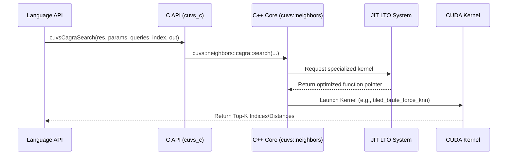
Sources: [c/src/core/c_api.cpp:30-36](), [cpp/src/neighbors/detail/knn_brute_force.cuh:64-95](), [cpp/include/cuvs/neighbors/brute_force.hpp:67-70]()

---

## Child Pages

### [Distance Metrics & Primitives](#2.1)
Covers the distance computation layer, supported metrics, and fused distance primitives used by search algorithms.

### [C API Layer](#2.2)
Documents the stable C ABI that serves as the foundation for all language bindings (Python, Rust, Go, Java), detailing opaque handles and `DLManagedTensor` integration.

### [JIT LTO Kernel System](#2.3)
Explains the Just-In-Time Link-Time Optimization system used to generate specialized CUDA kernels at runtime, balancing binary size and execution performance.

---

# Page: Distance Metrics & Primitives

# Distance Metrics & Primitives

<details>
<summary>Relevant source files</summary>

The following files were used as context for generating this wiki page:

- [cpp/cmake/modules/FindSVE.cmake](cpp/cmake/modules/FindSVE.cmake)
- [cpp/cmake/modules/generate_cuvs_export.cmake](cpp/cmake/modules/generate_cuvs_export.cmake)
- [cpp/cmake/patches/cutlass/Support-both-CUDA-12-and-13-cccl-header-locations.patch](cpp/cmake/patches/cutlass/Support-both-CUDA-12-and-13-cccl-header-locations.patch)
- [cpp/cmake/patches/cutlass_override.json](cpp/cmake/patches/cutlass_override.json)
- [cpp/cmake/patches/ggnn_override.json](cpp/cmake/patches/ggnn_override.json)
- [cpp/cmake/patches/hnswlib_override.json](cpp/cmake/patches/hnswlib_override.json)
- [cpp/cmake/thirdparty/get_cutlass.cmake](cpp/cmake/thirdparty/get_cutlass.cmake)
- [cpp/cmake/thirdparty/get_diskann.cmake](cpp/cmake/thirdparty/get_diskann.cmake)
- [cpp/cmake/thirdparty/get_faiss.cmake](cpp/cmake/thirdparty/get_faiss.cmake)
- [cpp/cmake/thirdparty/get_ggnn.cmake](cpp/cmake/thirdparty/get_ggnn.cmake)
- [cpp/cmake/thirdparty/get_hnswlib.cmake](cpp/cmake/thirdparty/get_hnswlib.cmake)
- [cpp/include/cuvs/util/cutlass_utils.hpp](cpp/include/cuvs/util/cutlass_utils.hpp)
- [cpp/src/cluster/detail/minClusterDistanceCompute.cu](cpp/src/cluster/detail/minClusterDistanceCompute.cu)
- [cpp/src/core/omp_wrapper.cpp](cpp/src/core/omp_wrapper.cpp)
- [cpp/src/core/omp_wrapper.hpp](cpp/src/core/omp_wrapper.hpp)
- [cpp/src/distance/detail/fused_distance_nn/cutlass_base.cuh](cpp/src/distance/detail/fused_distance_nn/cutlass_base.cuh)
- [cpp/src/distance/detail/pairwise_distance_cutlass_base.cuh](cpp/src/distance/detail/pairwise_distance_cutlass_base.cuh)
- [cpp/src/distance/detail/sparse/coo_spmv.cuh](cpp/src/distance/detail/sparse/coo_spmv.cuh)
- [cpp/src/distance/detail/sparse/coo_spmv_kernel.cuh](cpp/src/distance/detail/sparse/coo_spmv_kernel.cuh)
- [cpp/src/distance/detail/sparse/coo_spmv_strategies/dense_smem_strategy.cuh](cpp/src/distance/detail/sparse/coo_spmv_strategies/dense_smem_strategy.cuh)
- [cpp/src/distance/detail/sparse/coo_spmv_strategies/hash_strategy.cuh](cpp/src/distance/detail/sparse/coo_spmv_strategies/hash_strategy.cuh)
- [cpp/src/distance/detail/sparse/l2_distance.cuh](cpp/src/distance/detail/sparse/l2_distance.cuh)
- [cpp/src/distance/detail/sparse/lp_distance.cuh](cpp/src/distance/detail/sparse/lp_distance.cuh)
- [cpp/src/distance/detail/sparse/utils.cuh](cpp/src/distance/detail/sparse/utils.cuh)
- [cpp/src/distance/fused_distance_nn-inl.cuh](cpp/src/distance/fused_distance_nn-inl.cuh)
- [cpp/src/distance/unfused_distance_nn.cuh](cpp/src/distance/unfused_distance_nn.cuh)
- [cpp/src/neighbors/mg/snmg.cuh](cpp/src/neighbors/mg/snmg.cuh)
- [cpp/src/preprocessing/quantize/detail/scalar.cuh](cpp/src/preprocessing/quantize/detail/scalar.cuh)
- [cpp/src/preprocessing/quantize/scalar.cu](cpp/src/preprocessing/quantize/scalar.cu)
- [cpp/tests/CMakeLists.txt](cpp/tests/CMakeLists.txt)
- [cpp/tests/cluster/kmeans_predict_batching.cu](cpp/tests/cluster/kmeans_predict_batching.cu)
- [cpp/tests/neighbors/distance_nn.cu](cpp/tests/neighbors/distance_nn.cu)
- [cpp/tests/neighbors/distance_nn_helper.cuh](cpp/tests/neighbors/distance_nn_helper.cuh)
- [cpp/tests/neighbors/knn_merge_parts.cu](cpp/tests/neighbors/knn_merge_parts.cu)
- [cpp/tests/preprocessing/scalar_quantization.cu](cpp/tests/preprocessing/scalar_quantization.cu)
- [cpp/tests/test_utils.cuh](cpp/tests/test_utils.cuh)
- [python/cuvs/cuvs/distance/__init__.py](python/cuvs/cuvs/distance/__init__.py)
- [python/cuvs/cuvs/distance/distance.pyx](python/cuvs/cuvs/distance/distance.pyx)
- [python/cuvs/cuvs/distance_type.pxd](python/cuvs/cuvs/distance_type.pxd)
- [python/cuvs/cuvs/neighbors/nn_descent/CMakeLists.txt](python/cuvs/cuvs/neighbors/nn_descent/CMakeLists.txt)
- [python/cuvs/cuvs/neighbors/nn_descent/__init__.pxd](python/cuvs/cuvs/neighbors/nn_descent/__init__.pxd)
- [python/cuvs/cuvs/neighbors/nn_descent/__init__.py](python/cuvs/cuvs/neighbors/nn_descent/__init__.py)

</details>


The distance computation layer in cuVS provides highly optimized CUDA kernels for calculating similarities and distances between vectors. This layer serves as the foundation for all Approximate Nearest Neighbor (ANN) algorithms, clustering techniques, and manifold learning methods within the library. It supports a wide array of metrics, ranging from standard Euclidean distance to specialized sparse and bitwise metrics.

## Supported Metrics

Metrics are defined via the `cuvs::distance::DistanceType` enum `[cpp/include/cuvs/distance/distance.hpp:19-67]()`. The system distinguishes between "expanded" and "unexpanded" versions of certain metrics. Expanded versions utilize mathematical identities (e.g., $|x-y|^2 = |x|^2 + |y|^2 - 2xy$) to leverage high-performance GEMM (General Matrix Multiplication) operations, whereas unexpanded versions use direct element-wise accumulation `[cpp/include/cuvs/distance/distance.hpp:21-32]()`. Python bindings expose these via `DISTANCE_TYPES` and `SUPPORTED_DISTANCES` `[python/cuvs/cuvs/distance/distance.pyx:17-46]()`.

### Dense Distance Metrics
| Metric Type | Enum Value | Implementation Note |
| :--- | :--- | :--- |
| **L2 (Euclidean)** | `L2Expanded`, `L2Unexpanded` | Standard $L_2$ norm `[cpp/include/cuvs/distance/distance.hpp:22-30]()`. |
| **L2 Sqrt** | `L2SqrtExpanded`, `L2SqrtUnexpanded` | Euclidean distance with square root `[cpp/include/cuvs/distance/distance.hpp:24-32]()`. |
| **Inner Product** | `InnerProduct` | Basic dot product similarity `[cpp/include/cuvs/distance/distance.hpp:34-34]()`. |
| **Cosine** | `CosineExpanded` | Normalized dot product `[cpp/include/cuvs/distance/distance.hpp:26-26]()`. |
| **Manhattan** | `L1` | $L_1$ norm `[cpp/include/cuvs/distance/distance.hpp:28-28]()`. |
| **Chebyshev** | `Linf` | $L_{\infty}$ norm `[cpp/include/cuvs/distance/distance.hpp:36-36]()`. |
| **Minkowski** | `LpUnexpanded` | Generalized $L_p$ distance `[cpp/include/cuvs/distance/distance.hpp:40-40]()`. |
| **Geographic** | `Haversine` | Great-circle distance for lat/lon `[cpp/include/cuvs/distance/distance.hpp:48-48]()`. |

### Sparse & Bitwise Metrics
*   **Hamming**: Supported for both standard vectors (`HammingUnexpanded`) and bit-packed strings (`BitwiseHamming`) `[cpp/include/cuvs/distance/distance.hpp:54-62]()`.
*   **Jaccard/Dice**: Specialized for set similarity `[cpp/include/cuvs/distance/distance.hpp:44-60]()`.
*   **Sparse Optimized**: Kernels for CSR/COO formats, including `KLDivergence`, `JensenShannon`, and `RusselRao` `[cpp/include/cuvs/distance/distance.hpp:52-58]()`.

Sources: `[cpp/include/cuvs/distance/distance.hpp:19-67]`, `[python/cuvs/cuvs/distance/distance.pyx:17-46]`

## Pairwise Distance API

The primary entry point for distance computation is the `pairwise_distance` function in both C++ and Python (`cuvsPairwiseDistance`) `[python/cuvs/cuvs/distance/distance.pyx:51-135]()`. It computes an $N \times M$ distance matrix given two input matrices $X$ ($N \times K$) and $Y$ ($M \times K$).

### Data Flow & Dispatch
The API uses a tag-dispatching mechanism to select the optimal kernel at compile-time based on the `DistanceType`.

1.  **Public API**: `pairwise_distance` accepts `raft::device_matrix_view` `[cpp/include/cuvs/distance/distance.hpp:163-170]()` or DLPack-backed tensors in Python `[python/cuvs/cuvs/distance/distance.pyx:122-134]`.
2.  **Internal Dispatch**: Calls `distance_impl` with a `distance_tag<Metric>` `[cpp/src/distance/detail/distance.cuh:78-81]()`.
3.  **Operation Selection**: Matches the tag to a specific operator (e.g., `canberra_distance_op`) `[cpp/src/distance/detail/distance.cuh:93-93]()`.
4.  **Matrix Execution**: Executes via `pairwise_matrix_dispatch`, which handles tiling and layout (Row vs. Column Major) `[cpp/src/distance/detail/distance.cuh:99-100]()`.

Sources: `[cpp/include/cuvs/distance/distance.hpp:163-213]`, `[cpp/src/distance/detail/distance.cuh:23-101]`, `[python/cuvs/cuvs/distance/distance.pyx:51-135]`

## Fused Distance NN

For K-Nearest Neighbor (KNN) search and clustering reductions where the full $N \times M$ distance matrix is too large to store, cuVS provides **Fused Kernels** (e.g., `fusedDistanceNNMinReduce`) alongside fallback unfused routines (`unfusedDistanceNNMinReduce`) `[cpp/src/cluster/detail/minClusterDistanceCompute.cu:60-117]()`. These compute distances and perform K-selection or min-reductions in a single pass, significantly reducing global memory traffic.

### Implementation Details
*   **Registers & Shmem**: The `fusedL2kNN` kernel tiles the query and index matrices, accumulating distances in registers and using shared memory for top-K candidates `[cpp/src/neighbors/detail/fused_l2_knn.cuh:186-193]()`.
*   **Warp Select**: Uses `faiss_select::BlockSelect` and `warp_reduce` to efficiently find the smallest values across thread blocks `[cpp/src/neighbors/detail/fused_l2_knn.cuh:108-133]()`.
*   **Multi-Part Merging**: When datasets are partitioned across GPUs or memory segments, `knn_merge_parts` combines local top-K results into a global top-K `[cpp/src/neighbors/detail/knn_merge_parts.cuh:75-80]()`.

### Natural Language to Code Entity Mapping (KNN)
Title: KNN Fused Execution Mapping

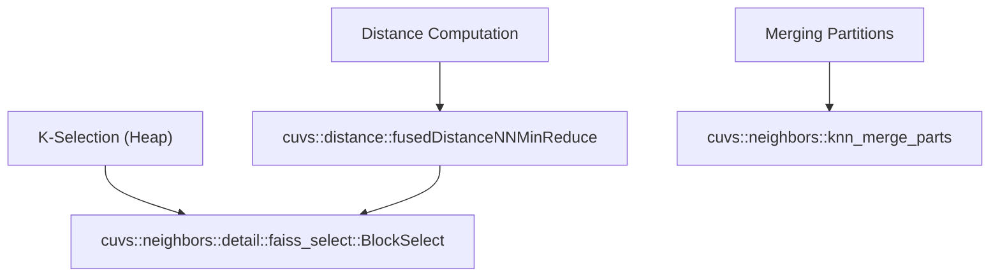

Sources: `[cpp/src/cluster/detail/minClusterDistanceCompute.cu:34-118]`, `[cpp/src/neighbors/detail/fused_l2_knn.cuh:108-193]`, `[cpp/tests/neighbors/knn_merge_parts.cu:75-80]`

## Sparse Distance Primitives

Sparse distance computations in cuVS are optimized for high-dimensional data where most features are zero, utilizing specialized SPMV (Sparse-Matrix-Vector) strategies.

### SPMV Strategies
Sparse computations are dispatched through a strategy pattern defined in `coo_spmv_strategy` `[cpp/src/distance/detail/sparse/coo_spmv_strategies/base_strategy.cuh]()`.
*   **Dense Shared Memory**: `dense_smem_strategy` loads a row of the sparse matrix into a dense shared memory buffer for fast lookups `[cpp/src/distance/detail/sparse/coo_spmv_strategies/dense_smem_strategy.cuh:18-21]()`.
*   **Hash-Based**: `hash_strategy` uses `cuco::static_map` to handle rows that are too large for shared memory but still sparse `[cpp/src/distance/detail/sparse/coo_spmv_strategies/hash_strategy.cuh:37-51]()`.

### Sparse Kernel Architecture
The `balanced_coo_generalized_spmv_kernel` provides load-balanced execution by chunking the non-zero elements (NNZ) of the matrix across thread blocks `[cpp/src/distance/detail/sparse/coo_spmv_kernel.cuh:85-103]()`.

Sources: `[cpp/src/distance/detail/sparse/coo_spmv_kernel.cuh:26-103]`, `[cpp/src/distance/detail/sparse/coo_spmv_strategies/hash_strategy.cuh:37-51]`, `[cpp/src/distance/detail/sparse/coo_spmv_strategies/dense_smem_strategy.cuh:18-91]`

## Kernel Density Estimation (KDE)

KDE is a non-parametric method to estimate probability density functions. cuVS provides a fused `kde` function that computes log-density estimates `[cpp/include/cuvs/distance/kde.hpp:48-57]()`.

### KDE Implementation Flow
1.  **Tiling**: The kernel tiles over query points and training points.
2.  **Distance Accumulation**: Uses `DistOp` structures to accumulate distances per-feature in registers `[cpp/src/distance/kde.cu:42-113]()`.
3.  **Kernel Evaluation**: Applies a smoothing kernel defined by `DensityKernelType` `[cpp/include/cuvs/distance/distance.hpp:93-100]()`.
4.  **LogSumExp**: Performs a Log-Sum-Exp reduction to normalize density without numerical overflow `[cpp/include/cuvs/distance/kde.hpp:19-23]()`.

### Natural Language to Code Entity Mapping (KDE)
Title: KDE System Architecture

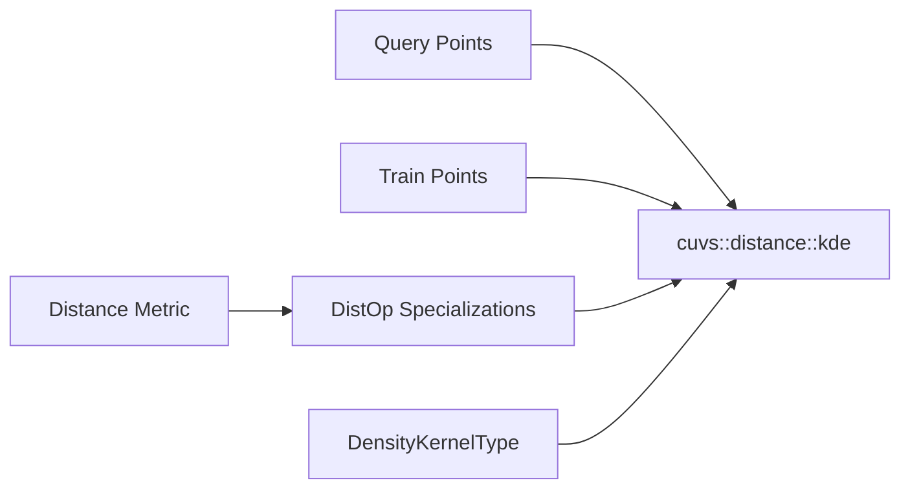

Sources: `[cpp/include/cuvs/distance/kde.hpp:19-57]`, `[cpp/src/distance/kde.cu:37-113]`, `[cpp/include/cuvs/distance/distance.hpp:93-100]`

---

# Page: C API Layer

# C API Layer

<details>
<summary>Relevant source files</summary>

The following files were used as context for generating this wiki page:

- [build.sh](build.sh)
- [c/CMakeLists.txt](c/CMakeLists.txt)
- [c/include/cuvs/core/all.h](c/include/cuvs/core/all.h)
- [c/include/cuvs/core/c_api.h](c/include/cuvs/core/c_api.h)
- [c/include/cuvs/neighbors/common.h](c/include/cuvs/neighbors/common.h)
- [c/include/cuvs/neighbors/mg_common.h](c/include/cuvs/neighbors/mg_common.h)
- [c/include/cuvs/preprocessing/quantize/binary.h](c/include/cuvs/preprocessing/quantize/binary.h)
- [c/src/core/c_api.cpp](c/src/core/c_api.cpp)
- [c/src/neighbors/brute_force.cpp](c/src/neighbors/brute_force.cpp)
- [c/src/neighbors/ivf_flat.cpp](c/src/neighbors/ivf_flat.cpp)
- [c/src/neighbors/mg_cagra.cpp](c/src/neighbors/mg_cagra.cpp)
- [c/src/neighbors/mg_ivf_flat.cpp](c/src/neighbors/mg_ivf_flat.cpp)
- [c/src/neighbors/mg_ivf_pq.cpp](c/src/neighbors/mg_ivf_pq.cpp)
- [c/src/preprocessing/quantize/binary.cpp](c/src/preprocessing/quantize/binary.cpp)
- [c/tests/CMakeLists.txt](c/tests/CMakeLists.txt)
- [c/tests/cmake/header_check.cmake](c/tests/cmake/header_check.cmake)
- [c/tests/core/headers.c](c/tests/core/headers.c)
- [ci/build_standalone_c.sh](ci/build_standalone_c.sh)
- [ci/check_c_abi/LICENSE](ci/check_c_abi/LICENSE)
- [ci/check_c_abi/VERSION](ci/check_c_abi/VERSION)
- [ci/check_c_abi/check_c_abi/__init__.py](ci/check_c_abi/check_c_abi/__init__.py)
- [ci/check_c_abi/check_c_abi/abi.py](ci/check_c_abi/check_c_abi/abi.py)
- [ci/check_c_abi/check_c_abi/main.py](ci/check_c_abi/check_c_abi/main.py)
- [ci/check_c_abi/check_c_abi/tests/test_abi.py](ci/check_c_abi/check_c_abi/tests/test_abi.py)
- [ci/check_c_abi/pyproject.toml](ci/check_c_abi/pyproject.toml)
- [ci/release/update-version.sh](ci/release/update-version.sh)
- [cpp/cmake/modules/determine_cuvs_abi_version.cmake](cpp/cmake/modules/determine_cuvs_abi_version.cmake)
- [cpp/include/cuvs/neighbors/dynamic_batching.hpp](cpp/include/cuvs/neighbors/dynamic_batching.hpp)
- [cpp/src/neighbors/detail/dynamic_batching.cuh](cpp/src/neighbors/detail/dynamic_batching.cuh)
- [examples/c/src/bruteforce_c_example.c](examples/c/src/bruteforce_c_example.c)
- [fern/pages/c_api/index.md](fern/pages/c_api/index.md)
- [java/benchmarks/pom.xml](java/benchmarks/pom.xml)
- [java/build.sh](java/build.sh)
- [java/cuvs-java/pom.xml](java/cuvs-java/pom.xml)
- [java/panama-bindings/generate-bindings.sh](java/panama-bindings/generate-bindings.sh)
- [java/panama-bindings/headers.h](java/panama-bindings/headers.h)

</details>


The cuVS C API provides a stable ABI (Application Binary Interface) that serves as the foundation for multi-language interoperability. By exposing a pure C interface, cuVS enables seamless integration with languages such as Python, Rust, Go, and Java without the complexities of C++ name mangling or standard library version mismatches.

## Overview and Purpose

The C API layer wraps the high-performance C++ template-based core into a set of opaque handles and flat functions. This architecture ensures that the underlying C++ implementation can evolve while maintaining a consistent binary interface for external consumers.

Key features include:
* **Multi-language Support:** Acts as the target for `bindgen` (Rust), `cgo` (Go), `Cython` (Python), and `FFM/Panama` (Java) [java/panama-bindings/generate-bindings.sh:37-53]().
* **Resource Management:** Centralized handling of CUDA streams, device IDs, and RMM (RAPIDS Memory Manager) contexts via `cuvsResources_t` [c/include/cuvs/core/c_api.h:76-80]().
* **Data Exchange:** Standardized tensor passing using the **DLPack** protocol [c/include/cuvs/core/c_api.h:9-9]().
* **ABI Stability:** Explicit versioning of the shared library to prevent breaking downstream applications [c/CMakeLists.txt:125-134]().

### C API Resource Creation and Execution Data Flow

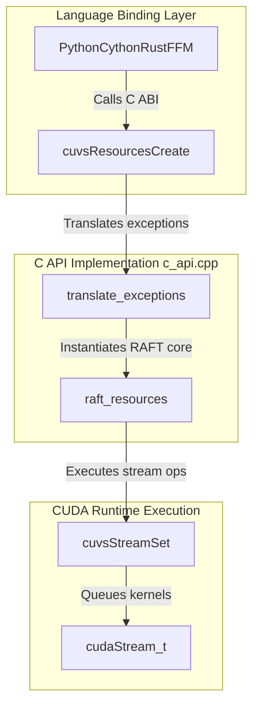
Sources: [c/src/core/c_api.cpp:36-42](), [c/include/cuvs/core/c_api.h:76-133]()

---

## Core Entities & Resource Management

### cuvsResources_t
The `cuvsResources_t` is an opaque `uintptr_t` handle that encapsulates a `raft::resources` object [c/include/cuvs/core/c_api.h:76-80](). It is mandatory for almost all cuVS operations as it manages the CUDA stream, device context, and memory resources.

* **Creation:** `cuvsResourcesCreate` allocates a new `raft::resources` object on the heap [c/src/core/c_api.cpp:36-42]().
* **Workspace Pools:** `cuvsResourcesSetWorkspacePool` configures an uncapped pool backed by the current device memory resource to minimize allocation overhead [c/src/core/c_api.cpp:44-55](), [c/include/cuvs/core/c_api.h:175-177]().
* **Memory Tracking:** `cuvsResourcesCreateWithMemoryTracking` wraps memory resources with allocation-tracking adaptors that output CSV logs [c/src/core/c_api.cpp:57-72](), [c/include/cuvs/core/c_api.h:113-116]().
* **Multi-GPU:** For SNMG (Single Node Multi-GPU) operations, `cuvsMultiGpuResourcesCreate` and `cuvsMultiGpuResourcesCreateWithDeviceIds` instantiate `raft::device_resources_snmg` [c/src/core/c_api.cpp:82-116](), [c/include/cuvs/core/c_api.h:179-196]().
* **Stream Management:** Streams can be configured via `cuvsStreamSet`, retrieved via `cuvsStreamGet`, and synchronized via `cuvsStreamSync` [c/src/core/c_api.cpp:135-157](), [c/include/cuvs/core/c_api.h:133-151]().

### Opaque Index Handles
To avoid exposing C++ template types, the C API uses index-specific structs containing a `uintptr_t` address and type metadata.

| C Type | Wrapped C++ Type |
| :--- | :--- |
| `cuvsResources_t` | `raft::resources` [c/include/cuvs/core/c_api.h:76-80]() |
| `cuvsIvfSqIndex_t` | `cuvs::neighbors::ivf_sq::index` [c/src/core/c_api.cpp:30-41]() |
| `cuvsCagraIndex_t` | `cuvs::neighbors::cagra::index` [c/src/core/c_api.cpp:30-41]() |
| `cuvsBruteForceIndex_t` | `cuvs::neighbors::brute_force::index` [c/src/core/c_api.cpp:30-41]() |

Sources: [c/include/cuvs/core/c_api.h:76-80](), [c/src/core/c_api.cpp:36-124]()

---

## Error Handling and Logging

Since C does not support exceptions, the C API layer wraps all internal operations using `cuvs::core::translate_exceptions` to catch C++ exceptions and convert them into `cuvsError_t` return codes [c/src/core/c_api.cpp:36-41]().

* **Error Retrieval:** Detailed error strings are retrieved per thread via `cuvsGetLastErrorText()` and updated with `cuvsSetLastErrorText()` [c/include/cuvs/core/c_api.h:29-38]().
* **Logging:** Global log levels (`cuvsLogLevel_t`) are managed through `cuvsGetLogLevel()` and `cuvsSetLogLevel()` [c/include/cuvs/core/c_api.h:51-68]().

Sources: [c/include/cuvs/core/c_api.h:27-68](), [c/src/core/c_api.cpp:36-42]()

---

## Data Exchange via DLPack

The C API layer relies on the standard `DLManagedTensor` protocol defined in DLPack for zero-copy data exchange between host/device memory and various language bindings [c/include/cuvs/core/c_api.h:9-9](). Functions such as `cuvsMultiGpuResourcesCreateWithDeviceIds` validate tensor metadata (such as `dtype.code == kDLInt`, `dtype.bits == 32`, and `device_type == kDLCPU`) before consuming device identifier arrays [c/src/core/c_api.cpp:90-116]().

Sources: [c/include/cuvs/core/c_api.h:9-9](), [c/src/core/c_api.cpp:90-116]()

---

## C-ABI Stability Workflow

cuVS enforces ABI stability through automated CI workflows and strict target properties:

1. **Header Validation:** Dedicated tests like `cuvs_c_headers` ensure that `cuvs/core/all.h` correctly aggregates all exported headers [c/tests/CMakeLists.txt:106-118]().
2. **Versioning:** The target `cuvs_c` defines explicit `VERSION` and `SOVERSION` properties derived via `determine_cuvs_abi_version.cmake` to guarantee safe dynamic linking [c/CMakeLists.txt:85-134]().
3. **Export Controls:** C++ symbols are hidden by default (`CXX_VISIBILITY_PRESET hidden`), exposing only explicit C functions [c/CMakeLists.txt:121-122]().

Sources: [c/CMakeLists.txt:85-134](), [c/tests/CMakeLists.txt:106-118]()

---

## Standalone C Library Build (`ci/build_standalone_c.sh`)

To support environments with strict `glibc` requirements or embedders requiring zero Python/Conda dependencies, cuVS provides a standalone C build workflow (`ci/build_standalone_c.sh`).

### Standalone C Library Build & Packaging Pipeline

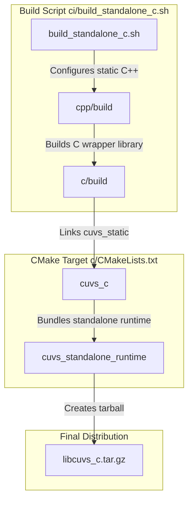
Sources: [ci/build_standalone_c.sh:65-117](), [c/CMakeLists.txt:34-43]()

* **Static Linking:** The C++ core is compiled statically (`-DCUVSC_STATIC_CUVS_LIBRARY=ON`), encapsulating internal RAFT and RMM dependencies inside the shared `libcuvs_c.so` library [ci/build_standalone_c.sh:80-87](), [c/CMakeLists.txt:34-43]().
* **Toolchain Isolation:** Uses `gcc-toolset-14` to compile modern C++20 constructs on older enterprise Linux systems [ci/build_standalone_c.sh:7-7](), [ci/build_standalone_c.sh:65-68]().
* **Runtime Bundling:** Installs required standalone runtime components such as KvikIO libraries via CMake component targets (`cuvs_standalone_runtime`) [ci/build_standalone_c.sh:95-103]().
* **Distribution Tarball:** Packages headers, shared objects, licenses, and auxiliary symbols into `libcuvs_c.tar.gz` [ci/build_standalone_c.sh:111-117]().

Sources: [ci/build_standalone_c.sh:1-117](), [c/CMakeLists.txt:34-44]()

---

# Page: JIT LTO Kernel System

# JIT LTO Kernel System

<details>
<summary>Relevant source files</summary>

The following files were used as context for generating this wiki page:

- [c/include/cuvs/neighbors/cagra.h](c/include/cuvs/neighbors/cagra.h)
- [c/src/neighbors/cagra.cpp](c/src/neighbors/cagra.cpp)
- [c/tests/neighbors/ann_cagra_c.cu](c/tests/neighbors/ann_cagra_c.cu)
- [cpp/.clang-format](cpp/.clang-format)
- [cpp/CMakeLists.txt](cpp/CMakeLists.txt)
- [cpp/bench/ann/src/cuvs/cuvs_ann_bench_param_parser.h](cpp/bench/ann/src/cuvs/cuvs_ann_bench_param_parser.h)
- [cpp/bench/ann/src/cuvs/cuvs_cagra_wrapper.h](cpp/bench/ann/src/cuvs/cuvs_cagra_wrapper.h)
- [cpp/cmake/modules/ConfigureCUDA.cmake](cpp/cmake/modules/ConfigureCUDA.cmake)
- [cpp/include/cuvs/detail/jit_lto/common_fragments.hpp](cpp/include/cuvs/detail/jit_lto/common_fragments.hpp)
- [cpp/include/cuvs/neighbors/cagra.hpp](cpp/include/cuvs/neighbors/cagra.hpp)
- [cpp/src/neighbors/cagra.cuh](cpp/src/neighbors/cagra.cuh)
- [cpp/src/neighbors/detail/cagra/cagra_filter_payload.hpp](cpp/src/neighbors/detail/cagra/cagra_filter_payload.hpp)
- [cpp/src/neighbors/detail/cagra/cagra_merge.cuh](cpp/src/neighbors/detail/cagra/cagra_merge.cuh)
- [cpp/src/neighbors/detail/cagra/jit_lto_kernels/cagra_filter_payload.cuh](cpp/src/neighbors/detail/cagra/jit_lto_kernels/cagra_filter_payload.cuh)
- [cpp/src/neighbors/detail/cagra/search_multi_cta_inst.cu.in](cpp/src/neighbors/detail/cagra/search_multi_cta_inst.cu.in)
- [cpp/src/neighbors/detail/cagra/search_single_cta_inst.cu.in](cpp/src/neighbors/detail/cagra/search_single_cta_inst.cu.in)
- [cpp/src/neighbors/detail/cagra/search_single_cta_kernel_launcher_jit.cuh](cpp/src/neighbors/detail/cagra/search_single_cta_kernel_launcher_jit.cuh)
- [cpp/src/neighbors/detail/cagra/shared_launcher_jit.hpp](cpp/src/neighbors/detail/cagra/shared_launcher_jit.hpp)
- [cpp/src/neighbors/ivf_pq/ivf_pq_compute_similarity.cuh](cpp/src/neighbors/ivf_pq/ivf_pq_compute_similarity.cuh)
- [cpp/src/neighbors/ivf_pq/ivf_pq_compute_similarity.hpp](cpp/src/neighbors/ivf_pq/ivf_pq_compute_similarity.hpp)
- [cpp/src/neighbors/ivf_pq/ivf_pq_compute_similarity_impl.cuh](cpp/src/neighbors/ivf_pq/ivf_pq_compute_similarity_impl.cuh)
- [cpp/src/neighbors/refine/refine_host.hpp](cpp/src/neighbors/refine/refine_host.hpp)
- [cpp/tests/neighbors/ann_cagra.cuh](cpp/tests/neighbors/ann_cagra.cuh)
- [cpp/tests/neighbors/ann_cagra/test_merge_fastener.cu](cpp/tests/neighbors/ann_cagra/test_merge_fastener.cu)
- [python/cuvs_bench/cuvs_bench/config/algos/constraints/__init__.py](python/cuvs_bench/cuvs_bench/config/algos/constraints/__init__.py)
- [python/cuvs_bench/cuvs_bench/config/algos/cuvs_cagra.yaml](python/cuvs_bench/cuvs_bench/config/algos/cuvs_cagra.yaml)

</details>


The Just-In-Time Link-Time Optimization (JIT LTO) system in cuVS composes and optimizes specialized CUDA kernels at runtime. By leveraging the `nvJitLink` library, cuVS combines modular device code "fragments"—such as specific distance metrics, data types, or filtering logic—into a single optimized executable kernel. This approach avoids the binary size explosion that would occur from statically pre-compiling every combination of template parameters.

Sources: [cpp/include/cuvs/detail/jit_lto/AlgorithmPlanner.hpp:24-60](), [cpp/cmake/modules/generate_jit_lto_kernels.cmake:86-136]()

---

## System Architecture

The JIT LTO subsystem relies on three primary abstractions:
1.  **Fragments**: Pre-compiled LTO intermediate representation (IR) encapsulated in fatbins.
2.  **Planner**: Coordination logic that selects and aggregates required fragments for a target algorithm configuration (`AlgorithmPlanner`).
3.  **Launcher**: Manages the loaded CUDA library lifecycle and handles execution dispatch (`AlgorithmLauncher`).

### Natural Language to Code Entity Mapping

The following diagram bridges high-level architectural concepts to their corresponding C++ classes and CMake modules.

**Concept to Entity Mapping**
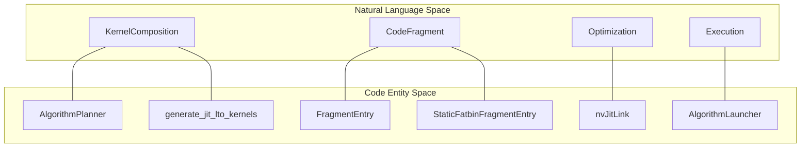
Sources: [cpp/include/cuvs/detail/jit_lto/AlgorithmPlanner.hpp:24-60](), [cpp/include/cuvs/detail/jit_lto/FragmentEntry.hpp:18-47](), [cpp/cmake/modules/generate_jit_lto_kernels.cmake:86-136]()

---

## Build-Time: Kernel Generation

During the CMake configuration and build phase, the `generate_jit_lto_kernels` module processes template parameter matrices (supplied via JSON) to generate specialized fatbins containing LTO IR.

### Workflow
1.  **Matrix Expansion**: `compute_matrix_product` expands JSON configurations into valid combinations [cpp/cmake/modules/generate_jit_lto_kernels.cmake:102-114]().
2.  **Kernel Compilation**: `add_jit_lto_kernel` creates object libraries with `CUDA_FATBIN_COMPILATION` and `INTERPROCEDURAL_OPTIMIZATION` enabled [cpp/cmake/modules/generate_jit_lto_kernels.cmake:19-34]().
3.  **Embedding**: The `bin2c` tool converts fatbins into C++ header byte arrays [cpp/cmake/modules/generate_jit_lto_kernels.cmake:36-41]().

**Build-Time Data Flow**

Sources: [cpp/cmake/modules/generate_jit_lto_kernels.cmake:12-42](), [cpp/cmake/modules/generate_jit_lto_kernels.cmake:86-136]()

---

## Runtime: Composition and Linking

At runtime, algorithms instantiate an `AlgorithmPlanner` to collect necessary code fragments and link them into an executable kernel.

### Fragment Management
Fragments implement the `FragmentEntry` interface [cpp/include/cuvs/detail/jit_lto/FragmentEntry.hpp:18-24]().
*   **`StaticFatbinFragmentEntry<Tag>`**: Wraps build-time pre-compiled fatbins [cpp/include/cuvs/detail/jit_lto/FragmentEntry.hpp:35-47]().
*   **`UDFFatbinFragment`**: Compiles runtime user-defined CUDA code via NVRTC into LTO IR [cpp/include/cuvs/detail/jit_lto/FragmentEntry.hpp:49-64]().

### AlgorithmPlanner and AlgorithmLauncher
The `AlgorithmPlanner` manages the `nvJitLink` lifecycle:
1.  **Cache Lookup**: Generates a unique key and queries `LauncherJitCache` [cpp/src/detail/jit_lto/AlgorithmPlanner.cpp:24-46]().
2.  **Linking**: On a cache miss, initializes an `nvJitLinkHandle`, registers fragments, and invokes `nvJitLinkComplete` for cross-module optimization into a `cubin` [cpp/src/detail/jit_lto/AlgorithmPlanner.cpp:75-93]().
3.  **Loading**: Loads the `cubin` into a `cudaLibrary_t` and extracts the `cudaKernel_t` entrypoint [cpp/src/detail/jit_lto/AlgorithmPlanner.cpp:108-115]().

The `AlgorithmLauncher` wraps these handles, offering type-safe invocation via its `dispatch` method [cpp/include/cuvs/detail/jit_lto/AlgorithmLauncher.hpp:31-38]().

**Runtime Execution Flow**
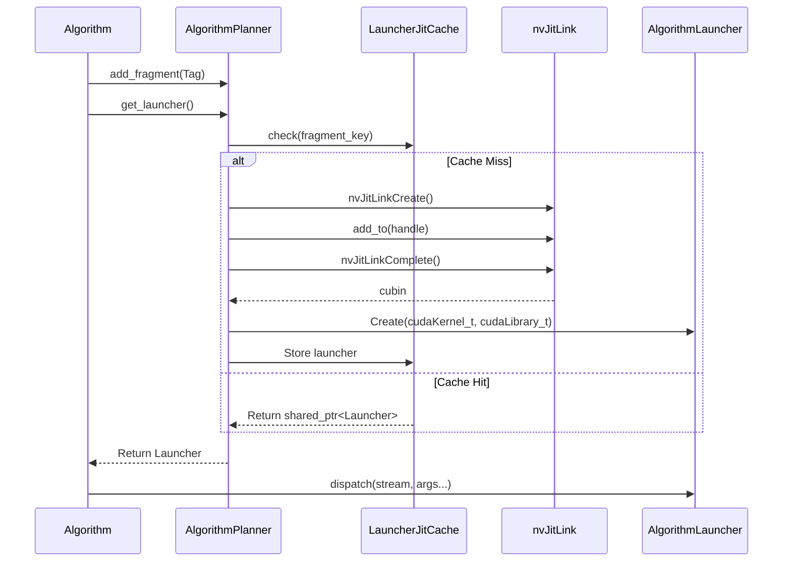
Sources: [cpp/src/detail/jit_lto/AlgorithmPlanner.cpp:41-116](), [cpp/include/cuvs/detail/jit_lto/AlgorithmLauncher.hpp:31-38]()

---

## Implementation Example: IVF-Flat Interleaved Scan

The IVF-Flat algorithm uses this framework to specialize its scan kernels. In `ivf_flat_interleaved_scan_jit.cuh`, the launch workflow proceeds as follows:

1.  **Tag Mapping**: Maps types like `float` or `int8_t` to JIT tags [cpp/src/neighbors/ivf_flat/ivf_flat_interleaved_scan_jit.cuh:36-43]().
2.  **Planner Setup**: Instantiates an `InterleavedScanPlanner` extending `AlgorithmPlanner` [cpp/src/neighbors/ivf_flat/ivf_flat_interleaved_scan_jit.cuh:164-165]().
3.  **Fragment Registration**: Appends entrypoint, distance metric, loading logic, and filter fragments [cpp/src/neighbors/ivf_flat/ivf_flat_interleaved_scan_jit.cuh:166-180]().
4.  **UDF Integration**: Compiles and injects custom metrics at runtime if specified [cpp/src/neighbors/ivf_flat/ivf_flat_interleaved_scan_jit.cuh:168-173]().

Sources: [cpp/src/neighbors/ivf_flat/ivf_flat_interleaved_scan_jit.cuh:36-43](), [cpp/src/neighbors/ivf_flat/ivf_flat_interleaved_scan_jit.cuh:164-181]()

---

# Page: ANN Algorithms

# ANN Algorithms

<details>
<summary>Relevant source files</summary>

The following files were used as context for generating this wiki page:

- [c/include/cuvs/neighbors/cagra.h](c/include/cuvs/neighbors/cagra.h)
- [c/src/neighbors/cagra.cpp](c/src/neighbors/cagra.cpp)
- [c/tests/neighbors/ann_cagra_c.cu](c/tests/neighbors/ann_cagra_c.cu)
- [cpp/CMakeLists.txt](cpp/CMakeLists.txt)
- [cpp/bench/ann/src/cuvs/cuvs_ann_bench_param_parser.h](cpp/bench/ann/src/cuvs/cuvs_ann_bench_param_parser.h)
- [cpp/bench/ann/src/cuvs/cuvs_cagra_wrapper.h](cpp/bench/ann/src/cuvs/cuvs_cagra_wrapper.h)
- [cpp/include/cuvs/neighbors/brute_force.hpp](cpp/include/cuvs/neighbors/brute_force.hpp)
- [cpp/include/cuvs/neighbors/cagra.hpp](cpp/include/cuvs/neighbors/cagra.hpp)
- [cpp/include/cuvs/neighbors/common.hpp](cpp/include/cuvs/neighbors/common.hpp)
- [cpp/src/neighbors/brute_force.cu](cpp/src/neighbors/brute_force.cu)
- [cpp/src/neighbors/cagra.cuh](cpp/src/neighbors/cagra.cuh)
- [cpp/src/neighbors/detail/cagra/cagra_merge.cuh](cpp/src/neighbors/detail/cagra/cagra_merge.cuh)
- [cpp/src/neighbors/detail/faiss_distance_utils.h](cpp/src/neighbors/detail/faiss_distance_utils.h)
- [cpp/src/neighbors/detail/knn_brute_force.cuh](cpp/src/neighbors/detail/knn_brute_force.cuh)
- [cpp/tests/neighbors/ann_cagra.cuh](cpp/tests/neighbors/ann_cagra.cuh)
- [cpp/tests/neighbors/ann_cagra/test_merge_fastener.cu](cpp/tests/neighbors/ann_cagra/test_merge_fastener.cu)
- [python/cuvs_bench/cuvs_bench/config/algos/constraints/__init__.py](python/cuvs_bench/cuvs_bench/config/algos/constraints/__init__.py)
- [python/cuvs_bench/cuvs_bench/config/algos/cuvs_cagra.yaml](python/cuvs_bench/cuvs_bench/config/algos/cuvs_cagra.yaml)

</details>


Approximate Nearest Neighbor (ANN) algorithms are the core of cuVS, providing high-performance vector search capabilities on GPUs. cuVS implements several families of ANN algorithms, each optimized for different trade-offs between search latency, index build time, memory footprint, and recall accuracy. As a parent overview page, this section introduces the available algorithm families and routes to detailed child pages.

## Algorithm Selection Guide

The following table provides a high-level comparison to help select the appropriate algorithm for a given use case.

| Algorithm | Type | Strengths | Best For |
| :--- | :--- | :--- | :--- |
| **CAGRA** [cpp/include/cuvs/neighbors/cagra.hpp:106-109]() | Graph-Based | State-of-the-art search throughput; hardware-optimized for GPUs. | Low-latency serving; high-throughput requirements. |
| **IVF-PQ** [cpp/include/cuvs/neighbors/common.hpp:54-54]() | Quantized | Very low memory footprint; fast build times. | Billion-scale datasets; memory-constrained environments. |
| **IVF-Flat & IVF-SQ** [cpp/include/cuvs/neighbors/common.hpp:54-54]() | Inverted File | High recall; supports dynamic updates and scalar quantization. | Medium-scale datasets where accuracy or quantization trade-offs are critical. |
| **HNSW** [cpp/include/cuvs/neighbors/cagra.hpp:132-132]() | Graph-Based | CPU/GPU interoperability; established industry standard. | Hybrid cloud deployments; interoperability with `hnswlib`. |
| **Brute Force** [cpp/include/cuvs/neighbors/brute_force.hpp:31-38]() | Exact | 100% recall; no index build required. | Small datasets; ground-truth generation; exact distance refinement. |

Sources: [cpp/include/cuvs/neighbors/common.hpp:43-55](), [cpp/include/cuvs/neighbors/brute_force.hpp:31-38]()

## Graph-Based ANN

Graph-based methods represent the dataset as a navigable graph where nodes are vectors and edges connect neighbors.

### CAGRA: Graph-Based ANN
CAGRA (`cuvs::neighbors::cagra`) is cuVS's flagship graph-based algorithm. It is designed specifically for GPU architectures, utilizing specialized search kernels to maximize throughput. It can be seeded using other algorithms like IVF-PQ or NN-Descent, or constructed via Augmented Core Extraction (ACE) partitioning.
For details, see [CAGRA: Graph-Based ANN](#3.1).

### HNSW: Hierarchical Navigable Small Worlds
cuVS provides HNSW support primarily through integration with `hnswlib`. It supports building HNSW indices on the GPU (via CAGRA graph conversion heuristics) and provides CPU-friendly search capabilities.
For details, see [HNSW: Hierarchical Navigable Small Worlds](#3.4).

### NN-Descent: KNN Graph Construction
NN-Descent (`cuvs::neighbors::nn_descent`) is an iterative algorithm used to construct high-quality K-Nearest Neighbor (KNN) graphs via local joins and Bloom filter sampling. In cuVS, it serves as a fast graph seed builder for CAGRA.
For details, see [NN-Descent: KNN Graph Construction](#3.5).

Sources: [cpp/include/cuvs/neighbors/common.hpp:43-55](), [cpp/include/cuvs/neighbors/cagra.hpp:132-157]()

## Quantization & Inverted File (IVF)

IVF methods partition the vector space into Voronoi cells to narrow the search space at query time.

### IVF-PQ: Inverted File with Product Quantization
IVF-PQ (`cuvs::neighbors::ivf_pq`) combines inverted files with Product Quantization to compress vectors into compact codes using trained codebooks. This significantly reduces memory usage, allowing billion-scale indices to fit on a single GPU or multi-GPU setup.
For details, see [IVF-PQ: Inverted File with Product Quantization](#3.2).

### IVF-Flat & IVF-SQ: Inverted File Variants
IVF-Flat stores interleaved exact vectors in inverted lists, while IVF-SQ (Scalar Quantization) quantizes vector components to lower bit-widths (e.g., `int8` or `fp16`) to balance memory consumption and search accuracy.
For details, see [IVF-Flat & IVF-SQ: Inverted File Variants](#3.3).

Sources: [cpp/include/cuvs/neighbors/common.hpp:56-112](), [cpp/include/cuvs/neighbors/cagra.hpp:10-15]()

## Specialized & Exact Search

### Brute Force, ScaNN, Vamana & Other Algorithms
The exact `brute_force::index` provides exact nearest neighbor search using tiled matrix multiplication (`tiled_brute_force_knn`). Other specialized algorithms include ScaNN (SOAR/AVQ), Vamana/DiskANN graph indices, and batch all-neighbors construction.
For details, see [Brute Force, ScaNN, Vamana & Other Algorithms](#3.6).

Sources: [cpp/include/cuvs/neighbors/brute_force.hpp:31-78](), [cpp/src/neighbors/detail/knn_brute_force.cuh:60-87]()

## Mapping Algorithms to Code Entities

The following diagrams bridge natural language concepts to concrete code entities within the cuVS codebase.

### Algorithm Hierarchy and Parameter Mapping
Title: "ANN Index and Parameter Structure"
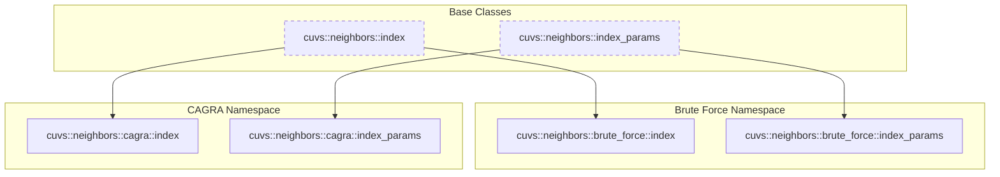
Sources: [cpp/include/cuvs/neighbors/common.hpp:121-131](), [cpp/include/cuvs/neighbors/brute_force.hpp:22-42](), [cpp/include/cuvs/neighbors/cagra.hpp:159-165]()

### CAGRA Graph Construction Pipeline
Title: "CAGRA Graph Build and Optimization"
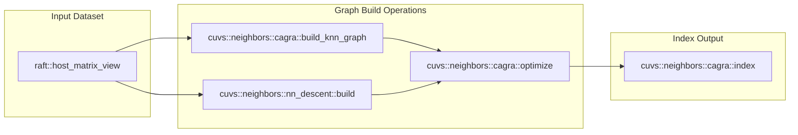
Sources: [cpp/src/neighbors/cagra.cuh:119-137](), [cpp/src/neighbors/cagra.cuh:150-167]()

## Advanced Index Features

cuVS algorithms support several cross-cutting features to improve production performance:
- **Pre-filtering**: Using bitsets or bitmaps to filter candidate results during search.
- **Refinement**: Applying post-search or combined ratio refinement over quantized distances.
- **Multi-GPU (SNMG)**: Scaling search and index building across multiple GPUs.

For details, see [Advanced Index Features](#3.7).

Sources: [cpp/src/neighbors/detail/knn_brute_force.cuh:79-86](), [cpp/bench/ann/src/cuvs/cuvs_cagra_wrapper.h:147-152]()

---

# Page: CAGRA: Graph-Based ANN

# CAGRA: Graph-Based ANN

<details>
<summary>Relevant source files</summary>

The following files were used as context for generating this wiki page:

- [c/include/cuvs/neighbors/cagra.h](c/include/cuvs/neighbors/cagra.h)
- [c/src/neighbors/cagra.cpp](c/src/neighbors/cagra.cpp)
- [c/tests/neighbors/ann_cagra_c.cu](c/tests/neighbors/ann_cagra_c.cu)
- [cpp/CMakeLists.txt](cpp/CMakeLists.txt)
- [cpp/bench/ann/src/cuvs/cuvs_ann_bench_param_parser.h](cpp/bench/ann/src/cuvs/cuvs_ann_bench_param_parser.h)
- [cpp/bench/ann/src/cuvs/cuvs_cagra_wrapper.h](cpp/bench/ann/src/cuvs/cuvs_cagra_wrapper.h)
- [cpp/include/cuvs/neighbors/cagra.hpp](cpp/include/cuvs/neighbors/cagra.hpp)
- [cpp/include/cuvs/neighbors/hnsw.hpp](cpp/include/cuvs/neighbors/hnsw.hpp)
- [cpp/include/cuvs/neighbors/ivf_flat.hpp](cpp/include/cuvs/neighbors/ivf_flat.hpp)
- [cpp/include/cuvs/neighbors/ivf_pq.hpp](cpp/include/cuvs/neighbors/ivf_pq.hpp)
- [cpp/include/cuvs/neighbors/ivf_sq.hpp](cpp/include/cuvs/neighbors/ivf_sq.hpp)
- [cpp/include/cuvs/util/file_io.hpp](cpp/include/cuvs/util/file_io.hpp)
- [cpp/src/neighbors/brute_force_serialize.cu](cpp/src/neighbors/brute_force_serialize.cu)
- [cpp/src/neighbors/cagra.cuh](cpp/src/neighbors/cagra.cuh)
- [cpp/src/neighbors/detail/ann_utils.cuh](cpp/src/neighbors/detail/ann_utils.cuh)
- [cpp/src/neighbors/detail/cagra/add_nodes.cuh](cpp/src/neighbors/detail/cagra/add_nodes.cuh)
- [cpp/src/neighbors/detail/cagra/cagra_build.cuh](cpp/src/neighbors/detail/cagra/cagra_build.cuh)
- [cpp/src/neighbors/detail/cagra/cagra_merge.cuh](cpp/src/neighbors/detail/cagra/cagra_merge.cuh)
- [cpp/src/neighbors/detail/cagra/cagra_search.cuh](cpp/src/neighbors/detail/cagra/cagra_search.cuh)
- [cpp/src/neighbors/detail/cagra/cagra_serialize.cuh](cpp/src/neighbors/detail/cagra/cagra_serialize.cuh)
- [cpp/src/neighbors/detail/cagra/factory.cuh](cpp/src/neighbors/detail/cagra/factory.cuh)
- [cpp/src/neighbors/detail/cagra/graph_core.cuh](cpp/src/neighbors/detail/cagra/graph_core.cuh)
- [cpp/src/neighbors/detail/cagra/graph_shared.cu](cpp/src/neighbors/detail/cagra/graph_shared.cu)
- [cpp/src/neighbors/detail/cagra/graph_shared.cuh](cpp/src/neighbors/detail/cagra/graph_shared.cuh)
- [cpp/src/neighbors/detail/cagra/search_multi_cta.cuh](cpp/src/neighbors/detail/cagra/search_multi_cta.cuh)
- [cpp/src/neighbors/detail/cagra/search_multi_cta_inst.cuh](cpp/src/neighbors/detail/cagra/search_multi_cta_inst.cuh)
- [cpp/src/neighbors/detail/cagra/search_multi_cta_kernel.cuh](cpp/src/neighbors/detail/cagra/search_multi_cta_kernel.cuh)
- [cpp/src/neighbors/detail/cagra/search_multi_kernel.cuh](cpp/src/neighbors/detail/cagra/search_multi_kernel.cuh)
- [cpp/src/neighbors/detail/cagra/search_plan.cuh](cpp/src/neighbors/detail/cagra/search_plan.cuh)
- [cpp/src/neighbors/detail/cagra/search_single_cta.cuh](cpp/src/neighbors/detail/cagra/search_single_cta.cuh)
- [cpp/src/neighbors/detail/cagra/search_single_cta_inst.cuh](cpp/src/neighbors/detail/cagra/search_single_cta_inst.cuh)
- [cpp/src/neighbors/detail/cagra/search_single_cta_kernel.cuh](cpp/src/neighbors/detail/cagra/search_single_cta_kernel.cuh)
- [cpp/src/neighbors/detail/cagra/utils.hpp](cpp/src/neighbors/detail/cagra/utils.hpp)
- [cpp/src/neighbors/detail/dataset_serialize.hpp](cpp/src/neighbors/detail/dataset_serialize.hpp)
- [cpp/src/neighbors/detail/hnsw.hpp](cpp/src/neighbors/detail/hnsw.hpp)
- [cpp/src/neighbors/detail/vamana/vamana_serialize.cuh](cpp/src/neighbors/detail/vamana/vamana_serialize.cuh)
- [cpp/src/neighbors/ivf_flat/ivf_flat_build.cuh](cpp/src/neighbors/ivf_flat/ivf_flat_build.cuh)
- [cpp/src/neighbors/ivf_flat/ivf_flat_search.cuh](cpp/src/neighbors/ivf_flat/ivf_flat_search.cuh)
- [cpp/src/neighbors/ivf_flat/ivf_flat_serialize.cuh](cpp/src/neighbors/ivf_flat/ivf_flat_serialize.cuh)
- [cpp/src/neighbors/ivf_list.cuh](cpp/src/neighbors/ivf_list.cuh)
- [cpp/src/neighbors/ivf_pq/ivf_pq_build.cuh](cpp/src/neighbors/ivf_pq/ivf_pq_build.cuh)
- [cpp/src/neighbors/ivf_pq/ivf_pq_build_common.cu](cpp/src/neighbors/ivf_pq/ivf_pq_build_common.cu)
- [cpp/src/neighbors/ivf_pq/ivf_pq_codepacking.cuh](cpp/src/neighbors/ivf_pq/ivf_pq_codepacking.cuh)
- [cpp/src/neighbors/ivf_pq/ivf_pq_search.cuh](cpp/src/neighbors/ivf_pq/ivf_pq_search.cuh)
- [cpp/src/neighbors/ivf_pq/ivf_pq_serialize.cuh](cpp/src/neighbors/ivf_pq/ivf_pq_serialize.cuh)
- [cpp/src/neighbors/ivf_sq/ivf_sq_build.cuh](cpp/src/neighbors/ivf_sq/ivf_sq_build.cuh)
- [cpp/src/neighbors/ivf_sq/ivf_sq_serialize.cuh](cpp/src/neighbors/ivf_sq/ivf_sq_serialize.cuh)
- [cpp/tests/neighbors/ann_cagra.cuh](cpp/tests/neighbors/ann_cagra.cuh)
- [cpp/tests/neighbors/ann_cagra/test_float_uint32_t.cu](cpp/tests/neighbors/ann_cagra/test_float_uint32_t.cu)
- [cpp/tests/neighbors/ann_cagra/test_half_uint32_t.cu](cpp/tests/neighbors/ann_cagra/test_half_uint32_t.cu)
- [cpp/tests/neighbors/ann_cagra/test_int8_t_uint32_t.cu](cpp/tests/neighbors/ann_cagra/test_int8_t_uint32_t.cu)
- [cpp/tests/neighbors/ann_cagra/test_merge_fastener.cu](cpp/tests/neighbors/ann_cagra/test_merge_fastener.cu)
- [cpp/tests/neighbors/ann_cagra/test_uint8_t_uint32_t.cu](cpp/tests/neighbors/ann_cagra/test_uint8_t_uint32_t.cu)
- [cpp/tests/neighbors/ann_hnsw_ace.cuh](cpp/tests/neighbors/ann_hnsw_ace.cuh)
- [cpp/tests/neighbors/ann_hnsw_ace/test_float_uint32_t.cu](cpp/tests/neighbors/ann_hnsw_ace/test_float_uint32_t.cu)
- [cpp/tests/neighbors/ann_hnsw_ace/test_half_uint32_t.cu](cpp/tests/neighbors/ann_hnsw_ace/test_half_uint32_t.cu)
- [cpp/tests/neighbors/ann_hnsw_ace/test_int8_t_uint32_t.cu](cpp/tests/neighbors/ann_hnsw_ace/test_int8_t_uint32_t.cu)
- [cpp/tests/neighbors/ann_hnsw_ace/test_uint8_t_uint32_t.cu](cpp/tests/neighbors/ann_hnsw_ace/test_uint8_t_uint32_t.cu)
- [cpp/tests/neighbors/ann_ivf_flat/test_float_int64_t.cu](cpp/tests/neighbors/ann_ivf_flat/test_float_int64_t.cu)
- [cpp/tests/neighbors/ann_ivf_sq/test_float_int64_t.cu](cpp/tests/neighbors/ann_ivf_sq/test_float_int64_t.cu)
- [python/cuvs/cuvs/tests/test_cagra_ace.py](python/cuvs/cuvs/tests/test_cagra_ace.py)
- [python/cuvs_bench/cuvs_bench/config/algos/constraints/__init__.py](python/cuvs_bench/cuvs_bench/config/algos/constraints/__init__.py)
- [python/cuvs_bench/cuvs_bench/config/algos/cuvs_cagra.yaml](python/cuvs_bench/cuvs_bench/config/algos/cuvs_cagra.yaml)

</details>


CAGRA (CUDA Accelerated Graph-based RetrievAl) is a GPU-native approximate nearest neighbor (ANN) search algorithm designed to maximize hardware throughput via fixed-degree graphs and customized CUDA traversal kernels. 

This page provides a technical deep dive into CAGRA index construction, seeding strategies (IVF-PQ and NN-Descent), pruning, Minimum Spanning Tree (MST) connectivity, ACE (Augmented Core Extraction) partitioning for large datasets, search execution plans, dynamic extension, merging, and serialization.

---

## 1. Index Construction Pipeline

CAGRA construction converts a raw vector dataset into an optimized, fixed-degree K-Nearest Neighbor (KNN) graph. The build process begins by generating an initial coarse KNN graph using configurable seeding strategies, refines it via distance-based pruning, and optionally enforces graph connectivity.

### Construction Workflow & Seeding Strategies
The initial seeding graph is defined by `graph_build_params_t` in `cuvs/neighbors/cagra.hpp`, supporting multiple backend heuristics [cpp/include/cuvs/neighbors/cagra.hpp:119-123]():
1. **IVF-PQ Seeding**: Uses Inverted File Product Quantization (`cuvs::neighbors::ivf_pq`) to quickly cluster vectors and construct an initial candidate graph [cpp/include/cuvs/neighbors/cagra.hpp:120]().
2. **NN-Descent Seeding**: Uses Neighborhood Descent (`cuvs::neighbors::nn_descent`) to iteratively discover local neighbors [cpp/include/cuvs/neighbors/cagra.hpp:121]().
3. **Iterative Search / Monostate**: Automatically selects heuristics based on dataset dimensions and shape [cpp/include/cuvs/neighbors/cagra.hpp:167-168]().

### Pruning and Optimization
Once the intermediate graph of degree `intermediate_graph_degree` is built, CAGRA applies a fused pruning kernel (`kern_fused_prune`) to compress the neighbor list down to the target `graph_degree` [cpp/src/neighbors/detail/cagra/graph_core.cuh:86-92](). The pruning algorithm evaluates edge quality by counting multi-hop detours ($A \to D \to B$), eliminating redundant edges that can be reached efficiently through alternative paths [cpp/src/neighbors/detail/cagra/graph_core.cuh:139-157]().

Sources: [cpp/include/cuvs/neighbors/cagra.hpp:119-168](), [cpp/src/neighbors/detail/cagra/graph_core.cuh:86-169]()

---

## 2. ACE: Augmented Core Extraction

For massive datasets exceeding available GPU memory, CAGRA implements **ACE (Augmented Core Extraction)**, enabling partitioned index construction with optional disk-backed storage [cpp/include/cuvs/neighbors/cagra.hpp:38-81]().

### ACE Partitioning Architecture
ACE divides the dataset into balanced partitions, builds local graphs independently, and merges them into a global structure:
* **Partition Assignment**: `ace_get_partition_labels` computes partition histograms and labels using balanced K-Means [cpp/src/neighbors/detail/cagra/cagra_build.cuh:177-184]().
* **Disk Workspace (`ace_disk_workspace`)**: Manages intermediate build files such as `reordered_dataset.npy`, `augmented_dataset.npy`, `dataset_mapping.npy`, and `cagra_graph.npy` inside a configured `build_dir` [cpp/src/neighbors/detail/cagra/cagra_build.cuh:67-83]().
* **Resource Controls**: `max_host_memory_gb` and `max_gpu_memory_gb` govern peak resource consumption, triggering automatic partition adjustments if limits are exceeded [cpp/include/cuvs/neighbors/cagra.hpp:52-55]().

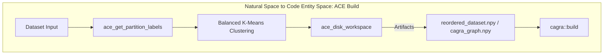
Sources: [cpp/include/cuvs/neighbors/cagra.hpp:38-81](), [cpp/src/neighbors/detail/cagra/cagra_build.cuh:67-184]()

---

## 3. Search Algorithms & Execution Plans

CAGRA search execution is managed by specialized search plans and kernel variants selected via `search_params` [cpp/src/neighbors/detail/cagra/search_plan.cuh:113-131]().

### Search Strategies
1. **`SINGLE_CTA`**: Each Cooperative Thread Array (CTA/block) handles a single query. Highly optimized for low `itopk_size` ($\le 512$) and high-concurrency throughput [cpp/src/neighbors/detail/cagra/search_plan.cuh:124-127](). Supports persistent kernel modes [cpp/src/neighbors/detail/cagra/search_plan.cuh:112-116]().
2. **`MULTI_CTA`**: Multiple CTAs cooperate to traverse the graph for a single query. Preferred for large top-$k$ sizes where latency is prioritized over raw throughput [cpp/src/neighbors/detail/cagra/search_plan.cuh:128-130]().
3. **`MULTI_KERNEL`**: Decomposes graph expansion and distance calculations across separate kernel invocations.

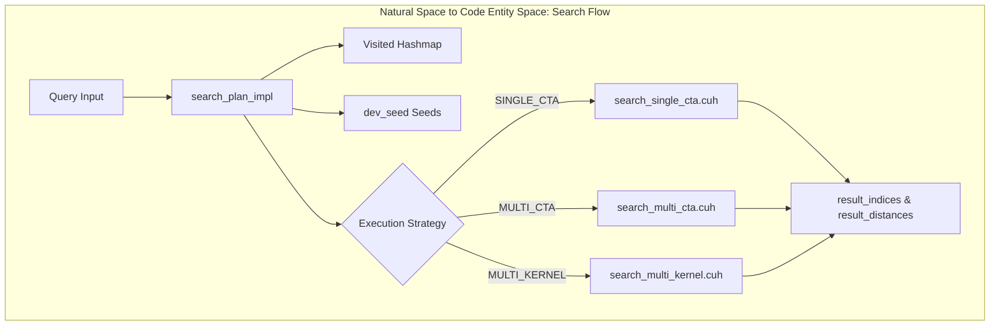
Sources: [cpp/src/neighbors/detail/cagra/search_plan.cuh:112-132](), [cpp/src/neighbors/detail/cagra/search_single_cta.cuh:1-50](), [cpp/src/neighbors/detail/cagra/search_multi_cta.cuh:1-50]()

---

## 4. Index Extension and Merging

CAGRA supports incremental updates and multi-GPU collection consolidation without requiring full index reconstruction.

### Index Extension (`add_node_core`)
New vectors are appended to an existing index using `add_node_core`:
1. **Neighborhood Search**: Finds nearest neighbors for incoming nodes using the existing graph [cpp/src/neighbors/detail/cagra/add_nodes.cuh:114-116]().
2. **Rank-Based Reordering**: Re-ranks incoming edges to maintain structural graph quality [cpp/src/neighbors/detail/cagra/add_nodes.cuh:148-155]().
3. **Incoming Edge Tracking**: Uses `dev_num_incoming_edges` to monitor connection densities across nodes [cpp/src/neighbors/detail/cagra/add_nodes.cuh:41-50]().

### Multi-GPU Merging
Distributed indexes built across multiple GPUs can be merged using shard combination functions [cpp/src/neighbors/mg/snmg.cuh:92-166](), supporting both **SHARDED** (partitioned dataset chunks) and **REPLICATED** (full copies per GPU) topologies [cpp/src/neighbors/mg/snmg.cuh:97-131]().

Sources: [cpp/src/neighbors/detail/cagra/add_nodes.cuh:24-155](), [cpp/src/neighbors/mg/snmg.cuh:92-166]()

---

## 5. Serialization and Interoperability

CAGRA provides binary serialization for persistence and export mechanisms to bridge GPU-built indexes with CPU runtimes like `hnswlib`.

### Native Serialization
The `serialize` function writes index metadata (version, dimensions, graph degree, metric type), adjacency lists, and optional base datasets to an `std::ostream` [cpp/src/neighbors/detail/cagra/cagra_serialize.cuh:31-84]().

### HNSW Interoperability (`serialize_to_hnswlib`)
GPU-constructed CAGRA graphs can be exported into CPU-compatible `hnswlib` binary formats [cpp/src/neighbors/detail/cagra/cagra_serialize.cuh:106-162]().
* **Heuristics**: `hnsw_heuristic_type` allows choosing between `SIMILAR_SEARCH_PERFORMANCE` and `SAME_GRAPH_FOOTPRINT` when mapping CAGRA's fixed-degree graph to HNSW layer structures [cpp/include/cuvs/neighbors/cagra.hpp:145-156]().

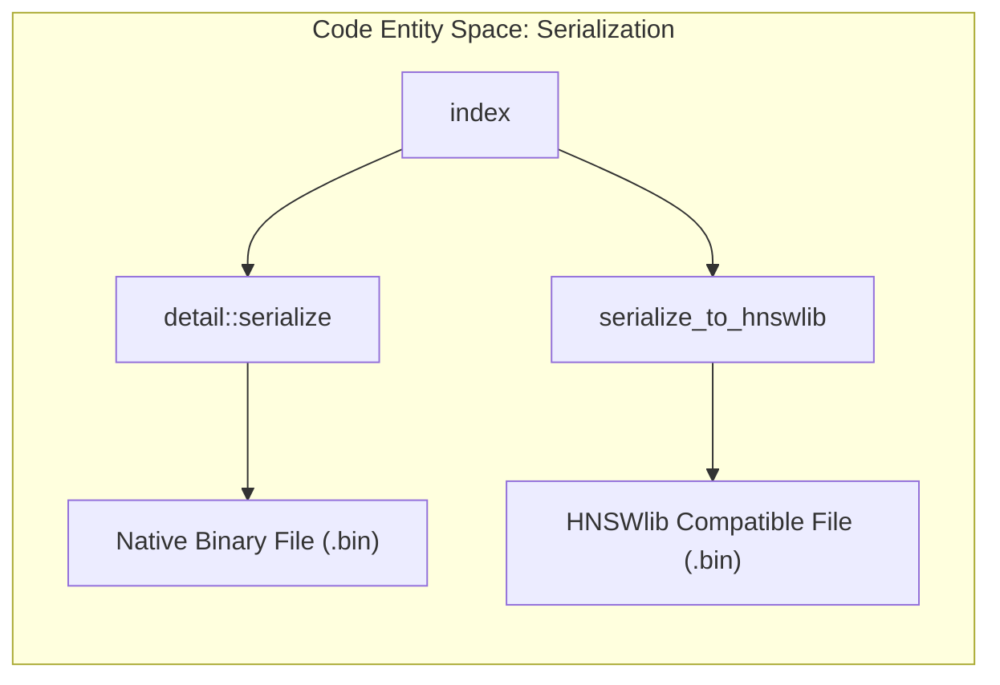
Sources: [cpp/src/neighbors/detail/cagra/cagra_serialize.cuh:31-162](), [cpp/include/cuvs/neighbors/cagra.hpp:145-156]()

---

# Page: IVF-PQ: Inverted File with Product Quantization

# IVF-PQ: Inverted File with Product Quantization

<details>
<summary>Relevant source files</summary>

The following files were used as context for generating this wiki page:

- [cpp/bench/ann/src/common/cuda_huge_page_resource.hpp](cpp/bench/ann/src/common/cuda_huge_page_resource.hpp)
- [cpp/cmake/modules/ConfigureCUDA.cmake](cpp/cmake/modules/ConfigureCUDA.cmake)
- [cpp/include/cuvs/neighbors/ivf_flat.hpp](cpp/include/cuvs/neighbors/ivf_flat.hpp)
- [cpp/include/cuvs/neighbors/ivf_pq.hpp](cpp/include/cuvs/neighbors/ivf_pq.hpp)
- [cpp/src/core/nvtx.hpp](cpp/src/core/nvtx.hpp)
- [cpp/src/neighbors/detail/ann_utils.cuh](cpp/src/neighbors/detail/ann_utils.cuh)
- [cpp/src/neighbors/detail/cagra/add_nodes.cuh](cpp/src/neighbors/detail/cagra/add_nodes.cuh)
- [cpp/src/neighbors/detail/cagra/graph_core.cuh](cpp/src/neighbors/detail/cagra/graph_core.cuh)
- [cpp/src/neighbors/detail/cagra/graph_shared.cu](cpp/src/neighbors/detail/cagra/graph_shared.cu)
- [cpp/src/neighbors/detail/cagra/graph_shared.cuh](cpp/src/neighbors/detail/cagra/graph_shared.cuh)
- [cpp/src/neighbors/detail/cagra/utils.hpp](cpp/src/neighbors/detail/cagra/utils.hpp)
- [cpp/src/neighbors/ivf_common.cu](cpp/src/neighbors/ivf_common.cu)
- [cpp/src/neighbors/ivf_common.cuh](cpp/src/neighbors/ivf_common.cuh)
- [cpp/src/neighbors/ivf_flat/ivf_flat_build.cuh](cpp/src/neighbors/ivf_flat/ivf_flat_build.cuh)
- [cpp/src/neighbors/ivf_flat/ivf_flat_search.cuh](cpp/src/neighbors/ivf_flat/ivf_flat_search.cuh)
- [cpp/src/neighbors/ivf_pq/ivf_pq_build.cuh](cpp/src/neighbors/ivf_pq/ivf_pq_build.cuh)
- [cpp/src/neighbors/ivf_pq/ivf_pq_build_common.cu](cpp/src/neighbors/ivf_pq/ivf_pq_build_common.cu)
- [cpp/src/neighbors/ivf_pq/ivf_pq_codepacking.cuh](cpp/src/neighbors/ivf_pq/ivf_pq_codepacking.cuh)
- [cpp/src/neighbors/ivf_pq/ivf_pq_compute_similarity.cuh](cpp/src/neighbors/ivf_pq/ivf_pq_compute_similarity.cuh)
- [cpp/src/neighbors/ivf_pq/ivf_pq_compute_similarity.hpp](cpp/src/neighbors/ivf_pq/ivf_pq_compute_similarity.hpp)
- [cpp/src/neighbors/ivf_pq/ivf_pq_compute_similarity_impl.cuh](cpp/src/neighbors/ivf_pq/ivf_pq_compute_similarity_impl.cuh)
- [cpp/src/neighbors/ivf_pq/ivf_pq_fp_8bit.cuh](cpp/src/neighbors/ivf_pq/ivf_pq_fp_8bit.cuh)
- [cpp/src/neighbors/ivf_pq/ivf_pq_search.cuh](cpp/src/neighbors/ivf_pq/ivf_pq_search.cuh)
- [cpp/src/neighbors/ivf_pq_impl.hpp](cpp/src/neighbors/ivf_pq_impl.hpp)
- [cpp/src/neighbors/ivf_pq_index.cu](cpp/src/neighbors/ivf_pq_index.cu)
- [cpp/src/neighbors/refine/refine_host.hpp](cpp/src/neighbors/refine/refine_host.hpp)
- [cpp/tests/distance/distance_base.cuh](cpp/tests/distance/distance_base.cuh)
- [cpp/tests/neighbors/ann_ivf_pq.cuh](cpp/tests/neighbors/ann_ivf_pq.cuh)
- [cpp/tests/neighbors/ann_ivf_pq/test_float_int64_t.cu](cpp/tests/neighbors/ann_ivf_pq/test_float_int64_t.cu)
- [cpp/tests/neighbors/ann_utils.cuh](cpp/tests/neighbors/ann_utils.cuh)
- [cpp/tests/sparse/neighbors/cross_component_nn.cu](cpp/tests/sparse/neighbors/cross_component_nn.cu)

</details>


Inverted File with Product Quantization (IVF-PQ) is a lossy compression-based approximate nearest neighbor (ANN) algorithm. It accelerates searches by partitioning the dataset into Voronoi cells (Inverted Lists) and compressing the residual vectors within each cell using Product Quantization (PQ). This approach significantly reduces the memory footprint and enables fast distance computations using lookup tables (LUTs).

## Coarse IVF Clustering

The first stage of IVF-PQ is coarse quantization, where the vector space is divided into $N$ inverted lists.

*   **Clustering Implementation**: cuVS uses a balanced K-Means implementation to ensure that inverted lists are relatively uniform in size, which prevents GPU thread divergence during search [cpp/src/neighbors/ivf_pq/ivf_pq_build.cuh:23-24]().
*   **Metric Selection**: For `InnerProduct` metrics, the system automatically maps to `L2Expanded` for coarse clustering to maintain spatial consistency [cpp/src/neighbors/ivf_pq/ivf_pq_build.cuh:70-76]().
*   **Residual Computation**: After identifying the nearest cluster center (centroid) for a vector, the algorithm computes the residual (the difference between the vector and its centroid). PQ is then applied to these residuals rather than the raw vectors [cpp/src/neighbors/ivf_pq/ivf_pq_build.cuh:79-83]().

### Data Flow: Coarse Clustering to Residuals
The following diagram describes the transition from raw input data to the residual space handled by the PQ encoder, bridging natural language concepts to specific code entities.

Title: Coarse Clustering and Residual Flow
```mermaid
graph TD
    InputData["Dataset_N_Dim"] --> BalancedKMeans["cuvs::cluster::kmeans"]
    BalancedKMeans --> Centroids["Centroids_n_lists_dim"]
    Centroids --> SelectResiduals["select_residuals"]
    InputData --> SelectResiduals
    SelectResiduals --> ResidualVectors["Residual_Vectors"]

    style BalancedKMeans stroke-dasharray: 5 5
    style SelectResiduals stroke-dasharray: 5 5
```
Sources: [cpp/src/neighbors/ivf_pq/ivf_pq_build.cuh:79-130](), [cpp/src/cluster/kmeans_balanced.cuh:1-20]()

## Product Quantization (PQ)

PQ decomposes the high-dimensional residual vector into $M$ sub-vectors (subspaces). Each sub-vector is quantized using a separate codebook.

*   **Subspaces (`pq_dim`)**: The residual vector is split into `pq_dim` sub-vectors. If `pq_dim` is not a divisor of the original dimension, a random rotation matrix is applied to align the dimensions [cpp/include/cuvs/neighbors/ivf_pq.hpp:92-103]().
*   **Codebook Generation**: cuVS supports two kinds of codebooks configured via `codebook_gen` [cpp/include/cuvs/neighbors/ivf_pq.hpp:34-37]():
    *   `PER_SUBSPACE`: One codebook per subspace across all clusters [cpp/include/cuvs/neighbors/ivf_pq.hpp:35]().
    *   `PER_CLUSTER`: Specialized codebooks for each inverted list [cpp/include/cuvs/neighbors/ivf_pq.hpp:36]().
*   **Bit Length (`pq_bits`)**: Specifies the number of bits per subspace index, taking values in `[4, 5, 6, 7, 8]` [cpp/include/cuvs/neighbors/ivf_pq.hpp:67]().

Sources: [cpp/include/cuvs/neighbors/ivf_pq.hpp:33-104](), [cpp/src/neighbors/ivf_pq/ivf_pq_build.cuh:15-18]()

## Index Layout and Memory Management

cuVS provides two layouts for storing the quantized codes within the inverted lists via `list_layout` [cpp/include/cuvs/neighbors/ivf_pq.hpp:39-45]().

| Layout | Description | Use Case |
| :--- | :--- | :--- |
| `FLAT` | Codes for each vector are stored contiguously: `[v1_c1, v1_c2, ..., vN_cM]` [cpp/include/cuvs/neighbors/ivf_pq.hpp:42]() | Simpler data management, sequential access. |
| `INTERLEAVED` | Codes from multiple vectors are interleaved for coalesced memory access: `[v1_c1, v2_c1, ..., v32_c1]` [cpp/include/cuvs/neighbors/ivf_pq.hpp:44]() | Optimized for GPU search performance (default). |

*   **Interleaving**: Specifically groups vectors into blocks to allow threads within a warp to read codes for the same subspace simultaneously [cpp/src/neighbors/ivf_flat/ivf_flat_build.cuh:138-142]().
*   **Conservative Allocation**: Users can toggle `conservative_memory_allocation`. If false, the system over-allocates list buffers to amortize the cost of `extend` operations [cpp/include/cuvs/neighbors/ivf_pq.hpp:114-115]().

Sources: [cpp/include/cuvs/neighbors/ivf_pq.hpp:40-45](), [cpp/src/neighbors/ivf_flat/ivf_flat_build.cuh:138-158]()

## Search Implementation and LUT-Based Search

The search process involves identifying candidate inverted lists and then scanning the compressed codes within those lists using precomputed lookup tables.

1.  **Select Clusters**: The query is compared against all coarse centroids using a GEMM-based search (`select_clusters`) to find the `n_probes` nearest lists [cpp/src/neighbors/ivf_pq/ivf_pq_search.cuh:60-72]().
2.  **LUT Construction**: A Look-Up Table (LUT) is built dynamically for the query to store distances from query sub-vectors to codebook entries [cpp/include/cuvs/neighbors/ivf_pq.hpp:160-175]().
3.  **Distance Computation**: For each vector in the probed lists, the distance is approximated by summing the pre-computed values from the LUT corresponding to the vector's PQ codes [cpp/src/neighbors/ivf_pq/ivf_pq_search.cuh:12-14]().

Title: IVF-PQ Search Pipeline and Code Mapping
```mermaid
graph LR
    QueryVec["QueryVector"] --> SelectClusters["select_clusters"]
    SelectClusters --> ClustersToProbe["ClustersToProbe"]
    QueryVec --> ConstructLUT["ivf_pq_compute_similarity"]
    ClustersToProbe --> ScanLists["interleaved_scan"]
    ConstructLUT --> ScanLists
    ScanLists --> TopK["cuvs::selection::select_k"]

    style SelectClusters stroke-dasharray: 5 5
    style ConstructLUT stroke-dasharray: 5 5
    style ScanLists stroke-dasharray: 5 5
    style TopK stroke-dasharray: 5 5
```
Sources: [cpp/src/neighbors/ivf_pq/ivf_pq_search.cuh:60-168](), [cpp/include/cuvs/neighbors/ivf_pq.hpp:160-175]()

## Serialization and Codepacker Helpers

### Serialization
The index is serialized into a binary format that includes global metadata, coarse centroids, rotation matrices, PQ codebooks, and inverted list data [cpp/src/neighbors/ivf_pq_index.cu:1-50]().

### Codepacker Helpers
Because of the `INTERLEAVED` layout, adding or extracting data from the index requires specialized packing logic. The `ivf_pq_codepacking.cuh` utility handles the conversion between raw PQ codes and the optimized GPU memory layout [cpp/src/neighbors/ivf_pq/ivf_pq_codepacking.cuh:1-30]().

Sources: [cpp/src/neighbors/ivf_pq_index.cu:1-50](), [cpp/src/neighbors/ivf_pq/ivf_pq_codepacking.cuh:1-30]()

## API Reference

### Key C++ Structures
*   `cuvs::neighbors::ivf_pq::index_params`: Configuration structure for building the index [cpp/include/cuvs/neighbors/ivf_pq.hpp:47-151]().
*   `cuvs::neighbors::ivf_pq::search_params`: Runtime parameters structure for search operations [cpp/include/cuvs/neighbors/ivf_pq.hpp:160-175]().

### Key Functions
*   `ivf_pq::build`: Constructs the index from a dataset [cpp/include/cuvs/neighbors/ivf_pq.hpp:123]().
*   `ivf_pq::extend`: Adds new vectors to an existing index [cpp/include/cuvs/neighbors/ivf_pq.hpp:114]().
*   `ivf_pq::search`: Performs approximate nearest neighbor search [cpp/src/neighbors/ivf_pq/ivf_pq_search.cuh:60-168]().

Sources: [cpp/include/cuvs/neighbors/ivf_pq.hpp:47-175](), [cpp/src/neighbors/ivf_pq/ivf_pq_search.cuh:60-168]()

---

# Page: IVF-Flat & IVF-SQ: Inverted File Variants

# IVF-Flat & IVF-SQ: Inverted File Variants

<details>
<summary>Relevant source files</summary>

The following files were used as context for generating this wiki page:

- [c/include/cuvs/neighbors/ivf_sq.h](c/include/cuvs/neighbors/ivf_sq.h)
- [c/src/neighbors/ivf_sq.hpp](c/src/neighbors/ivf_sq.hpp)
- [c/tests/neighbors/ann_ivf_sq_c.cu](c/tests/neighbors/ann_ivf_sq_c.cu)
- [c/tests/neighbors/c_api.c](c/tests/neighbors/c_api.c)
- [c/tests/neighbors/run_ivf_sq_c.c](c/tests/neighbors/run_ivf_sq_c.c)
- [cpp/include/cuvs/neighbors/ivf_sq.hpp](cpp/include/cuvs/neighbors/ivf_sq.hpp)
- [cpp/include/cuvs/neighbors/refine.hpp](cpp/include/cuvs/neighbors/refine.hpp)
- [cpp/src/neighbors/brute_force_serialize.cu](cpp/src/neighbors/brute_force_serialize.cu)
- [cpp/src/neighbors/detail/cagra/cagra_serialize.cuh](cpp/src/neighbors/detail/cagra/cagra_serialize.cuh)
- [cpp/src/neighbors/detail/dataset_serialize.hpp](cpp/src/neighbors/detail/dataset_serialize.hpp)
- [cpp/src/neighbors/detail/vamana/vamana_serialize.cuh](cpp/src/neighbors/detail/vamana/vamana_serialize.cuh)
- [cpp/src/neighbors/ivf_flat/ivf_flat_interleaved_scan_ext.cuh](cpp/src/neighbors/ivf_flat/ivf_flat_interleaved_scan_ext.cuh)
- [cpp/src/neighbors/ivf_flat/ivf_flat_serialize.cuh](cpp/src/neighbors/ivf_flat/ivf_flat_serialize.cuh)
- [cpp/src/neighbors/ivf_flat_index.cpp](cpp/src/neighbors/ivf_flat_index.cpp)
- [cpp/src/neighbors/ivf_list.cuh](cpp/src/neighbors/ivf_list.cuh)
- [cpp/src/neighbors/ivf_pq/ivf_pq_serialize.cuh](cpp/src/neighbors/ivf_pq/ivf_pq_serialize.cuh)
- [cpp/src/neighbors/ivf_sq/ivf_sq_build.cuh](cpp/src/neighbors/ivf_sq/ivf_sq_build.cuh)
- [cpp/src/neighbors/ivf_sq/ivf_sq_serialize.cuh](cpp/src/neighbors/ivf_sq/ivf_sq_serialize.cuh)
- [cpp/src/neighbors/refine/refine_device.cuh](cpp/src/neighbors/refine/refine_device.cuh)
- [cpp/tests/cluster/kmeans_balanced.cu](cpp/tests/cluster/kmeans_balanced.cu)
- [cpp/tests/neighbors/ann_brute_force.cuh](cpp/tests/neighbors/ann_brute_force.cuh)
- [cpp/tests/neighbors/ann_ivf_flat.cuh](cpp/tests/neighbors/ann_ivf_flat.cuh)
- [cpp/tests/neighbors/ann_ivf_flat/test_float_int64_t.cu](cpp/tests/neighbors/ann_ivf_flat/test_float_int64_t.cu)
- [cpp/tests/neighbors/ann_ivf_sq.cuh](cpp/tests/neighbors/ann_ivf_sq.cuh)
- [cpp/tests/neighbors/ann_ivf_sq/test_float_int64_t.cu](cpp/tests/neighbors/ann_ivf_sq/test_float_int64_t.cu)
- [cpp/tests/neighbors/dynamic_batching.cuh](cpp/tests/neighbors/dynamic_batching.cuh)
- [cpp/tests/neighbors/hnsw.cu](cpp/tests/neighbors/hnsw.cu)
- [cpp/tests/neighbors/tiered_index.cu](cpp/tests/neighbors/tiered_index.cu)
- [fern/pages/c_api/c-api-neighbors-ivf-sq.md](fern/pages/c_api/c-api-neighbors-ivf-sq.md)
- [fern/pages/cpp_api/cpp-api-neighbors-ivf-sq.md](fern/pages/cpp_api/cpp-api-neighbors-ivf-sq.md)

</details>


Inverted File (IVF) indices partition the vector space into Voronoi cells based on cluster centers. At search time, only the most promising cells (inverted lists) are scanned. cuVS provides two high-performance variants that differ in how they store the residual data within these lists: **IVF-Flat** (storing exact vectors) and **IVF-SQ** (storing scalar-quantized residuals).

Sources: `[cpp/include/cuvs/neighbors/ivf_flat.hpp:1-30](), [cpp/include/cuvs/neighbors/ivf_sq.hpp:138-170]()`

---

## IVF-Flat: Exact Inverted File

IVF-Flat stores the original vector data within the inverted lists. To maximize GPU memory throughput during search, vectors are stored in an **interleaved layout** within each list.

### Data Layout and Build
The build process uses K-Means to find cluster centers. Vectors are then assigned to these centers and copied into the index. The internal storage uses `kIndexGroupSize` (32) to interleave dimensions, allowing for coalesced memory access during the scan.

| Parameter | Role |
| :--- | :--- |
| `n_lists` | Number of Voronoi cells (inverted lists). `[cpp/src/neighbors/ivf_flat/ivf_flat_build.cuh:173]()` |
| `adaptive_centers` | If true, cluster centers are updated as data is added. `[cpp/src/neighbors/ivf_flat/ivf_flat_build.cuh:56]()` |
| `conservative_memory_allocation` | If true, minimizes GPU memory by avoiding over-provisioning list capacity. `[cpp/src/neighbors/ivf_flat/ivf_flat_build.cuh:57]()` |

### Search Pipeline
The search process follows a two-stage approach:
1.  **Coarse Quantization**: A GEMM operation computes distances between queries and all cluster centers to select the top `n_probes` lists. `[cpp/src/neighbors/ivf_flat/ivf_flat_search.cuh:148-162]()`
2.  **Fine Scan**: The selected lists are scanned using an interleaved kernel that computes exact distances (L2, Inner Product, or Cosine). `[cpp/src/neighbors/ivf_flat/ivf_flat_search.cuh:11-13]()`

Sources: `[cpp/src/neighbors/ivf_flat/ivf_flat_build.cuh:47-120](), [cpp/src/neighbors/ivf_flat/ivf_flat_search.cuh:41-162](), [cpp/include/cuvs/neighbors/ivf_flat.hpp:28-60]()`

---

## IVF-SQ: Scalar Quantized Inverted File

IVF-SQ provides a middle ground between the exactness of IVF-Flat and the high compression of IVF-PQ. It stores 8-bit scalar quantized residuals.

### Quantization Mechanism
For each dimension $i$, the residual $r_i$ (vector component minus centroid component) is mapped to a `uint8_t` code using learned per-dimension minimums ($vmin_i$) and step-sizes ($delta_i$):
$$code_i = clamp(round((x_i - centroid_i - vmin_i) / delta_i), 0, 255)$$
`[cpp/include/cuvs/neighbors/ivf_sq.hpp:148-155]()`

### Key Classes and Structures
-   `cuvs::neighbors::ivf_sq::index<CodeT>`: The main index structure. Currently, `CodeT` must be `uint8_t`. `[cpp/include/cuvs/neighbors/ivf_sq.hpp:171-180]()`
-   `list_spec`: Defines the storage alignment and padding (vectors are padded to multiples of 16 for performance). `[cpp/include/cuvs/neighbors/ivf_sq.hpp:92-123]()`

Sources: `[cpp/include/cuvs/neighbors/ivf_sq.hpp:36-62](), [cpp/include/cuvs/neighbors/ivf_sq.hpp:138-180]()`

---

## System Architecture & Data Flow

The following diagrams bridge natural language concepts to concrete code entities within the cuVS codebase.

### IVF Variant Logic to Code Mapping
Diagram: IVF Data Flow
```mermaid
graph TD
    subgraph "CApiLayer"
        CApiBuild["cuvsIvfSqBuild"] --> BuildWrap["_build<T>"]
        CApiSearch["cuvsIvfSqSearch"] --> SearchWrap["_search<T>"]
    end

    subgraph "CppCore"
        BuildWrap --> BuildLogic["ivf_sq::build"]
        SearchWrap --> SearchLogic["ivf_sq::search"]
        
        subgraph "IvfFlatSearch"
            SearchLogicFlat["search_impl"] --> CoarseGEMM["raft::linalg::gemm"]
            CoarseGEMM --> FineScan["interleaved_scan"]
        end
    end

    subgraph "DataStructures"
        BuildLogic --> IndexObj["ivf_sq::index<uint8_t>"]
        IndexObj --> ListData["ivf::list"]
    end
```
Sources: `[c/src/neighbors/ivf_sq.cpp:53-72](), [c/src/neighbors/ivf_sq.cpp:74-116](), [cpp/src/neighbors/ivf_flat/ivf_flat_search.cuh:41-56]()`

---

## Implementation Details

### Interleaved Memory Layout
Both variants use a specialized layout to ensure that when a warp (32 threads) processes a list, each thread reads a dimension from a different vector in a single transaction.

Diagram: Memory Layout of Inverted Lists
```mermaid
graph LR
    subgraph "VectorGroup"
        V0["Vec0Dim0"]
        V1["Vec1Dim0"]
        V31["Vec31Dim0"]
        V0_d1["Vec0Dim1"]
    end
    
    V0 --- V1 --- V31 --- V0_d1
    
    subgraph "CodeEntity"
        Layout["kIndexGroupSize=32"]
        Spec["list_spec::kVecLen=16"]
    end
```
Sources: `[cpp/src/neighbors/ivf_flat/ivf_flat_build.cuh:138-144](), [cpp/include/cuvs/neighbors/ivf_sq.hpp:28-116]()`

### Pre-filtering
Both IVF-Flat and IVF-SQ support bitset-based pre-filtering. This allows excluding specific IDs from the search results before distance computation.
-   In the C API, this is handled via `cuvsFilter`. `[c/src/neighbors/ivf_sq.cpp:96-112]()`
-   In the C++ detail layer, it uses `IvfSampleFilterT`. `[cpp/src/neighbors/ivf_flat/ivf_flat_search.cuh:40-55]()`

Sources: `[c/src/neighbors/ivf_sq.cpp:96-112](), [cpp/src/neighbors/ivf_flat/ivf_flat_search.cuh:40-55]()`

### Serialization
Serialization is implemented for both variants to allow saving/loading indices to/from disk.
-   **IVF-Flat**: Uses `cuvs::neighbors::ivf_flat::serialize`. `[cpp/src/neighbors/ivf_flat/ivf_flat_serialize.cuh:43-78]()`
-   **IVF-SQ**: Uses `cuvs::neighbors::ivf_sq::serialize`. `[cpp/src/neighbors/ivf_sq/ivf_sq_serialize.cuh:20-50]()`

Sources: `[cpp/src/neighbors/ivf_flat/ivf_flat_serialize.cuh:43-78](), [cpp/src/neighbors/ivf_sq/ivf_sq_serialize.cuh:20-50]()`

---

## Summary Table

| Feature | IVF-Flat | IVF-SQ |
| :--- | :--- | :--- |
| **Data Storage** | Full `float`/`half` vectors `[cpp/src/neighbors/ivf_flat/ivf_flat_build.cuh:88]()` | 8-bit Scalar Quantized residuals `[cpp/include/cuvs/neighbors/ivf_sq.hpp:179]()` |
| **Distance Computation** | Exact (L2, IP, Cosine) `[cpp/src/neighbors/ivf_flat/ivf_flat_search.cuh:109-146]()` | Dequantized + Centroid distance `[cpp/include/cuvs/neighbors/ivf_sq.hpp:153-155]()` |
| **Memory Efficiency** | Low (Full vector size) | Medium (1 byte per dimension) |
| **Performance** | High (Coalesced IO) | Very High (Reduced bandwidth) |

Sources: `[cpp/include/cuvs/neighbors/ivf_sq.hpp:138-160](), [cpp/src/neighbors/ivf_flat/ivf_flat_search.cuh:109-162](), [c/src/neighbors/ivf_sq.cpp:21-38]()`

---

# Page: HNSW: Hierarchical Navigable Small Worlds

# HNSW: Hierarchical Navigable Small Worlds

<details>
<summary>Relevant source files</summary>

The following files were used as context for generating this wiki page:

- [c/include/cuvs/neighbors/hnsw.h](c/include/cuvs/neighbors/hnsw.h)
- [c/src/neighbors/hnsw.cpp](c/src/neighbors/hnsw.cpp)
- [c/tests/neighbors/ann_hnsw_c.cu](c/tests/neighbors/ann_hnsw_c.cu)
- [cpp/bench/ann/src/cuvs/cuvs_cagra_hnswlib.cu](cpp/bench/ann/src/cuvs/cuvs_cagra_hnswlib.cu)
- [cpp/bench/ann/src/cuvs/cuvs_cagra_hnswlib_wrapper.h](cpp/bench/ann/src/cuvs/cuvs_cagra_hnswlib_wrapper.h)
- [cpp/include/cuvs/neighbors/hnsw.hpp](cpp/include/cuvs/neighbors/hnsw.hpp)
- [cpp/include/cuvs/util/file_io.hpp](cpp/include/cuvs/util/file_io.hpp)
- [cpp/src/neighbors/detail/cagra/cagra_build.cuh](cpp/src/neighbors/detail/cagra/cagra_build.cuh)
- [cpp/src/neighbors/detail/hnsw.hpp](cpp/src/neighbors/detail/hnsw.hpp)
- [cpp/src/neighbors/hnsw.cpp](cpp/src/neighbors/hnsw.cpp)
- [cpp/tests/neighbors/ann_hnsw_ace.cuh](cpp/tests/neighbors/ann_hnsw_ace.cuh)
- [cpp/tests/neighbors/ann_hnsw_ace/test_float_uint32_t.cu](cpp/tests/neighbors/ann_hnsw_ace/test_float_uint32_t.cu)
- [cpp/tests/neighbors/ann_hnsw_ace/test_half_uint32_t.cu](cpp/tests/neighbors/ann_hnsw_ace/test_half_uint32_t.cu)
- [cpp/tests/neighbors/ann_hnsw_ace/test_int8_t_uint32_t.cu](cpp/tests/neighbors/ann_hnsw_ace/test_int8_t_uint32_t.cu)
- [cpp/tests/neighbors/ann_hnsw_ace/test_uint8_t_uint32_t.cu](cpp/tests/neighbors/ann_hnsw_ace/test_uint8_t_uint32_t.cu)
- [java/cuvs-java/src/main/java/com/nvidia/cuvs/HnswIndex.java](java/cuvs-java/src/main/java/com/nvidia/cuvs/HnswIndex.java)
- [java/cuvs-java/src/main/java/com/nvidia/cuvs/HnswIndexParams.java](java/cuvs-java/src/main/java/com/nvidia/cuvs/HnswIndexParams.java)
- [java/cuvs-java/src/main/java22/com/nvidia/cuvs/internal/HnswIndexImpl.java](java/cuvs-java/src/main/java22/com/nvidia/cuvs/internal/HnswIndexImpl.java)
- [java/cuvs-java/src/test/java/com/nvidia/cuvs/HnswBuildAndSearchIT.java](java/cuvs-java/src/test/java/com/nvidia/cuvs/HnswBuildAndSearchIT.java)
- [python/cuvs/cuvs/neighbors/hnsw/hnsw.pxd](python/cuvs/cuvs/neighbors/hnsw/hnsw.pxd)
- [python/cuvs/cuvs/neighbors/hnsw/hnsw.pyx](python/cuvs/cuvs/neighbors/hnsw/hnsw.pyx)
- [python/cuvs/cuvs/tests/test_cagra_ace.py](python/cuvs/cuvs/tests/test_cagra_ace.py)
- [python/cuvs/cuvs/tests/test_hnsw.py](python/cuvs/cuvs/tests/test_hnsw.py)

</details>


The HNSW implementation in cuVS provides a high-performance CPU search interface integrated with GPU-accelerated construction. By leveraging the `hnswlib` library and cuVS's own CAGRA algorithm, it enables a workflow where complex graph construction is offloaded to the GPU while search can be performed on CPU-only nodes. This page covers the core HNSW integration, the conversion path from CAGRA, the ACE (Augmented Core Extraction) system for large-scale builds, serialization, and language bindings.

## Overview and Integration

cuVS integrates HNSW by wrapping the `hnswlib` library via headers like `[cpp/include/cuvs/neighbors/hnsw.hpp]()` and implementation files like `[cpp/src/neighbors/detail/hnsw.hpp]().` The primary value proposition is building a high-quality graph on the GPU (via CAGRA) and converting it into a standard HNSW structure for low-latency CPU serving.

### System Architecture and Data Flow

The following diagram bridges natural language concepts to concrete code entities in the cuVS codebase for the HNSW pipeline.

**HNSW Construction and Search Pipeline**
```mermaid
graph TD
    subgraph "GPU Space"
        Dataset[Dataset] --> CB["cagra::build()"]
        CB --> CI["cuvs::neighbors::cagra::index"]
    end

    subgraph "Transition"
        CI --> FC["hnsw::from_cagra()"]
        FC --> HI["cuvs::neighbors::hnsw::index"]
        Params["hnsw::index_params"] -.-> FC
    end

    subgraph "CPU Space"
        HI --> HS["hnsw::search()"]
        Queries[Queries] --> HS
        HS --> Results[Results]
    end

    style CI stroke-dasharray: 5 5
    style HI stroke-dasharray: 5 5
```
Sources: `[cpp/include/cuvs/neighbors/hnsw.hpp:101-115](), [cpp/src/neighbors/detail/hnsw.hpp:190-218]()`

## HNSW Index and Parameters

The HNSW implementation supports various data types including `float`, `half`, `uint8_t`, and `int8_t` `[cpp/src/neighbors/detail/hnsw.hpp:139-162]()`.

### Hierarchy Types
The `HnswHierarchy` enum defines how the hierarchical layers of the HNSW index are constructed during conversion from a CAGRA graph:
*   `NONE`: Creates a base-layer-only index (flat graph).
*   `CPU`: Build the hierarchy using CPU threads.
*   `GPU`: Offload hierarchy construction to the GPU for faster processing.

Sources: `[cpp/include/cuvs/neighbors/hnsw.hpp:39-43]()`

### Configuration Classes
*   `hnsw::index_params`: Configuration struct containing `hierarchy`, `ef_construction`, `num_threads`, `M`, and `graph_build_params` `[cpp/include/cuvs/neighbors/hnsw.hpp:45-91]()`.
*   `hnsw::extend_params`: Configuration struct containing `num_threads` for appending vectors `[cpp/include/cuvs/neighbors/hnsw.hpp:192-196]()`.

Sources: `[cpp/include/cuvs/neighbors/hnsw.hpp:45-91](), [cpp/include/cuvs/neighbors/hnsw.hpp:192-196]()`

## CAGRA-to-HNSW Conversion

A unique feature of cuVS is generating an HNSW index from a CAGRA graph. CAGRA produces a high-quality K-NN graph on the GPU, which can be hierarchized into an HNSW index.

*   **Function**: `hnsw::from_cagra` `[cpp/include/cuvs/neighbors/hnsw.hpp:217-221]()`
*   **Workflow**:
    1. Build a CAGRA index using `cagra::build`.
    2. Invoke `hnsw::from_cagra` with `hnsw::index_params` to produce a `hnsw::index` handle `[cpp/include/cuvs/neighbors/hnsw.hpp:101-118]()`.

Sources: `[cpp/include/cuvs/neighbors/hnsw.hpp:91-118](), [cpp/src/neighbors/detail/hnsw.hpp:190-215]()`

## ACE-based HNSW Build & Out-of-Core Workspaces

For datasets exceeding GPU memory, cuVS uses **ACE (Augmented Core Extraction)** implemented via `cagra::detail::ace_disk_workspace` `[cpp/src/neighbors/detail/cagra/cagra_build.cuh:67-153]()`. ACE partitions the dataset, builds sub-indices, and merges them into a single coherent graph.

### ACE Implementation Details
The `ace_params` structure allows fine-tuning the partitioned build:
*   `npartitions`: Number of dataset chunks (`0` derives it automatically) `[python/cuvs/cuvs/neighbors/hnsw/hnsw.pyx:41-46]()`.
*   `build_dir`: Directory for temporary artifacts (`reordered_dataset.npy`, `augmented_dataset.npy`, `dataset_mapping.npy`, `cagra_graph.npy`) `[cpp/src/neighbors/detail/cagra/cagra_build.cuh:69-74]()`.
*   `use_disk`: Enables disk-backed storage for memory-efficient construction `[python/cuvs/cuvs/neighbors/hnsw/hnsw.pyx:108-110]()`.

**ACE Disk Workspace and HNSW Output Pipeline**
```mermaid
graph TD
    subgraph "Code Entities"
        Workspace["cuvs::neighbors::cagra::detail::ace_disk_workspace"]
        OutFile["cuvs::neighbors::hnsw::detail::exclusive_hnsw_output_file"]
        CagraBuild["cagra::build"]
        HnswBuild["hnsw::from_cagra"]
    end

    subgraph "Operations"
        Init["initialize() / mkdir()"] --> WriteArtifacts["Write NumPy Artifacts"]
        WriteArtifacts --> CagraBuild
        CagraBuild --> HnswBuild
        HnswBuild --> OutFile
        OutFile --> Publish["atomic ::link() to final path"]
    end

    Workspace --> Init
```
Sources: `[cpp/src/neighbors/detail/cagra/cagra_build.cuh:67-153](), [cpp/src/neighbors/detail/hnsw.hpp:49-115]()`

## Serialization and Search API

HNSW indices can be serialized to disk and deserialized for later use via transactional patterns.

*   **Serialization**: `hnsw::serialize(res, filename, index)` uses `exclusive_hnsw_output_file` to write to a temporary file via `mkstemp` and publish via `::link` `[cpp/src/neighbors/detail/hnsw.hpp:49-105]()`.
*   **Search**: Performed on the CPU using `hnsw::search` [cpp/src/neighbors/hnsw.cpp:79-87](), accepting host matrix views for queries, neighbors, and distances.

Sources: `[cpp/src/neighbors/detail/hnsw.hpp:49-115](), [cpp/src/neighbors/hnsw.cpp:79-109]()`

## Language Bindings

### Python (Cython)
The Python API wraps the C++ structures via `AceParams` and `IndexParams` in `[python/cuvs/cuvs/neighbors/hnsw/hnsw.pyx:31-151]()`, supporting both in-memory and disk-spill ACE builds.

### Java (FFM)
The Java implementation uses the Foreign Function & Memory API in `[java/cuvs-java/src/main/java22/com/nvidia/cuvs/internal/HnswIndexImpl.java:47-155]()`, exposing `HnswIndex`, `HnswIndexParams`, and native calls like `cuvsHnswSearch`.

### C API Layer
Exposes stable ABI functions in `[c/include/cuvs/neighbors/hnsw.h:48-137]()` for creating parameters (`cuvsHnswIndexParamsCreate`), managing indices (`cuvsHnswIndexCreate`, `cuvsHnswIndexDestroy`), and searching.

Sources: `[python/cuvs/cuvs/neighbors/hnsw/hnsw.pyx:31-151](), [java/cuvs-java/src/main/java22/com/nvidia/cuvs/internal/HnswIndexImpl.java:47-155](), [c/include/cuvs/neighbors/hnsw.h:48-137]()`

---

# Page: NN-Descent: KNN Graph Construction

# NN-Descent: KNN Graph Construction

<details>
<summary>Relevant source files</summary>

The following files were used as context for generating this wiki page:

- [c/include/cuvs/neighbors/all_neighbors.h](c/include/cuvs/neighbors/all_neighbors.h)
- [c/include/cuvs/neighbors/nn_descent.h](c/include/cuvs/neighbors/nn_descent.h)
- [c/src/neighbors/all_neighbors.cpp](c/src/neighbors/all_neighbors.cpp)
- [c/src/neighbors/nn_descent.cpp](c/src/neighbors/nn_descent.cpp)
- [cpp/include/cuvs/neighbors/all_neighbors.hpp](cpp/include/cuvs/neighbors/all_neighbors.hpp)
- [cpp/include/cuvs/neighbors/nn_descent.hpp](cpp/include/cuvs/neighbors/nn_descent.hpp)
- [cpp/src/neighbors/all_neighbors/all_neighbors.cu](cpp/src/neighbors/all_neighbors/all_neighbors.cu)
- [cpp/src/neighbors/all_neighbors/all_neighbors.cuh](cpp/src/neighbors/all_neighbors/all_neighbors.cuh)
- [cpp/src/neighbors/all_neighbors/all_neighbors_batched.cuh](cpp/src/neighbors/all_neighbors/all_neighbors_batched.cuh)
- [cpp/src/neighbors/all_neighbors/all_neighbors_builder.cuh](cpp/src/neighbors/all_neighbors/all_neighbors_builder.cuh)
- [cpp/src/neighbors/all_neighbors/all_neighbors_merge.cuh](cpp/src/neighbors/all_neighbors/all_neighbors_merge.cuh)
- [cpp/src/neighbors/detail/nn_descent.cuh](cpp/src/neighbors/detail/nn_descent.cuh)
- [cpp/src/neighbors/detail/nn_descent_gnnd.hpp](cpp/src/neighbors/detail/nn_descent_gnnd.hpp)
- [cpp/src/neighbors/nn_descent.cuh](cpp/src/neighbors/nn_descent.cuh)
- [cpp/tests/neighbors/all_neighbors.cuh](cpp/tests/neighbors/all_neighbors.cuh)
- [cpp/tests/neighbors/all_neighbors/test_float.cu](cpp/tests/neighbors/all_neighbors/test_float.cu)
- [cpp/tests/neighbors/ann_nn_descent.cuh](cpp/tests/neighbors/ann_nn_descent.cuh)
- [cpp/tests/neighbors/ann_nn_descent/test_float_uint32_t.cu](cpp/tests/neighbors/ann_nn_descent/test_float_uint32_t.cu)
- [cpp/tests/neighbors/ann_nn_descent/test_uint8_t_uint32_t.cu](cpp/tests/neighbors/ann_nn_descent/test_uint8_t_uint32_t.cu)
- [cpp/tests/neighbors/naive_knn.cuh](cpp/tests/neighbors/naive_knn.cuh)
- [python/cuvs/cuvs/neighbors/all_neighbors/all_neighbors.pyx](python/cuvs/cuvs/neighbors/all_neighbors/all_neighbors.pyx)
- [python/cuvs/cuvs/neighbors/nn_descent/nn_descent.pxd](python/cuvs/cuvs/neighbors/nn_descent/nn_descent.pxd)
- [python/cuvs/cuvs/neighbors/nn_descent/nn_descent.pyx](python/cuvs/cuvs/neighbors/nn_descent/nn_descent.pyx)
- [python/cuvs/cuvs/tests/test_all_neighbors.py](python/cuvs/cuvs/tests/test_all_neighbors.py)
- [python/cuvs/cuvs/tests/test_nn_descent.py](python/cuvs/cuvs/tests/test_nn_descent.py)

</details>


## Purpose and Scope
This page details the implementation of **NN-Descent** (specifically the GNND GPU-accelerated solver) within cuVS [cpp/src/neighbors/detail/nn_descent_gnnd.hpp:1-15](). NN-Descent is an efficient algorithm for constructing Approximate K-Nearest Neighbor (KNN) graphs [cpp/include/cuvs/neighbors/nn_descent.hpp:87-95](). In cuVS, NN-Descent serves a dual role: it provides high-quality graph seeds for graph-based indices like **CAGRA** [cpp/include/cuvs/neighbors/nn_descent.hpp:91-95](), and it acts as an underlying graph build engine for **all-neighbors** batch construction pipelines [cpp/include/cuvs/neighbors/all_neighbors.hpp:25-27]().

Sources: `[cpp/include/cuvs/neighbors/nn_descent.hpp:87-95]`, `[cpp/src/neighbors/detail/nn_descent_gnnd.hpp:1-15]`, `[cpp/include/cuvs/neighbors/all_neighbors.hpp:25-27]()`.

---

## Algorithm Overview

The NN-Descent algorithm starts with a random graph and iteratively improves it by exploring the neighbors of neighbors based on the heuristic that "a neighbor of my neighbor is likely to be my neighbor."

### Key Phases
1. **Initialization**: A random neighbor graph is initialized where each node connects to random peers via `GnndGraph::init_random_graph()` [cpp/src/neighbors/detail/nn_descent_gnnd.hpp:180-180]().
2. **Sampling**: In each iteration, "new" and "old" neighbor candidates are sampled for local joins. A probabilistic Bloom filter tracks explored paths to avoid redundancy [cpp/src/neighbors/detail/nn_descent_gnnd.hpp:182-184]().
3. **Local Join**: Pairwise distances are computed among sampled neighborhood candidates. If closer peers are discovered, the adjacency list is updated via `GnndGraph::update_graph()` [cpp/src/neighbors/detail/nn_descent_gnnd.hpp:185-188]().
4. **Refinement Iterations**: Refinement repeats up to `max_iterations` or until updates drop below the `termination_threshold` [cpp/include/cuvs/neighbors/nn_descent.hpp:64-65]().

### Data Flow and Code Entity Mapping

The following diagram bridges the natural language concepts of NN-Descent to the concrete classes and functions in the codebase.

Title: "NN-Descent Component Mapping"
```mermaid
graph TD
    PublicAPI["cuvs::neighbors::nn_descent::build()"] -->|invokes| GNNDClass["cuvs::neighbors::nn_descent::detail::GNND"]
    IndexParamsStruct["cuvs::neighbors::nn_descent::index_params"] -->|configures| GNNDClass
    GNNDClass -->|manages| GnndGraphStruct["cuvs::neighbors::nn_descent::detail::GnndGraph"]
    GnndGraphStruct -->|samples via| BloomFilterClass["cuvs::neighbors::nn_descent::detail::BloomFilter"]
    GnndGraphStruct -->|sorts lists| SortLists["GnndGraph::sort_lists()"]
    GNNDClass -->|populates| IndexStruct["cuvs::neighbors::nn_descent::index"]
```
Sources: `[cpp/include/cuvs/neighbors/nn_descent.hpp:61-131]`, `[cpp/src/neighbors/detail/nn_descent_gnnd.hpp:154-192]`, `[cpp/src/neighbors/nn_descent.cuh:54-60]()`.

---

## Implementation Details

### WMMA vs. SIMT Kernels and Precision
The local join phase evaluates large batches of pairwise distances on the GPU:
* **Kernel Dispatch**: Depending on hardware capabilities and data layout, kernels utilize either Tensor Core acceleration via Warp Matrix Multiply-Accumulate (`WMMA`) or standard Warp-level `SIMT` execution paths [cpp/src/neighbors/detail/nn_descent.cuh:207-209]().
* **Precision Control (`DIST_COMP_DTYPE`)**: Controlled via `index_params::dist_comp_dtype`, users can select `AUTO`, `FP32`, or `FP16` [cpp/include/cuvs/neighbors/nn_descent.hpp:40-67](). `AUTO` selects the optimal precision based on dataset dimensions.
* **Bank Conflict Avoidance**: Shared memory layouts apply `skew_dim<T>()` to pad dimensions and eliminate shared memory bank conflicts during parallel matrix updates [cpp/src/neighbors/detail/nn_descent.cuh:116-124]().

### Bloom Filter Sampling
To prevent redundant distance calculations across iterations, `BloomFilter<Index_t>` maintains compact bitsets [cpp/src/neighbors/detail/nn_descent_gnnd.hpp:72-151]().
* **Hash Functions**: Employs two fast integer hash routines (`hash_0` and `hash_1`) to map neighbor IDs into bitset indices [cpp/src/neighbors/detail/nn_descent_gnnd.hpp:125-143]().
* **Efficiency**: `GnndGraph::sample_graph_new()` uses the Bloom filter to quickly identify unvisited candidates for local joining without maintaining dense transition matrices [cpp/src/neighbors/detail/nn_descent_gnnd.hpp:182-184]().

### Memory Management & Host/Device Split
* **Graph Storage**: The resulting KNN graph is stored as a host matrix (`raft::host_matrix`) of indices inside `cuvs::neighbors::nn_descent::index` [cpp/include/cuvs/neighbors/nn_descent.hpp:123-125]().
* **Distances**: If requested, computed distances reside in a device matrix (`raft::device_matrix`) [cpp/include/cuvs/neighbors/nn_descent.hpp:127-130]().
* **Pinned Buffers**: Internal iteration state vectors (`h_graph_new`, `h_graph_old`, `h_list_sizes_new`) allocate pinned host memory (`raft::pinned_matrix`) to maximize PCIe transfer throughput between CPU and GPU [cpp/src/neighbors/detail/nn_descent_gnnd.hpp:166-170]().

Sources: `[cpp/include/cuvs/neighbors/nn_descent.hpp:40-130]`, `[cpp/src/neighbors/detail/nn_descent.cuh:116-209]`, `[cpp/src/neighbors/detail/nn_descent_gnnd.hpp:72-170]()`.

---

## Configuration Parameters

The `index_params` struct exposes the primary tuning knobs for the NN-Descent algorithm:

| Parameter | Type | Default | Description |
| :--- | :--- | :--- | :--- |
| `graph_degree` | `size_t` | 64 | Final output degree of the KNN graph per node [cpp/include/cuvs/neighbors/nn_descent.hpp:62-62](). |
| `intermediate_graph_degree` | `size_t` | 128 | Internal working degree during graph refinement (recommended $\ge 1.5 \times \text{graph\_degree}$) [cpp/include/cuvs/neighbors/nn_descent.hpp:63-63](). |
| `max_iterations` | `size_t` | 20 | Maximum refinement iterations [cpp/include/cuvs/neighbors/nn_descent.hpp:64-64](). |
| `termination_threshold` | `float` | 0.0001 | Convergence threshold based on graph update deltas [cpp/include/cuvs/neighbors/nn_descent.hpp:65-65](). |
| `dist_comp_dtype` | `enum` | `AUTO` | Distance computation precision (`AUTO`, `FP32`, or `FP16`) [cpp/include/cuvs/neighbors/nn_descent.hpp:67-67](). |

Sources: `[cpp/include/cuvs/neighbors/nn_descent.hpp:61-76]()`.

---

## Data Structures and Core Classes

### ResultItem and InternalID_t
* `ResultItem<Index_t>`: Tracks candidate neighbor IDs and distances inside CUDA kernels, utilizing sign-bit manipulation to distinguish between newly discovered (`is_new() == true`) and established graph edges [cpp/src/neighbors/detail/nn_descent.cuh:53-77]().
* `InternalID_t<Index_t>`: Internal representation used by `GnndGraph` to pack flags and node identifiers into single integers [cpp/src/neighbors/detail/nn_descent_gnnd.hpp:33-55]().

### GnndGraph and BloomFilter Class Hierarchy

Title: "NN-Descent Internal Data Structures"
```mermaid
classDiagram
    class GnndGraph {
        +InternalID_t* h_graph
        +raft::host_matrix h_dists
        +raft::pinned_matrix h_graph_new
        +raft::pinned_matrix h_graph_old
        +BloomFilter bloom_filter
        +init_random_graph()
        +sample_graph_new(InternalID_t* new_neighbors, size_t width)
        +update_graph(...)
        +sort_lists()
    }
    class BloomFilter {
        -std::vector~bool~ bitsets_
        -size_t nrow_
        +add(size_t list_id, Index_t key)
        +check(size_t list_id, Index_t key)
        +clear()
    }
    GnndGraph *-- BloomFilter : "owns and queries"
```
Sources: `[cpp/src/neighbors/detail/nn_descent_gnnd.hpp:72-192]`, `[cpp/src/neighbors/detail/nn_descent.cuh:53-104]()`.

---

## Role as CAGRA and All-Neighbors Graph Seed

NN-Descent is critical across multiple cuVS subsystems:
1. **CAGRA Seed**: While CAGRA provides ultra-fast GPU graph-based search, its index quality relies heavily on initial graph connectivity. NN-Descent yields superior recall-latency curves compared to random or IVF seeding [cpp/include/cuvs/neighbors/nn_descent.hpp:91-95]().
2. **All-Neighbors Graph Builder**: Integrated via `graph_build_params::nn_descent_params`, NN-Descent powers batched global graph construction workflows in `all_neighbors::build()` [cpp/include/cuvs/neighbors/all_neighbors.hpp:25-27]().

Sources: `[cpp/include/cuvs/neighbors/nn_descent.hpp:91-95]`, `[cpp/include/cuvs/neighbors/all_neighbors.hpp:25-27]()`.

---

# Page: Brute Force, ScaNN, Vamana & Other Algorithms

# Brute Force, ScaNN, Vamana & Other Algorithms

<details>
<summary>Relevant source files</summary>

The following files were used as context for generating this wiki page:

- [c/include/cuvs/neighbors/all_neighbors.h](c/include/cuvs/neighbors/all_neighbors.h)
- [c/src/neighbors/all_neighbors.cpp](c/src/neighbors/all_neighbors.cpp)
- [cpp/include/cuvs/neighbors/all_neighbors.hpp](cpp/include/cuvs/neighbors/all_neighbors.hpp)
- [cpp/include/cuvs/neighbors/brute_force.hpp](cpp/include/cuvs/neighbors/brute_force.hpp)
- [cpp/include/cuvs/neighbors/common.hpp](cpp/include/cuvs/neighbors/common.hpp)
- [cpp/include/cuvs/neighbors/scann.hpp](cpp/include/cuvs/neighbors/scann.hpp)
- [cpp/include/cuvs/neighbors/vamana.hpp](cpp/include/cuvs/neighbors/vamana.hpp)
- [cpp/src/cluster/detail/agglomerative.cuh](cpp/src/cluster/detail/agglomerative.cuh)
- [cpp/src/cluster/detail/connectivities.cuh](cpp/src/cluster/detail/connectivities.cuh)
- [cpp/src/cluster/detail/mst.cuh](cpp/src/cluster/detail/mst.cuh)
- [cpp/src/cluster/single_linkage.cuh](cpp/src/cluster/single_linkage.cuh)
- [cpp/src/neighbors/all_neighbors/all_neighbors.cu](cpp/src/neighbors/all_neighbors/all_neighbors.cu)
- [cpp/src/neighbors/all_neighbors/all_neighbors.cuh](cpp/src/neighbors/all_neighbors/all_neighbors.cuh)
- [cpp/src/neighbors/all_neighbors/all_neighbors_batched.cuh](cpp/src/neighbors/all_neighbors/all_neighbors_batched.cuh)
- [cpp/src/neighbors/all_neighbors/all_neighbors_builder.cuh](cpp/src/neighbors/all_neighbors/all_neighbors_builder.cuh)
- [cpp/src/neighbors/all_neighbors/all_neighbors_merge.cuh](cpp/src/neighbors/all_neighbors/all_neighbors_merge.cuh)
- [cpp/src/neighbors/ball_cover/ball_cover.cuh](cpp/src/neighbors/ball_cover/ball_cover.cuh)
- [cpp/src/neighbors/ball_cover/common.cuh](cpp/src/neighbors/ball_cover/common.cuh)
- [cpp/src/neighbors/ball_cover/registers.cuh](cpp/src/neighbors/ball_cover/registers.cuh)
- [cpp/src/neighbors/brute_force.cu](cpp/src/neighbors/brute_force.cu)
- [cpp/src/neighbors/detail/faiss_distance_utils.h](cpp/src/neighbors/detail/faiss_distance_utils.h)
- [cpp/src/neighbors/detail/knn_brute_force.cuh](cpp/src/neighbors/detail/knn_brute_force.cuh)
- [cpp/src/neighbors/detail/knn_graph.cuh](cpp/src/neighbors/detail/knn_graph.cuh)
- [cpp/src/neighbors/detail/reachability.cuh](cpp/src/neighbors/detail/reachability.cuh)
- [cpp/src/neighbors/detail/vamana/greedy_search.cuh](cpp/src/neighbors/detail/vamana/greedy_search.cuh)
- [cpp/src/neighbors/detail/vamana/macros.cuh](cpp/src/neighbors/detail/vamana/macros.cuh)
- [cpp/src/neighbors/detail/vamana/priority_queue.cuh](cpp/src/neighbors/detail/vamana/priority_queue.cuh)
- [cpp/src/neighbors/detail/vamana/robust_prune.cuh](cpp/src/neighbors/detail/vamana/robust_prune.cuh)
- [cpp/src/neighbors/detail/vamana/vamana_build.cuh](cpp/src/neighbors/detail/vamana/vamana_build.cuh)
- [cpp/src/neighbors/detail/vamana/vamana_structs.cuh](cpp/src/neighbors/detail/vamana/vamana_structs.cuh)
- [cpp/src/neighbors/scann/detail/scann_avq.cuh](cpp/src/neighbors/scann/detail/scann_avq.cuh)
- [cpp/src/neighbors/scann/detail/scann_build.cuh](cpp/src/neighbors/scann/detail/scann_build.cuh)
- [cpp/src/neighbors/scann/detail/scann_common.cuh](cpp/src/neighbors/scann/detail/scann_common.cuh)
- [cpp/src/neighbors/scann/detail/scann_quantize.cuh](cpp/src/neighbors/scann/detail/scann_quantize.cuh)
- [cpp/src/neighbors/scann/detail/scann_serialize.cuh](cpp/src/neighbors/scann/detail/scann_serialize.cuh)
- [cpp/src/neighbors/scann/detail/scann_soar.cuh](cpp/src/neighbors/scann/detail/scann_soar.cuh)
- [cpp/src/neighbors/scann/scann.cuh](cpp/src/neighbors/scann/scann.cuh)
- [cpp/src/neighbors/scann/scann_build_float.cu](cpp/src/neighbors/scann/scann_build_float.cu)
- [cpp/src/neighbors/scann/scann_serialize_float.cu](cpp/src/neighbors/scann/scann_serialize_float.cu)
- [cpp/src/neighbors/vamana.cuh](cpp/src/neighbors/vamana.cuh)
- [cpp/tests/cluster/connect_knn.cu](cpp/tests/cluster/connect_knn.cu)
- [cpp/tests/neighbors/all_neighbors.cuh](cpp/tests/neighbors/all_neighbors.cuh)
- [cpp/tests/neighbors/all_neighbors/test_float.cu](cpp/tests/neighbors/all_neighbors/test_float.cu)
- [cpp/tests/neighbors/ann_scann.cuh](cpp/tests/neighbors/ann_scann.cuh)
- [cpp/tests/neighbors/ann_scann/test_float_int64_t.cu](cpp/tests/neighbors/ann_scann/test_float_int64_t.cu)
- [cpp/tests/neighbors/ann_vamana.cuh](cpp/tests/neighbors/ann_vamana.cuh)
- [cpp/tests/neighbors/ball_cover.cu](cpp/tests/neighbors/ball_cover.cu)
- [examples/cpp/src/scann_example.cu](examples/cpp/src/scann_example.cu)
- [examples/cpp/src/vamana_example.cu](examples/cpp/src/vamana_example.cu)
- [python/cuvs/cuvs/neighbors/all_neighbors/all_neighbors.pyx](python/cuvs/cuvs/neighbors/all_neighbors/all_neighbors.pyx)
- [python/cuvs/cuvs/tests/test_all_neighbors.py](python/cuvs/cuvs/tests/test_all_neighbors.py)

</details>


This section covers a diverse set of nearest neighbor search algorithms and utilities in cuVS, ranging from exact brute-force search to advanced graph-based (Vamana/DiskANN), quantization-based approximate search (ScaNN with SOAR/AVQ), all-neighbors batch construction, and range-based query primitives (epsilon neighborhood and ball cover).

---

## 1. Brute Force KNN Search

The Brute Force implementation provides exact K-Nearest Neighbor search by computing distances between all pairs of query and index vectors. It is highly optimized for GPUs using a tiled memory-budget approach to maximize throughput under constrained hardware limits.

### Implementation Details

The core search routine is implemented in `tiled_brute_force_knn` [cpp/src/neighbors/detail/knn_brute_force.cuh:62-81](), which divides the search and index matrices into smaller row and column tiles [cpp/src/neighbors/detail/knn_brute_force.cuh:62-63]().

*   **Tiling Selection:** The system leverages `faiss_select::chooseTileSize` to compute optimal tile dimensions based on available memory and element sizes [cpp/src/neighbors/detail/knn_brute_force.cuh:93-94]().
*   **Norm Precomputation:** For metrics requiring expanded norms (such as `L2Expanded`, `L2SqrtExpanded`, or `CosineExpanded`), norms are computed once across rows to prevent redundant per-tile evaluations [cpp/src/neighbors/detail/knn_brute_force.cuh:110-150]().
*   **Index Structure:** Managed via `cuvs::neighbors::brute_force::index` [cpp/include/cuvs/neighbors/brute_force.hpp:38-38](), which stores the dataset and optional precomputed norms on device memory [cpp/include/cuvs/neighbors/brute_force.hpp:35-37]().

### Brute Force Code Architecture

```mermaid
graph TD
    BF_Build["cuvs::neighbors::brute_force::build"] --> BF_Index["cuvs::neighbors::brute_force::index"]
    BF_Search["cuvs::neighbors::brute_force::search"] --> Tiled_BF["cuvs::neighbors::detail::tiled_brute_force_knn"]
    Tiled_BF --> Fused_L2["cuvs::neighbors::detail::fused_l2_knn"]
    Tiled_BF --> PW_Dist["raft::distance::pairwise_distance"]
    Tiled_BF --> Select_K["raft::selection::select_k"]
```
**Sources:** [cpp/include/cuvs/neighbors/brute_force.hpp:38-168](), [cpp/src/neighbors/detail/knn_brute_force.cuh:58-81](), [cpp/src/neighbors/brute_force.cu:156-163]()

---

## 2. ScaNN (SOAR/AVQ)

cuVS includes an experimental implementation of Google's ScaNN algorithm, combining Anisotropic Vector Quantization (AVQ) and Spatially Optimized Admission Record (SOAR) mechanisms to accelerate high-recall approximate nearest neighbor search.

### Key Components

*   **AVQ (Anisotropic Vector Quantization):** Adjusts coarse k-means cluster centroids to minimize quantization error specifically along the direction of the underlying vector distribution [cpp/src/neighbors/scann/detail/scann_avq.cuh:136-141]().
*   **SOAR:** Facilitates multi-partition assignment and robust candidate routing during index build [cpp/src/neighbors/scann/detail/scann_build.cuh:191-193]().
*   **Build Pipeline:** Executed via `cuvs::neighbors::experimental::scann::detail::build` [cpp/src/neighbors/scann/detail/scann_build.cuh:43-47](), which performs balanced k-means fitting, AVQ centroid adjustment [cpp/src/neighbors/scann/detail/scann_avq.cuh:136-141](), residual computation, and Product Quantization (PQ) codebook training [cpp/src/neighbors/scann/detail/scann_build.cuh:165-177]().

**Sources:** [cpp/src/neighbors/scann/detail/scann_build.cuh:43-177](), [cpp/src/neighbors/scann/detail/scann_avq.cuh:136-141]()

---

## 3. Vamana (DiskANN Graph Index)

Vamana is a graph-based approximate nearest neighbor algorithm optimized for high-degree connectivity and efficient greedy traversal, serving as the core index structure in DiskANN.

### Build Process & Batched Insertion

The Vamana builder constructs the graph iteratively using batched inserts and robust graph pruning:
*   **Greedy Search:** Traverses the graph to find routing paths and candidate neighbors for incoming insertion batches [cpp/src/neighbors/detail/vamana/vamana_build.cuh:10-11]().
*   **Robust Prune:** Filters neighbor lists to remove redundant edges while preserving long-range links necessary for fast graph traversal [cpp/src/neighbors/detail/vamana/robust_prune.cuh:11-12]().
*   **GPU Batched Insertion:** Implemented in `batched_insert_vamana` [cpp/src/neighbors/detail/vamana/vamana_build.cuh:112-124]() to parallelize insertions across GPU blocks.

### Vamana Implementation Flow

```mermaid
graph TD
    V_Build["cuvs::neighbors::vamana::build"] --> V_Batch["batched_insert_vamana"]
    V_Batch --> V_Greedy["greedy_search"]
    V_Batch --> V_Prune["robust_prune"]
    V_Greedy --> Dist["cuvs::distance::DistanceType"]
```
**Sources:** [cpp/src/neighbors/detail/vamana/vamana_build.cuh:97-124](), [cpp/include/cuvs/neighbors/vamana.hpp:31-50](), [examples/cpp/src/vamana_example.cu:31-44]()

---

## 4. All-Neighbors Batch Construction

The `all_neighbors` utility constructs an approximate or exact k-NN graph for an entire dataset, finding the top-$K$ nearest neighbors for every vector in the training set.

### Scalability Strategy

To handle datasets that exceed GPU memory capacity, the all-neighbors build pipeline partitions the training vectors into overlapping clusters:
1.  **Subsample Clustering:** Fits balanced k-means on a data subsample to generate coarse centroids (`get_centroids_on_data_subsample`) [cpp/src/neighbors/all_neighbors/all_neighbors_batched.cuh:79-103]().
2.  **Cluster Assignment:** Assigns dataset rows to their `overlap_factor` nearest clusters (`single_gpu_assign_clusters`) [cpp/src/neighbors/all_neighbors/all_neighbors_batched.cuh:105-116]().
3.  **Local Graph Build:** Computes local k-NN graphs using configurable backends (Brute Force, NN-Descent, or IVF-PQ) via `check_params_validity` [cpp/src/neighbors/all_neighbors/all_neighbors.cuh:25-30]().
4.  **Global Merge:** Merges local components into a unified global k-NN graph [cpp/include/cuvs/neighbors/all_neighbors.hpp:32-34]().

**Sources:** [cpp/include/cuvs/neighbors/all_neighbors.hpp:40-94](), [cpp/src/neighbors/all_neighbors/all_neighbors_batched.cuh:67-116](), [cpp/src/neighbors/all_neighbors/all_neighbors.cuh:25-30]()

---

## 5. Epsilon Neighborhood & Ball Cover

These algorithms address range-restricted spatial queries rather than fixed-$K$ nearest neighbor searches:

*   **Epsilon Neighborhood:** Identifies all neighbors within a specified distance threshold $\epsilon$ from query vectors [cpp/include/cuvs/neighbors/epsilon_neighborhood.hpp:34-45](), returning results structured as a Compressed Sparse Row (CSR) matrix [cpp/src/neighbors/detail/epsilon_neighborhood.cuh:44-55]().
*   **Ball Cover:** Organizes data points into hierarchical hyperspherical boundaries to accelerate exact range queries and spatial indexing.

**Sources:** [cpp/include/cuvs/neighbors/epsilon_neighborhood.hpp:34-45](), [cpp/src/neighbors/detail/epsilon_neighborhood.cuh:44-55]()

---

## 6. Summary of Algorithm Parameters

| Algorithm | Key Parameters | File Reference |
| :--- | :--- | :--- |
| **Brute Force** | `metric`, `metric_arg` | [cpp/include/cuvs/neighbors/brute_force.hpp:22-24]() |
| **ScaNN** | `pq_bits`, `pq_dim`, `partitioning_eta` | [cpp/include/cuvs/neighbors/scann.hpp:30-60]() |
| **Vamana** | `graph_degree`, `visited_size`, `alpha` | [cpp/include/cuvs/neighbors/vamana.hpp:31-50]() |
| **All-Neighbors** | `overlap_factor`, `n_clusters`, `graph_build_params` | [cpp/include/cuvs/neighbors/all_neighbors.hpp:40-94]() |

**Sources:** [cpp/include/cuvs/neighbors/common.hpp:46-101](), [cpp/include/cuvs/neighbors/brute_force.hpp:22-24]()

---

# Page: Advanced Index Features

# Advanced Index Features

<details>
<summary>Relevant source files</summary>

The following files were used as context for generating this wiki page:

- [cpp/bench/ann/src/common/thread_pool.hpp](cpp/bench/ann/src/common/thread_pool.hpp)
- [cpp/bench/ann/src/cuvs/cuvs_mg_ivf_flat_wrapper.h](cpp/bench/ann/src/cuvs/cuvs_mg_ivf_flat_wrapper.h)
- [cpp/bench/ann/src/cuvs/cuvs_mg_ivf_pq_wrapper.h](cpp/bench/ann/src/cuvs/cuvs_mg_ivf_pq_wrapper.h)
- [cpp/src/cluster/detail/kmeans_balanced.cuh](cpp/src/cluster/detail/kmeans_balanced.cuh)
- [cpp/src/cluster/detail/minClusterDistanceCompute.cu](cpp/src/cluster/detail/minClusterDistanceCompute.cu)
- [cpp/src/core/bloom_filter.cu](cpp/src/core/bloom_filter.cu)
- [cpp/src/core/omp_wrapper.cpp](cpp/src/core/omp_wrapper.cpp)
- [cpp/src/core/omp_wrapper.hpp](cpp/src/core/omp_wrapper.hpp)
- [cpp/src/distance/detail/sparse/bin_distance.cuh](cpp/src/distance/detail/sparse/bin_distance.cuh)
- [cpp/src/distance/detail/sparse/common.hpp](cpp/src/distance/detail/sparse/common.hpp)
- [cpp/src/distance/detail/sparse/coo_spmv_strategies/base_strategy.cuh](cpp/src/distance/detail/sparse/coo_spmv_strategies/base_strategy.cuh)
- [cpp/src/distance/detail/sparse/coo_spmv_strategies/coo_mask_row_iterators.cuh](cpp/src/distance/detail/sparse/coo_spmv_strategies/coo_mask_row_iterators.cuh)
- [cpp/src/distance/unfused_distance_nn.cuh](cpp/src/distance/unfused_distance_nn.cuh)
- [cpp/src/neighbors/detail/smem_utils.cuh](cpp/src/neighbors/detail/smem_utils.cuh)
- [cpp/src/neighbors/iface/iface.hpp](cpp/src/neighbors/iface/iface.hpp)
- [cpp/src/neighbors/mg/snmg.cuh](cpp/src/neighbors/mg/snmg.cuh)
- [cpp/tests/CMakeLists.txt](cpp/tests/CMakeLists.txt)
- [cpp/tests/cluster/kmeans_predict_batching.cu](cpp/tests/cluster/kmeans_predict_batching.cu)
- [cpp/tests/neighbors/ann_cagra/bug_issue_93_reproducer.cu](cpp/tests/neighbors/ann_cagra/bug_issue_93_reproducer.cu)
- [cpp/tests/neighbors/ann_cagra/bug_iterative_cagra_build.cu](cpp/tests/neighbors/ann_cagra/bug_iterative_cagra_build.cu)
- [cpp/tests/neighbors/brute_force_prefiltered.cu](cpp/tests/neighbors/brute_force_prefiltered.cu)
- [cpp/tests/neighbors/distance_nn.cu](cpp/tests/neighbors/distance_nn.cu)
- [cpp/tests/neighbors/distance_nn_helper.cuh](cpp/tests/neighbors/distance_nn_helper.cuh)
- [cpp/tests/neighbors/knn_merge_parts.cu](cpp/tests/neighbors/knn_merge_parts.cu)
- [cpp/tests/neighbors/mg.cuh](cpp/tests/neighbors/mg.cuh)
- [python/cuvs/cuvs/tests/test_mg_cagra.py](python/cuvs/cuvs/tests/test_mg_cagra.py)
- [python/cuvs/cuvs/tests/test_mg_ivf_flat.py](python/cuvs/cuvs/tests/test_mg_ivf_flat.py)
- [python/cuvs/cuvs/tests/test_mg_ivf_pq.py](python/cuvs/cuvs/tests/test_mg_ivf_pq.py)

</details>


This page covers cross-cutting features in cuVS that extend beyond individual Approximate Nearest Neighbor (ANN) algorithms. These features enable low-latency serving, hybrid indexing strategies, multi-GPU scaling, fine-grained control over search results, and custom distance or filtering user-defined functions (UDFs).

## Multi-GPU Search (SNMG)

cuVS supports Single-Node Multi-GPU (SNMG) search using sharded or replicated index distributions. The SNMG layer utilizes NCCL for inter-GPU communication and OpenMP for managing host-side CPU threads that orchestrate multiple CUDA streams.

### Distribution Modes and Implementation
The system defines distribution strategies within `cuvs::neighbors::distribution_mode`:
1. **SHARDED**: The dataset rows are partitioned across available devices. Each rank builds a local index on its assigned shard (`n_rows_per_shard`). Search results are merged across ranks using `knn_merge_parts` [cpp/src/neighbors/mg/snmg.cuh:130-165]().
2. **REPLICATED**: The entire dataset is copied to every device, enabling high-throughput query load-balancing across all ranks [cpp/src/neighbors/mg/snmg.cuh:100-129]().

The `cuvs::neighbors::snmg::detail::build` function and `cuvs::neighbors::snmg::detail::deserialize` coordinate these multi-rank operations [cpp/src/neighbors/mg/snmg.cuh:63-99]().

**SNMG Code-Space Architecture**
```mermaid
graph TD
    subgraph "Host Runtime"
        R["raft::resources (NCCL Clique)"]
        OMP["cuvs::core::omp Parallel Region"]
        R --> OMP
    end

    subgraph "Rank 0 GPU Space"
        DevRes0["raft::resources (Device 0)"]
        Idx0["cuvs::neighbors::iface (Rank 0 Index)"]
        DevRes0 --> Idx0
    end

    subgraph "Rank 1 GPU Space"
        DevRes1["raft::resources (Device 1)"]
        Idx1["cuvs::neighbors::iface (Rank 1 Index)"]
        DevRes1 --> Idx1
    end

    OMP -->|Set Current Device| DevRes0
    OMP -->|Set Current Device| DevRes1
    Idx0 --> Merge["cuvs::neighbors::knn_merge_parts"]
    Idx1 --> Merge
```
**Sources:** [cpp/src/neighbors/mg/snmg.cuh:31-99](), [cpp/src/neighbors/mg/snmg.cuh:100-165]()

## Tiered Index (CAGRA + HNSW)

Tiered indexing implements hybrid architectures where GPU-constructed graph indices (such as CAGRA) or high-performance memory structures are exposed via CPU-compatible fallback layers or serialized into CPU-native search formats like `hnswlib`.

### Implementation and Verification
Tiered indexes are validated via dedicated test suites such as `NEIGHBORS_TIERED_INDEX_TEST` [cpp/tests/CMakeLists.txt:119-123](). They allow systems to ingest data and construct graphs using high-throughput GPU primitives before transferring or wrapping them for execution paths optimized for host CPU memory constraints.

**Sources:** [cpp/tests/CMakeLists.txt:119-123]()

## Result Refinement

Refinement re-calculates exact or unquantized distances for a candidate neighbor set returned by a lossy compressed index (e.g., IVF-PQ or IVF-SQ). 

### Mechanism
Refinement constructs a transient exact-distance evaluation over the candidate indices, ensuring high recall without paying the full memory bandwidth cost of uncompressed scans across the entire dataset.

**Sources:** [cpp/tests/CMakeLists.txt:110-116]()

## Pre-Filtering with Bitsets, Bitmaps, and Bloom Filters

cuVS supports pre-filtering mechanisms to prune invalid vector IDs before or during distance evaluation.

### Bloom Filter Integration
The `cuvs::core::bloom_filter` class implements GPU-accelerated Bloom filters using underlying `cuco::bloom_filter` policies [cpp/src/core/bloom_filter.cu:9-12](). 

- `compute_num_blocks_from_rates`: Derives optimal block allocations given dataset row counts, filtering rates, and target false-positive rates [cpp/src/core/bloom_filter.cu:67-103]().
- `expected_false_positive_rate`: Calculates inclusion-exclusion probabilities over binomial block occupancy [cpp/src/core/bloom_filter.cu:41-65]().

### Bitmaps and Bitsets
For structured exclusion, custom bitset/bitmap kernels populate bit arrays via atomic operations [cpp/tests/neighbors/brute_force_prefiltered.cu:106-134](). These are integrated directly into brute-force and ANN search passes as sample filters.

**Pre-Filtering & Bloom Filter Code-Space Architecture**
```mermaid
graph TD
    subgraph "Configuration Space"
        Config["Dataset Rows & Target FPR"]
        Compute["cuvs::core::bloom_filter::compute_num_blocks_from_rates"]
        Config --> Compute
    end

    subgraph "Device Filter Space"
        BF["cuco::bloom_filter"]
        Bitmap["set_bitmap_kernel (Atomic OR)"]
        Compute --> BF
    end

    subgraph "Search Execution"
        Search["cuvs::neighbors::search / Brute Force"]
        BF -->|Filter Keys| Search
        Bitmap -->|Bitmap View| Search
    end
```
**Sources:** [cpp/src/core/bloom_filter.cu:67-150](), [cpp/tests/neighbors/brute_force_prefiltered.cu:106-134]()

## UDF Custom Distance and Filters

cuVS permits user-defined functions (UDFs) to inject custom distance metrics or inspection routines into index searching and clustering loops.

### IVF-Flat UDF Testing
Custom distance and filtering logic is verified through dedicated integration tests such as `NEIGHBORS_ANN_IVF_FLAT_UDF_TEST` [cpp/tests/CMakeLists.txt:157-161](). These tests validate that custom metric kernels and predicate functors integrate correctly with inverted file partition scanning without violating memory safety or stream synchronization boundaries.

**Sources:** [cpp/tests/CMakeLists.txt:157-161]()

## Dynamic Batching

Dynamic batching breaks down large query workloads into smaller chunks to manage device memory limits and optimize tensor core utilization.

### Batching Heuristics
Batching parameters such as `batch_samples` and `batch_centroids` control allocation sizes during fused and unfused nearest-neighbor reductions (e.g., within `minClusterAndDistanceCompute` and K-Means prediction loops) [cpp/src/cluster/detail/minClusterDistanceCompute.cu:31-75](). Tests verify that these parameters preserve convergence accuracy while reducing peak memory allocation [cpp/tests/cluster/kmeans_predict_batching.cu:123-153]().

**Sources:** [cpp/src/cluster/detail/minClusterDistanceCompute.cu:31-137](), [cpp/tests/cluster/kmeans_predict_batching.cu:123-153]()

---

# Page: Clustering & Preprocessing

# Clustering & Preprocessing

<details>
<summary>Relevant source files</summary>

The following files were used as context for generating this wiki page:

- [cpp/include/cuvs/cluster/kmeans.hpp](cpp/include/cuvs/cluster/kmeans.hpp)
- [cpp/src/cluster/detail/kmeans.cuh](cpp/src/cluster/detail/kmeans.cuh)
- [cpp/src/cluster/detail/kmeans_auto_find_k.cuh](cpp/src/cluster/detail/kmeans_auto_find_k.cuh)
- [cpp/src/cluster/detail/kmeans_common.cuh](cpp/src/cluster/detail/kmeans_common.cuh)
- [cpp/src/cluster/detail/kmeans_mg.cuh](cpp/src/cluster/detail/kmeans_mg.cuh)
- [cpp/src/cluster/detail/kmeans_mg_batched_init.cuh](cpp/src/cluster/detail/kmeans_mg_batched_init.cuh)
- [cpp/src/cluster/kmeans.cuh](cpp/src/cluster/kmeans.cuh)
- [cpp/src/cluster/kmeans_fit_double.cu](cpp/src/cluster/kmeans_fit_double.cu)
- [cpp/src/cluster/kmeans_fit_float.cu](cpp/src/cluster/kmeans_fit_float.cu)
- [cpp/src/cluster/kmeans_impl.cuh](cpp/src/cluster/kmeans_impl.cuh)
- [cpp/src/cluster/kmeans_impl_fit_predict.cuh](cpp/src/cluster/kmeans_impl_fit_predict.cuh)
- [cpp/src/cluster/kmeans_predict_double.cu](cpp/src/cluster/kmeans_predict_double.cu)
- [cpp/src/cluster/kmeans_predict_float.cu](cpp/src/cluster/kmeans_predict_float.cu)
- [cpp/tests/cluster/kmeans.cu](cpp/tests/cluster/kmeans.cu)
- [fern/pages/c_api/c-api-core-c-api.md](fern/pages/c_api/c-api-core-c-api.md)
- [fern/pages/c_api/c-api-neighbors-all-neighbors.md](fern/pages/c_api/c-api-neighbors-all-neighbors.md)
- [fern/pages/c_api/c-api-neighbors-cagra.md](fern/pages/c_api/c-api-neighbors-cagra.md)
- [fern/pages/c_api/c-api-neighbors-mg-cagra.md](fern/pages/c_api/c-api-neighbors-mg-cagra.md)
- [fern/pages/c_api/c-api-preprocessing-pca.md](fern/pages/c_api/c-api-preprocessing-pca.md)
- [fern/pages/cpp_api/cpp-api-cluster-kmeans.md](fern/pages/cpp_api/cpp-api-cluster-kmeans.md)
- [fern/pages/cpp_api/cpp-api-neighbors-all-neighbors.md](fern/pages/cpp_api/cpp-api-neighbors-all-neighbors.md)
- [fern/pages/cpp_api/cpp-api-neighbors-brute-force.md](fern/pages/cpp_api/cpp-api-neighbors-brute-force.md)
- [fern/pages/cpp_api/cpp-api-neighbors-common.md](fern/pages/cpp_api/cpp-api-neighbors-common.md)

</details>


cuVS provides a suite of GPU-accelerated algorithms for data grouping, dimensionality reduction, and vector quantization. These tools serve both as standalone clustering solutions and as critical preprocessing steps for Approximate Nearest Neighbor (ANN) index construction (such as building coarse quantizers for IVF-PQ).

### Overview of Capabilities

The clustering and preprocessing subsystem is built on top of RAFT primitives and is designed to handle massive datasets through memory-efficient batching and multi-GPU distribution.

*   **Centroid-based Clustering**: High-performance K-Means with support for standard, balanced, and multi-GPU execution [cpp/include/cuvs/cluster/kmeans.hpp:22-108]().
*   **Graph-based & Hierarchical Clustering**: Agglomerative methods, MST connectivity, and spectral techniques for discovering complex manifold structures.
*   **Dimensionality Reduction & Quantization**: Tools like Spectral Embedding, PCA, and scalar/binary/product quantization (VPQ) to project and compress high-dimensional vectors [fern/pages/cpp_api/cpp-api-cluster-kmeans.md:1-1296]().
*   **Statistical Evaluation & GMMs**: Gaussian Mixture Models alongside cluster quality metrics such as silhouette and trustworthiness scores.

### System Architecture: Clustering Components

The following diagram illustrates how high-level clustering concepts map to the internal C++ implementation entities within cuVS.

**Clustering Entity Map**
```mermaid
graph TD
    subgraph "Natural Language Space"
        KMEANS["K-Means Clustering"]
        BAL_KMEANS["Balanced K-Means"]
        SPECTRAL["Spectral Clustering"]
        EMBED["Spectral Embedding"]
    end

    subgraph "Code Entity Space (cuvs::cluster)"
        K_PARAMS["struct params"]
        K_FIT["fit()"]
        K_PREDICT["predict()"]
        B_PARAMS["struct balanced_params"]
        S_FIT["fit_predict()"]
        E_TRANS["transform()"]
    end

    KMEANS --> K_PARAMS
    KMEANS --> K_FIT
    KMEANS --> K_PREDICT
    BAL_KMEANS --> B_PARAMS
    SPECTRAL --> S_FIT
    EMBED --> E_TRANS

    K_FIT -.-> K_IMPL["kmeans_impl.cuh"]
    S_FIT -.-> S_DETAIL["detail/spectral.cuh"]
    E_TRANS -.-> E_DETAIL["detail/spectral_embedding.cuh"]
```
Sources: [cpp/include/cuvs/cluster/kmeans.hpp:37-148](), [cpp/src/cluster/kmeans_impl.cuh:14-39]()

---

## [K-Means Clustering](#4.1)

cuVS implements a highly optimized K-Means algorithm capable of processing data that exceeds single-GPU memory. It supports multiple initialization methods, including **K-Means++** and **Random** [cpp/include/cuvs/cluster/kmeans.hpp:38-54]().

*   **Standard K-Means**: Uses Lloyd's algorithm with specialized kernels for distance computation and centroid updates. It supports various metrics like L2 and Cosine [cpp/include/cuvs/cluster/kmeans.hpp:22-27]().
*   **Balanced K-Means**: A variation that enforces roughly equal cluster sizes, primarily used internally for balancing Inverted File (IVF) lists in ANN indices [cpp/include/cuvs/cluster/kmeans.hpp:169-197]().
*   **Multi-GPU & Out-of-Core**: Supports streaming host data to GPU in batches (`device_buffer_samples`) and synchronizing centroids across multiple GPUs using NCCL via RAFT communicators [cpp/include/cuvs/cluster/kmeans.hpp:150-156](), [cpp/src/cluster/detail/kmeans_mg.cuh:106-118]().

For details, see [K-Means Clustering](#4.1).

Sources: [cpp/include/cuvs/cluster/kmeans.hpp:37-157](), [cpp/src/cluster/detail/kmeans_mg.cuh:106-118](), [cpp/src/cluster/kmeans_fit_float.cu:37-59]()

---

## [Agglomerative Clustering & Graph Connectivity](#4.2)

This section covers algorithms that leverage graph structures to identify manifold clusters and hierarchy.

*   **Single-Linkage & MST**: Computes minimum spanning trees (MST) over k-NN graphs to extract single-linkage hierarchies and connected components.
*   **Spectral Clustering Pipeline**: Combines graph construction, normalized Laplacian calculation, and eigenvector embedding followed by K-Means clustering to discover non-convex clusters.

For details, see [Agglomerative Clustering & Graph Connectivity](#4.2).

Sources: [cpp/include/cuvs/cluster/kmeans.hpp:22-28](), [cpp/src/cluster/detail/kmeans.cuh:63-74]()

---

## [Vector Preprocessing & Quantization](#4.3)

Preprocessing involves transforming raw vectors into forms more suitable for downstream tasks or more efficient storage.

*   **Dimensionality Reduction**: Includes PCA and Spectral Embedding using Lanczos solvers to project high-dimensional representations into compact coordinate spaces.
*   **Quantization (VPQ)**: Primitives for Scalar, Binary, and Product Quantization (VPQ) to compress vectors, significantly reducing memory footprint while enabling accelerated distance lookups during ANN search.

**Preprocessing Pipeline Flow**
```mermaid
graph LR
    DATA["Raw Dataset (Row-Major)"]
    subgraph "Preprocessing (cuvs::preprocessing)"
        GRAPH["Connectivity Graph (COO)"]
        LAPLACE["Graph Laplacian"]
        EIGEN["Eigenvector Solver (Lanczos)"]
    end
    EMBED["Embedding (Col-Major)"]

    DATA --> GRAPH
    GRAPH --> LAPLACE
    LAPLACE --> EIGEN
    EIGEN --> EMBED
```
Sources: [cpp/src/cluster/detail/kmeans.cuh:91-144](), [cpp/src/cluster/detail/kmeans_common.cuh:67-83]()

For details, see [Vector Preprocessing & Quantization](#4.3).

Sources: [cpp/src/cluster/detail/kmeans.cuh:138-144](), [cpp/src/cluster/detail/kmeans_common.cuh:67-83]()

---

## [Gaussian Mixture Models & Cluster Statistics](#4.4)

cuVS implements probability-based clustering and diagnostic evaluation metrics for cluster validation.

*   **Gaussian Mixture Models (GMM)**: Expectation-Maximization (EM) fitting and prediction kernels supporting both single-precision (`float`) and double-precision (`double`) instantiations.
*   **Cluster Quality Statistics**: Evaluation metrics including silhouette scores and trustworthiness scores to quantify cluster separation and neighborhood preservation after dimensionality reduction or clustering.

For details, see [Gaussian Mixture Models & Cluster Statistics](#4.4).

Sources: [cpp/include/cuvs/cluster/kmeans.hpp:80-96](), [cpp/src/cluster/kmeans_fit_float.cu:22-30]()

---

# Page: K-Means Clustering

# K-Means Clustering

<details>
<summary>Relevant source files</summary>

The following files were used as context for generating this wiki page:

- [c/include/cuvs/cluster/kmeans.h](c/include/cuvs/cluster/kmeans.h)
- [c/include/cuvs/cluster/mg_kmeans.h](c/include/cuvs/cluster/mg_kmeans.h)
- [c/src/cluster/kmeans.cpp](c/src/cluster/kmeans.cpp)
- [c/src/cluster/mg_kmeans.cpp](c/src/cluster/mg_kmeans.cpp)
- [c/tests/cluster/kmeans_c.cu](c/tests/cluster/kmeans_c.cu)
- [c/tests/cluster/kmeans_mg_c.cu](c/tests/cluster/kmeans_mg_c.cu)
- [cpp/include/cuvs/cluster/kmeans.hpp](cpp/include/cuvs/cluster/kmeans.hpp)
- [cpp/src/cluster/detail/kmeans.cuh](cpp/src/cluster/detail/kmeans.cuh)
- [cpp/src/cluster/detail/kmeans_auto_find_k.cuh](cpp/src/cluster/detail/kmeans_auto_find_k.cuh)
- [cpp/src/cluster/detail/kmeans_balanced.cuh](cpp/src/cluster/detail/kmeans_balanced.cuh)
- [cpp/src/cluster/detail/kmeans_common.cuh](cpp/src/cluster/detail/kmeans_common.cuh)
- [cpp/src/cluster/detail/kmeans_mg.cuh](cpp/src/cluster/detail/kmeans_mg.cuh)
- [cpp/src/cluster/detail/kmeans_mg_batched_init.cuh](cpp/src/cluster/detail/kmeans_mg_batched_init.cuh)
- [cpp/src/cluster/kmeans.cuh](cpp/src/cluster/kmeans.cuh)
- [cpp/src/cluster/kmeans_balanced.cuh](cpp/src/cluster/kmeans_balanced.cuh)
- [cpp/src/cluster/kmeans_fit_double.cu](cpp/src/cluster/kmeans_fit_double.cu)
- [cpp/src/cluster/kmeans_fit_float.cu](cpp/src/cluster/kmeans_fit_float.cu)
- [cpp/src/cluster/kmeans_impl.cuh](cpp/src/cluster/kmeans_impl.cuh)
- [cpp/src/cluster/kmeans_impl_fit_predict.cuh](cpp/src/cluster/kmeans_impl_fit_predict.cuh)
- [cpp/src/cluster/kmeans_predict_double.cu](cpp/src/cluster/kmeans_predict_double.cu)
- [cpp/src/cluster/kmeans_predict_float.cu](cpp/src/cluster/kmeans_predict_float.cu)
- [cpp/src/core/bloom_filter.cu](cpp/src/core/bloom_filter.cu)
- [cpp/src/distance/detail/sparse/bin_distance.cuh](cpp/src/distance/detail/sparse/bin_distance.cuh)
- [cpp/src/distance/detail/sparse/common.hpp](cpp/src/distance/detail/sparse/common.hpp)
- [cpp/src/distance/detail/sparse/coo_spmv_strategies/base_strategy.cuh](cpp/src/distance/detail/sparse/coo_spmv_strategies/base_strategy.cuh)
- [cpp/src/distance/detail/sparse/coo_spmv_strategies/coo_mask_row_iterators.cuh](cpp/src/distance/detail/sparse/coo_spmv_strategies/coo_mask_row_iterators.cuh)
- [cpp/tests/cluster/kmeans.cu](cpp/tests/cluster/kmeans.cu)
- [cpp/tests/neighbors/brute_force_prefiltered.cu](cpp/tests/neighbors/brute_force_prefiltered.cu)
- [examples/README.md](examples/README.md)
- [examples/cpp/src/balanced_kmeans_example.cu](examples/cpp/src/balanced_kmeans_example.cu)
- [fern/pages/c_api/c-api-cluster-kmeans.md](fern/pages/c_api/c-api-cluster-kmeans.md)
- [fern/pages/c_api/c-api-cluster-mg-kmeans.md](fern/pages/c_api/c-api-cluster-mg-kmeans.md)
- [fern/pages/cluster/kmeans.md](fern/pages/cluster/kmeans.md)
- [fern/pages/python_api/python-api-cluster-kmeans.md](fern/pages/python_api/python-api-cluster-kmeans.md)
- [python/cuvs/cuvs/cluster/kmeans/kmeans.pxd](python/cuvs/cuvs/cluster/kmeans/kmeans.pxd)
- [python/cuvs/cuvs/cluster/kmeans/kmeans.pyx](python/cuvs/cuvs/cluster/kmeans/kmeans.pyx)
- [python/cuvs/cuvs/cluster/mg/kmeans/kmeans.pxd](python/cuvs/cuvs/cluster/mg/kmeans/kmeans.pxd)
- [python/cuvs/cuvs/cluster/mg/kmeans/kmeans.pyx](python/cuvs/cuvs/cluster/mg/kmeans/kmeans.pyx)
- [rust/cuvs-sys/src/bindings.rs](rust/cuvs-sys/src/bindings.rs)

</details>


## Purpose and Scope
K-Means is a fundamental clustering algorithm used throughout cuVS for data partitioning, vector quantization, and as a core building block for inverted file (IVF) index structures. cuVS provides multiple GPU-accelerated implementations tailored to diverse hardware constraints and workflow requirements: standard Lloyd's algorithm, balanced K-Means (used internally by IVF for load balancing), multi-GPU clustering, and auto-find-k, exposed via C++ templates, a stable C ABI, and Python bindings.

Sources: [cpp/include/cuvs/cluster/kmeans.hpp:1-21](), [c/include/cuvs/cluster/kmeans.h:1-20]()

---

## Architecture Overview

The cuVS K-Means subsystem builds upon RAFT linear algebra and distance primitives. It accepts GPU-resident or host-resident datasets (`raft::device_matrix_view` and `raft::host_matrix_view`), managing temporary memory using `rmm::device_uvector` and RMM asynchronous memory resources.

### System Components & Code Mapping
The following diagram maps the high-level clustering interfaces to their internal C++ and execution-level code entities.

```mermaid
graph TD
    subgraph "API Layer"
        C_API["cuvsKMeansFit (c/include/cuvs/cluster/kmeans.h)"]
        CPP_API["cuvs::cluster::kmeans::fit (cpp/src/cluster/kmeans.cuh)"]
        PY_API["KMeans.fit (python/cuvs/cuvs/cluster/kmeans/kmeans.pxd)"]
    end

    subgraph "Logic & Implementation Layer"
        C_IMPL["_fit (c/src/cluster/kmeans.cpp)"]
        FIT_CORE["cuvs::cluster::kmeans::mg::detail::mnmg_fit"]
        BALANCED_CORE["cuvs::cluster::kmeans::detail::predict_core"]
    end

    subgraph "Execution Primitives & Kernels"
        INIT_PP["kmeansPlusPlus (cpp/src/cluster/detail/kmeans.cuh)"]
        INIT_RND["initRandom (cpp/src/cluster/detail/kmeans.cuh)"]
        USE_FUSED["use_fused (cpp/src/cluster/detail/kmeans_common.cuh)"]
        COUNT_LABELS["countLabels (cpp/src/cluster/detail/kmeans_common.cuh)"]
    end

    PY_API --> C_API
    C_API --> C_IMPL
    C_IMPL --> CPP_API
    CPP_API --> FIT_CORE
    CPP_API --> BALANCED_CORE
    CPP_API --> INIT_PP
    CPP_API --> INIT_RND
    INIT_PP --> USE_FUSED
    INIT_PP --> COUNT_LABELS
```
Sources: [cpp/include/cuvs/cluster/kmeans.hpp:81-88](), [cpp/src/cluster/detail/kmeans.cuh:63-112](), [c/src/cluster/kmeans.cpp:45-141](), [python/cuvs/cuvs/cluster/kmeans/kmeans.pxd:46-52]()

---

## Implementation Details

### Standard K-Means
Standard K-Means executes Lloyd's iterative refinement loop, supporting `InitMethod::KMeansPlusPlus`, `InitMethod::Random`, and user-supplied initial centers via `InitMethod::Array` [cpp/include/cuvs/cluster/kmeans.hpp:38-54](). 

*   **Fused Distance Kernels**: To optimize memory bandwidth, `use_fused` dynamically selects between fused distance-reduction kernels (preferred on Ampere SM 8.x and Hopper SM 9.x for large matrices) and unfused kernels (preferred on Blackwell SM 10.x+) [cpp/src/cluster/detail/kmeans_common.cuh:61-83]().
*   **Tiled Computation**: `batch_samples` and `batch_centroids` parameterize 1-Nearest-Neighbor distance matrix tiling to cap temporary memory consumption [cpp/include/cuvs/cluster/kmeans.hpp:119-124]().

### Balanced K-Means
Balanced K-Means enforces uniform cluster sizes, which prevents search bottlenecks in IVF-based indices [cpp/include/cuvs/cluster/kmeans.hpp:160-207](). It relies on hierarchical rebalancing parameters (`balance_lower_tolerance`, `balance_upper_tolerance`, `centroid_offset`, and `balanced_donor_selection`) to detect underfull and overfull clusters and reinitialize centers accordingly [cpp/include/cuvs/cluster/kmeans.hpp:173-207](). Prediction and assignment for balanced clustering are implemented via `predict_core` [cpp/src/cluster/detail/kmeans_balanced.cuh:75-87]().

### Multi-GPU Clustering (MNMG / SNMG)
Multi-GPU clustering (`mnmg_fit`) coordinates execution across multiple ranks using NCCL or RAFT communication primitives [cpp/src/cluster/detail/kmeans_mg.cuh:106-141](). Each rank processes local data partitions (`X_parts`) and sample weights (`sample_weight_parts`), performing local reductions followed by collective `AllReduce` operations for centroid updates, convergence checks, and inertia computation [cpp/src/cluster/detail/kmeans_mg.cuh:106-118]().

### Multi-GPU Initialization Data Flow
```mermaid
graph LR
    subgraph "Rank0_Root"
        R0_INIT["initRandom / kmeansPlusPlus"]
        R0_BCAST["Broadcast Centroids via NCCL"]
    end
    subgraph "RankN_Worker"
        RN_RECV["Receive Centroids"]
        RN_DIST["minClusterDistanceCompute"]
        RN_REDUCE["AllReduce Partial Sums"]
    end
    R0_BCAST --> RN_RECV
    RN_RECV --> RN_DIST
    RN_DIST --> RN_REDUCE
    RN_REDUCE -->|Updated Centroids| R0_INIT
```
Sources: [cpp/src/cluster/detail/kmeans.cuh:63-112](), [cpp/src/cluster/detail/kmeans_mg.cuh:106-141]()

---

## API Reference

### C++ API
Configured via `cuvs::cluster::kmeans::params` and executed via `cuvs::cluster::kmeans::fit` / `cuvs::cluster::kmeans::predict` [cpp/include/cuvs/cluster/kmeans.hpp:38-157](), [cpp/src/cluster/kmeans.cuh:81-88]().

| Parameter | Type | Description |
| :--- | :--- | :--- |
| `n_clusters` | `int` | Number of clusters to form (default: `8`) [cpp/include/cuvs/cluster/kmeans.hpp:60]() |
| `init` | `InitMethod` | Initialization strategy: `KMeansPlusPlus`, `Random`, or `Array` [cpp/include/cuvs/cluster/kmeans.hpp:70]() |
| `max_iter` | `int` | Maximum Lloyd iterations per run (default: `300`) [cpp/include/cuvs/cluster/kmeans.hpp:75]() |
| `tol` | `double` | Relative tolerance for inertia convergence (default: `1e-4`) [cpp/include/cuvs/cluster/kmeans.hpp:80]() |
| `metric` | `DistanceType` | Distance metric (e.g., `L2Expanded`, `InnerProduct`) [cpp/include/cuvs/cluster/kmeans.hpp:27]() |

Sources: [cpp/include/cuvs/cluster/kmeans.hpp:22-157]()

### C API
The C API exposes a stable ABI using `cuvsResources_t`, `cuvsKMeansParams_t`, and DLPack `DLManagedTensor` structures [c/include/cuvs/cluster/kmeans.h:45-118]().

*   `cuvsKMeansParamsCreate` / `cuvsKMeansParamsDestroy`: Parameter lifecycle management [c/include/cuvs/cluster/kmeans.h:128-136]().
*   `cuvsKMeansFit`: Computes cluster centroids from training data `X` [c/include/cuvs/cluster/kmeans.h:182-188]().
*   `cuvsKMeansPredict`: Assigns new samples to nearest centroids [c/include/cuvs/cluster/kmeans.h:209-217]().

Sources: [c/include/cuvs/cluster/kmeans.h:45-217]()

### Python API
Wrapped via Cython in `cuvs.cluster.kmeans`, accepting any array container supporting `__cuda_array_interface__` or NumPy [python/cuvs/cuvs/cluster/kmeans/kmeans.pxd:15-67]().

Sources: [python/cuvs/cuvs/cluster/kmeans/kmeans.pxd:15-67]()

---

## Internal Functions and Utilities

| Function / Class | File Path | Role |
| :--- | :--- | :--- |
| `kmeansPlusPlus` | `cpp/src/cluster/detail/kmeans.cuh:91` | Scalable K-Means++ seeding algorithm |
| `initRandom` | `cpp/src/cluster/detail/kmeans.cuh:63` | Uniform random centroid sampling |
| `use_fused` | `cpp/src/cluster/detail/kmeans_common.cuh:67` | Architecture-based kernel selection heuristic |
| `countLabels` | `cpp/src/cluster/detail/kmeans_common.cuh:121` | Histogram computation using `cub::DeviceHistogram` |
| `mnmg_fit` | `cpp/src/cluster/detail/kmeans_mg.cuh:106` | Multi-GPU distributed K-Means fit coordination |
| `predict_core` | `cpp/src/cluster/detail/kmeans_balanced.cuh:75` | Balanced K-Means cluster label prediction |

Sources: [cpp/src/cluster/detail/kmeans.cuh:63-112](), [cpp/src/cluster/detail/kmeans_common.cuh:67-121](), [cpp/src/cluster/detail/kmeans_balanced.cuh:75-87](), [cpp/src/cluster/detail/kmeans_mg.cuh:106-118]()

---

# Page: Agglomerative Clustering & Graph Connectivity

# Agglomerative Clustering & Graph Connectivity

<details>
<summary>Relevant source files</summary>

The following files were used as context for generating this wiki page:

- [cpp/include/cuvs/cluster/agglomerative.hpp](cpp/include/cuvs/cluster/agglomerative.hpp)
- [cpp/include/cuvs/cluster/spectral.hpp](cpp/include/cuvs/cluster/spectral.hpp)
- [cpp/include/cuvs/preprocessing/spectral_embedding.hpp](cpp/include/cuvs/preprocessing/spectral_embedding.hpp)
- [cpp/src/cluster/detail/agglomerative.cuh](cpp/src/cluster/detail/agglomerative.cuh)
- [cpp/src/cluster/detail/connectivities.cuh](cpp/src/cluster/detail/connectivities.cuh)
- [cpp/src/cluster/detail/mst.cuh](cpp/src/cluster/detail/mst.cuh)
- [cpp/src/cluster/detail/single_linkage.cuh](cpp/src/cluster/detail/single_linkage.cuh)
- [cpp/src/cluster/detail/spectral.cuh](cpp/src/cluster/detail/spectral.cuh)
- [cpp/src/cluster/single_linkage.cuh](cpp/src/cluster/single_linkage.cuh)
- [cpp/src/cluster/single_linkage_float.cu](cpp/src/cluster/single_linkage_float.cu)
- [cpp/src/cluster/spectral.cu](cpp/src/cluster/spectral.cu)
- [cpp/src/neighbors/ball_cover/ball_cover.cuh](cpp/src/neighbors/ball_cover/ball_cover.cuh)
- [cpp/src/neighbors/ball_cover/common.cuh](cpp/src/neighbors/ball_cover/common.cuh)
- [cpp/src/neighbors/ball_cover/registers.cuh](cpp/src/neighbors/ball_cover/registers.cuh)
- [cpp/src/neighbors/detail/knn_graph.cuh](cpp/src/neighbors/detail/knn_graph.cuh)
- [cpp/src/neighbors/detail/reachability.cuh](cpp/src/neighbors/detail/reachability.cuh)
- [cpp/src/preprocessing/spectral/detail/spectral_embedding.cuh](cpp/src/preprocessing/spectral/detail/spectral_embedding.cuh)
- [cpp/src/preprocessing/spectral/spectral_embedding.cu](cpp/src/preprocessing/spectral/spectral_embedding.cu)
- [cpp/src/sparse/neighbors/cross_component_nn.cuh](cpp/src/sparse/neighbors/cross_component_nn.cuh)
- [cpp/src/sparse/neighbors/detail/cross_component_nn.cuh](cpp/src/sparse/neighbors/detail/cross_component_nn.cuh)
- [cpp/tests/cluster/connect_knn.cu](cpp/tests/cluster/connect_knn.cu)
- [cpp/tests/cluster/spectral.cu](cpp/tests/cluster/spectral.cu)
- [cpp/tests/neighbors/ball_cover.cu](cpp/tests/neighbors/ball_cover.cu)

</details>


The `cuvs` library provides GPU-accelerated implementations for hierarchical clustering and graph-based connectivity analysis. This includes single-linkage agglomerative clustering, spectral clustering, and specialized primitives for connecting disjoint components in K-Nearest Neighbor (KNN) graphs. These algorithms are essential for density-based clustering (like HDBSCAN) and non-linear dimensionality reduction.

## Single-Linkage Agglomerative Clustering

Agglomerative clustering in cuVS focuses on the single-linkage criterion, where the distance between two clusters is defined as the minimum distance between any member of one cluster and any member of the other. The implementation is designed to scale beyond the $O(n^2)$ memory requirements of traditional dense distance matrices by utilizing sparse KNN graphs.

### Linkage Construction Strategies
The library supports two primary strategies for building the hierarchy, defined by the `cuvs::cluster::agglomerative::Linkage` enum:
1.  **PAIRWISE**: Uses a full pairwise distance matrix. This is optimal for smaller datasets (e.g., < 50,000 points) where memory is not the bottleneck [cpp/include/cuvs/cluster/agglomerative.hpp:33-39]().
2.  **KNN_GRAPH**: Constructs a sparse KNN graph. If the resulting Minimum Spanning Tree (MST) is not fully connected (forming a Minimum Spanning Forest), the library iteratively adds cross-component edges until a single tree is formed [cpp/include/cuvs/cluster/agglomerative.hpp:41-47]().

### Data Flow: From Vectors to Dendrogram
The `single_linkage` API [cpp/include/cuvs/cluster/agglomerative.hpp:107-115]() orchestrates the transformation of raw device vectors into a dendrogram and cluster labels.

| Component | Role | Source |
| :--- | :--- | :--- |
| `all_neighbors` | Constructs the initial KNN graph to seed the MST. | [cpp/src/cluster/detail/single_linkage.cuh:75-76]() |
| `raft::sparse::solver::mst` | Computes the Minimum Spanning Tree from the sparse graph. | [cpp/src/cluster/detail/mst.cuh:102-112]() |
| `connect_knn_graph` | Finds nearest neighbors between disjoint components to ensure connectivity. | [cpp/src/cluster/detail/mst.cuh:67-75]() |
| `build_dendrogram_host` | Constructs the final hierarchy (children, distances, sizes) on the host using Union-Find. | [cpp/src/cluster/detail/agglomerative.cuh:97-106]() |

**Agglomerative Clustering Logic Flow**
```mermaid
graph TD
    subgraph "cuvs::cluster::agglomerative"
        X["raft::device_matrix_view (Input Data)"] --> KNN["cuvs::neighbors::all_neighbors::build"]
        KNN --> MST["raft::sparse::solver::mst"]
        MST --> Check{"Is Connected?"}
        Check -- "No" --> CCN["cuvs::sparse::neighbors::cross_component_nn"]
        CCN --> MST
        Check -- "Yes" --> UF["detail::UnionFind (Host)"]
        UF --> OUT["single_linkage_output"]
    end
```
Sources: [cpp/include/cuvs/cluster/agglomerative.hpp:60-81](), [cpp/src/cluster/detail/single_linkage.cuh:47-59](), [cpp/src/cluster/detail/mst.cuh:67-94]()

## Graph Connectivity & Cross-Component NN

A critical challenge in graph-based clustering is ensuring the graph is fully connected. When a KNN graph is built, it often contains multiple disjoint components. cuVS provides `cross_component_nn` to efficiently bridge these gaps.

### Cross-Component Nearest Neighbors
The function `cuvs::sparse::neighbors::cross_component_nn` identifies the closest points between different "colors" (component IDs) in a graph [cpp/src/cluster/detail/mst.cuh:86-94]().
*   **Masked NN**: It uses a masked nearest neighbor search where points in the same component are ignored.
*   **Reduction Operators**: It supports custom reduction logic via `FixConnectivitiesRedOp` and `MutualReachabilityFixConnectivitiesRedOp` [cpp/src/sparse/neighbors/detail/cross_component_nn.cuh:53-186]().
*   **Mutual Reachability**: For algorithms like HDBSCAN, the distance metric is transformed into "mutual reachability distance," which accounts for local point density (core distances) [cpp/src/sparse/neighbors/detail/cross_component_nn.cuh:102-148]().

### Mutual Reachability Linkage
The `build_mr_linkage` function specifically implements the Mutual Reachability space linkage [cpp/src/cluster/detail/single_linkage.cuh:47-58](). It:
1.  Computes core distances for every point using KNN [cpp/src/cluster/detail/single_linkage.cuh:75-76]().
2.  Symmetrizes the resulting graph [cpp/src/cluster/detail/single_linkage.cuh:84-91]().
3.  Computes the MST in the reachability space, where edge weight $d_{mr}(a, b) = \max(core\_dist(a), core\_dist(b), dist(a, b))$ [cpp/src/sparse/neighbors/detail/cross_component_nn.cuh:114-128]().

Sources: [cpp/src/cluster/detail/mst.cuh:86-94](), [cpp/src/sparse/neighbors/detail/cross_component_nn.cuh:53-186](), [cpp/src/cluster/detail/single_linkage.cuh:47-150]()

## Spectral Clustering & Embedding

Spectral clustering uses the eigenvalues and eigenvectors of the graph Laplacian to perform dimensionality reduction before clustering in the embedding space.

### Spectral Embedding Pipeline
The `cuvs::preprocessing::spectral_embedding::transform` function implements the following pipeline:
1.  **Graph Construction**: If not provided, it builds a KNN graph using `all_neighbors` [cpp/src/preprocessing/spectral/detail/spectral_embedding.cuh:150-153]().
2.  **Laplacian Computation**: Creates either a normalized ($D^{-1/2} L D^{-1/2}$) or unnormalized ($L = D - W$) Laplacian matrix [cpp/src/preprocessing/spectral/detail/spectral_embedding.cuh:32-41]().
3.  **Eigen-decomposition**: Uses a GPU-accelerated Lanczos solver (`raft::sparse::solver::lanczos_compute_eigenpairs`) to find the eigenvectors corresponding to the smallest eigenvalues [cpp/src/preprocessing/spectral/detail/spectral_embedding.cuh:77-79]().
4.  **Embedding**: The eigenvectors (optionally dropping the first uninformative one) form the new coordinates [cpp/src/preprocessing/spectral/detail/spectral_embedding.cuh:90-115]().

### Spectral Clustering API
The high-level `fit_predict` API [cpp/include/cuvs/cluster/spectral.hpp:87-90]() wraps the embedding and follows it with a K-Means clustering step on the embedded coordinates to produce final labels.

**Spectral Pipeline Mapping**
| Code Entity | Purpose | File Reference |
| :--- | :--- | :--- |
| `cuvs::preprocessing::spectral_embedding::params` | Configures components, neighbors, and normalization. | [cpp/include/cuvs/preprocessing/spectral_embedding.hpp:28-69]() |
| `detail::create_laplacian` | Computes the sparse Laplacian matrix. | [cpp/src/preprocessing/spectral/detail/spectral_embedding.cuh:32-52]() |
| `detail::compute_eigenpairs` | Invokes the Lanczos solver. | [cpp/src/preprocessing/spectral/detail/spectral_embedding.cuh:54-116]() |
| `cuvs::cluster::spectral::fit_predict` | End-to-end clustering (Embedding + K-Means). | [cpp/include/cuvs/cluster/spectral.hpp:87-161]() |

**Spectral Clustering Data Flow**
```mermaid
graph LR
    subgraph "Spectral Implementation"
        DATA["raft::device_matrix_view"] -- "all_neighbors" --> GRAPH["raft::device_coo_matrix"]
        GRAPH -- "create_laplacian" --> LAP["Laplacian Matrix"]
        LAP -- "lanczos_compute_eigenpairs" --> EIG["Eigenvectors"]
        EIG -- "K-Means" --> LABELS["Cluster Labels"]
    end
```
Sources: [cpp/include/cuvs/preprocessing/spectral_embedding.hpp:28-69](), [cpp/src/preprocessing/spectral/detail/spectral_embedding.cuh:32-131](), [cpp/include/cuvs/cluster/spectral.hpp:25-43]()

## Ball Cover for Exact Neighborhoods

The `ball_cover` implementation provides an alternative way to handle graph connectivity and neighborhood searches by partitioning space into "balls" around landmarks.

*   **Landmark Sampling**: Uniformly samples $\sqrt{n}$ points to act as ball centers [cpp/src/neighbors/ball_cover/ball_cover.cuh:46-86]().
*   **Radius Computation**: For each landmark, determines the radius required to cover its assigned points [cpp/src/neighbors/ball_cover/ball_cover.cuh:186-190]().
*   **Post-Filtering**: A specialized CUDA kernel `perform_post_filter_registers` uses the triangle inequality to prune landmarks that cannot possibly contain a neighbor for a given query, significantly speeding up exact search [cpp/src/neighbors/ball_cover/registers.cuh:54-114]().

Sources: [cpp/src/neighbors/ball_cover/ball_cover.cuh:46-190](), [cpp/src/neighbors/ball_cover/registers.cuh:54-114]()

---

# Page: Vector Preprocessing & Quantization

# Vector Preprocessing & Quantization

<details>
<summary>Relevant source files</summary>

The following files were used as context for generating this wiki page:

- [c/include/cuvs/preprocessing/pca.h](c/include/cuvs/preprocessing/pca.h)
- [c/src/preprocessing/pca.cpp](c/src/preprocessing/pca.cpp)
- [c/src/preprocessing/quantize/pq.cpp](c/src/preprocessing/quantize/pq.cpp)
- [c/tests/preprocessing/pca_c.cu](c/tests/preprocessing/pca_c.cu)
- [cpp/bench/ann/src/cuvs/cuvs_cagra_diskann_wrapper.h](cpp/bench/ann/src/cuvs/cuvs_cagra_diskann_wrapper.h)
- [cpp/bench/ann/src/cuvs/cuvs_mg_cagra_wrapper.h](cpp/bench/ann/src/cuvs/cuvs_mg_cagra_wrapper.h)
- [cpp/include/cuvs/preprocessing/pca.hpp](cpp/include/cuvs/preprocessing/pca.hpp)
- [cpp/include/cuvs/preprocessing/quantize/binary.hpp](cpp/include/cuvs/preprocessing/quantize/binary.hpp)
- [cpp/include/cuvs/preprocessing/quantize/pq.hpp](cpp/include/cuvs/preprocessing/quantize/pq.hpp)
- [cpp/include/cuvs/preprocessing/quantize/scalar.hpp](cpp/include/cuvs/preprocessing/quantize/scalar.hpp)
- [cpp/src/distance/detail/sparse/coo_spmv.cuh](cpp/src/distance/detail/sparse/coo_spmv.cuh)
- [cpp/src/distance/detail/sparse/coo_spmv_kernel.cuh](cpp/src/distance/detail/sparse/coo_spmv_kernel.cuh)
- [cpp/src/distance/detail/sparse/coo_spmv_strategies/dense_smem_strategy.cuh](cpp/src/distance/detail/sparse/coo_spmv_strategies/dense_smem_strategy.cuh)
- [cpp/src/distance/detail/sparse/coo_spmv_strategies/hash_strategy.cuh](cpp/src/distance/detail/sparse/coo_spmv_strategies/hash_strategy.cuh)
- [cpp/src/distance/detail/sparse/l2_distance.cuh](cpp/src/distance/detail/sparse/l2_distance.cuh)
- [cpp/src/distance/detail/sparse/lp_distance.cuh](cpp/src/distance/detail/sparse/lp_distance.cuh)
- [cpp/src/distance/detail/sparse/utils.cuh](cpp/src/distance/detail/sparse/utils.cuh)
- [cpp/src/distance/fused_distance_nn-inl.cuh](cpp/src/distance/fused_distance_nn-inl.cuh)
- [cpp/src/neighbors/detail/vpq_dataset.cuh](cpp/src/neighbors/detail/vpq_dataset.cuh)
- [cpp/src/preprocessing/pca/detail/pca.cuh](cpp/src/preprocessing/pca/detail/pca.cuh)
- [cpp/src/preprocessing/pca/pca.cu](cpp/src/preprocessing/pca/pca.cu)
- [cpp/src/preprocessing/quantize/binary.cu](cpp/src/preprocessing/quantize/binary.cu)
- [cpp/src/preprocessing/quantize/detail/binary.cuh](cpp/src/preprocessing/quantize/detail/binary.cuh)
- [cpp/src/preprocessing/quantize/detail/pq.cuh](cpp/src/preprocessing/quantize/detail/pq.cuh)
- [cpp/src/preprocessing/quantize/detail/scalar.cuh](cpp/src/preprocessing/quantize/detail/scalar.cuh)
- [cpp/src/preprocessing/quantize/pq.cu](cpp/src/preprocessing/quantize/pq.cu)
- [cpp/src/preprocessing/quantize/scalar.cu](cpp/src/preprocessing/quantize/scalar.cu)
- [cpp/tests/preprocessing/binary_quantization.cu](cpp/tests/preprocessing/binary_quantization.cu)
- [cpp/tests/preprocessing/pca.cu](cpp/tests/preprocessing/pca.cu)
- [cpp/tests/preprocessing/product_quantization.cu](cpp/tests/preprocessing/product_quantization.cu)
- [cpp/tests/preprocessing/scalar_quantization.cu](cpp/tests/preprocessing/scalar_quantization.cu)
- [cpp/tests/test_utils.cuh](cpp/tests/test_utils.cuh)
- [python/cuvs/cuvs/preprocessing/CMakeLists.txt](python/cuvs/cuvs/preprocessing/CMakeLists.txt)
- [python/cuvs/cuvs/preprocessing/__init__.py](python/cuvs/cuvs/preprocessing/__init__.py)
- [python/cuvs/cuvs/preprocessing/pca/CMakeLists.txt](python/cuvs/cuvs/preprocessing/pca/CMakeLists.txt)
- [python/cuvs/cuvs/preprocessing/pca/pca.pyx](python/cuvs/cuvs/preprocessing/pca/pca.pyx)
- [python/cuvs/cuvs/preprocessing/quantize/__init__.py](python/cuvs/cuvs/preprocessing/quantize/__init__.py)
- [python/cuvs/cuvs/preprocessing/quantize/binary/CMakeLists.txt](python/cuvs/cuvs/preprocessing/quantize/binary/CMakeLists.txt)
- [python/cuvs/cuvs/preprocessing/quantize/binary/__init__.py](python/cuvs/cuvs/preprocessing/quantize/binary/__init__.py)
- [python/cuvs/cuvs/preprocessing/quantize/scalar/__init__.py](python/cuvs/cuvs/preprocessing/quantize/scalar/__init__.py)
- [python/cuvs/cuvs/tests/test_pca.py](python/cuvs/cuvs/tests/test_pca.py)

</details>


Vector preprocessing and quantization are critical stages in the vector search pipeline, enabling dimensionality reduction for efficiency and quantization for reduced memory footprint and accelerated distance computations. cuVS provides high-performance GPU implementations for standard techniques like PCA, Spectral Embedding, and various quantization schemes including Scalar (SQ), Binary (BQ), and Product Quantization (PQ).

Sources: [cpp/include/cuvs/preprocessing/quantize/pq.hpp:20-65](), [cpp/src/preprocessing/quantize/detail/binary.cuh:24-46]()

---

## Dimensionality Reduction

### Principal Component Analysis (PCA)
PCA is used to reduce the dimensionality of datasets while preserving as much variance as possible. In cuVS, PCA is accessible through both C++ and C APIs.
*   **C API**: Defined in `c/include/cuvs/preprocessing/pca.h:1-35` (see additional file).
*   **Implementation**: The C implementation wraps the underlying RAFT/cuVS logic in `c/src/preprocessing/pca.cpp:1-50` (see additional file).

Sources: [c/include/cuvs/preprocessing/pca.h:1-35](), [c/src/preprocessing/pca.cpp:1-50]()

### Spectral Embedding
Spectral embedding uses the eigenvectors of the graph Laplacian to embed data into a lower-dimensional space, often used for non-linear dimensionality reduction.

**Implementation Flow:**
1.  **Graph Construction**: A k-nearest neighbors graph is built from the input data [cpp/include/cuvs/preprocessing/spectral_embedding.hpp:79-80]().
2.  **Laplacian Computation**: The graph is converted into a Laplacian matrix (normalized or unnormalized) [cpp/src/preprocessing/spectral/detail/spectral_embedding.cuh:32-52]().
3.  **Eigen-decomposition**: The Lanczos solver is used to find eigenvectors corresponding to the smallest eigenvalues [cpp/src/preprocessing/spectral/detail/spectral_embedding.cuh:54-78]().
4.  **Embedding Generation**: These eigenvectors serve as the new coordinates [cpp/include/cuvs/preprocessing/spectral_embedding.hpp:82-83]().

**Key Structures:**
*   `cuvs::preprocessing::spectral_embedding::params`: Configures `n_components`, `n_neighbors`, and Laplacian normalization [cpp/include/cuvs/preprocessing/spectral_embedding.hpp:28-69]().

Diagram: Spectral Embedding to Code Entity Mapping
```mermaid
graph TD
    subgraph "Preprocessing API"
        A["Spectral Embedding"] --> B["cuvs::preprocessing::spectral_embedding::transform"]
        C["PCA"] --> D["cuvsPcaFit"]
    end

    subgraph "Internal Logic (C++)"
        B --> E["detail::create_connectivity_graph"]
        B --> F["detail::compute_eigenpairs"]
        E --> G["cuvs::neighbors::all_neighbors::build"]
        F --> H["raft::sparse::solver::lanczos_compute_eigenpairs"]
    end
```
Sources: [cpp/include/cuvs/preprocessing/spectral_embedding.hpp:16-121](), [cpp/src/preprocessing/spectral/detail/spectral_embedding.cuh:29-116](), [c/include/cuvs/preprocessing/pca.h:20-30]()

---

## Vector Quantization

Quantization reduces the precision of vectors to save memory and speed up search via specialized hardware instructions (e.g., `POPC` for binary).

### Binary Quantization (BQ)
BQ converts floating-point vectors into bit-vectors based on a threshold (usually zero or the mean).
*   **Kernel**: `binary_quantization_kernel` performs bit-packing using warps to coalesce memory access [cpp/src/preprocessing/quantize/detail/binary.cuh:38-105]().
*   **Thresholding**: Supports zero-thresholding or calculated mean values via `mean_f16_in_f32` [cpp/src/preprocessing/quantize/detail/binary.cuh:141-162]().

Sources: [cpp/src/preprocessing/quantize/detail/binary.cuh:38-105](), [cpp/src/preprocessing/quantize/detail/binary.cuh:141-162]()

### Scalar Quantization (SQ)
SQ maps floating-point values to a smaller set of discrete values (e.g., 8-bit integers) using linear scaling based on min/max quantiles.
*   **Quantization Operator**: `quantize_op` computes scaling and offsets for mapping floating points to integer ranges [cpp/src/preprocessing/quantize/detail/scalar.cuh:41-72]().
*   **Quantile Bounds**: `quantile_min_max` subsamples the dataset and uses CUB merge sort to determine bounding quantiles [cpp/src/preprocessing/quantize/detail/scalar.cuh:74-129]().

Sources: [cpp/src/preprocessing/quantize/detail/scalar.cuh:41-72](), [cpp/src/preprocessing/quantize/detail/scalar.cuh:74-129]()

### Product Quantization (PQ)
PQ divides a vector into sub-vectors and quantizes each sub-vector independently using a codebook. cuVS supports a sophisticated variant often referred to as Vector-Product Quantization (VPQ) when combined with an initial Vector Quantization (VQ) step to subtract cluster centers.

**Data Flow for PQ Training:**
1.  **VQ Training (Optional)**: If `n_vq_centers > 0`, K-Means is run to find coarse centroids [cpp/src/neighbors/detail/vpq_dataset.cuh:111-118]().
2.  **Subspace Decomposition**: The dataset (or residuals after VQ) is split into `pq_dim` subspaces [cpp/src/preprocessing/quantize/detail/pq.cuh:84-90]().
3.  **PQ Codebook Training**: K-Means is run on each subspace to generate local codebooks [cpp/src/preprocessing/quantize/detail/pq.cuh:130-147]().

**Code Entity Space Mapping:**
| Concept | Code Entity | File |
| :--- | :--- | :--- |
| **PQ Parameters** | `cuvs::preprocessing::quantize::pq::params` | [cpp/include/cuvs/preprocessing/quantize/pq.hpp:37-140]() |
| **Training Entry** | `cuvs::preprocessing::quantize::pq::detail::build` | [cpp/src/preprocessing/quantize/detail/pq.cuh:152-156]() |
| **K-Means Helper** | `cuvs::neighbors::detail::train_pq_centers` | [cpp/src/neighbors/detail/vpq_dataset.cuh:76-83]() |
| **Bit Packing** | `pq_bits-bitfield` logic | [cpp/src/preprocessing/quantize/detail/pq_codepacking.cuh:1-11]() |

Sources: [cpp/include/cuvs/preprocessing/quantize/pq.hpp:37-140](), [cpp/src/preprocessing/quantize/detail/pq.cuh:75-149](), [cpp/src/neighbors/detail/vpq_dataset.cuh:76-121]()

---

## Technical Implementation Details

### K-Means in Quantization
Quantization training heavily relies on K-Means. cuVS provides a choice between:
*   **Classic K-Means**: Standard Lloyd's algorithm via `cuvs::cluster::kmeans::fit` [cpp/src/neighbors/detail/vpq_dataset.cuh:111-118]().
*   **Balanced K-Means**: Ensures clusters are of roughly equal size, which is often preferred for PQ codebooks to maximize entropy via `cuvs::cluster::kmeans_balanced::helpers::build_clusters` [cpp/src/neighbors/detail/vpq_dataset.cuh:90-104]().

Sources: [cpp/src/neighbors/detail/vpq_dataset.cuh:76-121]()

Diagram: Quantization Data Flow Pipeline
```mermaid
graph LR
    subgraph "Input Space"
        DS["Raw Dataset (float)"]
    end

    subgraph "Quantization Pipeline"
        DS --> TRAIN["PQ/VQ Trainer"]
        TRAIN --> CODE["Codebook (Centers)"]
        DS --> TRANS["Transform (Encoding)"]
        CODE --> TRANS
        TRANS --> BITS["Quantized Codes (uint8/uint16)"]
    end

    subgraph "Storage"
        BITS --> SER["serialize_dataset"]
        SER --> DISK[(".bin / .index File")]
    end
```
Sources: [cpp/src/neighbors/detail/vpq_dataset.cuh:76-121](), [cpp/src/preprocessing/quantize/detail/pq.cuh:152-175]()

---

# Page: Gaussian Mixture Models & Cluster Statistics

# Gaussian Mixture Models & Cluster Statistics

<details>
<summary>Relevant source files</summary>

The following files were used as context for generating this wiki page:

- [cpp/include/cuvs/cluster/gmm.hpp](cpp/include/cuvs/cluster/gmm.hpp)
- [cpp/include/cuvs/stats/silhouette_score.hpp](cpp/include/cuvs/stats/silhouette_score.hpp)
- [cpp/include/cuvs/stats/trustworthiness_score.hpp](cpp/include/cuvs/stats/trustworthiness_score.hpp)
- [cpp/src/cluster/gmm.cuh](cpp/src/cluster/gmm.cuh)
- [cpp/src/cluster/gmm_double.cu](cpp/src/cluster/gmm_double.cu)
- [cpp/src/cluster/gmm_float.cu](cpp/src/cluster/gmm_float.cu)
- [cpp/src/cluster/gmm_impl.cuh](cpp/src/cluster/gmm_impl.cuh)
- [cpp/src/cluster/gmm_kernels.cuh](cpp/src/cluster/gmm_kernels.cuh)
- [cpp/src/stats/detail/batched/silhouette_score.cuh](cpp/src/stats/detail/batched/silhouette_score.cuh)
- [cpp/src/stats/detail/silhouette_score.cuh](cpp/src/stats/detail/silhouette_score.cuh)
- [cpp/src/stats/detail/trustworthiness_score.cuh](cpp/src/stats/detail/trustworthiness_score.cuh)
- [cpp/src/stats/silhouette_score.cu](cpp/src/stats/silhouette_score.cu)
- [cpp/src/stats/trustworthiness_score.cu](cpp/src/stats/trustworthiness_score.cu)
- [cpp/tests/cluster/gmm.cu](cpp/tests/cluster/gmm.cu)
- [cpp/tests/stats/silhouette_score.cu](cpp/tests/stats/silhouette_score.cu)
- [fern/pages/cluster/gmm.md](fern/pages/cluster/gmm.md)

</details>


This technical documentation page covers the Gaussian Mixture Model (GMM) clustering and density estimation subsystem in cuVS, alongside cluster quality statistics such as the silhouette score and trustworthiness score. It details the Expectation-Maximization (EM) solver architecture, GPU kernel implementations for E- and M-steps, precision-typed instantiations (`float` and `double`), covariance parameterizations, and batching strategies for large-scale distance and score computations.

---

## 1. Gaussian Mixture Model (GMM) Architecture & APIs

The GMM implementation models a dataset as a weighted sum of $K$ Gaussian components (`n_components`), learning component weights, means, and covariance structures via the Expectation-Maximization (EM) algorithm [fern/pages/cluster/gmm.md:1-3](). 

The core configuration and API structures reside in `cuvs::cluster::gmm` [cpp/include/cuvs/cluster/gmm.hpp:15-17](). The hyper-parameter struct `params` exposes configuration options mirroring scikit-learn's `GaussianMixture`:

```cpp
struct params {
  int n_components = 1;
  covariance_type cov_type = covariance_type::FULL;
  double tol = 1e-3;
  double reg_covar = 1e-6;
  int max_iter = 100;
  int n_init = 1;
  init_method init = init_method::KMeans;
  uint64_t seed = 0;
};
``` [cpp/include/cuvs/cluster/gmm.hpp:49-75]()

### Covariance Types and Parameterization

The `covariance_type` enum defines four parameterization strategies controlling component shape flexibility [cpp/include/cuvs/cluster/gmm.hpp:25-34]():
- `FULL`: Each component maintains its own general covariance matrix of shape $(K, d, d)$.
- `TIED`: All components share a single general covariance matrix of shape $(d, d)$.
- `DIAG`: Each component maintains an axis-aligned diagonal covariance matrix of shape $(K, d)$.
- `SPHERICAL`: Each component maintains a single scalar variance (isotropic) of shape $(K,)$.

### Primary Functions

The C++ API provides four primary entrypoints for fitting, predicting, and scoring [cpp/include/cuvs/cluster/gmm.hpp:102-164]():
- `cuvs::cluster::gmm::fit`: Runs EM estimation across `n_init` random restarts (or a single run if `warm_start` is enabled) to output component weights, means, covariances, Cholesky factors of precision matrices (`precisions_chol`), precisions, hard cluster `labels`, and convergence diagnostics [cpp/include/cuvs/cluster/gmm.hpp:102-164]().
- `cuvs::cluster::gmm::predict`: Assigns hard cluster labels to input samples via argument-maximum of component responsibilities [cpp/include/cuvs/cluster/gmm.hpp:166-180]().
- `cuvs::cluster::gmm::predict_proba`: Computes the soft responsibility matrix of shape $(n\_samples, n\_components)$ [cpp/include/cuvs/cluster/gmm.hpp:182-198]().
- `cuvs::cluster::gmm::score_samples`: Computes the per-sample log-likelihood under the fitted mixture model [cpp/include/cuvs/cluster/gmm.hpp:200-215]().

```mermaid
graph TD
  UserCode["User Application"] --> API["cuvs::cluster::gmm::fit"]
  API --> CheckArgs["cuvs::cluster::gmm::check_common_args"]
  CheckArgs --> FitImpl["cuvs::cluster::gmm::detail::fit_impl"]
  FitImpl --> EStep["E-Step: cuvs::cluster::gmm::detail::e_step_log_prob_*"]
  FitImpl --> MStep["M-Step: Responsibility Weighted Statistics"]
  MStep --> BatchedPotrf["cuvs::cluster::gmm::detail::potrf_batched"]
  MStep --> BatchedTrsm["cuvs::cluster::gmm::detail::trsm_batched"]
```
*Figure 1: Natural Language Space to Code Entity Space mapping for GMM fitting and linear algebra routines.*

Sources: `cpp/include/cuvs/cluster/gmm.hpp`, `fern/pages/cluster/gmm.md`, `cpp/src/cluster/gmm.cuh`, `cpp/src/cluster/gmm_impl.cuh`

---

## 2. GMM Implementation Details & EM Loop

The GMM solver internal logic is implemented in `cpp/src/cluster/gmm_impl.cuh` and instantiated for single-precision (`float`) and double-precision (`double`) types in `cpp/src/cluster/gmm_float.cu` and `cpp/src/cluster/gmm_double.cu`.

### Argument Validation and Tensor Layout

Before launching EM iterations, `check_common_args` validates matrix extents, component bounds ($\le 65535$), and buffer sizing requirements [cpp/src/cluster/gmm.cuh:23-51](). Covariance-shaped buffers (`covariances`, `precisions_chol`, `precisions`) are flattened into 1D device vectors whose expected lengths depend on `covariance_type` [cpp/include/cuvs/cluster/gmm.hpp:81-98]():
- `FULL`: $K \cdot d^2$
- `TIED`: $d^2$
- `DIAG`: $K \cdot d$
- `SPHERICAL`: $K$

### E-Step Kernels

The Expectation step evaluates the log-probability density of each sample under each Gaussian component. Depending on dimensionality $d$, cuVS dispatches specialized CUDA kernels:
- `e_step_log_prob_small_kernel`: Optimized for dimensions $d \le 64$, leveraging shared memory to cache component means and Cholesky factors [cpp/src/cluster/gmm_kernels.cuh:44-120]().
- `e_step_log_prob_large_d_thread64_kernel`: Utilizes 64-column tiled block processing for high-dimensional feature spaces ($d > 64$) [cpp/src/cluster/gmm_kernels.cuh:124-182]().

### M-Step Linear Algebra Wrappers

The Maximization step updates component weights, means, and covariance matrices based on responsibility-weighted data statistics. Matrix inversions and Cholesky decompositions rely on batched cuSOLVER and cuBLAS routines [cpp/src/cluster/gmm_impl.cuh:71-158]():
- `cuvs::cluster::gmm::detail::potrf_batched`: Wraps `cusolverDnSpotrfBatched` and `cusolverDnDpotrfBatched` for batched Cholesky factorization [cpp/src/cluster/gmm_impl.cuh:71-105]().
- `cuvs::cluster::gmm::detail::trsm_batched`: Wraps `cublasStrsmBatched` and `cublasDtrsmBatched` for batched triangular system solves [cpp/src/cluster/gmm_impl.cuh:110-158]().

```mermaid
graph TD
  Start["Initialize Parameters / KMeans"] --> Loop{"EM Loop: while not converged"}
  Loop --> EStep["E-Step: Evaluate log_prob via e_step_log_prob_* kernels"]
  EStep --> ComputeBounds["Compute log-likelihood lower bound"]
  ComputeBounds --> CheckConv{"Check convergence tol & max_iter"}
  CheckConv -- "Continue" --> MStep["M-Step: Update weights, means, covariances"]
  MStep --> Cholesky["Factorize precisions via potrf_batched"]
  Cholesky --> Trsm["Solve triangular systems via trsm_batched"]
  Trsm --> Loop
  CheckConv -- "Converged" --> End["Return best model parameters"]
```
*Figure 2: Data flow and execution loop of the GPU-accelerated GMM Expectation-Maximization solver.*

Sources: `cpp/src/cluster/gmm.cuh`, `cpp/src/cluster/gmm_impl.cuh`, `cpp/src/cluster/gmm_kernels.cuh`, `cpp/src/cluster/gmm_float.cu`, `cpp/src/cluster/gmm_double.cu`

---

## 3. Cluster Quality Statistics: Silhouette Score

The silhouette score measures how similar an object is to its own cluster compared to other clusters, producing values between -1 and +1. cuVS provides both standard and batched GPU implementations in `cuvs::stats::silhouette_score` and `cuvs::stats::silhouette_score_batched`.

### Core Algorithms and Kernels

1. **Histogram Binning**: `cuvs::stats::detail::countLabels` computes per-cluster sample counts (`binCountArray`) using CUB's `DeviceHistogram::HistogramEven` [cpp/src/stats/detail/silhouette_score.cuh:99-135]().
2. **Intra-Cluster Distance (`a`)**: `populateAKernel` calculates the mean intra-cluster distance for each sample point and flags singleton clusters [cpp/src/stats/detail/silhouette_score.cuh:50-85]().
3. **Inter-Cluster Distance (`b`)**: 
   - Standard implementation computes pairwise distance matrices directly.
   - Batched implementation (`cuvs::stats::batched::detail::compute_chunked_a_b_kernel`) processes pairwise distance chunks asynchronously across streams to bound memory consumption [cpp/src/stats/detail/batched/silhouette_score.cuh:71-105]().
4. **Reduction**: `SilOp` and `DivOp` functors combine $a$ and $b$ to derive per-sample silhouette coefficients [cpp/src/stats/detail/silhouette_score.cuh:138-168]().

```mermaid
graph TD
  InputData["Dataset X & Cluster Labels y"] --> Count["countLabels via CUB Histogram"]
  Count --> ComputeA["populateAKernel: Intra-cluster distance a"]
  ComputeA --> Pairwise["Compute Pairwise Distances (Full or Batched Chunked)"]
  Pairwise --> ComputeB["compute_chunked_a_b_kernel: Inter-cluster distance b"]
  ComputeB --> SilOp["SilOp: Compute per-sample silhouette coefficients"]
  SilOp --> Reduce["Reduction: Average silhouette score"]
```
*Figure 3: Computational pipeline for GPU-accelerated Silhouette Score calculation.*

Sources: `cpp/include/cuvs/stats/silhouette_score.hpp`, `cpp/src/stats/detail/silhouette_score.cuh`, `cpp/src/stats/detail/batched/silhouette_score.cuh`

---

## 4. Cluster Quality Statistics: Trustworthiness Score

The trustworthiness score evaluates how faithfully a local neighborhood structure in a high-dimensional space is preserved in a lower-dimensional embedding (or clustering space). It is implemented in `cuvs::stats::detail::trustworthiness_score` [cpp/src/stats/detail/trustworthiness_score.cuh:116-126]().

### Key Functions and Kernels

- `cuvs::stats::detail::run_knn`: Builds a brute-force k-NN index using `cuvs::neighbors::brute_force::build` and queries nearest neighbors via `cuvs::neighbors::brute_force::search` [cpp/src/stats/detail/trustworthiness_score.cuh:82-102]().
- `cuvs::stats::detail::build_lookup_table`: Constructs a lookup table mapping high-dimensional pairwise distance ranks to sample indices [cpp/src/stats/detail/trustworthiness_score.cuh:30-41]().
- `cuvs::stats::detail::compute_rank`: Evaluates embedding neighbor ranks against original space ranks and accumulates penalties via atomic additions (`raft::myAtomicAdd`) [cpp/src/stats/detail/trustworthiness_score.cuh:52-70]().

Sources: `cpp/include/cuvs/stats/trustworthiness_score.hpp`, `cpp/src/stats/detail/trustworthiness_score.cuh`, `cpp/src/stats/trustworthiness_score.cu`

---

# Page: Language Bindings

# Language Bindings

<details>
<summary>Relevant source files</summary>

The following files were used as context for generating this wiki page:

- [build.sh](build.sh)
- [c/include/cuvs/core/c_api.h](c/include/cuvs/core/c_api.h)
- [c/src/core/c_api.cpp](c/src/core/c_api.cpp)
- [ci/release/update-version.sh](ci/release/update-version.sh)
- [cpp/include/cuvs/neighbors/dynamic_batching.hpp](cpp/include/cuvs/neighbors/dynamic_batching.hpp)
- [cpp/src/neighbors/detail/dynamic_batching.cuh](cpp/src/neighbors/detail/dynamic_batching.cuh)
- [examples/c/src/bruteforce_c_example.c](examples/c/src/bruteforce_c_example.c)
- [fern/pages/c_api/c-api-neighbors-hnsw.md](fern/pages/c_api/c-api-neighbors-hnsw.md)
- [fern/pages/c_api/c-api-neighbors-vamana.md](fern/pages/c_api/c-api-neighbors-vamana.md)
- [fern/pages/cuvs_bench/param_tuning.md](fern/pages/cuvs_bench/param_tuning.md)
- [fern/pages/java_api/java-api-com-nvidia-cuvs-cagraindex.md](fern/pages/java_api/java-api-com-nvidia-cuvs-cagraindex.md)
- [fern/pages/java_api/java-api-com-nvidia-cuvs-hnswindex.md](fern/pages/java_api/java-api-com-nvidia-cuvs-hnswindex.md)
- [fern/pages/java_api/java-api-com-nvidia-cuvs-hnswindexparams.md](fern/pages/java_api/java-api-com-nvidia-cuvs-hnswindexparams.md)
- [fern/pages/java_api/java-api-com-nvidia-cuvs-spi-cuvsprovider.md](fern/pages/java_api/java-api-com-nvidia-cuvs-spi-cuvsprovider.md)
- [fern/pages/python_api/python-api-neighbors-hnsw.md](fern/pages/python_api/python-api-neighbors-hnsw.md)
- [fern/pages/python_api/python-api-neighbors-vamana.md](fern/pages/python_api/python-api-neighbors-vamana.md)
- [java/benchmarks/pom.xml](java/benchmarks/pom.xml)
- [java/build.sh](java/build.sh)
- [java/cuvs-java/pom.xml](java/cuvs-java/pom.xml)
- [java/panama-bindings/generate-bindings.sh](java/panama-bindings/generate-bindings.sh)
- [java/panama-bindings/headers.h](java/panama-bindings/headers.h)

</details>


The cuVS library provides a multi-layered interface designed to enable high-performance vector search across various programming environments. While the core algorithms are implemented in C++ and CUDA, cuVS exposes a stable C ABI that serves as the foundation for all high-level language bindings, leveraging the **DLPack** protocol for zero-copy tensor exchange.

---

## Architecture Overview

All language bindings in cuVS (Python, Rust, Go, and Java) follow a consistent architectural pattern. They wrap the stable C API layer and use the `DLManagedTensor` structure to pass multidimensional arrays across language boundaries without host-device memory duplication [c/include/cuvs/core/c_api.h:9-11]().

### The C API Foundation
The C API provides opaque handles for complex C++ objects, such as `cuvsResources_t` which wraps the underlying `raft::resources` [c/include/cuvs/core/c_api.h:76-80](), [c/src/core/c_api.cpp:36-42](). This allows foreign function interfaces (FFI) to manage GPU execution streams and workspace memory without linking directly against C++ mangled symbols.

### Language Interop Diagram

Diagram: cuVS Language Interop Architecture
```mermaid
graph TD
    subgraph "Language Space"
        PY["Python (Cython)"]
        RS["Rust (bindgen)"]
        GO["Go (CGo)"]
        JV["Java (FFM/Panama)"]
    end

    subgraph "C ABI Layer"
        C_API["libcuvs_c"]
        RES["cuvsResources_t"]
        DL["DLManagedTensor"]
    end

    subgraph "C++ Core"
        RAFT["raft::resources"]
        ALGO["cuvs::neighbors / cuvs::cluster"]
    end

    PY --> C_API
    RS --> C_API
    GO --> C_API
    JV --> C_API
    C_API --> RES
    C_API --> DL
    RES --> RAFT
    DL --> ALGO
```
Sources: [c/include/cuvs/core/c_api.h:76-88](), [c/src/core/c_api.cpp:36-42]()

---

## Python Bindings (Cython)

The Python bindings provide a Pythonic interface to cuVS, supporting seamless integration with the RAPIDS ecosystem (CuPy, PyTorch, NumPy). They are implemented using Cython `.pyx` and `.pxd` modules.

*   **Key Modules:** `cuvs.neighbors` (CAGRA, IVF-PQ, IVF-Flat, IVF-SQ, HNSW, NN-Descent, Brute Force), `cuvs.cluster`, `cuvs.distance`, and `cuvs.preprocessing`.
*   **Resource Management:** The `Resources` class wraps `cuvsResources_t` and provides an `auto_sync_resources` decorator to manage CUDA stream synchronization.
*   **Data Handling:** Uses the DLPack protocol via `cydlpack` to interface with any array supporting `__cuda_array_interface__`.

For details, see [Python Bindings (Cython)](#5.1).

Sources: [build.sh:28]()

---

## Java Bindings (FFM/Panama) & Lucene Integration

The Java bindings utilize the Foreign Function & Memory (FFM) API (Project Panama) to call native cuVS code with minimal overhead, replacing traditional JNI.

*   **Native Interop:** Bindings are generated using `jextract` against the cuVS C headers [java/panama-bindings/generate-bindings.sh:45-53]().
*   **Core APIs:** Provides high-level classes such as `CagraIndex`, `BruteForceIndex`, `HnswIndex`, and `TieredIndex`, managed via `CuVSResources` and `CuVSMatrix` host/device tensors.
*   **Lucene Codecs:** The `cuvs-lucene` module integrates GPU-accelerated HNSW and vector search codecs directly into Apache Lucene.

For details, see [Java Bindings (FFM/Panama)](#5.2) and [cuvs-lucene: GPU-Accelerated Lucene Codecs](#5.2.1).

Sources: [java/build.sh:28-32](), [java/cuvs-java/pom.xml:10-18]()

---

## Rust Bindings

Rust support is structured around a dual-crate workspace separating low-level FFI bindings from safe, idiomatic abstractions.

*   **Crate Structure:** `cuvs-sys` (bindgen-generated raw FFI bindings to `libcuvs_c`) and `cuvs` (high-level safe wrappers).
*   **Index APIs:** Idiomatic wrappers for CAGRA, IVF-PQ, IVF-Flat, Brute Force, Vamana, and K-Means.
*   **Memory Safety:** Leverages Rust's ownership model to manage `ManagedTensor` and DLPack lifetimes, automatically releasing native handles.

For details, see [Rust Bindings](#5.3).

Sources: [build.sh:29]()

---

## Go Bindings

The Go bindings provide integration through CGo, allowing Go-based applications and vector database microservices to invoke GPU-accelerated search algorithms.

*   **Package Structure:** Organized into subpackages matching the C API (`cagra`, `ivf_flat`, `ivf_pq`, `brute_force`).
*   **Types:** Exposes `Resource` and `Tensor` types mapping directly to `cuvsResources_t` and `DLManagedTensor`.

For details, see [Go Bindings](#5.4).

Sources: [build.sh:30]()

---

## Common Patterns Across Bindings

All language bindings implement a consistent lifecycle pattern when interacting with the cuVS C backend:

| Feature | Implementation Pattern | C API Reference |
| :--- | :--- | :--- |
| **Initialization** | Allocate a Resources handle to manage CUDA context and streams. | `cuvsResourcesCreate` [c/include/cuvs/core/c_api.h:88]() |
| **Data Input** | Wrap host or device memory pointers into a DLPack tensor descriptor. | `DLManagedTensor` [c/include/cuvs/core/c_api.h:9]() |
| **Error Handling** | Inspect return codes and retrieve descriptive error strings. | `cuvsGetLastErrorText` [c/include/cuvs/core/c_api.h:32]() |
| **Execution** | Pass resource handles and tensors to build or search functions. | e.g., `cuvsVamanaBuild` |
| **Cleanup** | Explicitly release index structures and destroy resource handles. | `cuvsResourcesDestroy` [c/include/cuvs/core/c_api.h:123]() |

Sources: [c/include/cuvs/core/c_api.h:27-123](), [c/src/core/c_api.cpp:36-80]()

---

# Page: Python Bindings (Cython)

# Python Bindings (Cython)

<details>
<summary>Relevant source files</summary>

The following files were used as context for generating this wiki page:

- [c/include/cuvs/neighbors/ivf_pq.h](c/include/cuvs/neighbors/ivf_pq.h)
- [c/src/neighbors/ivf_pq.cpp](c/src/neighbors/ivf_pq.cpp)
- [cpp/cmake/thirdparty/get_kvikio.cmake](cpp/cmake/thirdparty/get_kvikio.cmake)
- [python/cuvs/CMakeLists.txt](python/cuvs/CMakeLists.txt)
- [python/cuvs/cuvs/common/CMakeLists.txt](python/cuvs/cuvs/common/CMakeLists.txt)
- [python/cuvs/cuvs/common/c_api.pxd](python/cuvs/cuvs/common/c_api.pxd)
- [python/cuvs/cuvs/common/resources.pyx](python/cuvs/cuvs/common/resources.pyx)
- [python/cuvs/cuvs/distance/CMakeLists.txt](python/cuvs/cuvs/distance/CMakeLists.txt)
- [python/cuvs/cuvs/distance/__init__.py](python/cuvs/cuvs/distance/__init__.py)
- [python/cuvs/cuvs/distance/distance.pyx](python/cuvs/cuvs/distance/distance.pyx)
- [python/cuvs/cuvs/distance_type.pxd](python/cuvs/cuvs/distance_type.pxd)
- [python/cuvs/cuvs/neighbors/CMakeLists.txt](python/cuvs/cuvs/neighbors/CMakeLists.txt)
- [python/cuvs/cuvs/neighbors/__init__.py](python/cuvs/cuvs/neighbors/__init__.py)
- [python/cuvs/cuvs/neighbors/brute_force/CMakeLists.txt](python/cuvs/cuvs/neighbors/brute_force/CMakeLists.txt)
- [python/cuvs/cuvs/neighbors/brute_force/brute_force.pyx](python/cuvs/cuvs/neighbors/brute_force/brute_force.pyx)
- [python/cuvs/cuvs/neighbors/cagra/CMakeLists.txt](python/cuvs/cuvs/neighbors/cagra/CMakeLists.txt)
- [python/cuvs/cuvs/neighbors/cagra/__init__.py](python/cuvs/cuvs/neighbors/cagra/__init__.py)
- [python/cuvs/cuvs/neighbors/cagra/cagra.pxd](python/cuvs/cuvs/neighbors/cagra/cagra.pxd)
- [python/cuvs/cuvs/neighbors/cagra/cagra.pyx](python/cuvs/cuvs/neighbors/cagra/cagra.pyx)
- [python/cuvs/cuvs/neighbors/common.py](python/cuvs/cuvs/neighbors/common.py)
- [python/cuvs/cuvs/neighbors/filters/CMakeLists.txt](python/cuvs/cuvs/neighbors/filters/CMakeLists.txt)
- [python/cuvs/cuvs/neighbors/hnsw/CMakeLists.txt](python/cuvs/cuvs/neighbors/hnsw/CMakeLists.txt)
- [python/cuvs/cuvs/neighbors/ivf_flat/CMakeLists.txt](python/cuvs/cuvs/neighbors/ivf_flat/CMakeLists.txt)
- [python/cuvs/cuvs/neighbors/ivf_flat/__init__.py](python/cuvs/cuvs/neighbors/ivf_flat/__init__.py)
- [python/cuvs/cuvs/neighbors/ivf_flat/ivf_flat.pxd](python/cuvs/cuvs/neighbors/ivf_flat/ivf_flat.pxd)
- [python/cuvs/cuvs/neighbors/ivf_flat/ivf_flat.pyx](python/cuvs/cuvs/neighbors/ivf_flat/ivf_flat.pyx)
- [python/cuvs/cuvs/neighbors/ivf_pq/CMakeLists.txt](python/cuvs/cuvs/neighbors/ivf_pq/CMakeLists.txt)
- [python/cuvs/cuvs/neighbors/ivf_pq/__init__.py](python/cuvs/cuvs/neighbors/ivf_pq/__init__.py)
- [python/cuvs/cuvs/neighbors/ivf_pq/ivf_pq.pxd](python/cuvs/cuvs/neighbors/ivf_pq/ivf_pq.pxd)
- [python/cuvs/cuvs/neighbors/ivf_pq/ivf_pq.pyx](python/cuvs/cuvs/neighbors/ivf_pq/ivf_pq.pyx)
- [python/cuvs/cuvs/neighbors/nn_descent/CMakeLists.txt](python/cuvs/cuvs/neighbors/nn_descent/CMakeLists.txt)
- [python/cuvs/cuvs/neighbors/nn_descent/__init__.pxd](python/cuvs/cuvs/neighbors/nn_descent/__init__.pxd)
- [python/cuvs/cuvs/neighbors/nn_descent/__init__.py](python/cuvs/cuvs/neighbors/nn_descent/__init__.py)
- [python/cuvs/cuvs/neighbors/refine.pyx](python/cuvs/cuvs/neighbors/refine.pyx)
- [python/cuvs/cuvs/tests/test_brute_force.py](python/cuvs/cuvs/tests/test_brute_force.py)
- [python/cuvs/cuvs/tests/test_cagra.py](python/cuvs/cuvs/tests/test_cagra.py)
- [python/cuvs/cuvs/tests/test_ivf_flat.py](python/cuvs/cuvs/tests/test_ivf_flat.py)
- [python/cuvs/cuvs/tests/test_ivf_pq.py](python/cuvs/cuvs/tests/test_ivf_pq.py)
- [python/cuvs/cuvs/tests/test_mg_cagra.py](python/cuvs/cuvs/tests/test_mg_cagra.py)
- [python/cuvs/cuvs/tests/test_mg_ivf_flat.py](python/cuvs/cuvs/tests/test_mg_ivf_flat.py)
- [python/cuvs/cuvs/tests/test_mg_ivf_pq.py](python/cuvs/cuvs/tests/test_mg_ivf_pq.py)
- [python/libcuvs/CMakeLists.txt](python/libcuvs/CMakeLists.txt)

</details>


The cuVS Python package provides high-performance GPU-accelerated vector search, clustering, and preprocessing capabilities by wrapping the cuVS C API using Cython. It leverages the DLPack protocol for zero-copy data exchange with popular Python tensor libraries like NumPy, CuPy, and PyTorch via the CUDA Array Interface (CAI).

Sources: `[python/cuvs/CMakeLists.txt:48-59]()`, `[python/cuvs/cuvs/neighbors/CMakeLists.txt:1-29]()`

---

## Package Structure

The Python bindings are organized into submodules mirroring the core C++ functional areas. The build system relies on `scikit-build-core` and `rapids-cython` to compile `.pyx` and `.pxd` Cython files into optimized shared extension modules.

### `cuvs.neighbors`
Contains Approximate Nearest Neighbor (ANN) and exact search algorithms:
*   **CAGRA**: Graph-based ANN index construction and search [python/cuvs/cuvs/neighbors/cagra/cagra.pyx:1-50]()
*   **IVF-PQ**: Inverted File with Product Quantization [python/cuvs/cuvs/neighbors/ivf_pq/ivf_pq.pyx:40-125]()
*   **IVF-Flat / IVF-SQ**: Inverted File with exact vectors or Scalar Quantization [python/cuvs/cuvs/neighbors/ivf_flat/ivf_flat.pyx:41-116]()
*   **Brute Force**: Exact k-nearest neighbor search
*   **HNSW**: Hierarchical Navigable Small Worlds (via HNSWlib integration)
*   **NN-Descent**: Fast KNN graph construction for CAGRA seeding

### `cuvs.common`
Provides foundational utilities for device resource management and tensor interop:
*   **Resources**: Manages the `cuvsResources_t` opaque handle, wrapping CUDA streams and execution contexts `[python/cuvs/cuvs/common/c_api.pxd:14-28]()`
*   **DLPack / cydlpack**: Implements zero-copy array exchange between Python CAI arrays and `DLManagedTensor` `[python/cuvs/cuvs/common/cydlpack.pyx:1-15]()`

### `cuvs.distance`, `cuvs.cluster`, and `cuvs.preprocessing`
*   **Distance**: Provides `pairwise_distance` supporting diverse metric types [python/cuvs/cuvs/distance/distance.pyx:17-52]()
*   **Cluster**: Contains GPU-accelerated K-Means and clustering algorithms
*   **Preprocessing**: Vector transformations, quantization utilities, and dimensionality reduction

Sources: `[python/cuvs/CMakeLists.txt:48-59]()`, `[python/cuvs/cuvs/neighbors/CMakeLists.txt:1-29]()`

---

## Data Flow and Interop Layer

cuVS Python integrates Python arrays with underlying C APIs using the **DLPack** protocol. Any library implementing the CUDA Array Interface (CAI) can pass device memory pointers directly into Cython bindings without host roundtrips.

### Implementation Pattern: Python to C API
The following diagram details the execution flow from a high-level Python invocation down to the underlying C library function.

**Diagram: Python to C API Data Flow**
```mermaid
graph TD
    subgraph PythonSpace["Python Space"]
        PY_DATA["NumPy/CuPy Array"]
        PY_PARAMS["ivf_pq.IndexParams"]
    end

    subgraph CythonLayer["Cython Layer (ivf_pq.pyx)"]
        WRAP["cai_wrapper / wrap_array"]
        DL_CONV["cydlpack.dlpack_c"]
        CY_INDEX["cdef class Index"]
    end

    subgraph CAPI["C API (libcuvs.so)"]
        C_PARAMS["cuvsIvfPqIndexParams_t"]
        C_BUILD["cuvsIvfPqBuild"]
        C_INDEX["cuvsIvfPqIndex_t"]
    end

    PY_DATA --> WRAP
    WRAP --> DL_CONV
    DL_CONV -->|"DLManagedTensor*"| C_BUILD
    PY_PARAMS -->|"params.get_handle()"| C_PARAMS
    C_PARAMS --> C_BUILD
    C_BUILD --> C_INDEX
    C_INDEX --> CY_INDEX
```
Sources: `[python/cuvs/cuvs/neighbors/ivf_pq/ivf_pq.pyx:58-61]`, `[python/cuvs/cuvs/neighbors/ivf_pq/ivf_pq.pxd:125-128]`, `[python/cuvs/cuvs/common/cydlpack.pyx:1-15]()`

---

## Key Components

### Resources and Memory Management
The `cuvs.common.resources.Resources` class wraps the C-level `cuvsResources_t` handle. Functions apply the `@auto_sync_resources` decorator to synchronize CUDA streams automatically upon completion `[python/cuvs/cuvs/common/resources.pyx:1-15]()`.

### CAGRA (Graph-based ANN)
CAGRA bindings expose comprehensive parameter classes and search options:
*   **IndexParams**: Configures `intermediate_graph_degree`, `graph_degree`, and `build_algo` (`ivf_pq` or `nn_descent`) [python/cuvs/cuvs/neighbors/cagra/cagra.pyx:47-53]()
*   **AceParams**: Configures Augmented Core Extraction (ACE) for constructing indexes larger than GPU memory via balanced k-means partitioning [python/cuvs/cuvs/neighbors/cagra/cagra.pyx:59-110]()
*   **SearchParams**: Exposes search strategies such as `SINGLE_CTA`, `MULTI_CTA`, and `MULTI_KERNEL` via `cuvsCagraSearchAlgo` [python/cuvs/cuvs/neighbors/cagra/cagra.pxd:71-76]()

### IVF-PQ & IVF-Flat
The `ivf_pq` and `ivf_flat` submodules manage inverted file lists combined with product quantization or exact vector storage:
*   **IndexParams**: Defines coarse clusters (`n_lists`), PQ codebook size (`pq_bits`), and memory layouts (`codes_layout`) [python/cuvs/cuvs/neighbors/ivf_pq/ivf_pq.pyx:40-125]()
*   **SearchParams**: Controls `n_probes`, lookup table (`lut_dtype`), and internal distance precision [python/cuvs/cuvs/neighbors/ivf_pq/ivf_pq.pxd:52-59]()

Sources: `[python/cuvs/cuvs/neighbors/cagra/cagra.pyx:59-174]`, `[python/cuvs/cuvs/neighbors/ivf_pq/ivf_pq.pyx:40-125]`, `[python/cuvs/cuvs/neighbors/ivf_flat/ivf_flat.pyx:41-116]()`

---

## Code Entity Mapping

This diagram bridges natural language functional requirements to exact code symbols across the Python, Cython, and C API layers.

**Diagram: Natural Language to Code Entity Mapping**
```mermaid
classDiagram
    class NaturalLanguageSpace {
        <<Concept>>
        +BuildIVFPQIndex
        +SearchCAGRA
        +ComputePairwiseDistance
    }
    class PythonAPIEntity {
        <<Python>>
        +ivf_pq.build()
        +cagra.search()
        +distance.pairwise_distance()
    }
    class CythonExportEntity {
        <<Cython PXD/PYX>>
        +cuvsIvfPqBuild()
        +cuvsCagraSearch()
        +cuvsPairwiseDistance()
    }
    class CAPIEntity {
        <<C ABI>>
        +cuvsIvfPqBuild()
        +cuvsCagraSearch()
        +cuvsPairwiseDistance()
    }

    NaturalLanguageSpace --> PythonAPIEntity : invokes
    PythonAPIEntity --> CythonExportEntity : delegates
    CythonExportEntity --> CAPIEntity : links external
```
Sources: `[python/cuvs/cuvs/neighbors/ivf_pq/ivf_pq.pxd:125-128]`, `[python/cuvs/cuvs/neighbors/cagra/cagra.pxd:133-144]`, `[python/cuvs/cuvs/distance/distance.pyx:129-134]()`

---

## Test Patterns

Python test suites use `pytest` to validate correctness by comparing GPU outputs against CPU baselines (such as `scikit-learn`).

| Test File | Algorithm Tested | Key Validation Focus |
| :--- | :--- | :--- |
| `test_ivf_pq.py` | IVF-PQ | Recall > 0.7 against brute-force, serialization `[python/cuvs/cuvs/tests/test_ivf_pq.py:142-143]()` |
| `test_cagra.py` | CAGRA | Graph degree verification, dataset roundtrip `[python/cuvs/cuvs/tests/test_cagra.py:139-152]()` |
| `test_ivf_flat.py`| IVF-Flat | Adaptive center drift and indexing |

### Standard Test Execution Flow
1.  **Data Generation**: Construct test matrices using `generate_data` [python/cuvs/cuvs/tests/test_ivf_pq.py:40-43]()
2.  **Index Creation**: Instantiate `IndexParams` and build index via `ivf_pq.build` or `cagra.build` [python/cuvs/cuvs/tests/test_ivf_pq.py:45-60]()
3.  **Search Execution**: Invoke `search` with `SearchParams` and query arrays [python/cuvs/cuvs/tests/test_ivf_pq.py:93-106]()
4.  **Recall Metric Check**: Compute recall score against `sklearn.neighbors.NearestNeighbors` [python/cuvs/cuvs/tests/test_ivf_pq.py:130-143]()

Sources: `[python/cuvs/cuvs/tests/test_ivf_pq.py:17-43]`, `[python/cuvs/cuvs/tests/test_cagra.py:23-45]()`

---

# Page: Java Bindings (FFM/Panama)

# Java Bindings (FFM/Panama)

<details>
<summary>Relevant source files</summary>

The following files were used as context for generating this wiki page:

- [cpp/src/neighbors/cagra.cpp](cpp/src/neighbors/cagra.cpp)
- [java/.gitignore](java/.gitignore)
- [java/README.md](java/README.md)
- [java/benchmarks/README.md](java/benchmarks/README.md)
- [java/benchmarks/src/main/java/com/nvidia/cuvs/CagraIndexBenchmarks.java](java/benchmarks/src/main/java/com/nvidia/cuvs/CagraIndexBenchmarks.java)
- [java/benchmarks/src/main/java/com/nvidia/cuvs/CuVSDeviceMatrixBenchmarks.java](java/benchmarks/src/main/java/com/nvidia/cuvs/CuVSDeviceMatrixBenchmarks.java)
- [java/benchmarks/src/main/java/com/nvidia/cuvs/Utils.java](java/benchmarks/src/main/java/com/nvidia/cuvs/Utils.java)
- [java/cuvs-java/.mvn/maven.config](java/cuvs-java/.mvn/maven.config)
- [java/cuvs-java/src/main/java/com/nvidia/cuvs/BruteForceQuery.java](java/cuvs-java/src/main/java/com/nvidia/cuvs/BruteForceQuery.java)
- [java/cuvs-java/src/main/java/com/nvidia/cuvs/CagraIndex.java](java/cuvs-java/src/main/java/com/nvidia/cuvs/CagraIndex.java)
- [java/cuvs-java/src/main/java/com/nvidia/cuvs/CagraIndexParams.java](java/cuvs-java/src/main/java/com/nvidia/cuvs/CagraIndexParams.java)
- [java/cuvs-java/src/main/java/com/nvidia/cuvs/CagraQuery.java](java/cuvs-java/src/main/java/com/nvidia/cuvs/CagraQuery.java)
- [java/cuvs-java/src/main/java/com/nvidia/cuvs/CuVSDeviceMatrix.java](java/cuvs-java/src/main/java/com/nvidia/cuvs/CuVSDeviceMatrix.java)
- [java/cuvs-java/src/main/java/com/nvidia/cuvs/CuVSHostMatrix.java](java/cuvs-java/src/main/java/com/nvidia/cuvs/CuVSHostMatrix.java)
- [java/cuvs-java/src/main/java/com/nvidia/cuvs/CuVSMatrix.java](java/cuvs-java/src/main/java/com/nvidia/cuvs/CuVSMatrix.java)
- [java/cuvs-java/src/main/java/com/nvidia/cuvs/CuVSResources.java](java/cuvs-java/src/main/java/com/nvidia/cuvs/CuVSResources.java)
- [java/cuvs-java/src/main/java/com/nvidia/cuvs/DelegatingScopedAccess.java](java/cuvs-java/src/main/java/com/nvidia/cuvs/DelegatingScopedAccess.java)
- [java/cuvs-java/src/main/java/com/nvidia/cuvs/HnswQuery.java](java/cuvs-java/src/main/java/com/nvidia/cuvs/HnswQuery.java)
- [java/cuvs-java/src/main/java/com/nvidia/cuvs/SearchResults.java](java/cuvs-java/src/main/java/com/nvidia/cuvs/SearchResults.java)
- [java/cuvs-java/src/main/java/com/nvidia/cuvs/SynchronizedCuVSResources.java](java/cuvs-java/src/main/java/com/nvidia/cuvs/SynchronizedCuVSResources.java)
- [java/cuvs-java/src/main/java/com/nvidia/cuvs/TieredIndex.java](java/cuvs-java/src/main/java/com/nvidia/cuvs/TieredIndex.java)
- [java/cuvs-java/src/main/java/com/nvidia/cuvs/TieredIndexQuery.java](java/cuvs-java/src/main/java/com/nvidia/cuvs/TieredIndexQuery.java)
- [java/cuvs-java/src/main/java/com/nvidia/cuvs/spi/CuVSProvider.java](java/cuvs-java/src/main/java/com/nvidia/cuvs/spi/CuVSProvider.java)
- [java/cuvs-java/src/main/java/com/nvidia/cuvs/spi/CuVSServiceProvider.java](java/cuvs-java/src/main/java/com/nvidia/cuvs/spi/CuVSServiceProvider.java)
- [java/cuvs-java/src/main/java/com/nvidia/cuvs/spi/ProviderInitializationException.java](java/cuvs-java/src/main/java/com/nvidia/cuvs/spi/ProviderInitializationException.java)
- [java/cuvs-java/src/main/java/com/nvidia/cuvs/spi/UnsupportedProvider.java](java/cuvs-java/src/main/java/com/nvidia/cuvs/spi/UnsupportedProvider.java)
- [java/cuvs-java/src/main/java22/com/nvidia/cuvs/internal/BruteForceIndexImpl.java](java/cuvs-java/src/main/java22/com/nvidia/cuvs/internal/BruteForceIndexImpl.java)
- [java/cuvs-java/src/main/java22/com/nvidia/cuvs/internal/BruteForceSearchResults.java](java/cuvs-java/src/main/java22/com/nvidia/cuvs/internal/BruteForceSearchResults.java)
- [java/cuvs-java/src/main/java22/com/nvidia/cuvs/internal/CagraIndexImpl.java](java/cuvs-java/src/main/java22/com/nvidia/cuvs/internal/CagraIndexImpl.java)
- [java/cuvs-java/src/main/java22/com/nvidia/cuvs/internal/CagraSearchResults.java](java/cuvs-java/src/main/java22/com/nvidia/cuvs/internal/CagraSearchResults.java)
- [java/cuvs-java/src/main/java22/com/nvidia/cuvs/internal/CuVSDeviceMatrixImpl.java](java/cuvs-java/src/main/java22/com/nvidia/cuvs/internal/CuVSDeviceMatrixImpl.java)
- [java/cuvs-java/src/main/java22/com/nvidia/cuvs/internal/CuVSHostMatrixImpl.java](java/cuvs-java/src/main/java22/com/nvidia/cuvs/internal/CuVSHostMatrixImpl.java)
- [java/cuvs-java/src/main/java22/com/nvidia/cuvs/internal/CuVSMatrixBaseImpl.java](java/cuvs-java/src/main/java22/com/nvidia/cuvs/internal/CuVSMatrixBaseImpl.java)
- [java/cuvs-java/src/main/java22/com/nvidia/cuvs/internal/CuVSMatrixInternal.java](java/cuvs-java/src/main/java22/com/nvidia/cuvs/internal/CuVSMatrixInternal.java)
- [java/cuvs-java/src/main/java22/com/nvidia/cuvs/internal/CuVSParamsHelper.java](java/cuvs-java/src/main/java22/com/nvidia/cuvs/internal/CuVSParamsHelper.java)
- [java/cuvs-java/src/main/java22/com/nvidia/cuvs/internal/CuVSResourcesImpl.java](java/cuvs-java/src/main/java22/com/nvidia/cuvs/internal/CuVSResourcesImpl.java)
- [java/cuvs-java/src/main/java22/com/nvidia/cuvs/internal/GPUInfoProviderImpl.java](java/cuvs-java/src/main/java22/com/nvidia/cuvs/internal/GPUInfoProviderImpl.java)
- [java/cuvs-java/src/main/java22/com/nvidia/cuvs/internal/HnswSearchResults.java](java/cuvs-java/src/main/java22/com/nvidia/cuvs/internal/HnswSearchResults.java)
- [java/cuvs-java/src/main/java22/com/nvidia/cuvs/internal/ScopedAccessWithHostBuffer.java](java/cuvs-java/src/main/java22/com/nvidia/cuvs/internal/ScopedAccessWithHostBuffer.java)
- [java/cuvs-java/src/main/java22/com/nvidia/cuvs/internal/TieredIndexImpl.java](java/cuvs-java/src/main/java22/com/nvidia/cuvs/internal/TieredIndexImpl.java)
- [java/cuvs-java/src/main/java22/com/nvidia/cuvs/internal/common/CloseableHandle.java](java/cuvs-java/src/main/java22/com/nvidia/cuvs/internal/common/CloseableHandle.java)
- [java/cuvs-java/src/main/java22/com/nvidia/cuvs/internal/common/CompositeCloseableHandle.java](java/cuvs-java/src/main/java22/com/nvidia/cuvs/internal/common/CompositeCloseableHandle.java)
- [java/cuvs-java/src/main/java22/com/nvidia/cuvs/internal/common/NativeLibraryUtils.java](java/cuvs-java/src/main/java22/com/nvidia/cuvs/internal/common/NativeLibraryUtils.java)
- [java/cuvs-java/src/main/java22/com/nvidia/cuvs/internal/common/PinnedMemoryBuffer.java](java/cuvs-java/src/main/java22/com/nvidia/cuvs/internal/common/PinnedMemoryBuffer.java)
- [java/cuvs-java/src/main/java22/com/nvidia/cuvs/internal/common/Util.java](java/cuvs-java/src/main/java22/com/nvidia/cuvs/internal/common/Util.java)
- [java/cuvs-java/src/main/java22/com/nvidia/cuvs/spi/JDKProvider.java](java/cuvs-java/src/main/java22/com/nvidia/cuvs/spi/JDKProvider.java)
- [java/cuvs-java/src/main/java22/com/nvidia/cuvs/spi/NativeDependencyLoader.java](java/cuvs-java/src/main/java22/com/nvidia/cuvs/spi/NativeDependencyLoader.java)
- [java/cuvs-java/src/test/java/com/nvidia/cuvs/BruteForceAndSearchIT.java](java/cuvs-java/src/test/java/com/nvidia/cuvs/BruteForceAndSearchIT.java)
- [java/cuvs-java/src/test/java/com/nvidia/cuvs/BruteForceRandomizedIT.java](java/cuvs-java/src/test/java/com/nvidia/cuvs/BruteForceRandomizedIT.java)
- [java/cuvs-java/src/test/java/com/nvidia/cuvs/CagraBuildAndSearchIT.java](java/cuvs-java/src/test/java/com/nvidia/cuvs/CagraBuildAndSearchIT.java)
- [java/cuvs-java/src/test/java/com/nvidia/cuvs/CagraMultiThreadStabilityIT.java](java/cuvs-java/src/test/java/com/nvidia/cuvs/CagraMultiThreadStabilityIT.java)
- [java/cuvs-java/src/test/java/com/nvidia/cuvs/CagraRandomizedIT.java](java/cuvs-java/src/test/java/com/nvidia/cuvs/CagraRandomizedIT.java)
- [java/cuvs-java/src/test/java/com/nvidia/cuvs/CheckedCuVSResources.java](java/cuvs-java/src/test/java/com/nvidia/cuvs/CheckedCuVSResources.java)
- [java/cuvs-java/src/test/java/com/nvidia/cuvs/CuVSMatrixIT.java](java/cuvs-java/src/test/java/com/nvidia/cuvs/CuVSMatrixIT.java)
- [java/cuvs-java/src/test/java/com/nvidia/cuvs/CuVSResourcesIT.java](java/cuvs-java/src/test/java/com/nvidia/cuvs/CuVSResourcesIT.java)
- [java/cuvs-java/src/test/java/com/nvidia/cuvs/CuVSTestCase.java](java/cuvs-java/src/test/java/com/nvidia/cuvs/CuVSTestCase.java)
- [java/cuvs-java/src/test/java/com/nvidia/cuvs/FilterBitsetHandleIT.java](java/cuvs-java/src/test/java/com/nvidia/cuvs/FilterBitsetHandleIT.java)
- [java/cuvs-java/src/test/java/com/nvidia/cuvs/HnswRandomizedIT.java](java/cuvs-java/src/test/java/com/nvidia/cuvs/HnswRandomizedIT.java)
- [java/cuvs-java/src/test/java/com/nvidia/cuvs/MultiPartitionCagraSearchIT.java](java/cuvs-java/src/test/java/com/nvidia/cuvs/MultiPartitionCagraSearchIT.java)
- [java/cuvs-java/src/test/java/com/nvidia/cuvs/TieredIndexIT.java](java/cuvs-java/src/test/java/com/nvidia/cuvs/TieredIndexIT.java)
- [java/cuvs-lucene/src/main/java/com/nvidia/cuvs/lucene/FilterCuVSProvider.java](java/cuvs-lucene/src/main/java/com/nvidia/cuvs/lucene/FilterCuVSProvider.java)

</details>


The cuVS Java library provides a high-performance interface for GPU-accelerated vector search and clustering. It leverages the Java **Foreign Function & Memory (FFM) API** (Project Panama) to provide low-overhead native interop with the cuVS C API, replacing the traditional JNI approach [java/cuvs-java/pom.xml:48-49]().

## Architecture and Native Interop

The Java bindings are built on the FFM API introduced in JDK 22 [java/cuvs-java/pom.xml:48-49](). The library uses `jextract` to generate low-level Panama bindings from cuVS C headers [java/README.md:12-13]().

### Data Flow and Memory Management
The system uses `java.lang.foreign.MemorySegment` to manage memory across the JVM-Native boundary. 
*   **DLPack Protocol**: cuVS communicates with the native layer using the DLPack protocol. Java matrices are prepared as `DLManagedTensor` structures before being passed to native functions [java/cuvs-java/src/main/java22/com/nvidia/cuvs/internal/common/Util.java:15-18]().
*   **Memory Tiers**: The library supports three memory locations for datasets: `HEAP` (standard Java arrays), `NATIVE` (off-heap memory via `MemorySegment`), and `DEVICE` (GPU memory via RMM) [java/cuvs-java/src/test/java/com/nvidia/cuvs/CagraRandomizedIT.java:32-36]().

### Natural Language to Code Entity Space: Native Interop
This diagram maps the high-level concept of "Native Interop" to the specific classes and functions in the Java codebase.

Title: "Java Native Interop Data Flow"
```mermaid
graph TD
    subgraph "JavaSpace"
        A["CuVSMatrix"] --> B["CuVSMatrixInternal"]
        B --> C["Util.prepareTensor()"]
    end

    subgraph "FFM/PanamaBridge"
        C --> D["DLManagedTensor"]
        D --> E["headers_h.cuvsCagraBuild()"]
    end

    subgraph "NativeCAPIs"
        E --> F["libcuvs_c.so"]
    end

    style A stroke-width:2px
    style E stroke-width:2px
    style F stroke-width:2px
```
Sources: [java/cuvs-java/src/main/java22/com/nvidia/cuvs/internal/common/Util.java:15-18](), [java/cuvs-java/src/main/java22/com/nvidia/cuvs/internal/CagraIndexImpl.java:180-181](), [java/cuvs-java/src/main/java/com/nvidia/cuvs/CuVSMatrix.java:15-20]()

## Core Components

### CuVSResources Lifecycle
`CuVSResources` manages the GPU state, including the CUDA stream and RMM (RAPIDS Memory Manager) memory resources. It must be created before any index operations and closed to prevent memory leaks [java/cuvs-java/src/main/java22/com/nvidia/cuvs/internal/CuVSResourcesImpl.java:25-30]().

*   **Pooled Memory**: Users can enable RMM pooled memory to improve performance in multi-threaded environments by calling `enableRMMPooledMemory` on the provider [java/cuvs-java/src/main/java/com/nvidia/cuvs/spi/CuVSProvider.java:110-111]().
*   **Thread Safety**: While resources can be shared, `SynchronizedCuVSResources` provides a wrapper for thread-safe access [java/cuvs-java/src/main/java/com/nvidia/cuvs/SynchronizedCuVSResources.java:10-15]().

### Matrix Implementations
| Class | Role | Storage |
| :--- | :--- | :--- |
| `CuVSHostMatrixImpl` | Host-side data | Off-heap `MemorySegment` |
| `CuVSDeviceMatrixImpl` | GPU-side data | RMM-allocated Device Memory |
| `CuVSMatrix.ofArray()` | Utility | Wraps Java `float[][]` or `byte[][]` |

Sources: [java/cuvs-java/src/main/java22/com/nvidia/cuvs/internal/CuVSHostMatrixImpl.java:10-15](), [java/cuvs-java/src/main/java22/com/nvidia/cuvs/internal/CuVSDeviceMatrixImpl.java:10-15](), [java/cuvs-java/src/main/java/com/nvidia/cuvs/CuVSMatrix.java:95-102]()

## Supported Algorithms

### CAGRA (Graph-Based)
`CagraIndexImpl` implements the CAGRA algorithm. It supports building from a dataset or loading from a pre-computed graph [java/cuvs-java/src/main/java22/com/nvidia/cuvs/internal/CagraIndexImpl.java:63-118]().
*   **Multi-threading**: Index building can be parallelized using OpenMP via `omp_set_num_threads` [java/cuvs-java/src/main/java22/com/nvidia/cuvs/internal/CagraIndexImpl.java:157-158]().
*   **Merge Strategy**: Multiple CAGRA indices can be merged into a single index using `mergeCagraIndexes` [java/cuvs-java/src/main/java/com/nvidia/cuvs/spi/CuVSProvider.java:143-149]().

### Brute Force
`BruteForceIndexImpl` provides exact KNN search. It copies the dataset to the GPU and uses the `cuvsBruteForceBuild` and `cuvsBruteForceSearch` C functions [java/cuvs-java/src/main/java22/com/nvidia/cuvs/internal/BruteForceIndexImpl.java:143-170]().

### HNSW and Tiered Index
*   **HNSW**: Implemented via `HnswIndexImpl`. Supports building via the ACE (Augmented Core Extraction) algorithm or converting an existing CAGRA index to HNSW for CPU-friendly searching [java/cuvs-java/src/main/java/com/nvidia/cuvs/spi/CuVSProvider.java:124-136]().
*   **Tiered Index**: A hybrid index managed by `TieredIndexImpl` [java/cuvs-java/src/main/java22/com/nvidia/cuvs/internal/TieredIndexImpl.java:10-20]().

### Natural Language to Code Entity Space: Index Implementation
This diagram bridges algorithm names to their internal Java implementation classes and native C API calls.

Title: "Algorithm Implementation Mapping"
```mermaid
graph LR
    subgraph "PublicAPI"
        Cagra["CagraIndex"]
        BF["BruteForceIndex"]
        HNSW["HnswIndex"]
    end

    subgraph "InternalImplementation"
        CagraImpl["CagraIndexImpl"]
        BFImpl["BruteForceIndexImpl"]
        HNSWImpl["HnswIndexImpl"]
    end

    subgraph "NativeCCalls"
        CagraBuild["cuvsCagraBuild"]
        BFBuild["cuvsBruteForceBuild"]
        HNSWSearch["cuvsHnswSearch"]
    end

    Cagra --> CagraImpl
    BF --> BFImpl
    HNSW --> HNSWImpl

    CagraImpl --> CagraBuild
    BFImpl --> BFBuild
    HNSWImpl --> HNSWSearch
```
Sources: [java/cuvs-java/src/main/java22/com/nvidia/cuvs/internal/CagraIndexImpl.java:180-181](), [java/cuvs-java/src/main/java22/com/nvidia/cuvs/internal/BruteForceIndexImpl.java:143-144](), [java/cuvs-java/src/main/java22/com/nvidia/cuvs/internal/HnswIndexImpl.java:132-139]()

## Serialization and I/O
The Java bindings implement index serialization by streaming bytes between the JVM and native memory.
*   **Temporary Files**: Because native cuVS serialization often expects file paths or file descriptors, the Java layer uses temporary files as buffers when deserializing from an `InputStream` [java/cuvs-java/src/main/java22/com/nvidia/cuvs/internal/CagraIndexImpl.java:235-245]().
*   **Process**:
    1.  Java `InputStream` writes to a `Files.createTempFile`.
    2.  Native `cuvsCagraDeserialize` is called with the temp file path.
    3.  Temporary file is deleted after the index is loaded into GPU memory [java/cuvs-java/src/test/java/com/nvidia/cuvs/CagraBuildAndSearchIT.java:141-150]().

## Build and Maven System

The project uses a standard Maven build system with specific configurations for the Panama API:
*   **Multi-Release JAR**: The `maven-compiler-plugin` is configured to handle Java 22 specific code (Panama) in `src/main/java22` while keeping base compatibility [java/cuvs-java/pom.xml:161-176]().
*   **Native Dependencies**: The build requires `libcuvs_c.so`. The `NativeDependencyLoader` handles finding and loading the shared library and its dependencies like `cudart` [java/cuvs-java/src/main/java/com/nvidia/cuvs/spi/NativeDependencyLoader.java:10-20]().
*   **Testing**: Tests use the `RandomizedRunner` and include integration tests (`IT`) that verify the full flow from indexing to search [java/cuvs-java/src/test/java/com/nvidia/cuvs/CagraBuildAndSearchIT.java:43-44]().

Sources: [java/cuvs-java/pom.xml:1-50](), [java/README.md:15-30](), [java/cuvs-java/src/main/java/com/nvidia/cuvs/spi/JDKProvider.java:146-150]()

---

## Child Pages & Integrations

For details on GPU-accelerated vector search integrations with Apache Lucene, see [cuvs-lucene: GPU-Accelerated Lucene Codecs](#5.2.1).

---

# Page: cuvs-lucene: GPU-Accelerated Lucene Codecs

# cuvs-lucene: GPU-Accelerated Lucene Codecs

<details>
<summary>Relevant source files</summary>

The following files were used as context for generating this wiki page:

- [java/cuvs-lucene/README.md](java/cuvs-lucene/README.md)
- [java/cuvs-lucene/bench/pom.xml](java/cuvs-lucene/bench/pom.xml)
- [java/cuvs-lucene/build.sh](java/cuvs-lucene/build.sh)
- [java/cuvs-lucene/pom.xml](java/cuvs-lucene/pom.xml)
- [java/cuvs-lucene/src/main/java/com/nvidia/cuvs/lucene/AcceleratedHNSWParams.java](java/cuvs-lucene/src/main/java/com/nvidia/cuvs/lucene/AcceleratedHNSWParams.java)
- [java/cuvs-lucene/src/main/java/com/nvidia/cuvs/lucene/AcceleratedHNSWUtils.java](java/cuvs-lucene/src/main/java/com/nvidia/cuvs/lucene/AcceleratedHNSWUtils.java)
- [java/cuvs-lucene/src/main/java/com/nvidia/cuvs/lucene/CagraIndexParamsFactory.java](java/cuvs-lucene/src/main/java/com/nvidia/cuvs/lucene/CagraIndexParamsFactory.java)
- [java/cuvs-lucene/src/main/java/com/nvidia/cuvs/lucene/CuVS2510GPUSearchCodec.java](java/cuvs-lucene/src/main/java/com/nvidia/cuvs/lucene/CuVS2510GPUSearchCodec.java)
- [java/cuvs-lucene/src/main/java/com/nvidia/cuvs/lucene/CuVS2510GPUVectorsFormat.java](java/cuvs-lucene/src/main/java/com/nvidia/cuvs/lucene/CuVS2510GPUVectorsFormat.java)
- [java/cuvs-lucene/src/main/java/com/nvidia/cuvs/lucene/CuVS2510GPUVectorsReader.java](java/cuvs-lucene/src/main/java/com/nvidia/cuvs/lucene/CuVS2510GPUVectorsReader.java)
- [java/cuvs-lucene/src/main/java/com/nvidia/cuvs/lucene/CuVS2510GPUVectorsWriter.java](java/cuvs-lucene/src/main/java/com/nvidia/cuvs/lucene/CuVS2510GPUVectorsWriter.java)
- [java/cuvs-lucene/src/main/java/com/nvidia/cuvs/lucene/FieldWriter.java](java/cuvs-lucene/src/main/java/com/nvidia/cuvs/lucene/FieldWriter.java)
- [java/cuvs-lucene/src/main/java/com/nvidia/cuvs/lucene/FilterCuVSServiceProvider.java](java/cuvs-lucene/src/main/java/com/nvidia/cuvs/lucene/FilterCuVSServiceProvider.java)
- [java/cuvs-lucene/src/main/java/com/nvidia/cuvs/lucene/GPUFieldWriter.java](java/cuvs-lucene/src/main/java/com/nvidia/cuvs/lucene/GPUFieldWriter.java)
- [java/cuvs-lucene/src/main/java/com/nvidia/cuvs/lucene/GPUIndex.java](java/cuvs-lucene/src/main/java/com/nvidia/cuvs/lucene/GPUIndex.java)
- [java/cuvs-lucene/src/main/java/com/nvidia/cuvs/lucene/GPUKnnFloatVectorQuery.java](java/cuvs-lucene/src/main/java/com/nvidia/cuvs/lucene/GPUKnnFloatVectorQuery.java)
- [java/cuvs-lucene/src/main/java/com/nvidia/cuvs/lucene/GPUPerLeafCuVSKnnCollector.java](java/cuvs-lucene/src/main/java/com/nvidia/cuvs/lucene/GPUPerLeafCuVSKnnCollector.java)
- [java/cuvs-lucene/src/main/java/com/nvidia/cuvs/lucene/GPUSearchParams.java](java/cuvs-lucene/src/main/java/com/nvidia/cuvs/lucene/GPUSearchParams.java)
- [java/cuvs-lucene/src/main/java/com/nvidia/cuvs/lucene/IndexInputInputStream.java](java/cuvs-lucene/src/main/java/com/nvidia/cuvs/lucene/IndexInputInputStream.java)
- [java/cuvs-lucene/src/main/java/com/nvidia/cuvs/lucene/IndexOutputOutputStream.java](java/cuvs-lucene/src/main/java/com/nvidia/cuvs/lucene/IndexOutputOutputStream.java)
- [java/cuvs-lucene/src/main/java/com/nvidia/cuvs/lucene/Lucene101AcceleratedHNSWCodec.java](java/cuvs-lucene/src/main/java/com/nvidia/cuvs/lucene/Lucene101AcceleratedHNSWCodec.java)
- [java/cuvs-lucene/src/main/java/com/nvidia/cuvs/lucene/Lucene99AcceleratedHNSWVectorsFormat.java](java/cuvs-lucene/src/main/java/com/nvidia/cuvs/lucene/Lucene99AcceleratedHNSWVectorsFormat.java)
- [java/cuvs-lucene/src/main/java/com/nvidia/cuvs/lucene/Lucene99AcceleratedHNSWVectorsWriter.java](java/cuvs-lucene/src/main/java/com/nvidia/cuvs/lucene/Lucene99AcceleratedHNSWVectorsWriter.java)
- [java/cuvs-lucene/src/main/java/com/nvidia/cuvs/lucene/LuceneAcceleratedHNSWBinaryQuantizedCodec.java](java/cuvs-lucene/src/main/java/com/nvidia/cuvs/lucene/LuceneAcceleratedHNSWBinaryQuantizedCodec.java)
- [java/cuvs-lucene/src/main/java/com/nvidia/cuvs/lucene/LuceneAcceleratedHNSWBinaryQuantizedVectorsFormat.java](java/cuvs-lucene/src/main/java/com/nvidia/cuvs/lucene/LuceneAcceleratedHNSWBinaryQuantizedVectorsFormat.java)
- [java/cuvs-lucene/src/main/java/com/nvidia/cuvs/lucene/LuceneAcceleratedHNSWBinaryQuantizedVectorsWriter.java](java/cuvs-lucene/src/main/java/com/nvidia/cuvs/lucene/LuceneAcceleratedHNSWBinaryQuantizedVectorsWriter.java)
- [java/cuvs-lucene/src/main/java/com/nvidia/cuvs/lucene/LuceneAcceleratedHNSWScalarQuantizedCodec.java](java/cuvs-lucene/src/main/java/com/nvidia/cuvs/lucene/LuceneAcceleratedHNSWScalarQuantizedCodec.java)
- [java/cuvs-lucene/src/main/java/com/nvidia/cuvs/lucene/LuceneAcceleratedHNSWScalarQuantizedVectorsFormat.java](java/cuvs-lucene/src/main/java/com/nvidia/cuvs/lucene/LuceneAcceleratedHNSWScalarQuantizedVectorsFormat.java)
- [java/cuvs-lucene/src/main/java/com/nvidia/cuvs/lucene/LuceneAcceleratedHNSWScalarQuantizedVectorsWriter.java](java/cuvs-lucene/src/main/java/com/nvidia/cuvs/lucene/LuceneAcceleratedHNSWScalarQuantizedVectorsWriter.java)
- [java/cuvs-lucene/src/main/java/com/nvidia/cuvs/lucene/Utils.java](java/cuvs-lucene/src/main/java/com/nvidia/cuvs/lucene/Utils.java)
- [java/cuvs-lucene/src/main/java/com/nvidia/cuvs/lucene/package-info.java](java/cuvs-lucene/src/main/java/com/nvidia/cuvs/lucene/package-info.java)
- [java/cuvs-lucene/src/test/java/com/nvidia/cuvs/lucene/TestAcceleratedHNSWDeletedDocuments.java](java/cuvs-lucene/src/test/java/com/nvidia/cuvs/lucene/TestAcceleratedHNSWDeletedDocuments.java)
- [java/cuvs-lucene/src/test/java/com/nvidia/cuvs/lucene/TestAcceleratedHNSWOddGraphDegree.java](java/cuvs-lucene/src/test/java/com/nvidia/cuvs/lucene/TestAcceleratedHNSWOddGraphDegree.java)
- [java/cuvs-lucene/src/test/java/com/nvidia/cuvs/lucene/TestAcceleratedHNSWParams.java](java/cuvs-lucene/src/test/java/com/nvidia/cuvs/lucene/TestAcceleratedHNSWParams.java)
- [java/cuvs-lucene/src/test/java/com/nvidia/cuvs/lucene/TestAcceleratedHNSWVectorsFormatThrowableHandling.java](java/cuvs-lucene/src/test/java/com/nvidia/cuvs/lucene/TestAcceleratedHNSWVectorsFormatThrowableHandling.java)
- [java/cuvs-lucene/src/test/java/com/nvidia/cuvs/lucene/TestCagraIndexParamsFactory.java](java/cuvs-lucene/src/test/java/com/nvidia/cuvs/lucene/TestCagraIndexParamsFactory.java)
- [java/cuvs-lucene/src/test/java/com/nvidia/cuvs/lucene/TestCagraToHnswSerializationAndSearch.java](java/cuvs-lucene/src/test/java/com/nvidia/cuvs/lucene/TestCagraToHnswSerializationAndSearch.java)
- [java/cuvs-lucene/src/test/java/com/nvidia/cuvs/lucene/TestCagraToHnswSerializationAndSearchWithFallbackWriter.java](java/cuvs-lucene/src/test/java/com/nvidia/cuvs/lucene/TestCagraToHnswSerializationAndSearchWithFallbackWriter.java)
- [java/cuvs-lucene/src/test/java/com/nvidia/cuvs/lucene/TestCuVSAcceleratedHNSWDeletedDocuments.java](java/cuvs-lucene/src/test/java/com/nvidia/cuvs/lucene/TestCuVSAcceleratedHNSWDeletedDocuments.java)
- [java/cuvs-lucene/src/test/java/com/nvidia/cuvs/lucene/TestCuVSAcceleratedHNSWGaps.java](java/cuvs-lucene/src/test/java/com/nvidia/cuvs/lucene/TestCuVSAcceleratedHNSWGaps.java)
- [java/cuvs-lucene/src/test/java/com/nvidia/cuvs/lucene/TestCuVSDeletedDocuments.java](java/cuvs-lucene/src/test/java/com/nvidia/cuvs/lucene/TestCuVSDeletedDocuments.java)
- [java/cuvs-lucene/src/test/java/com/nvidia/cuvs/lucene/TestCuVSGaps.java](java/cuvs-lucene/src/test/java/com/nvidia/cuvs/lucene/TestCuVSGaps.java)
- [java/cuvs-lucene/src/test/java/com/nvidia/cuvs/lucene/TestCuVSRandomizedHNSWVectorSearch.java](java/cuvs-lucene/src/test/java/com/nvidia/cuvs/lucene/TestCuVSRandomizedHNSWVectorSearch.java)
- [java/cuvs-lucene/src/test/java/com/nvidia/cuvs/lucene/TestCuVSRandomizedVectorSearch.java](java/cuvs-lucene/src/test/java/com/nvidia/cuvs/lucene/TestCuVSRandomizedVectorSearch.java)
- [java/cuvs-lucene/src/test/java/com/nvidia/cuvs/lucene/TestGPUSearchParams.java](java/cuvs-lucene/src/test/java/com/nvidia/cuvs/lucene/TestGPUSearchParams.java)
- [java/cuvs-lucene/src/test/java/com/nvidia/cuvs/lucene/TestLucene99AcceleratedHNSWVectorsFormat.java](java/cuvs-lucene/src/test/java/com/nvidia/cuvs/lucene/TestLucene99AcceleratedHNSWVectorsFormat.java)
- [java/cuvs-lucene/src/test/java/com/nvidia/cuvs/lucene/TestMerge.java](java/cuvs-lucene/src/test/java/com/nvidia/cuvs/lucene/TestMerge.java)
- [java/cuvs-lucene/src/test/java/com/nvidia/cuvs/lucene/TestQuantizedVectorsFormats.java](java/cuvs-lucene/src/test/java/com/nvidia/cuvs/lucene/TestQuantizedVectorsFormats.java)
- [java/cuvs-lucene/src/test/java/com/nvidia/cuvs/lucene/TestUtilsThrowableHandling.java](java/cuvs-lucene/src/test/java/com/nvidia/cuvs/lucene/TestUtilsThrowableHandling.java)

</details>


## Purpose and Scope

The `cuvs-lucene` module provides pluggable Apache Lucene codecs, vector formats, writers, and readers that integrate NVIDIA's `cuVS` GPU-accelerated vector search library into Apache Lucene [java/cuvs-lucene/README.md:1-15](). By leveraging the Java Foreign Function & Memory (FFM) API and underlying native CUDA libraries (`libcuvs`), `cuvs-lucene` allows Lucene applications to offload compute-intensive approximate nearest neighbor (ANN) index construction (such as CAGRA or HNSW graphs) and vector search to NVIDIA GPUs, while maintaining a seamless fallback mechanism to standard CPU codecs when GPUs are unavailable [java/cuvs-lucene/src/main/java/com/nvidia/cuvs/lucene/Lucene99AcceleratedHNSWVectorsFormat.java:94-124]().

---

## Codecs and Formats Architecture

The module defines several custom `org.apache.lucene.codecs.KnnVectorsFormat` implementations and matching codecs that target different deployment scenarios:

*   `CuVS2510GPUVectorsFormat`: Handles GPU-accelerated index building (using CAGRA or Brute Force) and GPU-accelerated search via `CuVS2510GPUVectorsReader` and `CuVS2510GPUVectorsWriter` [java/cuvs-lucene/src/main/java/com/nvidia/cuvs/lucene/CuVS2510GPUVectorsFormat.java:25-111]().
*   `Lucene101AcceleratedHNSWCodec` (and its counterpart `Lucene99AcceleratedHNSWVectorsFormat`): Provides GPU-accelerated HNSW index building while writing an on-disk format compatible with standard Lucene readers, permitting GPU-accelerated indexing with standard CPU-based HNSW search [java/cuvs-lucene/README.md:17-20]().
*   `LuceneAcceleratedHNSWScalarQuantizedCodec` / `LuceneAcceleratedHNSWBinaryQuantizedCodec`: Specialized quantized codecs that compress vector representations using scalar or binary quantization to minimize memory footprint and accelerate bandwidth-bound distance calculations [java/cuvs-lucene/README.md:20-21]().

```mermaid
graph TD
    subcode["Natural Language & Code Entity Mapping"]
    LuceneIndexWriter["IndexWriter"] -->|invokes| Format["KnnVectorsFormat / CuVS2510GPUVectorsFormat"]
    Format -->|instantiates| Writer["CuVS2510GPUVectorsWriter / Lucene99AcceleratedHNSWVectorsWriter"]
    Writer -->|calls builder| Matrix["Utils.createFloatMatrix()"]
    Matrix -->|passes data to| NativeCuVS["CagraIndex / BruteForceIndex (cuvs-java)"]
    NativeCuVS -->|serializes to disk| IndexOutput["IndexOutput (.vcag / .vemc)"]
```

### Sources
* `java/cuvs-lucene/README.md:1-25`
* `java/cuvs-lucene/src/main/java/com/nvidia/cuvs/lucene/CuVS2510GPUVectorsFormat.java:25-111`
* `java/cuvs-lucene/src/main/java/com/nvidia/cuvs/lucene/Lucene99AcceleratedHNSWVectorsFormat.java:27-146`

---

## Index Writers and Readers

### `CuVS2510GPUVectorsWriter` & `CuVS2510GPUVectorsReader`
`CuVS2510GPUVectorsWriter` intercepts field vector values during segment flushing, constructs a native host/device matrix representation using `Utils.createFloatMatrix()` [java/cuvs-lucene/src/main/java/com/nvidia/cuvs/lucene/Utils.java:63-70](), and invokes native cuVS builders (such as `CagraIndex.build()`) to generate graph or brute-force indices. These indices are serialized into dedicated segment extension files (`.vcag` for index data, `.vemc` for metadata) [java/cuvs-lucene/src/main/java/com/nvidia/cuvs/lucene/CuVS2510GPUVectorsFormat.java:31-34]().

`CuVS2510GPUVectorsReader` loads these indices into GPU memory during segment initialization (unless opened under an `IOContext.Context.MERGE` context, which reduces device memory pressure during segment merges by roughly 50%) [java/cuvs-lucene/src/main/java/com/nvidia/cuvs/lucene/CuVS2510GPUVectorsReader.java:130-141]().

### Accelerated HNSW Writers
`Lucene99AcceleratedHNSWVectorsWriter` manages the bridge between Lucene's vector structures and accelerated graph construction [java/cuvs-lucene/src/main/java/com/nvidia/cuvs/lucene/Lucene99AcceleratedHNSWVectorsWriter.java:41-79](). During segment merging, `vectorBasedMerge` streams vectors directly into native host-memory matrices (`CuVSHostMatrix`) to bypass Java heap allocations and prevent Out-Of-Memory (OOM) errors [java/cuvs-lucene/src/main/java/com/nvidia/cuvs/lucene/Lucene99AcceleratedHNSWVectorsWriter.java:146-160]().

```mermaid
graph TD
    subcode["Flush and Merge Data Flow"]
    Flush["SegmentFlush / MergeState"] -->|extracts float vectors| StreamVec["Utils.createListFromMergedVectors()"]
    StreamVec -->|builds host matrix| HostMat["CuVSHostMatrix"]
    HostMat -->|passes native pointer| GraphOutput["AcceleratedHnswGraphOutput"]
    GraphOutput -->|invokes GPU builder| NativeBuild["CagraIndex / HNSW Conversion"]
    NativeBuild -->|writes graph nodes| Disk["Lucene Index Files (.vex / .vem)"]
```

### Sources
* `java/cuvs-lucene/src/main/java/com/nvidia/cuvs/lucene/CuVS2510GPUVectorsFormat.java:25-112`
* `java/cuvs-lucene/src/main/java/com/nvidia/cuvs/lucene/CuVS2510GPUVectorsWriter.java:59-183`
* `java/cuvs-lucene/src/main/java/com/nvidia/cuvs/lucene/CuVS2510GPUVectorsReader.java:59-148`
* `java/cuvs-lucene/src/main/java/com/nvidia/cuvs/lucene/Lucene99AcceleratedHNSWVectorsWriter.java:41-160`
* `java/cuvs-lucene/src/main/java/com/nvidia/cuvs/lucene/Utils.java:63-170`

---

## GPU Search and Query Execution

Query execution against GPU-backed indices is orchestrated via custom search infrastructure:

*   `GPUKnnFloatVectorQuery`: Integrates with Lucene's search architecture to delegate vector query collection to GPU executors.
*   `GPUPerLeafCuVSKnnCollector`: Executes nearest-neighbor searches per segment leaf using `CagraQuery` or `BruteForceQuery` handles against the loaded `GPUIndex` instances [java/cuvs-lucene/src/main/java/com/nvidia/cuvs/lucene/CuVS2510GPUVectorsReader.java:16-21]() [java/cuvs-lucene/src/main/java/com/nvidia/cuvs/lucene/GPUPerLeafCuVSKnnCollector.java:1-50]().
*   `FilterCuVSServiceProvider`: Handles pre-filtering and post-filtering operations by converting Lucene `Bits` (live docs / bitsets) into bitmasks consumable by native cuVS query APIs.

### Sources
* `java/cuvs-lucene/src/main/java/com/nvidia/cuvs/lucene/CuVS2510GPUVectorsReader.java:16-53`
* `java/cuvs-lucene/src/main/java/com/nvidia/cuvs/lucene/GPUKnnFloatVectorQuery.java:1-50`
* `java/cuvs-lucene/src/main/java/com/nvidia/cuvs/lucene/GPUPerLeafCuVSKnnCollector.java:1-50`

---

## Parameters and Factories

Configuration of indexing behavior is centralized in parameter objects and builder classes:

*   `AcceleratedHNSWParams`: Encapsulates tuning parameters such as `writerThreads`, `intermediateGraphDegree`, `graphdegree`, `hnswLayers`, `maxConn`, `beamWidth`, `nnDescentNumIterations`, and the index building `Strategy` (`HEURISTIC` vs `CUSTOM`) [java/cuvs-lucene/src/main/java/com/nvidia/cuvs/lucene/AcceleratedHNSWParams.java:17-148](). Under the default `HEURISTIC` strategy, cuVS derives optimal CAGRA build configurations from HNSW-equivalent parameters [java/cuvs-lucene/src/main/java/com/nvidia/cuvs/lucene/AcceleratedHNSWParams.java:19-32]().
*   `CagraIndexParamsFactory`: Translates high-level Lucene search parameters and distance functions into native `CagraIndexParams` and `CagraSearchParams` structures.

| Parameter Class | Key Properties | Default Value | Role |
| :--- | :--- | :--- | :--- |
| `AcceleratedHNSWParams` | `maxConn`, `beamWidth`, `strategy` | `HEURISTIC`, `maxConn=32` | Controls HNSW fallback and heuristic index construction |
| `GPUSearchParams` | `cagraGraphBuildAlgo`, `distanceType` | `AUTO_SELECT`, `L2Expanded` | Tunes CAGRA build algorithm (`NN_DESCENT` or `IVF_PQ`) |

### Sources
* `java/cuvs-lucene/src/main/java/com/nvidia/cuvs/lucene/AcceleratedHNSWParams.java:17-148`
* `java/cuvs-lucene/src/main/java/com/nvidia/cuvs/lucene/CagraIndexParamsFactory.java:1-50`

---

## Segment Merging and Deleted-Document Handling

Handling segment merges and deleted documents correctly is critical for maintaining index integrity:
*   **Deletions during Merges**: During segment merging, `MergeState` provides live document bitsets (`mergeState.liveDocs`) [java/cuvs-lucene/src/main/java/com/nvidia/cuvs/lucene/Lucene99AcceleratedHNSWVectorsWriter.java:161-166](). The writer iterates over valid vectors, omitting deleted document ordinals to ensure the resulting GPU index does not allocate space for or index dead rows.
*   **Gap Management**: Tests such as `TestMerge.java`, `TestCuVSDeletedDocuments.java`, and `TestCuVSGaps.java` validate that sparse vector fields, updates, and document deletions properly update vector ordinals without corrupting graph neighbor pointers.

### Sources
* `java/cuvs-lucene/src/main/java/com/nvidia/cuvs/lucene/Lucene99AcceleratedHNSWVectorsWriter.java:146-166`
* `java/cuvs-lucene/src/test/java/com/nvidia/cuvs/lucene/TestMerge.java:1-180`
* `java/cuvs-lucene/src/test/java/com/nvidia/cuvs/lucene/TestCuVSDeletedDocuments.java:1-50`

---

## Build System, Maven Configuration, and Benchmarking Harness

The module is built using Maven (`java/cuvs-lucene/pom.xml`) [java/cuvs-lucene/pom.xml:1-53] and integrated into the top-level repository build scripts (`java/cuvs-lucene/build.sh`) [java/cuvs-lucene/build.sh:1-58](). 

```mermaid
graph TD
    subcode["Build & Verification Flow"]
    RootBuild["Top-level build.sh libcuvs java"] -->|installs artifact| M2Repo["~/.m2/repository/com/nvidia/cuvs/cuvs-java"]
    M2Repo -->|resolved by| MavenBuild["mvn clean verify in java/cuvs-lucene/"]
    MavenBuild -->|compiles codecs against| LuceneCore["org.apache.lucene:lucene-core:10.2.0"]
    MavenBuild -->|executes test suite| Tests["TestMerge / TestCagraToHnswSerializationAndSearch"]
```

*   **Dependencies**: Requires `org.apache.lucene:lucene-core:10.2.0` and `com.nvidia.cuvs:cuvs-java` [java/cuvs-lucene/pom.xml:109-148]().
*   **Benchmarking**: The `bench/` subdirectory (`java/cuvs-lucene/bench/pom.xml`) provides performance evaluation harnesses comparing query throughput and recall against standard Lucene codecs.

### Sources
* `java/cuvs-lucene/pom.xml:1-190`
* `java/cuvs-lucene/build.sh:1-59`
* `java/cuvs-lucene/bench/pom.xml:1-30`

---

# Page: Rust Bindings

# Rust Bindings

<details>
<summary>Relevant source files</summary>

The following files were used as context for generating this wiki page:

- [.github/workflows/check-c-abi.yaml](.github/workflows/check-c-abi.yaml)
- [.github/workflows/publish-rust.yaml](.github/workflows/publish-rust.yaml)
- [.github/workflows/store-c-abi-baseline.yaml](.github/workflows/store-c-abi-baseline.yaml)
- [.github/workflows/update-c-abi-baseline.yaml](.github/workflows/update-c-abi-baseline.yaml)
- [.github/zizmor.yml](.github/zizmor.yml)
- [VERSION](VERSION)
- [c/include/cuvs/cluster/kmeans.h](c/include/cuvs/cluster/kmeans.h)
- [c/include/cuvs/cluster/mg_kmeans.h](c/include/cuvs/cluster/mg_kmeans.h)
- [c/src/cluster/kmeans.cpp](c/src/cluster/kmeans.cpp)
- [c/src/cluster/mg_kmeans.cpp](c/src/cluster/mg_kmeans.cpp)
- [c/tests/cluster/kmeans_c.cu](c/tests/cluster/kmeans_c.cu)
- [c/tests/cluster/kmeans_mg_c.cu](c/tests/cluster/kmeans_mg_c.cu)
- [fern/pages/c_api/c-api-cluster-kmeans.md](fern/pages/c_api/c-api-cluster-kmeans.md)
- [fern/pages/c_api/c-api-cluster-mg-kmeans.md](fern/pages/c_api/c-api-cluster-mg-kmeans.md)
- [fern/pages/python_api/python-api-cluster-kmeans.md](fern/pages/python_api/python-api-cluster-kmeans.md)
- [python/cuvs/cuvs/cluster/kmeans/kmeans.pxd](python/cuvs/cuvs/cluster/kmeans/kmeans.pxd)
- [python/cuvs/cuvs/cluster/kmeans/kmeans.pyx](python/cuvs/cuvs/cluster/kmeans/kmeans.pyx)
- [python/cuvs/cuvs/cluster/mg/kmeans/kmeans.pxd](python/cuvs/cuvs/cluster/mg/kmeans/kmeans.pxd)
- [python/cuvs/cuvs/cluster/mg/kmeans/kmeans.pyx](python/cuvs/cuvs/cluster/mg/kmeans/kmeans.pyx)
- [rust/Cargo.toml](rust/Cargo.toml)
- [rust/cuvs-sys/build.rs](rust/cuvs-sys/build.rs)
- [rust/cuvs-sys/cuvs_c_wrapper.h](rust/cuvs-sys/cuvs_c_wrapper.h)
- [rust/cuvs-sys/src/bindings.rs](rust/cuvs-sys/src/bindings.rs)
- [rust/cuvs/Cargo.toml](rust/cuvs/Cargo.toml)
- [rust/cuvs/examples/cagra.rs](rust/cuvs/examples/cagra.rs)
- [rust/cuvs/src/cluster/kmeans/mod.rs](rust/cuvs/src/cluster/kmeans/mod.rs)
- [rust/cuvs/src/cluster/kmeans/params.rs](rust/cuvs/src/cluster/kmeans/params.rs)
- [rust/cuvs/src/cluster/mod.rs](rust/cuvs/src/cluster/mod.rs)
- [rust/cuvs/src/distance/mod.rs](rust/cuvs/src/distance/mod.rs)
- [rust/cuvs/src/dlpack.rs](rust/cuvs/src/dlpack.rs)
- [rust/cuvs/src/error.rs](rust/cuvs/src/error.rs)
- [rust/cuvs/src/lib.rs](rust/cuvs/src/lib.rs)
- [rust/cuvs/src/resources.rs](rust/cuvs/src/resources.rs)
- [rust/cuvs/src/version.rs](rust/cuvs/src/version.rs)
- [rust/cuvs/tests/version.rs](rust/cuvs/tests/version.rs)

</details>


## Purpose and Scope
The cuVS Rust bindings provide a safe, idiomatic, and high-performance Rust interface to NVIDIA cuVS, enabling GPU-accelerated vector search and clustering directly from Rust applications [rust/cuvs/src/lib.rs:6-9](). The codebase is structured as a Cargo workspace housing two primary crates: `cuvs-sys` for low-level FFI bindings and `cuvs` for high-level safety-wrapped APIs [rust/Cargo.toml:4-9](), [rust/cuvs/src/lib.rs:6-27]().

---

## Crate Structure and Cargo Workspace

The workspace manages dependencies and package configuration centrally. The `rust/Cargo.toml` file defines the workspace members (`cuvs` and `cuvs-sys`) and shared workspace settings such as the library version (`26.12.0`), edition (`2024`), repository URLs, and licenses [rust/Cargo.toml:4-18]().

1.  **`cuvs-sys`**: A low-level binding crate containing raw FFI declarations and type definitions generated via `bindgen` [rust/cuvs-sys/src/bindings.rs:1-111]().
2.  **`cuvs`**: The high-level user crate depending on `cuvs-sys`, `bon`, `thiserror`, and `tinyvec`, which exposes structured builders, RAII resource wrappers, and DLPack protocol integrations [rust/cuvs/Cargo.toml:15-20]().

**Cargo Workspace and Publishing Data Flow**
```mermaid
graph TD
    subgraph "Workspace Configuration"
        Workspace["rust/Cargo.toml"]
        SysCrate["rust/cuvs-sys"]
        MainCrate["rust/cuvs"]
    end

    subgraph "CI Publication Pipeline"
        PublishWorkflow[".github/workflows/publish-rust.yaml"]
        CratesIo["crates.io Registry"]
    end

    Workspace --> SysCrate
    Workspace --> MainCrate
    SysCrate --> MainCrate
    PublishWorkflow -->|"1. cargo publish"| SysCrate
    PublishWorkflow -->|"2. sleep 30 (index sync)"| CratesIo
    PublishWorkflow -->|"3. cargo publish"| MainCrate
    SysCrate --> CratesIo
    MainCrate --> CratesIo
```
**Sources:** [rust/Cargo.toml:4-9](), [rust/cuvs/Cargo.toml:15-20](), [.github/workflows/publish-rust.yaml:35-63]()

---

## Bindgen-Based Sys Crate Build

The `cuvs-sys` crate uses a custom build script (`build.rs`) to discover native C libraries and automatically generate Rust foreign function interfaces [rust/cuvs-sys/build.rs:6-67]().

### Build Process Workflow
1.  **Library Locating**: `cmake::locate_cuvs()` scans environment variables like `CMAKE_PREFIX_PATH`, `CONDA_PREFIX`, or default paths to locate the compiled native `libcuvs` and `libcuvs_c` libraries [rust/cuvs-sys/build.rs:41-59]().
2.  **Cargo Metadata Output**: The script exposes build locations to downstream crates by printing `cargo::metadata=include=...` and `cargo::metadata=lib=...` [rust/cuvs-sys/build.rs:61-64]().
3.  **Bindings Generation**: When the `generate-bindings` feature is active, `bindgen::Builder` parses `cuvs_c_wrapper.h` using clang arguments pointing to the located include directories and stub headers [rust/cuvs-sys/build.rs:12-33](). It applies allowlists for functions matching `cuvs.*` and types matching `(cuvs|DL).*`, producing `cuvs_bindings.rs` in `OUT_DIR` [rust/cuvs-sys/build.rs:16-38]().

Sources: [rust/cuvs-sys/build.rs:11-68]()

---

## Managed Tensors and DLPack Interop

To avoid unnecessary data copying between host and device memory, cuVS implements the **DLPack** tensor specification. The `cuvs::dlpack` module bridges Rust structures with the C-ABI `DLManagedTensor` type [rust/cuvs/src/lib.rs:15]().

### Natural Language to Code Entity Space: DLPack Interop
```mermaid
graph LR
    subgraph "Natural Language Space"
        NL_Tensor["GPU Tensor Memory"]
        NL_Type["Data Type Translation"]
        NL_View["Borrowing Tensor View"]
    end

    subgraph "Code Entity Space"
        CE_AsTensor["trait AsDlTensor / AsDlTensorMut"]
        CE_DType["trait DType"]
        CE_View["struct DLTensorView<'a>"]
        CE_Managed["ffi::DLManagedTensor"]
    end

    NL_Tensor -.-> CE_AsTensor
    NL_Type -.-> CE_DType
    NL_View -.-> CE_View
    CE_View -- "materializes" --> CE_Managed
```
**Sources:** [rust/cuvs/src/lib.rs:25](), [rust/cuvs-sys/src/bindings.rs:87-104]()

---

## High-Level Index APIs

The `cuvs::neighbors` module exposes robust, high-level abstractions for Approximate Nearest Neighbor (ANN) search algorithms [rust/cuvs/src/lib.rs:18]().

| Algorithm Family | Module Path | Core Structs | Description |
| :--- | :--- | :--- | :--- |
| **CAGRA** | `cuvs::neighbors::cagra` | `Index`, `IndexParams`, `SearchParams` | High-throughput GPU graph-based indexing [rust/cuvs/src/lib.rs:18]() |
| **IVF-PQ** | `cuvs::neighbors::ivf_pq` | `Index`, `IndexParams`, `SearchParams` | Inverted File with Product Quantization compression [rust/cuvs/src/lib.rs:18]() |
| **IVF-Flat** | `cuvs::neighbors::ivf_flat` | `Index`, `IndexParams`, `SearchParams` | Inverted File storing exact unquantized vectors [rust/cuvs/src/lib.rs:18]() |
| **Brute Force** | `cuvs::neighbors::brute_force` | `Index`, `SearchParams` | Exact pairwise distance matrix calculation [rust/cuvs/src/lib.rs:18]() |
| **Vamana** | `cuvs::neighbors::vamana` | `Index`, `IndexParams`, `SearchParams` | DiskANN-compatible graph index structure [rust/cuvs/src/lib.rs:18]() |

Sources: [rust/cuvs/src/lib.rs:18]()

---

## K-Means Clustering and Distance APIs

The Rust bindings expose clustering algorithms and distance metric primitives through dedicated submodules [rust/cuvs/src/lib.rs:12-14]().

### K-Means Clustering
The `cuvs::cluster::kmeans` module wraps the C-API k-means implementation defined in `cuvs/cluster/kmeans.h` [c/include/cuvs/cluster/kmeans.h:8-12](). It configures hyperparameters via `cuvsKMeansParams` [c/include/cuvs/cluster/kmeans.h:45-118]() and executes training over DLPack tensors via `cuvsKMeansFit` [c/include/cuvs/cluster/kmeans.h:182-188]() and `cuvsKMeansPredict` [c/include/cuvs/cluster/kmeans.h:209-216]().

### Distance Metrics
The `cuvs::distance` module provides functions to calculate pairwise metrics (such as L2, Inner Product, Cosine) across host or device tensors [rust/cuvs/src/lib.rs:14]().

Sources: [rust/cuvs/src/lib.rs:12-14](), [c/include/cuvs/cluster/kmeans.h:45-216]()

---

## Resources, Error Handling, and Publishing

### Resources and Error Handling
*   **`Resources`**: Manages the CUDA stream, handle lifecycle, and internal workspace allocations, wrapping `cuvsResources_t` [rust/cuvs/src/lib.rs:19](), [rust/cuvs-sys/src/bindings.rs:135]().
*   **`LibraryError`**: Translates native `cuvsError_t` return codes into standard Rust `Result` enums via `error::check_cuvs`, querying `cuvsGetLastErrorText()` upon failures [rust/cuvs/src/lib.rs:16](), [rust/cuvs-sys/src/bindings.rs:108-114]().

### Publishing Workflow
During release pipelines defined in `.github/workflows/publish-rust.yaml`, the `cuvs-sys` crate is published to crates.io first, followed by a 30-second sleep interval to allow index propagation, after which the main `cuvs` crate is published [.github/workflows/publish-rust.yaml:52-63]().

Sources: [rust/cuvs/src/lib.rs:16-19](), [rust/cuvs-sys/src/bindings.rs:108-135](), [.github/workflows/publish-rust.yaml:52-63]()

---

# Page: Go Bindings

# Go Bindings

<details>
<summary>Relevant source files</summary>

The following files were used as context for generating this wiki page:

- [.github/workflows/build.yaml](.github/workflows/build.yaml)
- [.github/workflows/pr.yaml](.github/workflows/pr.yaml)
- [.github/workflows/test.yaml](.github/workflows/test.yaml)
- [.github/workflows/trigger-breaking-change-alert.yaml](.github/workflows/trigger-breaking-change-alert.yaml)
- [RAPIDS_BRANCH](RAPIDS_BRANCH)
- [README.md](README.md)
- [examples/go/README.md](examples/go/README.md)
- [go/brute_force/brute_force.go](go/brute_force/brute_force.go)
- [go/brute_force/brute_force_test.go](go/brute_force/brute_force_test.go)
- [go/cagra/cagra.go](go/cagra/cagra.go)
- [go/cagra/cagra_test.go](go/cagra/cagra_test.go)
- [go/cagra/extend_params.go](go/cagra/extend_params.go)
- [go/cagra/extend_params_test.go](go/cagra/extend_params_test.go)
- [go/cagra/index_params.go](go/cagra/index_params.go)
- [go/cagra/index_params_test.go](go/cagra/index_params_test.go)
- [go/cagra/search_params.go](go/cagra/search_params.go)
- [go/distance_test.go](go/distance_test.go)
- [go/dlpack_test.go](go/dlpack_test.go)
- [go/go.mod](go/go.mod)
- [go/ivf_flat/index_params.go](go/ivf_flat/index_params.go)
- [go/ivf_flat/ivf_flat.go](go/ivf_flat/ivf_flat.go)
- [go/ivf_flat/ivf_flat_test.go](go/ivf_flat/ivf_flat_test.go)
- [python/cuvs/cuvs/tests/ann_utils.py](python/cuvs/cuvs/tests/ann_utils.py)
- [python/cuvs_bench/cuvs_bench/plot/__main__.py](python/cuvs_bench/cuvs_bench/plot/__main__.py)

</details>


The cuVS Go bindings provide a high-performance interface for GPU-accelerated vector search within the Go ecosystem. These bindings wrap the cuVS C API using CGo, allowing Go applications to leverage optimized CUDA kernels for Approximate Nearest Neighbor (ANN) search and brute-force KNN.

## Package Structure

The Go bindings are organized into several sub-packages, each corresponding to a specific algorithm or core utility. This modular structure allows users to import only the necessary components.

| Package | Description |
| :--- | :--- |
| `github.com/nvidia/cuvs/go` | Core package containing `Resource`, `Tensor`, and `Distance` types. |
| `github.com/nvidia/cuvs/go/cagra` | Graph-based ANN search (CUDA Accelerated Graph-based RetrievAl). |
| `github.com/nvidia/cuvs/go/ivf_flat` | Inverted File (IVF) with flat vector storage. |
| `github.com/nvidia/cuvs/go/ivf_pq` | Inverted File with Product Quantization. |
| `github.com/nvidia/cuvs/go/brute_force` | Exact nearest neighbor search using brute force. |

**Sources:** [examples/go/README.md:35-41](), [go/cagra/cagra.go:1-10](), [go/ivf_flat/ivf_flat.go:1-11](), [go/brute_force/brute_force.go:1-11]()

## Core Types and Data Flow

The integration relies on two primary abstractions to manage GPU state and data movement: `Resource` and `Tensor`.

### Resource Management
The `Resource` type wraps `cuvsResources_t`. It manages the CUDA stream, handle, and temporary workspace required for GPU operations. It must be initialized before any cuVS operation and closed to release native resources.

### Tensor and DLPack
Data exchange between Go and the CUDA kernels is handled via the `Tensor` type. This type encapsulates a `DLManagedTensor` (from the DLPack protocol), enabling zero-copy data sharing between the host and device where possible.

### Go to C API Mapping
The following diagram illustrates how Go entities interact with the underlying C API and CUDA hardware.

**Entity Mapping: Go Bindings to C API**
```mermaid
graph TD
    subgraph "Go Space"
        G_Res["Resource struct"]
        G_Ten["Tensor[T] struct"]
        G_Cagra["cagra.Index struct"]
        G_Ivf["ivf_flat.IvfFlatIndex struct"]
    end

    subgraph "C API Space (cgo)"
        C_Res["cuvsResources_t"]
        C_DL["DLManagedTensor*"]
        C_Cagra["cuvsCagraIndex_t"]
        C_Ivf["cuvsIvfFlatIndex_t"]
    end

    subgraph "Native Core"
        CUDA["CUDA Kernels"]
    end

    G_Res -- "wraps" --> C_Res
    G_Ten -- "wraps (C_tensor)" --> C_DL
    G_Cagra -- "wraps (index)" --> C_Cagra
    G_Ivf -- "wraps (index)" --> C_Ivf

    C_Res --> CUDA
    C_DL --> CUDA
    C_Cagra --> CUDA
```
**Sources:** [go/ivf_flat/ivf_flat.go:14-17](), [go/brute_force/brute_force.go:14-17](), [go/cagra/cagra.go:13-16](), [go/ivf_flat/ivf_flat.go:39-39]()

## Implementation Details

### Index Lifecycle
Every index implementation (CAGRA, IVF, Brute Force) follows a consistent lifecycle:
1.  **Creation**: `CreateIndex` initializes the opaque C handle.
2.  **Configuration**: Parameter structs (e.g., `IndexParams`) are used to set algorithm-specific hyperparameters.
3.  **Building**: `BuildIndex` processes a dataset `Tensor` and populates the index on the GPU.
4.  **Searching**: `SearchIndex` performs queries against the built index.
5.  **Destruction**: `Close()` must be called to free GPU memory allocated for the index.

### IVF-Flat Example
In `ivf_flat.go`, the `BuildIndex` function demonstrates the transition from Go types to CGo calls:
[go/ivf_flat/ivf_flat.go:38-45]()
```go
func BuildIndex[T any](Resources cuvs.Resource, params *IndexParams, dataset *cuvs.Tensor[T], index *IvfFlatIndex) error {
	err := cuvs.CheckCuvs(cuvs.CuvsError(C.cuvsIvfFlatBuild(C.ulong(Resources.Resource), params.params, (*C.DLManagedTensor)(unsafe.Pointer(dataset.C_tensor)), index.index)))
    // ...
}
```

### Brute Force Example
The `brute_force` package provides exact search and supports various distance metrics via the `cuvs.Distance` enum.
[go/brute_force/brute_force.go:48-62]()
```go
func BuildIndex[T any](Resources cuvs.Resource, Dataset *cuvs.Tensor[T], metric cuvs.Distance, metric_arg float32, index *BruteForceIndex) error {
	CMetric, exists := cuvs.CDistances[metric]
    // ...
	err := cuvs.CheckCuvs(cuvs.CuvsError(C.cuvsBruteForceBuild(C.cuvsResources_t(Resources.Resource), (*C.DLManagedTensor)(unsafe.Pointer(Dataset.C_tensor)), C.cuvsDistanceType(CMetric), C.float(metric_arg), index.index)))
    // ...
}
```

**Sources:** [go/ivf_flat/ivf_flat.go:20-76](), [go/brute_force/brute_force.go:20-85](), [go/cagra/cagra.go:18-35]()

## Search and Filtering

cuVS Go bindings support filtered search, allowing users to restrict results based on a bitset. The `SearchIndex` functions accept a `cuvsFilter` object. By default, `NO_FILTER` is used if no filter is provided.

**Data Flow: Search Execution**
```mermaid
sequenceDiagram
    participant Go as Go Application
    participant CGo as CGo Wrapper
    participant CAPI as cuVS C API
    participant GPU as GPU Kernel

    Go->>Go: Create Resource & Tensors
    Go->>Go: Move queries to Device (queries.ToDevice)
    Go->>CGo: SearchIndex(res, params, index, queries, ...)
    CGo->>CAPI: cuvs[Algo]Search(res, params, index, DLManagedTensor, ...)
    CAPI->>GPU: Launch Search Kernel
    GPU-->>CAPI: Write results to Neighbors/Distances Tensors
    CAPI-->>CGo: Return cuvsError_t
    CGo-->>Go: Return error
    Go->>Go: Move results to Host (neighbors.ToHost)
```
**Sources:** [go/ivf_flat/ivf_flat.go:66-76](), [go/ivf_flat/ivf_flat_test.go:131-142](), [go/cagra/cagra_test.go:115-125]()

## Usage Example: CAGRA Search

The following logic summarizes the typical workflow for performing a graph-based search using the CAGRA package.

1.  **Initialize Resources**: Create a `cuvs.Resource` to handle the CUDA context.
2.  **Prepare Data**: Create a `cuvs.Tensor` from a Go slice and move it to the GPU using `ToDevice`.
3.  **Build Index**: Initialize `IndexParams`, create an index, and call `BuildIndex`.
4.  **Execute Search**: Allocate tensors for neighbors (indices) and distances, then call `SearchIndex`.
5.  **Retrieve Results**: Use `ToHost` and `Slice()` to access the results in Go.

**Sources:** [go/cagra/cagra_test.go:36-158](), [examples/go/README.md:17-31]()

## CGo Integration and Environment

To compile Go applications using these bindings, the `CGO_CFLAGS` and `CGO_LDFLAGS` must be configured to point to the cuVS C headers and libraries (`libcuvs` and `libcuvs_c`).

**Required Environment Variables:**
```bash
export CGO_CFLAGS="-I${CONDA_PREFIX}/include"
export CGO_LDFLAGS="-L${CONDA_PREFIX}/lib -lcudart_static -ldl -lrt -lcuvs -lcuvs_c"
export LD_LIBRARY_PATH="$CONDA_PREFIX/lib:$LD_LIBRARY_PATH"
```
**Sources:** [examples/go/README.md:17-23]()

---

# Page: Benchmarking

# Benchmarking

<details>
<summary>Relevant source files</summary>

The following files were used as context for generating this wiki page:

- [c/tests/neighbors/ann_mg_c.cu](c/tests/neighbors/ann_mg_c.cu)
- [cpp/bench/ann/CMakeLists.txt](cpp/bench/ann/CMakeLists.txt)
- [cpp/bench/ann/src/cuvs/cuvs_cagra_diskann.cu](cpp/bench/ann/src/cuvs/cuvs_cagra_diskann.cu)
- [cpp/bench/ann/src/cuvs/cuvs_vamana.cu](cpp/bench/ann/src/cuvs/cuvs_vamana.cu)
- [cpp/bench/ann/src/cuvs/cuvs_vamana_wrapper.h](cpp/bench/ann/src/cuvs/cuvs_vamana_wrapper.h)
- [cpp/bench/ann/src/diskann/diskann_benchmark.cpp](cpp/bench/ann/src/diskann/diskann_benchmark.cpp)
- [cpp/bench/ann/src/diskann/diskann_wrapper.h](cpp/bench/ann/src/diskann/diskann_wrapper.h)
- [cpp/bench/ann/src/faiss/faiss_cpu_benchmark.cpp](cpp/bench/ann/src/faiss/faiss_cpu_benchmark.cpp)
- [cpp/bench/ann/src/faiss/faiss_cpu_wrapper.h](cpp/bench/ann/src/faiss/faiss_cpu_wrapper.h)
- [cpp/bench/ann/src/faiss/faiss_gpu_benchmark.cu](cpp/bench/ann/src/faiss/faiss_gpu_benchmark.cu)
- [cpp/bench/ann/src/faiss/faiss_gpu_wrapper.h](cpp/bench/ann/src/faiss/faiss_gpu_wrapper.h)
- [python/cuvs_bench/cuvs_bench/backends/base.py](python/cuvs_bench/cuvs_bench/backends/base.py)
- [python/cuvs_bench/cuvs_bench/backends/cpp_gbench.py](python/cuvs_bench/cuvs_bench/backends/cpp_gbench.py)
- [python/cuvs_bench/cuvs_bench/backends/elasticsearch.py](python/cuvs_bench/cuvs_bench/backends/elasticsearch.py)
- [python/cuvs_bench/cuvs_bench/backends/opensearch.py](python/cuvs_bench/cuvs_bench/backends/opensearch.py)
- [python/cuvs_bench/cuvs_bench/config/algorithms.yaml](python/cuvs_bench/cuvs_bench/config/algorithms.yaml)
- [python/cuvs_bench/cuvs_bench/config/algos/cuvs_cagra_diskann.yaml](python/cuvs_bench/cuvs_bench/config/algos/cuvs_cagra_diskann.yaml)
- [python/cuvs_bench/cuvs_bench/config/algos/cuvs_vamana.yaml](python/cuvs_bench/cuvs_bench/config/algos/cuvs_vamana.yaml)
- [python/cuvs_bench/cuvs_bench/config/algos/diskann_memory.yaml](python/cuvs_bench/cuvs_bench/config/algos/diskann_memory.yaml)
- [python/cuvs_bench/cuvs_bench/config/algos/diskann_ssd.yaml](python/cuvs_bench/cuvs_bench/config/algos/diskann_ssd.yaml)
- [python/cuvs_bench/cuvs_bench/orchestrator/orchestrator.py](python/cuvs_bench/cuvs_bench/orchestrator/orchestrator.py)
- [python/cuvs_bench/cuvs_bench/run/__main__.py](python/cuvs_bench/cuvs_bench/run/__main__.py)
- [python/cuvs_bench/cuvs_bench/run/data_export.py](python/cuvs_bench/cuvs_bench/run/data_export.py)
- [python/cuvs_bench/cuvs_bench/tests/test_cpp_gbench.py](python/cuvs_bench/cuvs_bench/tests/test_cpp_gbench.py)
- [python/cuvs_bench/cuvs_bench/tests/test_data_export.py](python/cuvs_bench/cuvs_bench/tests/test_data_export.py)
- [python/cuvs_bench/cuvs_bench/tests/test_modularization.py](python/cuvs_bench/cuvs_bench/tests/test_modularization.py)
- [python/cuvs_bench/cuvs_bench/tests/test_opensearch.py](python/cuvs_bench/cuvs_bench/tests/test_opensearch.py)
- [python/cuvs_bench/cuvs_bench/tests/test_registry.py](python/cuvs_bench/cuvs_bench/tests/test_registry.py)

</details>


The cuVS benchmarking infrastructure provides a comprehensive suite for evaluating Approximate Nearest Neighbor (ANN) algorithms. It consists of a high-level Python orchestration tool, `cuvs_bench`, and a high-performance C++ benchmark harness. This infrastructure supports end-to-end workflows including dataset acquisition, index building, search performance measurement (latency and throughput), and result visualization [python/cuvs_bench/cuvs_bench/run/__main__.py:184-207](), [python/cuvs_bench/cuvs_bench/orchestrator/orchestrator.py:90-160]().

Sources: [python/cuvs_bench/cuvs_bench/run/__main__.py:184-207](), [python/cuvs_bench/cuvs_bench/orchestrator/orchestrator.py:90-160]()

---

### Benchmarking Architecture

The system is designed to bridge high-level user configuration (YAML) with low-level execution. The Python layer manages the "Natural Language Space" of experiments, while the C++ layer handles the "Code Entity Space" for maximum performance.

Diagram: Orchestration Flow
```mermaid
graph TD
    subgraph "Natural Language Space (Python)"
        A["YAML Configs (algos/*.yaml)"] --> B["cuvs_bench.run"]
        C["datasets.yaml"] --> B
        B --> D["BenchmarkOrchestrator"]
    end

    subgraph "Code Entity Space (C++)"
        D --> E["C++ Executable (ann_bench_main)"]
        E --> F["cuvs::bench::algo<T> Wrappers"]
        F --> G["cuvs::neighbors (CAGRA, IVF, etc.)"]
        F --> H["External (Faiss, HNSWlib, DiskANN)"]
        E --> I["SQLite / JSON Results"]
    end

    I --> J["cuvs_bench.plot"]
    J --> K["Pareto Frontier Charts"]
```
Sources: [python/cuvs_bench/cuvs_bench/run/__main__.py:184-207](), [python/cuvs_bench/cuvs_bench/orchestrator/orchestrator.py:90-160]()

---

### [cuvs_bench Python Tool](#6.1)

The `cuvs_bench` package is the primary entry point for users. It automates the complex task of sweeping across parameter grids for multiple algorithms and datasets. The orchestrator coordinates execution across local C++ backends as well as external database backends like OpenSearch and Elasticsearch [python/cuvs_bench/cuvs_bench/orchestrator/orchestrator.py:71-104](), [python/cuvs_bench/cuvs_bench/backends/opensearch.py:31-62](), [python/cuvs_bench/cuvs_bench/backends/elasticsearch.py:117-129]().

For details, see [cuvs_bench Python Tool](#6.1).

Sources: [python/cuvs_bench/cuvs_bench/orchestrator/orchestrator.py:71-104](), [python/cuvs_bench/cuvs_bench/backends/opensearch.py:31-62](), [python/cuvs_bench/cuvs_bench/backends/elasticsearch.py:117-129]()

---

### [C++ ANN Benchmark Harness](#6.2)

The C++ harness is a specialized framework for low-overhead measurement of ANN algorithms. It wraps both cuVS-native algorithms and third-party libraries (Faiss GPU/CPU, HNSWlib, DiskANN) to provide a unified benchmarking interface compiled via CMake [cpp/bench/ann/CMakeLists.txt:13-55](), [cpp/bench/ann/src/diskann/diskann_benchmark.cpp:76-106](), [cpp/bench/ann/src/faiss/faiss_gpu_wrapper.h:75-102]().

For details, see [C++ ANN Benchmark Harness](#6.2).

Sources: [cpp/bench/ann/CMakeLists.txt:13-55](), [cpp/bench/ann/src/diskann/diskann_benchmark.cpp:76-106](), [cpp/bench/ann/src/faiss/faiss_gpu_wrapper.h:75-102]()

---

### Supported Algorithms & Dataset Management

The benchmarking suite supports a wide array of configurations, spanning cuVS native algorithms, external vector engines, and different memory layouts:

| Category | Supported Algorithms | Key Benchmark Parameters |
| :--- | :--- | :--- |
| **cuVS Native** | CAGRA, IVF-PQ, IVF-Flat, IVF-SQ, Brute Force, Vamana | `graph_degree`, `n_probes`, `itopk`, `refine_ratio` |
| **External** | Faiss (GPU/CPU), HNSWlib, DiskANN (Memory/SSD), OpenSearch, Elasticsearch | `M`, `ef_construction`, `ef_search`, `L_build`, `L_search` |

Sources: [cpp/bench/ann/CMakeLists.txt:13-55](), [cpp/bench/ann/src/diskann/diskann_benchmark.cpp:22-56](), [cpp/bench/ann/src/faiss/faiss_cpu_benchmark.cpp:19-78]()

---

# Page: cuvs_bench Python Tool

# cuvs_bench Python Tool

<details>
<summary>Relevant source files</summary>

The following files were used as context for generating this wiki page:

- [cpp/bench/ann/src/common/util.hpp](cpp/bench/ann/src/common/util.hpp)
- [fern/pages/cuvs_bench/figures/diskann_bigann.png](fern/pages/cuvs_bench/figures/diskann_bigann.png)
- [fern/pages/cuvs_bench/figures/diskann_falcon.png](fern/pages/cuvs_bench/figures/diskann_falcon.png)
- [fern/pages/cuvs_bench/figures/diskann_wiki.png](fern/pages/cuvs_bench/figures/diskann_wiki.png)
- [fern/pages/cuvs_bench/figures/pipeline.png](fern/pages/cuvs_bench/figures/pipeline.png)
- [fern/pages/cuvs_bench/synthesize_dataset.md](fern/pages/cuvs_bench/synthesize_dataset.md)
- [python/cuvs_bench/cuvs_bench/_bin_format.py](python/cuvs_bench/cuvs_bench/_bin_format.py)
- [python/cuvs_bench/cuvs_bench/backends/__init__.py](python/cuvs_bench/cuvs_bench/backends/__init__.py)
- [python/cuvs_bench/cuvs_bench/backends/_utils.py](python/cuvs_bench/cuvs_bench/backends/_utils.py)
- [python/cuvs_bench/cuvs_bench/backends/base.py](python/cuvs_bench/cuvs_bench/backends/base.py)
- [python/cuvs_bench/cuvs_bench/backends/cpp_gbench.py](python/cuvs_bench/cuvs_bench/backends/cpp_gbench.py)
- [python/cuvs_bench/cuvs_bench/backends/elasticsearch.py](python/cuvs_bench/cuvs_bench/backends/elasticsearch.py)
- [python/cuvs_bench/cuvs_bench/backends/opensearch.py](python/cuvs_bench/cuvs_bench/backends/opensearch.py)
- [python/cuvs_bench/cuvs_bench/backends/registry.py](python/cuvs_bench/cuvs_bench/backends/registry.py)
- [python/cuvs_bench/cuvs_bench/backends/search_spaces.py](python/cuvs_bench/cuvs_bench/backends/search_spaces.py)
- [python/cuvs_bench/cuvs_bench/config/algos/cuvs_cagra_hnswlib.yaml](python/cuvs_bench/cuvs_bench/config/algos/cuvs_cagra_hnswlib.yaml)
- [python/cuvs_bench/cuvs_bench/config/algos/cuvs_ivf_pq.yaml](python/cuvs_bench/cuvs_bench/config/algos/cuvs_ivf_pq.yaml)
- [python/cuvs_bench/cuvs_bench/config/algos/elasticsearch.yml](python/cuvs_bench/cuvs_bench/config/algos/elasticsearch.yml)
- [python/cuvs_bench/cuvs_bench/config/algos/faiss_cpu_hnsw_flat.yaml](python/cuvs_bench/cuvs_bench/config/algos/faiss_cpu_hnsw_flat.yaml)
- [python/cuvs_bench/cuvs_bench/config/algos/faiss_cpu_ivf_flat.yaml](python/cuvs_bench/cuvs_bench/config/algos/faiss_cpu_ivf_flat.yaml)
- [python/cuvs_bench/cuvs_bench/config/algos/faiss_gpu_cagra.yaml](python/cuvs_bench/cuvs_bench/config/algos/faiss_gpu_cagra.yaml)
- [python/cuvs_bench/cuvs_bench/config/algos/faiss_gpu_cagra_hnsw.yaml](python/cuvs_bench/cuvs_bench/config/algos/faiss_gpu_cagra_hnsw.yaml)
- [python/cuvs_bench/cuvs_bench/config/algos/faiss_gpu_ivf_flat.yaml](python/cuvs_bench/cuvs_bench/config/algos/faiss_gpu_ivf_flat.yaml)
- [python/cuvs_bench/cuvs_bench/config/algos/faiss_gpu_ivf_pq.yaml](python/cuvs_bench/cuvs_bench/config/algos/faiss_gpu_ivf_pq.yaml)
- [python/cuvs_bench/cuvs_bench/config/algos/hnswlib.yaml](python/cuvs_bench/cuvs_bench/config/algos/hnswlib.yaml)
- [python/cuvs_bench/cuvs_bench/config/datasets/datasets.yaml](python/cuvs_bench/cuvs_bench/config/datasets/datasets.yaml)
- [python/cuvs_bench/cuvs_bench/generate_groundtruth/__main__.py](python/cuvs_bench/cuvs_bench/generate_groundtruth/__main__.py)
- [python/cuvs_bench/cuvs_bench/generate_groundtruth/utils.py](python/cuvs_bench/cuvs_bench/generate_groundtruth/utils.py)
- [python/cuvs_bench/cuvs_bench/get_dataset/fbin_to_f16bin.py](python/cuvs_bench/cuvs_bench/get_dataset/fbin_to_f16bin.py)
- [python/cuvs_bench/cuvs_bench/get_dataset/hdf5_to_fbin.py](python/cuvs_bench/cuvs_bench/get_dataset/hdf5_to_fbin.py)
- [python/cuvs_bench/cuvs_bench/orchestrator/__init__.py](python/cuvs_bench/cuvs_bench/orchestrator/__init__.py)
- [python/cuvs_bench/cuvs_bench/orchestrator/config_loaders.py](python/cuvs_bench/cuvs_bench/orchestrator/config_loaders.py)
- [python/cuvs_bench/cuvs_bench/orchestrator/orchestrator.py](python/cuvs_bench/cuvs_bench/orchestrator/orchestrator.py)
- [python/cuvs_bench/cuvs_bench/run/__main__.py](python/cuvs_bench/cuvs_bench/run/__main__.py)
- [python/cuvs_bench/cuvs_bench/run/data_export.py](python/cuvs_bench/cuvs_bench/run/data_export.py)
- [python/cuvs_bench/cuvs_bench/run/run.py](python/cuvs_bench/cuvs_bench/run/run.py)
- [python/cuvs_bench/cuvs_bench/run/runners.py](python/cuvs_bench/cuvs_bench/run/runners.py)
- [python/cuvs_bench/cuvs_bench/synthesize_dataset/__init__.py](python/cuvs_bench/cuvs_bench/synthesize_dataset/__init__.py)
- [python/cuvs_bench/cuvs_bench/synthesize_dataset/__main__.py](python/cuvs_bench/cuvs_bench/synthesize_dataset/__main__.py)
- [python/cuvs_bench/cuvs_bench/tests/conftest.py](python/cuvs_bench/cuvs_bench/tests/conftest.py)
- [python/cuvs_bench/cuvs_bench/tests/test_cli.py](python/cuvs_bench/cuvs_bench/tests/test_cli.py)
- [python/cuvs_bench/cuvs_bench/tests/test_cpp_gbench.py](python/cuvs_bench/cuvs_bench/tests/test_cpp_gbench.py)
- [python/cuvs_bench/cuvs_bench/tests/test_data_export.py](python/cuvs_bench/cuvs_bench/tests/test_data_export.py)
- [python/cuvs_bench/cuvs_bench/tests/test_modularization.py](python/cuvs_bench/cuvs_bench/tests/test_modularization.py)
- [python/cuvs_bench/cuvs_bench/tests/test_opensearch.py](python/cuvs_bench/cuvs_bench/tests/test_opensearch.py)
- [python/cuvs_bench/cuvs_bench/tests/test_registry.py](python/cuvs_bench/cuvs_bench/tests/test_registry.py)
- [python/cuvs_bench/cuvs_bench/tests/test_run.py](python/cuvs_bench/cuvs_bench/tests/test_run.py)
- [python/cuvs_bench/cuvs_bench/tests/test_utils.py](python/cuvs_bench/cuvs_bench/tests/test_utils.py)

</details>


The `cuvs_bench` package is a Python-based benchmarking infrastructure designed to evaluate Approximate Nearest Neighbor (ANN) search algorithms across diverse backends. It provides a unified interface for orchestrating benchmark runs, managing datasets in various formats (HDF5, fbin/ibin), generating exact ground truth data via GPU/CPU acceleration, configuring algorithm search spaces through YAML files, exporting structured CSV/JSON metrics, and interfacing with C++ benchmarks as well as external database engines like OpenSearch and Elasticsearch.

Sources: [python/cuvs_bench/cuvs_bench/run/__main__.py:1-20](), [python/cuvs_bench/cuvs_bench/orchestrator/orchestrator.py:1-25]()

---

## System Architecture & Benchmarking Pipeline

The cuvs_bench tool acts as an orchestrator that bridges high-level YAML configurations with low-level execution backends. It manages the full benchmark lifecycle from dataset download and synthesis to index building, searching, and result exporting.

```mermaid
graph TD
    subgraph "NaturalLanguageSpace"
        YAML["AlgorithmConfigYAML"]
        DS_YAML["DatasetConfigYAML"]
    end

    subgraph "CodeEntitySpace"
        CLI["cuvs_bench.run.__main__.main"]
        ORCH["cuvs_bench.orchestrator.BenchmarkOrchestrator"]
        LOADER["cuvs_bench.orchestrator.config_loaders.ConfigLoader"]
        BACKEND["cuvs_bench.backends.base.BenchmarkBackend"]
    end

    subgraph "ExecutionAndStorage"
        CPP["cpp_gbench.CPPGBenchmarkBackend"]
        OS["opensearch.OpenSearchConfigLoader"]
        ES["elasticsearch.ElasticsearchBackend"]
        DATA[(".fbin/.ibin/Datasets")]
        RESULTS[("CSV/JSON Results")]
    end

    YAML --> LOADER
    DS_YAML --> LOADER
    CLI --> ORCH
    LOADER --> ORCH
    ORCH --> BACKEND
    BACKEND --> CPP
    BACKEND --> OS
    BACKEND --> ES
    CPP --> DATA
    CPP --> RESULTS
```
Sources: [python/cuvs_bench/cuvs_bench/run/__main__.py:22-184](), [python/cuvs_bench/cuvs_bench/orchestrator/orchestrator.py:32-104](), [python/cuvs_bench/cuvs_bench/backends/opensearch.py:31-63]()

---

## Core Components

### 1. Orchestrator and CLI Runner (`cuvs_bench.run`)
The entry point `cuvs_bench.run.__main__` uses `click` to expose command-line options for running benchmark sweeps or hyperparameter tuning [python/cuvs_bench/cuvs_bench/run/__main__.py:22-184]().

*   **`main`**: Parses arguments such as `--subset-size`, `-k` (count), `-bs` (batch size), `--dataset`, `--algorithms`, `--groups`, `--mode`, and `--backend-config` [python/cuvs_bench/cuvs_bench/run/__main__.py:184-207]().
*   **`BenchmarkOrchestrator`**: Coordinates backend instantiation via a registry pattern, loading parameter spaces and executing build and search phases [python/cuvs_bench/cuvs_bench/orchestrator/orchestrator.py:32-104]().

Sources: [python/cuvs_bench/cuvs_bench/run/__main__.py:22-207](), [python/cuvs_bench/cuvs_bench/orchestrator/orchestrator.py:32-104]()

### 2. Pluggable Backends System
The benchmarking framework supports multiple backends registered through Python entry points and internal registry modules:
*   **`cpp_gbench`**: The default C++ harness (`libcuvs-bench-ann`) executing high-performance GPU and CPU algorithms [python/cuvs_bench/cuvs_bench/tests/test_modularization.py:38-51]().
*   **`opensearch`**: Integrates OpenSearch vector search engines, supporting Lucene and Faiss engines as well as OpenSearch 3.0+ remote GPU index build services [python/cuvs_bench/cuvs_bench/backends/opensearch.py:7-13]().
*   **`elasticsearch`**: Interfaces with Elasticsearch GPU HTTP endpoints for `hnsw`, `int8_hnsw`, `int4_hnsw`, and `bbq_hnsw` indexing types [python/cuvs_bench/cuvs_bench/backends/elasticsearch.py:6-16]().

Sources: [python/cuvs_bench/cuvs_bench/backends/opensearch.py:7-40](), [python/cuvs_bench/cuvs_bench/backends/elasticsearch.py:6-36](), [python/cuvs_bench/cuvs_bench/tests/test_modularization.py:38-51]()

```mermaid
graph TD
    subgraph "RegistrySpace"
        REG["cuvs_bench.backends.registry"]
        BASE["cuvs_bench.backends.base.BenchmarkBackend"]
    end

    subgraph "BackendImplementations"
        CPP_BE["cpp_gbench.CPPGBenchmarkBackend"]
        OS_BE["opensearch.OpenSearchBackend"]
        ES_BE["elasticsearch.ElasticsearchBackend"]
    end

    REG -->|registers| CPP_BE
    REG -->|registers| OS_BE
    REG -->|registers| ES_BE
    CPP_BE --> BASE
    OS_BE --> BASE
    ES_BE --> BASE
```
Sources: [python/cuvs_bench/cuvs_bench/backends/registry.py:1-50](), [python/cuvs_bench/cuvs_bench/backends/base.py:1-40]()

---

## Algorithm YAML Configurations & Search Spaces

Algorithm hyperparameters are defined in YAML configuration files (e.g., under `cuvs_bench/config/algos/`). Each file specifies algorithm constraints, group definitions, and hyperparameter grids for both building and searching.

*   **Groups**: Named parameter sets (e.g., `base`, `test`, `large`, `100M`) allowing selective sweeps [python/cuvs_bench/cuvs_bench/config/algos/faiss_gpu_ivf_pq.yaml:5-88]().
*   **Build Parameters**: Configure index structures such as `nlist`, `M`, `graph_degree`, and quantization bits [python/cuvs_bench/cuvs_bench/config/algos/faiss_gpu_ivf_pq.yaml:7-14]().
*   **Search Parameters**: Configure query-time parameters such as `nprobe`, `refine_ratio`, `itopk`, and `search_width` [python/cuvs_bench/cuvs_bench/config/algos/faiss_gpu_ivf_pq.yaml:15-18]().

Sources: [python/cuvs_bench/cuvs_bench/config/algos/faiss_gpu_ivf_pq.yaml:1-88](), [python/cuvs_bench/cuvs_bench/config/algos/faiss_gpu_cagra.yaml:1-22]()

---

## Dataset Management and Ground Truth Generation

`cuvs_bench` provides dataset acquisition, conversion utilities, and ground truth generation tools located in `cuvs_bench.generate_groundtruth` [python/cuvs_bench/cuvs_bench/generate_groundtruth/__main__.py:1-20]().

*   **Formats**: Supports HDF5 (`.hdf5`) and flat binary files (`.fbin` for vectors, `.ibin` for neighbor indices) [python/cuvs_bench/cuvs_bench/tests/test_cli.py:32-38]().
*   **Ground Truth Calculation**: `calc_truth` uses batched exact k-NN queries via `cuvs.neighbors.brute_force` on GPU (accelerated via RMM and CuPy) with automatic fallback to NumPy (`cpu_search`) [python/cuvs_bench/cuvs_bench/generate_groundtruth/__main__.py:66-94](), [python/cuvs_bench/cuvs_bench/generate_groundtruth/__main__.py:131-192]().

```mermaid
sequenceDiagram
    participant CLI as generate_groundtruth.__main__
    participant GPU as cuvs.neighbors.brute_force
    participant CPU as NumPy (cpu_search)
    participant Disk as BinaryFiles (.fbin/.ibin)

    CLI->>Disk: Load Dataset & Queries
    alt GPU System Available
        CLI->>GPU: cuvs.neighbors.brute_force.build()
        CLI->>GPU: cuvs.neighbors.brute_force.search()
        GPU-->>CLI: Exact Distances & Indices
    else CPU Fallback
        CLI->>CPU: cpu_search(dataset, queries, k)
        CPU-->>CLI: Exact Distances & Indices
    end
    CLI->>Disk: write_groundtruth_neighbors()
```
Sources: [python/cuvs_bench/cuvs_bench/generate_groundtruth/__main__.py:66-94](), [python/cuvs_bench/cuvs_bench/generate_groundtruth/__main__.py:131-209]()

---

## Data Export and Visualization

The data export module (`cuvs_bench.run.data_export`) processes raw benchmark outputs, standardizes metrics, and saves structured CSV and JSON frontier files [python/cuvs_bench/cuvs_bench/run/data_export.py:56-84]().

*   **Result Export**: Converts build and search results into tabular DataFrames, automatically calculating throughput (queries per second), latency, and recall [python/cuvs_bench/cuvs_bench/run/data_export.py:86-204]().
*   **Metrics Tracked**:
    *   `k-nn`: Recall accuracy against ground truth [python/cuvs_bench/cuvs_bench/run/data_export.py:39-44]().
    *   `throughput`: Queries processed per second [python/cuvs_bench/cuvs_bench/run/data_export.py:45-48]().
    *   `latency`: Search response time in seconds [python/cuvs_bench/cuvs_bench/run/data_export.py:49-53]().

Sources: [python/cuvs_bench/cuvs_bench/run/data_export.py:1-84](), [python/cuvs_bench/cuvs_bench/run/data_export.py:133-204]()

---

# Page: C++ ANN Benchmark Harness

# C++ ANN Benchmark Harness

<details>
<summary>Relevant source files</summary>

The following files were used as context for generating this wiki page:

- [c/tests/neighbors/ann_mg_c.cu](c/tests/neighbors/ann_mg_c.cu)
- [cpp/bench/ann/CMakeLists.txt](cpp/bench/ann/CMakeLists.txt)
- [cpp/bench/ann/src/common/ann_types.hpp](cpp/bench/ann/src/common/ann_types.hpp)
- [cpp/bench/ann/src/common/benchmark.hpp](cpp/bench/ann/src/common/benchmark.hpp)
- [cpp/bench/ann/src/common/blob.hpp](cpp/bench/ann/src/common/blob.hpp)
- [cpp/bench/ann/src/common/conf.hpp](cpp/bench/ann/src/common/conf.hpp)
- [cpp/bench/ann/src/common/cuda_huge_page_resource.hpp](cpp/bench/ann/src/common/cuda_huge_page_resource.hpp)
- [cpp/bench/ann/src/common/dataset.hpp](cpp/bench/ann/src/common/dataset.hpp)
- [cpp/bench/ann/src/common/nvtx_stats.hpp](cpp/bench/ann/src/common/nvtx_stats.hpp)
- [cpp/bench/ann/src/common/thread_pool.hpp](cpp/bench/ann/src/common/thread_pool.hpp)
- [cpp/bench/ann/src/cuvs/cuvs_ann_bench_utils.h](cpp/bench/ann/src/cuvs/cuvs_ann_bench_utils.h)
- [cpp/bench/ann/src/cuvs/cuvs_cagra_diskann.cu](cpp/bench/ann/src/cuvs/cuvs_cagra_diskann.cu)
- [cpp/bench/ann/src/cuvs/cuvs_ivf_flat_wrapper.h](cpp/bench/ann/src/cuvs/cuvs_ivf_flat_wrapper.h)
- [cpp/bench/ann/src/cuvs/cuvs_ivf_pq_wrapper.h](cpp/bench/ann/src/cuvs/cuvs_ivf_pq_wrapper.h)
- [cpp/bench/ann/src/cuvs/cuvs_mg_ivf_flat_wrapper.h](cpp/bench/ann/src/cuvs/cuvs_mg_ivf_flat_wrapper.h)
- [cpp/bench/ann/src/cuvs/cuvs_mg_ivf_pq_wrapper.h](cpp/bench/ann/src/cuvs/cuvs_mg_ivf_pq_wrapper.h)
- [cpp/bench/ann/src/cuvs/cuvs_vamana.cu](cpp/bench/ann/src/cuvs/cuvs_vamana.cu)
- [cpp/bench/ann/src/cuvs/cuvs_vamana_wrapper.h](cpp/bench/ann/src/cuvs/cuvs_vamana_wrapper.h)
- [cpp/bench/ann/src/cuvs/cuvs_wrapper.h](cpp/bench/ann/src/cuvs/cuvs_wrapper.h)
- [cpp/bench/ann/src/diskann/diskann_benchmark.cpp](cpp/bench/ann/src/diskann/diskann_benchmark.cpp)
- [cpp/bench/ann/src/diskann/diskann_wrapper.h](cpp/bench/ann/src/diskann/diskann_wrapper.h)
- [cpp/bench/ann/src/faiss/faiss_cpu_benchmark.cpp](cpp/bench/ann/src/faiss/faiss_cpu_benchmark.cpp)
- [cpp/bench/ann/src/faiss/faiss_cpu_wrapper.h](cpp/bench/ann/src/faiss/faiss_cpu_wrapper.h)
- [cpp/bench/ann/src/faiss/faiss_gpu_benchmark.cu](cpp/bench/ann/src/faiss/faiss_gpu_benchmark.cu)
- [cpp/bench/ann/src/faiss/faiss_gpu_wrapper.h](cpp/bench/ann/src/faiss/faiss_gpu_wrapper.h)
- [cpp/cmake/patches/faiss_override.json](cpp/cmake/patches/faiss_override.json)
- [cpp/cmake/thirdparty/get_sqlite.cmake](cpp/cmake/thirdparty/get_sqlite.cmake)
- [cpp/src/neighbors/iface/iface.hpp](cpp/src/neighbors/iface/iface.hpp)
- [cpp/src/neighbors/ivf_pq_impl.hpp](cpp/src/neighbors/ivf_pq_impl.hpp)
- [cpp/src/neighbors/ivf_pq_index.cu](cpp/src/neighbors/ivf_pq_index.cu)
- [cpp/tests/neighbors/ann_ivf_pq.cuh](cpp/tests/neighbors/ann_ivf_pq.cuh)
- [cpp/tests/neighbors/ann_ivf_pq/test_float_int64_t.cu](cpp/tests/neighbors/ann_ivf_pq/test_float_int64_t.cu)
- [cpp/tests/neighbors/ann_utils.cuh](cpp/tests/neighbors/ann_utils.cuh)
- [cpp/tests/neighbors/mg.cuh](cpp/tests/neighbors/mg.cuh)
- [examples/cpp/src/cagra_hnsw_ace_example.cu](examples/cpp/src/cagra_hnsw_ace_example.cu)
- [python/cuvs_bench/cuvs_bench/config/algorithms.yaml](python/cuvs_bench/cuvs_bench/config/algorithms.yaml)
- [python/cuvs_bench/cuvs_bench/config/algos/cuvs_cagra_diskann.yaml](python/cuvs_bench/cuvs_bench/config/algos/cuvs_cagra_diskann.yaml)
- [python/cuvs_bench/cuvs_bench/config/algos/cuvs_vamana.yaml](python/cuvs_bench/cuvs_bench/config/algos/cuvs_vamana.yaml)
- [python/cuvs_bench/cuvs_bench/config/algos/diskann_memory.yaml](python/cuvs_bench/cuvs_bench/config/algos/diskann_memory.yaml)
- [python/cuvs_bench/cuvs_bench/config/algos/diskann_ssd.yaml](python/cuvs_bench/cuvs_bench/config/algos/diskann_ssd.yaml)

</details>


The C++ ANN Benchmark Harness is a high-performance framework designed to evaluate and compare Approximate Nearest Neighbor (ANN) algorithms. It provides a standardized environment for benchmarking cuVS algorithms alongside industry-standard libraries like Faiss, HNSWlib, and DiskANN. The harness handles data loading, index building, search execution, result validation (recall), and performance instrumentation.

Sources: `[cpp/bench/ann/src/common/benchmark.hpp:30-35]`, `[cpp/bench/ann/src/common/dataset.hpp:146-160]()`.

## Core Architecture and Data Flow

The harness is built around a centralized runner that orchestrates the lifecycle of a benchmark run, from configuration parsing to result persistence in SQLite.

### System Components Diagram

The following diagram illustrates the relationship between the benchmark runner, algorithm wrappers, and the data management layer.

**ANN Benchmark Data Flow**
```mermaid
graph TD
    subgraph "Natural Language Space"
        A["BenchmarkConfiguration"]
        B["DatasetFiles"]
    end

    subgraph "Code Entity Space"
        C["cuvs::bench::run_main"]
        D["cuvs::bench::dataset<T>"]
        E["cuvs::bench::algo<T>"]
        F["cuvs::bench::blob<T>"]
        G["SQLiteResultStore"]
    end

    A --> C
    B --> F
    F --> D
    C --> D
    C --> E
    E --> G
    
    subgraph "Algorithm Wrappers"
        E1["cuvs::bench::diskann_memory"]
        E2["cuvs::bench::faiss_gpu"]
        E3["cuvs::bench::faiss_cpu"]
    end
    E --- E1
    E --- E2
    E --- E3
```
Sources: `[cpp/bench/ann/src/common/benchmark.hpp:30-33]()`, `[cpp/bench/ann/src/common/dataset.hpp:147-158]()`, `[cpp/bench/ann/src/common/blob.hpp:29-30]()`.

### Key Classes and Roles

| Class | Role |
| :--- | :--- |
| `cuvs::bench::algo<T>` | Abstract base class defining the interface for all benchmarked algorithms (build, search, save, load). `[cpp/bench/ann/src/common/ann_types.hpp:120-125]()` |
| `cuvs::bench::dataset<T>` | Manages the base set, query set, and ground truth data. `[cpp/bench/ann/src/common/dataset.hpp:147-161]()` |
| `cuvs::bench::blob<T>` | RAII wrapper for memory-mapped files and device/managed memory allocations. `[cpp/bench/ann/src/common/blob.hpp:210-212]()` |
| `cuvs::bench::ground_truth_map<T>` | Handles recall calculation by building O(1) lookup maps for ground truth neighbors. `[cpp/bench/ann/src/common/dataset.hpp:38-45]()` |

Sources: `[cpp/bench/ann/src/common/ann_types.hpp:120-125]()`, `[cpp/bench/ann/src/common/dataset.hpp:38-161]`, `[cpp/bench/ann/src/common/blob.hpp:210-212]()`.

## Data Loading and Memory Management

The harness uses a sophisticated memory management system to handle datasets that may exceed available GPU or System RAM.

### Blob and Memory Mapping
The `blob<T>` class provides a unified interface for data access across different memory types:
*   **HostMmap**: Uses `mmap` to map large files from disk without loading them entirely into RAM. `[cpp/bench/ann/src/common/blob.hpp:95-105]()`
*   **Device/Managed**: Allocates memory via `cudaMalloc` or `cudaMallocManaged`. `[cpp/bench/ann/src/common/blob.hpp:161-165]()`, `[cpp/bench/ann/src/common/blob.hpp:211-215]()`

### Dataset Management
The `dataset<T>` class encapsulates the base vectors, query vectors, and ground truth. It supports filtering via bitsets and manages the `ground_truth_map` for recall validation. `[cpp/bench/ann/src/common/dataset.hpp:153-158]()`.

Sources: `[cpp/bench/ann/src/common/blob.hpp:95-215]()`, `[cpp/bench/ann/src/common/dataset.hpp:147-175]()`.

## Algorithm Wrappers

Each external library or internal cuVS algorithm is integrated via a specialized wrapper that inherits from `cuvs::bench::algo<T>`.

### cuVS Wrappers
Wrappers for CAGRA, IVF-PQ, IVF-Flat, and IVF-SQ utilize configured resources to manage GPU streams and memory pools.
*   **CAGRA**: Supports multiple search modes and refinement.
*   **IVF Variants**: Implement coarse clustering and quantization logic via cuVS core APIs.

### Third-Party Wrappers
*   **Faiss (GPU/CPU)**: Wraps Faiss indices, handling the translation between cuVS metrics and `faiss::MetricType`. `[cpp/bench/ann/src/faiss/faiss_gpu_wrapper.h:41-50]()`. It manages `faiss::gpu::StandardGpuResources` and memory resource pools. `[cpp/bench/ann/src/faiss/faiss_gpu_wrapper.h:92-101]()`.
*   **DiskANN/Vamana**: Supports `diskann_memory` and `diskann_ssd` for graph-based search on host or SSD. `[cpp/bench/ann/src/diskann/diskann_wrapper.h:40-42]()`, `[cpp/bench/ann/src/diskann/diskann_wrapper.h:172-175]()`.
*   **HNSWlib**: Integrates the standard CPU HNSW implementation.

Sources: `[cpp/bench/ann/src/faiss/faiss_gpu_wrapper.h:41-101]()`, `[cpp/bench/ann/src/diskann/diskann_wrapper.h:40-175]()`.

## Execution and Benchmarking

The `benchmark.hpp` runner provides the core loops for `bench_build` and `bench_search`.

### Build and Search Lifecycle
1.  **Build**: Measures index construction time. It supports forcing overwrites and uses timers for precise duration tracking. `[cpp/bench/ann/src/common/benchmark.hpp:109-175]()`.
2.  **Search**: Executes queries in batches. It calculates latency and throughput while recording NVTX ranges for profiling. `[cpp/bench/ann/src/common/benchmark.hpp:178-208]()`.

### NVTX and Performance Stats
The harness uses `nvtx_stats` to push/pop NVTX ranges, allowing developers to correlate benchmark iterations with specific kernel executions in profiling tools. `[cpp/bench/ann/src/common/benchmark.hpp:142-143]()`.

### Result Storage
Benchmark results, including latency percentiles, throughput (QPS), and recall, are stored in an SQLite database for post-processing and Pareto frontier visualization.

**Algorithm Factory and Execution Flow**
```mermaid
graph LR
    subgraph "Factory Logic"
        M["create_algo<T>"]
        S["create_search_param<T>"]
    end

    subgraph "Execution Loops"
        B["bench_build"]
        R["bench_search"]
    end

    subgraph "Metrics"
        T["cuda_timer"]
        N["nvtx_stats"]
        G["ground_truth_map::count_matches"]
    end

    M --> B
    S --> R
    B --> T
    R --> T
    R --> N
    R --> G
```
Sources: `[cpp/bench/ann/src/common/benchmark.hpp:128-166]()`, `[cpp/bench/ann/src/common/dataset.hpp:121-136]()`.

## Build Configuration

The harness is configured via CMake, allowing users to toggle specific algorithm support to reduce build times or dependency requirements.

| Option | Description | Default |
| :--- | :--- | :--- |
| `CUVS_ANN_BENCH_USE_FAISS_GPU_CAGRA` | Include Faiss CAGRA in benchmark | ON |
| `CUVS_ANN_BENCH_USE_CUVS_CAGRA` | Include cuVS CAGRA in benchmark | ON |
| `CUVS_ANN_BENCH_USE_DISKANN` | Include DiskANN search in benchmark | ON |
| `CUVS_ANN_BENCH_USE_HNSWLIB` | Include HNSWlib in benchmark | ON |

Sources: `[cpp/bench/ann/CMakeLists.txt:13-43]()`, `[cpp/bench/ann/CMakeLists.txt:149-171]()`.

---

# Page: Build System & CI/CD

# Build System & CI/CD

<details>
<summary>Relevant source files</summary>

The following files were used as context for generating this wiki page:

- [.github/workflows/build.yaml](.github/workflows/build.yaml)
- [.github/workflows/pr.yaml](.github/workflows/pr.yaml)
- [.github/workflows/test.yaml](.github/workflows/test.yaml)
- [.github/workflows/trigger-breaking-change-alert.yaml](.github/workflows/trigger-breaking-change-alert.yaml)
- [RAPIDS_BRANCH](RAPIDS_BRANCH)
- [README.md](README.md)
- [build.sh](build.sh)
- [c/include/cuvs/core/c_api.h](c/include/cuvs/core/c_api.h)
- [c/src/core/c_api.cpp](c/src/core/c_api.cpp)
- [ci/release/update-version.sh](ci/release/update-version.sh)
- [cmake/RAPIDS.cmake](cmake/RAPIDS.cmake)
- [cmake/rapids_config.cmake](cmake/rapids_config.cmake)
- [cpp/include/cuvs/neighbors/dynamic_batching.hpp](cpp/include/cuvs/neighbors/dynamic_batching.hpp)
- [cpp/src/neighbors/detail/dynamic_batching.cuh](cpp/src/neighbors/detail/dynamic_batching.cuh)
- [examples/c/src/bruteforce_c_example.c](examples/c/src/bruteforce_c_example.c)
- [examples/go/README.md](examples/go/README.md)
- [java/benchmarks/pom.xml](java/benchmarks/pom.xml)
- [java/build.sh](java/build.sh)
- [java/cuvs-java/pom.xml](java/cuvs-java/pom.xml)
- [java/internal/CMakeLists.txt](java/internal/CMakeLists.txt)
- [java/panama-bindings/generate-bindings.sh](java/panama-bindings/generate-bindings.sh)
- [java/panama-bindings/headers.h](java/panama-bindings/headers.h)
- [python/cuvs_bench/cuvs_bench/plot/__main__.py](python/cuvs_bench/cuvs_bench/plot/__main__.py)

</details>


This page provides a high-level overview of the cuVS build infrastructure, including the multi-language build systems, release versioning automation, CI/CD pipelines, and the documentation site. cuVS employs a unified build strategy that coordinates C++ (`CMake`), Python (`scikit-build-core`), Rust (`Cargo`), Java (`Maven`), and Go (`CGo`) components.

For deep technical details, refer to the child pages linked at the bottom of this overview.

---

## Unified Build Entrypoint: `build.sh`

The primary interface for local development and CI is the root-level `build.sh` script [build.sh:1-22](). This script wraps the underlying build systems for all supported languages and provides a consistent CLI for building specific components, running tests, or generating benchmarks.

| Target | Description | Underlying Tool |
| :--- | :--- | :--- |
| `libcuvs` | C++ Core and C-API Library | CMake / Ninja [build.sh:26-27]() |
| `python` | Python Bindings and `cuvs_bench` | scikit-build-core / pip [build.sh:28]() |
| `rust` | Rust Crates (`cuvs` & `cuvs-sys`) | Cargo [build.sh:29]() |
| `go` | Go Packages | Go Build / CGo [build.sh:30]() |
| `java` | Java Bindings | Maven [build.sh:31]() |
| `lucene` | Apache Lucene GPU Codecs | Maven [build.sh:32]() |
| `docs` | Documentation site generation | Sphinx / Doxygen / Fern [build.sh:33]() |
| `tests` | Compiled test suites | CMake [build.sh:34]() |
| `bench-ann` | C++ ANN Benchmark Harness | CMake [build.sh:35]() |

Sources: [build.sh:1-37]()

---

## Build System Architecture

The cuVS build system handles complex CUDA dependencies, cross-language interop, and modular compilation.

### C++ & CUDA (CMake)
The core library (`libcuvs`) is built using CMake and manages third-party dependencies such as RAFT, Faiss, CUTLASS, HNSWlib, DiskANN, KvikIO, and SQLite. It handles CUDA architecture configuration and JIT LTO kernel generation. 
For details, see [C++ CMake Build System](#7.1).

### Python & Conda Packaging
Python packages (`cuvs`, `libcuvs`, `cuvs_bench`) use `scikit-build-core` and `rapids-build-backend` to bridge CMake and Python setup. Conda packages are built using `rattler-build` recipes.
For details, see [Python & Conda Packaging](#7.2).

### Multi-Language Bindings
- **Rust:** Managed by Cargo, using `bindgen` in `cuvs-sys` to interface with the C API [rust/Cargo.toml:21]().
- **Java:** Managed by Maven, utilizing Panama Foreign Function & Memory (FFM) API bindings [java/build.sh:31-32](), [java/cuvs-java/pom.xml:9-13]().
- **Go:** Managed via standard Go toolchain with CGo pointers to the stable C ABI [examples/go/README.md:19-23]().

Sources: [rust/Cargo.toml:21](), [java/build.sh:31-32](), [java/cuvs-java/pom.xml:9-13](), [examples/go/README.md:19-23]()

---

## CI/CD Workflows & Testing

cuVS uses GitHub Actions workflows for continuous integration, validating PRs across multiple CUDA versions and architectures using shared RAPIDS workflows [.github/workflows/pr.yaml:10-42]().

**CI Workflow & Script Association**
```mermaid
graph TD
    subgraph "GitHub Actions Workflows"
        PR[".github/workflows/pr.yaml"]
        BUILD[".github/workflows/build.yaml"]
        TEST[".github/workflows/test.yaml"]
    end

    subgraph "CI Scripts (ci/)"
        BCPP["ci/build_cpp.sh"]
        BPY["ci/build_python.sh"]
        BWH["ci/build_wheel.sh"]
        TCPP["ci/test_cpp.sh"]
        TPY["ci/test_python.sh"]
    end

    subgraph "Build Systems"
        CMAKE["CMake (cpp/CMakeLists.txt)"]
        SKB["scikit-build-core (pyproject.toml)"]
        CARGO["Cargo (rust/Cargo.toml)"]
        MVN["Maven (java/pom.xml)"]
    end

    PR --> BCPP
    PR --> BPY
    BUILD --> BWH
    BCPP --> CMAKE
    BPY --> SKB
    BPY --> CMAKE
    TEST --> TCPP
    TEST --> TPY
```
Sources: [.github/workflows/pr.yaml:10-36](), [.github/workflows/build.yaml:38-58](), [.github/workflows/test.yaml:28-60]()

Key pipeline stages include change-detection optimization, C-ABI stability validation, multi-language test suites, and nightly artifact publishing.
For details, see [CI/CD Workflows & Testing](#7.3).

Sources: [.github/workflows/pr.yaml:10-42](), [.github/workflows/build.yaml:38-58](), [.github/workflows/test.yaml:28-60]()

---

## Documentation Site (Fern & Doxygen)

The `fern/` directory powers the cuVS documentation site (`docs.nvidia.com/cuvs`), driven by Fern navigation configuration (`docs.yml`), Doxygen-generated C/C++ API references, and custom NVIDIA themes. Pre-commit hooks (`fern-api-reference`) validate API specs.
For details, see [Documentation Site (Fern & Doxygen)](#7.4).

Sources: [ci/release/update-version.sh:143-143]()

---

## Release & Versioning

Versioning is centralized in the root `VERSION` file [ci/release/update-version.sh:104]() and managed via `ci/release/update-version.sh` [ci/release/update-version.sh:1-32](). The release script automates updates across dependencies, pyproject files, package manifests, and CI pipelines [ci/release/update-version.sh:103-172]().

**Version Flow Diagram**
```mermaid
graph LR
    VFILE["VERSION file"]
    SCRIPT["ci/release/update-version.sh"]
    
    subgraph "Affected Entities"
        PY["python/*/pyproject.toml"]
        CONDA["conda/environments/*.yaml"]
        RUST["rust/Cargo.toml"]
        JAVA["java/*/pom.xml"]
        GHA[".github/workflows/*.yaml"]
    end

    VFILE --> SCRIPT
    SCRIPT --> PY
    SCRIPT --> CONDA
    SCRIPT --> RUST
    SCRIPT --> JAVA
    SCRIPT --> GHA
```
Sources: [ci/release/update-version.sh:103-172]()

---

## Child Pages

- [C++ CMake Build System](#7.1) — C++ CMake configuration, dependency acquisition, CUDA architecture config, and JIT LTO kernel generation.
- [Python & Conda Packaging](#7.2) — Packaging pipeline via `scikit-build-core`, conda `rattler-build` recipes, and wheel generation.
- [CI/CD Workflows & Testing](#7.3) — GitHub Actions workflows, PR/build/test pipelines, and C-ABI stability checking.
- [Documentation Site (Fern & Doxygen)](#7.4) — The `fern/` documentation site, Doxygen API integration, and navigation configuration.

---

# Page: C++ CMake Build System

# C++ CMake Build System

<details>
<summary>Relevant source files</summary>

The following files were used as context for generating this wiki page:

- [c/include/cuvs/neighbors/cagra.h](c/include/cuvs/neighbors/cagra.h)
- [c/src/neighbors/cagra.cpp](c/src/neighbors/cagra.cpp)
- [c/tests/neighbors/ann_cagra_c.cu](c/tests/neighbors/ann_cagra_c.cu)
- [cmake/RAPIDS.cmake](cmake/RAPIDS.cmake)
- [cmake/rapids_config.cmake](cmake/rapids_config.cmake)
- [cpp/CMakeLists.txt](cpp/CMakeLists.txt)
- [cpp/bench/ann/src/cuvs/cuvs_ann_bench_param_parser.h](cpp/bench/ann/src/cuvs/cuvs_ann_bench_param_parser.h)
- [cpp/bench/ann/src/cuvs/cuvs_cagra_wrapper.h](cpp/bench/ann/src/cuvs/cuvs_cagra_wrapper.h)
- [cpp/cmake/modules/ConfigureCUDA.cmake](cpp/cmake/modules/ConfigureCUDA.cmake)
- [cpp/cmake/modules/FindSVE.cmake](cpp/cmake/modules/FindSVE.cmake)
- [cpp/cmake/modules/generate_cuvs_export.cmake](cpp/cmake/modules/generate_cuvs_export.cmake)
- [cpp/cmake/patches/cutlass/Support-both-CUDA-12-and-13-cccl-header-locations.patch](cpp/cmake/patches/cutlass/Support-both-CUDA-12-and-13-cccl-header-locations.patch)
- [cpp/cmake/patches/cutlass_override.json](cpp/cmake/patches/cutlass_override.json)
- [cpp/cmake/patches/ggnn_override.json](cpp/cmake/patches/ggnn_override.json)
- [cpp/cmake/patches/hnswlib_override.json](cpp/cmake/patches/hnswlib_override.json)
- [cpp/cmake/thirdparty/get_cutlass.cmake](cpp/cmake/thirdparty/get_cutlass.cmake)
- [cpp/cmake/thirdparty/get_cuvs.cmake](cpp/cmake/thirdparty/get_cuvs.cmake)
- [cpp/cmake/thirdparty/get_diskann.cmake](cpp/cmake/thirdparty/get_diskann.cmake)
- [cpp/cmake/thirdparty/get_faiss.cmake](cpp/cmake/thirdparty/get_faiss.cmake)
- [cpp/cmake/thirdparty/get_ggnn.cmake](cpp/cmake/thirdparty/get_ggnn.cmake)
- [cpp/cmake/thirdparty/get_hnswlib.cmake](cpp/cmake/thirdparty/get_hnswlib.cmake)
- [cpp/cmake/thirdparty/get_raft.cmake](cpp/cmake/thirdparty/get_raft.cmake)
- [cpp/include/cuvs/neighbors/cagra.hpp](cpp/include/cuvs/neighbors/cagra.hpp)
- [cpp/include/cuvs/util/cutlass_utils.hpp](cpp/include/cuvs/util/cutlass_utils.hpp)
- [cpp/src/distance/detail/fused_distance_nn/cutlass_base.cuh](cpp/src/distance/detail/fused_distance_nn/cutlass_base.cuh)
- [cpp/src/distance/detail/pairwise_distance_cutlass_base.cuh](cpp/src/distance/detail/pairwise_distance_cutlass_base.cuh)
- [cpp/src/neighbors/cagra.cuh](cpp/src/neighbors/cagra.cuh)
- [cpp/src/neighbors/detail/cagra/cagra_merge.cuh](cpp/src/neighbors/detail/cagra/cagra_merge.cuh)
- [cpp/src/neighbors/ivf_pq/ivf_pq_compute_similarity.cuh](cpp/src/neighbors/ivf_pq/ivf_pq_compute_similarity.cuh)
- [cpp/src/neighbors/ivf_pq/ivf_pq_compute_similarity.hpp](cpp/src/neighbors/ivf_pq/ivf_pq_compute_similarity.hpp)
- [cpp/src/neighbors/ivf_pq/ivf_pq_compute_similarity_impl.cuh](cpp/src/neighbors/ivf_pq/ivf_pq_compute_similarity_impl.cuh)
- [cpp/src/neighbors/refine/refine_host.hpp](cpp/src/neighbors/refine/refine_host.hpp)
- [cpp/tests/neighbors/ann_cagra.cuh](cpp/tests/neighbors/ann_cagra.cuh)
- [cpp/tests/neighbors/ann_cagra/test_merge_fastener.cu](cpp/tests/neighbors/ann_cagra/test_merge_fastener.cu)
- [examples/cmake/thirdparty/get_cuvs.cmake](examples/cmake/thirdparty/get_cuvs.cmake)
- [java/internal/CMakeLists.txt](java/internal/CMakeLists.txt)
- [python/cuvs_bench/cuvs_bench/config/algos/constraints/__init__.py](python/cuvs_bench/cuvs_bench/config/algos/constraints/__init__.py)
- [python/cuvs_bench/cuvs_bench/config/algos/cuvs_cagra.yaml](python/cuvs_bench/cuvs_bench/config/algos/cuvs_cagra.yaml)

</details>


The purpose and scope of this page is to detail the C++ CMake configuration of cuVS, covering third-party dependency acquisition (RAFT, Faiss, CUTLASS, HNSWlib, DiskANN, KvikIO, SQLite), CUDA architecture configuration, JIT LTO kernel generation, `ConfigureCUDA`, and module exports.

## Build System Architecture

The cuVS build system is based on Modern CMake (version 4.0+) and leverages the `rapids-cmake` ecosystem to manage dependencies, CUDA configurations, and multi-architecture builds. It is designed to support high-performance vector search by orchestrating complex CUDA compilation workflows. The build system is centralized in `cpp/CMakeLists.txt`, which handles project initialization, user-configurable options, and dependency resolution via `rapids-cpm` and `rapids-cuda` [cpp/CMakeLists.txt:7-29]().

### Key Build Options
The following options in `cpp/CMakeLists.txt` control the build behavior:

| Option | Default | Description |
| :--- | :--- | :--- |
| `BUILD_SHARED_LIBS` | `ON` | Build cuVS shared libraries (`libcuvs.so`) [cpp/CMakeLists.txt:60](). |
| `BUILD_C_LIBRARY` | `ON` | Build the stable C ABI library [cpp/CMakeLists.txt:62](). |
| `BUILD_TESTS` | `ON` | Build GoogleTest-based unit tests [cpp/CMakeLists.txt:61](). |
| `BUILD_CPU_ONLY` | `OFF` | Build only CPU components (primarily for benchmarks) [cpp/CMakeLists.txt:13](). |
| `CUDA_STATIC_MATH_LIBRARIES` | `OFF` | Statically link math libraries like cuBLAS/cuSolver [cpp/CMakeLists.txt:78](). |
| `CUVS_STATIC_RAPIDS_LIBRARIES` | `OFF` | Statically link internal RAPIDS dependencies like RAFT [cpp/CMakeLists.txt:79](). |

**Sources:**
- [cpp/CMakeLists.txt:13-68]()
- [cpp/CMakeLists.txt:70-97]()

## Dependency Acquisition

cuVS relies on several core and third-party libraries managed via `rapids-cpm` to ensure version consistency across environments.

### Core Dependencies
*   **RAFT:** The foundational library for cuVS, providing CUDA primitives and infrastructure. Configured via `cpp/cmake/thirdparty/get_raft.cmake`, version is pinned to `RAPIDS_VERSION_MAJOR_MINOR` [cpp/cmake/thirdparty/get_raft.cmake:8-10]().
*   **CUTLASS:** Used for high-performance matrix multiplications, configured as a header-only dependency with a custom namespace.

### Third-Party ANN Libraries
cuVS integrates several external ANN libraries to provide a unified benchmarking and algorithm suite:
*   **Faiss:** Integrated via `cpp/cmake/thirdparty/get_faiss.cmake`. Detects CPU features like AVX2 or SVE to select optimal optimization levels.
*   **HNSWlib:** Provides CPU-based HNSW implementations via `cpp/cmake/thirdparty/get_hnswlib.cmake`.
*   **DiskANN / Vamana:** Integrated for disk-optimized vector search via `cpp/cmake/thirdparty/get_diskann.cmake`.

**Sources:**
- [cpp/cmake/thirdparty/get_raft.cmake:12-59]()
- [cpp/cmake/thirdparty/get_cutlass.cmake:8-51]()
- [cpp/cmake/thirdparty/get_faiss.cmake:8-121]()

## CUDA Configuration and Architecture

The `cpp/cmake/modules/ConfigureCUDA.cmake` module standardizes compilation flags across the project, handling strictness (warnings as errors), performance optimizations, and debug information [cpp/cmake/modules/ConfigureCUDA.cmake:8-59]().

### Compilation Flags
*   **Standard Flags:** Includes `--expt-extended-lambda` and `--expt-relaxed-constexpr` for modern C++ features in CUDA [cpp/cmake/modules/ConfigureCUDA.cmake:40]().
*   **Fatbin Compression:** Uses `rapids_cuda_enable_fatbin_compression` to reduce the binary size of generated GPU code [cpp/cmake/modules/ConfigureCUDA.cmake:44-45]().
*   **Debug Info:** Appends `-G` and `-rdynamic`, and caps register counts to 64 when building in Debug mode [cpp/cmake/modules/ConfigureCUDA.cmake:58]().

### Build-to-Code Association: CUDA Setup
The following diagram illustrates how CMake modules map to CUDA compilation entities:

**[CUDAEntityMapping]**
```mermaid
graph TD
    subgraph "CMake_Space"
        CC["ConfigureCUDA.cmake"]
        RCI["rapids_cuda_init_architectures"]
        EF["enable_fatbin_compression.cmake"]
    end

    subgraph "Compiler_Output_Space"
        NVCC["nvcc"]
        FB["Fatbin"]
        ARCH["SM_Architectures"]
    end

    CC -->|Sets| NVCC
    RCI -->|Defines| ARCH
    EF -->|Optimizes| FB
    NVCC --> FB
    NVCC --> ARCH
```

**Sources:**
- [cpp/cmake/modules/ConfigureCUDA.cmake:8-59]()
- [cpp/CMakeLists.txt:20-23]()

## JIT LTO Kernel Generation

cuVS employs a Just-In-Time (JIT) Link-Time Optimization (LTO) system to generate specialized CUDA kernels, managed by the JIT CMake integration modules.

### Implementation Details
1.  **Matrix Product Configuration:** Reads a JSON file defining combinations of types and parameters.
2.  **Kernel Specialization:** For each entry in the matrix, a `.cu` kernel file is generated from a template using `configure_file`.
3.  **Object Compilation:** Kernels are compiled as OBJECT libraries with `CUDA_SEPARABLE_COMPILATION` and `INTERPROCEDURAL_OPTIMIZATION` enabled.
4.  **Fatbin Embedding:** Resulting object files are converted into C headers using `bin2c`, allowing them to be embedded directly into the cuVS library and loaded at runtime.

**Sources:**
- [cpp/CMakeLists.txt:1-100]()

## Testing and Examples

### Unit Tests
The build system uses custom functions to standardize GoogleTest executable creation, handling linking against `cuvs`, `raft`, and `GTest`, while configuring C++20 and CUDA standards [cpp/tests/CMakeLists.txt:1-62]().

### Standalone Examples
Examples demonstrate how to use cuVS as an external dependency via `get_cuvs.cmake` to either find a system-installed cuVS or download it via CPM [examples/cmake/thirdparty/get_cuvs.cmake]()].

**[DependencyFlow]**
```mermaid
graph LR
    subgraph "Example_Project"
        EC["CMakeLists.txt"]
        SRC["cagra_c_example.c"]
    end

    subgraph "Dependency_Provider"
        GC["get_cuvs.cmake"]
    end

    subgraph "cuVS_Library"
        C_API["cuvs::c_api"]
        LIBCUVS["libcuvs.so"]
    end

    EC --> GC
    GC -->|find_package| C_API
    C_API --> LIBCUVS
    EC -->|target_link_libraries| C_API
```

**Sources:**
- [cpp/CMakeLists.txt:1-1799]()
- [cpp/cmake/thirdparty/get_raft.cmake:1-59]()

---

# Page: Python & Conda Packaging

# Python & Conda Packaging

<details>
<summary>Relevant source files</summary>

The following files were used as context for generating this wiki page:

- [ci/build_cpp.sh](ci/build_cpp.sh)
- [ci/build_python.sh](ci/build_python.sh)
- [ci/build_wheel.sh](ci/build_wheel.sh)
- [ci/build_wheel_cuvs.sh](ci/build_wheel_cuvs.sh)
- [ci/build_wheel_libcuvs.sh](ci/build_wheel_libcuvs.sh)
- [ci/test_wheel_cuvs.sh](ci/test_wheel_cuvs.sh)
- [ci/validate_wheel.sh](ci/validate_wheel.sh)
- [conda/environments/all_cuda-129_arch-aarch64.yaml](conda/environments/all_cuda-129_arch-aarch64.yaml)
- [conda/environments/all_cuda-129_arch-x86_64.yaml](conda/environments/all_cuda-129_arch-x86_64.yaml)
- [conda/environments/all_cuda-133_arch-aarch64.yaml](conda/environments/all_cuda-133_arch-aarch64.yaml)
- [conda/environments/all_cuda-133_arch-x86_64.yaml](conda/environments/all_cuda-133_arch-x86_64.yaml)
- [conda/environments/bench_ann_cuda-129_arch-aarch64.yaml](conda/environments/bench_ann_cuda-129_arch-aarch64.yaml)
- [conda/environments/bench_ann_cuda-129_arch-x86_64.yaml](conda/environments/bench_ann_cuda-129_arch-x86_64.yaml)
- [conda/environments/bench_ann_cuda-133_arch-aarch64.yaml](conda/environments/bench_ann_cuda-133_arch-aarch64.yaml)
- [conda/environments/bench_ann_cuda-133_arch-x86_64.yaml](conda/environments/bench_ann_cuda-133_arch-x86_64.yaml)
- [conda/environments/go_cuda-129_arch-aarch64.yaml](conda/environments/go_cuda-129_arch-aarch64.yaml)
- [conda/environments/go_cuda-129_arch-x86_64.yaml](conda/environments/go_cuda-129_arch-x86_64.yaml)
- [conda/environments/go_cuda-133_arch-aarch64.yaml](conda/environments/go_cuda-133_arch-aarch64.yaml)
- [conda/environments/go_cuda-133_arch-x86_64.yaml](conda/environments/go_cuda-133_arch-x86_64.yaml)
- [conda/environments/rust_cuda-129_arch-aarch64.yaml](conda/environments/rust_cuda-129_arch-aarch64.yaml)
- [conda/environments/rust_cuda-129_arch-x86_64.yaml](conda/environments/rust_cuda-129_arch-x86_64.yaml)
- [conda/recipes/cuvs-bench-cpu/conda_build_config.yaml](conda/recipes/cuvs-bench-cpu/conda_build_config.yaml)
- [conda/recipes/cuvs-bench-cpu/recipe.yaml](conda/recipes/cuvs-bench-cpu/recipe.yaml)
- [conda/recipes/cuvs-bench/conda_build_config.yaml](conda/recipes/cuvs-bench/conda_build_config.yaml)
- [conda/recipes/cuvs-bench/recipe.yaml](conda/recipes/cuvs-bench/recipe.yaml)
- [conda/recipes/cuvs/conda_build_config.yaml](conda/recipes/cuvs/conda_build_config.yaml)
- [conda/recipes/cuvs/recipe.yaml](conda/recipes/cuvs/recipe.yaml)
- [conda/recipes/libcuvs/conda_build_config.yaml](conda/recipes/libcuvs/conda_build_config.yaml)
- [conda/recipes/libcuvs/recipe.yaml](conda/recipes/libcuvs/recipe.yaml)
- [cpp/cmake/thirdparty/get_kvikio.cmake](cpp/cmake/thirdparty/get_kvikio.cmake)
- [dependencies.yaml](dependencies.yaml)
- [python/cuvs/CMakeLists.txt](python/cuvs/CMakeLists.txt)
- [python/cuvs/cuvs/common/CMakeLists.txt](python/cuvs/cuvs/common/CMakeLists.txt)
- [python/cuvs/cuvs/common/c_api.pxd](python/cuvs/cuvs/common/c_api.pxd)
- [python/cuvs/cuvs/common/resources.pyx](python/cuvs/cuvs/common/resources.pyx)
- [python/cuvs/cuvs/distance/CMakeLists.txt](python/cuvs/cuvs/distance/CMakeLists.txt)
- [python/cuvs/cuvs/neighbors/CMakeLists.txt](python/cuvs/cuvs/neighbors/CMakeLists.txt)
- [python/cuvs/cuvs/neighbors/__init__.py](python/cuvs/cuvs/neighbors/__init__.py)
- [python/cuvs/cuvs/neighbors/brute_force/CMakeLists.txt](python/cuvs/cuvs/neighbors/brute_force/CMakeLists.txt)
- [python/cuvs/cuvs/neighbors/cagra/CMakeLists.txt](python/cuvs/cuvs/neighbors/cagra/CMakeLists.txt)
- [python/cuvs/cuvs/neighbors/filters/CMakeLists.txt](python/cuvs/cuvs/neighbors/filters/CMakeLists.txt)
- [python/cuvs/cuvs/neighbors/hnsw/CMakeLists.txt](python/cuvs/cuvs/neighbors/hnsw/CMakeLists.txt)
- [python/cuvs/cuvs/neighbors/ivf_flat/CMakeLists.txt](python/cuvs/cuvs/neighbors/ivf_flat/CMakeLists.txt)
- [python/cuvs/cuvs/neighbors/ivf_pq/CMakeLists.txt](python/cuvs/cuvs/neighbors/ivf_pq/CMakeLists.txt)
- [python/cuvs/pyproject.toml](python/cuvs/pyproject.toml)
- [python/cuvs_bench/pyproject.toml](python/cuvs_bench/pyproject.toml)
- [python/libcuvs/CMakeLists.txt](python/libcuvs/CMakeLists.txt)
- [python/libcuvs/pyproject.toml](python/libcuvs/pyproject.toml)

</details>


The cuVS Python packaging pipeline provides high-performance GPU-accelerated vector search through multiple distribution channels, including Conda packages and PyPI wheels. The system integrates modern packaging tools such as `scikit-build-core`, `rapids-build-backend`, and `rattler-build` to manage complex CUDA dependencies, C++ shared libraries, and Cython extensions [dependencies.yaml:1-30](), [python/cuvs/pyproject.toml:4-10](), [ci/build_python.sh:36-38]().

## Dependency Management System

cuVS uses a centralized dependency management system governed by `dependencies.yaml` [dependencies.yaml:1-2](). This file acts as the single source of truth for build-time, run-time, and test-time requirements across Conda, `requirements.txt`, and `pyproject.toml` configurations [dependencies.yaml:3-272]().

### The Dependency Generator
The `rapids-dependency-file-generator` utility parses `dependencies.yaml` to dynamically synchronize configuration files across the repository:
*   **Conda Environment Files**: Generates isolated architecture- and CUDA-specific environment YAML files under `conda/environments/` [dependencies.yaml:3-7](), [conda/environments/all_cuda-129_arch-x86_64.yaml:1-2]().
*   **pyproject.toml Metadata**: Automatically populates `build-system.requires`, `project.dependencies`, and `tool.rapids-build-backend` configurations for `libcuvs`, `cuvs`, and `cuvs_bench` [python/cuvs/pyproject.toml:4-27](), [python/libcuvs/pyproject.toml:4-28]().

### Data Flow: Dependency Resolution
The following diagram illustrates how dependency specifications flow from `dependencies.yaml` through the generator tool to the build backends and package outputs.

**Title: Dependency Resolution and Generation Pipeline**
```mermaid
graph TD
    YAML["dependencies.yaml"] -- "rapids-dependency-file-generator" --> CONDA["conda/environments/*.yaml"]
    YAML -- "rapids-dependency-file-generator" --> PYPROJ_CUVS["python/cuvs/pyproject.toml"]
    YAML -- "rapids-dependency-file-generator" --> PYPROJ_LIBCUVS["python/libcuvs/pyproject.toml"]
    
    subgraph "Build Backends"
        RBB["rapids_build_backend.build"]
        SBC["scikit_build_core.build"]
        RBB -- "Delegates to" --> SBC
    end

    PYPROJ_CUVS -- "build-system.requires" --> RBB
    PYPROJ_LIBCUVS -- "build-system.requires" --> RBB
    SBC -- "Compiles & Packages" --> WHEEL["Python Wheel (.whl)"]
```
Sources: [dependencies.yaml:1-126](), [python/cuvs/pyproject.toml:4-118](), [python/libcuvs/pyproject.toml:4-89]()

## Python Packaging Stack

cuVS employs a layered Python build stack to compile C++ shared libraries, wrap interfaces via Cython, and package artifacts using standard PEP 517 build backends [python/cuvs/pyproject.toml:4-10](), [python/libcuvs/pyproject.toml:4-9]().

### Key Build Backends and Tools
*   **`rapids-build-backend`**: A RAPIDS-specific wrapper around `scikit-build-core` that handles automated versioning, dependency tracking, and CUDA suffixing [python/cuvs/pyproject.toml:107-120]().
*   **`scikit-build-core`**: The underlying PEP 517 build backend that bridges Python packaging with CMake configurations (`CMakeLists.txt`) [python/cuvs/pyproject.toml:92-96](), [python/libcuvs/pyproject.toml:65-70]().
*   **`cython`**: Used in the main `cuvs` package to compile low-overhead bindings (`.pyx`, `.pxd`) against the C API [dependencies.yaml:266-270](), [conda/recipes/cuvs/recipe.yaml:73]().

### Package Distribution Structure
The Python project is divided into three distinct packages:
1.  **`libcuvs`**: A library wheel containing C++ headers, shared libraries (`libcuvs.so`, `libcuvs_c.so`), and CMake configuration entry points [python/libcuvs/pyproject.toml:12-38](), [tool.scikit-build install.components python/libcuvs/pyproject.toml:75]().
2.  **`cuvs`**: The primary Python package containing Cython modules for neighboring algorithms, clustering, distance metrics, and preprocessing [python/cuvs/pyproject.toml:12-27]().
3.  **`cuvs-bench`**: A standalone benchmarking utility package integrating with OpenSearch, Elasticsearch, and internal test runners [python/cuvs_bench/pyproject.toml:12-54]().

Sources: [python/cuvs/pyproject.toml:4-118](), [python/libcuvs/pyproject.toml:4-89](), [python/cuvs_bench/pyproject.toml:1-54]()

## Conda Distribution (`rattler-build`)

cuVS uses `rattler-build` for creating optimized Conda packages across multiple CUDA versions and hardware architectures [ci/build_python.sh:36-38]().

### Recipe Implementations
The recipes leverage Jinja2 templating to determine dynamic package versions, build strings, and runtime constraints [conda/recipes/cuvs/recipe.yaml:5-14]().

| Recipe Path | Output Package Name | Key Dependencies |
| :--- | :--- | :--- |
| `conda/recipes/libcuvs` | `libcuvs` | `libraft`, `librmm`, `cuda-version`, `libkvikio` |
| `conda/recipes/cuvs` | `cuvs` | `libcuvs`, `pylibraft`, `cuda-python`, `numpy` |
| `conda/recipes/cuvs-bench` | `cuvs-bench` | `cuvs`, `cupy`, `pandas`, `click` |

### Build Orchestration Workflow
The build script `ci/build_python.sh` manages local channel integration and executes `rattler-build` sequentially for each package [ci/build_python.sh:16-59](). C++ packages are built first and published to a local channel so that subsequent Python binding packages can resolve them at build time [ci/build_python.sh:16-28]().

**Title: Conda Package Build Pipeline (`ci/build_python.sh`)**
```mermaid
graph TD
    START["ci/build_python.sh"] --> DL["rapids-download-from-github (libcuvs conda package)"]
    DL --> PREP["rapids-rattler-channel-string"]
    PREP --> BUILD_CUVS["rattler-build build --recipe conda/recipes/cuvs"]
    BUILD_CUVS --> BUILD_BENCH["rattler-build build --recipe conda/recipes/cuvs-bench"]
    BUILD_BENCH --> CHECK_MAJOR{"RAPIDS_CUDA_MAJOR == 13"}
    CHECK_MAJOR -- "Yes" --> BUILD_CPU["rattler-build build --recipe conda/recipes/cuvs-bench-cpu"]
    CHECK_MAJOR -- "No" --> END["Package Build Complete"]
    BUILD_CPU --> END
```
Sources: [conda/recipes/cuvs/recipe.yaml:1-110](), [ci/build_python.sh:1-63]()

## Wheel Distribution & Repair

Python wheels are compiled using `pip wheel` and subsequently processed with `auditwheel` to ensure all necessary shared objects are correctly bundled or excluded [ci/build_wheel.sh:69-101]().

### Build and Repair Pipeline
The script `ci/build_wheel.sh` handles environment initialization, compiler caching via `sccache`, wheel compilation, and `auditwheel repair` [ci/build_wheel.sh:26-101]().

**Title: Wheel Build and Audit Repair Workflow (`ci/build_wheel.sh`)**
```mermaid
graph LR
    subgraph "Compilation Phase"
        INIT["ci/build_wheel.sh"] --> SCCACHE["rapids-configure-sccache"]
        SCCACHE --> PIP_WHEEL["pip wheel -w dist ."]
        PIP_WHEEL --> RAW_WHEEL["dist/*.whl (Raw Wheel)"]
    end

    subgraph "Repair Phase"
        RAW_WHEEL --> AUDIT["python -m auditwheel repair"]
        EXCLUDES["EXCLUDE_ARGS"] -- "Excludes libcublas, libraft, librmm, etc." --> AUDIT
        AUDIT --> OUTPUT["RAPIDS_WHEEL_BLD_OUTPUT_DIR/*.whl"]
    end
```

### Exclusion Management (`EXCLUDE_ARGS`)
To prevent package bloat and avoid symbol conflicts with host CUDA drivers or sibling RAPIDS libraries, `ci/build_wheel.sh` explicitly excludes standard system and runtime libraries from wheel bundling [ci/build_wheel.sh:38-58](). Exclusions include:
*   CUDA runtime and math libraries (`libcublas.so.*`, `libcusolver.so.*`, `libnvrtc.so.*`) [ci/build_wheel.sh:39-47]().
*   RAPIDS core dependencies (`libraft.so`, `librmm.so`, `libkvikio.so*`) [ci/build_wheel.sh:44-50]().
*   Internal C++ binaries (`libcuvs.so`, `libcuvs_c.so`) when building top-level Python wheels [ci/build_wheel.sh:53-58]().

### Wheel Validation
Post-build validation is handled by `ci/test_wheel_cuvs.sh`, which performs a clean virtual environment installation, verifies library loading (`libcuvs.load_library()`), and executes the pytest suite [ci/test_wheel_cuvs.sh:18-41]().

Sources: [ci/build_wheel.sh:1-101](), [ci/test_wheel_cuvs.sh:1-41]()

## CUDA Suffixing and Matrix Builds

To support concurrent installations of multiple CUDA toolkit versions on PyPI (e.g., `cuvs-cu12`), the packaging system utilizes CUDA suffixing [python/cuvs/pyproject.toml:107-120]().

*   **Matrix Configuration**: Configured in `pyproject.toml` under `[tool.rapids-build-backend]` using parameters like `matrix-entry = "cuda_suffixed=true;use_cuda_wheels=true"` [python/cuvs/pyproject.toml:107-120](), [python/libcuvs/pyproject.toml:82-94]().
*   **Version Independence**: Conda recipes specify `version_independent: true` for the Python layer, decoupling the Python package version from specific Python interpreter minor versions [conda/recipes/cuvs/recipe.yaml:23-26]().
*   **Stable ABI**: Build scripts support a `--stable` flag configuring `skbuild.wheel.py-api` (such as `cp311` or `abi3`) to generate ABI-3 compliant wheels that work across multiple Python minor versions without recompilation [ci/build_wheel.sh:12-18](), [ci/build_wheel.sh:76-79]().

Sources: [python/cuvs/pyproject.toml:107-120](), [python/libcuvs/pyproject.toml:82-94](), [conda/recipes/cuvs/recipe.yaml:23-26](), [ci/build_wheel.sh:12-79]()

---

# Page: CI/CD Workflows & Testing

# CI/CD Workflows & Testing

<details>
<summary>Relevant source files</summary>

The following files were used as context for generating this wiki page:

- [.github/CODEOWNERS](.github/CODEOWNERS)
- [.github/workflows/build.yaml](.github/workflows/build.yaml)
- [.github/workflows/check-c-abi.yaml](.github/workflows/check-c-abi.yaml)
- [.github/workflows/labeler.yml](.github/workflows/labeler.yml)
- [.github/workflows/pr.yaml](.github/workflows/pr.yaml)
- [.github/workflows/publish-rust.yaml](.github/workflows/publish-rust.yaml)
- [.github/workflows/security-suite.yml](.github/workflows/security-suite.yml)
- [.github/workflows/store-c-abi-baseline.yaml](.github/workflows/store-c-abi-baseline.yaml)
- [.github/workflows/test.yaml](.github/workflows/test.yaml)
- [.github/workflows/trigger-breaking-change-alert.yaml](.github/workflows/trigger-breaking-change-alert.yaml)
- [.github/workflows/update-c-abi-baseline.yaml](.github/workflows/update-c-abi-baseline.yaml)
- [.github/zizmor.yml](.github/zizmor.yml)
- [.pre-commit-config.yaml](.pre-commit-config.yaml)
- [.yamllint.yaml](.yamllint.yaml)
- [RAPIDS_BRANCH](RAPIDS_BRANCH)
- [README.md](README.md)
- [ci/build_docs.sh](ci/build_docs.sh)
- [ci/build_go.sh](ci/build_go.sh)
- [ci/build_java.sh](ci/build_java.sh)
- [ci/build_lucene.sh](ci/build_lucene.sh)
- [ci/build_rust.sh](ci/build_rust.sh)
- [ci/check_c_abi/LICENSE](ci/check_c_abi/LICENSE)
- [ci/check_c_abi/VERSION](ci/check_c_abi/VERSION)
- [ci/check_c_abi/check_c_abi/__init__.py](ci/check_c_abi/check_c_abi/__init__.py)
- [ci/check_c_abi/check_c_abi/abi.py](ci/check_c_abi/check_c_abi/abi.py)
- [ci/check_c_abi/check_c_abi/main.py](ci/check_c_abi/check_c_abi/main.py)
- [ci/check_c_abi/check_c_abi/tests/test_abi.py](ci/check_c_abi/check_c_abi/tests/test_abi.py)
- [ci/check_c_abi/pyproject.toml](ci/check_c_abi/pyproject.toml)
- [ci/check_style.sh](ci/check_style.sh)
- [ci/checks/run_spotless.sh](ci/checks/run_spotless.sh)
- [ci/run_ctests.sh](ci/run_ctests.sh)
- [ci/run_cuvs_pytests.sh](ci/run_cuvs_pytests.sh)
- [ci/test_cpp.sh](ci/test_cpp.sh)
- [ci/test_python.sh](ci/test_python.sh)
- [cpp/src/cluster/detail/minClusterDistanceCompute.cu](cpp/src/cluster/detail/minClusterDistanceCompute.cu)
- [cpp/src/core/omp_wrapper.cpp](cpp/src/core/omp_wrapper.cpp)
- [cpp/src/core/omp_wrapper.hpp](cpp/src/core/omp_wrapper.hpp)
- [cpp/src/distance/unfused_distance_nn.cuh](cpp/src/distance/unfused_distance_nn.cuh)
- [cpp/src/neighbors/mg/snmg.cuh](cpp/src/neighbors/mg/snmg.cuh)
- [cpp/tests/CMakeLists.txt](cpp/tests/CMakeLists.txt)
- [cpp/tests/cluster/kmeans_predict_batching.cu](cpp/tests/cluster/kmeans_predict_batching.cu)
- [cpp/tests/neighbors/distance_nn.cu](cpp/tests/neighbors/distance_nn.cu)
- [cpp/tests/neighbors/distance_nn_helper.cuh](cpp/tests/neighbors/distance_nn_helper.cuh)
- [cpp/tests/neighbors/knn_merge_parts.cu](cpp/tests/neighbors/knn_merge_parts.cu)
- [cpp/tests/python/test_compute_matrix_product.py](cpp/tests/python/test_compute_matrix_product.py)
- [examples/go/README.md](examples/go/README.md)
- [examples/java/.gitignore](examples/java/.gitignore)
- [examples/java/cuvs-java/README.md](examples/java/cuvs-java/README.md)
- [examples/java/cuvs-java/pom.xml](examples/java/cuvs-java/pom.xml)
- [examples/java/cuvs-java/src/main/java/com/nvidia/cuvs/examples/BruteForceExample.java](examples/java/cuvs-java/src/main/java/com/nvidia/cuvs/examples/BruteForceExample.java)
- [python/cuvs_bench/cuvs_bench/plot/__main__.py](python/cuvs_bench/cuvs_bench/plot/__main__.py)

</details>


The cuVS repository utilizes GitHub Actions to orchestrate a sophisticated CI/CD pipeline that spans multiple programming languages (C++, Python, Rust, Go, Java, Lucene) and hardware architectures (x86_64, aarch64). The system ensures C-ABI stability, validates multi-language bindings, enforces strict style and license standards via pre-commit hooks, and optimizes resource consumption using `sccache` and intelligent file change detection.

---

## 1. Pipeline Architecture & Workflows

The CI/CD infrastructure is driven by three primary workflow entry points integrated with NVIDIA RAPIDS shared workflows (`rapidsai/shared-workflows`):
1.  **PR Workflow (`pr.yaml`)**: Triggered on pull requests to run comprehensive checks, builds, and test matrices across all languages and platforms [[.github/workflows/pr.yaml:1-42]](.github/workflows/pr.yaml).
2.  **Build Workflow (`build.yaml`)**: Handles branch pushes, nightly builds, and tag-based releases, producing conda packages, wheels, and static libraries [[.github/workflows/build.yaml:1-37]](.github/workflows/build.yaml).
3.  **Test Workflow (`test.yaml`)**: Orchestrates execution of C++, Python, Java, and Lucene test suites using build artifacts [[.github/workflows/test.yaml:1-35]](.github/workflows/test.yaml).

**PR to Artifact Flow**
```mermaid
graph TD
    PR["Pull Request Submission"] --> CF["changed-files (Job)"]
    CF --> Checks["Static Analysis & Style Checks"]
    CF --> CPP_Build["conda-cpp-build (Job)"]
    
    subgraph "Language Binding Validation"
        CPP_Build --> Rust["rust-build (ci/build_rust.sh)"]
        CPP_Build --> Go["go-build (ci/build_go.sh)"]
        CPP_Build --> Java["java-build (ci/build_java.sh)"]
        CPP_Build --> Py["conda-python-build (Job)"]
    end

    subgraph "Testing & Verification"
        CPP_Build --> ABI["check-c-abi (Job)"]
        Py --> PyTest["conda-python-tests (ci/test_python.sh)"]
        CPP_Build --> CPPTest["conda-cpp-tests (ci/test_cpp.sh)"]
    end

    PyTest --> PR_Builder["pr-builder (Final Status)"]
    CPPTest --> PR_Builder
    ABI --> PR_Builder
    Rust --> PR_Builder
    
    Sources: [:.github/workflows/pr.yaml:10-38](), [:ci/build_rust.sh]()
```
Sources: [:.github/workflows/pr.yaml:1-42](), [:.github/workflows/build.yaml:1-37](), [:.github/workflows/test.yaml:1-35]()

---

## 2. Changed-Files Optimization & Smart Filtering

To conserve CI compute resources, cuVS uses the `changed-files` workflow action to selectively enable jobs based on the paths modified in a pull request [[.github/workflows/pr.yaml:80-87]](.github/workflows/pr.yaml). 

For instance, the `build_docs` and `test_cpp` jobs define negative file matchers (`!docs/**`, `!cpp/**`, etc.) to bypass unnecessary compilations when changes are localized [[.github/workflows/pr.yaml:90-149]](.github/workflows/pr.yaml). Similarly, Java and Lucene tests are triggered only when changes touch `java/` or related build files [[.github/workflows/pr.yaml:176-199]](.github/workflows/pr.yaml).

Sources: [:.github/workflows/pr.yaml:80-199]()

---

## 3. Multi-Language Testing & Build Scripts

cuVS maintains dedicated build and test wrapper scripts under the `ci/` directory for each supported language integration:

*   **C++ & Python**: C++ unit tests are configured via CMake and executed using `gtest` and `ctest` [[:cpp/tests/CMakeLists.txt:11-104]()]. Python test scripts (`ci/test_python.sh`) execute `pytest` against the built `cuvs` wheel or conda package.
*   **Java & Lucene**: Managed via Maven builds and tested on GPU-accelerated runners (`gpu-l4-latest-1`). The test jobs execute `ci/test_java.sh` and `ci/test_lucene.sh` using artifacts produced by the C++ core build [[.github/workflows/test.yaml:73-134]](.github/workflows/test.yaml).
*   **Rust & Go**: Validated via `ci/build_rust.sh` and `ci/build_go.sh` inside Conda environments containing the appropriate C++ header and library paths [[:examples/go/README.md:10-23]()].

Sources: [:.github/workflows/test.yaml:73-134](), [[:cpp/tests/CMakeLists.txt:11-104]()], [[:examples/go/README.md:10-23]()]

---

## 4. Code Quality & Pre-commit Hooks

Code style, linting, and license compliance are rigorously enforced using `pre-commit` hooks defined in `.pre-commit-config.yaml` [[:.pre-commit-config.yaml:4-180]()]. Key hooks include:
*   **Security & Secrets**: `secret-scan-trufflehog` prevents credential leaks [[.pre-commit-config.yaml:6-9]](.pre-commit-config.yaml).
*   **Python Formatting & Types**: `ruff-check`, `ruff-format`, `isort`, and `mypy` [[.pre-commit-config.yaml:18-43]](.pre-commit-config.yaml).
*   **C/C++/CUDA Formatting**: `clang-format` enforcing style rules for device code [[.pre-commit-config.yaml:51-56]](.pre-commit-config.yaml).
*   **CMake Formatting**: `cmake-format` and `cmake-lint` via `cmakelang` [[.pre-commit-config.yaml:84-107]](.pre-commit-config.yaml).
*   **Java Spotless**: `spotless-fmt` for Java and Lucene modules [[.pre-commit-config.yaml:120-127]](.pre-commit-config.yaml).
*   **Rust Format**: `cargo-fmt` [[.pre-commit-config.yaml:114-119]](.pre-commit-config.yaml).
*   **Documentation Generation**: `fern-api-reference` to automatically regenerate API docs [[.pre-commit-config.yaml:57-77]](.pre-commit-config.yaml).
*   **Copyright Verification**: `verify-copyright` validating SPDX headers across all source files [[.pre-commit-config.yaml:151-172]](.pre-commit-config.yaml).

Sources: [[:.pre-commit-config.yaml:4-180]()]

---

## 5. C-ABI Stability & Specialized Builds

### C-ABI Check
Because cuVS relies on a stable C ABI (`libcuvs_c`) for multi-language interoperability (Rust, Go, Java), pull requests undergo automated ABI compliance testing via the `check-c-abi` workflow [[.github/workflows/pr.yaml:17]](.github/workflows/pr.yaml). This ensures that exported function signatures, opaque handles (`cuvsResources_t`, `cuvsCagraIndex_t`), and type definitions remain backward compatible. Baselines are updated via dedicated maintenance workflows [[:.github/workflows/store-c-abi-baseline.yaml]()], [[:.github/workflows/update-c-abi-baseline.yaml]()].

### Rocky 8 Standalone C Library Build
To support deployments on systems with older `glibc` versions, cuVS provides a standalone C library build matrix on Rocky Linux 8 [[.github/workflows/build.yaml:59-91]](.github/workflows/build.yaml). The `ci/build_standalone_c.sh` script compiles `libcuvs` as a standalone package bundled into a compressed tarball artifact [[.github/workflows/build.yaml:86-90]](.github/workflows/build.yaml).

Sources: [:.github/workflows/pr.yaml:17](), [:.github/workflows/build.yaml:59-91]()

---

## 6. Caching, Infrastructure & Release Management

### sccache Integration
To minimize compilation latency, build jobs integrate `sccache` for caching object files across runs. Cache keys are partitioned by target architecture and CUDA version, utilizing preprocessor cache modes to accelerate C++ template and CUDA kernel instantiations.

### Release Process & Version Updates
Releases and version bumps are coordinated via automated scripts (e.g., `ci/release/update-version.sh`). When breaking changes are merged, the `.github/workflows/trigger-breaking-change-alert.yaml` workflow triggers automated notifications to stakeholder channels via Slack webhooks [[.github/workflows/trigger-breaking-change-alert.yaml:1-35]](.github/workflows/trigger-breaking-change-alert.yaml). For Rust crates, publication is handled sequentially via `.github/workflows/publish-rust.yaml`, publishing `cuvs-sys` followed by the high-level `cuvs` crate.

Sources: [:.github/workflows/trigger-breaking-change-alert.yaml:1-35]()

---

## 7. Code Entity to CI Mapping

The following diagram bridges natural language functional requirements to the exact workflow files, scripts, and code entities responsible for executing them in the codebase.

**CI Entity Mapping**
```mermaid
graph TD
    NC1["C++ Core Compilation"] --> CE1["ci/build_cpp.sh"]
    NC2["Python Wheel & Tests"] --> CE2["ci/build_python.sh & ci/test_python.sh"]
    NC3["C-ABI Compatibility"] --> CE3[".github/workflows/check-c-abi.yaml"]
    NC4["Java & Lucene Tests"] --> CE4["ci/test_java.sh & ci/test_lucene.sh"]
    NC5["Pre-commit Validation"] --> CE5[".pre-commit-config.yaml"]
    NC6["Breaking Change Alerts"] --> CE6[".github/workflows/trigger-breaking-change-alert.yaml"]

    CE1 --> WF1[".github/workflows/build.yaml"]
    CE2 --> WF2[".github/workflows/test.yaml"]
    CE3 --> WF3[".github/workflows/pr.yaml"]
    CE4 --> WF2
    CE5 --> WF3
    CE6 --> WF3

    Sources: [:.github/workflows/build.yaml](), [:.github/workflows/test.yaml](), [:.github/workflows/pr.yaml](), [:.pre-commit-config.yaml]()
```
Sources: [:.github/workflows/build.yaml](), [:.github/workflows/test.yaml](), [:.github/workflows/pr.yaml](), [:.pre-commit-config.yaml]()

---

# Page: Documentation Site (Fern & Doxygen)

# Documentation Site (Fern & Doxygen)

<details>
<summary>Relevant source files</summary>

The following files were used as context for generating this wiki page:

- [ci/build_docs.sh](ci/build_docs.sh)
- [ci/build_go.sh](ci/build_go.sh)
- [ci/build_java.sh](ci/build_java.sh)
- [ci/build_rust.sh](ci/build_rust.sh)
- [ci/check_style.sh](ci/check_style.sh)
- [ci/test_cpp.sh](ci/test_cpp.sh)
- [ci/test_python.sh](ci/test_python.sh)
- [cpp/doxygen/header.html](cpp/doxygen/header.html)
- [cpp/tests/python/test_compute_matrix_product.py](cpp/tests/python/test_compute_matrix_product.py)
- [fern/assets/images/cuvs-overview.png](fern/assets/images/cuvs-overview.png)
- [fern/docs.yml](fern/docs.yml)
- [fern/pages/c_api/c-api-core-c-api.md](fern/pages/c_api/c-api-core-c-api.md)
- [fern/pages/c_api/c-api-neighbors-all-neighbors.md](fern/pages/c_api/c-api-neighbors-all-neighbors.md)
- [fern/pages/c_api/c-api-neighbors-cagra.md](fern/pages/c_api/c-api-neighbors-cagra.md)
- [fern/pages/c_api/c-api-neighbors-hnsw.md](fern/pages/c_api/c-api-neighbors-hnsw.md)
- [fern/pages/c_api/c-api-neighbors-mg-cagra.md](fern/pages/c_api/c-api-neighbors-mg-cagra.md)
- [fern/pages/c_api/c-api-neighbors-vamana.md](fern/pages/c_api/c-api-neighbors-vamana.md)
- [fern/pages/c_api/c-api-preprocessing-pca.md](fern/pages/c_api/c-api-preprocessing-pca.md)
- [fern/pages/cpp_api/cpp-api-cluster-gmm.md](fern/pages/cpp_api/cpp-api-cluster-gmm.md)
- [fern/pages/cpp_api/cpp-api-cluster-kmeans.md](fern/pages/cpp_api/cpp-api-cluster-kmeans.md)
- [fern/pages/cpp_api/cpp-api-neighbors-all-neighbors.md](fern/pages/cpp_api/cpp-api-neighbors-all-neighbors.md)
- [fern/pages/cpp_api/cpp-api-neighbors-brute-force.md](fern/pages/cpp_api/cpp-api-neighbors-brute-force.md)
- [fern/pages/cpp_api/cpp-api-neighbors-common.md](fern/pages/cpp_api/cpp-api-neighbors-common.md)
- [fern/pages/cpp_api/index.md](fern/pages/cpp_api/index.md)
- [fern/pages/cuvs_bench/param_tuning.md](fern/pages/cuvs_bench/param_tuning.md)
- [fern/pages/index.md](fern/pages/index.md)
- [fern/pages/java_api/java-api-com-nvidia-cuvs-cagraindex.md](fern/pages/java_api/java-api-com-nvidia-cuvs-cagraindex.md)
- [fern/pages/java_api/java-api-com-nvidia-cuvs-hnswindex.md](fern/pages/java_api/java-api-com-nvidia-cuvs-hnswindex.md)
- [fern/pages/java_api/java-api-com-nvidia-cuvs-hnswindexparams.md](fern/pages/java_api/java-api-com-nvidia-cuvs-hnswindexparams.md)
- [fern/pages/java_api/java-api-com-nvidia-cuvs-spi-cuvsprovider.md](fern/pages/java_api/java-api-com-nvidia-cuvs-spi-cuvsprovider.md)
- [fern/pages/python_api/python-api-neighbors-hnsw.md](fern/pages/python_api/python-api-neighbors-hnsw.md)
- [fern/pages/python_api/python-api-neighbors-vamana.md](fern/pages/python_api/python-api-neighbors-vamana.md)
- [fern/theme/nvidia/components/CustomFooter.tsx](fern/theme/nvidia/components/CustomFooter.tsx)

</details>


## Purpose and Scope
This page details the technical architecture and build pipeline of the NVIDIA cuVS documentation site, which is built using Fern (`fern/docs.yml`) and integrated with Doxygen for C and C++ API extraction. It covers the documentation navigation structure, multi-language API reference generation (`c_api`, `cpp_api`, `python_api`, `java_api`, `rust_api`, `go_api`), user guide pages, the custom NVIDIA theme, and the CI/CD documentation build process.

---

## 1. Documentation Site Configuration & Navigation (`docs.yml`)
The documentation portal is driven by Fern configuration (`fern/docs.yml`). It establishes global branding, multi-instance publishing URLs, color themes, and hierarchical documentation navigation.

```yaml
global-theme: nvidia
title: "NVIDIA cuVS"
instances:
  - url: "nvidia-cuvs.docs.buildwithfern.com/cuvs"
    custom-domain: docs.nvidia.com/cuvs
    multi-source: true
```
*(Reference: `fern/docs.yml:1-8`)*

The navigation structure groups content into sections including Installation, Getting Started, User Guide, and language-specific API references. Redirection rules ensure legacy paths map correctly to restructured guides.

```mermaid
graph TD
  A["docs.yml"] --> B["GlobalTheme[nvidia]"]
  A --> C["NavigationTree"]
  C --> D["Installation[pages/build.md]"]
  C --> E["GettingStarted[pages/getting_started.md]"]
  C --> F["UserGuide[pages/user_guide.md]"]
  C --> G["APIGuide[pages/api_guide.md]"]
  
  subgraph "Code Entity Space"
  D
  E
  F
  G
  end
```
**Sources:** `fern/docs.yml:1-185`

---

## 2. Per-Language API Reference Architecture
cuVS provides client APIs across multiple languages. The documentation site aggregates pre-generated or structured Markdown pages corresponding to each language binding layer:

*   **C API (`c_api`):** Exposes the stable C ABI (`cuvsResources_t`, opaque index handles, error types). Example: [`fern/pages/c_api/c-api-neighbors-vamana.md`]().
*   **C++ API (`cpp_api`):** Documents the header-only and compiled C++ core implementations.
*   **Python API (`python_api`):** Covers Cython modules (`cuvs.neighbors`, `cuvs.cluster`, `cuvs.preprocessing`). Example: [`fern/pages/python_api/python-api-neighbors-vamana.md`]().
*   **Java API (`java_api`):** Documents Panama FFM-based bindings (`com.nvidia.cuvs`, `com.nvidia.cuvs.spi`). Example: [`fern/pages/java_api/java-api-com-nvidia-cuvs-spi-cuvsprovider.md`]().
*   **Rust & Go APIs (`rust_api`, `go_api`):** Outlines cargo crates (`cuvs`, `cuvs-sys`) and go packages.

```mermaid
graph TD
  A["APIReferenceRoot"] --> B["c_api"]
  A --> C["cpp_api"]
  A --> D["python_api"]
  A --> E["java_api"]
  A --> F["rust_api"]
  A --> G["go_api"]

  B --> H["c-api-neighbors-vamana.md"]
  D --> I["python-api-neighbors-vamana.md"]
  E --> J["java-api-com-nvidia-cuvs-spi-cuvsprovider.md"]

  subgraph "Code Entity Space"
  H
  I
  J
  end
```
**Sources:** `fern/pages/java_api/java-api-com-nvidia-cuvs-spi-cuvsprovider.md:1-203`, `fern/pages/c_api/c-api-neighbors-vamana.md:1-219`, `fern/pages/python_api/python-api-neighbors-vamana.md:1-213`

---

## 3. Doxygen Integration & C/C++ Documentation
C and C++ codebases utilize Doxygen for parsing source headers and generating standardized reference structures. Custom headers like `cpp/doxygen/header.html` inject NVIDIA branding and stylesheet assets into the generated HTML output before integration into the Fern site layout.

**Sources:** `cpp/doxygen/header.html:1-50`

---

## 4. Custom NVIDIA Theme & Styling
The site employs a custom NVIDIA theme defined in `fern/docs.yml` and styled via CSS files and React components:
*   **Primary Color Palette:** Configured with NVIDIA green (`#76B900`) accents on light and dark backgrounds (`fern/docs.yml:17-26`).
*   **Custom Footer:** Located at `fern/theme/nvidia/components/CustomFooter.tsx` (`fern/docs.yml:9`).
*   **Custom Stylesheets:** Includes `fern/theme/nvidia/main.css`, `fern/styles/authors.css`, `fern/styles/expandable-code.css`, `fern/styles/metrics-table.css`, and `fern/styles/notebook-viewer.css` (`fern/docs.yml:61-67`).

**Sources:** `fern/docs.yml:3-26`, `fern/docs.yml:61-70`

---

## 5. CI/CD Build Pipeline (`ci/build_docs.sh`)
Documentation validation and builds are automated via `ci/build_docs.sh`. The script creates a dedicated conda environment using `rapids-dependency-file-generator` and executes Fern validation or preview deployments.

```bash
rapids-dependency-file-generator \
  --output conda \
  --file-key docs \
  --matrix "cuda=${RAPIDS_CUDA_VERSION%.*};arch=$(arch);py=${RAPIDS_PY_VERSION}" \
  | tee env.yaml

rapids-mamba-retry env create --yes -f env.yaml -n docs
```
*(Reference: `ci/build_docs.sh:13-19`)*

```mermaid
graph TD
  A["ci/build_docs.sh"] --> B["rapids-dependency-file-generator"]
  B --> C["env.yaml"]
  C --> D["rapids-mamba-retry env create"]
  D --> E["conda activate docs"]
  E --> F["fern/build_docs.sh"]

  subgraph "Code Entity Space"
  A
  B
  C
  D
  E
  F
  end
```
**Sources:** `ci/build_docs.sh:1-66`

---

# Page: Code Examples & Notebooks

# Code Examples & Notebooks

<details>
<summary>Relevant source files</summary>

The following files were used as context for generating this wiki page:

- [cpp/scripts/run-cmake-format.sh](cpp/scripts/run-cmake-format.sh)
- [cpp/tests/distance/masked_nn.cu](cpp/tests/distance/masked_nn.cu)
- [examples/.clang-format](examples/.clang-format)
- [examples/.clang-tidy](examples/.clang-tidy)
- [examples/.clangd](examples/.clangd)
- [examples/build.sh](examples/build.sh)
- [examples/c/CMakeLists.txt](examples/c/CMakeLists.txt)
- [examples/c/src/L2_c_example.c](examples/c/src/L2_c_example.c)
- [examples/c/src/cagra_c_example.c](examples/c/src/cagra_c_example.c)
- [examples/c/src/common.h](examples/c/src/common.h)
- [examples/c/src/ivf_flat_c_example.c](examples/c/src/ivf_flat_c_example.c)
- [examples/c/src/ivf_pq_c_example.c](examples/c/src/ivf_pq_c_example.c)
- [examples/cpp/CMakeLists.txt](examples/cpp/CMakeLists.txt)
- [examples/cpp/src/brute_force_bitmap.cu](examples/cpp/src/brute_force_bitmap.cu)
- [examples/cpp/src/cagra_persistent_example.cu](examples/cpp/src/cagra_persistent_example.cu)
- [examples/cpp/src/common.cuh](examples/cpp/src/common.cuh)
- [examples/cpp/src/dynamic_batching_example.cu](examples/cpp/src/dynamic_batching_example.cu)
- [examples/cpp/src/ivf_flat_example.cu](examples/cpp/src/ivf_flat_example.cu)
- [examples/cpp/src/ivf_pq_example.cu](examples/cpp/src/ivf_pq_example.cu)

</details>


The cuVS repository provides a comprehensive suite of self-contained examples and Jupyter notebooks to demonstrate the library's capabilities across different programming languages and use cases. These resources serve as both functional tests and templates for integrating cuVS into production systems.

For deep technical details, build instructions, and complete code walkthroughs, refer to the child pages:
- **[C & C++ Examples](#8.1)** — Covers CAGRA, IVF-PQ, IVF-Flat, brute force, ScaNN, Vamana, balanced k-means, dynamic batching, persistent index, and the CPM-based standalone build.
- **[Rust, Go, Java & Notebook Examples](#8.2)** — Covers Rust, Go, and Java example programs and Jupyter notebooks.

---

## Overview of Examples

cuVS supports multiple language ecosystems by providing examples that utilize the core C++ headers (`[examples/cpp/CMakeLists.txt:39-53]()`), the stable C API (`[examples/c/CMakeLists.txt:34-62]()`), or high-level bindings.

### Language-Specific Examples

| Language | Primary Focus | Build System |
| :--- | :--- | :--- |
| **C++** | Performance-critical applications, low-level RAFT integration, and advanced features like persistent kernels. | CMake (CPM) `[examples/cpp/CMakeLists.txt:12-36]()` |
| **C** | Demonstrating the stable ABI for interoperability and standard C integration. | CMake `[examples/c/CMakeLists.txt:12-30]()` |
| **Rust** | Safety-focused systems programming using the `cuvs` crate. | Cargo |
| **Go** | Integration into Go-based microservices using CGo. | Go Modules |
| **Java** | Panama/FFM native interop and the cuvs-lucene integration. | Maven |

### Jupyter Notebooks
The notebooks focus on Python-based data science workflows, demonstrating integration with the broader RAPIDS ecosystem (e.g., RMM, CuPy) and practical applications like semantic search and parameter tuning.

Sources:
- `[examples/cpp/CMakeLists.txt:1-53]()`
- `[examples/c/CMakeLists.txt:1-62]()`

---

## C & C++ Examples

The C and C++ examples are located in the `examples/c/` and `examples/cpp/` directories. These examples demonstrate the full lifecycle of vector search: index construction, data extension, searching, and result refinement.

Key demonstrations include:
- **Algorithm Basics**: Simple build and search routines for `CAGRA`, `IVF-Flat`, `IVF-PQ`, and `Brute Force` (`[examples/c/CMakeLists.txt:34-62]()`, `[examples/cpp/CMakeLists.txt:39-53]()`).
- **Persistent Kernels**: Using `search_params.persistent = true` to maintain a search kernel on the GPU for low-latency, small-batch asynchronous requests (`[examples/cpp/src/cagra_persistent_example.cu:83-95]()`).
- **Index Extension**: Building an index on a training subset and using `ivf_flat::extend` to add the full dataset (`[examples/cpp/src/ivf_flat_example.cu:70-86]()`).
- **Refinement**: Re-ranking ANN results using exact distance calculations via `cuvs::neighbors::refine` (`[examples/cpp/src/ivf_pq_example.cu:60-67]()`).

For detailed implementation and build guides, see **[C & C++ Examples](#8.1)**.

Sources:
- `[examples/c/CMakeLists.txt:34-62]()`
- `[examples/cpp/CMakeLists.txt:39-53]()`
- `[examples/cpp/src/cagra_persistent_example.cu:83-95]()`
- `[examples/cpp/src/ivf_flat_example.cu:70-86]()`
- `[examples/cpp/src/ivf_pq_example.cu:60-67]()`

---

## Rust, Go, Java & Notebook Examples

These examples target developers building applications in higher-level languages or conducting interactive research.

- **Rust & Go**: Utilize bindings via the `cuvs` crate and CGo respectively, offering templates for managing GPU resources and tensors (`[examples/rust/README.md:1-8]()`, `[examples/go/README.md:18-23]()`).
- **Java**: Demonstrates Panama/FFM integration and Lucene codec acceleration.
- **Notebooks**: Practical tutorials such as `VectorSearch_QuestionRetrieval.ipynb` for asymmetric semantic search and `ivf_flat_example.ipynb` for performance tuning (`[notebooks/VectorSearch_QuestionRetrieval.ipynb:9-15]()`, `[notebooks/ivf_flat_example.ipynb:221-230]()`).

For details on running these examples, see **[Rust, Go, Java & Notebook Examples](#8.2)**.

Sources:
- `[examples/rust/README.md:1-8]()`
- `[examples/go/README.md:18-23]()`
- `[notebooks/VectorSearch_QuestionRetrieval.ipynb:9-15]()`
- `[notebooks/ivf_flat_example.ipynb:221-230]()`

---

## Mapping Concepts to Code

The following diagrams illustrate how high-level example concepts map to specific code entities in the cuVS codebase.

### Example System Architecture

```mermaid
graph TD
    subgraph "NaturalLanguageSpace"
        A["ApproximateNearestNeighbor"]
        B["GPUResourceManagement"]
        C["MemoryAllocation"]
    end

    subgraph "CodeEntitySpace"
        A --> D["cuvs::neighbors::cagra::build"]
        A --> E["cuvs::neighbors::ivf_flat::search"]
        B --> F["raft::device_resources"]
        B --> G["cuvsResources_t"]
        C --> H["rmm::mr::pool_memory_resource"]
        C --> I["cuvsRMMAlloc"]
    end

    D -- "C++API" --> F
    E -- "C++API" --> F
    G -- "Wraps" --> F
```
Sources:
- `[examples/cpp/src/ivf_flat_example.cu:112-117]()`
- `[examples/c/src/ivf_flat_c_example.c:37-40]()`
- `[examples/cpp/src/ivf_flat_example.cu:31]()`

### Data Flow in Examples

```mermaid
graph LR
    subgraph "InputProcessing"
        J["RawData"] --> K["generate_dataset"]
        K --> L["raft::device_matrix"]
    end

    subgraph "Indexing"
        L --> M["Algorithm::build"]
        M --> N["Algorithm::index"]
    end

    subgraph "SearchAndOutput"
        N --> O["Algorithm::search"]
        O --> P["print_results"]
    end
```
Sources:
- `[examples/cpp/src/common.cuh:24-36]()`
- `[examples/cpp/src/ivf_flat_example.cu:123-130]()`
- `[examples/cpp/src/common.cuh:40-63]()`

---

# Page: C & C++ Examples

# C & C++ Examples

<details>
<summary>Relevant source files</summary>

The following files were used as context for generating this wiki page:

- [cpp/scripts/run-cmake-format.sh](cpp/scripts/run-cmake-format.sh)
- [cpp/src/cluster/kmeans_balanced.cuh](cpp/src/cluster/kmeans_balanced.cuh)
- [cpp/tests/distance/masked_nn.cu](cpp/tests/distance/masked_nn.cu)
- [examples/.clang-format](examples/.clang-format)
- [examples/.clang-tidy](examples/.clang-tidy)
- [examples/.clangd](examples/.clangd)
- [examples/README.md](examples/README.md)
- [examples/build.sh](examples/build.sh)
- [examples/c/CMakeLists.txt](examples/c/CMakeLists.txt)
- [examples/c/src/L2_c_example.c](examples/c/src/L2_c_example.c)
- [examples/c/src/cagra_c_example.c](examples/c/src/cagra_c_example.c)
- [examples/c/src/common.h](examples/c/src/common.h)
- [examples/c/src/ivf_flat_c_example.c](examples/c/src/ivf_flat_c_example.c)
- [examples/c/src/ivf_pq_c_example.c](examples/c/src/ivf_pq_c_example.c)
- [examples/cpp/CMakeLists.txt](examples/cpp/CMakeLists.txt)
- [examples/cpp/src/balanced_kmeans_example.cu](examples/cpp/src/balanced_kmeans_example.cu)
- [examples/cpp/src/brute_force_bitmap.cu](examples/cpp/src/brute_force_bitmap.cu)
- [examples/cpp/src/cagra_persistent_example.cu](examples/cpp/src/cagra_persistent_example.cu)
- [examples/cpp/src/common.cuh](examples/cpp/src/common.cuh)
- [examples/cpp/src/dynamic_batching_example.cu](examples/cpp/src/dynamic_batching_example.cu)
- [examples/cpp/src/ivf_flat_example.cu](examples/cpp/src/ivf_flat_example.cu)
- [examples/cpp/src/ivf_pq_example.cu](examples/cpp/src/ivf_pq_example.cu)
- [fern/pages/cluster/kmeans.md](fern/pages/cluster/kmeans.md)

</details>


The cuVS repository provides a comprehensive collection of self-contained C and C++ example programs illustrating how to configure, build, extend, and query GPU-accelerated vector search indices [examples/README.md:1-10](). These examples span core Approximate Nearest Neighbor (ANN) algorithms, clustering routines, distance metrics, and advanced serving patterns such as dynamic batching and persistent indexing [examples/cpp/CMakeLists.txt:39-53]().

---

## CPM-Based Standalone Build Infrastructure

The cuVS examples are structured to be compiled as standalone projects using **CPM (CMake Package Manager)** [examples/cpp/CMakeLists.txt:32](). This configuration allows developers to build cuVS applications by automatically fetching required dependencies (such as RAFT, cuVS, and cuco) from remote repositories or locating existing installations via `cuvs_ROOT` [examples/cpp/CMakeLists.txt:31-36](), [examples/build.sh:81-82]().

### Build Script and CMake Targets
The top-level `examples/build.sh` script automates configuration and parallel compilation for both C and C++ example directories [examples/build.sh:88-105](). 
*   **C++ Executables**: Defined in `examples/cpp/CMakeLists.txt`, including `CAGRA_EXAMPLE`, `CAGRA_PERSISTENT_EXAMPLE`, `DYNAMIC_BATCHING_EXAMPLE`, `IVF_FLAT_EXAMPLE`, `IVF_PQ_EXAMPLE`, `BALANCED_KMEANS_EXAMPLE`, `BRUTE_FORCE_EXAMPLE`, `VAMANA_EXAMPLE`, and `SCANN_EXAMPLE` [examples/cpp/CMakeLists.txt:39-53]().
*   **C Executables**: Defined in `examples/c/CMakeLists.txt`, linking against the stable C ABI library (`cuvs::c_api`) and utilizing `DLManagedTensor` for memory interoperability [examples/c/CMakeLists.txt:34-62]().

**Sources:** [examples/cpp/CMakeLists.txt:1-82](), [examples/c/CMakeLists.txt:1-62](), [examples/build.sh:1-105]()

---

## Core Algorithm & Advanced Serving Examples

### CAGRA and Advanced Graph Variants
CAGRA examples illustrate graph-based indexing, searching, and filtering workflows:
*   **Basic & Persistent Search**: `cagra_example.cu` and `cagra_persistent_example.cu` show how to construct a CAGRA graph index and employ persistent search parameters (`search_params.persistent = true`) to keep search kernels resident on the GPU, minimizing latency for high-throughput queries [examples/cpp/src/cagra_persistent_example.cu:70-95]().
*   **Filtering and UDFs**: `CAGRA_FILTER_UDF_EXAMPLE` and `CAGRA_BLOOM_FILTER_EXAMPLE` demonstrate integrating user-defined filters and Bloom filters [examples/cpp/CMakeLists.txt:42-43]() using `cuco::cuco` hash tables [examples/cpp/CMakeLists.txt:64]().
*   **CAGRA-HNSW-ACE**: `CAGRA_HNSW_ACE_BUILD_EXAMPLE` and `CAGRA_HNSW_ACE_EXAMPLE` demonstrate advanced graph conversion and ACE partitioning pipelines [examples/cpp/CMakeLists.txt:44-45]().

### Inverted File Variants (IVF-Flat & IVF-PQ)
*   **IVF-Flat**: `ivf_flat_example.cu` demonstrates both simple build-and-search patterns (`ivf_flat::build`, `ivf_flat::search`) and advanced "build-extend-search" workflows where an index is trained on a subset (`subsample`) and populated incrementally using `ivf_flat::extend` [examples/cpp/src/ivf_flat_example.cu:19-108]().
*   **IVF-PQ**: `ivf_pq_example.cu` and `ivf_pq_c_example.c` showcase Product Quantization for memory-compressed storage, lookup-table (LUT) configuration (`search_params.internal_distance_dtype`), and post-search exact distance re-ranking via `cuvs::neighbors::refine` [examples/cpp/src/ivf_pq_example.cu:17-74](), [examples/c/src/ivf_pq_c_example.c:13-137]().

### Brute Force & Balanced K-Means
*   **Brute Force Bitmap**: `BRUTE_FORCE_EXAMPLE` (`brute_force_bitmap.cu`) covers exact KNN search combined with bitmap masking to exclude specific entries [examples/cpp/CMakeLists.txt:39]().
*   **Balanced K-Means**: `BALANCED_KMEANS_EXAMPLE` demonstrates hierarchical balanced k-means clustering (`cuvs::cluster::kmeans_balanced::fit`) to partition datasets into uniform cluster sizes, serving as a foundational primitive for inverted file algorithms [examples/cpp/CMakeLists.txt:40](), [cpp/src/cluster/kmeans_balanced.cuh:16-96]().

### Dynamic Batching
*   **Dynamic Batching**: `DYNAMIC_BATCHING_EXAMPLE` (`dynamic_batching_example.cu`) groups multiple asynchronous independent query streams into unified GPU kernel dispatches, balancing throughput and tail latency [examples/cpp/CMakeLists.txt:47]().

**Sources:** [examples/cpp/CMakeLists.txt:39-82](), [examples/cpp/src/ivf_flat_example.cu:1-136](), [examples/cpp/src/ivf_pq_example.cu:1-97](), [examples/cpp/src/cagra_persistent_example.cu:1-150](), [cpp/src/cluster/kmeans_balanced.cuh:16-96]()

---

## Data Flow and Implementation Patterns

### Resource and Memory Management
C++ examples use RAFT's `raft::device_resources` handle alongside device mdarrays (`raft::make_device_matrix`), while C examples utilize `cuvsResources_t` and `DLManagedTensor` structures wrapping RMM memory allocations (`cuvsRMMAlloc`) [examples/cpp/src/ivf_flat_example.cu:39-40](), [examples/c/src/ivf_flat_c_example.c:12-40]().

### Code Entity Association

The diagram below associates natural language functional concepts with their concrete C++ and C API code symbols across the example codebases.

**Entity Mapping: C++ vs C API Examples**
```mermaid
graph TD
    subgraph "NaturalLanguageSpace"
        NL1["Device Resource Context"]
        NL2["Tensor Data View"]
        NL3["IVF-Flat Index Handle"]
        NL4["Search Hyperparameters"]
    end

    subgraph "CppCodeEntitySpace"
        CPP1["raft::device_resources"]
        CPP2["raft::device_matrix_view"]
        CPP3["cuvs::neighbors::ivf_flat::index"]
        CPP4["cuvs::neighbors::ivf_flat::search_params"]
    end

    subgraph "CCodeEntitySpace"
        C1["cuvsResources_t"]
        C2["DLManagedTensor"]
        C3["cuvsIvfFlatIndex_t"]
        C4["cuvsIvfFlatSearchParams_t"]
    end

    NL1 --> CPP1
    NL1 --> C1
    NL2 --> CPP2
    NL2 --> C2
    NL3 --> CPP3
    NL3 --> C3
    NL4 --> CPP4
    NL4 --> C4
```
**Sources:** [examples/cpp/src/ivf_flat_example.cu:19-48](), [examples/c/src/ivf_flat_c_example.c:12-61]()

### Execution Pipeline Data Flow

The following sequence illustrates the lifecycle of dataset ingestion, index construction, asynchronous query submission, and host synchronization in the example programs.

**Data Flow: Build, Search, and Refinement Pipeline**
```mermaid
sequenceDiagram
    participant App as "ExampleMain"
    participant RMM as "RMM Pool / Memory"
    participant Alg as "cuVS Algorithm API"
    participant Dev as "NVIDIA GPU Device"

    App->>RMM: cuvsRMMAlloc / raft::make_device_matrix
    App->>Alg: build(dev_resources, index_params, dataset)
    Alg->>Dev: Launch K-Means / Graph Clustering Kernels
    Dev-->>Alg: Completed Index Structure
    Alg-->>App: Return Index Object
    App->>Alg: search(dev_resources, search_params, index, queries, neighbors, distances)
    Alg->>Dev: Launch Search Kernels (Async)
    App->>Dev: raft::resource::sync_stream
    Dev-->>App: Results Synchronized in Device Memory
    App->>App: print_results (Copy to Host & Print)
```
**Sources:** [examples/cpp/src/common.cuh:40-63](), [examples/cpp/src/ivf_flat_example.cu:31-51](), [examples/c/src/ivf_flat_c_example.c:30-73]()

---

## Example Program Summary

| Algorithm / Feature | Target Executable Name | Primary API Functions / Classes |
| :--- | :--- | :--- |
| **CAGRA Persistent** | `CAGRA_PERSISTENT_EXAMPLE` | `cagra::build`, `cagra::search` [examples/cpp/src/cagra_persistent_example.cu:74-108]() |
| **IVF-Flat** | `IVF_FLAT_EXAMPLE`, `IVF_FLAT_C_EXAMPLE` | `ivf_flat::build`, `ivf_flat::extend`, `ivf_flat::search` [examples/cpp/src/ivf_flat_example.cu:31-48](), [examples/c/src/ivf_flat_c_example.c:30-61]() |
| **IVF-PQ** | `IVF_PQ_EXAMPLE`, `IVF_PQ_C_EXAMPLE` | `ivf_pq::build`, `ivf_pq::search`, `cuvs::neighbors::refine` [examples/cpp/src/ivf_pq_example.cu:31-61](), [examples/c/src/ivf_pq_c_example.c:33-97]() |
| **Balanced K-Means** | `BALANCED_KMEANS_EXAMPLE` | `cuvs::cluster::kmeans_balanced::fit` [cpp/src/cluster/kmeans_balanced.cuh:69-74]() |
| **Brute Force Filter** | `BRUTE_FORCE_EXAMPLE` | `brute_force::search` with `cuvsFilter` [examples/cpp/CMakeLists.txt:39]() |
| **Vamana Index** | `VAMANA_EXAMPLE` | `vamana::build`, `vamana::search` [examples/cpp/CMakeLists.txt:52]() |

**Sources:** [examples/cpp/CMakeLists.txt:39-53](), [examples/c/CMakeLists.txt:34-62](), [examples/cpp/src/ivf_flat_example.cu:31-51](), [cpp/src/cluster/kmeans_balanced.cuh:69-96]()

---

# Page: Rust, Go, Java & Notebook Examples

# Rust, Go, Java & Notebook Examples

<details>
<summary>Relevant source files</summary>

The following files were used as context for generating this wiki page:

- [.github/CODEOWNERS](.github/CODEOWNERS)
- [.github/workflows/labeler.yml](.github/workflows/labeler.yml)
- [.github/workflows/security-suite.yml](.github/workflows/security-suite.yml)
- [.gitignore](.gitignore)
- [.pre-commit-config.yaml](.pre-commit-config.yaml)
- [.yamllint.yaml](.yamllint.yaml)
- [ci/build_lucene.sh](ci/build_lucene.sh)
- [ci/checks/run_spotless.sh](ci/checks/run_spotless.sh)
- [cpp/src/neighbors/cagra_optimize.cu](cpp/src/neighbors/cagra_optimize.cu)
- [cpp/tests/neighbors/ann_cagra/test_optimize_uint32_t.cu](cpp/tests/neighbors/ann_cagra/test_optimize_uint32_t.cu)
- [examples/java/.gitignore](examples/java/.gitignore)
- [examples/java/cuvs-java/README.md](examples/java/cuvs-java/README.md)
- [examples/java/cuvs-java/pom.xml](examples/java/cuvs-java/pom.xml)
- [examples/java/cuvs-java/src/main/java/com/nvidia/cuvs/examples/BruteForceExample.java](examples/java/cuvs-java/src/main/java/com/nvidia/cuvs/examples/BruteForceExample.java)
- [go/brute_force/brute_force.go](go/brute_force/brute_force.go)
- [go/brute_force/brute_force_test.go](go/brute_force/brute_force_test.go)
- [go/cagra/cagra.go](go/cagra/cagra.go)
- [go/cagra/cagra_test.go](go/cagra/cagra_test.go)
- [go/cagra/extend_params.go](go/cagra/extend_params.go)
- [go/cagra/extend_params_test.go](go/cagra/extend_params_test.go)
- [go/cagra/index_params.go](go/cagra/index_params.go)
- [go/cagra/index_params_test.go](go/cagra/index_params_test.go)
- [go/cagra/search_params.go](go/cagra/search_params.go)
- [go/distance_test.go](go/distance_test.go)
- [go/dlpack_test.go](go/dlpack_test.go)
- [go/go.mod](go/go.mod)
- [go/ivf_flat/index_params.go](go/ivf_flat/index_params.go)
- [go/ivf_flat/ivf_flat.go](go/ivf_flat/ivf_flat.go)
- [go/ivf_flat/ivf_flat_test.go](go/ivf_flat/ivf_flat_test.go)
- [notebooks/VectorSearch_QuestionRetrieval.ipynb](notebooks/VectorSearch_QuestionRetrieval.ipynb)
- [notebooks/ivf_flat_example.ipynb](notebooks/ivf_flat_example.ipynb)
- [notebooks/tutorial_ivf_pq.ipynb](notebooks/tutorial_ivf_pq.ipynb)
- [python/cuvs/cuvs/tests/ann_utils.py](python/cuvs/cuvs/tests/ann_utils.py)
- [python/cuvs_bench/cuvs_bench/plot/__init__.py](python/cuvs_bench/cuvs_bench/plot/__init__.py)
- [rust/cuvs-sys/build.rs](rust/cuvs-sys/build.rs)
- [rust/cuvs-sys/cuvs_c_wrapper.h](rust/cuvs-sys/cuvs_c_wrapper.h)
- [rust/cuvs/Cargo.toml](rust/cuvs/Cargo.toml)
- [rust/cuvs/examples/cagra.rs](rust/cuvs/examples/cagra.rs)
- [rust/cuvs/src/cluster/kmeans/mod.rs](rust/cuvs/src/cluster/kmeans/mod.rs)
- [rust/cuvs/src/cluster/kmeans/params.rs](rust/cuvs/src/cluster/kmeans/params.rs)
- [rust/cuvs/src/cluster/mod.rs](rust/cuvs/src/cluster/mod.rs)
- [rust/cuvs/src/distance/mod.rs](rust/cuvs/src/distance/mod.rs)
- [rust/cuvs/src/dlpack.rs](rust/cuvs/src/dlpack.rs)
- [rust/cuvs/src/error.rs](rust/cuvs/src/error.rs)
- [rust/cuvs/src/lib.rs](rust/cuvs/src/lib.rs)
- [rust/cuvs/src/resources.rs](rust/cuvs/src/resources.rs)
- [rust/cuvs/src/version.rs](rust/cuvs/src/version.rs)
- [rust/cuvs/tests/version.rs](rust/cuvs/tests/version.rs)

</details>


This page provides a technical overview of the cuVS example implementations in Rust, Go, and Java, as well as the educational Jupyter notebooks. These examples demonstrate how to integrate cuVS into diverse software stacks and how to leverage its algorithms for real-world vector search tasks.

## Rust Example

The Rust example provides a template for using the `cuvs` crate to perform high-performance graph-based ANN search using CAGRA. It demonstrates the lifecycle of managing device memory through DLPack/managed tensors and executing searches via the high-level Rust API (`rust/cuvs/src/lib.rs`).

### Implementation Details
The example follows a standard pattern of initializing a GPU resource handle, generating synthetic data, and moving that data to the GPU device for processing.

*   **Resource Management**: The `cuvs::Resources` object is initialized to manage the CUDA stream and internal state [rust/cuvs/src/resources.rs:38-42]().
*   **Index Building**: The `cuvs::neighbors::cagra::build` function consumes tensor views and produces a GPU-resident CAGRA index.
*   **Memory Flow**: Data is moved using DLPack tensor views (`AsDlTensor` / `AsDlTensorMut`) [rust/cuvs/src/dlpack.rs:89-100](). Search results (neighbors and distances) are allocated on the device and subsequently accessed or copied.

### Running the Rust Example
Users must have `libcuvs.so` and `libcuvs_c.so` installed in their environment.

1.  **Environment Setup**:
    ```bash
    conda env create --name rust -f conda/environments/rust_cuda-133_arch-$(uname -m).yaml
    conda activate rust
    export LIBCLANG_PATH=$(dirname "$(find "$CONDA_PREFIX" -name libclang.so | head -n 1)")
    ```
2.  **Build and Run**:
    ```bash
    cargo run --example cagra
    ```

### Data Flow: Rust to GPU
The following diagram illustrates how the Rust entities interact with the underlying C-API and GPU memory.

**Rust-to-GPU Memory Mapping**
```mermaid
graph TD
    subgraph "Host Space (Rust)"
        A["ndarray::Array"] -- "AsDlTensor" --> B["DLTensorView (Host/Device)"]
        C["cuvs::Resources"]
    end

    subgraph "Device Space (GPU)"
        B -- "to_device" --> D["Device Memory Buffer"]
        D -- "cagra::build" --> E["CAGRA Index"]
    end

    subgraph "Search Execution"
        F["Queries (Device)"]
        G["Neighbors (Device)"]
        H["Distances (Device)"]
        E -- "cagra::search" --> G
        E -- "cagra::search" --> H
    end

    G -- "Access / Copy" --> I["Host Results"]
```
Sources: [rust/cuvs/src/lib.rs:1-33](), [rust/cuvs/src/resources.rs:32-71](), [rust/cuvs/src/dlpack.rs:89-100]()

## Go Example

The Go bindings allow developers to call cuVS algorithms through CGO. The examples demonstrate the package structure where each algorithm (CAGRA, IVF-Flat, IVF-PQ, Brute Force) resides in its own sub-package under `github.com/rapidsai/cuvs/go` (or local module configuration).

### Configuration and Build
The Go bindings require explicit configuration of `CGO_CFLAGS` and `CGO_LDFLAGS` to locate the cuVS headers and libraries installed via Conda.

*   **CGO Integration**: The project links against `libcuvs` and `libcuvs_c` via package configuration.
*   **Package Structure**: Algorithms are imported modularly, e.g., `github.com/rapidsai/cuvs/go/cagra` and `github.com/rapidsai/cuvs/go/ivf_flat` [go/cagra/cagra.go:1-25](), [go/ivf_flat/ivf_flat.go:1-25]().

### Running the Go Example
1.  **Environment Setup**:
    ```bash
    conda activate go
    export CGO_CFLAGS="-I${CONDA_PREFIX}/include"
    export CGO_LDFLAGS="-L${CONDA_PREFIX}/lib -lcudart_static -ldl -lrt -lcuvs -lcuvs_c"
    export CC=clang
    ```
2.  **Execution**:
    ```bash
    go test ./...
    ```

Sources: [go/cagra/cagra_test.go:1-40](), [go/ivf_flat/ivf_flat_test.go:1-40](), [go/brute_force/brute_force_test.go:1-40]()

## Java Example

The Java bindings provide Panama/FFM-based access to cuVS via `cuvs-java` and `cuvs-lucene` [ci/build_lucene.sh:1-30]().

### Implementation Details
*   **Resource Lifecycle**: Managed via `CuVSResources` matching the C handle lifecycle.
*   **Indices**: `CagraIndex`, `BruteForceIndex`, and `HnswIndex` offer high-level abstractions over native memory tensors (`CuVSMatrix`) [examples/java/cuvs-java/src/main/java/com/nvidia/cuvs/examples/BruteForceExample.java:1-50]().
*   **Lucene Codecs**: The `cuvs-lucene` module implements GPU-accelerated HNSW codecs (`CuVS2510GPUVectors`) for integration into Apache Lucene search pipelines.

### Running the Java Examples
1.  **Build with Maven**:
    ```bash
    mvn clean package -f java/cuvs-java/pom.xml
    ```
2.  **Run BruteForceExample**:
    ```bash
    mvn exec:java -f examples/java/cuvs-java/pom.xml -Dexec.mainClass="com.nvidia.cuvs.examples.BruteForceExample"
    ```

Sources: [ci/build_lucene.sh:1-45](), [examples/java/cuvs-java/pom.xml:1-60](), [examples/java/cuvs-java/src/main/java/com/nvidia/cuvs/examples/BruteForceExample.java:1-80]()

## Jupyter Notebook Tutorials

The repository includes several notebooks that demonstrate cuVS in Python, focusing on integration with the broader ML ecosystem (PyTorch, Sentence-Transformers) and fine-tuning algorithm parameters.

### Vector Search: Question Retrieval
This notebook demonstrates an asymmetric search task: retrieving Wikipedia passages that answer Google search queries [notebooks/VectorSearch_QuestionRetrieval.ipynb:1-20]().

*   **Model**: Uses `nq-distilbert-base-v1` via `SentenceTransformer` to generate 768-dimensional embeddings [notebooks/VectorSearch_QuestionRetrieval.ipynb:50-90]().
*   **cuVS Integration**: Demonstrates using `ivf_pq` to reduce memory footprint, configuring indices with parameters like `n_lists` and `pq_dim` [notebooks/VectorSearch_QuestionRetrieval.ipynb:100-160]().

### IVF-Flat Tutorial
This notebook covers the standard Inverted File (IVF) algorithm without quantization, focusing on accuracy and parameter tuning [notebooks/ivf_flat_example.ipynb:1-30]().

*   **Key APIs**: Uses `cuvs.neighbors.ivf_flat` for building and searching [notebooks/ivf_flat_example.ipynb:20-50]().
*   **Parameters**: Explores `n_lists` (coarse clusters) during build and `n_probes` (clusters searched) during query time [notebooks/ivf_flat_example.ipynb:100-200]().

### IVF-PQ Tutorial
A deep dive into the Product Quantization variant, explaining the trade-offs between compression and recall [notebooks/tutorial_ivf_pq.ipynb:1-30]().

*   **Phases**: Explains the two-phase process of `ivf_pq.build` (training clusters) and `ivf_pq.extend` (adding data) [notebooks/tutorial_ivf_pq.ipynb:100-180]().
*   **Refinement**: Demonstrates the `cuvs.neighbors.refine` API to improve search accuracy by re-ranking candidates using exact distances [notebooks/tutorial_ivf_pq.ipynb:30-60]().

### System-to-Code Mapping: Python Notebooks
The following diagram maps the conceptual steps of a vector search pipeline to the specific cuVS Python API entities used in the notebooks.

**Python API Pipeline Mapping**
```mermaid
graph LR
    subgraph "Natural Language Space"
        Q["User Query"]
        D["Document Corpus"]
    end

    subgraph "Embedding Space (PyTorch/Transformers)"
        QE["Query Embedding"]
        CE["Corpus Embeddings"]
    end

    subgraph "cuVS Code Entity Space"
        IP["ivf_pq.IndexParams"]
        B["ivf_pq.build"]
        SP["ivf_pq.SearchParams"]
        S["ivf_pq.search"]
        RES["cuvs.resources.Resources"]
    end

    D --> CE
    Q --> QE
    CE & IP --> B
    B --> INDEX["ivf_pq.Index"]
    INDEX & QE & SP & RES --> S
    S --> RESULTS["Top-K Neighbors"]
```
Sources: [notebooks/VectorSearch_QuestionRetrieval.ipynb:1-161](), [notebooks/ivf_flat_example.ipynb:1-234](), [notebooks/tutorial_ivf_pq.ipynb:1-216]()

## Summary of Example Files

| Algorithm | Language | File Path | Key Feature |
| :--- | :--- | :--- | :--- |
| **CAGRA** | Rust | `rust/cuvs/examples/cagra.rs` | DLPack tensor interop and device memory management. |
| **CAGRA** | Go | `go/cagra/cagra.go` | CGO integration and package separation. |
| **Brute Force** | Java | `examples/java/cuvs-java/.../BruteForceExample.java` | Panama FFM API usage for exact nearest neighbors. |
| **IVF-PQ** | Python | `notebooks/VectorSearch_QuestionRetrieval.ipynb` | Integration with Sentence-Transformers for RAG. |
| **IVF-Flat** | Python | `notebooks/ivf_flat_example.ipynb` | HDF5 dataset loading and recall benchmarking. |
| **IVF-PQ** | Python | `notebooks/tutorial_ivf_pq.ipynb` | Deep dive into PQ dimensions and refinement. |

Sources: [rust/cuvs/examples/cagra.rs:1-100](), [go/cagra/cagra.go:1-50](), [examples/java/cuvs-java/src/main/java/com/nvidia/cuvs/examples/BruteForceExample.java:1-80](), [notebooks/VectorSearch_QuestionRetrieval.ipynb:1-161](), [notebooks/ivf_flat_example.ipynb:1-234](), [notebooks/tutorial_ivf_pq.ipynb:1-216]()

---

# Page: Glossary

# Glossary

<details>
<summary>Relevant source files</summary>

The following files were used as context for generating this wiki page:

- [build.sh](build.sh)
- [c/include/cuvs/core/c_api.h](c/include/cuvs/core/c_api.h)
- [c/include/cuvs/neighbors/cagra.h](c/include/cuvs/neighbors/cagra.h)
- [c/src/core/c_api.cpp](c/src/core/c_api.cpp)
- [c/src/neighbors/cagra.cpp](c/src/neighbors/cagra.cpp)
- [c/tests/neighbors/ann_cagra_c.cu](c/tests/neighbors/ann_cagra_c.cu)
- [ci/release/update-version.sh](ci/release/update-version.sh)
- [conda/environments/all_cuda-129_arch-aarch64.yaml](conda/environments/all_cuda-129_arch-aarch64.yaml)
- [conda/environments/all_cuda-129_arch-x86_64.yaml](conda/environments/all_cuda-129_arch-x86_64.yaml)
- [conda/environments/bench_ann_cuda-129_arch-aarch64.yaml](conda/environments/bench_ann_cuda-129_arch-aarch64.yaml)
- [conda/environments/bench_ann_cuda-129_arch-x86_64.yaml](conda/environments/bench_ann_cuda-129_arch-x86_64.yaml)
- [conda/environments/go_cuda-129_arch-aarch64.yaml](conda/environments/go_cuda-129_arch-aarch64.yaml)
- [conda/environments/go_cuda-129_arch-x86_64.yaml](conda/environments/go_cuda-129_arch-x86_64.yaml)
- [conda/environments/rust_cuda-129_arch-aarch64.yaml](conda/environments/rust_cuda-129_arch-aarch64.yaml)
- [conda/environments/rust_cuda-129_arch-x86_64.yaml](conda/environments/rust_cuda-129_arch-x86_64.yaml)
- [cpp/CMakeLists.txt](cpp/CMakeLists.txt)
- [cpp/bench/ann/src/cuvs/cuvs_ann_bench_param_parser.h](cpp/bench/ann/src/cuvs/cuvs_ann_bench_param_parser.h)
- [cpp/bench/ann/src/cuvs/cuvs_cagra_wrapper.h](cpp/bench/ann/src/cuvs/cuvs_cagra_wrapper.h)
- [cpp/include/cuvs/neighbors/cagra.hpp](cpp/include/cuvs/neighbors/cagra.hpp)
- [cpp/include/cuvs/neighbors/dynamic_batching.hpp](cpp/include/cuvs/neighbors/dynamic_batching.hpp)
- [cpp/include/cuvs/neighbors/ivf_flat.hpp](cpp/include/cuvs/neighbors/ivf_flat.hpp)
- [cpp/include/cuvs/neighbors/ivf_pq.hpp](cpp/include/cuvs/neighbors/ivf_pq.hpp)
- [cpp/src/neighbors/cagra.cuh](cpp/src/neighbors/cagra.cuh)
- [cpp/src/neighbors/detail/ann_utils.cuh](cpp/src/neighbors/detail/ann_utils.cuh)
- [cpp/src/neighbors/detail/cagra/add_nodes.cuh](cpp/src/neighbors/detail/cagra/add_nodes.cuh)
- [cpp/src/neighbors/detail/cagra/cagra_merge.cuh](cpp/src/neighbors/detail/cagra/cagra_merge.cuh)
- [cpp/src/neighbors/detail/cagra/graph_core.cuh](cpp/src/neighbors/detail/cagra/graph_core.cuh)
- [cpp/src/neighbors/detail/cagra/graph_shared.cu](cpp/src/neighbors/detail/cagra/graph_shared.cu)
- [cpp/src/neighbors/detail/cagra/graph_shared.cuh](cpp/src/neighbors/detail/cagra/graph_shared.cuh)
- [cpp/src/neighbors/detail/cagra/utils.hpp](cpp/src/neighbors/detail/cagra/utils.hpp)
- [cpp/src/neighbors/detail/dynamic_batching.cuh](cpp/src/neighbors/detail/dynamic_batching.cuh)
- [cpp/src/neighbors/ivf_flat/ivf_flat_build.cuh](cpp/src/neighbors/ivf_flat/ivf_flat_build.cuh)
- [cpp/src/neighbors/ivf_flat/ivf_flat_search.cuh](cpp/src/neighbors/ivf_flat/ivf_flat_search.cuh)
- [cpp/src/neighbors/ivf_pq/ivf_pq_build.cuh](cpp/src/neighbors/ivf_pq/ivf_pq_build.cuh)
- [cpp/src/neighbors/ivf_pq/ivf_pq_build_common.cu](cpp/src/neighbors/ivf_pq/ivf_pq_build_common.cu)
- [cpp/src/neighbors/ivf_pq/ivf_pq_codepacking.cuh](cpp/src/neighbors/ivf_pq/ivf_pq_codepacking.cuh)
- [cpp/src/neighbors/ivf_pq/ivf_pq_search.cuh](cpp/src/neighbors/ivf_pq/ivf_pq_search.cuh)
- [cpp/tests/neighbors/ann_cagra.cuh](cpp/tests/neighbors/ann_cagra.cuh)
- [cpp/tests/neighbors/ann_cagra/test_merge_fastener.cu](cpp/tests/neighbors/ann_cagra/test_merge_fastener.cu)
- [dependencies.yaml](dependencies.yaml)
- [examples/c/src/bruteforce_c_example.c](examples/c/src/bruteforce_c_example.c)
- [java/benchmarks/pom.xml](java/benchmarks/pom.xml)
- [java/build.sh](java/build.sh)
- [java/cuvs-java/pom.xml](java/cuvs-java/pom.xml)
- [java/panama-bindings/generate-bindings.sh](java/panama-bindings/generate-bindings.sh)
- [java/panama-bindings/headers.h](java/panama-bindings/headers.h)
- [python/cuvs/pyproject.toml](python/cuvs/pyproject.toml)
- [python/cuvs_bench/cuvs_bench/config/algos/constraints/__init__.py](python/cuvs_bench/cuvs_bench/config/algos/constraints/__init__.py)
- [python/cuvs_bench/cuvs_bench/config/algos/cuvs_cagra.yaml](python/cuvs_bench/cuvs_bench/config/algos/cuvs_cagra.yaml)
- [python/cuvs_bench/pyproject.toml](python/cuvs_bench/pyproject.toml)
- [python/libcuvs/pyproject.toml](python/libcuvs/pyproject.toml)

</details>


This page provides definitions for cuVS-specific terminology, algorithm names, and domain concepts. It serves as a technical reference for engineers to map high-level concepts to their specific implementations and code entities within the repository.

Sources: [cpp/include/cuvs/neighbors/cagra.hpp:1-105]()

---

## Core Concepts

### Resources (`cuvsResources_t`)
The central object managing the lifecycle of CUDA resources, including the `cudaStream_t`, device memory allocators (RMM), and internal workspace handles. Most cuVS functions require a resource handle as their first argument.
*   **C++ Class:** `raft::device_resources` [cpp/include/cuvs/neighbors/cagra.hpp:110]()
*   **C Type:** `cuvsResources_t` [c/include/cuvs/core/c_api.h:1-50]()
*   **Java Class:** `CuVSResources` [java/cuvs-java/pom.xml:1-30]()
*   **Rust Class:** `Resources` [rust/cuvs/src/lib.rs:1-33]()

Sources: [cpp/include/cuvs/neighbors/cagra.hpp:110-125](), [c/include/cuvs/core/c_api.h:1-50]()

### DLPack & Tensors
cuVS uses the **DLPack** protocol for zero-copy data exchange between different languages and frameworks. Tensors are typically represented as `DLManagedTensor` in the C API or `device_matrix_view` in C++.
*   **C API usage:** `DLManagedTensor` [c/include/cuvs/core/c_api.h:1-50]()
*   **Rust Wrapper:** `ManagedTensor` [rust/cuvs/src/lib.rs:1-33]()
*   **C++ View:** `raft::device_matrix_view` [cpp/src/neighbors/detail/cagra/graph_core.cuh:57-62]()

Sources: [cpp/src/neighbors/detail/cagra/graph_core.cuh:57-62](), [c/include/cuvs/core/c_api.h:1-50]()

---

## Algorithm Glossary

### CAGRA (CUDA Accelerated Graph-based RetrievAl)
A high-performance graph-based ANN algorithm designed specifically for GPUs. It supports fixed-degree graphs and high-concurrency search.
*   **Index Params:** `cuvs::neighbors::cagra::index_params` [cpp/include/cuvs/neighbors/cagra.hpp:159-170]()
*   **Search Implementation:** `cuvs::neighbors::cagra::search` [cpp/include/cuvs/neighbors/cagra.hpp:159-170]()

Sources: [cpp/include/cuvs/neighbors/cagra.hpp:159-170]()

### ACE (Augmented Core Extraction)
A specialized partitioned graph construction technique for CAGRA. It enables building graphs for datasets that exceed GPU memory by partitioning the data and augmenting cores.
*   **Parameters:** `cuvs::neighbors::graph_build_params::ace_params` [cpp/include/cuvs/neighbors/cagra.hpp:38-101]()

Sources: [cpp/include/cuvs/neighbors/cagra.hpp:38-101]()

### IVF-PQ (Inverted File with Product Quantization)
An algorithm that clusters the vector space into "lists" (Inverted File) and compresses the vectors using Product Quantization (PQ).
*   **C++ Header:** `cpp/include/cuvs/neighbors/ivf_pq.hpp` [cpp/include/cuvs/neighbors/ivf_pq.hpp:1-25]()
*   **Residual Computation:** `flat_compute_residuals` [cpp/src/neighbors/ivf_pq/ivf_pq_build.cuh:141-152]()

Sources: [cpp/include/cuvs/neighbors/ivf_pq.hpp:1-25](), [cpp/src/neighbors/ivf_pq/ivf_pq_build.cuh:141-152]()

### NN-Descent
An algorithm for constructing K-Nearest Neighbor (kNN) graphs by iteratively refining a random graph through local joins. In cuVS, it is often used as a fast "seeding" step for CAGRA.
*   **Index Params Variant:** `graph_build_params::nn_descent_params` [cpp/include/cuvs/neighbors/cagra.hpp:119-124]()

Sources: [cpp/include/cuvs/neighbors/cagra.hpp:119-124]()

### K-Means
A clustering algorithm used internally by IVF-style indices for coarse quantization and independently for data analysis.
*   **Balanced K-Means Header:** `kmeans_balanced.cuh` [cpp/src/neighbors/ivf_pq/ivf_pq_build.cuh:23-25]()
*   **Fit Function:** `cuvs::cluster::kmeans::fit` [cpp/src/neighbors/ivf_pq/ivf_pq_build.cuh:23-25]()

Sources: [cpp/src/neighbors/ivf_pq/ivf_pq_build.cuh:23-25]()

---

## Implementation Concepts

### System Mapping: Natural Language to Code
The following diagram maps high-level user intents to the specific C++ and C code entities responsible for them.

Title: "Intent-to-Entity Mapping"
```mermaid
graph TD
    subgraph "User Intent"
        A[""Build a Graph Index""]
        B[""Search with PQ""]
        C[""Cluster Data""]
    end

    subgraph "C++ Code Entity Space"
        A1["cuvs::neighbors::cagra::index_params"]
        B1["flat_compute_residuals"]
        C1["cuvs::cluster::kmeans::fit"]
    end

    subgraph "C API Entity Space"
        A2["cuvsCagraBuild"]
        B2["cuvsIvfPqSearch"]
        C2["cuvsKMeansFit"]
    end

    A --> A1
    A1 --> A2
    B --> B1
    B1 --> B2
    C --> C1
    C1 --> C2
```
Sources: [cpp/include/cuvs/neighbors/cagra.hpp:119-170](), [cpp/src/neighbors/ivf_pq/ivf_pq_build.cuh:141-152]()

### Data Flow: Index Construction
This diagram illustrates the flow of data through the system during a CAGRA index build, highlighting the internal use of NN-Descent or IVF-PQ for seeding.

Title: "CAGRA Build Data Flow"
```mermaid
graph LR
    subgraph "Input Space"
        DS["Dataset Tensors"]
        IP["index_params"]
    end

    subgraph "Logic: cagra.hpp & ivf_pq_build.cuh"
        ACE["ace_params"]
        NND["nn_descent_params"]
        IVF["ivf_pq_params"]
    end

    subgraph "Output"
        IDX["CAGRA Index"]
    end

    DS --> ACE
    IP --> NND
    IP --> IVF
    ACE --> NND
    NND --> IDX
    IVF --> IDX
```
Sources: [cpp/include/cuvs/neighbors/cagra.hpp:38-124](), [cpp/src/neighbors/ivf_pq/ivf_pq_build.cuh:141-152]()

---

## Abbreviations & Terms

| Term | Definition | Code Pointer |
| :--- | :--- | :--- |
| **ANN** | Approximate Nearest Neighbors. | [cpp/include/cuvs/neighbors/cagra.hpp:132-157]() |
| **PQ** | Product Quantization; a lossy compression technique for vectors. | [cpp/include/cuvs/neighbors/ivf_pq.hpp:1-20]() |
| **IVF** | Inverted File; a data structure for narrowing search space. | [cpp/src/neighbors/ivf_pq/ivf_pq_build.cuh:1-20]() |
| **RMM** | RAPIDS Memory Manager; provides pooled and asynchronous allocators. | [cpp/CMakeLists.txt:1-120]() |
| **RAFT** | A library of reusable CUDA primitives that cuVS is built upon. | [cpp/include/cuvs/neighbors/cagra.hpp:16-24]() |
| **VPQ** | Vector Product Quantization. | [cpp/src/neighbors/ivf_pq/ivf_pq_build.cuh:1-20]() |
| **QPS** | Queries Per Second; a common throughput metric. | [cpp/include/cuvs/neighbors/cagra.hpp:132-157]() |
| **Recall** | The fraction of true nearest neighbors found by an ANN algorithm. | [cpp/include/cuvs/neighbors/cagra.hpp:132-157]() |

Sources: [cpp/include/cuvs/neighbors/cagra.hpp:132-157](), [cpp/include/cuvs/neighbors/ivf_pq.hpp:1-20](), [cpp/CMakeLists.txt:1-120]()